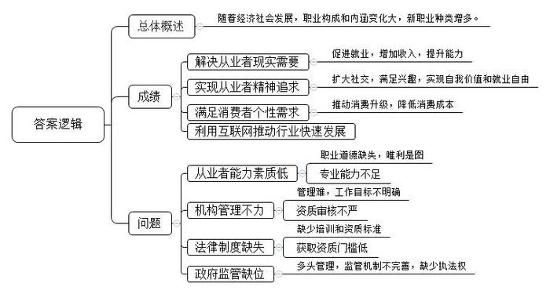
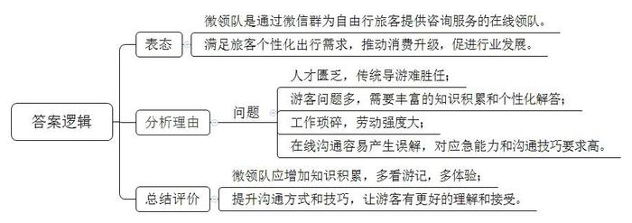
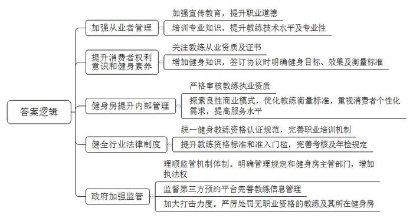
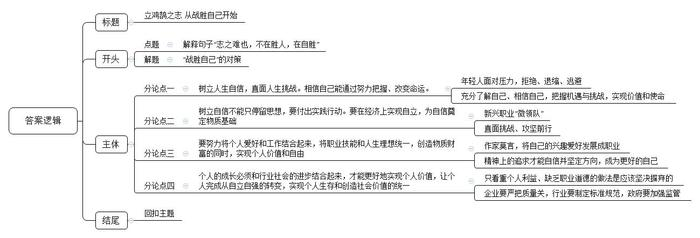

# 2016年吉林省公考《申论》题（乙级）

> 候选采集稿。参考答案及解析来自粉笔页面，不代表官方答案或真实高分答卷；来源使用许可与原卷对应关系仍需人工核实。

## 给定材料

### 材料 material-0ccd95407e531acc

高铁让您贴着地面飞行，“千里江陵一日还”不再只是人的梦想；微博瞬间将各种信息传达到百万粉丝，“十年寒窗无人问”已成为传说；营养师给我们编制健康食谱，“会须一饮三百杯”的生活方式鲜有再现......随着经济社会发展，经济产业结构的调整升级，技术的日新月异与消费需求的扩大细化，我国社会的职业构成和内涵发生了很大变化。

新修订的《中华人民共和国职业分类大典》，将当前我国社会上的职业分为8个大类、1481个职业，原有的894个职业退出历史舞台，网络与信息安全管理员、快递员、文化经纪人等347个新兴职业成为职业分类中的新成员。本次修订将部分社会认知度较高、具有显著绿色特征的职业标示为绿色职业，共127个，如环境检测员、太阳能利用工、轮胎翻修工等职业，统一以“绿色职业”的汉语拼音首字母“L”标识。

人力资源和社会保障部相关负责人介绍：新职业是指经济社会发展中已存在一定规模的从业人员，具有相对独立成熟的职业技能，未被《中华人民共和国职业分类大典》收录的职业，包括全新职业和更新职业。全新职业，即由于经济社会发展、技术进步和劳动组织方式变革而形成的新的社会群体性工作；更新职业，即原有职业活动内容因技术更新和劳动组织方式变革而发生质的变化的社会群体性工作。

### 材料 material-060e9ad95c3e4f6a

大数据是这两年最火的词汇之一，2015年我国大数据市场规模达102亿元，应用需求日渐丰富，不同行业间跨界深化，旅游行业升级转型明显，滑雪、潜水、亲子、美食等成为旅游主题。“机票+酒店”“机票+门票”等多种旅游产品供游客选择，休闲、体验、度假成为旅游的主要方式。舒适、自由、宽松、特色成为游客的主要关注点。近年来，选择自由行的游客人数越来越多，并呈现出逐年快速增长趋势。旅游观念的变化，旅游消费的升级，使得人们对旅游产品和服务的需求越来越高。

“既能自由地玩，又能方便地问”，一些旅游网站为满足消费者个性化的出行需求，推出“自由行+‘微领队’”的产品。该产品主要是为自由行游客配备，能够提供咨询服务的在线领队。在旅游网站购买自由行产品的游客，如果出发日期相近，旅游目的地相同，就会被邀请加入一个由导游担任“群主”的微信群。该导游就是“微领队”。游客关于此次出游的任何问题都可以在群里问询，用户也可以把自己的旅游体验发到群里交流分享。

“微领队”小胡，从2011年开始在厦门从事地接导游工作，做传统地接导游时，他每天的任务是带旅行团到厦门的各大景点游玩，工作中积累了不少当地旅游经验，后转行成为一名“微领队”。小胡表示：目前这一新职业，人才匮乏，有的传统导游转行，不一定能适应此项工作。以前线下带团时，线路相对固定，景点介绍以及回答游客问题时，标准答案多，与游客面对面沟通，直接、方便，不需要考虑太多技巧。但同时也因游客太多，导游没有精力、时间详细回答每个游客提出的问题，游客满意度不高。微领队工作琐碎，手机不离手，游客咨询订单、机票的退改签、景区线路等都需要尽快回复，劳动强度大。此外，还要为游客提供如身体不适、自然灾害等情况的应急帮助和救援。自由行游客遇到的问题多种多样，“微领队”需要有更多的知识积累，才能有针对性地解决游客的问题，个性化服务程度高。我平时只要有空闲时间，就会到各个旅游网站看游记，然后再去体验，增加自己的知识积累。与游客沟通时，有些面对面沟通很容易解决的问题，通过微信沟通就容易产生误解，在与游客沟通过程中的方法、技巧要求更高，不能生硬地向游客灌输，而是需要把自己的体验传递给游客，让游客有更好的理解和接受，自由行游客更愿意为优质服务买单。

## 题目

### 第 1 题

**根据给定资料**1**\-**7**，概****括目前我国新职业发展的现状。（20分）**

关联材料：material-0ccd95407e531acc

作答要求：

要求：内容全面，语言准确，条理清晰，字数不超过250字。

### 第 2 题

**根据给定资料**3**，对“微领队”这一新兴职业进行评价。（15分）**

关联材料：material-060e9ad95c3e4f6a

作答要求：

要求：观点明确，分析透彻，逻辑清晰，字数不超过200字。

### 第 3 题

**给定资料**5**\-**7**，提到了我国私人健身教练群体存在的一些问题，假如你是政府相关部门工作人员，请你就如何促进私人健身教练这一新兴职业健康发展提出具体建议。（25分）**

关联材料：material-0ccd95407e531acc

作答要求：

要求：内容全面，建议具体、可行，条理清晰，字数不超过350字。

### 第 4 题

**参考给定资料，联系实际，以“志之难也，不在胜人，在自胜”为主题，自选角度，自拟题目，写一篇议论文。（40分）**

关联材料：material-0ccd95407e531acc

作答要求：

要求：

（1）观点明确，内容充实，逻辑清晰，语言流畅；

（2）参考给定资料，但不拘泥于给定资料；

（3）字数800-1000字。

## 答案与解析

第 1 题

**参考答案（粉笔题库参考内容）**

随着经济社会发展，职业构成和内涵变化大，新职业种类增多。

成绩：1.解决从业者现实需要。促进就业，增加收入，提升能力。2.实现从业者精神追求。扩大社交，满足兴趣，实现自我价值和就业自由。3.满足消费者个性需求。推动消费升级，降低消费成本。4.利用互联网推动行业快速发展。

问题：1.从业者能力素质低。职业道德缺失，唯利是图；专业能力不足。2.机构管理不力。管理难，工作目标不明确；资质审核不严。3.法律制度缺失。缺少培训和资质标准；获取资质门槛低。4.政府监管缺位。多头管理，监管机制不完善，缺少执法权。

**解析**

**参考答案说明：**答案从“解决从业者现实需要”“实现从业者精神追求”“满足消费者个性需求”“利用互联网推动行业快速发展”等不同的成绩和“从业者能力素质低”“机构管理不力”“法律制度缺失”“政府监管缺位”等不同的问题进行了分条撰写。各条要点之间在内容上是并列关系，无交叉。

**考点**：考点其他类

**来源**：来源2016年吉林省公考《申论》题（乙级）

粉笔申论页面对本题只提供「解析视频」入口，该入口是会员推广位，页面无视频地址与文字解析。

第 2 题

**参考答案（粉笔题库参考内容）**

微领队是通过微信群为自由行旅客提供咨询服务的在线领队。它能满足旅客个性化出行需求，推动消费升级，促进行业发展。

但也面临诸多问题：人才匮乏，传统导游难胜任；游客问题多，需要丰富的知识积累和个性化解答；工作琐碎，劳动强度大；在线沟通容易产生误解，对应急能力和沟通技巧要求高。

微领队应增加知识积累，多看游记，多体验；提升沟通方式和技巧，让游客有更好的理解和接受。

**解析**

**参考答案说明：**思路方面，本参考答案按照观点现象分析题“表态+分析理由+总结评价”的一般答题思路展开。内容方面，本参考答案先对“微领队”进行了表态；“分析理由”部分主要分析了问题；最后进行了总结评价。词句表达方面，本答案加上了“但”等连接词来承接上下文。

**考点**：考点观点现象分析类

**来源**：来源2016年吉林省公考《申论》题（乙级）

粉笔申论页面对本题只提供「解析视频」入口，该入口是会员推广位，页面无视频地址与文字解析。

第 3 题

**参考答案（粉笔题库参考内容）**

一、加强从业者管理。1.加强宣传教育，提升职业道德。2.培训专业知识，提升教练技术水平及专业性。

二、提升消费者权利意识和健身素养。1.关注教练从业资质及证书。2.增加健身知识，签订协议时明确健身目标、效果及衡量标准。

三、健身房提升内部管理。1.严格审核教练执业资质。2.探索良性商业模式，优化教练衡量标准，重视消费者个性化需求，提高服务水平。

四、健全行业法律制度。1.统一健身教练资格认证规范，完善职业培训机制。2.提升教练资格标准和准入门槛，完善考核及年检规定。

五、政府加强监管。1.理顺监管机制体制。明确管理规定和健身房主管部门，增加执法权；监督第三方预约平台完善教练信息管理。2.加大打击力度。严厉处罚无职业资格的教练及其所在健身房。

**解析**

**参考答案说明：**本参考答案从“加强从业者管理”“提升消费者权利意识和健身素养”“健身房提升内部管理”“健全行业法律制度”“政府加强监管”等不同的方面进行了分条撰写。各条答案要点之间在内容上是并列关系，没有交叉。

**考点**：考点提出对策类

**来源**：来源2016年吉林省公考《申论》题（乙级）

粉笔申论页面对本题只提供「解析视频」入口，该入口是会员推广位，页面无视频地址与文字解析。

第 4 题

**参考答案（粉笔题库参考内容）**

**立鸿鹄之志 从战胜自己开始**

“志之难也，不在胜人，在自胜。”事物发展变化的关键在内因，个人的命运前途关键在自身。要成就事业，实现价值，推动社会进步，必须自信、自立、自强。

**树立人生自信，直面人生挑战。相信自己能通过努力把握、改变命运。**当今社会一些年轻人面对压力，拒绝、退缩、逃避。毛主席说：“数风流人物，还看今朝。”我们不可妄自菲薄，要勇于接受挑战，扼住命运的咽喉。今天是一个新时代，各种新职业层出不穷，对年轻人来说是一个充满机会的时代。要坚信自己能引领潮流，不要辜负这个时代。要充分了解自己、相信自己，把握机遇与挑战，实现价值和使命。

**树立自信不能只停留思想，要付出实践行动。要在经济上实现自立，为自信奠定物质基础。**自立不是口号，必须要有真本事。面对层出不穷的新职业，必须转变观念努力学习，提升自己的本领。就像新兴职业“微领队”，面对消费者的个性化需求，从业者只有不断努力增加知识积累，在实践中提升应急能力和沟通技巧，才能成为一名合格优秀的“微领队”。成长的路上，唯有直面挑战、攻坚前行，才能抓住机遇，实现经济上的独立自主，对自己负责。

**个人追求不应仅仅停留在物质层面，还应该有更高的精神追求。要努力将个人爱好和工作结合起来，将职业技能和人生理想统一，创造物质财富的同时，实现个人价值和自由。**就像作家莫言，将自己的兴趣爱好发展成职业，通过大量的阅读与思考，将一般的乡情描写转化为对人的“生存”的领悟和发现，这使得莫言的作品超越了一般“乡土文学”的狭隘性和局限性，成为第一个获得诺贝尔文学奖的中国籍作家。只有有了精神上的追求才能自信并坚定方向，成为更好的自己。

**个人的成长必须和行业社会的进步结合起来，才能更好地实现个人价值，让个人完成从自立自强的转变，实现个人生存和创造社会价值的统一。**只有否定自我才能战胜自我最终超越自我，要摒弃个人好恶满足人民和社会的需求。一些营养师打着宣传营养知识的名义办讲座，实则为了推销产品。这种只看重个人利益、缺乏职业道德的做法是应该坚决摒弃的。个人的成长需要提升自身的职业道德，也需要良好的行业风气和社会环境。企业要严把质量关，行业要制定标准规范。政府要加强监管，理顺机制。多方合力，促进个人成长与社会进步的融合。

作为年轻的一代、希望的一代，只有我们积极进取、不断战胜自己，将个人理想融入社会需求中，才能够成为国家的中流砥柱，才能够为实现中华民族伟大复兴的梦想提供源源不断的动力！

**解析**

**文章分析**

**立鸿鹄之志 从战胜自己开始**

【**标题的优点：**首先，范文的标题突出了“志之难也，不在胜人，在自胜”这一主题。其次，点出了“自胜”是重要性，使标题更加完整、饱满。】

“志之难也，不在胜人，在自胜。”（1）事物发展变化的关键在内因，个人的命运前途关键在自身。（2）要成就事业，实现价值，推动社会进步，必须自信、自立、自强。

【**开头的优点**：★内容方面。范文的开头是紧扣题目给定的“志之难也，不在胜人，在自胜”这一主题展开的。首先，开头第一句话点出了这一主题词，做到了主题明确。其次，对这一主题进行了分析阐述，指出了：（1）“志之难也，不在胜人，在自胜”的含义；（2）战胜自己的重要性和对策。★文字表达方面。简洁利索，快速提出总体观点。】

**树立人生自信****，****直面人生挑战****。相信自己能****通过努力把握、改变命运****。**（1）当今社会一些年轻人面对压力，拒绝、退缩、逃避。毛主席说：“数风流人物，还看今朝。”（2）我们不可妄自菲薄，要勇于接受挑战，扼住命运的咽喉。今天是一个新时代，各种新职业层出不穷，对年轻人来说是一个充满机会的时代。要坚信自己能引领潮流，不要辜负这个时代。要充分了解自己、相信自己，把握机遇与挑战，实现价值和使命。

【**论述段****1****的优点**：★观点句：范文的观点句是紧扣“志之难也，不在胜人，在自胜”这一文章主题提出的。形式上，它在段首处写出，位置突出，容易被发现；内容上，关键词突出，内容要点明确，可以明显看出它是从“对策”的角度入手，指出了树立自信，要直面人生挑战。★论述内容：介绍了（1）部分年轻人面对压力时的错误做法；（2）用毛主席的话引出如何树立人生自信。注意：以上两个方面的内容都是紧扣观点句“树立人生自信，直面人生挑战。相信自己能通过努力把握、改变命运”进行分析论述的，针对性强、内容层次丰富。最后，在论证方法和论据选取方面，引用了毛主席的话，以讲道理为主，有说服力。】

**树立自信不能只停留思想，****要付出实践行动****。要****在经济上实现自立****，为自信奠定物质基础****。**自立不是口号，必须要有真本事。（1）面对层出不穷的新职业，必须转变观念努力学习，提升自己的本领。就像新兴职业“微领队”，面对消费者的个性化需求，从业者只有不断努力增加知识积累，在实践中提升应急能力和沟通技巧，才能成为一名合格优秀的“微领队”。（2）成长的路上，唯有直面挑战、攻坚前行，才能抓住机遇，实现经济上的独立自主，对自己负责。

【**论述段****2****的优点**：★观点句：范文的观点句是紧扣“志之难也，不在胜人，在自胜”这一文章主题提出的。形式上，它在段首处直接写出，位置突出，容易被发现；内容上，关键词突出，内容要点明确，可以明显看出它是从“对策”的角度入手，指出了树立自信需要付出实践。★论述内容：介绍了（1）以“微领队”为例，提出具体对策；（2）付出实践的重要性。注意：以上两个方面的内容都是紧扣观点句“树立自信不能只停留思想，要付出实践行动。要在经济上实现自立，为自信奠定物质基础”进行分析论述的，针对性强、内容层次丰富。最后，在论证方法和论据选取方面，讲道理和举例子相结合，做到了丰富多样。】

**个人追求不应仅仅停留在物质层面，****还应该有更高的精神追求****。要努力****将个人爱好和工作结合起来****，****将职业技能和人生理想统一****，创造物质财富的同时，****实现个人价值和自由****。**（1）就像作家莫言，将自己的兴趣爱好发展成职业，通过大量的阅读与思考，将一般的乡情描写转化为对人的“生存”的领悟和发现，这使得莫言的作品超越了一般“乡土文学”的狭隘性和局限性，成为第一个获得诺贝尔文学奖的中国籍作家。（2）只有有了精神上的追求才能自信并坚定方向，成为更好的自己。

【**论述段****3****的优点**：★观点句：范文的观点句是紧扣“志之难也，不在胜人，在自胜”这一文章主题提出的。形式上，它在段首处直接写出，位置突出，容易被发现；内容上，关键词突出，内容要点明确，可以明显看出它是从“对策”的角度入手，指出了我们要有更高的精神追求。★论述内容：介绍了（1）以“莫言”为例，提出具体对策；（2）有精神追求的重要性。注意：以上两个方面的内容都是紧扣观点句“个人追求不应仅仅停留在物质层面，还应该有更高的精神追求。要努力将个人爱好和工作结合起来，将职业技能和人生理想统一，创造物质财富的同时，实现个人价值和自由”进行分析论述的，针对性强、内容层次丰富。最后，在论证方法和论据选取方面，讲道理和举例子相结合，做到了丰富多样。】

**个人的成长必须****和行业社会的进步结合起来****，才能更好地实现个人价值，让个人完成从自立自强的转变，****实现个人生存和创造社会价值的统一****。**（1）只有否定自我才能战胜自我最终超越自我，要摒弃个人好恶满足人民和社会的需求。（2）一些营养师打着宣传营养知识的名义办讲座，实则为了推销产品。这种只看重个人利益、缺乏职业道德的做法是应该坚决摒弃的。（3）个人的成长需要提升自身的职业道德，也需要良好的行业风气和社会环境。企业要严把质量关，行业要制定标准规范。政府要加强监管，理顺机制。多方合力，促进个人成长与社会进步的融合。

【**论述段****4****的优点**：★观点句：范文的观点句是紧扣“志之难也，不在胜人，在自胜”这一文章主题提出的。形式上，它在段首处直接写出，位置突出，容易被发现；内容上，关键词突出，内容要点明确，可以明显看出它是从“对策”的角度入手，指出了我们要创造社会价值。★论述内容：介绍了（1）我们要满足人民和社会的需求；（2）部分商家存在缺乏职业道德的问题；（3）个人、企业、政府应如何促进个人成长与社会进步的融合。注意：以上三个方面的内容都是紧扣观点句“个人的成长必须和行业社会的进步结合起来，才能更好地实现个人价值，让个人完成从自立自强的转变，实现个人生存和创造社会价值的统一”进行分析论述的，针对性强、内容层次丰富。最后，在论证方法和论据选取方面，讲道理和举例子相结合，做到了丰富多样。】

（1）作为年轻的一代、希望的一代，只有我们积极进取、不断战胜自己，将个人理想融入社会需求中，（2）才能够成为国家的中流砥柱，才能够为实现中华民族伟大复兴的梦想提供源源不断的动力！

【**结尾的优点**：范文的结尾回扣了“志之难也，不在胜人，在自胜”这一主题。（1）再次提到了“自胜”；（2）阐述了年轻人战胜自己的重要意义。】

**考点**：考点文章写作题

**来源**：来源2016年吉林省公考《申论》题（乙级）

粉笔申论页面对本题只提供「解析视频」入口，该入口是会员推广位，页面无视频地址与文字解析。

