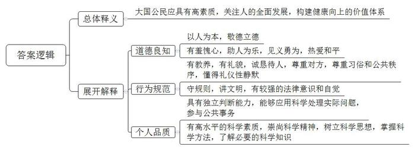
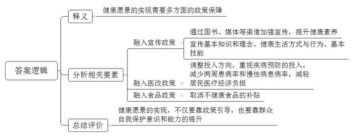
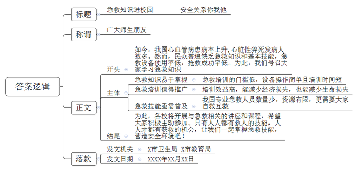
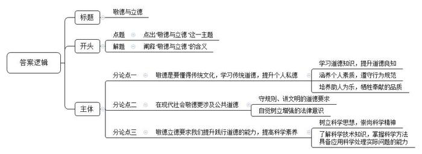

# 2016年吉林省公考《申论》题（甲级）

<!-- gwy:overview:start -->
> **吉林 · 2016 · 申论 · 甲级** ｜ 4 题 · 图片 4 处 · 答案随题折叠

导航：[题目](#题目) · [材料 1](#材料-1)
<!-- gwy:overview:end -->

> 候选采集稿。参考答案及解析来自粉笔页面，不代表官方答案或真实高分答卷；来源使用许可与原卷对应关系仍需人工核实。

## 给定材料

### 材料 1

2014年年末，美国《赫芬顿邮报》网站上发表了乔治•华盛顿大学教授塔伊•埃其奥妮题为《年轻人的声音》的文章。在文中，这位国际问题研究者为中国学生点赞，称赞中国年轻人的坦诚，说他们展现了“崛起大国的公民意识”。当中国历经百年沧桑、重回世界舞台中央时，这个有着五千年文明历史的大国的公民形象必定会受到世人的瞩目。

2015年，十八届五中全会正式提出，把“国民素质和社会文明程度显著提高”作为“十三五”经济社会发展的主要目标之一。“仓廪实而知礼节”，逐渐富裕起来的中国，已经到了培植“精神富足”的阶段。在中国成为世界第二大经济体的今天，成为健康向上的大国公民，建设一个让国民享有安全感、信任感和自豪感的社会，已经不只是社会发展阶段的必然，更是每一位国民的内生要求。每个中国人的一言一行，都可能成为世界对中国国家形象的直观印象，都可能成为世界了解中国历史与现实的鲜活样本。国家的现代化，首先应是国民的现代化。我们传递给世界的，不能只是奢侈品店里扫货的阔绰、各大景区爆满的热情，更应是谦逊有礼的大国公民形象。

### 材料 2

在现代社会，“大国”的概念绝非仅仅局限于经济实力的攀升，它还需要公民的道德伦理、文明程度等共同支撑。中国社会科学院社会心理学研究中心J主任说：“公民，是现代国家治理体系中最基础也是最核心的概念。”构成国民素质最核心的内容应该是健康向上的价值体系，道德良知、行为规范、个体品质都是以此为基础建立的。

今年3月，某媒体以“国民素质”为主题，选取东中西部12个城市进行了抽样调查。2016年通过对数千名普通国民的访问，收集到2405个有效样本。调查从国民素质的基本构成要素入手发问，虽不能涵盖国民素质的全部内容，但基本能够反映当下我国国民素质的基本状态。调查发现，受访者对“国民素质”的认知已经不再简单局限于道德层面，众多充满着现代意识的指标已经进入了人们的视野。“人的全面发展”得到越来越多的关注，这里面既有对中华民族道德基因和精神血脉的继承与延续，也有新的时代特征。

尽管受访者的年龄、职业、生活地域、关注重点各有不同，但“做高素质的大国公民”已经成为人们的普遍共识。

### 材料 3

中华文化自西周以来就确立了以人为本的文化品格。商灭夏，周灭商，夏商两代的历史给周王朝非常深刻的启示。以史为鉴，周王朝认识到一个非常重要的道理：天命靡常。天命并非恒常不变，不是获得了就可以一劳永逸，而是因人而变。《尚书》里记载了周人对历史的总结：“皇天无亲，惟德是辅。”周人据此提出了一个重要观念——“敬德”，这就形成了中国文化以人为本的根本特性，即决定命运和政权兴亡的不在于外在力量，而在于人自身德行的好坏。被古人奉为人生追求最高境界的“立德、立功、立言”的“三不朽”原则，亦以“立德”为“太上”。以人为本的人文精神是中华文化的根本精神之一，也是中华民族对人类的一项重要贡献。而欧洲启蒙运动时期开始倡导的人本主义思想，启发人不要做神的奴隶，要做人自己，一方面它源于古希腊罗马文化，另一方面也是受到了16世纪以后传教士从中国传回去的人本文化的影响。

### 材料 4

近些年，随着中国出境旅游、留学、海外就业、经商的人越来越多，世界对中国公民有了更直观的印象。2015年12月，《中国人海外形象全球调查报告》发布。该报告依托大数据平台采集了海外3万多个站点的5亿条次舆情信息进行分析，数据采集范围涵盖200多个国家和地区，时间跨度为2015年全年。数据显示，中国公民在海外颇受好评。杭州方女士一家春节去伦敦旅游，为避免18个月大的女儿在飞机上哭闹引起其他旅客的不满，他们向邻近旅客发放了手绘的“致歉卡”；武汉姑娘在普吉岛救溺水女子等……这些事例都向海外展示了中国公民形象。中国海外派遣和交流人员在这一年也为中国人的海外形象加了分。尤其是中国维和行动、援非医疗、撤侨等事件最受海外关注。其中，在超过2.7万条与维和部队相关的信息中，对中国维和行动表示赞赏的高达74%。

### 材料 5

据著名画家陈丹青回忆，有一次，他到罗马旅游，进到一家古董专卖店后，他就埋头专心挑选小雕塑、小文物，然后向一位很有风度的老先生问价钱。问了几件，老先生都说不卖。他问：“为什么不卖呢？”老先生说：“这是我的店，你进来了，不跟我打招呼，就在那里看，然后问我卖不卖，我不卖。”陈丹青感叹，在罗马，在文艺复兴的故国，不经意间就把“那种没教养，那种粗鄙的人格流露出来了，是这位老人把我点醒了”。

有人说，看得见的教养是容易的，因为慑于群体的压力。但凡有自尊心的人，都会努力接近文明。比如，在干净的环境里，我不好意思乱扔垃圾；在安静的公共场所，你不敢大声喧哗。“有礼貌、诚恳待人、尊重对方、尊重当地生活习俗和法律法规，这是大国公民应有的、最根本的底线。”北京第二外国语学院旅游科学研究所原所长、资深旅游专家W表示。

在社会交往中，与人打招呼是一种礼仪，而静默更是一种教养。诸多例证表明，除乱扔垃圾、闯红灯、插队等经常为外国人诟病外，在公共场所大声喧哗也是海外公众批评最多的不文明行为。事实上，作为交谈礼仪的一部分，礼仪性的沉默一直受到人类学、语言学、社会文化学等的关注。美国社会学家高夫曼说，交谈的礼仪是“一种公共的安排，让人知道什么时候必须说话，什么时候应该沉默”。礼仪性静默需要知道什么场合不该出声，对谁不要作声，如何用静默表示敬畏，谁应该少言寡语等。

### 材料 6

去年，四川省科普作家董仁威教授的《科普创作通览》面世。中国科学院院士、中国科普作家协会理事长刘嘉麒为该书作序说：在我们这样一个拥有13亿多人口的大国，尚有相当大的一部分人未受过中等教育，甚至是文盲，科学普及的任务还相当艰巨。到了21世纪这个科技高度发达的时代，仍有一些匪夷所思的奇葩出现，各个领域都有一些假以科学名义的小丑登场，让人扼腕叹息。可见，“五四运动”提出的民主与科学这个任务还没有完成。中国要现代化，离不开高素质的国民，除了民主和法治外，还特别需要科学精神的浸染。所以科普从来不是纯粹的科学问题，而是事关社会发展全局的重要内容。在我们的价值观中，应该有科学的位置。

科学素质一般指了解必要的科学技术知识，掌握基本的科学方法，树立科学思想，崇尚科学精神，并且具有一定的应用科学处理实际问题、参与公共事务的能力，简称“四科一能力”。在科技日新月异的今天，科技已经深刻地影响到社会的方方面面。公民科学素质已经成为国家综合实力的重要组成部分，成为先进生产力的核心要素之一。从总体上看，我国全民科学素质仍处在相对较低的水平，尽管2015年第九次中国公民科学素质调查结果显示，我国具备科学素质的公民比例已经达到了6.2%，但这个水平仍然只相当于日本、加拿大等主要发达国家和地区20世纪80年代末的水平。有研究表明，进入创新型国家行列的30多个发达国家，其公民具备科学素质的比例最低都在10%以上。

### 材料 7

上海“史上最严”《烟花爆竹安全管理条例》实施后，PM2.5浓度明显降低；福建的“黑名单”制度让不少“老赖”赶在最后期限前还款；北京雍和宫，正月初一排队“抢头香”的习俗已经持续多年，数万香客秩序井然……种种“文明”见诸媒体的背后，让人感受到的是民众法律意识的自觉与增强。

心理学研究表明，一个人思想意识、行为方式的变化，需要经历服从、认同、内化三个阶段，经过3个月以上的重复就会形成相对稳定的习惯。长久以来，“酒驾”是难以治愈的顽症，随地吐痰是法不责众的陋习，而随着醉驾入刑的施行、国民的文明素养升级，类似行为在很多地方已经大大地减少甚至销声匿迹。

多年研究全国文明城市测评体系的C教授认为，市民素质至少包含两层内涵：首先是道德要求，其次是公共场所要求。守规则、讲文明，是一个人受人尊重的起码条件。良好的文明行为习惯，才是良好社会秩序形成的基础。“凑够一拨人就走，和红绿灯无关”，是对“规则”的集体漠视，其本质就是“只要有人带头就不怕”的法不责众心理。

中国人法治意识较低的另一个表现就是根深蒂固的“青天意识”。上千年来，当人们受到不公正待遇时，首先想到的解决办法就是找上级、找领导，甚至进京找“包青天”。这种“青天意识”与几千年来的“官本位”意识合流，使找政府解决问题成为很长一段时间里老百姓的主流意识。红头文件和领导讲话的威力远远大于法律效力，法律手段往往沦为配角。古人云：“国无常强，无常弱。奉法者强，则国强；奉法者弱，则国弱。”“法律必须被信仰，否则它将形同虚设”。

### 材料 8

自2008年起，我国已经进行了4次居民健康素养监测。监测结果显示，我国居民健康素养水平由2008年的6.5%上升到2014年的9.79%。9.79%这个数字，意味着每100个人中具备健康素养的人不足10人。近些年来，随着国民生活水平的提高，人们在健康保健上的投入也慢慢增多，市场上保健图书热销，电视里养生节目收视率节节攀升。伴随着新一轮医改的实施，近些年政府向以“医疗为主”的医院投入了大量的卫生资源。据统计，2013年政府卫生支出的65.19%用在疾病治疗上，而用于疾病预防的支出仅占14.59%。这些投入在一定程度上提高了居民卫生服务利用，但居民两周患病率和慢性病患病率仍在增长，居民医疗经济负担仍然较高。当“健康中国”上升为国家战略，公民健康素养的短板显得格外突出。

通常而言，健康素养包括三方面内容：基本知识和理念、健康生活方式与行为、基本技能。根据相关研究表明，生活方式与行为对健康的影响超过60%，是影响健康的最重要因素。20世纪70年代，芬兰政府发现北卡地区居民的心脏病发病率和死亡率明显高于芬兰本国其他地区。经研究分析认为，原因主要在于当地居民的生活方式不健康，诸如黄油、肉类脂肪等的摄入量较高，缺乏体力劳动和体育活动等。于是，芬兰政府把北卡地区作为实验地区，实施“取消面包加黄油财政补贴”的政策，要求盐业部门加强低盐饮食的宣传，同时进行健康教育，普及心脑血管疾病的预防知识，传授健康的技能等。30年后，北卡地区居民的心脏病死亡率下降了80%。

北卡的案例使有识之士认识到，健康愿景的实现，需要确立“将健康融入所有政策”的策略。

中国医学科学院北京协和医学院专家L先生认为，相对于疾病预防和健康促进，我国当前的医改更加注重疾病治疗，并且从近年我国医改的重点工作来看，对“预防为主”的重视有所弱化。

### 材料 9

去年3月，北京医生唐子人，在美国圣地亚哥海洋公园成功挽回一名心脏骤停的游客的生命。而2016年6月29日晚，34岁的著名媒体人B先生倒在了北京地铁6号线的站台上，却再也没站起来。急救专家根据视频记录初步判断，B先生可能为心脏性猝死。

据相关部门统计，目前，我国心血管病患病率处于持续上升阶段，每年心脏性猝死发病人数超过54万，相当于每分钟约1人因此丧生。专家介绍说，心脏骤停可以发生在任何时候、任何地点、任何人——甚至看似健康的人身上。从发病的地点上看，仅有5%发生在医院内，其余绝大部分发生在家里或其他场合。由于民众普遍缺乏急救知识和基本技能，抢救成功率极低，能够抢救过来的患者不足1%。

对猝死的急救，时间就是生命。业内一直有“黄金4分钟”的说法，指心肺复苏和除颤的关键时期是在心脏骤停之后的4分钟内。“如果现场有人能懂得简单的急救技能，就能在意外发生的现场及时开展自救互救，在专业医护人员到来之前争取抢救生命的黄金时间，最大可能地挽救生命。”某专家介绍说。

从北京地铁里拍摄的视频可见，B先生倒地后虽然即刻有人上前救助，但更多的人却是在沟通、呼叫。专业人士认为，如果救助的方法更加专业，如果现场能有自动体外除颤器（AED），并且有人会使用，患者获救的机会会更大。据在圣地亚哥海洋公园成功挽回游客生命的北京医生唐子人回忆，当时就是有人迅速拿来了公园内的AED，对抢救起到关键性作用。

据报道，2014年年底，杭州市共有15台AED被投放在机场、地铁和市民中心等地。1年多过去了，这15台AED的使用率却是零。这些能大大提高抢救成功率的“救命神器”成了平时无人问，关键时刻不会用、不敢用的摆设。

城市急救不仅关乎设备，更是一种新观念，即由现场目击者最早进行有效急救的观念。正确使用急救设备的前提，无疑是掌握基本的急救常识。而需要注意的是，“AED只限专业人士使用”是一大误区。其实，与灭火器类似，AED操作较为简单，接受几十分钟的培训就能学会。

有人曾做过测算，在急救普及上投入1元钱，在灾害中就能减少至少4元钱的损失。不过，由于种种原因，这方面的培训能力和效果都很低。一位一线城市的急救培训人士坦言，“现在他们的培训人数总量和全市人口比起来还是九牛一毛”。多位急救专家呼吁，在全社会普及急救教育，尤其是高危行业、服务行业，应把急救技能列为职业技能之一，各类各级学校应把急救教育列为必修课。毕竟，在某些情况下，一个人掌握技能是救不了自己的，“只有人人都有救人的技能，人人才都有获救的机会”。

不仅如此，地震、泥石流以及火灾、爆炸等自然灾害和公共安全事件也时有发生，威胁着自己和他人的生命财产安全。“在突发事件的初始时间段，人们可依赖的主要是自己所拥有的生存知识、避险经验和技能。研究表明，重大灾难发生后绝大部分被救人员是由基层单位非专业救援人员自发救助完成的，专业救援队伍所救人员只占5%左右。”国家行政学院应急管理案例研究中心主任Z教授说。

## 题目

### 第 1 题

**根据“给定资料**2**～**8**”，概括“大国公民形象”的基本内涵。（20分）**

关联材料：材料 2、材料 3、材料 4、材料 5、材料 6、材料 7、材料 8

作答要求：

要求：全面准确，条理清晰，语言准确；不超过250字。

第 1 题 · 答案与解析

**参考答案（粉笔题库参考内容）**

大国公民形象指大国公民应具有高素质，关注人的全面发展，构建健康向上的价值体系。

一、道德良知方面：1.以人为本，敬德立德；2.有羞愧心，助人为乐，见义勇为，热爱和平。

二、行为规范方面：1.有教养，有礼貌，诚恳待人，尊重对方，尊重习俗和公共秩序，懂得礼仪性静默；2.守规则，讲文明，有较强的法律意识和自觉。

三、个人品质方面：1.有高水平的科学素质，崇尚科学精神，树立科学思想，掌握科学方法，了解必要的科学知识；2.具有独立判断能力，能够应用科学处理实际问题，参与公共事务。

**解析**

**参考答案说明：**（1）思路方面，本参考答案按照词句解释题“总体释义+展开解释+总结”的一般答题思路展开，其中“总结”部分并未在材料中提及，可省略。（2）内容方面，本参考答案先解释“大国公民形象”整体含义；“展开解释”部分从“道德良知”“行为规范”“个人品质”三个方面具体阐释了“大国公民形象”的表现。

**考点**：词句解释类

**来源**：2016年吉林省公考《申论》题（甲级）

### 第 2 题

**根据“给定资料**8**”，结合实际，谈谈你对“健康愿景的实现，需要确立‘将健康融入所有政策’的策略”的理解。（15分）**

关联材料：材料 8

作答要求：

要求：理解准确，分析合理，条理清晰；不超过250字。

第 2 题 · 答案与解析

**参考答案（粉笔题库参考内容）**

这句话是指健康愿景的实现需要多方面的政策保障。具体表现在：

1.融入宣传政策。通过图书、媒体等渠道加强宣传，提升健康素养；宣传基本知识和理念、健康生活方式与行为、基本技能。2.融入医改政策。调整投入方向，重视疾病预防的投入，减少两周患病率和慢性病患病率，减轻居民医疗经济负担。3.融入食品政策。取消不健康食品的补贴。

最后，健康愿景的实现，不仅要靠政策引导，也要靠群众自我保护意识和能力的提升。

**解析**

**参考答案说明：**思路方面，本参考答案按照词句解释题“释义+分析相关要素+总结评价”的一般答题思路展开。内容方面，本参考答案先对“健康愿景的实现，需要确立‘将健康融入所有政策’的策略”的含义进行了解释；“分析相关要素”部分分别从“融入宣传政策”“融入医改政策”“融入食品政策”三个方面进行了分析，最后给出了总结评价。每条答案标注序号，满足了题干中“条理清晰”这一要求。各条要点之间在内容上是并列关系，没有交叉。

**考点**：词句解释类

**来源**：2016年吉林省公考《申论》题（甲级）

### 第 3 题

**为加强急救教育，某市卫生部门和教育部门拟联合举办“急救知识进校园”活动。假如你是活动主办方的工作人员，请根据“给定资料**9**”，为该活动拟写一份宣传稿。（25分）**

关联材料：材料 9

作答要求：

要求：切合活动主题；内容全面，条理清晰，有可行性；不超过400字。

第 3 题 · 答案与解析

**参考答案（粉笔题库参考内容）**

急救知识进校园 安全关系你我他

广大师生朋友：

如今，我国心血管病患病率上升，心脏性猝死发病人数多。然而，民众普遍缺乏急救知识和基本技能，急救设备使用率低，抢救成功率低。为此，我们号召大家学习急救知识：

一、急救知识易于掌握。急救培训的门槛低，设备操作简单且培训时间短。二、急救培训值得推广。培训效益高，能减少经济损失，也能减少生命损失。三、急救技能亟需普及。我国专业急救人员数量少，资源有限，更需要大家自救互救。

为此，各校将开展与急救相关的讲座和课程，希望大家积极主动参加。只有人人都有救人的技能，人人才都有获救的机会，让我们一起掌握急救技能，营造安全环境吧！

X市卫生局 X市教育局

XXXX年XX月XX日

**解析**

**参考答案说明：**（1）格式方面，本参考答案写到了“标题”“称谓”“正文”“落款”。（2）正文部分，一方面从内容看，围绕着“急救知识进校园”这一主题，本参考答案的开头先写到了“心血管病患病率上升”“急救设备使用率低”等；主体部分从“急救知识易于掌握”“急救培训值得推广”“急救技能亟需普及”等几个方面给出了学习急救知识的可行性、重要性及必要性。另一方面，形式上，本参考答案做到了分段、分条撰写，整体上条理较为清晰。（3）本参考答案能够结合宣传类公文特点，在语言表达上使用“吧”等具有号召性、有感染力的词汇。

**考点**：宣传类

**来源**：2016年吉林省公考《申论》题（甲级）

### 第 4 题

**从“给定资料”出发，结合实际，以“敬德与立德”为题写一篇议论文。（40分）**

关联材料：材料 1、材料 2、材料 3、材料 4、材料 5、材料 6、材料 7、材料 8、材料 9

作答要求：

要求：观点明确，内容充实，逻辑严谨，语言流畅；800～1000字。

第 4 题 · 答案与解析

**参考答案（粉笔题库参考内容）**

**敬德与立德**

《尚书》有云：“皇天无亲，惟德是辅。”周人据此提出“敬德”观念，使得“以人为本”的道德精神贯穿了中华悠悠五千载历史。古人崇尚“立德、立功、立言”的“三不朽”原则，“立德”亦被放在首位。**可见，对“德”之敬畏，对“立德”之推崇，是中国源远流长的传统文化历久弥新的根本所在。**

**所谓敬德，是要懂得传统文化，学习道德知识；更要涵养个人素质，秉持个人修养，还要培养助人为乐，牺牲奉献的精神。**回顾历史，夏商的灭亡告诉我们倒行逆施、违逆德法，终致国家倾覆；二战德国的失败告诉我们背弃人伦、穷兵黩武、会遭致全球反对……以史为鉴，当今国人更应该继承发扬古人以德为先、敬德畏德的传统。我们不仅要传承传统文化道德，更要在当下坚守道德底线，提升个人道德素养。罗马老人的“我不卖”点醒了陈丹青，更点醒了当下的我们，告诫我们要有礼貌，诚恳待人，懂得礼仪性沉默。而这应是大国公民应有的、最基本的底线。而在这个围观者的时代，在这个精致的利己主义盛行的时代，我们更需要乐于助人，无私奉献的精神。小到扶老奶奶过马路，大到天灾人祸积极参与救援，都是这一精神的最佳写照。

**德字虽小，却不止于个人私德、传统道德，在现代社会它更涉及公共道德，是守规则、讲文明的道德要求，是自觉树立的法律意识。**如今，中国国民素质问题一度引发热议。不守秩序、大声喧哗、乱扔垃圾……每个中国人的言行都是世界了解中国的鲜活样本，如此这般，损害的是中国的大国形象。因此，提升公共道德，以德立身，以德立国，才能以行动告诉世界，崛起的中国不仅经济腾达，国民素质和社会文明程度更是显著提高！敬德要求我们涵养个人私德，提升公共道德，更要求我们树立增强法律意识。法律是成文的道德，道德是内心的法律。通过法律的形式将基本道德基本原则固定下来，道德才能根基稳健，行稳致远，持续发力。自觉树立法律意识，不仅仅是被动遵守法律，更是主动告别传统意识，理解法律内涵，弘扬法律精神。

**德字虽小，但影响深远。因此，我们绝不能空谈道德，而要让道德有力量、有智慧、更有实用性。敬德立德要求我们提高科学素养，提升践行道德的能力。**然而据2015年第九次中国公民科学素质调查结果显示，我国具备科学素质的公民比例仅占6.2%，全民科学素养仍处在相对较低的水平。所谓知识即美德，我们必须树立科学思想，崇尚科学精神，提升科学素养，了解必要的科学技术知识，掌握基本的科学方法，并且具有一定的应用科学处理实际问题、参与公共事务的能力，从而提升公民践行道德的知识与能力，展现“崛起大国的公民意识”，让世界听到中国的声音！

唯有如此，崇尚品德并践行之，我们才能够在科技日新月异的今天，提升国民素养，进而提高国家综合实力，共同营造一个让国民享有安全感、信任感和自豪感的国家！

**文章分析**

**敬德与立德**

【**标题的优点：**严格按照题目的要求，以“敬德与立德”为标题。】

（1）《尚书》有云：“皇天无亲，惟德是辅。”周人据此提出 <u> “敬德”观念</u>，<u>使得“以人为本”的道德精神贯穿了中华悠悠五千载历史</u>。（2）<u>古人崇尚“立德、立功、立言”的“三不朽”原则</u>，<u>“立德”亦被放在首位</u>。**可见，**（3）<u><b>对“德”之敬畏</b></u>**，**<u><b>对“立德”之推崇</b></u>**，**<u><b>是中国源远流长的传统文化历久弥新的根本所在</b></u>**。**

【**开头的优点：**★内容方面。范文的开头是紧扣题目给定的“敬德与立德”这一标题展开的。首先，开头开门见山点出主题，做到了主题明确。其次，对“敬德与立德”这一主题进行了分析阐述，指出了（1）“敬德”的来源；（2）“立德”的来源； （3）“敬德与立德”的意义**。**★文字表达方面：长短句配合使用，使语言表达有节奏感。】

**所谓敬德，是要懂得传统文化，学习道德知识；更要涵养个人素质，秉持个人修养，还要培养助人为乐，牺牲奉献的精神。**（1）回顾历史，夏商的灭亡告诉我们倒行逆施、违逆德法，终致国家倾覆；二战德国的失败告诉我们背弃人伦、穷兵黩武、会遭致全球反对……<u>以史为鉴</u>，<u>当今国人更应该继承发扬古人以德为先、敬德畏德的传统</u>。我们不仅要传承传统文化道德，（2）更<u>要在当下坚守道德底线</u>，<u>提升个人道德素养</u>。罗马老人的“我不卖”点醒了陈丹青，更点醒了当下的我们，<u>告诫我们要有礼貌</u>，<u>诚恳待人</u>，<u>懂得礼仪性沉默</u>。而这应是大国公民应有的、最基本的底线。而在这个围观者的时代，在这个精致的利己主义盛行的时代，（3）我们更<u>需要乐于助人</u>，<u>无私奉献的精神</u>。小到扶老奶奶过马路，大到天灾人祸积极参与救援，都是这一精神的最佳写照。

【**论述段****1****的优点：**★观点句：范文的观点句是紧扣“敬德与立德”这一文章主题提出的。形式上，它在段首处直接写出，位置突出，容易发现。内容上，关键词突出，内容要点明确，可以明显看出它是从“文化、知识、素质、精神”入手，指出了“敬德”的内涵。★论述内容：（1）介绍了“以德为先、敬德畏德的传统”的必要性；（2）介绍了“敬德在素养方面的体现”；（3）介绍了“敬德在精神方面的体现”。注意：以上几个方面的内容都是紧扣“所谓敬德，是要懂得传统文化，学习道德知识；更要涵养个人素质，秉持个人修养，还要培养助人为乐，牺牲奉献的精神”这个观点句进行分析论述的，论述的针对性强，内容层次丰富。并且这几个方面的论述从小到大，层层深入。★论述方法：采用讲道理与举例子相结合，做到了丰富多样。】

**德字虽小，却不止于个人私德、传统道德，在现代社会它更涉及公共道德，是守规则、讲文明的道德要求，是自觉树立的法律意识。**（1）如今，<u>中国国民素质问题一度引发热议</u>。不守秩序、大声喧哗、乱扔垃圾……每个中国人的言行都是世界了解中国的鲜活样本，如此这般，<u>损害的是中国的大国形象</u>。因此，（2）<u>提升公共道德</u>，<u>以德立身</u>，<u>以德立国</u>，才能以行动告诉世界，崛起的中国不仅经济腾达，<u>国民素质和社会文明程度更是显著提高</u>！敬德要求我们<u>涵养个人私德</u>，<u>提升公共道德</u>，（3）更要求我们<u>树立增强法律意识</u>。法律是成文的道德，道德是内心的法律。通过法律的形式将基本道德基本原则固定下来，道德才能根基稳健，行稳致远，持续发力。自觉树立法律意识，不仅仅是被动<u>遵守法律</u>，更是<u>主动告别传统意识</u>，<u>理解法律内涵</u>，<u>弘扬法律精神</u>。

【**论述段****2****的优点：**★观点句：范文的观点句是紧扣“敬德与立德”这一文章主题提出的。形式上，它在段首处直接写出，位置突出，容易发现。内容上，关键词突出，内容要点明确，可以明显看出它是从“道德要求、法律意识”入手，指出了“敬德”的具体要求。★论述内容：（1）介绍了“当前国民素养低下”的问题和危害；（2）介绍了“涵养个人私德，提升公共道德”的意义；（3）介绍了“敬德提高法律意识”的意义和做法。注意：以上几个方面的内容都是紧扣“德字虽小，却不止于个人私德、传统道德，在现代社会它更涉及公共道德，是守规则、讲文明的道德要求，是自觉树立的法律意识”这个观点句进行分析论述的，论述的针对性强，内容层次丰富。并且这几个方面的论述按照“为什么-怎么办”的内在逻辑，先讲国民素养低下的问题及危害，然后如何做到“敬德与立德”。★论述方法：采用讲道理与举例子相结合，做到了丰富多样。】

**德字虽小，但影响深远。因此，我们绝不能空谈道德，而要让道德有力量、有智慧、更有实用性。敬德立德要求我们提高科学素养，提升践行道德的能力。**然而（1）据2015年第九次中国公民科学素质调查结果显示，我国具备科学素质的公民比例仅占6.2%，<u>全民科学素养仍处在相对较低的水平</u>。所谓知识即美德，我们（2）必须<u>树立科学思想</u>，<u>崇尚科学精神</u>，<u>提升科学素养</u>，<u>了解必要的科学技术知识</u>，<u>掌握基本的科学方法</u>，并且<u>具有一定的应用科学处理实际问题</u>、<u>参与公共事务的能力</u>，从而提升公民践行道德的知识与能力，展现“崛起大国的公民意识”，让世界听到中国的声音！

【**论述段****3****的优点：**★观点句：范文的观点句是紧扣“敬德与立德”这一文章主题提出的。形式上，它在段首处直接写出，位置突出，容易发现。内容上，关键词突出，内容要点明确，可以明显看出它是从“提高科学素养，提升践行道德的能力”入手，指出了如何做到“敬德与立德”。★论述内容：（1）介绍了“全民科学素质低”；（2）介绍了“提高科学素养，提升践行道德的能力”的做法。注意：以上几个方面的内容都是紧扣“德字虽小，但影响深远。因此，我们绝不能空谈道德，而要让道德有力量、有智慧、更有实用性。敬德立德要求我们提高科学素养，提升践行道德的能力”这个观点句进行分析论述的，论述的针对性强，内容层次丰富。并且这两个方面的论述按照“提出问题-解决问题”的内在逻辑展开分析。★论述方法：采用举例论证和说理论证相结合，做到了丰富多样。】

【**论述段之间的关系**：★内容的内在逻辑：范文的论述段之间是依照“为什么-怎么办”的逻辑展开的。论述段1先写了“敬德”在个人层面的内涵，论述段2再写了“敬德”在社会层面的具体要求，论述段3最后写了如何做到“敬德与立德”。★段与段的外在衔接：论述段2的段首处的“德字虽小，却不止于个人私德、传统道德……”， 论述段3的段首处的“德字虽小，但影响深远。因此……”起到了承上启下的作用。】

唯有如此，崇尚品德并践行之，我们才能够在科技日新月异的今天，提升国民素养，进而提高国家综合实力，共同营造一个让国民享有安全感、信任感和自豪感的国家！

**【结尾的优点**：范文的结尾回扣了“敬德与立德”这一主题。（1）再次提到了“敬德与立德”；（2）发出了号召希望。】

**解析状态：unknown（来源未提供）**

**考点**：文章写作题

**来源**：2016年吉林省公考《申论》题（甲级）

