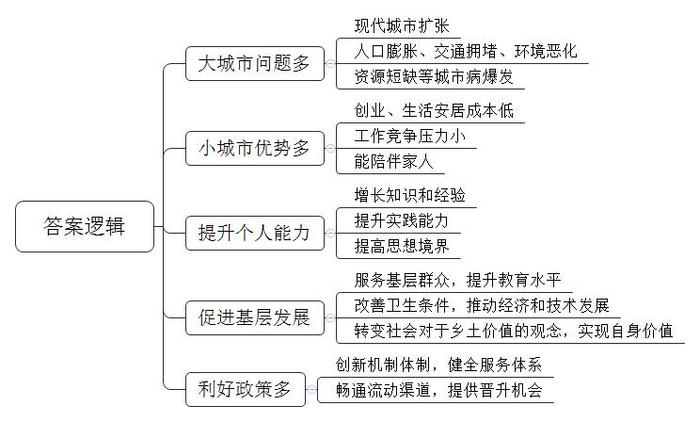
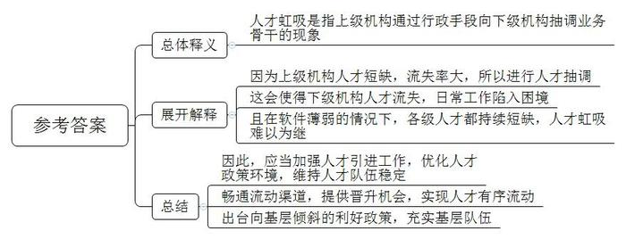

# 2017年公务员多省联考《申论》题（吉林乙级卷）

<!-- gwy:overview:start -->
> **吉林 · 2017 · 申论 · 乙级** ｜ 4 题 · 图片 4 处 · 答案随题折叠

导航：[题目](#题目) · [材料 1](#材料-1)
<!-- gwy:overview:end -->

> 候选采集稿。参考答案及解析来自粉笔页面，不代表官方答案或真实高分答卷；来源使用许可与原卷对应关系仍需人工核实。

## 给定材料

### 材料 1

智联招聘发布的《2015年应届毕业生就业力调研报告》显示，2015年大学毕业生就业于北京、上海、广州等一线城市的期望降至33.9%，低于2014年的48.4%和2013年的50.3%，北上广深等城市受热捧程度逐年下降。

随着现代城市的扩张，人口膨胀、交通拥堵、环境恶化、资源短缺等城市病大量爆发，城市居民回归自然、回归乡土的愿望日益强烈，“城市让生活更美好，乡村让城市更向往”正成为重新发现乡村价值的突破点。扎根基层的各行各业专业技术人才、前往基层就业工作的大专院校毕业生、前往基层党政部门挂职任职的公务员、自主创业的青年梦想家、返乡创业的农民工、返乡定居的新乡贤新农人等，都活跃在基层大舞台上。

### 材料 2

80后创业者彭诚带着他的创业团队和创业作品——族谱录网，从北京回到家乡湖南浏阳继续创业。在北京，那时一个100平方米的中等工作室，一年租金至少是30万元；在浏阳，他以800元/月租下一处140平方米的房屋，租金成本几乎可以忽略不计，这样就省下一大笔创业基金。2015年，彭诚和朋友合伙成立蒸菜品牌“蒸浏记”，打造浏阳蒸菜连锁品牌。该项目在第二届“中国创翼”青年创业创新大赛全国总决赛上获得银翼奖。他计划在2017年在长株潭地区开店100家以上，3年在全国开店1000家。对于“为什么选择回来创业”这一问题，彭诚的答案是：现实考虑与乡愁情怀。小城市生活安居成本低，工作竞争压力小，在家乡工作能更好地和家人生活在一起。

农村孩子考上大学常被视为“跳出农门”，如今，不少农家子弟大学生毕业后又回归桑梓，成为“新农人”。1990年出生的孙超群毕业于某知名大学，毕业后曾在厦门一家知名国企工作。一次偶然的机会，他接触到野猪养殖项目，涌起创业的激情。再三考虑后，他辞职回乡创业，办起了野猪养殖场。回乡当“猪倌”的想法让他的亲朋好友很不理解，他凭着自己的努力，慢慢把养猪场的工作带入正轨。目前野猪养殖投入的资金已经全部回收了，一年下来的纯收入约十几万元，未来他将逐步扩大养殖规模，拓展销售渠道，创出自己的品牌。

王彤从北京某大学毕业后，回到家乡贵州一个村小任教。几年来的教学中，她把先进的教育理念带回家乡，获得了同行的肯定。亲友们一度感慨她“可惜了好前程”。面对自己的回乡选择，她说：“大城市人才济济，留在北京，多我一个不多，回到家乡我能够帮助到更多的孩子，在这里能很好实现自己的价值。”

重庆市万州区走马镇走马社区书记向秀发，他最知名的身份是三峡植物研究专家和重庆大学城市科技学院植物研究所所长。退休返乡后，他竞选成为社区书记，制订了村规民约，大大改善了村里的卫生条件。面对返乡后的工作，他说：“村民的某些思维观念跟不上现代社会发展，但改变这些必须用村民能接受的办法。世界的眼光，草民的手法，这是我的经验。”

### 材料 3

雪洪村大学生村官陈飞，注资10万元成立华日稻米合作社，合作创建寿乡鲜米项目。他以雪洪村大学生村官的名义在众筹网发起寿乡鲜米众筹，目标5万元，用来推动乡土增值、田园生态建设。众筹成功后，他组建了“益方水土”团队，打造了寿乡鲜米微店；筹建了“益方水土”驻雪洪村实验室，通过用成熟的生物技术产品作为环境改良剂，提升寿乡鲜米的灌溉水与生长土壤的品质。他采用抢新鲜收割、抢新鲜干燥、低温贮存、低温碾米等方式精心生产，采用“农场——家庭”的小批量直接配送方式，为消费者提供环保、健康、安全的“匠心”食材。

陈飞说：“儿时母亲的教导记忆犹新，‘你要是不好好念书，就要回来种地’，当然我不会去跟年迈的母亲辩驳，那是她多年阅历的累积。从无奈现状的‘里子’中，我读出了社会对乡土价值的扭曲与漠视，以及乡亲无法体面安居后的自我否定。如今的消费者，口味更挑剔，不仅要吃饱，更要吃好，吃出营养，吃出健康。只有对种植过程精细把控，才能抢抓市场机遇，创造更高经济价值。通过自己的实践，明白了农业不光要简单解决吃与原材料的问题，还承担着生态价值、社会教育的功能。”

### 材料 4

2011年至2016年，湖北省“博士服务团”分五批共选派来自高校、科研院所、医疗机构、省直厅局及直属事业单位的515名青年博士，到秦巴山区、武陵山区、大别山区、幕阜山区四个连片特困地区所属的45个县市开展挂职服务锻炼。“博士服务团”成员每批服务期限为一年，这五批派出人员中有37人主动选择延长服务时间，1人选择留任当地。负责博士服务团项目的工作人员介绍：五批博士在服务期间，不仅给基层带去了看得见、摸得着的资金和项目，还带去了新的理念、知识和技术；积极在派出单位和服务单位间架设桥梁纽带，促进基层单位与高校、企业、研究所建立长期交流合作机制；做好传帮带工作，提升基层“造血”功能，为基层培养了一大批业务骨干和本土实用人才。

“博士下基层的价值究竟有多大?”对这一问题有人以医学博士为例算了一笔账：如果他在大医院上班，每个月可创造经济价值数十万元以上，每年还可以研究一至两个课题，这样算下来，博士到基层挂职1年，损失很大。

博士服务团成员邓万凯博士回答：“群众最需要的地方是我们最好的舞台，群众满意就是我们最大的价值。到基层锻炼，学到了书本上学不到的东西，特别是一线医生们不怕苦、不怕累的精神，更是深深感染了我，这段经历是我人生中最宝贵的财富。”

### 材料 5

陕西省N县医院，全院205名职工中取得执业医师资格的只有52人，其中包括4位院领导，5位返聘专家。5年来，该院先后招聘了17名医学本科毕业生，如今仅留下6名，2015年N县医院在陕西省森工医院的支援下，开设了有9张床位的儿科病房，N县卫生局动用行政手段，从该县四亩地中心卫生院、简车湾中心卫生院抽调了2名业务骨干，充实县医院儿科病房的人员力量。在人员抽调后，仅有2名执业医师的四亩地中心医院，日常工作陷入困境。

针对人员抽调情况，简车湾中心卫生院余院长说：“去年仅一年时间就被卫生局抽调了5人，分配到县医院、县疾控中心、县卫生监督所，业务骨干年年流失，原来卫生院还有个检验科，人被调走之后只好关门了，现在患者看病一般都选择直接到县医院看病。患者从乡镇外流，归因于县级医疗机构对乡镇卫生院向下的人才‘虹吸’”。

N县卫生局杨局长说，“我县在一定程度上解决了群众看得起病、有地方看病的问题，但有没有医生看病始终是最大的问题。与不断改善的硬件相比，县、镇医疗卫生机构的软件相对薄弱，专业技术人才特别是临床医学人才持续短缺，如今这种人才‘虹吸’已越来越难以为继。”

### 材料 6

2009年至2015年，Y市S区通过考试共招录了50名基层公务员，目前在乡镇工作的有28人，在区直部门工作的有5人，借调到区里的有10人，考到省市的有7人。在与该区基层工作人员座谈中，一些基层工作人员无奈地表示“基层工作难在留住人才”。

基层工作人员A：S区位于Y市近郊，目前28名在乡镇工作的人员有19人选择了在市区安家置业。由于另一半和子女都生活在市区，他们每周至少5天工作在乡镇，工作日在乡下，周末回城。离开乡镇，“考走”到市区，能更好地照顾家人，解决“同城异地”问题，是很多人的现实考虑。

基层工作人员B：住在乡镇政府宿舍的人员，家就在办公楼上，班更是在办公楼里，工作和生活相互渗透，生活基本没有展开。周末常常成为机动值班员，乡镇周末有紧急工作都优先安排给他们。工作劳累，缺少个人生活空间，一部分人选择离开乡镇工作。

基层工作人员C：工作两年多，月薪就两千多元，还要扣除社保金。每逢文明创建等重大活动期间，白天黑夜连轴转，工作强度与报酬不对等，长期处于“低薪高压”状态，重复单调的公文、琐碎的工作和一眼望到头的生活，让我有一种想逃离的想法。

基层工作人员D：我在上级机关单位工作的同学很多都已经是科级了，我还只是个科员。在基层，乡镇职级上升空间小，让不少人觉得没有出路。我不怕在基层，怕的是缺少上升机会，一辈子窝在下面。

基层工作人员E：整个街道一条街到头，晚上9点钟以后已经关灯闭户，娱乐活动除了通过电脑上网就是大妈们的广场舞。基层生活环境艰苦，虽然随着条件的改善逐渐得到解决，但基层生活单调、乏味的现状则让人无法忍受。

### 材料 7

2016年12月，《半月谈》编辑部联合半月谈新媒体中心，通过半月谈网、半月谈微信公众号进行了“到基层去，我们的梦还在不在”的问卷调查，共计5000人参与，收到高质量留言数百条。

调查结果显示，对于“你本人有无意愿和可能到基层去工作生活”的问卷选项，40%的被访者表示已经工作生活在基层，28%的被访者表示很想去基层；最能身体力行，投身基层实干苦干的三大群体依次是大专院校毕业生、基层挂职任职的公务员、返乡创业的农民工。不少被访者表示，自己身边越来越多的亲友利用在大城市打拼学到的种种本领、技术，返回家乡创业。

网友在网站的留言或表达了自己在基层工作生活的积极状态，或希望能够到基层去大有一番作为。

网友“Someone”：“我想去基层办点实事。”

本科毕业从事了七年半社区工作的网友“Cindy”：“我们接触不同的人群，学会和各种人打交道，理解不同人的思想，变得成熟，受到过各种感动，基层工作的经验是一份难得的修炼，是坐办公室永远学不到的。”

网友“陈一凡”：“基层是参天大树的厚实根脉，根深方可枝繁叶茂花满天；基层是人生剧目的原初舞台，用心演绎方可成就精彩。”

调查中发现，尽管到基层去的人越来越多，但不少基层单位仍然存在“人才荒”、“人才流失”现象，成为制约一方经济社会发展的瓶颈。

安徽太湖县，在岗的农田水利人员年龄结构老化严重，人手严重不足，该县水利局副局长说：“当地有一个乡镇只有两个水利员，有时一个点就要跑一天的时间。他们大部分是当初招的农村合同制水利员，当地近20年没有招过水利员。”江西赣州市安远县卫计委人事股股长介绍，该县有400名职业医生和助理医生，医生人数配比只达到国家标准的一半。其中，正高职称医生仅有2名，副高职称医生21名。乡、村一级高级医疗人才为零，不能给农民提供较好的医疗服务。村里的医生想往县里跑，县里的医生想往市里跑。

江苏扬州市汤旺社区卫生服务中心陆续添置了B超、X光机、生化分析仪、电子胃镜等设备。中心负责人说，有的仪器买过来就一直当摆设，没有合适的人去使用它。

2014年至2016年，安徽省淮南市田家庵区法院流失法官11人，其中30岁以下的5人，硕士研究生以上学历5人，具有审判资格的10人，新进人员不能马上满足工作要求，该法院“案多人少”的矛盾突出。

### 材料 8

中央到地方纷纷出台基层倾斜的利好政策，让人才在基层谋事创业的同时，实现自身发展，实现有序流动。2016年11月中央全面深化改革领导小组召开第二十九次会议，通过了《关于进一步引导和鼓励高校毕业生到基层工作的意见》。会议指出，要进一步创新体制机制，完善政策措施，健全服务体系，畅通流动渠道，加快构建引导和鼓励高校毕业生“下得去、留得住、干得好、流得动”的长效机制。《关于支持返乡下乡人员创业创新促进农村一二三产业融合发展的意见》《关于进一步做好艰苦边远地区县乡事业单位公开招聘工作的通知》等一系列文件在2016年密集出台，明确支持农民工、中高等院校的毕业生、退役士兵以及科技人员等返乡下乡人员创业创新，为促进艰苦边远地区的发展提供人才保障。

安徽省把大学生村官招录计划纳入基层公务员、选调生和事业单位统招中，同时积极与国有企业、非公企业和金融机构沟通协调，定期、不定期举办专场招聘会和洽谈会。河南省在全国率先研发公务员职级晋升系统，全省县以下机关公务员职级晋升工作顺利完成。县以下机关公务员职务与职级并行制度的实施，有效解决了基层公务员“晋升慢待遇低”的矛盾。

中科院邢院士表示：土壤、氛围，对于人才扎根和成长非常重要。人才培养就像种植庄稼，只要土壤好，给其足够的阳光、养料、水分，这片庄稼一定会长得好，这期间一定有一些人才会脱颖而出。人才要扎根，政策须生根。“到基层去”将不再是人的吟唱，更会汇成时代的雄壮和声！

### 材料 9

“宰相必起于州部，猛将必发于卒伍”是习近平总书记在《在参加兰考领导班子专题民主生活会时的讲话》中提到的。习近平总书记重视基层，积极倡导广大干部尤其是年轻干部投身基层，到群众中去，去接触国家最广袤无垠的基层“财富”，吸取各种“营养”来充实自己。真正把到基层任职作为学习提高的机遇、锻炼成长的过程。在这一过程中，让自己的思想境界、工作能力不断提高，真正成为一名让组织骄傲、让群众点赞的好干部，成为崛起于基层的人才。

## 题目

### 第 1 题

**根据给定资料，概括目前我国到基层工作人才增多的原因。（20分）**

关联材料：材料 1、材料 2、材料 3、材料 4、材料 5、材料 6、材料 7、材料 8、材料 9

作答要求：

要求：内容全面，语言准确，条理清晰，字数不超过250字。

第 1 题 · 答案与解析

**参考答案（粉笔题库参考内容）**

一、大城市问题多。现代城市扩张，人口膨胀、交通拥堵、环境恶化、资源短缺等城市病爆发。

二、小城市优势多。创业、生活安居成本低，工作竞争压力小，能陪伴家人。

三、提升个人能力。增长知识和经验，提升实践能力，提高思想境界。

四、促进基层发展。服务基层群众，提升教育水平，改善卫生条件，推动经济和技术发展，转变社会对于乡土价值的观念，实现自身价值。

五、利好政策多。创新机制体制，健全服务体系，畅通流动渠道，提供晋升机会。

**解析**

**参考答案说明：**本参考答案从“大城市问题多”“小城市优势多”“提升个人能力”“促进基层发展”“利好政策多”五个方面指出了我国到基层工作人才增多的原因。各条答案要点之间在内容上是并列关系，没有交叉。

**考点**：原因类

**来源**：2017年公务员多省联考《申论》题（吉林乙级卷）

### 第 2 题

**请结合资料5，谈谈你对“人才‘虹吸’”的理解。（15分）**

关联材料：材料 5

作答要求：

要求：全面准确，分析透彻，逻辑性强，字数不超过200字。

第 2 题 · 答案与解析

**参考答案（粉笔题库参考内容）**

1.人才虹吸是指上级机构通过行政手段向下级机构抽调业务骨干的现象。2.因为上级机构人才短缺，流失率大，所以进行人才抽调。3.这会使得下级机构人才流失，日常工作陷入困境。且在软件薄弱的情况下，各级人才都持续短缺，人才虹吸难以为继。4.因此，应当加强人才引进工作，优化人才政策环境，维持人才队伍稳定；畅通流动渠道，提供晋升机会，实现人才有序流动；出台向基层倾斜的利好政策，充实基层队伍。

**解析**

**参考答案说明：**宏观上，本参考答案按照词句解释题的一般答题思路“总体释义-展开解释-总结”展开。在内容上，本参考答案先解释了“人才‘虹吸’”的含义，进而分析出“人才‘虹吸’”的“原因”“危害”“问题”等要素，最后给出对策。词句表达上，本参考答案的撰写利用了“因为……所以……”“这会使得……且……”“因此……”这样一些连接语，使得答案各要素在逻辑上联系更紧密。

**考点**：词句解释类

**来源**：2017年公务员多省联考《申论》题（吉林乙级卷）

### 第 3 题

**根据给定资料6，假如你是S区政府一名工作人员，请分析S区基层留人难的原因，并就“如何让公务员扎根基层”的问题提出自己的建议，供上级部门参考。（25分）**

关联材料：材料 6

作答要求：

要求：分析合理，建议可行，条理清楚，字数不超过350字。

第 3 题 · 答案与解析

**参考答案（粉笔题库参考内容）**

一、原因：1.部分基层工作人员面临“同城异地”问题，不方便照顾家人。2.工作、生活相互渗透，工作劳累，缺少个人生活空间。3.工资待遇低，工作强度与报酬不对等，长期处于“低薪高压”状态，生活、工作单调琐碎。4.缺少晋升渠道，乡镇职级上升空间小。5.基层环境艰苦，娱乐活动匮乏。

二、建议：1.完善住房、教育配套政策，解决同城异地问题。2.将工作与生活分开，合理配置工作，打造个人生活空间。3.提高薪资待遇，降低劳动强度，加强宣传，认识基层工作的重要性。4.创建合理的晋升与激励机制，给予基层干部发展希望与前景。5.组织多样化的娱乐活动，丰富基层业余文化娱乐生活。

**解析**

**参考答案说明：**内容上，答案根据资料顺序分别罗列了“同城异地”“生活空间”“低薪高压”“晋升渠道”“生活环境”等方面的原因，并根据这些原因提出了建议。形式上，采取了“原因”和“建议”分段书写的形式，使答案看起来更加直观、整洁、清晰，并且这些答案要点之间没有交叉。

**考点**：提出对策类

**来源**：2017年公务员多省联考《申论》题（吉林乙级卷）

### 第 4 题

**从给定资料出发，以“向下方能向上”为题，自选角度，联系实际，写一篇议论文。（40分）**

关联材料：材料 1、材料 2、材料 3、材料 4、材料 5、材料 6、材料 7、材料 8、材料 9

作答要求：

要求：

（1）参考给定资料，但不拘泥于给定资料；

（2）主题明确，内容充实，结构合理，语言流畅；

（3）总字数1000-1200字。

第 4 题 · 答案与解析

**参考答案（粉笔题库参考内容）**

**向下方能向上**

“宰相必起于州部，猛将必发于卒伍。”既是个人的吟唱，更是时代的雄壮和声。基层是培养人、锻炼人的平台和考场，无论是各行各业专业的技才，还是前往基层工作的大学毕业生，抑或是自主创业、返乡创业的青年梦想家和农民工，只有向下扎根农村、扎根基层，才能够积极向上，干出一番事业。

**“向下”的对比优势明显，发展机会更大、空间更广阔。**当今一些人向往大城市，大城市机会虽多，但是挑战压力越来越大。城市病、交通拥堵、人口膨胀、环境恶化等问题凸显。且北上广等大城市经济发展速度趋缓，机会相对饱和，竞争压力巨大。反观二三线城市和农村基层，生活、创业成本低，发展机会多、空间大，相比之下优势巨大。

**“向下”不是逃避竞争，而是为了更好地促进自我成长，实现自我的价值。**“向下”条件艰苦，能磨练意志。习总书记鼓励年轻干部到基层、艰苦地区锻炼成长，困难和挫折往往更能锻造一个人的坚强性格和顽强的意志品格。“向下”问题很多，能提升能力。基层工作有其特殊性和复杂性，基层工作经验有利于提高自身适应环境、解决实际问题的能力。“向下”空间广阔，能实现自我价值。基层在经济、教育、医疗等方面都相对落后，这便给了人才干事创业的机会，每一次努力带来的基层小变化，都是实现自身理想价值的一大步。

**如何才能更好地扎根基层、“向上”发展？作为基层的工作人员，首先自身要脚踏实地、拼搏努力，要有不怕苦、不怕累的精神。**农家子弟孙超群毕业后回归桑梓，成为“新农人”创建野猪养殖场当“猪倌”，所谓“艰难困苦，玉汝于成”，正是因为不觉苦不喊累不怕脏，才将养殖场带入正规、创出品牌。

**其次，要对基层工作有信念，坚定为人民服务的理想。**认识到基层工作的重要性，胸怀大局，深入了解人民群众的所思、所想、所盼，真正地和人民群众打成一片、融为一体。名校毕业的王彤不顾亲友们反对，一心将先进的教育理念带回家乡任教，为山里的孩子插上梦想的翅膀，为家乡贡献力量。试问，若不是对基层充满向往，若没有信念的力量，又怎能收获肯定、实现自我价值呢？

**与此同时，政府也要完善基层人才相关配套政策。**如完善基层住房、教育的配套政策；将基层工作人员的工作与生活分开，合理配置工作，让基层工作人员拥有自己的生活空间；提高基层工作人员的薪资待遇；创建合理的晋升与激励机制；丰富基层业余文化娱乐生活……以此来促进人才的自身发展和有序流动。

向下以后才能向上开花，向下拼命扎根，就能尽可能多地吸取养分和水分，最终蓬勃向上。“宝剑锋从磨砺出，梅花香自苦寒来”，只有真正用心在农村、在基层拼搏工作，在基层的广阔天地中接受考验，经受锤炼，才能“向上”成长，取得成功！

**文章分析：**

**向下方能向上**

〖**标题的优点：**严格按照题目的要求，以“向下方能向上”为标题。〗

（1）<u>“</u><u>宰相必起于州部</u>，<u>猛将必发于卒伍。”既是个人的吟唱</u>，<u>更是时代的雄壮和声。</u>（2）<u>基层是培养人</u>、<u>锻炼人的平台和考场</u>，<u>无论是各行各业专业的技才</u>，<u>还是前往基层工作的大学毕业生</u>，<u>抑或是自主创业</u>、<u>返乡创业的青年梦想家和农民工</u>，<u>只有向下扎根农村、扎根基层</u>，<u>才能够积极向上</u>，<u>干出一番事业</u>。

〖**开头的优点：**★内容方面：范文的开头是紧扣“向下方能向上”这一主题展开的。首先，开头用名言引出了基层的重要性，接着点出了主题，做到了主题明确。其次，对“向下方能向上”这一主题进行了分析阐述，指出了各行各业、各种人才都要向下扎根基层，才能干出成绩。★文字表达方面：长短句配合使用，使语言表达有节奏感。〗

**“向下”的对比优势明显，发展机会更大、空间更广阔。**（1）当今一些人向往大城市，<u>大城市机会虽多</u>，但是<u>挑战压力越来越大</u>。<u>城市病、交通拥堵、人口膨胀、环境恶化等问题凸显</u>。（2）<u>且北上广等大城市经济发展速度趋缓</u>，<u>机会相对饱和</u>，<u>竞争压力巨大</u>。（3）<u>反观二三线城市和农村基层</u>，<u>生活</u>、<u>创业成本低</u>，<u>发展机会多</u>、<u>空间大</u>，<u>相比之下优势巨大</u>。

〖**论述段1的优点：**★观点句：范文的观点句是紧扣“向下方能向上”这一文章主题提出的。形式上，它在段首处直接写出，位置突出，容易发现。内容上，关键词突出，内容要点明确，可以明显看出它是从“发展机会更大、空间更广阔”等入手，指出了“‘向下’的对比优势明显”。★论述内容：（1）介绍了大城市问题凸显；（2）介绍了大城市发展前景不大；（3）介绍了二三线城市和农村基层优势巨大。注意：以上三个方面的内容都是紧扣“‘向下’的对比优势明显，发展机会更大、空间更广阔”这个观点句进行分析论述的，论述的针对性强，内容层次丰富。最后，在论述方法和论据的选取上采用了讲道理、举例子相结合的方式，做到了丰富多样。〗

**“向下”不是逃避竞争，而是为了更好地促进自我成长，实现自我的价值。**（1）<u>“向下”条件艰苦</u>，<u>能磨练意志</u>。习总书记鼓励年轻干部到基层、艰苦地区锻炼成长，困难和挫折往往更能锻造一个人的坚强性格和顽强的意志品格。（2）<u>“向下”问题很多</u>，<u>能提升能力</u>。基层工作有其特殊性和复杂性，基层工作经验有利于提高自身适应环境、解决实际问题的能力。（3）<u>“向下”空间广阔</u>，<u>能实现自我价值</u>。基层在经济、教育、医疗等方面都相对落后，这便给了人才干事创业的机会，每一次努力带来的基层小变化，都是实现自身理想价值的一大步。

〖**论述段2的优点：**★观点句：范文的观点句是紧扣“向下方能向上”这一文章主题提出的。形式上，它在段首处直接写出，位置突出，容易发现。内容上，关键词突出，内容要点明确，可以明显看出它是从“促进自我成长，实现自我的价值”入手，指出了“‘向下’的意义”。★论述内容：（1）介绍了“向下”能磨砺意志；（2）介绍了“向下”能提升能力；（3）介绍了“向下”能实现自我价值。注意：以上三个方面的内容都是紧扣“‘向下’不是逃避竞争，而是为了更好地促进自我成长，实现自我的价值”这个观点句进行分析论述的，论述的针对性强，内容层次丰富。在论述方法上采用了例证、理证相结合的方式进行展开的，做到了论述有力。〗

**如何才能更好地扎根基层、“向上”发展？作为基层的工作人员，（1）首先自身要脚踏实地、拼搏努力，要有不怕苦、不怕累的精神。**农家子弟孙超群毕业后回归桑梓，成为“新农人”创建野猪养殖场当“猪倌”，所谓“艰难困苦，玉汝于成”，正是因为不觉苦不喊累不怕脏，才将养殖场带入正规、创出品牌。

（2）**其次，要对基层工作有信念，坚定为人民服务的理想。**认识到基层工作的重要性，胸怀大局，深入了解人民群众的所思、所想、所盼，真正地和人民群众打成一片、融为一体。名校毕业的王彤不顾亲友们反对，一心将先进的教育理念带回家乡任教，为山里的孩子插上梦想的翅膀，为家乡贡献力量。试问，若不是对基层充满向往，若没有信念的力量，又怎能收获肯定、实现自我价值呢？

**与此同时，（3）政府也要完善基层人才相关配套政策。**如完善基层住房、教育的配套政策；将基层工作人员的工作与生活分开，合理配置工作，让基层工作人员拥有自己的生活空间；提高基层工作人员的薪资待遇；创建合理的晋升与激励机制；丰富基层业余文化娱乐生活……以此来促进人才的自身发展和有序流动。

〖**论述段3的优点：**★观点句：范文的观点句是紧扣“向下方能向上”这一文章主题提出的。形式上，它在段首处直接写出，位置突出，容易发现。内容上，关键词突出，内容要点明确，可以明显看出它是从“具体对策”入手，指出了如何才能更好地扎根基层、“向上”发展。★论述内容：（1）介绍了基层工作人员要树立“为人民服务”“不怕苦、不怕累”的精神；（2）介绍了基层工作人员要认识到基层工作的重要性，胸怀大局；（3）介绍了要完善相关配套政策。注意：以上三个方面的内容都是紧扣“如何才能更好地扎根基层、‘向上’发展”这个观点句进行分析论述的，论述的针对性强，内容层次丰富。并且这三个方面的论述是有内在逻辑顺序的，前两个方面先讲了基层工作人员的做法，第三部分讲了政府的做法。在论述方法上采用了例证、理证结合的方式进行展开的，做到了论述有力。〗

【**论述段之间的关系**：★内容的内在逻辑：范文的论述段之间是依照“为什么-怎么办”的逻辑展开的。论述段1和论述段2分别从正反两方面分别写了“‘向上’发展的意义”，论述段3接着写了“如何才能更好地扎根基层、‘向上’发展？”。★段与段的外在衔接：论述段2的段首处的句子“‘向下’不是逃避竞争，而是为了更好地促进自我成长，实现自我的价值”，起到了承接论述段1、引出了论述段2的作用。论述段3的段首处的句子“如何才能更好地扎根基层、‘向上’发展？”，起到了承接论述段2、引出了论述段3的作用。】

向下以后才能向上开花，向下拼命扎根，就能尽可能多地吸取养分和水分，最终蓬勃向上。“宝剑锋从磨砺出，梅花香自苦寒来”，只有真正用心在农村、在基层拼搏工作，在基层的广阔天地中接受考验，经受锤炼，才能“向上”成长，取得成功！

〖**结尾的优点**：范文的结尾回扣了”向下方能向上”这一主题。（1）再次总结了“人向下方能向上”；（2）发出了号召希望。〗

**解析状态：unknown（来源未提供）**

**考点**：文章写作题

**来源**：2017年公务员多省联考《申论》题（吉林乙级卷）

