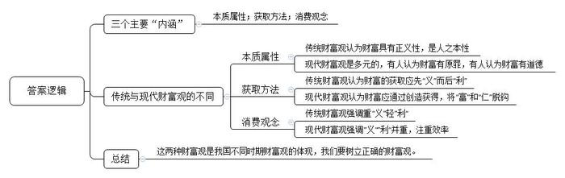
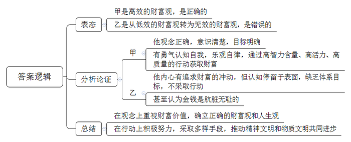
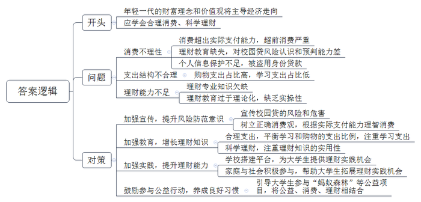
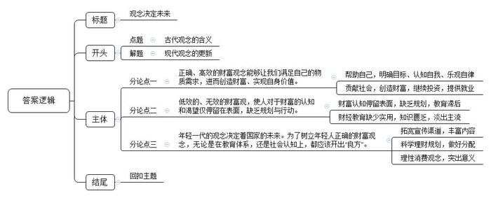

# 2017年公务员多省联考《申论》题（吉林甲级卷）

> 候选采集稿。参考答案及解析来自粉笔页面，不代表官方答案或真实高分答卷；来源使用许可与原卷对应关系仍需人工核实。

## 给定材料

### 材料 material-407522cc2ea495ac

孔子在《论语》中说：“富与贵，是人之所欲也；不以其道得之，不处也。贫与贱，是人之所恶也；不以其道得之，不去也。”进而指出：“不义而富且贵，于我如浮云”“富而可求也，虽执鞭之士，吾亦为之”等。该论述体现了两个基本观点，一是获取财富是人之本性，并不是只要仁义而不要利欲，“义”和“利”并不冲突；二是财富的正义性，财富的获取必须有正当合法的途径，符合“义”的原则，先“义”而后“利”。孟子说：“生亦我所欲也，义亦我所欲也；二者不可得兼，舍生而取义者也。”进一步阐述了利欲与仁义的关系，认为君子即使在财富缺乏的情况下，依然要恪守礼法，坚持仁义。

春秋以降，在先秦大儒义利观的基础上，后世诸贤不断深入阐释义利关系，从董仲舒的“正谊明道”学说到宋明理学的“存理去欲”思想，不仅进一步传承与发扬了先秦儒家思想，而且深刻影响了中国传统社会对待财富的思维理念与行为方式。后世越千年，虽然在儒家“重义轻利”思想外，“利先于义”“以利促义”等主张亦在不同时期一度盛行，但始终未能撼动儒家思想的主导地位。

以“重义轻利”为主导的中国传统财富观，历经几千年的文明积淀，饱含着中国特殊政治、经济、文化的历史底蕴，闪耀着中国哲学智慧的光芒。在当前新的历史条件下，深入理解中国传统财富观，正确处理义利关系，对构建适应当前经济社会发展形势的新型财富观具有重大意义和积极作用。

### 材料 material-b6327346d9bfc85d

随着社会总财富的增加，衡量社会价值的维度更多元。中国的年轻一代，数量是美国同龄人的5倍，他们的财富理念和价值观，将主导未来10年里甚至更久的经济走向。

小陈是上海某高校的在校生。2016年他在移动支付平台上的花销总额近1.2万元，占全年支出的60%左右，其中，服饰方面开支占近50%，书籍开支占近10%。“我以为买书花的钱最多，没想到买衣服竟然花了这么多钱。”除了网购衣服和书籍，小陈的花销主要还用于给女朋友买礼物，“买礼物的频率比较高，还得走心。2016年买的最贵的礼物是一支钢笔，花了600元。”他表示，恋爱后自己的花销明显有所增加，但还在自己能够承受的范围内。不过，小陈猜测“女生的年度总花销会更高”。

朱江是甘肃一所高校的大四学生，2016年10月初，朱江开始加入“蚂蚁森林”公益行动，12月10日，他收到了一张“种树证书”，他“养成”的“梭梭树”将被种植到阿拉善地区。

朱江的“梭梭树”其实是由自己“碳账户”的额度捐赠而来。在支付宝客户端里，首期“碳账户”概念着重突出用户碳减排的公益价值。“碳账户”被设计为一项“蚂蚁森林”游戏公益活动：用户如果步行、地铁出行、在线缴纳水电煤气费、网上缴交通罚单、网络挂号、网络购票等，就会减少相应的碳排放量，其实可以用来在支付宝里养一棵虚拟的树。“树”长成后，项目的公益合作方会将它“买”走，在现实中种下一棵树。

据统计，自2016年8月“蚂蚁森林”开通后，大学生已种下75789棵树，每棵树需大学生在蚂蚁森林账户中减排量达到17900g。

“随手的一个行为，可以做公益，何乐不为呢？”无论是线上还是线下，在朱江看来，公益已成为大学生的一种习惯、一种生活。

## 题目

### 第 1 题

**根据给定资料**1**、**2**，概述财富观的三个主要内涵，并简要说明中国传统财富观与现代财富观的不同。（20分）**

关联材料：材料 material-407522cc2ea495ac

作答要求：

要求：内容全面，条理清晰，语言简洁，不超过250字。

### 第 2 题

**给定资料**4**，叙述了甲乙二人从志同道合到分道扬镳的故事。请你结合给定资料，对此事进行分析。（15分）**

关联材料：材料 material-407522cc2ea495ac

作答要求：

要求：观点明确，条理清晰，不超过250字。

### 第 3 题

**某大学宣传部领导欲在新生入学教育大会上就“合理消费、科学理财”问题做专题报告。假如你是该部门的工作人员，请你根据给定资料**5**\-**9**，为其拟出该报告的内容要点。（25分）**

关联材料：材料 material-b6327346d9bfc85d

作答要求：

要求：内容全面有针对性，观点明确有条理性，不超过400字。

### 第 4 题

**从给定资料出发，结合实际，以“观念决定未来”为题写一篇议论文。（40分）**

关联材料：材料 material-407522cc2ea495ac

作答要求：

要求：观点明确，内容丰富、论证合理、结构清晰，语言准确流畅，800—1000字。

## 答案与解析

第 1 题

**参考答案（粉笔题库参考内容）**

三个主要内涵：本质属性；获取方法；消费观念。

传统与现代财富观的不同：本质属性上，传统财富观认为财富具有正义性，是人之本性；现代财富观是多元化的，有人认为财富有原罪，有人认为财富有道德。获取方法上，传统财富观认为财富的获取应先“义”而后“利”；现代财富观认为财富应通过创造获得，将“富”和“仁”脱钩。消费观念上，传统财富观强调重“义”轻“利”；现代财富观强调“义”“利”并重，注重效率。这两种财富观是我国不同时期财富观的体现，我们要树立正确的财富观。

**解析**

**参考答案说明：**答案分别从“本质属性”“获取方法”“消费观念”这三个方面的主要内涵，对传统与现代财富观进行比较，最终得出对策：我们要树立正确的财富观。

**考点**：考点对比分析类

**来源**：来源2017年公务员多省联考《申论》题（吉林甲级卷）

粉笔申论页面对本题只提供「解析视频」入口，该入口是会员推广位，页面无视频地址与文字解析。

第 2 题

**参考答案（粉笔题库参考内容）**

甲是高效的财富观，是正确的。他观念正确，意识清楚，目标明确；有勇气认知自我，乐观自律，通过高智力含量、高活力、高质量的行动获取财富。

乙是从低效的财富观转为无效的财富观，是错误的。他内心有追求财富的冲动，但认知停留于表面，缺乏体系目标，不采取行动，甚至认为金钱是肮脏无耻的。

我们应该在观念上重视财富价值，确立正确的财富观和人生观；在行动上积极努力，采取多样手段，推动精神文明和物质文明共同进步。

**解析**

**参考答案说明：**按照观点现象分析题的内在逻辑，本题除了先表态，再分析论证（分别介绍对“甲”和“乙”财富观的态度及相应理由），最后进行总结之外，还需要加上“但……”“应该……”等词语承接上下文。

**考点**：考点观点现象分析类

**来源**：来源2017年公务员多省联考《申论》题（吉林甲级卷）

粉笔申论页面对本题只提供「解析视频」入口，该入口是会员推广位，页面无视频地址与文字解析。

第 3 题

**参考答案（粉笔题库参考内容）**

年轻一代的财富理念和价值观将主导经济走向，应学会合理消费、科学理财。

当前存在问题：一、消费不理性。1.消费超出实际支付能力，超前消费严重。2.理财教育缺失，对校园贷风险认识和预判能力差。3.个人信息保护不足，被盗用身份贷款。二、支出结构不合理。购物支出占比高，学习支出占比低。三、理财能力不足。1.理财专业知识欠缺。2.理财教育过于理论化，缺乏实操性。

对策如下：一、加强宣传，提升风险防范意识。1.宣传校园贷的风险和危害。2.树立正确消费观，根据实际支付能力理智消费。二、加强教育，增长理财知识。1.合理支出，平衡学习和购物的支出比例，注重学习支出。2.科学理财，注重理财知识的实用性。三、加强实践，提升理财能力。1.学校搭建平台，为大学生提供理财实践机会。2.家庭与社会积极参与，帮助大学生拓展理财实践机会。四、鼓励参与公益行动，养成公益习惯。引导大学生参与“蚂蚁森林”等公益项目，将公益、消费、理财相结合。

**解析**

**参考答案说明：**（1）格式方面，本题只需拟出报告的内容要点，所以不必考虑格式，只写“正文”即可。（2）正文部分，一方面从内容来看，围绕着“合理消费、科学理财”这一主题，本参考答案的开头部分介绍了此次专题报告的背景；主体部分首先分别从“消费观念”“支出结构”“理财能力”三个方面介绍了当前存在的问题，之后再分别从“宣传防范”“理财教育”“实践平台”“公益行动”四个方面介绍了具体对策建议。另一方面，形式上，本参考答案做到了分段、分条撰写，整体上条理较为清晰。（3）本参考答案在语言表达上做到了简洁、流畅、通俗易懂，符合“专题报告”这一文种的语言风格。

**考点**：考点总结类

**来源**：来源2017年公务员多省联考《申论》题（吉林甲级卷）

第 4 题

**参考答案（粉笔题库参考内容）**

**观念决定未来**

岁月不居，时节如流。古往今来，富与贵，贫与贱的观念始终贯穿在我们的日常生活中，从董仲舒的“正谊明道”学说到宋明理学的“存理去欲”思想，不仅进一步传承与发扬了先秦儒家思想，而且深刻影响了中国传统社会对待财富的思维理念与行为方式。但是，随着时间的推移，时代早已为我们划开了两道深深的沟壑，中国传统的财富观已经有了很大程度上的更新。这就要求我们更新财富观，与时俱进。

**正确、高效的财富观念能够让我们满足自己的物质需求，进而创造财富、实现自身价值。**这样的财富观，可以帮助我们明确目标、认知自我，让我们乐观自律，心怀希望地面对生活和工作，并且更懂得如何通过高智力、高活力、高质量的行动去创造财富。现今社会，众多大学生成为“创客”，努力拼搏、改变生活、创造未来；企业家比尔·盖茨、扎克伯格等，都在获取第一桶金之后，继续投资，创造更大的财富，也为整个社会提供更多的就业岗位。

反之，如果不能正确看待财富，就会阻碍我们获得成功、实现价值。**低效的、无效的财富观，使人对于财富的认知和渴望仅停留在表面，缺乏规划与行动。**“校园贷”“炫富热”“仇富事件”无不折射出错误的财富观，认为金钱是肮脏的，认为财富可以不劳而获。这反映出当前我国财商教育的滞后。如今我国大部分高校的财经教育仍停留在理论阶段，缺少实用性，致使部分学生缺乏理财知识，无法应对理财风险。这不利于个人今后的成长，甚至会使人渐渐淡出社会的主流群体，成为社会的底层。

“国家不可一日无青年，青年不可一日无觉醒”。**年轻一代的观念决定着国家的未来**。**为了树立年轻人正确的财富观念，无论是在教育体系，还是社会认知上，都应该开出****“良方”**。

首先，对财富知识的宣传尤为必要，拓宽知识宣传渠道，丰富内容，增强通俗性，高校和金融机构都应认真思考、积极加入。其次，科学、长远的理财规划也需加强。金融机构要积极帮助民众全面规划投资方向，进行风险评估，选择储蓄方式，做好财富的分配。最后，如何花钱也是一门学问。既不能委屈自己，降低生活水平，也不能挥霍无度、一掷千金；既要量入为出，理性消费，也要“好钢用在刀刃上”，做有意义的支出。

曾有人说，财富来源于社会交易，先按正确的方式思考，再按正确的方式做事，这是致富的第一步。也有人说，人与人最大的区别，不在于才华或能力，而在于观念。观念不仅决定了一个人的财富，也决定着国家和民族的财富未来。

**解析**

**文章分析**

**观念决定未来**

【**标题的优点：**严格按照题目的要求，以“观念决定未来”为标题。】

岁月不居，时节如流。（1）古往今来，富与贵，贫与贱的观念始终贯穿在我们的日常生活中，从董仲舒的“正谊明道”学说到宋明理学的“存理去欲”思想，不仅进一步传承与发扬了先秦儒家思想，而且深刻影响了中国传统社会对待财富的思维理念与行为方式。但是，随着时间的推移，时代早已为我们划开了两道深深的沟壑，（2）中国传统的财富观已经有了很大程度上的更新。这就要求我们更新财富观，与时俱进。

【**开头的优点：**★内容方面。范文的开头是紧扣题目给定的“观念决定未来”这一标题展开的。首先，开头第一句话点出主题，做到了主题明确。其次，对“观念（财富观）”这一主题进行了分析阐述，指出了（1）古往今来的“财富观”有哪些。（2）“中国传统财富观”的更新。★文字表达方面：使用了“不仅”“更”等关联词，使语言表达有逻辑性。】

**正确、高效的财富观念能够让我们满足自己的物质需求，进而创造财富、实现自身价值。**这样的财富观，（1）可以帮助我们明确目标、认知自我，让我们乐观自律，心怀希望地面对生活和工作，（2）并且更懂得如何通过高智力、高活力、高质量的行动去创造财富。（3）现今社会，众多大学生成为“创客”，努力拼搏、改变生活、创造未来；企业家比尔·盖茨、扎克伯格等，都在获取第一桶金之后，继续投资，创造更大的财富，也为整个社会提供更多的就业岗位。

【**论述段****1****的优点：**★观点句：范文的观点句是紧扣“观念（财富观）”这一文章主题提出的。形式上，它在段首处直接写出，位置突出，容易发现。内容上，关键词突出，内容要点明确，可以明显看出它是从“正确、有效的财富观”入手，指出了“财富观对自我的作用”。★论述内容：（1）介绍了“正确、有效的财富观在认知自我”方面的意义；（2）介绍了“正确、有效的财富观在创造财富”方面的影响；（3）举例介绍“正确、有效的财富观”对“个人、社会”的意义。注意：以上几个方面的内容都是紧扣“正确、高效的财富观念能够让我们满足自己的物质需求，进而创造财富、实现自身价值”这个观点句进行分析论述的，论述的针对性强。★论述方法：在论述方法和论据的选取上做到了讲道理、举例子相结合，做到了丰富多样。】

反之，如果不能正确看待财富，就会阻碍我们获得成功、实现价值。**低效的、无效的财富观，使人对于财富的认知和渴望仅停留在表面，缺乏规划与行动。**“校园贷”“炫富热”“仇富事件”无不折射出错误的财富观，（1）认为金钱是肮脏的，认为财富可以不劳而获。这反映出当前（2）我国财商教育的滞后。如今我国大部分高校的财经教育仍停留在理论阶段，缺少实用性，致使部分学生缺乏理财知识，无法应对理财风险。这不利于（3）个人今后的成长，甚至会使人渐渐淡出社会的主流群体，成为社会的底层。

【**论述段****2****的优点：**★观点句：范文的观点句是紧扣“观念（财富观）”这一文章主题提出的。形式上，它在段首处直接写出，位置突出，容易发现。内容上，关键词突出，内容要点明确，可以明显看出它是从“无效的财富观”入手，指出了“个人对财富的认知偏差”。★论述内容：（1）介绍了“无效的财富观”有哪些表现；（2）介绍了“无效财富观”产生的原因；（3）介绍了“无效财富观”的危害。注意：以上几个方面的内容都是紧扣“低效的、无效的财富观，使人对于财富的认知和渴望仅停留在表面，缺乏规划与行动”这个观点句进行分析论述的，论述的针对性强，内容层次丰富。并且这几个方面的论述是有内在逻辑顺序的，先讲表现然后讲原因最后讲危害。★论述方法：在论述方法和论据的选取上做到了讲道理、举例子相结合，做到了丰富多样。】

“国家不可一日无青年，青年不可一日无觉醒”。**年轻一代的观念决定着国家的未来。为了树立年轻人正确的财富观念，无论是在教育体系，还是社会认知上，都应该开出“良方”。**

（1）首先，对财富知识的宣传尤为必要，拓宽知识宣传渠道，丰富内容，增强通俗性，高校和金融机构都应认真思考、积极加入。其次，（2）科学、长远的理财规划也需加强。金融机构要积极帮助民众全面规划投资方向，进行风险评估，选择储蓄方式，做好财富的分配。最后，（3）如何花钱也是一门学问。既不能委屈自己，降低生活水平，也不能挥霍无度、一掷千金；既要量入为出，理性消费，也要“好钢用在刀刃上”，做有意义的支出。

【**论述段****3****的优点：**★观点句：范文的观点句是紧扣“观念（财富观）”这一文章主题提出的。形式上，它在段首处直接写出，位置突出，容易发现。内容上，关键词突出，内容要点明确，可以明显看出它是从“年轻人的财富观”入手，指出了“如何通过教育树立正确的财富观”。★论述内容：（1）介绍了“如何从宣传的角度进行有效的财富教育”；（2）介绍了“如何从理财规划的角度进行有效的财富教育”；（3）介绍了“如何从花钱这门学问的角度进行有效的财富教育”。注意：以上几个方面的内容都是紧扣“年轻一代的观念决定着国家的未来。为了树立年轻人正确的财富观念，无论是在教育体系，还是社会认知上，都应该开出‘良方’”这个观点句进行分析论述的，论述的针对性强。★论述方法：在论述方法和论据的选取上做到了讲道理、举例子相结合，做到了丰富多样。】

曾有人说，财富来源于社会交易，先按正确的方式思考，再按正确的方式做事，这是致富的第一步。也有人说，人与人最大的区别，不在于才华或能力，而在于（1）观念。（2）观念不仅决定了一个人的财富，也决定着国家和民族的财富未来。

【**结尾的优点**：范文的结尾回扣了“观念”这一主题。（1）再次提到“观念”；（2）阐述了深远意义。】

**考点**：考点文章写作题

**来源**：来源2017年公务员多省联考《申论》题（吉林甲级卷）

粉笔申论页面对本题只提供「解析视频」入口，该入口是会员推广位，页面无视频地址与文字解析。

