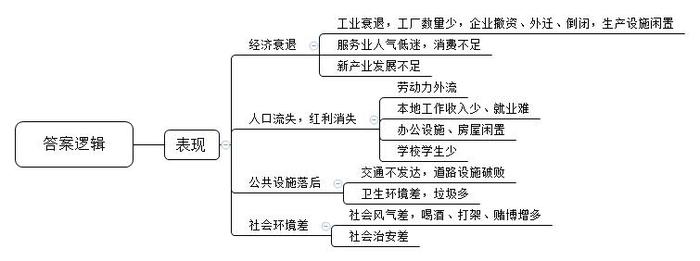
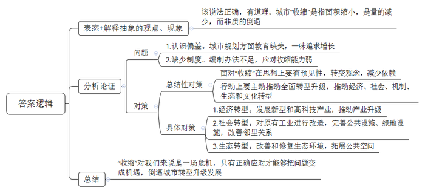
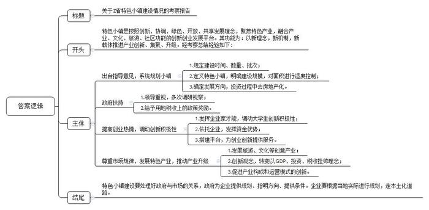
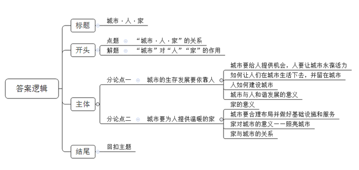

# 2018年公务员多省联考《申论》题（吉林甲级、普通选调卷）

<!-- gwy:overview:start -->
> **吉林 · 2018 · 申论 · 甲级** ｜ 4 题 · 图片 4 处 · 答案随题折叠

导航：[题目](#题目) · [材料 1](#材料-1)
<!-- gwy:overview:end -->

> 候选采集稿。参考答案及解析来自粉笔页面，不代表官方答案或真实高分答卷；来源使用许可与原卷对应关系仍需人工核实。

## 给定材料

### 材料 1

城市规划学者龙教授无意间发现2007年到2016年间，中国有84座城市正在“收缩”。国际上对“收缩城市”的认同标准是：人口规模超过1万人，连续两年人口流失，并且正在经历以某种结构性危机为特征的经济转型。中国的这84座城市大都符合这个标准。

这些城市集中分布在东北地区、长三角地区和珠三角地区，绝大多数为地级市和县级市，属于资源型或产业结构单一型城市。资源型产业必然要经历一个从勘探到开采、高产稳产（鼎盛）、衰退直至枯竭的过程。与之相对应的是，资源型城市的发展也大都会历经兴起、繁荣、衰退三个不同的发展阶段。按照城市生命周期，这些资源型城市很可能继续“收缩”下去，如果不主动实施转型，必然因资源枯竭，而走向衰退。而那些产业结构太过单一的城市，一旦支柱产业过时，失去优势或者遭遇产业政策调整，经济就要被迫转型，就业会出现问题，人口就会流失。

事实上，“收缩城市”并不是一个新概念。上世纪80年代，在某国际权威城市发展研究机构的研究报告中，就出现了“铁锈地带”一词。“铁锈地带”主要指从前工业繁荣而如今已经衰落的发达国家的一些地区，这里集中了发达经济体中人口规模正在出现收缩的城市，如美国的匹兹堡、底特律和德国鲁尔等。

面对城市的收缩，世界各国都采取了各种方法进行应对，有的城市做得很成功，摆脱了发展困境，实现了城市新生；也有不成功的城市，直到现在还承受城市收缩的痛苦。

### 材料 2

地处G市中心地带的人才市场，是所有前来G市打工者的必到之处。市场共有A、B、C、D四个区域，现在只有一个B区在开放，在此进行招聘的七八十家企业基本上都是外地企业，每天来此查看招聘信息的不过二三百人，稀少的招聘单位和应聘者，让大厅看起来非常空旷、冷清。

一位外地公司负责招聘的工作人员说：“今年五六月份的时候，我们公司已经在这里招走了300多人，现在是招第二批。G市用不了那么多人，正好我们可以用。”

已经在人才市场转悠多日的张进，越来越感到茫然无措。1996年就开始踏足G市的他，也曾有过事业上的辉煌。“那时我管20多个人，都是工程师、大学生，每月工资条上的收入就有11500元。”言语间透着自豪，他在应聘书中列出的理想工作还是技术管理岗位，他认为这是自己的优势所在。他说：“这类工作的工资行情，过去1万元左右，现在是7000-8000元。”工厂倒闭后，他曾一度自己创业，但最后却以失败告终，基本赔光了自己所有的积蓄。窘迫的状况，已容不得他挑肥拣瘦，他在心里把工资标准降得很低，“实在不行，干个每月工资2000元的普工也可以。”即便这样，实现起来也并不容易，因为本地企业不缺人。

G市这个曾经名满天下的“世界工厂”，在众多企业撤资或外迁到人工成本更低的国家和地区之后，这个冬天显得无比寒冷。大型工业园内很少有人进出，高大的办公楼和配套齐全的相关生产设施显得沉静而孤独。人口红利消失，经济结构转型带来的“阵痛”让G市人感受得实实在在。

### 材料 3

S市，一座曾以钢铁生产闻名的城市，大部分建筑还保存着上世纪90年代末期的建筑样式。唯一一趟经停的列车在留下几名乘客，再捎上屈指可数的乘客后继续静静地赶路。小城的中心开着一家集餐饮住宿于一体的酒店，昏暗的大堂内，两三个服务员在聊着天，偶有几名顾客出入。

酒店外的马路坑洼不平，路旁的垃圾桶也都东倒西歪地躺在路边。路两侧的商铺有一些都用木板封住了窗户，有的外墙皮已经脱落，被车刮断的电线悬在空中。在离市中心稍远的住宅区，很多楼房的窗户上挂着“此屋出售”的条幅，窗户上已经蒙上了一层厚厚的灰垢。

小城中最繁华的地方是位于城南的中小学，上下学的孩子、接送孩子的家长和附近的商贩让人感受到一丝城市的气息。在学校工作了30多年的陈大爷对记者说：“以前学校学生有2000多人，现在只有300来个。钢铁厂红火的时候，S市一直都是全省经济10强。那时的城市公共设施齐全，火车站、电影院、商场里每天都人来人往，不像现在到处冷冷清清，看不到多少人。那时大部分人都在钢铁厂上班，工资、福利都很好，现在工厂倒闭了，收入越来越少，喝酒、打架、赌博的多了，治安也大不如以前了。虽然近几年市里也发展了一些新的产业，但也都不太景气。现在能出去的都出去了，人也越来越少了。”老人的眼里透露出的是满满的忧伤与无奈。

### 材料 4

D市因矿而生，因矿而兴。因为预见到了城市也会因矿而衰的发展结果，D市6年前就着手开始进行城市转型。“这次转型对D市是一个全新的起点，我们对转型内容进行了扩展和丰富，从过去单纯的经济转型，到经济转型、社会转型、机制转型、生态转型和文化转型五位一体。资源型城市容易使人产生资源依赖，思想上依赖，经济上、财政上也依赖。资源型城市的转型最应该转的是思想观念。”D市市长说。

D市与法国普罗旺斯同处北纬三十八度，日照充足，非常适合花卉生长。在经过充分的考察评估后，D市确定了发展香草花卉生态休闲旅游业，带动民众就业的转型思路。现如今，过去被废弃的土地上遍布着玫瑰谷、植物园、花博馆、矿山公园、文化产业园，美景怡人。“因国内外对于叶黄素的需求量很大，成片的万寿菊不仅极具观赏性而且市场前景看好。”旅游局小马介绍说。产业结构调整使城市重现活力，2016年，D市接待旅游人数达到500万人次，同比增长35%，实现旅游综合收入18亿元，同比增长25%，彻底打破了“一矿独大”的产业格局。往日因为采矿而总是灰突突的城市，现在则是蓝天白云，十里花海，美不胜收。

### 材料 5

作为美国四大钢铁城市之一，扬斯敦市人口从1960年的16万人下降到了2010年的8万人。该市在《扬斯敦2010规划》中首先承认扬斯敦是一个“较小的城市”，然后在此基础上进行规划：把原有工业用的水道改造为供居民休闲娱乐的滨水带；更新改造大量闲置废弃地为城市绿地；对那些已经受污染或者荒草丛生的地带进行生态修复，改造为公园绿地。规划还把城市分为若干个邻里组团，不定期举办一些邻里讨论会，改善邻里关系。在准备收缩的同时，扬斯敦也在实施一些商业发展计划。政府加大教育投入，在当地大学带动下，一些科技企业入驻中心商业区，带来了城市的复兴。

规划后的扬斯敦，住宅土地面积缩小了30%，整个城市面积也相应减少，但居民们并没感觉失望。该市市长认为，量的收缩，不代表质也收缩，相反，“收缩”城市的规划更应该关注提高居民的生活品质和城市的空间品质。

某经济研究院院长W说：“每个‘收缩城市’都需要重新审视自己的规划，国内城市规划的思想体系大多都是基于增长范式的，这也的确符合当时的发展趋势。在中国的城市规划领域，是缺少给收缩城市做规划方案的方法论的。换句话说，就算有城市承认自己是收缩的，可能也没有太多设计院能做出一套合适的方案，因为我们缺少这方面的教育，也缺少编制办法等的支持。不管是决策者还是设计者，都一味地追求增长，觉得‘收缩’是个消极的词。从习惯心理上讲，城市收缩虽然不是我们想要的，但我要说的是，<u>‘收缩’至少不是一个贬义词。</u>”

### 材料 6

“镇”一直被视为城市与乡村之间的过渡。但在过去的几十年里，“镇”既无法获得城市的优质发展资源，也得不到像农村那样的政策支持，成为被忽视的“夹心层”。我国的城镇化概念中似乎只有“城化”，而“镇化”则被长期忽略。小城镇的衰落最明显地体现在人口上。上世纪90年代初，我国小城镇人口占城镇总人口的比重一度达到27%，约8100万人；到2010年，小城镇人口占城镇总人口的比重已降到了20.7%。小镇如果再不发展，将会大范围衰败，人口就会大量迁移，造成大城市的进一步膨胀，最后威胁到农业现代化建设。

2014年，Z省政府开始打造特色小镇。2015年初，Z省两会的政府工作报告这样描述特色小镇的功能：“以新理念、新机制、新载体推进产业创新、产业集聚和产业升级。”在Z省的概念中，建设中的特色小镇“非镇非区”——不是行政区划单元上的一个镇，也不是产业园区的一个区，而是按照创新、协调、绿色、开放、共享的发展理念，聚焦特色产业，融合产业、文化、旅游、社区功能的创新创业发展平台。2015年5月，Z省政府出台了《关于加快特色小镇规划建设的指导意见》，提出全省力争通过3年时间重点培育和规划建设100个左右特色小镇。6月4日，第一批省级特色小镇创建名单正式公布，全省37个小镇入选。

梦想小镇是最先由Z省政府倡导建设的特色小镇，它得益于“大众创业，万众创新”的热潮和Z省自上而下的支持。梦想小镇背靠著名科技园区，旁边就是省师范大学，得天独厚的地理位置吸引了大量有创业梦想的大学生，是一个名符其实的草根创业小镇。回忆起梦想小镇的建设过程，未来科技城管委会招商局李局长仍然觉得很兴奋，“那年春节后上班第一天，省长就过去了。梦想小镇建设前后，省长共去调研了12次。”梦想小镇建成后异常火爆，从开园起，考察团就一波接一波地来。考察团中有很多人提出想对梦想小镇模式进行整体输出。李局长说：“梦想小镇模式输出，不是说不行，但是绝不能简单复制，必须要根据当地的实际情况进行设计更新，进行小镇本土化，才有现实意义。”

Z省特色小镇申报工作启动。他们首先对特色小镇进行定义：面积3平方公里左右，核心区建设面积为1平方公里，3年内要达成50亿元产业投资，且必须是非房地产类投资。政府的奖励政策也直白明了：只要成功挤进特色小镇名单并完成年度规划任务，Z省就会按当地实际使用土地指标的情况提供50%到60%的奖励；由特色小镇建设新增财政收入上交到省财政的部分，也将返还前3年的全额和随后2年的一半给当地政府。

其实，在梦想小镇之前，Z省已经有了特色小镇的雏形，最先崭露头角的是云思小镇，当时它是ALB集团内部的一个项目。2014年，ALB上市，其团队拥有近200亿美元市值的股份。集团所在地的市政府很着急，因为集团里的中层骨干都成了千万富翁，其中700多人想要自主创业，这些人如果离开去了别的地方怎么办？一位曾经的市领导提议，在ALB周边做孵化器，“给想创业的人留下一片土壤，还会吸纳更多的人才和投资过来。”最后，想创业的这700多人大多留了下来。与此同时，该省的大云镇利用巧克力产业的优势，将自己发展成旅游小镇；莲都画乡也因为聚集了大量画家来这里创作写生而颇具规模；由一个村支书领导村民建设的影视城，诞生了中国65%的古装戏。“这样的发展模式，政府没有想到，没有一个是规划出来的。Z省的特色小镇，完全脱离了过去以GDP挂帅，以财政税收挂帅，以投资挂帅的原始做法，以形态、产业构成、运行模式等方面的创新，成为城市修补、生态修复、产业修缮的重要手段。”一位主管小镇建设的领导对记者说。

特色小镇是Z省实现经济发展的一个选择。每当被人问到“你们的特色小镇做得这么好，是怎么想出来的？”的时候，特色小镇建设工作负责人总会向提问者强调：“我们省的特色小镇不是拍脑袋想出来的，而是顺应市场规律，顺势而为，因地制宜谋划出来的。”

一位中央领导到Z省调研时指出，对特色小镇印象最深刻的是他们处理好了政府与市场的关系，政府为企业创业提供条件，大胆“放水养鱼”才能让企业家充分发挥能力，这对中国经济结构升级具有重要借鉴意义。

### 材料 7

2016年7月，住房和城乡建设部、国家发改委、财政部联合发布《关于开展特色小镇培育工作的通知》，提出到2020年我国将培育1000个左右各具特色、富有活力的特色小镇。

与Z省的“非镇非区”不同，《关于开展特色小镇培育工作的通知》明确要求：特色小镇原则上为建制镇，优先选择全国重点镇，三部委规定特色小镇要具有行政区划属性。然而，一些地方的特色小镇建设并没有达到原来设定的意图。一方面，某些房地产商热衷于去小城镇发展，是看中了小城市相对便宜的土地价格，以发展特色小镇的名义行房地产开发之实。房地产先行一定会托高小城镇的各项成本，在房屋租金高涨的情况下，对其他各种特色产业只会形成挤出效应，而不会实现吸聚效果。另一方面，一些地方政府发展特色小镇的目的只是拿地搞开发，提升GDP，并没有进行真正的小镇建设。还有一些地方，虽然提出了“人类小镇”“经济小镇”“体育小镇”的概念，但并没有真正理解特色小镇的内涵。

尽管如此，许多名不副实的特色小镇还是开始动工了。

### 材料 8

城市不在大小，人口不在多少，有品质的生活才是幸福生活。根据《中国经济生活大调查》，在调查的104个城市，300个县的样本中，居民幸福感最强的5个省会城市和5个地级市，都不是经济发达的一线城市。C市，就是一座GDP排名靠后却十次蝉联“中国最具幸福感城市”的“幸福城市”。

谈起小区变化，年近七旬的盛奶奶赞不绝口：“改造后，下水一次没堵过，小棚子全拆了，楼也新了，还打通了十多条路，进出特别方便。”该市城市管理委员会办公室王主任介绍：“下一步将继续提升长效化、精细化管理水平，巩固好旧城改造成果。”三年前还是杂草丛生的涝洼塘，如今已成为C市的“城市外滩”，成为集防洪减灾、生态保育、文化旅游、休闲娱乐、教育展示于一体的综合工程。

以前一个项目批复要跑好多地方，20天都办不完，现在只要跑一次。“蓓蕾计划”使20万名小学生获得课后免费托管服务，让孩子正上小学的双职工家庭感到幸福。旨在增加城乡居民收入的“暖流计划”更让众多群众幸福不已。创业初期资金短缺，一度让大学生创业者小白愁眉不展，“暖流计划”的贴息贷款政策让他顺利拿到10万元，他的生鲜小店越做越火。2017年，全市这样的受益者达893万人次。

谈起幸福城市话题，市民卢先生说：“这些年走过很多城市，还是觉得生活在C市最舒服，这里才是我真正的家。”莎士比亚说：“城市即人。”城市的核心要素是人，城以人为本，人以城为家。不论是今天还是明天，城市理应让生活更美好。

## 题目

### 第 1 题

**我国部分城市在发展过程中出现了“收缩****”****现象，根据给定资料**1**\-**3**，概括其具体表现。（****20****分）**

关联材料：材料 1、材料 2、材料 3

作答要求：

要求：内容全面，语言准确，条理清晰，不超过200字。

第 1 题 · 答案与解析

**参考答案（粉笔题库参考内容）**

收缩表现在：

一、经济衰退。工业衰退，工厂数量少，企业撤资、外迁、倒闭，生产设施闲置；服务业人气低迷，消费不足；新产业发展不足。

二、人口流失，红利消失。劳动力外流；本地工作收入少、就业难；办公设施、房屋闲置；学校学生少。

三、公共设施落后。交通不发达，道路设施破败；卫生环境差，垃圾多。

四、社会环境差。社会风气差，喝酒、打架、赌博增多；社会治安差。

**解析**

**参考答案说明**：本参考答案从“经济衰退”“人口流失，红利消失”“公共设施落后”“社会环境差”四个方面对“城市收缩”的具体表现进行了分条撰写，各条要点在内容上相互并列，没有交叉。

**考点**：问题类

**来源**：2018年公务员多省联考《申论》题（吉林甲级、普通选调卷）

### 第 2 题

**给定资料**5**中，****W****认为，****“‘****收缩****’****至少不是一个贬义词****”****。结合给定资料**4**、**5**，对这一说法进行分析。（****15****分）**

关联材料：材料 4、材料 5

作答要求：

要求：观点明确，分析合理，表述清楚，不超过300字。

第 2 题 · 答案与解析

**参考答案（粉笔题库参考内容）**

该说法正确，有道理。城市“收缩”是指面积缩小，是量的减少，而非质的倒退。

“收缩”存在的问题有：1.认识偏差。城市规划方面教育缺失，一味追求增长；2.缺少制度。编制办法不足，应对收缩能力弱。

面对“收缩”在思想上要有预见性，转变观念，减少依赖。行动上要主动推动全面转型升级，推动经济、社会、机制、生态和文化转型。具体包括：1.经济转型。发展新型和高科技产业，推动产业升级；2.社会转型。对原有工业进行改造，完善公共设施、绿地设施，改善邻里关系；3.生态转型。改善和修复生态环境，拓展公共空间。

“收缩”对我们来说是一场危机，只有正确应对才能够把问题变成机遇，倒逼城市转型升级发展。

**解析**

**参考答案说明**：思路方面，本参考答案按照观点现象分析题“表态+解释抽象的观点、现象+分析论证+总结”的一般答题思路展开。内容方面，本参考答案先对“‘收缩’至少不是一个贬义词”这一说法进行了表态，并对“收缩”的含义进行了解释；分析论证部分指出了“收缩”存在的问题，并从“思想上”和“行动上”两方面给出了应对“收缩”的对策；总结部分针对如何看待“收缩”进行了总结。

**考点**：观点现象分析类

**来源**：2018年公务员多省联考《申论》题（吉林甲级、普通选调卷）

### 第 3 题

**为建设特色小镇，某市在****Z****省进行了为期****2****天的专项考察。假如你是考察组成员，请你根据给定资料**6**、**7**，拟写一份****“Z****省特色小镇建设情况考察报告****”****，供领导审阅。（****25****分）**

关联材料：材料 6、材料 7

作答要求：

要求：

（1）不要求写成完整的文章，写出主要内容即可；

（2）考察内容全面，经验总结准确，建议合理可行，不超过450字。

第 3 题 · 答案与解析

**参考答案（粉笔题库参考内容）**

关于Z省特色小镇建设情况的考察报告

特色小镇是按照创新、协调、绿色、开放、共享发展理念，聚焦特色产业，融合产业、文化、旅游、社区功能的创新创业发展平台。其功能为：以新理念，新机制，新载体推进产业创新、集聚、升级。经考察总结经验如下：

一、出台指导意见，系统规划小镇。1.规定建设时间、数量、批次；2.定义特色小镇，明确建设规模，对面积进行适度控制；3.确定发展方向，投资过程中去房地产化。二、政府扶持。1.领导重视，多次调研视察；2.给予用地税收上的政策奖励。三、提高创业热情，调动创新积极性。1.发挥企业家才能，调动大学生创新积极性；2.依托企业，发挥资金优势；3.搭建平台，为创业创新提供服务。四、尊重市场规律，发展特色产业，推动产业升级。1.发展旅游、文化等创意产业；2.创新观念，转变以GDP、投资、税收挂帅理念；3.促进产业构成和运营模式的创新。

特色小镇建设要处理好政府与市场的关系，政府为企业提供规划、指明方向、提供条件。企业要根据当地实际进行规划，走本土化道路。

**解析**

**参考答案说明：**（1）本题不要求格式，保险起见，本参考答案写到了“标题”。（2）正文部分，一方面从内容来看，围绕着“Z省特色小镇建设”这一主题，开头先写到了“特色小镇的概念和功能”；主体部分从“出台指导意见，系统规划小镇”“政府扶持”“提高创业热情，调动创新积极性”“尊重市场规律，发展特色产业，推动产业升级”四个方面给出了具体的经验；结尾部分对“特色小镇建设”进行了总结。另一方面，形式上，本参考答案做到了分段、分条撰写，整体上条理较为清晰。

**考点**：总结类

**来源**：2018年公务员多省联考《申论》题（吉林甲级、普通选调卷）

### 第 4 题

**从给定材料出发，结合实际，以“城市•人•家”为题写一篇议论文。（****40****分）**

关联材料：材料 1、材料 2、材料 3、材料 4、材料 5、材料 6、材料 7、材料 8

作答要求：

要求：

（1）观点明确，内容丰富，论证合理，结构清晰，语言准确流畅；

（2）符合文体要求，不可写成对策文；

（3）字数800-1000字。

第 4 题 · 答案与解析

**参考答案（粉笔题库参考内容）**

**城市·人·家**

莎士比亚曾经说过：“城市即人。”**城市的核心要素是人，城以人为本，人以城为家，城市理应让生活更美好。**以人为本有两层含义：一层是把人类的生存作为根本；另一层是把人当做社会活动的成功资本。具体而言就是人为城市正常运转提供原动力；城市为人提供精神慰藉，带来幸福感。

然而，衰落的城市使一部分人面临就业危机，收入下降，使得他们不得不背井离乡。同时随着城市软硬条件的下降，公共服务和社会治安都难以令人满意，一些仍保有“故土难离”的人也无法在现实中享受昔日的幸福。“城市，让人生活更美好”，这不仅仅是个理念，更是一种行动。决策者和设计者在进行城市规划时，要正确处理好城市与人的关系。

**城市的生存发展要依靠人。**城市要留住人、吸引人、给人提供生存和发展的机会，人要在城市里创新创业，让城市永葆活力。亚里士多德说：“人们为了生活而来到城市，为了生活得更好留在城市。”想让人们能生活下去，城市就要发展经济，并且保持长久和稳定的发展；想要让人更好地留在城市，就要更加包容和开放，给人机会，让人在城市追逐自己的理想。对于一些小城镇和“收缩”城市而言，这显得尤为重要。只有城市出台创新创业方面的优惠政策和搭建发展平台，才能营造良好的创新创业环境，让人更有精神投入到城市建设。相信通过此种良性循环，城市和人会真正实现共赢。

**城市要为人提供温暖的家。**何以为家？家不仅仅是人的栖身之地，更是人精神的港湾。所以城市要想给人提供更好的家，就要给人以高品质的生活，城市的建设应合理布局，突出城市特色。还要有发达的交通、温暖的住所、便利的购物环境，最后要做好教育、医疗、养老等软件服务，通过基础设施的不断完善和保障的全面化，逐步提升人民生活水平和幸福感。无小家不成大家，千千万万个小家也以自己独特的方式照亮着城市的发展之路，守护着城市的温度。家与城本为一体，荣辱与共。

贝聿铭说：“对于一个城市来说，最重要的不是建筑，而是规划。”城市既能给人提供金山银山，也能让人看见绿水青山，既能提供良好的民生保障，也能建造安放灵魂的精神家园。城市、人、家本就是一个有机的共同体，我们只要把握好城市的发展规律，合理规划，就自然能够享受到城市带给我们的福利。

**文章分析**

**城市****·人·家**

【**标题的优点：**严格按照题目的要求，以“城市·人·家”为标题。】

莎士比亚曾经说过：“城市即人。”**城市的核心要素是人，城以人为本，人以城为家，城市理应让生活更美好。**（1）<u>以人为本有两层含义</u>：一层是<u>把人类的生存作为根本</u>；另一层是<u>把人当做社会活动的成功资本</u>。（2）<u>具体而言就是人为城市正常运转提供原动力</u>；<u>城市为人提供精神慰藉</u>，<u>带来幸福感</u>。

【**开头的优点：**★内容方面。范文的开头是紧扣题目给定的“城市·人·家”这一标题展开的。首先，开头第二句话点出主题，做到了主题明确。其次，对“城市·人·家”这一主题进行了分析阐述，指出了（1）介绍了“以人为本”的含义；（2）介绍了人与城市的关系。注意以上两个方面的阐述在逻辑上有先后顺序：先写“含义”，再写“关系”。★文字表达方面：使用了“一层……，另一层……”关联词，使语言表达有逻辑性。】

然而，（1）<u>衰落的城市使一部分人面临就业危机</u>，<u>收入下降</u>，<u>使得他们不得不背井离乡</u>。同时<u>随着城市软硬条件的下降</u>，<u>公共服务和社会治安都难以令人满意</u>，<u>一些仍保有</u>“<u>故土难离</u>”<u>的人也无法在现实中享受昔日的幸福</u>。“城市，让人生活更美好”，这不仅仅是个理念，更是一种行动。（2）<u>决策者和设计者在进行城市规划时</u>，<u>要正确处理好城市与人的关系</u>。

【**过渡段的优点：**范文过渡段分析了“城市发展”面临的困境等方面的内容，分别指出了（1）城市发展面临的困境；（2）我国城市规划的理念。其中尾句“<u>决策者和设计者在进行城市规划时</u>，<u>要正确处理好城市与人的关系</u>”是用来引起下文的过渡句。】

**城市的生存发展要依靠人。**（1）<u>城市要留住人</u>、<u>吸引人</u>、<u>给人提供生存和发展的机会</u>，<u>人要在城市里创新创业</u>，<u>让城市永葆活力</u>。亚里士多德说：“人们为了生活而来到城市，为了生活得更好留在城市。”（2）<u>想让人们能生活下去</u>，<u>城市就要发展经济</u>，并且<u>保持长久和稳定的发展</u>；<u>想要让人更好地留在城市</u>，<u>就要更加包容和开放</u>，<u>给人机会</u>，<u>让人在城市追逐自己的理想</u>。对于一些小城镇和“收缩”城市而言，这显得尤为重要。（3）<u>只有城市出台创新创业方面的优惠政策和搭建发展平台</u>，<u>才能营造良好的创新创业环境</u>，<u>让人更有精神投入到城市建设</u>。（4）<u>相信通过此种良性循环</u>，<u>城市和人会真正实现共赢</u>。

【**论述段****1****的优点：**★观点句：范文的观点句是紧扣“城市·人·家”这一文章主题提出的。形式上，它在段首处直接写出，位置突出，容易发现。内容上，关键词突出，内容要点明确，可以明显看出它是从“城市的生存发展要依靠人”入手，指出了“‘城市’与‘人’的关系”。★论述内容：（1）介绍了城市要给人提供机会，人要让城市永葆活力；（2）介绍了如何让人们在城市生活下去，并留在城市；（3）介绍了人如何建设城市；（4）介绍了城市与人和谐发展的意义。注意：以上几个方面的内容都是紧扣“城市的生存发展要依靠人”这个观点句进行分析论述的，论述的针对性强，内容层次丰富。最后，在论述方法和论据的选取上做到了讲道理、举例子相结合，做到了丰富多样。】

**城市要为人提供温暖的家。**何以为家？（1）<u>家不仅仅是人的栖身之地</u>，<u>更是人精神的</u><u>港湾</u>。所以城市要想给人提供更好的家，（2）<u>就要给人以高品质的生活</u>，<u>城市的建设应合理布局</u>，<u>突出城市特色</u>。<u>还要有发达的交通</u>、<u>温暖的住所</u>、<u>便利的购物环境</u>，<u>最后要做好教育</u>、<u>医疗</u>、<u>养老等软件服务</u>，<u>通过基础设施的不断完善和保障的全面化</u>，<u>逐步提升人民生活水平和幸福感</u>。无小家不成大家，（3）<u>千千万万个小家也以自己独特的方式照亮着城市的发展之路</u>，<u>守护着城市的温度</u>。（4）<u>家与城本为一体</u>，<u>荣辱与共</u>。

【**论述段****2****的优点：**★观点句：范文的观点句是紧扣“城市·人·家”这一文章主题提出的。形式上，它在段首处直接写出，位置突出，容易发现。内容上，关键词突出，内容要点明确，可以明显看出它是从“城市托起了家，家也照亮了城市”入手，指出了“‘城市’与‘家’的关系”。★论述内容：（1）介绍了家的意义；（2）介绍了城市要合理布局并做好基础设施和服务；（3）介绍了家对城市的意义——照亮城市；（4）介绍了家与城市的关系。注意：以上几个方面的内容都是紧扣“城市要为人提供温暖的家”这个观点句进行分析论述的，论述的针对性强，内容层次丰富。最后，在论述方法和论据的选取上做到了讲道理、打比方相结合，做到了丰富多样。】

【**论述段之间的关系**：★内容的内在逻辑：范文的论述段之间是依照“并列”的逻辑展开的。论述段1先写了“城市的生存发展要依靠人”，论述段2再写了“城市要为人提供温暖的家”。】

贝聿铭说：“对于一个城市来说，最重要的不是建筑，而是规划。”城市既能给人提供金山银山，也能让人看见绿水青山，既能提供良好的民生保障，也能建造安放灵魂的精神家园。（1）<u>城市、人、家本就是一个有机的共同体</u>，（2）<u>我们只要把握好城市的发展规律</u>，<u>合理规划</u>，<u>就自然能够享受到城市带给我们的福利</u>。

【**结尾的优点**：范文的结尾回扣了“城市·人·家”这一主题。（1）再次总结了“城市·人·家”；（2）发出了展望。】

**解析状态：unknown（来源未提供）**

**考点**：文章写作题

**来源**：2018年公务员多省联考《申论》题（吉林甲级、普通选调卷）

