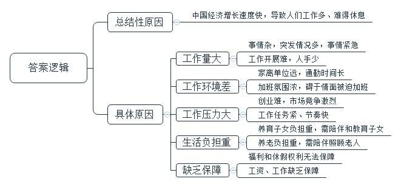
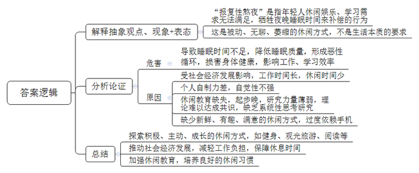
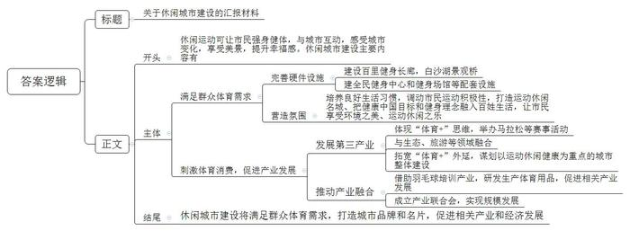
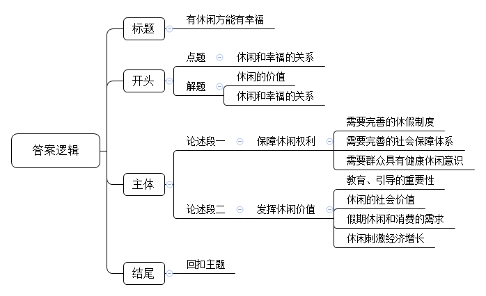

# 2019年公务员多省联考《申论》题（吉林乙卷）

> 候选采集稿。参考答案及解析来自粉笔页面，不代表官方答案或真实高分答卷；来源使用许可与原卷对应关系仍需人工核实。

## 给定材料

### 材料 material-8b23cc61dae1726e

刘刚是一名街道工作人员。几周前，他被调进当地的社区环境整治工作组，此后近一个月里，刘刚几乎没休过周末。“我们管辖的社区涉及搬迁的居民有180余户，我和同事一起，负责与12户协商谈判。”由于大多数搬迁居民白天上班，还有些在外地，除了完成白天的日常工作外，晚上和周末加班就成了刘刚的工作常态。上周日，他早上9点上班，忙活到夜里10点，才说通了3户人家，午间没歇，晚饭也没吃。

遇到突发情况，一些基层公务员更是要放弃休息，轮流加班。小钟是某镇政府的公务员，平时负责社保、公积金、小额贷款和劳动监察工作，“我本来打算休假去西藏旅行，但最近是防汛期，大家都在单位备勤。基层人手少、事情杂，加班其实很常见，比如这次防汛值班轮到我了，就算我有假期，也要舍下，服从工作安排。”

李玉是某高校团委书记，由于家离学校较远，来回一趟就要花去三个小时。除了日常填表、会务、报账等工作，她还带着几个学生文艺团体。训练和演出期间常常忙到很晚，有时参加聚会，也要通过手机处理单位的事。李玉说，没完没了地加班，让她觉得休闲时间被严重压缩，身心一直紧绷着。“我也想向单位提出不加班，但开不了口，因为身边许多同事都这样工作，自己又凭什么搞特殊呢?”

### 材料 material-6aba3e026d6f3769

中央电视台、国家统计局联合发起的“中国经济生活大调查”的结果显示，除去工作和睡觉，2017年中国人每天平均休闲时间为2.27小时，较三年前的2.55小时有所减少。其中，深圳、广州、上海、北京居民每天休闲时间更少，分别是1.94、2.04、2.14和2.25小时。相比而言，美国、德国、英国等国家国民每天平均休闲时间约为5小时，为中国人的两倍多。

“我喜欢书店的味道。”每逢周末，“70后”张英涛都会“泡”在国家图书馆里。

“我平时工作很忙，真正有了休息时间，也不愿意外出奔波，更多的时候会选择上网度过休闲时光。”关于休闲，“80后”王强的偏好是滑动鼠标探知世界。

“我的假期一般都是在打游戏中度过的。在游戏的世界中驰骋，很畅快。”“90后”赵兵最近喜欢上了一款新游戏，在他看来，网络游戏为他的休闲生活打开了一扇大门。

与父母同住的徐璐是刚刚入职的公务员，“下班后回家吃晚饭，饭后刷盘子、洗碗筷，然后陪父母一起看看电视剧、刷微博、看手机，铺开瑜伽垫锻炼一会儿，感觉也没干啥，一天就过去了。”到了周末，徐璐喜欢“宅”在家里看书、看电影。如果有约，她会跟朋友们逛街、喝奶茶，偶尔聚餐。在节假日，她会到城市周边转转。徐璐说：“虽然人们的休闲选择变得越来越丰富，可大家休闲时间有限，又不知道如何尽快找到新鲜、有趣、满意的休闲方式，总不能全靠碰运气吧。”

“我工作很忙，只有休长假才能享受休闲。”高女士是某上市公司职业经理人，每年有10天带薪年假。在她眼中，真正放松的休闲方式就是自由行。“今年我从泰国曼谷自由行回来，同事们都说我精神焕发，像换了个人似的。现在我基本上都是自己挑一个有特色的地方，平时抽空研究线路、规划行程、发掘当地的亮点，然后利用带薪年假去实践自己的旅行计划，那真是一年中最快乐的时光。”

某机构发布的“2018中国休闲小康指数”显示，受访者从近30种休闲活动中评选出了“国人最喜爱的十种休闲方式”，旅游继续蝉联冠军宝座，睡懒觉位居第二位，手机休闲渐成主流，由2017年的第八位迅速上升至第三位，逛街购物、看电影、看电视、读书、喝茶、享受美食、打游戏分列第四至第十位。“玩手机”异军突起，选择该项的受访者占比为32.9%，比2017年的16.1%翻了一番。某调查机构的一项调查显示，普通人每天平均要查看手机110次，刷朋友圈、刷微博、拍照、看视频、逛网店、玩手游、浏览信息……手机休闲已成为人们现在生活中不可或缺的一部分。

### 材料 material-2c0f0d32ff25ad70

初夏的傍晚，澄江之畔，绿荫簇拥。H市跑步运动协会组织的荧光跑活动，吸引了不少市民参加，孩子跑起来了、年轻人跑起来了，头发花白的老人也跑起来了。通过跑步，市民不仅可以强身健体，更重要的是在跑步的过程中能与城市更好地互动，感受城市日新月异的变化。“城市变美了，我们当然愿意多外出锻炼身体。能一边跑步一边享受美景，这种感觉非常幸福。”一位跑步爱好者说出了自己的心里话。

按照规划，围绕“水”文章，H市把运动休闲和当地“五水共治”相结合，在澄江两岸建设了百里健身长廊。沿江一直走，便来到2017年新建成的白沙湖景观桥。这座横跨澄江的大桥将H市新老城区紧密相连，被当地人追捧为“网红桥”。夜色中，曲线型的人行拱桥与自行车道叠加，于五彩斑斓的灯光中彰显出一种时尚感。“网红桥”的诞生，释放了H市致力于打造“运动休闲名城”，把健康中国目标和全民健身理念融入百姓生活的信号，让市民都能从健身中享受生态环境之美、运动休闲之乐。

在H市全民健身中心项目的施工工地上，工人们正在加紧施工。这里曾是市粮食批发市场，而今，“旧粮仓”即将大变样，成为一座座健身场馆。一些无法改建成体育场馆的建筑，则被设计成民宿、攀岩墙等，作为健身中心的配套设施使用。

H市打造“休闲健身城市”不仅是体育概念，更体现了“体育+”思维。这个“+”的后面，可以是生态、旅游、科技，也可以是养老、文化、教育。比如该市瞄准“体育+旅游”这一突破口，通过举办马拉松等各类赛事活动，把单一的观光旅游变为运动休闲体验游。如今，“体育”已成为打造城市品牌的新动能和对外展示的新名片。下一步H市将拓宽“体育+”外延，谋划建设城市“大花园”，而运动休闲健康是这个城市“大花园”的内涵和支撑。

体育产业的蓬勃发展促进了产业融合。借助原有羽毛球培训产业的优势，H市推动羽毛球等体育用品的研发和生产，促进了以体育用品生产为中心的体育运动培训、体育竞赛、体育休闲、体育旅游等相关产业的集聚和发展。H市体育产业联合会顺势成立，当地企业可以通过平台“抱团”发展。

H市市长在谈到体育和城市之间的关系时说：“既然风来了，就要让自己站在风口。随着人民群众体育需求的不断增长，我们将体育消费作为新的消费点和增长点，让体育为城市注入源源不断的新活力。”

### 材料 material-5d0942c857aebfe9

学者通过研究认为，自2015年开始，世界发达国家进入了“休闲时代”。改革开放40年来，中国社会经济发展水平迅速提高，城镇居民生活水平也得到了普遍提升，休闲逐渐成为一种新的和独立的生活方式，中国的“休闲时代”也已悄然来临。

习近平总书记在党的十九大报告中指出，中国特色社会主义进入新时代，中国社会主要矛盾已经转化为人民日益增长的美好生活需要和不平衡不充分的发展之间的矛盾。人民美好生活需要日益广泛，对生活质量提出了更高要求。2019年政府工作报告中提出，转职能，提效能，增强政府公信力和执行力，更好满足人民对美好生活的新期待。如果从时代的向度上思考，新时代，“普遍休闲”是突出特点，“更好的休闲”，则是人民对美好生活的期盼。

人类生产力越来越高，但个人生活越来越忙，工作和休闲的矛盾不仅表现在社会阶层之间，而且也点燃了关于个人的理想与现实的冲突：一方面人类整体休闲时间越来越多，一方面个人生活充满焦虑和不安；一方面认为休闲是每个人内心深处的要求，一方面又为“工作是人生的价值和意义”所困惑。如何迎接休闲时代的来临，是我们每个人不得不思考的命题。

## 题目

### 第 1 题

**根据给定资料**2**、**3**，概括目前人们处于“闲不下来、难得休息”状态的主要原因。（20分）**

关联材料：材料 material-8b23cc61dae1726e

作答要求：

要求：内容全面，语言准确，条理清晰，不超过200字。

### 第 2 题

**给定资料**5**提到“报复性熬夜”这一现象，请你结合给定资料**4**、**5**，对这一现象进行评析。（15分）**

关联材料：材料 material-6aba3e026d6f3769

作答要求：

要求：观点明确，分析透彻，条理清晰，不超过300字。

### 第 3 题

**H市需要向省有关部门汇报休闲城市建设的情况，假如你是H市政府的一名相关工作人员，结合给定资料**6**，拟写一份汇报材料提纲。（25分）**

关联材料：材料 material-2c0f0d32ff25ad70

作答要求：

要求：紧扣材料，内容全面，层次清楚，不超过400字。

### 第 4 题

**给定资料**7**中亚里士多德说：“幸福存在于闲暇之中，我们是为了闲暇而忙碌。”根据你对这句话的理解，结合给定资料，联系实际，自拟题目，自选角度，写一篇议论文。（40分）**

关联材料：材料 material-5d0942c857aebfe9

作答要求：

要求：

（1）观点明确，内容充实，结构清晰，论证合理，语言流畅；

（2）结合“给定资料”，但不拘泥于“给定资料”；

（3）符合文体要求；

（4）字数800～1000字。

## 答案与解析

第 1 题

**参考答案（粉笔题库参考内容）**

中国经济增长速度快，导致人们工作多、难得休息，具体原因有：

1.工作量大。事情杂，突发情况多，事情紧急，工作开展难，人手少。

2.工作环境差。家离单位远，通勤时间长，加班氛围浓，碍于情面被迫加班。

3.工作压力大。创业难，市场竞争激烈，工作任务紧、节奏快。

4.生活负担重。养育子女负担重，需陪伴和教育子女，养老负担重，需陪伴照顾老人。

5.缺乏保障。福利和休假权利无法保障，工资、工作缺乏保障。

**解析**

**参考答案说明：**本参考答案先指出了“中国经济增长速度快，导致人们工作多、难得休息”这一总结性原因，又从“工作量大”“工作环境差”“工作压力大”“生活负担重”“缺乏保障”这五个方面罗列了具体原因，各条要点之间在内容上相互并列，没有交叉。

**考点**：考点原因类

**来源**：来源2019年公务员多省联考《申论》题（吉林乙卷）

粉笔申论页面对本题只提供「解析视频」入口，该入口是会员推广位，页面无视频地址与文字解析。

第 2 题

**参考答案（粉笔题库参考内容）**

“报复性熬夜”是指年轻人休闲娱乐、学习需求无法满足，牺牲夜晚睡眠时间来补偿的行为。这是被动、无聊、萎缩的休闲方式，不是生活本质的要求。

一、这会导致睡眠时间不足，降低睡眠质量，形成恶性循环，损害身体健康，影响工作、学习效率。

二、其原因有：1.受社会经济发展影响，工作时间长，休闲时间少；2.个人自制力差，自觉性不强；3.休闲教育缺失，起步晚，研究力量薄弱，理论难以达成共识，缺乏系统性思考研究；4.缺少新鲜、有趣、满意的休闲方式，过度依赖手机。

三、因此我们要：1.探索积极、主动、成长的休闲方式，如健身、观光旅游、阅读等；2.推动社会经济发展，减轻工作负担，保障休息时间；3.加强休闲教育，培养良好的休闲习惯。

**解析**

**参考答案说明：**（1）思路方面，本参考答案按照观点现象分析题“解释抽象的观点、现象+表态+分析论证+总结”的一般答题思路展开。（2）内容方面，一方面，本参考答案先结合资料对“报复性熬夜”这一抽象的名词进行了解释，接着进行了表态；“分析论证”部分指出了危害，并从“社会经济发展”“个人自制力”“休闲教育研究”“休闲方式”四个方面分析了原因；最后进行了总结。另一方面，词句表达方面，本参考答案使用了“这会……”“其……”等，使得答案各部分在逻辑上联系更为紧密。

**考点**：考点观点现象分析类

**来源**：来源2019年公务员多省联考《申论》题（吉林乙卷）

粉笔申论页面对本题只提供「解析视频」入口，该入口是会员推广位，页面无视频地址与文字解析。

第 3 题

**参考答案（粉笔题库参考内容）**

关于休闲城市建设的汇报材料

休闲运动可让市民强身健体，与城市互动，感受城市变化，享受美景，提升幸福感。休闲城市建设主要内容有：

满足群众体育需求。1.完善硬件设施。建设百里健身长廊，白沙湖景观桥；建全民健身中心和健身场馆等配套设施。2.营造氛围。培养良好生活习惯，调动市民运动积极性，打造运动休闲名城、把健康中国目标和健身理念融入百姓生活，让市民享受环境之美、运动休闲之乐。

刺激体育消费，促进产业发展。1.发展第三产业。体现“体育+”思维，举办马拉松等赛事活动；与生态、旅游等领域融合；拓宽“体育+”外延，谋划以运动休闲健康为重点的城市整体建设。2.推动产业融合。借助羽毛球培训产业，研发生产体育用品，促进相关产业发展；成立产业联合会，实现规模发展。

休闲城市建设将满足群众体育需求，打造城市品牌和名片，促进相关产业和经济发展。

**解析**

**参考答案说明：**（1）由于本题要求写“汇报材料提纲”，因此不需考虑格式，但保险起见，建议加上标题，可写为“关于休闲城市建设的汇报材料”。（2）正文部分，一方面从内容来看，围绕“休闲城市建设”这一主题，本参考答案的开头先写到了“休闲运动对市民的意义”；主体部分从“满足群众体育需求”“刺激体育消费，促进产业发展”这两个大的方面给出了H市打造休闲城市的主要内容；结尾部分进行简单总结，指出休闲城市建设的意义。另一方面，形式上，本参考答案做到了分段、分条撰写，整体上条理较为清晰。

**考点**：考点总结类

**来源**：来源2019年公务员多省联考《申论》题（吉林乙卷）

粉笔申论页面对本题只提供「解析视频」入口，该入口是会员推广位，页面无视频地址与文字解析。

第 4 题

**参考答案（粉笔题库参考内容）**

**有休闲方能有幸福**

古希腊哲学家亚里士多德说：“幸福存在于闲暇之中，我们是为了闲暇而忙碌。”意思就是：**努力工作，辛苦忙碌，是为了获得闲暇，有了闲暇才会幸福、快乐**。英国思想家罗素也全面分析了休闲的价值：**闲暇，能带来艺术修养和文明提升；闲暇，能带来科学发现和经济繁荣。这就是说，闲暇和幸福是一辆车上的两个辕，应该良性循环，共同发展**。

然而，在“普遍闲暇”的时代，人们也存在困惑：一方面，工作如此之忙，何来时间休闲？另一方面，追求休闲会不会导致个人价值的迷失？……要打消群众忧虑，需有全方位、多层次的保障。既要保障群众有时间休闲，还要保证群众能健康休闲，更要鼓励群众有价值地休闲。

**保障休闲权利。要完善法律制度、社会保障体系，满足群众休闲“刚需”，也要鼓励群众健康休闲、创造良好休闲环境，做好“柔性”引导。**保障休闲条件，一是要通过完善的休假制度来保障群众的休息时间；二是需要有完善的社会保障体系，让群众敢休闲，能休闲，乐休闲，好休闲。同时，休闲不仅要靠这些刚性的制度，也需要柔性的引导。既需要个人提高认识，学会自我调节，平衡好工作和休闲；也需要政府和社会共同营造良好的休闲氛围、休闲文化，不过分提倡加班文化。当然，争取休闲的权利，不能成为我们放纵沉沦的借口。我们的闲暇方式应该是健康、积极、有创造性的。

**发挥休闲价值。加强教育、引导个人健康休闲，创造社会价值；营造社会条件，通过休闲刺激经济社会发展。**休闲本身就是创造社会价值的过程。比如健身、茶道、琴棋书画等健康的休闲方式不仅有益提升个人修养和价值，还能刺激相关产业的发展，推动社会进步。对此，良好的社会教育和引导显然不可或缺。教育让人们摒弃喝酒、赌博、打游戏等不健康的休闲方式，同时也让人们明白健康休闲方式所创造的社会价值。休闲本身就是拉动内需的重要方面。比如，十一黄金周期间，由于群众休闲需求集中爆发，消费内需大幅增长，各行各业也迎来了“黄金”时机。由此可见，休闲不仅是权利、价值，更是创造幸福的机会与动力。

**休闲与幸福本为一体，应良性循环与发展。**休闲权利是可以和社会发展统一协调、良性循环的。保障休闲的权利、环境，可以为个人赢得自由发展的空间；引导有社会价值的休闲方式，则有利于打造休闲产业，从而推动经济社会发展。个人能力提升、社会经济进步，最终又能赢得更多的休闲，从而获得更多的幸福、快乐。

**解析**

**文章分析**

**有休闲方能有幸福**

【**标题的优点**：首先，范文的标题“有休闲方能有幸福”突出了“休闲”这一主题。其次，形式上，文字简洁明快。】

（1）古希腊哲学家亚里士多德说：“幸福存在于闲暇之中，我们是为了闲暇而忙碌。”意思就是：**努力工作****，****辛苦忙碌****，****是为了获得闲暇****，****有了闲暇才会幸福****、****快乐**。（2）英国思想家罗素也全面分析了休闲的价值：**闲暇****，****能带来艺术修养和文明提升****；****闲暇****，****能带来科学发现和经济繁荣****。这就是说，**（3）**闲暇和幸福是一辆车上的两个辕****，****应该良性循环****，****共同发展**。

【**开头的优点：**★内容方面。范文的开头是紧扣题目给定的“幸福存在于闲暇之中，我们是为了闲暇而忙碌”这句话展开的。（1）开头第一句话指出题干给定句子的含义。（2）用名人罗素的观点引出了休闲的价值。（3）点出了休闲和幸福的关系。★文字表达方面。引用了名人名言，使用了比喻的修辞手法，使文字表达更加形象、有力。】

然而，在“普遍闲暇”的时代，人们也存在困惑：一方面，工作如此之忙，何来时间休闲？另一方面，追求休闲会不会导致个人价值的迷失？……要打消群众忧虑，需有全方位、多层次的保障。既要保障群众有时间休闲，还要保证群众能健康休闲，更要鼓励群众有价值地休闲。

【**过渡段的优点：**范文过渡段分析了“休闲时代”存在的问题，此外，还要注意过渡段末尾的“既要保障群众有时间休闲，还要保证群众能健康休闲，更要鼓励群众有价值地休闲”是用来引起下文的过渡句。】

**保障休闲权利。要完善法律制度、社会保障体系，满足群众休闲“刚需”，也要鼓励群众健康休闲、创造良好休闲环境，做好“柔性”引导。**保障休闲条件，（1）一是要通过完善的休假制度来保障群众的休息时间；（2）二是需要有完善的社会保障体系，让群众敢休闲，能休闲，乐休闲，好休闲。同时，休闲不仅要靠这些刚性的制度，也需要柔性的引导。（3）既需要个人提高认识，学会自我调节，平衡好工作和休闲；（4）也需要政府和社会共同营造良好的休闲氛围、休闲文化，不过分提倡加班文化。当然，争取休闲的权利，不能成为我们放纵沉沦的借口。我们的闲暇方式应该是健康、积极、有创造性的。

【**论述段****1****的优点：**★观点句：范文的观点句是紧扣“休闲”这一文章主题提出的。形式上，它在段首处直接写出，位置突出，容易发现。内容上，关键词突出，内容要点明确，可以明显看出它是从“休闲需要刚性保障和柔性引导”入手，指出了“保障休闲权利”。★论述内容：（1）介绍了“需要完善的休假制度”；（2）介绍了“需要完善的社会保障体系”；（3）介绍了“需要群众具有健康休闲意识”；（4）介绍了“营造健康休闲的环境”。注意：以上四个方面的内容都是紧扣“保障休闲权利。要完善法律制度、社会保障体系，满足群众休闲‘刚需’，也要鼓励群众健康休闲、创造良好休闲环境，做好‘柔性’引导”这个观点句进行分析论述的，论述的针对性强，内容层次丰富。在论述方法上采用了道理论证，论证透彻有力。】

**发挥休闲价值。加强教育、引导个人健康休闲，创造社会价值；营造社会条件，通过休闲刺激经济社会发展。**休闲本身就是创造社会价值的过程。比如健身、茶道、琴棋书画等健康的休闲方式不仅有益提升个人修养和价值，还能刺激相关产业的发展，推动社会进步。对此，（1）良好的社会教育和引导显然不可或缺。（2）教育让人们摒弃喝酒、赌博、打游戏等不健康的休闲方式，同时也让人们明白健康休闲方式所创造的社会价值。（3）休闲本身就是拉动内需的重要方面。比如，十一黄金周期间，由于群众休闲需求集中爆发，消费内需大幅增长，（4）各行各业也迎来了“黄金”时机。由此可见，休闲不仅是权利、价值，更是创造幸福的机会与动力。

【**论述段****2****的优点：**★观点句：范文的观点句是紧扣“休闲”这一文章主题提出的。形式上，它在段首处直接写出，位置突出，容易发现。内容上，关键词突出，内容要点明确，可以明显看出它是从“要教育、引导个人健康休闲，营造社会条件，拉动内需”入手，指出了“发挥休闲价值”。★论述内容：（1）介绍了“教育、引导的重要性”；（2）介绍了“休闲的社会价值”；（3）介绍了“假期休闲和消费的需求”；（4）介绍了“休闲刺激经济增长”。注意：以上四个方面的内容都是紧扣“发挥休闲价值。加强教育、引导个人健康休闲，创造社会价值；营造社会条件，通过休闲刺激经济社会发展”这个观点句进行分析论述的，论述的针对性强，内容层次丰富。在论述方法上采用了讲道理、举例子相结合，做到了丰富多样。】

【**论述段之间的关系：**★内容的内在逻辑：范文论述段1写了“保障休闲权利”；论述段2紧接着写了“发挥休闲价值”。两个段落之间是并列的关系。★段与段的外在衔接：论述段1尾句的“我们的闲暇方式应该是健康、积极、有创造性的”起到了承接上文，引出下文的作用。论述段2尾句的“由此可见，休闲不仅是权利、价值，更是创造幸福的机会与动力”总结了论述段的内容，并引起结尾内容。】

**休闲与幸福本为一体，应良性循环与发展。**休闲权利是可以和社会发展统一协调、良性循环的。保障休闲的权利、环境，可以为个人赢得自由发展的空间；引导有社会价值的休闲方式，则有利于打造休闲产业，从而推动经济社会发展。个人能力提升、社会经济进步，最终又能赢得更多的休闲，从而获得更多的幸福、快乐。

【**结尾的优点**：范文的结尾回扣了“休闲”这个主题。（1）再次提到了“休闲”；（2）发出了号召希望，阐述了深远意义。】

**考点**：考点文章写作题

**来源**：来源2019年公务员多省联考《申论》题（吉林乙卷）

粉笔申论页面对本题只提供「解析视频」入口，该入口是会员推广位，页面无视频地址与文字解析。

