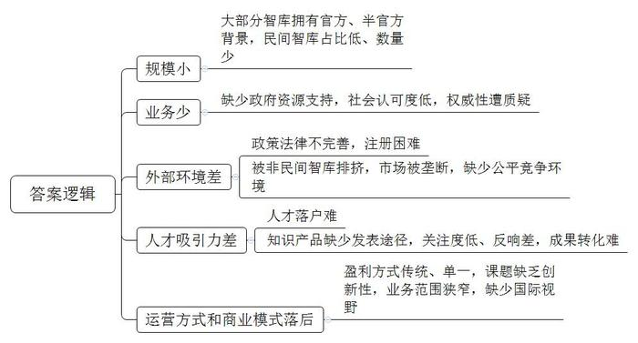
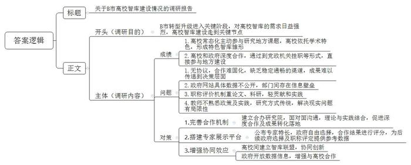
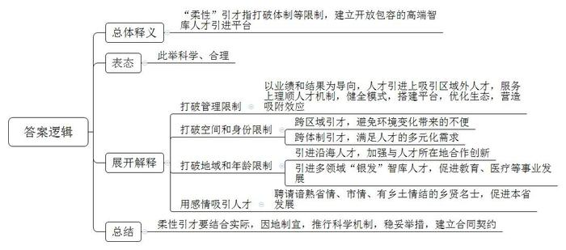
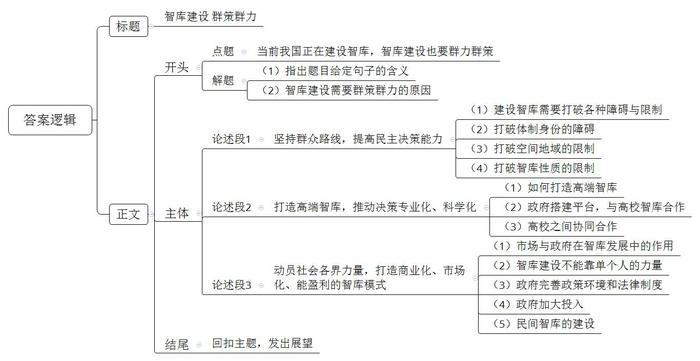

# 2019年公务员多省联考《申论》题（吉林甲级、普通选调卷）

> 候选采集稿。参考答案及解析来自粉笔页面，不代表官方答案或真实高分答卷；来源使用许可与原卷对应关系仍需人工核实。

## 给定材料

### 材料 material-8c35ae656d2cadf5

地方智库是指省级以下行政区内设立的各类型智库，是中国特色新型智库的重要组成部分，是地方经济社会发展的重要外脑。我国的地方智库划分为五类：一是各级党委政府研究室以及政府部门内部研究机构；二是社科院、党校行政学院等社会科学研究机构；三是高等院校内设研究机构；四是企业内的战略研究室（部）；五是民间智库，与前四类的官方和半官方智库不同，民间智库是主要由民间出资组织并且体现民间声音或者政策诉求的公共政策研究组织。

中国目前约有2500个智库，大都具有官方或半官方背景，民间智库所占比例不到5%。官方和半官方智库由于拥有政府资源的优势，短期内依然是决策咨询的主要力量。一位民间智库负责人表示，尽管他们的工作效率及收费较其他一些非民间智库具有极大的优势，政府部门和各企事业单位一旦有相关的业务需要，首选仍然是官方和半官方智库。一般社会大众，包括民间企业，都习惯性地认为官方智库更具权威性。例如，长期为中国决策层提供政策和咨询的中国十大著名“智库”全部都是官方或半官方机构，却没有真正的民间智库。

一位法学专家谈到民间智库时认为，由于政策环境和法律制度的不完善，民间智库也面临着注册困难，一些非民间智库还会利用自己官方或半官方背景，对其他民间智库进行排挤，从而垄断了有限的市场。

### 材料 material-1a9d8393d9eb8dcc

临近学期末，财经大学经济学院马院长比往年更加忙碌。“本周内要完成对B市主导产业发展的初步评估，作为未来规划的依据。”不久前，他受市发改委委托，率团队参与编制B市的十三五规划。

马院长的忙碌并非个例。与他同校的发展研究院赵教授也与B市签订了一项合作协议。在此之前，赵教授就曾受市政府委托，参与编制专项发展规划，这是第一次以协议的方式对两者的合作加以固化。

驻B市的12所高校主动参与研究地方课题已经成为常态。从2014年开始，市社科联向社会发布《社会科学规划项目课题指南》，聚焦政治理论与依法治市建设研究、经济新常态和B市转型发展研究。据市社科联胡主任统计，高校教师是申报课题最为活跃的群体，近三年立项的课题中，约二分之一由高校教师获得。通过课题的申报和研究，高校以各自的学术特色形成了特色智库的雏形。“比如说，财经大学很擅长金融、经济等宏观视角研究，师范大学在区域文化研究方面走在全省前列，科技大学的特长在农业等相关领域。”胡主任认为，随着B市的转型升级进入关键阶段，B市的党政机关等部门对高校智库的需求日益强烈，高校智库建设同样走到了关键节点。“在发布《社会科学规划项目课题指南》以及立项和结项的过程中，我们能感受到高校积极参与的热情，也能感受到各级党政机关求智若渴的迫切心情。”

B市政策研究室张主任认为，如果专家学者能完全融入地方经济社会建设中，对城市的发展将起到不可估量的作用。“建设高水平的智库，高校有潜力，有实力，也有能力。我刚到政策研究室不久，就看到师范大学一位教授撰写的城市发展建议，印象十分深刻。我市十来年的发展，与他建议中的许多内容不谋而合。”

2005年财经大学首次编写《B市经济发展研究报告》，之后种类逐年增加。到2018年，该校发布了包括12部子报告在内的城市年度经济社会发展系列研究报告。对城市经济社会整体、区域、行业等现状和未来发展态势进行详尽分析，直面问题，破解难题。有系列报告做招牌，财经大学已经与多个地市形成深度合作，被省政府评价为“在服务党和政府决策方面，是省内高校的优秀代表”。

如今，很多高校以建设研究院的形式，聚焦问题精准发力。越来越多的专家学者走出书斋，以到党政机关挂职等形式，直接参与地方经济建设。“挂职的教授带回地方最迫切需要解决的问题，推动了问题导向的针对性研究，也带回鲜活的研究课题，为科研和教学接上了‘地气’。”某高校党委书记说，近五年该校已陆续选派50余人到各部门挂职，取得了很好的效果。

许多高校在学术圈十分活跃，形成的学术成果受到了业内的肯定，但因为没有固定的、畅通的渠道，成果难以传递到政策决策者层面而无法落地。“在目前的合作中，有的是通过学校的官方渠道找到我，有的则是之前有过合作，直接找到我。”某大学农村教育研究院唐教授表示，通过私交形成的合作，很容易导致人走政息，只有建立起完善的合作机制，比如签署战略性协议将合作固化，才能保证工作的长期稳定开展。对此，《B市日报》评论员有着同样的看法：“必须将专家论证作为党政重大决策的前置条件，在包括资源整合，经费拨付等方面创新机制，才能推动智库建设步入良性发展的轨道。”

B市发改委一位负责人提到，智库研究成果要契合地方实际，必须有大量数据作为研究的支撑。但政府网站上往往只有宏观数据，细项的具体数据很难通过公开查询的方式得到。政府部门大都只掌握本部门工作的数据，当专家收集多方数据时，需要耗费大量的时间精力。类似的壁垒，不仅影响了研究成果的正确性和可应用性，也容易使高校感到地方政府对“引智”缺乏主动性和热情，阻碍两者的进一步深入合作。

对接不畅的不仅仅是渠道，高校本身存在的诸多问题也不容回避。某高校科研处处长毫不讳言：“一方面，高校的评价体系中，职称评定依据是最为重要的‘指挥棒’，但目前的职称评定仍然与科研、论文、专利成果直接挂钩，对政策贡献和实践影响力却很少考虑。另一方面，智库型学者不仅要有很高的学术造诣，更要熟悉政策和实践，教师们必须克服传统研究的局限，注重现实问题的针对性和特殊性，许多高校教师目前还无法胜任智库型学者的要求。”

### 材料 material-ad7eaa59e6d46297

近年来，东北地区经济发展缓慢，对人才难以形成较大吸引力。为了破解“引才引智”的困境，建设高端智库，对于一些受体制或其他因素制约而难以引进的高端智库人才，东北地区积极作为，变被动为主动，建立了开放式的高端智库人才引进平台。

通过顾问指导、兼职服务、“候鸟式”聘任、项目招标、联合攻关、成果转化、专题服务、合作交流，以及经认定的其他柔性引才方式，探索建立“不看时间看业绩”的考核管理和评价激励办法，东北地区吸引了很多区域外人才（团队）。据东北某省F市市委组织部相关负责人介绍，该市从精准定位才智需求、多元拓展才智来源、弹性发挥才智能效、个性定制才智服务、扶持激励才智发展五项机制入手，致力健全一套能够精准服务区域经济社会发展，低成本、高效能激发人才作用的模式，努力为引进才智搭建高位高效的事业发展平台，优化开放包容的创新创业生态，营造对高端人才智力的磁场吸附效应。

由于避开了“人为我有方能人为我用”的刚性引才阻碍，避免了身份改变、家庭搬迁、子女教育、工作生活环境变化等刚性引才带来的诸多不便，满足了国内外、体制外人才，以及一些专才对工作地点、工作方式、工作回报的多元化需求，东北地区采用的柔性引才方式已见成效。

2017年，东北地区还将东南沿海省份离退休老干部、老专家、老学者等纳入引才范围，他们当中有一大批是经济、科技、教育、文化、卫生等方面的专家。引进“银发”智库人才，不仅促进了东北地区教育、医疗等事业的发展，而且加强了与人才所在地的合作创新。

2018年7月，在东北某省召开的发展咨询委员会成立大会上，31位知名专家、学者和企业家受聘为咨询委员会委员。这些委员都是从该省走出的乡贤名士，长期关心、支持该省发展，谙熟省情、市情，富有乡土情结。“我出生在这里，对这里充满感情，更有责任和义务为故乡作贡献，我要为她的发展用尽全力。”一位院士的发言饱含深情。

某社科院研究员认为，柔性引才不能为了引进而引进，需要结合实际，因地制宜；需要科学的机制，稳妥的举措。对引进的人才也要建立合同契约，机制上要有约束。

### 材料 material-3292d3a3806bdd95

习近平总书记在十九大报告中强调，要加强中国特色新型智库建设。当代智库是汇聚高级人才，研究、分析公共政策，参与其制定过程，并就与政策相关的国内与国际事务向政策制定者提供建议，促使后者做出正确决策的机构。智库研究领域包括所有的公共政策，而不局限于军事，外交等。十八届三中全会通过的《中共中央关于全面深化改革若干重大问题的决定》明确提出，加强中国特色新型智库建设，建立健全决策咨询制度。“智库”首次在中共中央文件中出现。

2015年中共中央办公厅、国务院办公厅出台的《关于加强中国特色新型智库建设的意见》指出：“统筹推进党政部门、社科院、党校行政学院、高校、军队、科研院所和企业、社会智库协调发展，形成定位明晰、特色鲜明、规模适度、布局合理的中国特色新型智库体系，重点建设一批具有较大影响力和国际知名度的高端智库。”“地方社科院，党校行政学院要着力为地方党委和政府决策服务，有条件的要为中央有关部门提供决策咨询服务。”这为新时期加强地方新型智库建设指明了前进方向，具有里程碑意义。

智力资源是一个国家、一个民族最宝贵的资源。高水平智库是一个国家、一个区域软实力的集中体现和重要标志。近年来，我国智库发展很快，在出思想、出成果、出人才方面都取得了很大成绩，为推动改革开放和社会主义现代化建设作出了重要贡献。

## 题目

### 第 1 题

**根据给定资料**2**、**3**，概括我国民间智库发展过程中面临的困难。（20分）**

关联材料：材料 material-8c35ae656d2cadf5

作答要求：

要求：内容全面，语言准确，条理清晰，不超过200字。

### 第 2 题

**为了解高校智库发展情况，发现和解决问题，B市派出调研组对该市高校和相关部门进行专项调研。假如你是调研组成员，根据给定资料**4**、**5**，拟写一份“B市高校智库建设情况调研报告”，供领导参考。（25分）**

关联材料：材料 material-1a9d8393d9eb8dcc

作答要求：

要求：

（1）不要求写成完整的文章，写出主要内容即可；

（2）紧扣资料，要点完整，内容具体，不超过450字。

### 第 3 题

**给定资料**6**介绍了东北地区“柔性引才”的情况。结合给定资料，谈谈你对“柔性”的理解。（15分）**

关联材料：材料 material-ad7eaa59e6d46297

作答要求：

要求：观点明确，分析合理，条理清晰，不超过300字。

### 第 4 题

**给定资料**7**提到“大厦之成，非一木之材也；大海之阔，非一流之归也。”根据你对这句话的理解，结合给定资料，围绕“智库”这一话题，联系实际，自拟题目，自选角度，写一篇议论文。（40分）**

关联材料：材料 material-3292d3a3806bdd95

作答要求：

要求：

（1）观点明确，内容充实，论证合理，结构清晰，语言流畅；

（2）参考“给定资料”，但不拘泥于“给定资料”；

（3）符合文体要求；

（4）字数800～1000字。

## 答案与解析

第 1 题

**参考答案（粉笔题库参考内容）**

1.规模小。大部分智库拥有官方、半官方背景，民间智库占比低、数量少。

2.业务少。缺少政府资源支持，社会认可度低，权威性遭质疑。

3.外部环境差。政策法律不完善，注册困难；被非民间智库排挤，市场被垄断，缺少公平竞争环境。

4.人才吸引力差。人才落户难；知识产品缺少发表途径，关注度低、反响差，成果转化难。

5.运营方式和商业模式落后。盈利方式传统、单一，课题缺乏创新性，业务范围狭窄，缺少国际视野。

**解析**

**参考答案说明：**本参考答案从“规模小”“业务少”“外部环境差”“人才吸引力差”“运营方式和商业模式落后”等五个方面展开，各条答案要点之间在内容上相互并列，没有交叉。

**考点**：考点问题类

**来源**：来源2019年公务员多省联考《申论》题（吉林甲级、普通选调卷）

粉笔申论页面对本题只提供「解析视频」入口，该入口是会员推广位，页面无视频地址与文字解析。

第 2 题

**参考答案（粉笔题库参考内容）**

关于B市高校智库建设情况的调研报告

调研目的：B市转型升级进入关键阶段，对高校智库的需求日益强烈，高校智库建设走到关键节点。

调研内容：一、成绩：1.高校常态化主动参与研究地方课题，高校依托学术特色，形成特色智库雏形。2.高校和政府深度合作，通过到党政机关挂职等形式，直接参与地方建设。二、问题：1.无协议，合作难固化，缺乏稳定通畅的渠道，成果难以传递到决策层面。2.政府网站具体数据不公开，部门间存在信息壁垒。3.职称评价机制重论文、科研，轻贡献和实践。4.教师不熟悉政策及实践，研究方式传统，解决现实问题有局限性。三、建议：1.完善合作机制。建立合办研究院，面对面沟通，理论与实践结合，促进深度合作及成果转化落地。2.搭建专家展示平台。公布专家特长，政府自由选择，合作结果进行评分，为后续政府选择及职称评定提供参考数据。3.增强协同效应。高校间建立智库联盟，协同创新；政府开放数据信息，增强与高校合作。

**解析**

**参考答案说明：**（1）格式方面，本参考答案写到了标题和正文两部分。（2）正文部分：一方面从内容来看，围绕着“B市高校智库建设”这一主题，本参考答案开头简单介绍了目前B市高校智库建设的必要性，作为调研目的；主体部分从B市高校智库建设取得的成绩、存在的问题及建议等三方面展开。另一方面从形式来看，本参考答案做到了分段、分条撰写，层次分明，体现了公文题的逻辑性。

**考点**：考点总结类

**来源**：来源2019年公务员多省联考《申论》题（吉林甲级、普通选调卷）

粉笔申论页面对本题只提供「解析视频」入口，该入口是会员推广位，页面无视频地址与文字解析。

第 3 题

**参考答案（粉笔题库参考内容）**

“柔性”引才指打破体制等限制，建立开放包容的高端智库人才引进平台。此举科学、合理。

具体表现为：1.打破管理限制。以业绩和结果为导向，人才引进上吸引区域外人才，服务上理顺人才机制，健全模式，搭建平台，优化生态，营造吸附效应。2.打破空间和身份限制。跨区域引才，避免环境变化带来的不便；跨体制引才，满足人才的多元化需求。3.打破地域和年龄限制。引进沿海人才，加强与人才所在地合作创新；引进多领域“银发”智库人才，促进教育、医疗等事业发展。4.用感情吸引人才。聘请谙熟省情、市情、有乡土情结的乡贤名士，促进本省发展。

柔性引才要结合实际，因地制宜，推行科学机制，稳妥举措，建立合同契约。

**解析**

**参考答案说明：**（1）思路方面，本参考答案按照词句解释题“总体释义+表态+展开解释+总结”的一般答题思路展开。（2）内容方面，一方面，本参考答案首先整体解释了“柔性引才”的具体含义；接着从“打破管理限制”“打破空间和身份限制”“打破地域和年龄限制”“用感情吸引人才”这四个方面对柔性引才的具体表现进行了分条撰写。另一方面，从形式上，为了体现答案的逻辑性，还加上了“具体表现为”等连接词，使语句表达更流畅、自然。

**考点**：考点词句解释类

**来源**：来源2019年公务员多省联考《申论》题（吉林甲级、普通选调卷）

粉笔申论页面对本题只提供「解析视频」入口，该入口是会员推广位，页面无视频地址与文字解析。

第 4 题

**参考答案（粉笔题库参考内容）**

**智库建设 群策群力**

大厦之成，非一木之材也；大海之阔，非一流之归也。任何事情都不能凭一己之力完成。当前我国正在建设智库，智库建设也要群力群策。因为群众中的人才不仅数量多，而且多为智囊型人才，能提出推动当前社会发展的真知灼见。只有依靠群众，依靠人才，才能推动智库建设百花齐放、百家争鸣，让智库建设更加科学、民主、实用。

然而，当前我国智库建设并不完善。智库性质偏官方和半官方，民间力量薄弱；智库建设有“库”无“智”，甚至成为“废品库”。要解决这些问题，需多方努力，群力群策，才能保障智库建设民主决策、科学决策、以实践为导向进行决策。

**坚持群众路线，提高民主决策能力**。**智库建设要打破各种障碍和限制，要充分依靠群众、问政群众、发动群众，让群众广泛参与**。首先，应打破体制身份的障碍，让更多布衣参与公共事务的决策。利用他们丰富的工作经验和知识储备，推动智库建设民主进程。其次，还要打破空间地域的限制，跨区域引进人才，以用为本，唯才是举。最后，也要打破智库性质限制，大力发展民间智库，从资源、公平竞争环境方面给与支持。建设智库要广泛发动群众，也要甄选群众智慧，让智库有“库”又有“智”。

**打造高端智库，推动决策专业化、科学化。充分利用高校人才资源，加强组织性，完善合作机制，搭建平台，建立研究院，加强协同合作创新。**一方面，针对高校智库在学术圈活跃但成果难以传递到政策决策者层面而无法落地的现实难题，应该加强政府与高校智库的合作。搭建平台，建设研究院，建立完善的合作机制，以签署协议的形式将合作固化，保证其长期稳定的发展。另一方面，针对目前我国高校智库数量多但是各自为阵的现状，鼓励高校智库协同创新，打破传统组织模式，建立智库联盟，精准发力，共同开展重大课题研究。

**动员社会各界力量，打造商业化、市场化、能盈利的智库模式。发挥市场在资源配置中的决定性作用，同时政府制定规则制度，做好管理服务，为智库发展营造公平有序的环境。**智库建设不能光靠某些人的一时热情，也不能只靠政府的扶持、民间公益组织的捐赠维系，需要激发智库团体的内生动力，确保其持续、长远的发展。首先，政府应该完善政策环境和法律制度，扫清民间智库注册障碍，从源头上保障公平。其次，政府应该加大投入，丰富民间智慧成果的发表和展示途径，促进智库成果的量化和转化。最关键的是，民间智库应该开拓自身视野，借鉴国际经验，创新运营方式和商业模式，选择新颖的课题，丰富盈利模式，拓展业务。

“积力之所举，则无不胜也；众智之所为，则无不成也。”智力是一个国家、一个民族最宝贵的资源，智库发展需要始终关注基层，关注民间，融汇理论、融汇经验，才能凝聚最广泛力量，助力完成改革发展中艰巨繁重的任务！

**解析**

**文章分析：**

**智库建设 群策群力**

【**标题的优点：**首先，范文的标题“智库建设 群策群力”突出了“智库建设”这一主题。其次，形式上，文字简洁明快。】

大厦之成，非一木之材也；大海之阔，非一流之归也。（1）任何事情都不能凭一己之力完成。（2）当前我国正在建设智库，智库建设也要群力群策。因为群众中的人才不仅数量多，而且多为智囊型人才，能提出推动当前社会发展的真知灼见。只有依靠群众，依靠人才，才能推动智库建设百花齐放、百家争鸣，让智库建设更加科学、民主、实用。

【**开头的优点：**★内容方面：范文的开头是紧扣题目给定的“智库”这一话题展开的。首先，开头点出主题，做到了主题明确。其次，对“智库建设”这一主题进行了分析阐述，（1）先指出了“题目给定句子的含义”。（2）再指出了“智库建设需要群策群力的原因”。★文字表达方面：使用了“而且”“只有……才”等关联词，使语言表达有逻辑性。】

然而，当前我国智库建设并不完善。智库性质偏官方和半官方，民间力量薄弱；智库建设有“库”无“智”，甚至成为“废品库”。要解决这些问题，需多方努力，群力群策，才能保障智库建设民主决策、科学决策、以实践为导向进行决策。

【**过渡段的优点：**范文过渡段分析了当前我国“智库建设”中存在的问题，此外，还要注意过渡段末尾的“要解决这些问题，需多方努力，群力群策，才能保障智库建设民主决策、科学决策、以实践为导向进行决策”是用来引起下文的过渡句。】

**坚持群众路线，提高民主决策能力。**（1）智库建设要打破各种障碍和限制，要充分依靠群众、问政群众、发动群众，让群众广泛参与。首先，（2）应打破体制身份的障碍，让更多布衣参与公共事务的决策。利用他们丰富的工作经验和知识储备，推动智库建设民主进程。其次，（3）还要打破空间地域的限制，跨区域引进人才，以用为本，唯才是举。最后，（4）也要打破智库性质限制，大力发展民间智库，从资源、公平竞争环境方面给与支持。建设智库要广泛发动群众，也要甄选群众智慧，让智库有“库”又有“智”。

【**论述段****1的优点：**★观点句：范文的观点句是紧扣“智库建设”这一文章主题提出的。形式上，它在段首处直接写出，位置突出，容易发现。内容上，关键词突出，内容要点明确，可以明显看出它是从“走群众路线”入手，指出了“如何建设智库”。★论述内容：（1）先从整体介绍了“建设智库需要打破各种障碍与限制”；（2）接着介绍了“打破体制身份的障碍”；（3）再介绍了“打破空间地域的限制”。（4）最后介绍了“打破智库性质的限制”。注意：以上四个方面的内容都是紧扣“坚持群众路线，提高民主决策能力”这个观点句进行分析论述的，论述的针对性强，内容层次丰富。最后，在论述方法和论据的选取上以讲道理为主，做到了分析透彻、层次清晰。】

**打造高端智库，推动决策专业化、科学化。**（1）充分利用高校人才资源，加强组织性，完善合作机制，搭建平台，建立研究院，加强协同合作创新。（2）一方面，针对高校智库在学术圈活跃但成果难以传递到政策决策者层面而无法落地的现实难题，应该加强政府与高校智库的合作。搭建平台，建设研究院，建立完善的合作机制，以签署协议的形式将合作固化，保证其长期稳定的发展。另一方面，（3）针对目前我国高校智库数量多但是各自为阵的现状，鼓励高校智库协同创新，打破传统组织模式，建立智库联盟，精准发力，共同开展重大课题研究。

【**论述段****2的优点：**★观点句：范文的观点句是紧扣“智库建设”这一文章主题提出的。形式上，它在段首处直接写出，位置突出，容易发现。内容上，关键词突出，内容要点明确，可以明显看出它是从“打造高端智库”入手，指出了“如何建设智库”。★论述内容：（1）先从整体介绍了“如何打造高端智库”；（2）接着介绍了“政府搭建平台，与高校智库合作”；（3）最后介绍了“高校之间协同合作”。注意：以上三个方面的内容都是紧扣“打造高端智库，推动决策专业化、科学化”这个观点句进行分析论述的，论述的针对性强，内容层次丰富。最后，在论述方法和论据的选取上以讲道理为主，做到了分析透彻、层次清晰。】

**动员社会各界力量，打造商业化、市场化、能盈利的智库模式。**（1）发挥市场在资源配置中的决定性作用，同时政府制定规则制度，做好管理服务，为智库发展营造公平有序的环境。（2）智库建设不能光靠某些人的一时热情，也不能只靠政府的扶持、民间公益组织的捐赠维系，需要激发智库团体的内生动力，确保其持续、长远的发展。首先，（3）政府应该完善政策环境和法律制度，扫清民间智库注册障碍，从源头上保障公平。其次，（4）政府应该加大投入，丰富民间智慧成果的发表和展示途径，促进智库成果的量化和转化。最关键的是，（5）民间智库应该开拓自身视野，借鉴国际经验，创新运营方式和商业模式，选择新颖的课题，丰富盈利模式，拓展业务。

【**论述段****3的优点：**★观点句：范文的观点句是紧扣“智库建设”这一文章主题提出的。形式上，它在段首处直接写出，位置突出，容易发现。内容上，关键词突出，内容要点明确，可以明显看出它是从“动员社会各界力量”入手，指出了“如何建设智库”。★论述内容：（1）介绍了市场与政府在智库发展中的作用；（2）从整体介绍了“智库建设不能靠单个人的力量”；（3）接着介绍了“政府完善政策环境和法律制度”；（4）再介绍了“政府加大投入”；（5）最后介绍了“民间智库的建设”。注意：以上五个方面的内容都是紧扣“动员社会各界力量，打造商业化、市场化、能盈利的智库模式”这个观点句进行分析论述的，论述的针对性强，内容层次丰富。最后，在论述方法和论据的选取上以讲道理为主，做到了分析透彻、层次清晰。】

【**论述段之间的关系**：★内容的内在逻辑：范文的论述段之间是依照“并列”的逻辑展开的。论述段1先写了“走群众路线，民主决策”，论述段2再写了“打造高端智库，科学决策”，论述段3最后写了“动员社会各界力量，打造完善的智库模式”。★段与段的外在衔接：开头后面的过渡段中的“要解决这些问题，需多方努力，群力群策，才能保障智库建设民主决策、科学决策、以实践为导向进行决策”，起到了承接开头、引出论述段1、2、3的作用。】

“积力之所举，则无不胜也；众智之所为，则无不成也。”智力是一个国家、一个民族最宝贵的资源，（1）智库发展需要始终关注基层，关注民间，融汇理论、融汇经验，（2）才能凝聚最广泛力量，助力完成改革发展中艰巨繁重的任务！

【**结尾的优点：**（1）范文的结尾回扣了“智库建设”这一主题。（2）发出了展望，阐述了“智库建设”的深远意义。】

**考点**：考点文章写作题

**来源**：来源2019年公务员多省联考《申论》题（吉林甲级、普通选调卷）

粉笔申论页面对本题只提供「解析视频」入口，该入口是会员推广位，页面无视频地址与文字解析。

