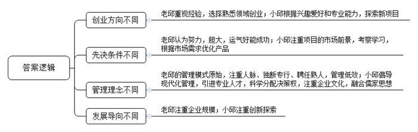
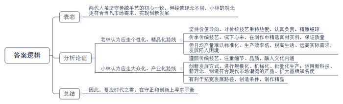
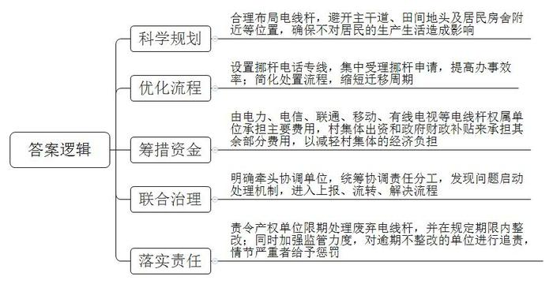
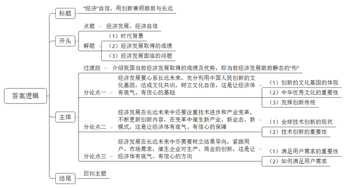

# 2020年0822公务员多省联考《申论》题（吉林乙卷）

<!-- gwy:overview:start -->
> **吉林 · 2020 · 申论 · 乙级** ｜ 4 题 · 图片 4 处 · 答案随题折叠

导航：[题目](#题目) · [材料 1](#材料-1)
<!-- gwy:overview:end -->

> 候选采集稿。参考答案及解析来自粉笔页面，不代表官方答案或真实高分答卷；来源使用许可与原卷对应关系仍需人工核实。

## 给定材料

### 材料 1

小邱个头不高，皮肤白皙，结实强壮，喜欢穿户外运动装，喜欢穿运动装和运动鞋，一点都不像他的父亲老邱，老邱总是穿着皮鞋、西装。他们相差近30岁，对企业经营的看法颇有不同。

1989年，老邱从C市建筑公司辞职，成立了自己的工程队，2002年成立了自己的建筑公司，2010年组建了集团公司，家乡人都称他“建筑大王”。在老邱看来，做企业只要胆大、灵活、肯吃苦，再加上运气好，就能做起来。小邱却不大认同。2004年，老邱计划让上海交大毕业的儿子回来接班，小邱对此纠结了很久。最后，小邱只答应了父亲一半的要求，回去，但他回去的目的不是守业，而是创业。“当时我父亲已经做到了C市建筑行业的第一。但在我看来，这个行业技术门槛比较低，同时与我个人兴趣和所学格格不入。所以我和父亲协商，能不能让我根据自己的兴趣做一个新的行业，父亲答应了。”

这之后的大半年时间，小邱一直在做市场调研。“我一直在思考如何突破现状，每天在报纸和网络中寻找与‘电’或‘自动化’有关的资料，分析什么是有市场前景的产品和项目，最终将目光集中在厨房家电。”2006年，找到创业方向的小邱，自立门户成立了一家家电公司。2009年，小邱通过对欧式洗碗机进行改造，研发出一款欧式外观、内部结构中国化的产品。这款洗碗机一经推向市场，第一年销量就达1万多台，随之确立了公司在这一领域的领先地位。在谈到自己的成功时，小邱说：“我认为最根本的原因在于，我们比洋品牌更加了解中国。”

公司成立之初，小邱希望自己的公司拥有现代化的企业管理制度，“在调研市场期间，我以一个旁观者的身份去观察父亲的企业，发现了很多问题。比如，公司员工乡里乡亲的复杂关系，使一些简单问题处理起来变成了难题；父亲更热衷于参加各种应酬，为自己积攒人脉；在公司，大事小情都是父亲自己来拍板，跟随父亲多年的一些老员工被安排在管理岗位，但他们根本不懂管理；公司表面上看起来干得轰轰烈烈，骨子里还是个包工队。”为此，小邱在成立新公司的时候与父亲约法三章：第一，新公司要建在C市的开发区；第二，父亲公司的员工不能到自己公司来；第三，公司所有的决策都由自己做主。

公司成立之初，小邱大力推行美式卓越绩效管理模式，引进西式管理人才。但他发现，西式管理人才与本地员工存在较大的文化隔阂。小邱说：“从2010年开始，公司的快速发展达到了一个瓶颈，甚至有两年停滞不前，我们分析原因还是管理上出了问题。西式的管理固然有它先进的一面，但单纯照搬是在步别人的后尘。中国的企业必须探索出自己的模式，才能具备持续不断的发展动力。”如何将中国传统文化的精髓与西方的管理模式相结合？这个问题开始萦绕在小邱的脑海。为此，从2012年起，小邱到清华、北大先后进修了四年的传统文化课。他逐渐将自己的所学所思运用到企业管理中，将儒家的基本精神“仁、义、礼、智、信”融入了公司的企业文化。“我们一边实践一边探索一边总结，逐渐摸索出一套中西合璧的管理模式。”十几年的创业磨砺，让小邱最感欣慰的不是企业越做越大，而是企业文化的塑造。他说：“在企业发展过程中，经营管理只是企业的骨架，文化才是一个企业的血脉和灵魂。”

从老邱到小邱，两代人一直在奔跑。有人问小邱，企业的边界在哪里？他的回答是：没有边界。竞争从来不是静态的，你在变，对手也在变，只有不断奔跑，才能生存。

### 材料 2

总面积不过八平方米的店铺，摆满货品之后，两人在店内走动都有些困难，但这家小店在当地却是小有名气的老字号。69岁的店主老林是资深木雕艺人，更被称为“最后的手工酸枝筷子传人”。手工木筷取材自缅甸坤甸木、老挝大红酸枝、泰国乌梅木、印度小叶紫檀和海南黄花梨这五种木材。其中，缅甸坤甸木筷最实惠，乌梅木筷和酸枝木筷最受欢迎，而海南黄花梨木筷因为材料稀缺，必须提前预订，属于收藏品级别。

老林家的店铺是他爷爷在1889年创立的，解放后曾一度关门歇业，到1991年又重新开业。近年来各行各业飞速发展，市场化程度越来越高，但老林对这门家族生意和手艺有着自己的坚持，多年来一直拒绝大批量生产，执着地手工制作每一双筷子。这些年来，不断有人想和他合作，希望形成规模生产，都被他一口回绝了。“钱多了就会想要更多，永远没有止境。”在老林看来，手工制筷工序复杂，没有捷径可走，每道工序都要求严格，稍有不慎，筷子就会走样。一双好筷，真正检验它的只有漫长的时间。做手艺，做生意，必须沉下心来，慢工出细活，而只要工艺精湛，总会有人来购买。正因如此，林家小店始终有一批熟客，“别人要做大做强，那是他们的事，我偏要做小做精，走个性化、精品化的路线。”

林家生产筷子的小作坊现在共有10多个工人，当中不少是跟随了老林20多年的老师傅。每一双筷子都经手工打磨，日均产量也难有标准数字，一天下来，大约能制成40多捆筷子。老林说：“本地早就没有人做手工筷子了，放眼全国，也没几个人坚持手工制作一双小小的筷子，基本都是机械化生产。”

去年开始，家族生意已由老林唯一的女儿小林接手。面对自家的木筷生意，小林有自己的想法。她认为：“人在制物的过程中，总是要把自己和自己的手艺融到里头去，在前人的基础上，留一点新的痕迹，这样这门手艺才能历久弥新。”但像自家这样的老字号要走出困境需要考虑的不仅仅是手艺传承的问题，更重要的是如何生存和发展。

在小林看来，受原材料、制造技艺、生产工时等各种主客观条件的限制，传统手工艺制品已经与奢侈品无异。老手艺在传承的过程中一成不变，走精品化的路线，就会脱离生活，远离人们生活的需要。老字号的道路也只会越走越窄，结果可想而知。自家老字号一方面要严格、严谨地按照传统的技艺进行生产，注重细节、品质，注重老手艺所蕴含的文化内涵的传承；另一方面也要注重新科技、新理念的运用，制造出更多符合当下潮流、迎合市场需要的产品，让“林家筷子”走进人们日常的生活。小林说：“扩大规模，批量生产，让更多的人了解、使用我们的‘林家筷子’，才是最终出路。也只有生意发展了、壮大了，我们才能有更好的条件制作出更多的精品。我要做的就是把自家生意做大做强，走大众化、产业化的路线。”

两代人经营理念的对接，或许还需要一些时日，不过，父女俩坚守传统手艺的初心一致。时代变迁自有节奏，但守正与创新本就是“林家筷子”这样的老字号突围的题中应有之义。

### 材料 3

“开车到这里，电线杆阻挡，车过不去，只好倒回去。”乡间公路，两米多宽，刚好供一辆轿车通行。但是，路中间“长”出一根电线杆，占了路面近半米。车行至此，转弯不行，直行也不畅，一大段出村的道路成了摆设。J县星火村的村民们没少为电线杆的事儿烦心。

顺着星火村党总支奚书记手指的方向看过去——道路两旁、房前屋后、田间地头，电线杆随处可见，分布很不规则，有不少已经闲置废弃，最近的电线杆离村民家房子不过数米。村民们开玩笑抱怨：道路拓宽、房屋翻建，还都得看杆子的“脸色”。

废旧电线杆碍事，为啥不给挪个地儿？“想请走，没那么容易。”奚书记细数电线杆的“娘家”：电力、电信、联通、移动、有线电视……就连小灵通的杆子现在还竖着呢！这么多单位的电线杆，要挪，得一家一家打电话咨询、打报告申请。电话那头听完诉求，都是先报价格。估算下来，废弃不用的杆，拔走，3000块钱一根；挪地方，更贵，一根得1万多块钱。而且流程走下来，移杆周期至少也得两三个月。星火村共有34根废弃空杆要拔除，81根尚在使用的电线杆要迁移，算算账，这笔钱对村里来说可不是个小数目。

在星火村，为这件事，村民们常有反映，可几年来，也只解决了几根。有的电线杆移杆审批好不容易下来了，负责部门也没个具体解决时间，今天拖明天，明天拖后天的。拔根电线杆，事本不大，却因“杆出多门”，多头管理，在基层治理中反倒成了“盲区”。据J县建设局调研统计，辖区内农村地区95％以上的电线杆竖在村民的房前屋后、村主干道旁或田间地头，有的废弃电线杆权属单位为减少处理废杆的成本，任由废杆随意丢弃，而申请电线杆移动周期长、费用高，给村里带来很大的经济压力。“解决不好这个问题，村容村貌受到影响不说，也会给整个美丽乡村建设拖后腿。”奚书记说。

去年J县开展大调研活动，成立大调研办公室，重点关注基层治理中的薄弱区域、盲点区域，着力解决跨地区、跨部门、跨事权的“三跨”问题，要求对发现的“三跨”问题立即启动处理机制，迅速进入上报、流转、解决流程。农村废弃电线杆的处理问题被反映上来，大调研办公室将其定性为典型的“三跨”问题，并责成县建设局牵头立即着手解决。

### 材料 4

日前，一家电商企业的智能配送机器人率先进行了5G测试运行，这标志着我国在物流领域向实现人工智能化作业又迈进了一步。人工智能在科研、医疗、教育、工业制造诸多领域，都有了越来越多的应用。科技进步助力产业与社会发展是令人兴奋的时代变化，但由此带来的就业问题也同样令人忧虑。某调研公司新近发布的报告指出，到2030年，全球约有2000万的制造业岗位被人工智能所取代。如何满足被人工智能替代人群的再就业需求，就成了必须回答的问题。

随着大数据、物联网和云计算的广泛运用，与此相关的新兴产业蓬勃发展，对从业人员的需求大幅增长。某研究机构发布的《2018年中国人工智能人才白皮书》显示，截至2018年底，仅民营企业人工智能人才缺口就至少在100万以上。人力资源专家苏博士说：“像数字化管理师、无人机驾驶员这样的新职业在许多民营企业中早有存在，这些新职业能为国家可持续发展贡献力量。”

中国社科院王研究员认为：“人们不必为智能化时代的就业问题过于担忧，人类经历的任何一场技术革命，都是机遇与挑战并存的。未来在新兴领域，专业的技术人才、创新人才，尤其是数字人才的供给缺口会逐渐增大，但由于人才间的竞争也在加剧，倘若就业者没有做好应对的准备，不去主动适应竞争，便只能在机遇面前望而却步了。”

### 材料 5

中国有着创新的历史和文化基因，中国古代的四大发明对世界文明发展进程产生了重要影响。在今天，不少中国企业在全球科技领域激烈竞争中占有了一席之地，推动了我国经济发展方式的转换、经济结构的调整，移动支付、无人机、生物医药、共享经济等方面取得了许多领先世界的科技成果，有着比国外同类产品更好的用户体验。经历了40多年的高速发展，中国已经积累了雄厚的经济、科研、人才等方面的基础，特别是与第四次工业革命相关的技术，如数字技术、人工智能、量子技术、新能源、5G通信等领域，都走在了世界前头。此外，中国的移动互联网发达，拥有业态优势；网民群体庞大，拥有大数据优势；政府提出的“创新驱动发展战略”，更为中国企业提供了契机。

清华大学陈教授认为，创新是推动经济发展的第一动力，没有科技创新的突破，就难以建成现代化经济体系，就难以实现高质量发展。中国的企业，在世界经济舞台上走出了一条从模仿、追随到引领的发展轨迹，而这背后的“秘诀”便是创新。市场需求催生了中国民营企业对生产的创新、商业的创新，这种创新不是短期的、偶然的，而是长期的、自发的，是一种迥然不同于欧美国家的创新路径，是深刻在中国经济肌体中独一无二的事实特征。

“风物长宜放眼量。”创新是百年大计。纵观世界经济发展史，技术进步和产业变革是经济增长的重要引擎。历次工业革命均因重大技术变革兴起，逐渐催生了一大批新产业、新业态、新模式，进而大幅提高劳动生产率，推动经济增长步入黄金期。有研究显示，以人工智能为代表的新技术革命，到2035年有望拉动中国经济年增长率明显提升，推动中国劳动生产率提高27％。<u>一个经济体的底气，既要看眼前静态的</u><u>“形”，更要看长远发展的“势”。</u>

## 题目

### 第 1 题

**根据给定资料**1**，归纳邱氏父子在创业理念上的差异。（2****0****分）**

关联材料：材料 1

作答要求：

要求：内容全面，语言准确，条理清晰，不超过200字。

第 1 题 · 答案与解析

**参考答案（粉笔题库参考内容）**

1.创业方向不同：老邱重视经验，选择熟悉领域创业；小邱根据兴趣爱好和专业能力，探索新项目。

2.先决条件不同：老邱认为努力，胆大，运气好能成功；小邱注重项目的市场前景，考察学习，根据市场需求优化产品。

3.管理理念不同：老邱的管理模式原始，注重人脉、独断专行、聘任熟人，管理低效；小邱倡导现代化管理，引进专业人才，科学分配决策权，注重企业文化，融合儒家思想。

4.发展导向不同：老邱注重企业规模；小邱注重创新探索。

**参考答案说明：**（1）本参考答案从“创业方向”“先决条件”“管理理念”“发展导向”四方面进行了分条撰写。（2）各条要点之间在内容上是并列的，没有交叉。

**解析状态：unknown（来源未提供）**

### 第 2 题

**给定资料**2**中提到了老林父女在自家老字号发展路线上的不同态度，请你对此进行评析。（1****5****分）**

关联材料：材料 2

作答要求：

要求：观点明确，分析透彻，条理清晰，不超过300字。

第 2 题 · 答案与解析

**参考答案（粉笔题库参考内容）**

**参考答案一：**

两代人虽坚守传统手艺的初心一致，但经营理念不同，小林的观念更符合当代市场需求，实现创新发展。

一、老林认为应走个性化、精品化路线。1.坚持价值导向。对传统技艺秉持热爱，认真负责，精雕细琢。2.传承传统技艺。沉下心来，在制作中精选真材实料，保证质量。但日均产量难以标准化、生产效率低，脱离生活、远离实际需求，发展陷入困境。

二、小林认为应走大众化、产业化路线。1.遵照传统技艺。注重细节、品质，融入文化内涵。2.创新发展方式。进行规模化、机械化、批量化生产；运用新科技、新理念，制造符合现代市场潮流的产品、扩大品牌知名度。有利于拓宽发展路径，创造条件，制作精品。

因此，要应时代之需，在守正和创新上寻求平衡。

**参****考答案说明：**（1）思路方面，本参考答案按照观点现象分析题“表态+分析论证+总结”的一般思路展开。（2）内容方面，本参考答案首先对“老林父女在自家老字号发展路线上的不同态度”表明了态度；接着“分析理由”部分，分别分析了“老林的态度、存在问题”和“小林的态度、意义”；最后在“总结”部分，对“老字号的发展”提出对策。（3）词句表达方面，本参考答案加上了“但”“因此”等连接词来承接上下文，使上下衔接更顺畅。

**参考答案二：**

一、老林认为应走个性化、精品化路线。1.坚持价值导向。对传统技艺秉持热爱，认真负责，精雕细琢。2.传承传统技艺。沉下心来，在制作中精选真材实料，保证质量。但日均产量难以标准化、生产效率低，脱离生活、远离实际需求，发展陷入困境。

二、小林认为应走大众化、产业化路线。1.遵照传统技艺。注重细节、品质，融入文化内涵。2.创新发展方式。进行规模化、机械化、批量化生产；运用新科技、新理念，制造符合现代市场潮流的产品、扩大品牌知名度。有利于拓宽发展路径，创造条件，制作精品。

三、两代人虽坚守传统手艺的初心一致，但小林的观念更符合当代市场需求，实现创新发展。因此，要应时代之需，在守正和创新上寻求平衡。

**解析状态：unknown（来源未提供）**

### 第 3 题

**给定资料**3**中提到了****J****县大调研办公室责成县建设局牵头治理农村电线杆乱象，假如你是****J****县建设局此项工作的负责人，请你提出整治这种乱象的具体措施。（****2****5****分）**

关联材料：材料 3

作答要求：

要求：内容全面，条理清晰，措施可行，有针对性，不超过400字。

第 3 题 · 答案与解析

**参考答案（粉笔题库参考内容）**

整治电线杆乱象的具体措施如下：

第一、科学规划。合理布局电线杆，避开主干道、田间地头及居民房舍附近等位置，确保不对居民的生产生活造成影响。

第二、优化流程。设置挪杆电话专线，集中受理挪杆申请，提高办事效率；简化处置流程，缩短迁移周期。

第三、筹措资金。由电力、电信、联通、移动、有线电视等电线杆权属单位承担主要费用，村集体出资和政府财政补贴来承担其余部分费用，以减轻村集体的经济负担。

第四、联合治理。明确牵头协调单位，统筹协调责任分工，发现问题启动处理机制，进入上报、流转、解决流程。

第五、落实责任。责令产权单位限期处理废弃电线杆，并在规定期限内整改；同时加强监管力度，对逾期不整改的单位进行追责，情节严重者给予惩罚。

**参考答案说明：**本参考答案从“科学规划”“优化流程”“筹措资金”“联合治理”“落实责任”等不同的方面进行了分条撰写。各条要点之间在内容上相互并列，没有交叉。

**解析状态：unknown（来源未提供）**

### 第 4 题

**给定资料**5**中提到，“一个经济体的底气，既要看眼前静态的‘形’，更要看长远发展的‘势’”。根据你对这句话的理解，结合给定资料，联系实际，自拟题目，自选角度，写一篇议论文。（4****0****分）**

关联材料：材料 1、材料 2、材料 3、材料 4、材料 5

作答要求：

要求：

（1）观点明确，内容充实，论证合理，结构清晰，语言流畅；

（2）结合给定资料，但不拘泥于给定资料；

（3）字数800～1000字。

第 4 题 · 答案与解析

**参考答案（粉笔题库参考内容）**

**“经济”自信，用创新兼顾眼前与长远**

在这片充满希望的田野上，大有可为的热土上，发展始终是每个时代的关键词，而经济则是衡量发展水平的重要指标，是一切发展的基础与保障。大数据、物联网、云计算，人脸识别、在线支付……，我们曾经期待的，渴望的，都照进了现实。经济结构的优化转型，综合国力的增强提升……这些都在向全世界昭示着我国经济“乘长风，破万里浪”的汹涌气势。但国际发展时局瞬息万变，我国经济发展也面临新的挑战与困境。想突破重重阻碍，赢得经济发展的主动权，树立经济自信，要善于着眼当下的时局，看到眼前静态的“形”，更要心系长远的未来，勇于开拓创新，蓄势谋势、求变应变，抓住长远发展的“势”。

40多年的风云变幻，一代又一代人的使命背后，依靠的是我们“拔地而起”的优势，不仅包含雄厚的经济、科研、人才等多方面的积累，亦包括走在前端的、发达的移动互联网，特别是党和政府提供的宽松的、优良的政治环境。但是，一代人的安于现状、固步自封，就会让我们在时代变迁中，固化思维、困住手脚，难以实现持续发展。

因此，**经济发展要心系长远未来，充分利用中国人民创新的文化基因，达成文化共识，树立文化自信，这是让经济体有底气、有信心的基础**。一直以来，我国都有着创新的历史和文化基因：在古代，四大发明对世界文明发展进程产生了重要影响；在今天，高速铁路、扫码支付、共享单车和网络购物改变了人们的生活方式，提高人们的生活质量，被外国友人评选为中国的“新四大发明”……这些都是中国人民积极创新的生动体现。中华优秀文化积淀着中华民族最深沉的精神追求，也为中华儿女不断创新提供丰厚滋养。新时期，更应发扬创新传统，将中华优秀文化创造性转化，以文化创新增强经济自信。

**经济发展在长远未来中还要注重技术进步和产业变革，不断更新创新内容，在变革中催生新产业、新业态、新模式，这是让经济体有底气、有信心的保障**。“风物长宜放眼量”，创新是百年大计。近年来，在全球范围内出现了一系列有重大影响、颠覆性的新兴技术，这些技术互相交叉、融合、渗透，以人工智能为代表的新技术革命正在孕育中，这也是经济发展的引擎。在促进经济发展的同时，改变人们的思维，拓宽人们的视野，不断催生新的发展模式，让发展生生不息，让经济持续突破。

**经济发展在长远未来中亦需要树立结果导向，紧跟用户、市场需求，催生企业对生产、商业****的创新，这是让****经济体有底气、有信心的方向**。“顾客就是上帝”，满足用户需求是市场得以永续发展的关键要素；关注用户需求，重视用户体验，掌握用户在使用产品时的心理感受，是产品更新换代、推陈出新的必经阶段。用户需求关乎市场需求，或爱不释手，或厌恶至极，或欣喜若狂，或怒不可遏；用户需求就是商机，或稍纵即逝，或旷日持久，或昙花一现，或绵延不绝。因此，有目的、目标地去发展经济，是赢得胜利的保障，是拓展用户、扩大市场的指向标。

“正入万山圈子里，一山放过一山拦。”回望过去，无论中国经济经历多少坎坷风雨，都能一路披荆斩棘、自信满满。只要我们善于积势蓄势谋势，把握眼前的“形”，更勇于识变求变应变，积极开拓创新，看到长远发展的“势”，就会在危机中孕育新机，于变局中广开新局。

**文章分析**

**“经济”自信，用创新兼顾眼前与长远**

【**标题的优点**：范文的标题突出了“经济底气（自信）”这一主题，并点明了“创新”这一角度，标题准确、简练。】

在这片充满希望的田野上，大有可为的热土上，（1）<u>发展始终是每个时代的关键词</u>，<u>而经济则是衡量发展水平的重要指标</u>，<u>是一切发展的基础与保障</u>。（2）大数据、物联网、云计算，人脸识别、在线支付……，<u>我们曾经期待的，渴望的，都照进了现实</u>。经济结构的优化转型，综合国力的增强提升……<u>这些都在向全世界昭示着我国经济</u><u>“</u><u>乘长风，破万里浪</u><u>”</u><u>的汹涌气势</u>。（3）<u>但国际发展时局瞬息万变，我国经济发展也面临新的挑战与困境</u>。想突破重重阻碍，赢得经济发展的主动权，树立经济自信，要善于着眼当下的时局，看到眼前静态的“形”，更要心系长远的未来，勇于开拓创新，蓄势谋势、求变应变，抓住长远发展的“势”。

【**开头的优点**：★内容方面。范文的开头是紧扣题目给定的“经济底气（自信）”这一主题展开的。首先，开头第一句话点出了“经济发展”这一话题，做到了主题明确。其次，对“经济底气（自信）”这一主题进行了分析阐述，指出了：（1）时代背景，（2）经济发展取得的成绩，（3）经济发展面临的问题。注意，以上三个方面的论述是有内在逻辑顺序的：先写“背景”，再写“成绩”，最后写“问题”。★文字表达方面。使用了“但”“要……更要……”等关联词，使语言表达有逻辑性。】

<u>40多年的风云变幻，一代又一代人的使命背后</u>，<u>依靠的是我们</u><u>“</u><u>拔地而起</u><u>”</u><u>的优势</u>，不仅包含雄厚的经济、科研、人才等多方面的积累，亦包括走在前端的、发达的移动互联网，特别是党和政府提供的宽松的、优良的政治环境。但是，一代人的安于现状、固步自封，就会让我们在时代变迁中，固化思维、困住手脚，难以实现持续发展。

【**过渡段的优点：**范文的过渡段分析了“经济发展取得的成绩”，这也是经济发展眼前静态的“形”。此外，还要注意过渡段末尾的“一代人的安于现状、固步自封，就会让我们在时代变迁中，固化思维、困住手脚，难以实现持续发展”是用来引起下文的过渡句。】

因此，**经济发展要心系长远未来，充分利用中国人民创新的文化基因，达成文化共识，树立文化自信，这是让经济体有底气、有信心的基础**。一直以来，（1）<u>我国都有着创新的历史和文化基因</u>：在古代，四大发明对世界文明发展进程产生了重要影响；在今天，高速铁路、扫码支付、共享单车和网络购物改变了人们的生活方式，提高人们的生活质量，被外国友人评选为中国的“新四大发明”……这些都是中国人民积极创新的生动体现。（2）<u>中华优秀文化积淀着中华民族最深沉的精神追求</u>，<u>也为中华儿女不断创新提供丰厚滋养</u>。新时期，（3）<u>更应发扬创新传统</u>，<u>将中华优秀文化创造性转化</u>，<u>以文化创新增强经济自信</u>。

【**论述段****1****的优点**：★观点句：范文的观点句是紧扣“经济底气（自信）”这一文章主题提出的。形式上，它在段首处直接写出，位置突出，容易被发现；内容上，关键词突出，内容要点明确，可以明显看出它是从“利用中国人民创新的文化基因”的角度入手，指出了如何从长远角度保持经济自信。★论述内容：本段主要围绕“经济底气（自信）”这一主题进行分析阐述，指出了：（1）创新的文化基因的体现，（2）中华优秀文化的重要性，（3）发挥创新传统。注意：以上三个方面的内容都是紧扣观点句“经济发展要心系长远未来，充分利用中国人民创新的文化基因，达成文化共识，树立文化自信，这是让经济体有底气、有信心的基础”进行分析论述的，针对性强、内容层次丰富。最后，在论证方法和论据选取方面，讲道理和举例子相结合，做到了丰富多样。】

**经济发展在长远未来中还要注重技术进步和产业变革，不断更新创新内容，在变革中催生新产业、新业态、新模式，这是让经济体有底气、有信心的保障**。“风物长宜放眼量”，创新是百年大计。近年来，（1）<u>在全球范围内出现了一系列有重大影响、颠覆性的新兴技术</u>，这些技术互相交叉、融合、渗透，以人工智能为代表的新技术革命正在孕育中，这也是经济发展的引擎。（2）<u>在促进经济发展的同时</u>，<u>改变人们的思维，拓宽人们的视野，不断催生新的发展模式，让发展生生不息，让经济持续突破</u>。

【**论述段****2****的优点**：★观点句：范文的观点句是紧扣“经济底气（自信）”这一文章主题提出的。形式上，它在段首处直接写出，位置突出，容易被发现；内容上，关键词突出，内容要点明确，可以明显看出它是从“注重技术进步和产业变革”的角度入手，指出了如何从长远角度保持经济自信。★论述内容：本段主要围绕“经济底气（自信）”这一主题进行分析阐述，指出了：（1）全球技术创新的现状，（2）技术创新的重要性。注意：以上两个方面的内容都是紧扣观点句“经济发展在长远未来中还要注重技术进步和产业变革，不断更新创新内容，在变革中催生新产业、新业态、新模式，这是让经济体有底气、有信心的保障”进行分析论述的，针对性强、内容层次丰富。最后，在论证方法和论据选取方面，以讲道理为主，论述准确、贴切。】

**经济发展在长远未来中亦需要树立结果导向，紧跟用户、市场需求，催生企业对生产、商业的创新，这是让经济体有底气、有信心的方向**。“顾客就是上帝”，（1）<u>满足用户需求</u><u>是市场得以永续发展的关键要素</u>；关注用户需求，重视用户体验，掌握用户在使用产品时的心理感受，是产品更新换代、推陈出新的必经阶段。用户需求关乎市场需求，或爱不释手，或厌恶至极，或欣喜若狂，或怒不可遏；用户需求就是商机，或稍纵即逝，或旷日持久，或昙花一现，或绵延不绝。因此，（2）<u>有目的、目标地去发展经济，是赢得胜利的保障，是拓展用户、扩大市场的指向标</u>。

【**论述段****3****的优点**：★观点句：范文的观点句是紧扣“经济底气（自信）”这一文章主题提出的。形式上，它在段首处直接写出，位置突出，容易被发现；内容上，关键词突出，内容要点明确，可以明显看出它是从“紧跟用户、市场需求，实现产品智能化升级”的角度入手，指出了如何从长远角度保持经济自信。★论述内容：本段主要围绕“经济底气（自信）”这一主题进行分析阐述，指出了：（1）满足用户需求的重要性，（2）如何满足用户需求。注意：以上两个方面的内容都是紧扣观点句“经济发展在长远未来中亦需要树立结果导向，紧跟用户、市场需求，催生企业对生产、商业的创新，实现产品智能化升级，这是让经济体有底气、有信心的方向”进行分析论述的，针对性强、内容层次丰富。最后，在论证方法和论据选取方面，以讲道理为主，论述准确、贴切。】

“正入万山圈子里，一山放过一山拦。”回望过去，无论中国经济经历多少坎坷风雨，都能一路披荆斩棘、自信满满。只要我们善于积势蓄势谋势，把握眼前的“形”，更勇于识变求变应变，积极开拓创新，看到长远发展的“势”，就会在危机中孕育新机，于变局中广开新局。

【**结尾的优点**：（1）再次提到了“经济底气（自信）”；（2）展望未来。】

**解析状态：unknown（来源未提供）**

