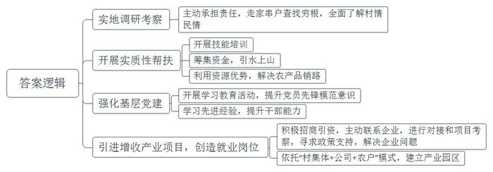
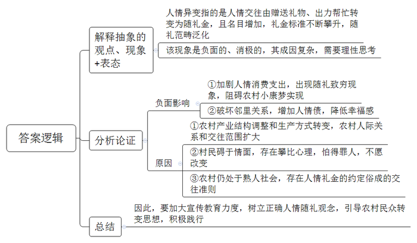
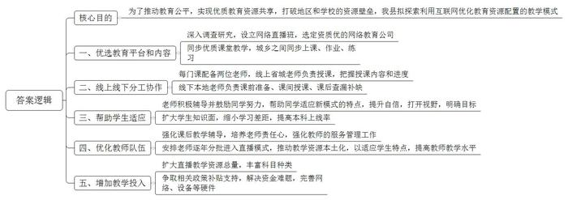
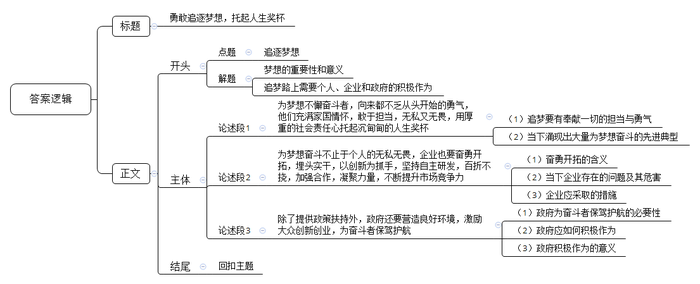

# 2020年0822公务员多省联考《申论》题（吉林甲卷）

<!-- gwy:overview:start -->
> **吉林 · 2020 · 申论 · 甲级** ｜ 4 题 · 图片 4 处 · 答案随题折叠

导航：[题目](#题目) · [材料 1](#材料-1)
<!-- gwy:overview:end -->

> 候选采集稿。参考答案及解析来自粉笔页面，不代表官方答案或真实高分答卷；来源使用许可与原卷对应关系仍需人工核实。

## 给定材料

### 材料 1

“我们都在努力奔跑，我们都是追梦人。”追梦，我们收获满满；追梦，我们希望满满。

正如习近平总书记所说，中国人民具有伟大梦想精神。改革开放40多年，就是一个追梦之旅。改革开放之初，我们党以非凡的胆略、坚定的自信设计了分三步走战略基本实现社会主义现代化的宏伟蓝图。40多年的追梦路上，我们咬定青山不放松，风雨无阻朝着这个伟大目标前进。

从站起来、富起来到强起来，这是奋斗的力量，也是梦想的力量。

梦想是拼出来的，奇迹是干出来的。改革开放辉煌成就的背后，是40多年的不懈努力。未来中国梦的实现，同样需要汗水的浇灌。改革开放40多年的历程告诉我们：伟大事业始于梦想，基于创新，成于实干。梦想是激发活力的源泉。只要有梦想，就会有力量；只要有梦想，则时光不弃，未来可期。

党的十九大提出了更高的奋斗目标，作出了从全面建成小康社会到基本实现现代化、再到全面建成社会主义现代化强国的战略安排，发出了实现中国梦的最强音。

### 材料 2

只因看了一眼岩山，从此就与岩山结缘。她就是D市驻岩山村帮扶工作组组长、驻村第一书记小孙。几年前，小孙从一所名牌大学毕业，来到D市商务局工作。有一次，市委、市政府组织“机关干部下基层”社会实践活动，她随着实践小组来到了岩山。

“太美了！”小孙被岩山美丽的风景深深吸引，花红柳绿，山清水秀，真是如诗如画。当地淳朴的民风，热情好客的村民更令她印象深刻。不过，令她同样印象深刻的还有岩山的贫困。岩山村共有1345户、4130口人，其中贫困户占60%，人均耕地不足0.8亩，村民收入主要依靠传统农业和外出务工，脱贫是这里的村民一代又一代的梦想。“如果能帮助岩山村这样的地方摆脱贫困，人生该是多么有价值啊！”小孙的心里涌起一个强烈的念头。

此时，D市正深入开展脱贫攻坚行动。巧合的是，岩山村正是商务局的对口扶贫村。小孙主动请缨，担任驻岩山村帮扶工作组组长。

从驻村工作开始的第一天起，帮助岩山这个贫困村脱贫致富的责任，便落在了小孙的肩上。刚入村时，小孙就听到了这样的风凉话，“咋还派个女干部？一个城里女娃能干啥？”

为了开个好头，尽快熟悉情况进入工作，小孙和工作组同事，挨家挨户了解情况。入村不到三个月，他们就完成了对全村所有贫困户的走访，对村里的“大事小情、家长里短”心里有了数。

随后，小孙与工作组同事率先在村里办了手工编织和家政服务两个培训班。与此同时，她们筹集资金，开工建设引水入村工程，彻底改变了村里几十年来缺水的落后状况。去年春节前，受非洲猪瘟疫情的影响，年猪卖不出去，这可愁坏了养殖的贫困户，工作组积极利用自身资源优势帮助销售，终于为贫困户换来了80多万元沉甸甸的“过年钱”……村民们被小孙这位“女干部”的实干精神深深打动了，原来那些风凉话也销声匿迹了。

“农村富不富，关键在支部。”小孙对此深有感触。她和工作组同事带着村里的党员积极开展“不忘初心，牢记使命”主题教育活动，提升党员的先锋模范意识。为了提高党员干部代表引领产业发展、带领群众致富的能力，小孙多次带领他们到县内外先进地区学习考察。“明显感觉到岩山的民心齐了，村干部的干劲足了、水平高了”，小孙带领村民脱贫致富的信心更强了。

小孙得知外省一家大型现代纺织企业的董事长宋先生是岩山人，有回乡投资的想法。小孙感到这个纺织项目非常适合岩山村，便第一时间与他取得联系，积极沟通招商想法，安排投资对接和项目考察。针对宋先生提出的十几条落实投资的要求，工作组到市、县、乡各项目主管部门咨询政策、寻求支持。仅仅5个多月的时间，工作组就协助该企业完成了项目选址、手续办理、厂房建设、员工培训等一系列工作。目前，一个依托“村集体+公司+农户”模式建起的纺织产业园区，已在岩山渐渐成型。不久的将来，这里的村民不仅可以在家门口就业，而且可以实现既拿薪资又领股金还得到租金的长效增收，岩山村的脱贫梦正在变成现实。“我们的目标是成为北方最大的坯布集散地。”一个更大的梦想在小孙心中一点点描绘。“作为一个80后，我的梦想也在一点点实现。”

“咱们岩山再也不是那个靠天吃饭的穷地方了，现在不少在外打工的年轻人都回来了。”村民喜滋滋地指着驻村工作组的办公室说，“变化就是从孙书记和她的工作组到咱村来的那一天开始的。”

### 材料 3

出于各种考虑，在省城工作的赵先生今年春节没回农村老家过年。但为了看望家中父母，他特意在春节前回去了一趟。“回去一趟，几千块钱就没了。”赵先生说，“有两个晚辈赶在春节前结婚，每人随了2000元。”

20世纪80年代，农村碰到重要的红白喜事，一般都是送点日常用品或者鸡蛋、罐头等，邻里一起出出力帮帮忙，那时候很少有人随钱，而且随多随少也没有固定标准。但如今，农村人情交往中赠送礼物的现象几乎消失了，结婚的、生孩子的、盖新房的、升学的、给老人祝寿的，都要办酒席，而且都要随礼，礼金标准也在不断攀升。

随着农村产业结构的调整和生产方式的转变，农村的人际关系和交往范围逐渐扩大，随礼的范围也在不断扩大，赵先生回忆说，“小时候，家里的人情往来一般在亲属、邻居和朋友之间。后来逐渐增加了工友、同事、合作伙伴等，农村人情消费支出大幅度增加。”

五花八门的酒席、巧立名目的宴请、节节攀升的礼金……近年来，部分农村地区出现了这种不好的风气。热衷“穷讲究”，最终“讲究穷”，甚至出现随礼致穷现象。相关调查显示，当下部分地区农民消费的第一支出为食品，第二支出就是人情礼金，甚至超过了医疗支出。随着礼金范畴的泛化，人情礼金已经不再有人情味，反而变成了人情债，农村邻里关系因此也变了味。邻里和谐，才会实现老乡们的幸福梦，但人情异变却成了农民实现小康梦路上的绊脚石。

不少农民对这些问题反映强烈，但碍于面子，不愿意从自己开始改变现状。赵先生曾要求父亲，有些宴请可以选择不参加，但父亲认为“不去不行”，因为“随礼是祖祖辈辈传下来的规矩，别人都随，咱家不随，人家一定会怪罪咱们。乡里乡亲的，低头不见抬头见，实在抹不开面子。”

对此，赵先生也有自己的思考。中国农村虽然在现代化进程中取得了很大的进步，但主要还是一个熟人社会。在农村熟人社会，人情礼金这样约定俗成的交往准则其实更像是一把双刃剑。

### 材料 4

L县是国家级贫困县，过去师资力量和办学条件整体比较落后。L县一中是该县的重点中学，高考成绩却不是很理想。“其实我们的孩子都很想学，也很勤奋，但总体成绩就是不如大城市的孩子。”L县一中吴校长说，“每当在电视、网络上看到大城市优越的教学条件，孩子们都梦想着能接受和大城市同龄人一样的教育，进行公平的竞争。”

随着国家对教育公平的重视和教育信息化大潮的推动，同时得益于近几年脱贫攻坚进程的加快，L县一中的软硬件条件如今都得到了较大提升。L县教育局经过反复调查研究，决定在L县一中设立网络直播班，选定一家资质较好的网络教育公司，同步直播省城重点中学七中老师的课堂教学，学生跟着省城七中的同学同步上课、同步作业、同步练习。在网络直播课程中，每门课都有线上线下两位老师，线上的是省城七中的老师，负责课堂授课，授课内容和进度也都以省城七中为准。线下的是L县一中的老师，他们除了课前准备、课间讲授，还需要在课后和没有跟上的同学一起查漏补缺。

罗同学是L县一中的高三学生，他对自己刚接触网络直播课程时的情形记忆犹新。“刚开始接触直播教学，那边的教学特点就是密度大，知识面覆盖广。有些不适应，感觉差距还是比较大。”罗同学说，“这种教学模式就像是6门学科有了12名指导老师，他们那边问什么我们就回答什么，一开始觉得有点儿怪，慢慢发现你答的跟那边也差不多，你会发现已经跟上那个课堂了，当时还是有点兴奋，自信心也上来了。”

网络直播班班主任杨老师认为，新的教学模式除了带来成绩上的提高，更多的是给了学生参照和动力。“他们会觉得在追梦的路上自己和省城七中的同学享有了均等的机会，剩下的就看自己的奋斗了。”

从三年前最初引入一个班试点，逐渐发展到现在15个网络直播班700多名学生上课，越来越多的学生参与到了网络直播教学中。对网络直播班的教学效果，L县教育局王局长介绍说，“今年高考成绩发布后，网络直播班本科上线率达到了93%，一本上线率达到了59%。虽然这个功劳并不能只归功于网络直播课程，但毫无疑问，网络直播课程在很大程度上带来了积极改变。”

对网络直播课程的效果，何同学有另外的感受。她也是L县一中网络直播班的学生，去年毕业考入了一所名牌大学。回忆在网络直播班学习的经历，她说，“要说高考增加多少分，可能不是特别明显。但是从省城七中师生身上我学到了很多东西，也打开了我的视野，让我有了清晰的目标，考一个什么样的大学，想去什么样的地方。这好像是一道光，它照亮了我的梦想，让梦想变得明亮清晰。”

网络直播授课的模式是互联网+教育的产物，在一定程度上打破了地区和学校之间的资源壁垒，实现了优质教育资源跨时空整合、配置和流转。吴校长认为这对教师来说也是锻炼和学习的机会，“我们的教师逐年分批地进入这种教学模式里锻炼，并且把省城七中的资源本土化，让它更适合我们自己的学生。在这个过程中，我们教师的教学水平也得到了提升。”但吴校长还认为，“技术和模式都有一定的局限性，关键还在于教师。L县一中网络直播课程为什么效果好，是因为对课堂教学没跟上的学生，本地教师课后会再进行教学辅导。这些教师非常累，他们上直播班的工作量，是上普通班工作量的三倍，很多教师还要连续加班带晚自习。这对教师的责任心是一个考验，也对教师队伍的管理服务工作提出了挑战。”

对于网络直播教学模式能否大规模推广，惠及更多学生，王局长坦言，“目前还存在很多困难。网络直播教学的资源总量还是很有限，主要集中在语文、数学和英语课上，还有很多课程没有实现资源共享。即便如此，一个网络直播班的费用平均一年也要七万元左右。如果覆盖到乡村，还要铺设网络、增添设备，支出就更大了。不过，只要能切切实实帮助到孩子们，我们还是要想办法去做。”

### 材料 5

BD药业是一家在全球肿瘤药物领域拥有多项核心自主知识产权的高科技公司。说起BD药业的故事和梦想，公司董事长兼首席执行官丁先生有很多感慨。

2002年，借着国家政策鼓励留学生回国创新创业的东风，留洋十年的丁先生与几位合伙人一道回国创业。2003年，BD药业成立。开始追逐“做创新药”的大梦想，有人说，丁先生身上有不少光环，比如国外著名大学的医学博士、执业医师等，回国创业就意味着放弃了优越的生活条件、高额的薪水。从头开始，这个抉择很有勇气。而在丁先生看来，这个选择顺理成章。“像我们这些知识分子，大多数还是有故土情结的，梦想着科技兴国。”除了游子的思乡情结，还有一点对丁先生来说非常重要——“国家鼓励海归创新创业，在国内可以做到很多在国外做不到的事”。

与很多企业选择做仿制药不同，BD药业一开始就立志做新药，要在全球药业竞争中拥有完全自主知识产权。虽然面临各种技术难题、无休止试药及资金链断裂等“生死劫”，但有志者，事竟成，BD药业克服了重重困难，最终成功了。他们研制的抗癌药获得国家颁布新药证书，成为我国首批具有完全自主知识产权的抗癌新药。该药还被列入国际权威机构发布的新药研发年度报告，成为获得国际机构认可的中国创制新药。

2016年1月8日对于丁先生来说很特别，也很难忘。这一天他作为BD药业相关项目的第一完成人，在2015年度国家科学技术奖励大会上捧起了光荣的奖杯。“这个奖杯是对奋斗者坚持梦想的最好褒奖，这个奖杯上不仅有我的名字，有我们团队的名字，其实还应该有国家的名字。”在北京深冬的暖阳中，丁先生郑重地一手拿着大红证书，一手举起奖杯，站在人民大会堂前拍了一张照片。这是国家对BD药业创新能力的巨大肯定。

如今，BD药业又种下了一颗新的梦想种子——以自家企业为基础，打造一座“医药梦工场”，搭建更大的创新平台，为全国医药产业的快速发展打造新引擎。丁先生说，这是一个为科学家、创业者造梦圆梦的项目，未来，这里将集聚一批医药领域的创业者。作为过来人，丁先生还想说的是，创业者既要有仰望星空的格局与胸襟，也要有坐住板凳的定力和意志。

## 题目

### 第 1 题

**根据给定资料2，归纳小孙为带领村民脱贫致富所做的工作。（20分）**

关联材料：材料 2

作答要求：内容全面，语言准确，条理清晰，不超过200字。

第 1 题 · 答案与解析

**参考答案（粉笔题库参考内容）**

1.实地调研考察。主动承担责任，走家串户查找穷根，全面了解村情民情。

2.开展实质性帮扶。开展技能培训；筹集资金，引水上山；利用资源优势，解决农产品销路。

3.强化基层党建。开展学习教育活动，提升党员先锋模范意识；学习先进经验，提升干部能力。

4.引进增收产业项目，创造就业岗位。积极招商引资，主动联系企业，进行对接和项目考察，寻求政策支持，解决企业问题；依托“村集体+公司+农户”模式，建立产业园区。

**解析**

**参考答案说明：**本参考答案从“实地调研考察”“开展实质性帮扶”“强化基层党建”“引进增收产业项目，创造就业岗位”等不同的角度进行了分条撰写；各条答案要点之间在内容上相互并列，没有交叉。

**考点**：概括措施类

**来源**：2020年0822公务员多省联考《申论》题（吉林甲卷）

### 第 2 题

**针对给定资料3中赵先生感受到的农村人情异变这一现象，谈谈你的认识。（15分）**

关联材料：材料 3

作答要求：观点明确，分析透彻，条理清晰，不超过300字。

第 2 题 · 答案与解析

**参考答案（粉笔题库参考内容）**

人情异变指的是人情交往由赠送礼物、出力帮忙转变为随礼金，且名目增加，礼金标准不断攀升，随礼范畴泛化。该现象是负面的、消极的，其成因复杂，需要理性思考。

1.其负面影响表现在：①加剧人情消费支出，出现随礼致穷现象，阻碍农村小康梦实现。②破坏邻里关系，增加人情债，降低幸福感。

2.其原因是：①农村产业结构调整和生产方式转变，农村人际关系和交往范围扩大。②村民碍于情面，存在攀比心理，怕得罪人，不愿改变。③农村仍处于熟人社会，存在人情礼金的约定俗成的交往准则。

因此，要加大宣传教育力度，树立正确人情随礼观念，引导农村民众转变思想，积极践行。

**解析**

**参考答案说明：**思路方面，本参考答案按照观点现象分析题“解释抽象的观点、现象+表态+分析论证+总结”的一般答题思路展开。内容方面，本参考答案先对“农村人情消费异变”的含义进行了解释并表态；“分析论证”部分先分析了“影响”，接着分析了“原因”；最后“总结”部分提出了简单对策。词句表达方面，本答案加上了“因此”等连接词来承接上下文。

**考点**：观点现象分析类

**来源**：2020年0822公务员多省联考《申论》题（吉林甲卷）

### 第 3 题

**L县教育局准备在全县各级中学推广L县一中的网络直播教学模式，假如你是该县教育局此项工作的负责人，结合给定资料4，谈谈你的工作思路。（25分）**

关联材料：材料 4

作答要求：思路清楚，内容全面，措施可行，条理清晰，不超过450字。

第 3 题 · 答案与解析

**参考答案（粉笔题库参考内容）**

为了推动教育公平，实现优质教育资源共享，打破地区和学校的资源壁垒，我县拟探索利用互联网优化教育资源配置的教学模式。思路如下：

一、优选教育平台和内容。深入调查研究，设立网络直播班，选定资质优的网络教育公司；同步优质课堂教学，城乡之间同步上课、作业、练习。

二、线上线下分工协作。每门课配备两位老师，线上省城老师负责授课，把握授课内容和进度；线下本地老师负责课前准备、课间授课、课后查漏补缺。

三、帮助学生适应。老师积极辅导并鼓励同学努力，帮助同学适应新模式的特点，提升自信，打开视野，明确目标；扩大学生知识面，缩小学习差距，提高本科上线率。

四、优化教师队伍。强化课后教学辅导，培养老师责任心，强化教师的服务管理工作；安排老师逐年分批进入直播模式，推动教学资源本土化，以适应学生特点，提高教师教学水平。

五、增加教学投入。扩大直播教学资源总量，丰富科目种类；争取相关政策补贴支持，解决资金难题，完善网络、设备等硬件。

**解析**

**参考答案说明：**本参考答案从“优选教育平台和内容”“线上线下分工协作”“帮助学生适应”“优化教师队伍”“增加教学投入”等不同的方面进行了分条撰写。各条答案要点之间在内容上相互并列，没有交叉。

**考点**：提出对策类

**来源**：2020年0822公务员多省联考《申论》题（吉林甲卷）

### 第 4 题

**给定资料5中提到，“这个奖杯是对奋斗者坚持梦想的最好褒奖，这个奖杯上不仅有我的名字，有我们团队的名字，其实还应该有国家的名字。”根据你对这句话的理解，结合给定资料，联系实际，以“人生的奖杯”为话题，自拟题目，写一篇议论文。（40分）**

关联材料：材料 1、材料 2、材料 3、材料 4、材料 5

作答要求：

（1）观点明确，内容充实，论证合理，结构清晰，语言流畅；

（2）结合给定资料，但不拘泥于给定资料；

（3）字数800-1000字。

第 4 题 · 答案与解析

**参考答案（粉笔题库参考内容）**

**勇敢追逐梦想，托起人生奖杯**

**这是一个追梦的时代，我们都是追梦人**。梦想，是我们人生起航的方向，是追梦路上星星点点的希望，亦是华夏儿女不懈奋斗的最终目标。正如习总书记所说，中国人民具有伟大梦想精神。只要有梦想，就会有改革的活力；只要有梦想，就会有发展的动力；只要有梦想，则时光不弃，未来可期。**在追梦的路上，个人、企业、国家都需要积极作为，勇敢前行，共同托起人生的奖杯。**

**为梦想不懈奋斗者，向来都不乏从头开始的勇气，他们充满家国情怀，敢于担当，无私又无畏，用厚重的社会责任心托起沉甸甸的人生奖杯。**王安石为梦想变法革新，不畏权贵；玄奘为梦想万里跋涉，西天取经；王淦昌为梦想隐姓埋名，以身许国；丁先生为梦想放弃高薪，毅然回国……凡此种种，都在告诉我们，追梦途中要有奉献一切的担当与勇气。放眼当下，正因为胸怀天下，心系百姓，才会有“甘于寂寞勇创新”的科研工作者，才会有“黄沙百战穿金甲”的最美逆行者，才会有“不胜疫情终不还”的医务工作者。

**为梦想奋斗不止于个人的无私无畏，企业也要奋勇开拓，埋头实干，以创新为抓手，坚持自主研发，百折不挠，加强合作，凝聚力量，不断提升市场竞争力。**奋勇开拓不是单打独斗的蛮干，也不是追随大流的盲从，而是要跟随时代前行的脚步，学会合作，善于创新。面对美国的多次打压，华为之所以能够顶住压力，绝地求生，正是在于其团结一心，持续创新。然而，当下很多企业只愿做跟随者，而不愿做开拓者，长此以往必将无法适应竞争激烈的外部环境，更不利于创新氛围的形成。面向未来，企业应该凝聚力量，加强自主研发，积极寻求合作，实干苦干，以超凡的格局迎接风险和挑战。

“人民有梦想，国家有力量。”中华民族生生不息，恰在于人们追梦的脚步从未停滞。在追梦的路上，政府更要积极作为，为个人和企业的发展护航。

**除了提供政策扶持外，政府还要营造良好环境，激励大众创新创业，为奋斗者保驾护航**。当前社会环境复杂，如果干事创业只凭一腔热血，缺少规划和引导，很可能会滑入失败的深渊。为此，国家要加大扶持力度，出台减税降费、证照合一等政策，营造公平的竞争环境，打造良好的科研环境，以创业园区、创业孵化器等为创业者提供发展空间，以创业培训、创业贷款等缓解他们资金上的燃眉之急。良好的政策环境不仅可以提升效率，促进创新成果的转化，还可以使创业创新者保持定力，增强信心，让创新源泉充分涌流，不断为国家高质量发展提供动力。

作为新时代的追梦人，我们要不忘初心和使命，勇敢前行，奋勇开拓，携手唱响“我辈岂是蓬蒿人”的时代颂歌。

**解析**

**文章分析**

**勇敢追逐梦想，托起人生奖杯**

【**标题的优点：**标题中含有“梦想”“人生奖杯”主题词，使文章主题更突出、清晰。】

**这是一个追梦的时代，我们都是追梦人**。（1）<u>梦想</u>，<u>是我们人生起航的方向</u>，<u>是追梦路上星星点点的希望</u>，<u>亦是华夏儿女不懈奋斗的最终目标</u>。正如习总书记所说，<u>中国人民具有伟大梦想精神</u>。<u>只要有梦想</u>，<u>就会有改革的活力</u>；<u>只要有梦想</u>，<u>就会有发展的动力</u>；<u>只要有梦想</u>，<u>则时光不弃</u>，<u>未来可期</u>。（2）<u>在追梦的路上</u>，<u>个人</u>、<u>企业</u>、<u>国家都需要积极作为</u>，<u>勇敢前行</u>，<u>共同托起人生的奖杯</u>。

【**开头的优点：**★内容方面：范文的开头是紧扣“人生的奖杯（梦想）”这一主题展开的。首先，开篇点出主题，做到了主题明确。其次，对“人生的奖杯（梦想）”这一主题进行了分析阐述：（1）指出梦想的重要性和意义；（2）指出追梦路上需要个人、企业和政府的积极作为。★文字表达方面：使用了“……是……亦是……”“只要……就会……”等句式，使语言表达有逻辑性。】

**为梦想不懈奋斗者，向来都不乏从头开始的勇气，他们充满家国情怀，敢于担当，无私又无畏，用厚重的社会责任心托起沉甸甸的人生奖杯。**王安石为梦想变法革新，不畏权贵；玄奘为梦想万里跋涉，西天取经；王淦昌为梦想隐姓埋名，以身许国；丁先生为梦想放弃高薪，毅然回国……凡此种种，都在告诉我们，（1）<u>追梦途中要有奉献一切的担当与勇气</u>。（2）<u>放眼当下</u>，<u>正因为胸怀天下</u>，<u>心系百姓</u>，<u>才会有</u>“<u>甘于寂寞勇创新</u>”<u>的科研工作者</u>，<u>才会有</u>“<u>黄沙百战穿金甲</u>”<u>的最美逆行者</u>，<u>才会有</u>“<u>不胜疫情终不还</u>”<u>的医务工作者</u>。

【**论述段1的优点**：★观点句：范文的观点句是紧扣“人生的奖杯（梦想）”这一文章主题提出的。形式上，它在段首处直接写出，位置突出，容易发现；内容上，关键词突出，内容要点明确，可以明显看出它是从“勇气”“家国情怀”“担当”“无私无畏”“社会责任心”等角度入手，指出追梦路上个人应如何作为。★论述内容：（1）追梦要有奉献一切的担当与勇气；（2）当下涌现出大量为梦想奋斗的先进典型。注意：以上两个方面的内容都是紧扣观点句“为梦想不懈奋斗者，向来都不乏从头开始的勇气，他们充满家国情怀，敢于担当，无私又无畏，用厚重的社会责任心托起沉甸甸的人生奖杯”进行分析论述的，针对性强、内容层次丰富。】

**为梦想奋斗不止于个人的无私无畏，企业也要奋勇开拓，埋头实干，以创新为抓手，坚持自主研发，百折不挠，加强合作，凝聚力量，不断提升市场竞争力。**（1）<u>奋勇开拓不是单打独斗的蛮干</u>，<u>也不是追随大流的盲从</u>，<u>而是要跟随时代前行的脚步</u>，<u>学会合作</u>，<u>善于创新</u>。面对美国的多次打压，华为之所以能够顶住压力，绝地求生，正是在于其团结一心，持续创新。然而，（2）<u>当下很多企业只愿做跟随者</u>，<u>而不愿做开拓者</u>，<u>长此以往必将无法适应竞争激烈的外部环境</u>，<u>更不利于创新氛围的形成</u>。面向未来，（3）<u>企业应该凝**聚**力量</u>，<u>加强自主研发</u>，<u>积极寻求合作</u>，<u>实干苦干</u>，<u>以超凡的格局迎接风险和挑战</u>。

【**论述段2的优点**：★观点句：范文的观点句是紧扣“人生的奖杯（梦想）”这一文章主题提出的。形式上，它在段首处直接写出，位置突出，容易发现；内容上，关键词突出，内容要点明确，可以明显看出它是从“奋勇开拓”“实干”“创新”“百折不挠”“合作”等角度入手，指出追梦路上企业应如何作为。★论述内容：（1）奋勇开拓的含义；（2）当下企业存在的问题及其危害；（3）企业应采取的措施。注意：以上三个方面的内容都是紧扣观点句“为梦想奋斗不止于个人的无私无畏，企业也要奋勇开拓，埋头实干，以创新为抓手，坚持自主研发，百折不挠，加强合作，凝聚力量，不断提升市场竞争力”进行分析论述的，针对性强、内容层次丰富。】

“人民有梦想，国家有力量。”中华民族生生不息，恰在于人们追梦的脚步从未停滞。在追梦的路上，政府更要积极作为，为个人和企业的发展护航。

【**过渡段的优点**：过渡段承上启下，先指出了人们追梦的脚步从未停止，然后用“在追梦的路上，政府更要积极作为，为个人和企业的发展护航”引出下文政府方面的对策。】

**除了提供政策扶持外，政府还要营造良好环境，激励大众创新创业，为奋斗者保驾护航。**（1）<u>当前社会环境复杂</u>，<u>如果干事创业只凭一腔热血</u>，<u>缺少规划和引导</u>，<u>很可能会滑入失败的深渊</u>。为此，（2）<u>国家要加大扶持力度</u>，<u>出台减税降费</u>、<u>证照合一等政策</u>，<u>营造公平的竞争环境</u>，<u>打造良好的科研环境</u>，<u>以创业园区</u>、<u>创业孵化器等为创业者提供发展空间</u>，<u>以创业培训</u>、<u>创业贷款等缓解他们资金上的燃眉之急</u>。（3）<u>良好的政策环境不仅可以提升效率</u>，<u>促进创新成果的转化</u>，<u>还可以使创业创新者保持定力</u>，<u>增强信心</u>，<u>让创新源泉充分涌流</u>，<u>不断为国家高质量发展提供动力</u>。

【**论述段3的优点**：★观点句：范文的观点句是紧扣“人生的奖杯（梦想）”这一文章主题提出的。形式上，它在段首处直接写出，位置突出，容易发现；内容上，关键词突出，内容要点明确，可以明显看出它是从“政策扶持”“营造良好环境”“激励大众创新创业”等角度入手，指出追梦路上政府要为奋斗者保驾护航。★论述内容：（1）政府为奋斗者保驾护航的必要性；（2）政府应如何积极作为；（3）政府积极作为的意义。注意：以上三个方面的内容都是紧扣观点句“除了提供政策扶持外，政府还要营造良好环境，激励大众创新创业，为奋斗者保驾护航”进行分析论述的，针对性强、内容层次丰富。】

【**论述段之间的关系**：★内在逻辑上：范文的论述段之间呈现递进关系，按照“先说个人，再说企业，最后说国家”的逻辑展开的。★外在衔接上：论述段2开头处的“为梦想奋斗不止于个人的无私无畏，企业也要……”，起到了承接论述段1，引出论述段2的作用；论述段2之后的过渡段“‘人民有梦想，国家有力量。’中华民族生生不息，恰在于人们追梦的脚步从未停滞。在追梦的路上，政府更要积极作为，为个人和企业的发展护航”，起到了承接论述段1、2，引出论述段3的作用。】

作为新时代的追梦人，我们要不忘初心和使命，勇敢前行，奋勇开拓，携手唱响“我辈岂是蓬蒿人”的时代颂歌。

【**结尾的优点**：范文的结尾回扣了“人生的奖杯（追梦）”这一主题词，语言精悍，不拖沓。】

**考点**：文章写作题

**来源**：2020年0822公务员多省联考《申论》题（吉林甲卷）

