# 2020年吉林省公务员录用考试《行测》试题（网友回忆版）

<!-- gwy:overview:start -->
> **吉林 · 2020 · 行测 · 统考** ｜ 100 题 · 图片 113 处 · 答案随题折叠

| 题型模块 | 题量 | 题号 |
| --- | ---: | ---: |
| 常识判断 | 20 | 1–20 |
| 言语理解与表达 | 30 | 21–50 |
| 数量关系 | 10 | 51–60 |
| 判断推理 | 30 | 61–90 |
| 资料分析 | 10 | 91–100 |
| **合计** | **100** | |

导航：[题型与作答说明](#题型与作答说明) · [题目](#题目) · [材料 1](#材料-1)
<!-- gwy:overview:end -->

> 候选采集稿。参考答案及解析来自粉笔页面，不代表官方答案或真实高分答卷；来源使用许可与原卷对应关系仍需人工核实。

## 题型与作答说明

常识判断

（20题）

第一部分 常识判断。 常识判断部分主要考查考生的基本常识和基本经验。请根据题目要求，在四个选项中选出一个正确答案。

言语理解与表达

（30题）

第二部分 言语理解与表达。 本部分包括表达与理解两方面内容。请根据题目要求，在四个选项中选出一个最恰当的答案。

数量关系

（10题）

第三部分 数量关系。 在这部分试题中，要求你充分利用所给条件，迅速准确地计算出答案。

判断推理

（30题）

第四部分 判断推理。 本部分包含图形推理、时间排序、定义判断、类比推理和逻辑判断五个部分，根据要求选出符合要求的一项。

资料分析

（10题）

第五部分 资料分析。 在这部分试题中，要求你充分利用所给条件，迅速准确地计算出答案。

## 题目

### 第 1 题

2020年1月8日，习近平总书记在“不忘初心、牢记使命”主题教育总结大会上的讲话中引用了一句古语：“君子之过也，如日月之食焉：过也，人皆见之；更也，人皆仰之。”下列选项最能体现这一古语精髓的是：

A. 敢于自我革命，勇于开拓创新

B. 敢于坚持真理，勇于担当作为

C. 敢于直面问题，勇于修正错误

D. 敢于坚持原则，勇于承担责任

第 1 题 · 答案与解析

**参考答案（粉笔题库参考内容）**

C

**解析**

本题考查政治常识。

2020年1月8日，在“不忘初心、牢记使命”主题教育总结大会上，在说到必须以正视问题的勇气和刀刃向内的自觉不断推进党的自我革命时，习近平总书记使用了古语“君子之过也，如日月之食焉：过也，人皆见之；更也，人皆仰之”。该古语出自《论语》，意思是君子的过错，如同日食月食：他犯了错误，人们都看得见；他改正了错误，人们都仰望他。

故正确答案为C。

### 第 2 题

习近平总书记2020年3月6日在决战决胜脱贫攻坚座谈会上强调，这次会议的主要任务是，分析当前形势，克服新冠肺炎疫情影响，凝心聚力打赢脱贫攻坚战，做到“两个确保”。下列属于“两个确保”内容的是：

①如期完成脱贫攻坚目标任务 ②实现经济社会高质量发展

③打赢疫情防控阻击战 ④全面建成小康社会

A. ①②

B. ①③

C. ②④

D. ①④

第 2 题 · 答案与解析

**参考答案（粉笔题库参考内容）**

D

**解析**

本题考查政治常识。

习近平总书记2020年3月6日在决战决胜脱贫攻坚座谈会上强调，这次会议的主要任务是，分析当前形势，克服新冠肺炎疫情影响，凝心聚力打赢脱贫攻坚战，确保如期完成脱贫攻坚目标任务，确保全面建成小康社会。

故正确答案为D。

### 第 3 题

“一带一路”倡议自提出以来，已逐步成为当今世界广泛参与的重要国际合作平台。下列有关2019年“一带一路”发展成果的说法正确的是：

A. 中欧班列全年开列8200多列，“一带一路”在欧洲稳步前行

B. 2019年4月，第二届“一带一路”国际合作高峰论坛在杭州举行

C. 中国人民银行和联合国开发计划署共同撰写研究报告，提出了“一带一路”投融资规划框架

D. 第六届丝绸之路国际电影节于2019年10月在泉州举办，推动“一带一路”国家间的文化交流

第 3 题 · 答案与解析

**参考答案（粉笔题库参考内容）**

A

**解析**

本题考查政治常识。

A项正确，2019年，中欧班列开行8225列，同比增长29%，“一带一路”在欧洲稳步前行。

B项错误，第二届“一带一路”国际合作高峰论坛于2019年4月25日至27日在北京举行。

C项错误，2019年11月，《融合投融资规则 促进“一带一路”可持续发展——“一带一路”经济发展报告（2019）》正式对外发布。该报告由中国国家开发银行和联合国开发计划署共同撰写，报告重点研究了“一带一路”投融资规则、促进包容性发展、助力可持续发展等问题。

D项错误，第六届丝绸之路国际电影节于2019年10月15至20日在福建省福州市举办。

故正确答案为A。

### 第 4 题

为应对新冠肺炎疫情，我国出台了一系列政策举措，帮助企业和个体工商户减负纾困，促进复工复产。下列哪一选项不属于我国在支持复工复产方面的优惠政策：

A. 阶段性减免增值税小规模纳税人增值税

B. 阶段性减免企业和个体工商户物业租金

C. 阶段性减征职工基本医疗保险单位缴费

D. 阶段性减免企业养老、失业、工伤保险单位缴费

第 4 题 · 答案与解析

**参考答案（粉笔题库参考内容）**

B

**解析**

本题考查政治常识。

2020年3月，国家税务总局发布新版《支持疫情防控和经济社会发展税费优惠政策指引》，在支持复工复产方面，对受疫情影响较大的困难行业企业2020年度发生的亏损最长结转年限延长至8年；阶段性减免增值税小规模纳税人增值税；阶段性减免企业养老、失业、工伤保险单位缴费；阶段性减免以单位方式参保的个体工商户职工养老、失业、工伤保险；阶段性减征职工基本医疗保险单位缴费；鼓励各地通过减免城镇土地使用税等方式支持出租方为个体工商户减免物业租金。

本题为选非题，故正确答案为B。

### 第 5 题

近年来，我国面临的农业安全复杂性不断增加。下列关于农业安全的说法不正确的是：

A. 为确保我国粮食安全，多部门制定了《沙漠蝗及国内蝗虫监测防控预案》，要求各地严防境外沙漠蝗入侵危害，继续做好国内蝗虫防治工作

B. 生物安全三级实验室需要从事某种高致病性动物病原微生物实验活动的，需要报省级以上畜牧兽医主管部门批准

C. 根据现行规定，举报为防控非洲猪瘟作出特别重大贡献的，可一次性给予举报人10万元奖励

D. 2020年是我国第三次全国农作物种质资源普查与收集行动的收官之年

第 5 题 · 答案与解析

**参考答案（粉笔题库参考内容）**

C

**解析**

本题考查政治常识。

A项正确，2020年3月6日，农业农村部、海关总署、国家林草局印发了《沙漠蝗及国内蝗虫监测防控预案》的通知：总体目标是“两个努力确保”，努力确保境外沙漠蝗不迁入造成危害，努力确保国内蝗虫不暴发成灾，全力夺取小康之年粮食丰收，有效保障生态安全。

B项正确，2020年2月28日，农业农村部、教育部等七部门联合发布《关于加强动物病原微生物实验室生物安全管理工作的通知》，通知要求，加强动物病原微生物实验活动监管，生物安全三级、四级实验室需要从事某种高致病性动物病原微生物或者疑似高致病性动物病原微生物实验活动的，应报省级以上畜牧兽医主管部门批准。

C项错误，2019年11月22日，农业农村部近日印发的《非洲猪瘟疫情有奖举报暂行办法》中提出，“奖励标准。由农业农村部受理经查证属实并符合奖励原则的举报，农业农村部给予举报人每次3000—10000元（税前）不等的奖励。具体的奖励标准另行规定。举报为防控非洲猪瘟作出特别重大贡献的，可一次性给予举报人高于前款规定标准并不超过30000元（税前）的奖励。”

D项正确，2015年7月9日，《农业部办公厅关于印发<第三次全国农作物种质资源普查与收集行动实施方案>的通知》指出，第三次全国农作物种质资源普查与收集的实施期限为2015年1月1日至2020年12月31日，所以2020年就是收官之年。

本题为选非题，故正确答案为C。

### 第 6 题

为提升生态文明、建设美丽中国，党和政府做了一系列重要工作。下列有关生态文明建设的说法不正确的是：

A. 自2020年1月起，黄河流域的自然保护区将全面禁止生产性捕捞

B. 2019年8月，第一届国家公园论坛在青海省举行，与会代表形成了8条“西宁共识”

C. 2019年，第二轮中央生态环保督察启动，拟用三年时间完成例行督察，再用一年时间开展“回头看”

D. 2019年11月，住建部发布了新修订的《生活垃圾分类标志》标准，将生活垃圾类别调整为可回收物、有害垃圾、厨余垃圾和其他垃圾4个大类

第 6 题 · 答案与解析

**参考答案（粉笔题库参考内容）**

A

**解析**

本题考查政治常识。

A项错误，根据《农业农村部关于长江流域重点水域禁捕范围和时间的通告》，长江上游珍稀特有鱼类国家级自然保护区等332个自然保护区和水产种质资源保护区，自2020年1月1日0时起，全面禁止生产性捕捞。

B项正确，2019年8月19日至20日，由国家林业和草原局、青海省人民政府共同举办的第一届国家公园论坛在青海省西宁市成功举行。与会代表通过交流、讨论，形成8条“西宁共识”。

C项正确，2019年3月，生态环境部部长李干杰在生态环境保护督察专题培训班中指出，将全面启动第二轮例行督察。从2019年起，用三年左右时间完成第二轮中央生态环境保护例行督察，再用一年时间开展“回头看”。

D项正确，2019年11月15日，住建部发布了新修订的《生活垃圾分类标志》标准，将生活垃圾类别调整为可回收物、有害垃圾、厨余垃圾和其他垃圾4个大类、11个小类。

本题为选非题，故正确答案为A。

### 第 7 题

下列关于我国科技自主可控的说法错误的是：

A. 基础性技术创新关乎科技自主可控的根本

B. 国产替代是我国近期和未来科技进步和工业发展的主要途径

C. 当前我国科技发展的主要问题表现为“缺芯少魂”“缺芯少屏”

D. 实现科技自主可控，要着力引进技术，引领关键核心领域科技崛起

第 7 题 · 答案与解析

**参考答案（粉笔题库参考内容）**

D

**解析**

本题考查科技常识。

A项正确，基础性技术创新关乎科技自主可控的根本。只有从源头开始的基础性技术创新才可能真正做到自主可控，并充分享有国际分工与合作的好处。

B项正确，国产替代将是中国近期和未来科技进步与工业发展的主要途径。任何国家层面上的工业发展、科技进步可以通过以下三种途径完成：引进技术、国产替代和自主创新。

C项正确，“缺芯”指的是“缺少国产的芯片”，“少屏”指的是“缺少国产的屏幕”，“少魂”则是指缺少国产的操作系统，常用来形容我国科技发展的现状。虽然目前“少屏”已大为改善，但“缺芯少魂”的问题一直存在。

D项错误，随着我国经济由高速增长阶段转向高质量发展阶段，关键核心技术受制于人已成为制约经济高质量发展的瓶颈。习近平总书记强调：“关键核心技术是要不来、买不来、讨不来的。只有把关键核心技术掌握在自己手中，才能从根本上保障国家经济安全、国防安全和其他安全。”所以实现科技自主可控，关键是在于提高自主创新能力，而非着力引进技术，让引进的技术去引领关键核心技术领域的科技崛起更是违背了自主可控的原则。

本题为选非题，故正确答案为D。

备注：本题C项亦存在问题，2020年，中国新型显示产业直接营收达到4460亿元，全球占比高达40.3%，产业规模位居全球第一。尤其是LCD屏幕领域，目前我国已经成为全球最大的LCD屏幕生产国、出口国，占全球50%以上的市场份额。“少屏”已经不再是我国科技发展的主要问题。

### 第 8 题

下列有关公共卫生的说法正确的是：

A. 突发公共卫生事件应急响应分为Ⅰ级、Ⅱ级、Ⅲ级三个等级

B. 按照我国现行标准，甲类传染病有鼠疫、霍乱、传染性非典型肺炎三种

C. 省、自治区、直辖市人民政府卫生行政主管部门有权向社会发布本行政区域内突发事件的消息

D. 医疗卫生机构发现可能发生传染病暴发、流行的，应当在2小时内向所在地县级人民政府卫生行政主管部门报告

第 8 题 · 答案与解析

**参考答案（粉笔题库参考内容）**

D

**解析**

本题考查法律常识。

A项错误，《国家突发公共卫生事件应急预案》总则第三条规定：“根据突发公共卫生事件性质、危害程度、涉及范围，突发公共卫生事件可分为特别重大（Ⅰ级）、重大（Ⅱ级）、较大（Ⅲ级）和一般（Ⅳ级）四级。”“突发公共卫生事件的应急反应和终止”部分第一条规定：“发生突发公共卫生事件时，事发地的县级、市（地）级、省级人民政府及其有关部门按照分级响应的原则，作出相应级别应急反应······”因此，应急响应为四个等级。

B项错误，根据《中华人民共和国传染病防治法》第三条第二款规定：“甲类传染病是指：鼠疫、霍乱。”

C项错误：《突发公共卫生事件应急条例》第二十五条规定：“国家建立突发事件的信息发布制度。国务院卫生行政主管部门负责向社会发布突发事件的信息。必要时，可以授权省、自治区、直辖市人民政府卫生行政主管部门向社会发布本行政区域内突发事件的信息。信息发布应当及时、准确、全面。”

D项正确，根据《突发公共卫生事件应急条例》第十九条第三款规定：“有下列情形之一的，省、自治区、直辖市人民政府应当在接到报告1小时内，向国务院卫生行政主管部门报告：（一）发生或者可能发生传染病暴发、流行的；（二）发生或者发现不明原因的群体性疾病的；（三）发生传染病菌种、毒种丢失的；（四）发生或者可能发生重大食物和职业中毒事件的。······”第二十条第一款规定：“突发事件监测机构、医疗卫生机构和有关单位发现有本条例第十九条规定情形之一的，应当在2小时内向所在地县级人民政府卫生行政主管部门报告；接到报告的卫生行政主管部门应当在2小时内向本级人民政府报告，并同时向上级人民政府卫生行政主管部门和国务院卫生行政主管部门报告。”

故正确答案为D。

### 第 9 题

下列俗语与其蕴含的经济学道理对应错误的是：

A. 田忌赛马—成本与收益

B. 知人知面不知心—信息不对称

C. 十年栽树，百年树人—长期投资

D. 萝卜白菜，各有所爱—偏好理论

第 9 题 · 答案与解析

**参考答案（粉笔题库参考内容）**

A

**解析**

本题考查经济常识。

A项错误，“田忌赛马”讲的是田忌通过调整自己的马与齐威王的马的对阵顺序，最终取胜的故事。这个故事告诉我们如何利用自己的长处去对付对手的短处，从而在竞技中获胜。从经济学角度看，这揭示了权衡取舍的原理，只有懂得取舍，才能作出最优的决策，在市场竞争中取胜。“田忌赛马”的故事跟“成本与收益”无关。

B项正确，“知人知面不知心”指认识一个人容易，但要了解一个人的内心却很困难。信息不对称理论是指在市场经济活动中，各类人员对有关信息的了解是有差异的；掌握信息比较充分的人员，往往处于比较有利的地位，而信息贫乏的人员，则处于比较不利的地位。“知人知面不知心”体现了各类人员对有关信息的了解存在差异，体现了信息不对称理论。

C项正确，“十年栽树，百年树人”意思是小树需要十年才能长成大树，而人则需要更长的时间才能被培养成才。长期投资是指不准备随时变现，持有时间超过1年的企业对外投资。“十年栽树，百年树人”体现了长期投资。

D项正确，“萝卜白菜，各有所爱”指的就是各人有各人的喜好。消费者偏好是反映消费者对不同产品和服务的喜好程度的个性化偏好，是影响市场需求的一个重要因素。“萝卜白菜，各有所爱”体现了消费者偏好理论。

本题为选非题，故正确答案为A。

### 第 10 题

祠堂在中国传统社会是家族成员的重要活动中心，一般情况下按姓氏称为某氏宗祠，但有时也会称为某氏家庙。称为“家庙”的依据是：

A. 该家族与宗教有关

B. 社会习惯约定俗成

C. 该家族受到皇帝册封

D. 该家族有人获得官爵

第 10 题 · 答案与解析

**参考答案（粉笔题库参考内容）**

D

**解析**

本题考查人文常识。

家庙即儒教为祖先立的庙，属于中国儒教徒祭祀祖先和先贤的场所。古时家族有官爵者才能建家庙，作为祭祀祖先的场所。古代，对庙的规模有严格的等级限制。根据《礼记·王制》记载：“天子七庙，三昭三穆，与太祖之庙而七。诸侯五庙，二昭二穆，与太祖之庙而五。大夫三庙，一昭一穆，与太祖之庙而三。士一庙，庶人祭于寝。”“太庙”是帝王的祖庙，其他凡有官爵的人，也可按制建立“家庙”。上古时期其叫“宗庙”，唐朝始创“私庙”，宋改为“家庙”。故称为“家庙”的依据是该家族有人获得官爵。

故正确答案为D。

### 第 11 题

下列政府举措中，不能够直接促进城镇居民人均可支配收入增长的是：

A. 减税

B. 发行政府债券

C. 将学前教育纳入义务教育

D. 提高退休职工养老金发放标准

第 11 题 · 答案与解析

**参考答案（粉笔题库参考内容）**

B

**解析**

本题考查经济常识。

城镇居民人均可支配收入是指将家庭总收入扣除交纳的个人所得税和个人交纳的各项社会保障支出之后，按照居民家庭人口平均的收入水平。其中，家庭总收入是指该家庭中生活在一起的所有家庭人员从各种渠道得到的所有收入之和。城镇居民人均可支配收入标志着居民的购买力，是衡量城镇居民收入水平和生活水平的最重要和最常用的统计指标。

A项正确，减税可以降低居民所交纳的个人所得税等税费，少交的税费可以用于其他家庭支出，从而直接提高居民可支配收入。

B项错误，发行政府债券是国家对经济进行宏观调控的工具，可以通过国家对经济的宏观调控来间接影响个人收入。

C项正确，学前教育纳入义务教育后将不再交纳学费，省下的学费可用于其他家庭支出，故可以直接提高居民可支配收入。

D项正确，提高退休职工养老金发放标准可以直接增加居民的工资收入，从而直接提高了居民可支配收入。

本题为选非题，故正确答案为B。

### 第 12 题

下列关于人体单纯性肥胖的说法错误的是：

A. 进食过多的糖类食物，会导致肥胖

B. 肥胖者会因动脉粥样硬化而产生心血管疾病

C. 不吃肥肉少放油，提倡低脂膳食就能避免肥胖

D. 脂肪虽供给人体能量，但摄入过多会沉积皮下引起肥胖

第 12 题 · 答案与解析

**参考答案（粉笔题库参考内容）**

C

**解析**

本题考查科技常识。

A项正确，当人摄入过量的糖分时，多余的糖分就会转化为肝肌糖元。如果还有剩余，就会大量转化成脂肪，使人长胖。

B项正确，身体太肥胖的话会改变血流动力，左心室异常肥大，使得心律失常，提高血栓生成风险，从而加快动脉粥样硬化生成。

C项错误，肥胖的成因是多方面的，有遗传、饮食、运动、年龄等因素，所以只是不吃肥肉少放油，提倡低脂膳食并不一定能够避免肥胖。

D项正确，人体能量摄入超过能量消耗，多余的能量就会转变成脂肪囤积在人体内，从而导致肥胖。

本题为选非题，故正确答案为C。

### 第 13 题

下列作家与其作品中所展现的地域对应错误的是：

A. 鲁迅—《阿Q正传》—绍兴

B. 沈从文—《边城》—湘西

C. 汪曾祺—《受戒》—高邮

D. 莫言—《红高粱》—东北

第 13 题 · 答案与解析

**参考答案（粉笔题库参考内容）**

D

**解析**

本题考查人文常识。

A项正确，《阿Q正传》是鲁迅于1921年12月以绍兴地区为背景创作的中篇小说，最初发表于北京《晨报副刊》，后收入小说集《呐喊》。小说以辛亥革命前后的中国农村为背景，描写了未庄流浪雇农阿Q，虽然干起活来“真能做”，但却一无所有，甚至连名姓都被人遗忘的故事。该小说批判了当时中国社会的封建、保守、庸俗、腐败等社会特点，有力地揭示了旧中国人民的生活场景和其处在水深火热之中的病态。

B项正确，《边城》是沈从文创作的中篇小说，首次出版于1934年。该小说以20世纪30年代川湘交界的边城小镇茶峒为背景，以兼具抒情诗和小品文的优美笔触，描绘了湘西地区特有的风土人情，借船家少女翠翠的纯爱故事，展现出了人性的善良美好。

C项正确，《受戒》是汪曾祺以早年间在故乡高邮的生活为素材创作的短篇小说，发表于《北京文学》1980年第10期。作品描写了小和尚明海与农家女小英子之间天真无邪的朦胧爱情，蕴含着对生活、对人生的热爱，洋溢着人性和人情的欢歌。

D项错误，《红高粱》是中国作家莫言创作的中篇小说，于1986年在《人民文学》杂志问世。该小说以抗日战争及20世纪30、40年代高密东北乡的民间生活为背景，塑造了一系列的抗日英雄，是表现高密人民在抗日战争中的顽强生命力和充满血性与民族精神的经典之作。该项中“东北”表述错误，应为山东省潍坊市高密东北乡。

本题为选非题，故正确答案为D。

### 第 14 题

下列影视剧情符合历史事实的是：

A. 清朝时称官员为大人，如刘大人、李大人等

B. 宋朝官员大声宣读圣旨道“奉天承运皇帝诏曰”

C. 武则天的父亲见到武则天时，称呼其为“媚娘”

D. 唐贞观年间官员对话讲到唐太宗时，称“吾皇太宗”

第 14 题 · 答案与解析

**参考答案（粉笔题库参考内容）**

A

**解析**

本题考查人文常识。

A项正确，“大人”这个词最早可见于《易经》，初始含义是指父母长辈，并不是用于称呼官员。到了宋朝后期，开始将官员称之为“大人”。因此，清朝时称官员为大人符合历史事实。

B项错误，“奉天承运皇帝诏曰”这一句式用于圣旨始于明太祖朱元璋时期。奉天殿是朱元璋和大臣举行朝议的地方，他用“奉天承运皇帝”作为自称，以示法统正确。从此之后，圣旨的开头开始采用“奉天承运皇帝诏曰”。因此，宋朝官员宣读圣旨不可能出现这句话。

C项错误，武则天是十四岁时进宫被赐号“武媚”，亦有人称之为“媚娘”。而其父于武则天十二岁去世（进宫前），故其父不可能称呼其为“媚娘”。

D项错误，贞观是唐太宗李世民的年号，而太宗是李世民死后的庙号，他当政期间是不可能被人称为太宗的。

故正确答案为A。

### 第 15 题

为治疗由维生素缺乏导致的夜盲症、败血症、佝偻病和脚气病而需要补充相对应的食物依次是：

A. 谷类、深海鱼、胡萝卜、柑橘

B. 柑橘、深海鱼、谷类、胡萝卜

C. 深海鱼、胡萝卜、谷类、柑橘

D. 胡萝卜、柑橘、深海鱼、谷类

第 15 题 · 答案与解析

**参考答案（粉笔题库参考内容）**

D

**解析**

本题考查科技常识。

夜盲症指在光线昏暗环境下或夜晚视物不清或完全看不见东西、行动困难的症状，缺乏维生素A可以引发夜盲症，多吃肝脏、鱼肝油、胡萝卜等能补充维生素A。

败血症是指病原微生物侵入血液循环并生长繁殖，产生大量毒素和代谢产物，引起严重毒血症症状的全身感染综合征。缺乏维生素C可以引发坏血病，维生素C在新鲜的水果、蔬菜当中含量非常丰富，像菠菜、韭菜、苹果、橘子、香蕉等，尤其在番茄和柑橘当中的量特别丰富。（注意：该题出题不严谨，题干应为坏血病）

佝偻病即维生素D缺乏性佝偻病，是由于婴幼儿、儿童、青少年体内维生素D不足，引起钙、磷代谢紊乱，从而产生的一种以骨骼病变为特征的全身、慢性、营养性疾病，植物性食物中维生素D的含量极小，它主要存在于动物性食物中，如猪肝、鸡肝、羊肝、海鱼、虾、扇贝、蛋黄等。

维生素B1（硫胺素）缺乏病又称脚气病，是常见的营养素缺乏病之一。多吃糙米、瘦肉、麦麸等能补充维生素B1的不足。

故正确答案为D。

### 第 16 题

下列食物经过人体口腔能够初步消化的是：

A. 牛肉和鱼

B. 鸡蛋和牛奶

C. 青菜和螃蟹

D. 米饭和馒头

第 16 题 · 答案与解析

**参考答案（粉笔题库参考内容）**

D

**解析**

本题考查科技常识。

A项错误，牛肉和鱼肉中含有大量蛋白质和少量脂肪，口腔中不含蛋白酶和脂肪酶，不能完成牛肉和鱼的初步消化。蛋白质的消化开始于胃，蛋白质进入胃以后，在胃液中胃蛋白酶的作用下进行初步消化后进入小肠，小肠里的胰液和肠液含有消化蛋白质的酶，在这些酶的作用下，蛋白质被彻底消化为氨基酸而被人体吸收利用；而脂肪的消化主要在小肠进行，先是胆汁（不包含任何消化酶）将脂肪颗粒乳化为脂肪微粒，再在肠液和胰液中脂肪酶的作用下，被彻底分解为甘油和脂肪酸。

B项错误，鸡蛋和牛奶的主要成分是蛋白质，在胃中完成初步消化。

C项错误，青菜中含有大量纤维素，但由于人体缺乏分解纤维素的酶，因此青菜的主要成分在人体不能被消化吸收；螃蟹肉主要成分是蛋白质和脂肪，蛋白质在胃中完成初步消化，脂肪在小肠中完成初步消化。

D项正确，米饭和馒头的主要成分是淀粉，口腔中含有唾液淀粉酶，能将淀粉初步分解为麦芽糖，因此米饭和馒头可以在口腔内初步消化。

故正确答案为D。

### 第 17 题

手机电池的发展经历了镍镉电池、镍氢电池和锂离子电池3个阶段。锂离子电池相对于其他两种电池的优势在于：

①重量轻

②安全性高

③绿色环保

④高低温适应性强

A. ①②③

B. ①③④

C. ①②④

D. ②③④

第 17 题 · 答案与解析

**参考答案（粉笔题库参考内容）**

B

**解析**

本题考查科技常识。

锂系电池分为锂电池和锂离子电池。锂离子电池是一种二次电池（充电电池），它主要依靠锂离子在正极和负极之间移动来工作。锂离子电池重量轻，相同体积下重量约为铅酸产品的\-，故①正确；锂离子电池绿色环保，不论生产、使用和报废，都不含有、也不产生任何铅、汞、镉等有毒有害重金属元素和物质，故③正确；锂离子电池高低温适应性强，可以在-20℃至60℃的环境下使用，经过工艺上的处理，可以在-45℃环境下使用，故④正确；由于锂离子电池组成物质非常活跃，若使用错误将会出现电解液分解、燃烧甚至爆炸的重大事故，错误使用存在安全隐患，故②错误。

故正确答案为B。

### 第 18 题

香蕉水作为油性涂料、油漆等建筑材料的溶剂和稀释剂，常用于家庭和办公室装修。下列关于香蕉水的说法正确的是：

A. 香蕉水是无色透明易挥发的有机液体

B. 香蕉水的主要成分是乙醇，易燃无毒

C. 香蕉水是一种特殊水溶液，不易燃烧

D. 香蕉水是提取于香蕉的天然无毒液体

第 18 题 · 答案与解析

**参考答案（粉笔题库参考内容）**

A

**解析**

本题考查科技常识。

A项正确，香蕉水是由多种有机溶剂配制而成的无色透明易挥发的液体。

B项错误，香蕉水的主要成分是甲苯、醋酸丁酯、环己酮、醋酸异戊酯、乙二醇乙醚醋酸酯等，易燃有毒。

C项错误，香蕉水易燃烧，其蒸气与空气可形成爆炸性混合物，遇明火、高热能引起燃烧爆炸。

D项错误，香蕉水的得名是因为有乙酸戊酯或乙酸异戊酯的香蕉味，其对人体有一定的毒性。

故正确答案为A。

### 第 19 题

生活中，俗称“暖宝宝”的一次性取暖片主要由铁粉、活性炭、蛭石、水、盐等材料构成。下列关于其发热原理的说法正确的是：

A. 活性炭的作用是减少铁粉和空气的接触面积

B. 盐和水的作用是加快铁粉氧化

C. 发热原理是铁的氧化吸热过程

D. 蛭石的作用是散热

第 19 题 · 答案与解析

**参考答案（粉笔题库参考内容）**

B

**解析**

本题考查科技常识。

A项错误，平常的活性炭可以用来吸附杂质，暖宝宝里的活性炭是用来吸收发热过程中产生的水分的，起到分散铁粉、透气、防结块，从而能够达到均衡发热的作用。

B项正确，食盐和水能帮助铁粉形成微电池，起到加速铁粉氧化腐蚀的作用。

C项错误，“暖宝宝”是利用铁的氧化反应放热来发热，而不是吸热。

D项错误，蛭石的作用是使温度能够持续更长，即其起到的作用是保温，而不是散热。

故正确答案为B。

### 第 20 题

下列诗词没有描述生物应激性反应的是：

A. 明月别枝惊鹊，清风半夜鸣蝉

B. 我有迷魂招不得，一唱雄鸡天下白

C. 人间四月芳菲尽，山寺桃花始盛开

D. 飞蛾性趋炎，见火不见我。愤然自投掷

第 20 题 · 答案与解析

**参考答案（粉笔题库参考内容）**

C

**解析**

本题考查科技常识。

应激性是指一切生物对外界各种刺激（如光、温度、声音、食物、化学物质、机械运动、地心引力等）所发生的反应。应激性是一种动态反应，是细胞对刺激发生反应的特性。

A项正确，“明月别枝惊鹊，清风半夜鸣蝉”出自辛弃疾的《西江月·夜行黄沙道中》，意为天边的明月升上了树梢，惊飞了栖息在枝头的喜鹊，清凉的晚风仿佛传来了远处的蝉叫声。喜鹊被惊飞，体现了生物应激性反应。

B项正确，“我有迷魂招不得，一唱雄鸡天下白”出自李贺的《致酒行》，意为我的魂魄好像迷失在外，招不回来；当长夜过去，雄鸡高唱，天下大白的时候，才会有我的出路。公鸡对光线特别敏感，当天刚刚发亮时，就能感受到光而报晓，体现了生物应激性反应。

C项错误，“人间四月芳菲尽，山寺桃花始盛开”出自白居易的《大林寺桃花》，意为人间四月里百花凋零已尽，可是山寺之中，桃花却刚刚盛开。由于地势高的原因，山中的温度一般比平原的温度要低，所以山中的植物达到有效积温所需时间就长，发育就慢。其没有描述生物应激性反应。

D项正确，“飞蛾性趋炎，见火不见我。愤然自投掷”出自秦应阳的《飞蛾》，意为飞蛾的本性惯于趋向炎热，只见到火而见不到自己。像愤然投掷一样。飞蛾夜间活动，具有趋光性，属于生物应激性反应。

本题为选非题，故正确答案为C。

### 第 21 题

从某种意义上来说，唐卡是藏文化中第一个走产业化的门类。文化产业化的指标之一是        ，早在数百年前，唐卡就已经有了《造像度量经》，而“度量”是决定一幅唐卡价值的基本条件，一幅上乘的手绘唐卡，应该是完全按照《造像度量经》之规定绘制的。

填入划横线部分最恰当的一项是：

A. 类型化

B. 标准化

C. 数据化

D. 规模化

第 21 题 · 答案与解析

**参考答案（粉笔题库参考内容）**

B

**解析**

根据后文“一幅上乘的手绘唐卡，应该是完全按照《造像度量经》之规定绘制的”可知，横线处所填词语强调唐卡因为有自己的统一标准，所以才具备走产业化的条件。B项“标准化”指为适应科学技术发展和合理组织生产的需要，在产品质量、品种规格、零件部件通用等方面规定统一的技术标准，符合文意，当选。

A项“类型化”指将具有共同特征的事物划到一个种类，C项“数据化”指用数值的形式将各种参数进行呈现，D项“规模化”指事物的规模大小达到了一定的标准，在文段中均未体现，排除。

故正确答案为B。

【文段出处】《西藏特色文化产业之窗让藏文化不再“高冷”》

### 第 22 题

作为一种现象，城市垃圾问题早已凸显，异地倾倒、            ，不过是垃圾困境的一种不当突围方式而已。治理垃圾异地倾倒问题，必须依靠严厉执法和监督举报，但最终还是要回到城市垃圾处理上来。

填入划横线部分最恰当的一项是：

A. 投机取巧

B. 以邻为壑

C. 落井下石

D. 寡廉鲜耻

第 22 题 · 答案与解析

**参考答案（粉笔题库参考内容）**

B

**解析**

横线处用“、”和“异地倾倒”构成近义并列，所填成语应体现把自己城市的垃圾倾倒在别的城市的意思。B项“以邻为壑”指把本国的洪水排泄到邻国，比喻只图自己一方的利益，而把困难或灾祸转嫁给别人，与“异地倾倒”语义相近可以构成近义并列，当选。

A项“投机取巧”是指用不正当的手段谋取私利，C项“落井下石”比喻趁人危难时加以陷害，D项“寡廉鲜耻”指不廉洁，不知羞耻。A、C、D三项均未能体现把对自己有害的转嫁到别人的身上，不能与“异地倾倒”构成近义并列，均排除。

故正确答案为B。

【文段出处】《异地偷倒垃圾为何还在疯狂上演》

### 第 23 题

国学如果停留在浅层次的形式复古，无异于             ，甚至会把国学弄成与现代文明相对抗的姿态，凡事不问好坏对错，一切以东西古今划界。凡是古人的都是好的，哪怕骑驴；凡是现代的都是“非我族类”，都该保持距离。如此下去，国学非但不会被这些人发扬光大，相反可能会走入狭隘化、极端化、边缘化的境地，钻进狭小天地里            ，与文明发展割断脉络，把自己变成了一块“化石”。

依次填入划横线部分最恰当的一项是：

A. 缘木求鱼 蓬荜生辉

B. 掩耳盗铃 纤尘不染

C. 刻舟求剑 皮里阳秋

D. 买椟还珠 孤芳自赏

第 23 题 · 答案与解析

**参考答案（粉笔题库参考内容）**

D

**解析**

此题第一空不易判断，可先从第二空入手，由文段“凡是古人的都是好的······凡是现代的都是‘非我族类’”、“钻进狭小天地里”可知，所填词语应体现出贬义色彩，表达国学比较“自负”的意思。D项“孤芳自赏”指自命清高，自我欣赏，符合文意，保留。A项“蓬荜生辉”指有客来临或别人的恩德使居所等增添光辉，B项“纤尘不染”指一点灰尘也没有，形容非常的干净，这两项均不符合文意，且与文段感情不符，排除。C项“皮里阳秋”指表面上不作评论但内心有所褒贬，不符合文意，排除。

第一空，代入验证。由文段可知，国学停留在“浅层次”的形式复古、“凡事不问好坏对错，一切以东西古今划界”的做法是没有眼光，不恰当的。D项“买椟还珠”比喻没有眼光，取舍不当，符合文意，当选。

故正确答案为D。

【文段出处】《弘扬国学要对接现代文明》

### 第 24 题

研究结果显示，只要手机在视线范围或            的范围之内，就会导致人们的注意力下降。这并不是手机的推送或通知分散了人的注意力，而是人们下意识地不去“        ”手机，但发布这个指令的过程本身就会耗费有限的认知资源，造成脑力流失。

依次填入划横线部分最恰当的一项是：

A. 近在咫尺 牵挂

B. 唾手可得 惦念

C. 触手可及 惦记

D. 一步之遥 想念

第 24 题 · 答案与解析

**参考答案（粉笔题库参考内容）**

C

**解析**

第一空，根据横线前“手机在视线范围”可知，所填词语表达距离手机很近之意。A项“近在咫尺”形容离得特别近，C项“触手可及”指近在手边，一伸手就可以接触到，形容距离极近，D项“一步之遥”指一步的距离，比喻距离很近，三项均符合文意，保留。B项“唾手可得”形容非常容易得到，与文意不符，排除。

第二空，根据文意可知，下意识地不去“想”手机的过程本身就会耗费有限的认知资源，故所填词语应体现“总想着、记着”之意。C项“惦记”指对人或事物心里老想着，放不下，置于此处形容人心里一直想着手机，符合文意，当选。A项“牵挂”指挂念，因放心不下而想念，D项“想念”指对离别的人或环境不能忘怀，希望见到，两者均有主观上关心之意，形容“手机”不恰当，排除。

故正确答案为C。

【文段出处】《科普：手机在身边会影响大脑认知功能》

### 第 25 题

中华文化绵延5000年，有其独特的价值体系，已成为中华民族的基因。中华优秀传统文化是中华民族的突出优势，        着中华民族最深沉的精神追求，为中华民族生生不息、发展壮大提供了丰厚        ，潜移默化地影响着中国人的思想方式和行为方式，至今仍然具有鲜活的时代价值。

依次填入划横线部分最恰当的一项是：

A. 沉淀 润泽

B. 积淀 滋养

C. 积聚 滋润

D. 积蓄 滋补

第 25 题 · 答案与解析

**参考答案（粉笔题库参考内容）**

B

**解析**

第一空，所填词语搭配“精神追求”，根据前文“中华文化绵延5000年”、“中华优秀传统文化是中华民族的突出优势”可知，此处表达中华优秀传统文化中积累包含最深沉的精神追求的意思，A项“沉淀”表示凝聚积累、 B项“积淀”指积累沉淀，两项均可体现积累的意思，保留。C项“积聚”指逐渐聚集，常搭配物资、钱财，D项“积蓄”指积攒聚存，常搭配力量、钱财，均与“精神追求”搭配不当，排除。

第二空，所填词语搭配“提供”，需要填一个名词，B项“滋养”可做名词，表示养分、养料的意思，与“提供”搭配恰当，当选。A项“润泽”指的是滋润、使滋润的意思，一般不做名词使用，与“提供”“丰厚”均搭配不当，排除。

故正确答案为B。

【文段出处】《以高度的文化自信推动中华文化繁荣发展》

### 第 26 题

壁虎吸附墙壁是靠它们脚上细微毛发与墙壁        的分子间吸附力，仿壁虎材料运用了相同原理，核心在于有方向的吸附力，也就是说这种材料在平时不粘，而当有        的时候就会牢牢吸住物体表面，整个过程几乎不需要进行按压。

依次填入划横线部分最恰当的一项是：

A. 粘连 向心力

B. 附着 零重力

C. 贴合 离心力

D. 接触 切向力

第 26 题 · 答案与解析

**参考答案（粉笔题库参考内容）**

D

**解析**

第一空，由“仿壁虎材料运用了相同原理”可知，壁虎吸附墙壁的原理与后文阐述的仿壁虎材料的原理是一致的。根据后文“这种材料在平时不粘”可知，壁虎脚上的细微毛发与墙壁之间也是不粘的，A项“粘连”与文意相悖，排除；B项“附着”指较小的物体黏着在较大的物体上，壁虎脚上细微毛发并非脱离壁虎本体而黏着在墙壁上面，不符合语境，排除；C项“贴合”指贴切吻合，表示两事物大小、形状等完全吻合，壁虎脚上的细微毛发与墙壁并非完全吻合，排除；D项“接触”指挨上、碰着，可以用于表示壁虎脚上的细微毛发与墙壁的位置关系，保留。

第二空，代入验证，D项“切向力”是物体作曲线运动时，在其轨道切线方向上所受到的力，与前文“有方向的吸附力”构成对应，符合文意，当选。

故正确答案为D。

【文段出处】《科学家研制仿壁虎抓手，你知道用来干嘛吗？》

### 第 27 题

中国的格律诗，总体上在唐代            ，达到无法超越的地步。宋诗其实是唐诗的延续，宋代有一些优秀的诗人，他们的创作可与唐人媲美，譬如苏东坡、王安石、陆游等。宋诗中，写得情景交融、意境优美的作品，可以说             。

依次填入划横线部分最恰当的一项是：

A. 叹为观止 触目皆是

B. 登峰造极 俯拾皆是

C. 无出其右 汗牛充栋

D. 无与伦比 斗量车载

第 27 题 · 答案与解析

**参考答案（粉笔题库参考内容）**

B

**解析**

第一空，搭配“格律诗”，根据后文“达到无法超越的地步”可知，唐代的格律诗水平极高。B项“登峰造极”比喻学问、技能等达到最高的境界或成就，C项“无出其右”表示没有能超过它的，两项均符合文意，保留。A项“叹为观止”形容所见到的事物好到了极点，常用搭配为“令人叹为观止”“让人叹为观止”，排除；D项“无与伦比”指事物非常完美，没有能够与它相比的同类的东西，根据“宋代有一些优秀的诗人，他们的创作可与唐人媲美”可知，程度过重，排除。

第二空，搭配“作品”，B项“俯拾皆是”形容多而易得，填入横线处表达宋诗中“写得情景交融、意境优美的作品很多”，符合文意，当选。C项“汗牛充栋”多用于形容“藏书”较多，而文段说的是“诗歌作品”，排除。

故正确答案为B。

【文段出处】《莫说宋诗味如蜡》

### 第 28 题

长期以来，人们对于“阳春白雪”的传统文化，都是一种仰望的姿态，认为            ，于是常常过而不入。从这个意义上说，搞好文创，需要首先激发起人们对文化的浓厚兴趣，然后同样重要的，是想方设法保留住它。如此，人们才会在文化探索的旅程中              ，走得更深、更远。

依次填入划横线部分最恰当的一项是：

A. 海水不可斗量 登堂入室

B. 百思不得其解 斗折蛇行

C. 夏虫不可语冰 登高履危

D. 可望而不可即 拾级而上

第 28 题 · 答案与解析

**参考答案（粉笔题库参考内容）**

D

**解析**

第一空，根据文意可知，人们对于传统文化是仰望的姿态，故横线处应与此意相近，D项“可望而不可即”指可以望到但无法接近，与文段对应恰当，保留；A项“海水不可斗量”比喻不可根据某人的现状就低估他的未来，文段未谈论人的现状与未来，与文段语义无关，排除；B项“百思不得其解”的意思是对事情百般思索都不明白，文段谈论的是人们对传统文化的看法而非是否明白，与文段语义无关，排除；C项“夏虫不可语冰”比喻时间局限人的见识，也比喻人的见识短浅，不懂大道理，文段并未提及见识是否短浅，与文段语义无关，排除。

第二空，代入验证，D项“拾级而上”的意思是顺着阶梯一步一步地往上走，与后文“走得更深、更远”对应恰当，符合语境，当选。

故正确答案为D。

【文段出处】《文创产业功夫在诗外》

### 第 29 题

饮食在中国文化传承中是较稳定的领域，国有盛衰，代有兴亡，用筷子吃饭数千年不变，与宴饮相关的某些礼仪程式也很少变化，盛行在西周的乡饮酒礼，上可溯至三代遗风，下传至清道光年间，其敬老、尊长、议政的古风            ，连酒会程序——谋宾、迎宾、旅酬和送宾等礼仪也            。

依次填入划横线部分最恰当的一项是：

A. 如出一辙 毫无二致

B. 一脉相承 大同小异

C. 一脉相通 相差无几

D. 衣钵相传 半斤八两

第 29 题 · 答案与解析

**参考答案（粉笔题库参考内容）**

B

**解析**

第一空，文段指出我国饮食在传统文化中比较稳定，相关的吃饭习俗数千年不变，且横线前提到“上可溯至三代遗风，下传至清道光年间”，故横线处表示敬老、尊长、议政的古风是一直传承、延续的。A项“如出一辙”表示好像从一道车辙上走过来，形容两种言论或行动一模一样，与文中表示古风一直延续、传承的语义不符，排除；B项“一脉相承”表示从同一血统、派别世代相承流传下来，可体现出敬老、尊长、议政的古风一直传承、延续之意，保留。C项“一脉相通”指事物之间相互关联，可以互通，侧重强调关联性强，文段表示传承之意，而非事物之间的关联性，排除；D项“衣钵相传”比喻技术、学术的师徒相传，不符合语境，排除。

第二空，代入验证，横线处前“也”字表明与上文内容形成近义并列，应表达这些礼仪也大致相同之意。B项“大同小异”表示大部分相同，只有小部分不同，与文意相符，当选。

故正确答案为B。

【文段出处】《150年前，西餐进入中国，吃个饭竟然促进了男女平等》

### 第 30 题

在西汉时期，一种青铜染炉非常流行，以至于在许多地方都有出土。这种染炉分为三个构造：主体为炭炉，下部是        炭灰的盘体，上面放置一具活动的杯。它曾让几代学者对它的用途             ，直到今天，考古界才确定它就是一种类似现代意义上的“小火锅”。

依次填入划横线部分最恰当的一项是：

A. 接收 孜孜以求

B. 承接 迷惑不解

C. 收纳 朝思暮想

D. 盛放 潜精研思

第 30 题 · 答案与解析

**参考答案（粉笔题库参考内容）**

B

**解析**

第一空，根据文段信息“主体为炭炉，下部是······炭灰的盘体”可知，染炉下部是用来接上面掉下来的炭灰的。B项“承接”意思是承前接后，体现出接住上面掉下的东西，与文段对应恰当，保留。A项“接收”指收取、收受，一般搭配“礼物、遗产、工程”等，与炭灰搭配不当，排除；C项“收纳”指收留容纳，D项“盛放”指安放，均体现要把东西收好、保存，炭灰是燃烧后的废物不需要完好保存，与文意不符，排除。

第二空，代入验证，根据后文“直到今天，考古界才确定它就是······”可知，以前几代学者并不知道染炉的用途。B项“迷惑不解”指对某事非常疑惑，很不理解，与文段对应恰当，当选。

故正确答案为B。

【文段出处】《考古证实：汉代吃火锅撸串儿喝酒很流行 》

### 第 31 题

不少街坊所熟知的“冬病夏治”，就是根据祖国医学“春夏养阳，秋冬养阴”的理论，        四时特性的养生疗法。“冬病”指某些好发于冬季，或在冬季加重的病变，如支气管炎、慢性阻塞性肺疾病、过敏性鼻炎、失眠、骨关节痛、体质虚寒症等疾病。“夏治”指夏季这些病情有所缓解，趁其发作缓解季节，补气扶阳、辨证施治，以        冬季旧病复发，或减轻其症状。

依次填入划横线部分最恰当的一项是：

A. 服从 防止

B. 适应 免予

C. 顺应 预防

D. 符合 避免

第 31 题 · 答案与解析

**参考答案（粉笔题库参考内容）**

C

**解析**

第一空，搭配“四时特性”，且由前一分句的“根据”可知，横线处表示“冬病夏治”受到了“四时特性”的引导与影响。A项“服从”指遵照、听从，一般搭配命令、管理等，与“四时特性”搭配不当，排除；D项“符合”指数量、形状、情节等相合，虽然可与“四时特性”搭配，但体现不出受到了其影响之意，排除；B项“适应”指适合，C项“顺应”指顺从、适应，均可与“四时特性”搭配，且能体现出受到了其影响之意，保留。

第二空，根据文意，“夏治”的目的即提前做准备，防止冬季旧病复发，故横线处应体现时间角度的提前，做防备之意。C项“预防”指事先防备，符合文意，当选。B项“免予”指不给予或不施行，与文意不符，排除。

故正确答案为C。

【文段出处】《夏天晒太阳防病有讲究》

### 第 32 题

研究人员分别给成年小鼠和老年小鼠喂食膳食纤维含量不同的两种食物，持续4周，然后对小鼠血液中短链脂肪酸水平、肠道炎症状况等进行检测，结果表明，多补充膳食纤维，不仅可以提高老年小鼠血液中短链脂肪酸水平，而且会显著        小鼠肠道炎症，增强细胞抗炎能力，进而抑制有害化学物质的产生，延缓大脑功能        进程。

依次填入划横线部分最恰当的一项是：

A. 减弱 衰萎

B. 减缓 衰弱

C. 减轻 衰退

D. 减少 衰变

第 32 题 · 答案与解析

**参考答案（粉笔题库参考内容）**

C

**解析**

第一空，搭配“炎症”，A项“减弱”，C项“减轻”，D项“减少”均可与之搭配，保留。B项“减缓”指速度变慢，不能直接搭配“炎症”，排除。

第二空，横线前搭配“大脑功能”，C项“衰退”指衰弱减退，可与“大脑功能”搭配，当选。A项“衰萎”指衰败萎缩，可以搭配“大脑”，但不能搭配“功能”，排除。D项“衰变”指放射性元素放射出粒子后变成另一种元素的现象，与本题语境无关，排除。

故正确答案为C。

【文段出处】《补充膳食纤维有助于延缓大脑衰退》

### 第 33 题

目前，第五代移动通信（5G）已成为当前和未来全球业界的焦点，将        移动互联网进入新时代。美国高通公司指出，5G技术将成为同电力、互联网等发明一样的通用技术，        未来的转型变革，重新定义工作流程并        经济竞争优势规则。到2035年，5G将在全球创造12.3万亿美元的经济产出，同时创造2200万个工作岗位。

依次填入划横线部分最恰当的一项是：

A. 带领 催生 重造

B. 引领 催化 重塑

C. 引导 催发 制定

D. 带动 催促 制订

第 33 题 · 答案与解析

**参考答案（粉笔题库参考内容）**

B

**解析**

本题可从第三空入手，搭配“规则”，且由“并”可知，横线处所填词语与“重新”构成并列语义相近。B项“重塑”指重新塑造，与文意相符且搭配恰当，保留。A项“重造”指不把原先做基础，完全重新再造，与“规则”搭配不当，排除；C项“制定”指经过一定的程序定出（法律、规程、计划等），D项“制订”指草拟创制，二者均无法体现“重新”之意，排除。

第一空，代入验证，形容“5G”对“移动互联网”的作用，B项“引领”指引导、带领，符合文意且搭配恰当。

第二空，代入验证，搭配“转型变革”，B项“催化”指促使化学反应的速率发生改变，有使加快速度之意，可与“未来的转型变革”搭配，表达加快未来的转型变革，当选。

故正确答案为B。

【文段出处】《移动互联网》

### 第 34 题

随着智能科技和产业的发展，数据和计算正在成为            经济增长和发展的关键            。作为第四次工业革命的引擎，智能科技和经济在中国的发展            于经济转型升级中所创造的智能化需求。

依次填入划横线部分最恰当的一项是：

A. 推动 因素 产生

B. 驱使 要点 内化

C. 触动 质素 生长

D. 驱动 要素 内生

第 34 题 · 答案与解析

**参考答案（粉笔题库参考内容）**

D

**解析**

第一空，此处需分别搭配“经济增长”和“发展”，A项“推动”指的是使事物推进，D项“驱动”指的是使动起来，均可与“经济增长”、“发展”构成搭配，保留A、D两项；B项“驱使”指的是强迫人按照自己的意志行动，一般搭配为“在……驱使下”“利益驱使”等，与“经济增长”、“发展”搭配不当，排除；C项“触动”指的是碰、撞，因某种刺激而引起（感情变化、回忆等），与“增长”、“发展”搭配不当，排除；

第二空，搭配“关键”，A项“因素”、D项“要素”均可构成搭配，保留；

第三空， 结合文段，此处需表达智能科技和经济能够在中国得以发展是由于有经济转型升级中所创造的智能化需求，即横线要表达智能科技和经济的发展与智能化需求之间存在因果关系。D项，“内生”指的是靠自身发展，智能这一领域的科技和经济之所以发展靠的是自身领域的需求——智能化的需求，在此能够体现同一领域的两者之间的因果关系，保留；A项“产生”指的是由已有的事物中生出新的事物，更多形容两个不同领域之间的因果关系，与文意不符，排除。

故正确答案为D。

【文段出处】《中国人工智能如何更好发展》

### 第 35 题

上海合作组织成立十多年来，创造性提出并始终        “上海精神”，主张互信、互利、平等、协商、尊重多样文明、谋求共同发展，为世界各国共同繁荣、区域合作发展壮大提供了有益        ，为推动各国        建设人类命运共同体作出了重大贡献。

依次填入划横线部分最恰当的一项是：

A. 实践 启发 并肩

B. 推行 借镜 昂首

C. 践行 借鉴 携手

D. 履行 启示 挽手

第 35 题 · 答案与解析

**参考答案（粉笔题库参考内容）**

C

**解析**

第一空，所填词语搭配“上海精神”。B项“推行”和C项“践行”搭配“上海精神”均恰当，保留。A项“实践”作谓语时，其后一般不接宾语，即其后不能搭配“上海精神”，排除；D项“履行”一般搭配职责、义务等，不能搭配“上海精神”，排除。

第二空，文段说的是上海合作组织的经验可以让世界各国学习、效仿。B项“借镜”取自成语“借镜观形”，“借镜观形”比喻参考和吸取别人的经验教训。B项“借镜”与C项“借鉴”意思相同，填入横线处均符合语境，保留。

第三空，B项“昂首”指仰着头，C项“携手”指手拉着手，表示共同做某事。由“各国”“人类命运共同体”可知，此处强调各国齐心协力共谋发展，所以C项“携手”更符合语境，当选。

故正确答案为C。

【文段出处】《为携手建设人类命运共同体作出更大贡献》

### 第 36 题

正因为中国法律史学除了单纯的理论研究，还要探究解决当代中国的法律问题，所以有必要坚持独立的中国立场。不论是单纯的理论研究，还是切近实际的应用研究，都需坚持独立思想立场，才能做出有价值的研究成果。这里的独立立场，其实就是中国自身的立场，而不是站在别国的立场之上。近代以来，西方国家一些学者对于中国法律不客观的负面评价，曾经影响到中国学者对待本国法律历史的态度。直到今天，这种影响仍没有完全消除，需要加以矫正。

这段文字旨在强调：

A. 中国法律史学研究需探究解决当代中国的法律问题

B. 中国法律史学研究受到西方学者不客观的负面评价

C. 中国法律史学研究必须坚持中国自身独立的立场

D. 中国法律史学研究曾受西方学者影响至今未消除

第 36 题 · 答案与解析

**参考答案（粉笔题库参考内容）**

C

**解析**

文段开篇通过结论词“所以”提出观点，强调中国法律史学研究需坚持独立的中国立场，后文分别从正反两个方面来论证前文观点，一方面“坚持独立思想立场才能做出有价值的研究成果”，即需要坚持中国立场，另一方面“西方国家一些学者对于中国法律不客观的负面评价······这种影响仍没有完全消除，需要加以矫正”，即通过反面的角度来强调需要坚持中国立场。故文段为总分结构，旨在强调中国法律史学研究必须坚持中国自身独立的立场，对应C项。

A项“当代中国的法律问题”对应开篇话题引入部分，结论之前的内容非重点，排除。

B项“西方学者不客观的负面评价”，D项“影响至今未消除”均对应解释说明部分的内容，非重点，排除。

故正确答案为C。

【文段出处】《构建具有中国风格的法律史学》

### 第 37 题

一次，苏格拉底与三个学生走过一块麦田，他要学生从这边走过，去摘一穗最大的麦穗。结果有一个学生空手而归，他总想最大的麦穗一定还在后面，不觉到了尽头，两手仍然空空；另一个则摘了一穗很小的麦穗，他一走进麦田便急忙摘了一穗，殊不知前面还有更大的；只有最后的学生摘了一穗很大的麦穗，虽然不一定是最大的，但他的结果是令人满意的。

这段文字意在说明：

A. 生活即思想，思想源于生活实际

B. 把握时机是人生快乐的最大诀窍

C. 优秀哲学家都以其毕生精力在孕育智慧的田地里耕耘

D. 苏格拉底一生注重实践，把哲学的注意力放在生活上

第 37 题 · 答案与解析

**参考答案（粉笔题库参考内容）**

B

**解析**

文段主要讲述了一则寓言故事，苏格拉底让三个学生在麦田中摘一穗最大的麦穗，三个学生的做法不尽相同：第一个学生抱希望于最后，即认为最好的时机是最后，结果最后两手空空；第二个学生担心错过眼前的，即认为最好的时机就是眼前，结果摘了很小的麦穗；第三个学生则抓住了时机摘下麦穗，尽管最终摘的不一定是最大的，但却是令人满意的。文段通过尾句转折关联词“但”强调重点，即最后这位学生的做法才是最合适的，只有准确把握机会才能令人满意，对应B项。

A项，文段重在强调把握时机给自己带来满意的结果，而非生活与思想的关系，表述无中生有，排除；

C项，文段重在通过寓言故事强调把握时机才能获得满意的结果，“在孕育智慧的田地里耕耘”为无中生有，排除；

D项，文段讲述的是苏格拉底三位学生的不同做法，而非“苏格拉底”，表述偏离文段中心，排除。

故正确答案为B。

【文段出处】《尊重哲学》

### 第 38 题

在移动阅读时代，自媒体的影响力不可小觑。由于拥有更广阔的传播途径和分发渠道，受公众关注度高，自媒体人掌握了一定话语权。有些自媒体人与传统媒体机构相比，确实不落下风，公信力给他们带来了收益。然而，公信力是把双刃剑，自媒体人既要看到流量背后的利益，也要认识到滥用自己的公信力会引发哪些负面效果。若以为可以仰仗传播力而“任性”，则实实在在打错了算盘。滥用话语权的后果，将直接影响自己辛苦树立起来的公信力，失去公众的支持与关注。

这段文字意在强调：

A. 自媒体具有强大的影响力

B. 自媒体人不应只关注收益

C. 自媒体人应争取公众支持

D. 自媒体的话语权不可滥用

第 38 题 · 答案与解析

**参考答案（粉笔题库参考内容）**

D

**解析**

文段开篇介绍自媒体影响力不可小觑的背景，并指出由于自媒体人掌握了一定话语权，可凭借公信力获得收益。之后通过“然而”转折引出重点，指出滥用公信力会引发负面效果的问题，尾句从反面提出对策。故文段强调自媒体不能仰仗传播力而“任性”，不能滥用话语权，对应D项。

A项，“影响力”对应文段转折前内容，非重点，排除；

B项，“不应只关注收益”对应尾句之前内容，非重点，排除；

C项，“争取公众支持”对应文段尾句滥用话语权的后果，非重点且表述片面，排除。

故正确答案为D。

【文段出处】《自媒体公信力不可滥用》

### 第 39 题

大凡作诗填词，都是语言与情感互相迁就的过程。一位初学者最初萌生什么样的感情，选择什么样的句式来起手，是不可预知的。可是一旦他有了初步的构思，就总能在《唐宋词格律》这部书里得到适当的帮助。他会知道哪些词牌适合表达怎样的感情，应该选择什么样的韵脚，以及怎样合理运用某些修辞方法，在面对特殊句法的时候不上当。如果读过足够多的古人诗词，具有一定的语感，就确实能在这部书的帮助下完成初次创作。它不能教人写出惊才绝艳的名篇，却以最大的诚意，防止你闹出各种笑话。

上述文字意在说明：

A. 《唐宋词格律》因词调丰富而适合初学者使用

B. 诗词创作实质上是语言与情感互相迁就的过程

C. 《唐宋词格律》为初学者提供了非常好的帮助

D. 诗词创作者须有充沛的情感及较高的文学修养

第 39 题 · 答案与解析

**参考答案（粉笔题库参考内容）**

C

**解析**

文段开篇引出“作诗填词”的话题，随后论述了“初学者”最初萌生什么感情和选择什么句式不可预知。紧接着通过转折词“可是”引出文段重点，强调“初学者”有了初步构思，就能从《唐宋词格律》里得到帮助。后文进行具体解释，阐释了这本书可以从“词牌”“韵脚”“修辞方法”“特殊句法”等方面为“初学者”提供帮助，防止“初学者”闹出笑话。故文段旨在强调“初学者”可以从《唐宋词格律》里得到帮助，对应C项。

A项，“词调丰富”无中生有，文段未提及，排除；

B项，“诗词创作实质上是语言与情感互相迁就的过程” 为转折之前的内容，非重点，且未包含主题词《唐宋词格律》，排除；

D项，“诗词创作者须有充沛的情感及较高的文学修养”无中生有，文段未提及，且未包含主题词《唐宋词格律》，排除。

故正确答案为C。

【文段出处】《阅读龙榆生 词人生命中的声音与性情》

### 第 40 题

我国研究机构日前宣布，世界上第一个全超导托卡马克“东方超环”（EAST）实现了稳定的101.2秒稳态长脉冲高约束等离子体运行，创造了新的世界纪录。这标志着EAST成为世界上第一个实现稳态高约束模式运行持续时间达到百秒量级的托卡马克核聚变实验装置。EAST高11米、直径8米、重达400吨，是我国第四代核聚变实验装置，其科学目标是让海水中大量存在的氘和氚在高温条件下，像太阳一样发生核聚变，为人类提供源源不断的清洁能源，所以也被称为“人造太阳”。

这段文字主要说明了：

A. 大力发展清洁能源势在必行

B. 核聚变技术可创造清洁能源

C. 短期内难建成真正的“人造太阳”

D. “人造太阳”装置取得革命性突破

第 40 题 · 答案与解析

**参考答案（粉笔题库参考内容）**

D

**解析**

文段首先介绍世界上第一个全超导托卡马克EAST创造了新的世界纪录，新突破使EAST成为世界上第一个持续时间达到百秒量级的托卡马克核聚变实验装置，接着通过介绍EAST的特点、科学目标等来介绍其被称为“人造太阳”的原因，故文段重点介绍“人造太阳”即EAST取得的重大突破，对应D项。

A、B两项均围绕“清洁能源”展开，但文段主题词为EAST装置，即“人造太阳”，主题词偷换，排除；

C项，“短期内难建成”无中生有，排除。

故正确答案为D。

【文段出处】《“人造太阳”新突破，奠定核聚变基础 》

### 第 41 题

有研究团队让22名17岁至42岁的志愿者在两周内每晚照常使用电子设备，但在睡前佩戴三小时防蓝光眼镜，发现其晚间褪黑激素水平整体上升了大约58%，上升幅度甚至超过服用褪黑激素补充剂带来的变化。志愿者感觉睡眠质量改善，入睡更快，整体睡眠时间延长。研究者说，最大的蓝光光源是日光，但大部分基于LED灯的设备也会发出蓝光，“人造蓝光”会激活对褪黑激素有抑制作用的内在光敏视网膜神经节细胞，从而干扰睡眠。该研究者建议睡前少用电子设备，或佩戴防蓝光眼镜。

从这段文字可以推出：

A. 电子设备的蓝光会减少褪黑激素的分泌而促进睡眠

B. 天然的日光并不会激活内在光敏视网膜神经节细胞

C. 睡前不佩戴防蓝光眼镜会使褪黑激素水平整体上升

D. 提升褪黑激素水平有助于入睡更快和睡眠质量改善

第 41 题 · 答案与解析

**参考答案（粉笔题库参考内容）**

D

**解析**

A项，根据“大部分基于LED灯的设备也会发出蓝光，‘人造蓝光’会激活对褪黑激素有抑制作用的内在光敏视网膜神经节细胞，从而干扰睡眠”可知，蓝光会减少褪黑激素的分泌，干扰睡眠，而非促进睡眠，与文意相悖，排除；

B项，文段只说“人造蓝光”会激活神经节细胞，对于天然日光并未提到，无中生有，排除；

C项，根据“在睡前佩戴三小时防蓝光眼镜，发现其晚间褪黑激素水平整体上升了大约58%”可知，佩戴防蓝光眼镜可以使褪黑激素水平整体上升，选项表述错误，排除；

D项，根据“在睡前佩戴三小时防蓝光眼镜，发现其晚间褪黑激素水平整体上升了大约58%”和“志愿者感觉睡眠质量改善，入睡更快，整体睡眠时间延长”可知，选项表述正确，当选。

故正确答案为D。

【文段出处】中国青年网《晚上用电子设备易失眠》

### 第 42 题

社交恐惧症是焦虑障碍的一个重要亚型，其主要症状是害怕受到注视，例如害怕在大庭广众之下讲话等，症状严重时甚至不敢出门。害羞则是一种常见的人格特质，本身并不具有病理性。不过，绝大多数社交恐惧症患者在接受治疗之后，症状都会得到明显缓解。对于症状程度较轻的患者，应该首选心理治疗；如果患者因工作忙等原因不能或不愿意接受心理治疗，则可以首选药物治疗，但将药物治疗与心理治疗结合起来才是治疗社交恐惧症最有效的方法。此外，大多数社交恐惧症患者都起病于青少年时期，所以预防非常重要。

根据这段文字，下列说法正确的是：

A. 害羞是社交恐惧症的一个重要亚型

B. 社交恐惧症无法通过药物治疗治愈

C. 中老年人不会成为社交恐惧症患者

D. 症状程度较轻者用结合治疗最有效

第 42 题 · 答案与解析

**参考答案（粉笔题库参考内容）**

D

**解析**

A项，根据“社交恐惧症是焦虑障碍的一个重要亚型”“害羞则是一种常见的人格特质，本身并不具有病理性”可知，害羞并非是社交恐惧症的一个重要亚型，它是一种常见的人格特质，本身并不具有病理性，偷换概念，排除；

B项，根据“如果患者因工作忙等原因不能或不愿意接受心理治疗，则可以首选药物治疗”可知，药物可以治疗社交恐惧症，表述错误，排除；

C项，根据“大多数社交恐惧症患者都起病于青少年时期”可知，中老年人也可能成为社交恐惧症患者，表述绝对，排除；

D项，根据“将药物治疗与心理治疗结合起来才是治疗社交恐惧症最有效的方法”可知，表述正确，当选。

故正确答案为D。

### 第 43 题

生命存在的首要条件是液态水，一颗行星是否宜居取决于表面温度能否维持液态水的存在。冰行星或冰卫星地表原本被冰雪覆盖，此前研究认为，随着恒星辐射增强，其地表冰雪最终会融化形成液态水，从而适宜生命生存。不过，最新研究证明，随着恒星辐射增强，冰行星或冰卫星将直接进入极端炎热的温室逃逸状态，表面温度将升至100摄氏度以上，液态水无法存在。一旦冰雪融化，行星地表反射能力的突然降低使其吸收恒星辐射的能力大大增强。此外，冰雪融化后，大量水汽进入大气，强温室效应也使地表温度进一步升高。

下列说法与原文相符的是：

A. 宜居行星在事实上并不存在

B. 冰行星或冰卫星其实不宜居

C. 冰行星或冰卫星其实没有冰

D. 温室逃逸状态阻止了冰融化

第 43 题 · 答案与解析

**参考答案（粉笔题库参考内容）**

B

**解析**

A项，根据“冰行星或冰卫星地表原本被冰雪覆盖……不过，最新研究证明……液态水无法存在”可知，冰行星或者冰卫星不宜居，而非所有行星均不宜居，故话题范围扩大，排除；

B项，根据“冰行星或冰卫星地表原本被冰雪覆盖……不过，最新研究证明……液态水无法存在”可知，选项表述正确，当选；

C项，根据“冰行星或冰卫星地表原本被冰雪覆盖”可知，冰行星或冰卫星是有冰的，故选项表述与文意相悖，排除；

D项，根据“冰行星或冰卫星将直接进入极端炎热的温室逃逸状态，表面温度将升至100摄氏度以上，液态水无法存在”可知，温室逃逸状态使液态水无法存在，而非是阻止了冰融化，排除。

故正确答案为B。

【文段出处】《新研究显示宜居行星可能少于此前估计》

### 第 44 题

人之所以能看到物体，是因为物体阻挡了光波的通过。如想让某个小球隐形，可在该小球的四周覆盖一层以同心圆形状排列的超材料，这种材料能挡住传来的一切光波，并且不发生反射或吸收现象。被挡开的波在物体的另一边再次汇合后继续沿直线传播。在观察者看来，物体就似乎变得“不存在”了，也就实现了视觉隐身，简而言之，隐身衣使用的超材料，可以让雷达波、光线或者其他的波绕过物体而不会被反弹，进而达到不可视的效果。未来，隐身衣将被首先应用于军事领域，提高作战的隐蔽性和安全性。但如果任何人都可以实现隐形，也会引发一系列社会问题。

与这段文字意思相符的一项是：

A. 隐身衣能够让光线穿透自身

B. 物体阻挡光波使人能够视物

C. 隐身衣用于军事会引发战争

D. 使用超材料能够反弹雷达波

第 44 题 · 答案与解析

**参考答案（粉笔题库参考内容）**

B

**解析**

A项，根据“隐身衣使用的超材料，可以让雷达波、光线或者其他的波绕过物体而不会被反弹，进而达到不可视的效果”可知，隐身衣可以让光波绕过物体，而非穿透自身，故表述错误，排除；

B项，根据“人之所以能看到物体，是因为物体阻挡了光波的通过”可知，表述正确，当选；

C项，根据“未来，隐身衣将被首先应用于军事领域，提高作战的隐蔽性和安全性”可知，“会引发战争”强加因果，排除；

D项，根据“简而言之，隐身衣使用的超材料，可以让雷达波、光线或者其他的波绕过物体而不会被反弹，进而达到不可视的效果”可知，使用超材料不会反弹雷达波，故表述错误，排除。

故正确答案为B。

【文段出处】《隐形人能从传说走向现实吗》

### 第 45 题

①用小小的木制手织机，固定在房角一柱上，一面伸出憔悴的手来

②做母亲的全按照一个地方的风气，当街坐下，织男子们束腰用的板带过日子

③当白日照到这长街时，这一条街静静的像在午睡

④敏捷地把手中犬骨线板压着手织机的一端，退着粗粗的棉线，一面用一个棕叶刷子为孩子们拂着蚊蚋

⑤许多小小的屋里，湿而发霉的土地上，头发干枯脸儿瘦弱的孩子们，皆蹲在土地上或伏在母亲身边睡着了

⑥什么地方柳树桐树上有新蝉单纯而又倦人的声音

将以上6个句子重新排列，语序正确的是：

A. ③⑥⑤②①④

B. ⑤①②④③⑥

C. ⑥⑤①②④③

D. ⑤①⑥②④③

第 45 题 · 答案与解析

**参考答案（粉笔题库参考内容）**

A

**解析**

观察选项，③、⑤和⑥充当首句，③“这长街”“这一条街”出现指代词，但是结合文段以及选项可知，文段中没有出现“这一条街”的指代对象，故③不能直接通过首句排除。⑤和⑥具体介绍长街上的屋子、人和声音，故首句不好判断。

观察文段，①、④两句中有共同话题“手织机”，并且①句中出现“一面伸出憔悴的手来”，④中出现“一面用一个棕叶刷子为孩子们拂着蚊蚋”，共同信息以及成对出现关联词捆绑，故锁定A项。

验证A项，③引出长街这一话题，⑥介绍长街树上有倦人的蝉声，⑤承接⑥中“倦人”，说孩子睡在母亲身边，②继续围绕母亲展开，说明母亲在街上织腰带，①、④两句进一步展开母亲的动作，并围绕手织机这一共同话题。逻辑通顺，话题衔接紧密，当选。

故正确答案为A。

【出处】沈从文《街》

### 第 46 题

技术是一把“双刃剑”，应用得当可以造福社会、造福人民，应用不当会危害社会、危害人民。当前，从整个世界范围来看，网络安全威胁不断增加，信息安全问题日益突出。没有网络安全就没有国家安全，没有信息安全就谈不上让信息化更好造福人民。信息时代，人们享受着数字化生活带来的诸多便利，但网络黑客、互联网诈骗、侵犯个人隐私等又让很多人“中招”。可见，信息化应用越深入，就越要重视信息安全问题。

这段文字意在强调：

A. 必须完善法律法规，为数字化生活提供法治保障

B. 解决信息安全问题，提高数字化生活的安全系数

C. 降低信息化应用成本，增进人民福祉、造福社会

D. 提高数字化生活质量，就必须加强信息技术手段

第 46 题 · 答案与解析

**参考答案（粉笔题库参考内容）**

B

**解析**

文段先指出“技术是一把‘双刃剑’”，交代了当前的背景。随后重点描述目前网络信息安全问题十分突出，关乎国家和人民的切身利益。接下来通过正反论证分析问题，指出信息时代人们享受着数字化生活的便利，但又面临网络安全的威胁。最后，由结论词“可见”总结前文，并提出对策“要重视信息安全问题”。故文段为分总结构，意在指出当下需要重视信息安全问题，对应B项。

A项，“完善法律法规”无中生有，排除；

C项，“降低信息化应用成本”无中生有，排除；

D项，文段讨论的核心并非是提高数字化生活质量的问题，而是信息安全问题，且提出的对策是“重视信息安全”，而非“加强信息技术手段”，排除。

故正确答案为B。

【文段出处】《创造更好的数字化生活》

### 第 47 题

压缩空气储能属于一种物理方式的储能，即空气在整个过程中只存在温度、压强等状态的变化，而不会发生化学方面的变化。储存了众多电力的压缩空气需要放在一间封闭性极好的“屋子”里，而这间“屋子”的“主人”就是盐。食盐开采后会自然留下一个场所，学名叫做“盐穴”。“盐穴”是一种极其宝贵的不可再生资源，并且密封性能良好。然而，长期以来这种资源的利用系数很低。由于盐岩具有良好的蠕变特性、自愈合特性，渗透率极低，并且不会与空气中的氧气发生反应。因此，                    。

填入划横线部分最恰当的一项是：

A. 要依托盐穴资源的优势发展储能产业

B. “盐穴”是储存高压空气的理想场所

C. 应当利用盐穴储能改善发电与用电

D. 要大力开发盐岩提高能源利用效率

第 47 题 · 答案与解析

**参考答案（粉笔题库参考内容）**

B

**解析**

横线出现在文段结尾，且横线前出现“因此”，故需要结合前文内容进行分析。前文说压缩空气储能属于一种物理方式的储能，它需要放在一间封闭性极好的“屋子”里，即“盐穴”。后文接着分析“盐穴”密封性能良好、有良好蠕变特性、自愈合特性，渗透率极低，不会与空气中的氧气发生反应等优点。“因此”应该承接前文进行总结，所以横线上的内容应该围绕“盐穴”封闭性好，可以被用来存储高压空气展开，对应B项。

A项，“发展储能产业”在文段没有体现，无中生有，排除；

C项，“利用盐穴储能改善发电与用电”在文段没有体现，无中生有，排除；

D项，“大力开发盐岩”在文段没有体现，无中生有，排除。

故正确答案为B。

【文段出处】《平时储能用时取出 盐穴竟然是能量银行？》

### 第 48 题

近来，多家情商教育机构针对不同年龄段推出相应套餐，“情商班”火爆家长圈。情商是控制和驾驭情绪的能力，对人的生活和工作有重要的作用。可是，在很多人的心里，情商的内涵已经被异化，最早的情商概念和如今流行的情商观念大相径庭。许多人对情商的理解，是圆滑世故、阿谀奉承的另一种说法。实际上，情商的核心既是对自身情绪的认识和控制能力，也包括与人交往、融入集体的能力。这两种能力的培养，需要在日常生活中实践。孩子能否培养出良好的情绪控制能力和社交能力，很大程度上取决于家长，任何情商培训都无法取代日常生活中的情商培养。

接下来最可能讲述的是：

A. 情商补习应当引起家长高度关注

B. 家长在家庭教育中的身体力行

C. 家长要理性地看待情商培训班

D. 需要培养和提高家长的情商

第 48 题 · 答案与解析

**参考答案（粉笔题库参考内容）**

C

**解析**

根据提问方式可知，本题为接语选择题，应重点关注文段最后讨论的核心话题。文段开篇引出“情商教育”的话题并介绍情商的作用，而后通过转折词“可是”强调很多人对情商的认知存在偏差并进行具体说明，接着通过“实际上”论述了情商的核心，通过“需要”提出对策，指出情商应在日常生活中实践得到，尾句进一步论述，日常的情商培养中家长应起到重要作用，而不能过分依赖培训班。故接下来最有可能详细介绍家长面对情商培训班的态度，对应C项。

A项，与文意相悖，文段之前提到自身情绪的认识和控制能力需要在日常生活中实践，并非是靠补习，排除；

B项，“家庭教育”范围扩大，文中强调的是情商的培养，排除；

D项，“培养和提高家长的情商”与文段话题衔接不当，排除。

故正确答案为C。

【文段出处】《“情商班”火爆家长圈 不如家长先负起责任》

### 第 49 题

作为一种积极有效的开发性保护模式，全域旅游强调旅游发展与资源环境承载能力相适应，要通过全面优化旅游资源、基础设施、旅游功能、旅游要素和产业布局，更好地疏解和减轻核心景点景区的承载压力，更好地保护核心资源和生态环境，实现设施、要素、功能在空间上的合理布局和优化配置，对推动生态保护新格局具有重要意义。

最适合做这段文字标题的是：

A. 以全域旅游减轻景区的承载压力

B. 以全域旅游推动生态保护新格局

C. 以全域旅游资源观保护核心资源

D. 以全域旅游环境观优化产业布局

第 49 题 · 答案与解析

**参考答案（粉笔题库参考内容）**

B

**解析**

文段开篇引出全域旅游的话题，后利用程度词“更好”强调全域旅游可以带来多方面的好处，最后指出实现合理布局和优化配置后对推动生态保护新格局具有重要意义，故文段重在强调全域旅游对生态保护新格局的推动作用，对应B项。

A项“减轻景区的承载压力”对应“更好地疏解和减轻核心景点景区的承载压力”，属于好处之一，表述片面，排除；

C项侧重强调“全域旅游资源观”，D项侧重强调“全域旅游环境观”，均偏离文段核心话题 “全域旅游”，排除。

故正确答案为B。

【文段出处】《以全域旅游推动生态保护新格局》

### 第 50 题

网络书店的页面为了适应人眼的视野范围，又窄又长，容易让人疲倦，而且图书多按销量或排行榜来呈现。随着人工智能的发展，现在还可以利用大数据算法，根据读者浏览和购买历史来确定其读书品味，推荐的书目符合读者口味，这就不可避免地形成“蚕茧效应”，读者只能看到喜欢看的，长此以往，                    ，这样的不足正好可以通过实体书店来弥补。现在不少大型书店的在售图书多到十万种以上，一入书城，如进书海，给读者带来的体验是网络书店无法比拟的。此时，书店如果能从众多图书中挑选高品质图书，用品质赢得读者，就可以在和网店的竞争中凸显竞争力。

填入划横线部分最恰当的一项是：

A. 读者在网络书店的收获越来越小

B. 逛实体书店才可能带来意外惊喜

C. 读者阅读视野不知不觉日益狭窄

D. 网络书店无法满足读者阅读需求

第 50 题 · 答案与解析

**参考答案（粉笔题库参考内容）**

C

**解析**

横线出现在文段中间，需要结合前后文内容进行分析。前文论述网络书店的不足之处，读者只能看到喜欢看的，即能看到的书会变少；横线后指出这个不足可以靠实体书店来弥补，因为“一入书城，如进书海”，也就是图书种类多，可从众多图书中挑选。故横线处所填内容应表达出因读者只能看到喜欢看的，时间长了其阅读的视野也就越来越窄，对应C项。

A项，文段围绕的核心话题是读者所看到的图书多与少，而非“收获”，排除；

B项，“意外惊喜”在文段中并未提及，前后衔接不当，排除；

D项，“无法满足”表述过于绝对，网络书店可以更精准地满足读者阅读需求，但会使读者的阅读视野越来越窄，并非无法满足读者的阅读需求，排除。

故正确答案为C。

【文段出处】《书店，不能止步于外表美》

### 第 51 题

某篮球队共有九人，分三组举行三人制篮球赛，他们的球衣号码分别是从1号到9号，分组后发现三组的球衣号码之和不同，且最大和是最小和的两倍。则各组号码之和不可能是下列哪个数？

A. 10

B. 11

C. 12

D. 13

第 51 题 · 答案与解析

**参考答案（粉笔题库参考内容）**

D

**解析**

根据等差数列求和公式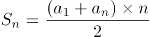可得，所有球衣号码之和为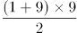。

方法一：代入排除法。

A项：假设最小和为10，则最大和为，则中间和为45-10-20=15，满足题意，排除；

B项：假设最小和为11，则最大和为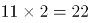，则中间和为45-11-22=12满足题意，排除；

C项：根据B项可得，12为可能的号码和，排除；

D项：假设最小和为13，则最大和为，则中间和为45-13-26=6，不满足题意；假设中间和为13，则最大和+最小和=45-13=32，32不是3的倍数，不满足题意，当选。

方法二：方程法。

根据题意设最小和与最大和分别为x、2x，中间和为y，x+y+2x=45，根据y＞x可得，45=3x+y＞4x，则，对应A、B两项，当x=10时，y=15，2x=20；当x=11时，y=12，2x=22，均符合题意，排除；根据倍数特性，3x+y=45中3x与45均为3的倍数，则y必为3的倍数，对应C项，y=12时，x=11，2x=22，符合题意，排除。

本题为选非题，故正确答案为D。

### 第 52 题

小明每天从家中出发骑自行车经过一段平路，再经过一道斜坡后到达学校上课。某天早上，小明从家中骑车出发，一到校门口就发现忘带课本，马上返回，从离家到赶回家中共用了1个小时，假设小明当天平路骑行速度为9千米/小时，上坡速度为6千米/小时，下坡速度为18千米/小时，那么小明的家距离学校多远？

A. 3.5千米

B. 4.5千米

C. 5.5千米

D. 6.5千米

第 52 题 · 答案与解析

**参考答案（粉笔题库参考内容）**

B

**解析**

设小明家到学校的距离为S，在往返的过程中，上坡和下坡的路程均为斜坡的长度即距离相等，根据等距离平均速度公式，上下坡的平均速度千米/小时，与平路速度相等，故往返全程的平均速度均为9千米/小时，往返一次走了两个全程，2S=9千米/小时×1小时，得S=4.5千米。

故正确答案为B。

### 第 53 题

甲乙丙丁四人通过手机的位置共享，发现乙在甲正南方向2公里处，丙在乙北偏西方向2公里处，丁在甲北偏西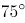方向。若丁与甲、丙的距离相等，则该距离为：

A. 1公里

B. 公里

C. 公里

D. 2公里

第 53 题 · 答案与解析

**参考答案（粉笔题库参考内容）**

B

**解析**

根据题意，四人的位置关系如下图所示：

因为丙在乙北偏西方向，且乙与甲、丙的距离均为2公里，所以甲乙丙三人的位置构成等边三角形，则甲到丙的距离为2公里。丁在甲北偏西方向，则丁-甲-丙构成的角度为，且丁与甲、丙的距离相等，则甲丁丙三人的位置构成等腰直角三角形，因此所求的距离为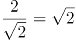公里。

故正确答案为B。

### 第 54 题

某学习平台的学习内容由观看视频、阅读文章、收藏分享、论坛交流、考试答题五个部分组成。某学员要先后学完这五个部分，若观看视频和阅读文章不能连续进行，该学员学习顺序的选择有：

A. 24种

B. 72种

C. 96种

D. 120种

第 54 题 · 答案与解析

**参考答案（粉笔题库参考内容）**

B

**解析**

根据题意，观看视频和阅读文章不连续，可用插空法，先安排其它三部分学习内容，顺序有种，这三部分学习内容共形成四个空，再插入不能连续进行的观看视频和阅读文章这两部分，有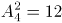种，因此总的学习顺序的选择有6×12=72种。

故正确答案为B。

### 第 55 题

某公司职员预约某快递员上午9点30分到10点在公司大楼前取件，假设两人均在这段时间内到达，且在这段时间到达的概率相等。约定先到者等后到者10分钟，过时交易取消。快递员取件成功的概率为：

A. 

B. 

C. 

D. 

第 55 题 · 答案与解析

**参考答案（粉笔题库参考内容）**

C

**解析**

设快递员到达的时间为9点x分，职员到达的时间为9点y分，则只有∣x-y∣≤10，两人才能相遇。即直线x-y≤10、y-x≤10、x=60、y=60围成的区域，交点坐标分别为（30,40）、（50,60）、（60,60）、（60,50）、（40,30）、（30,30），如下图所示，只有在阴影部分区域两人才能够相遇，也就是求阴影部分面积占整个正方形面积的比例。由图可以看出，正方形面积=30×30=900，空白部分为两个全等三角形，每个的面积为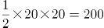，则阴影部分面积=900-2×200=500，占总面积的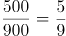。

故正确答案为C。

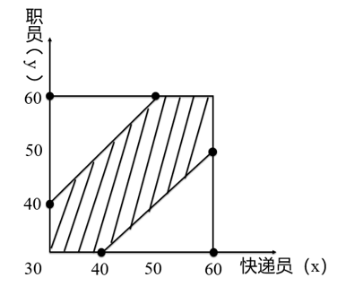

### 第 56 题

甲、乙、丙三人去超市买了100元的商品，如果甲付钱，那么甲剩下的钱是乙、丙两人钱数之和的；如果乙付钱，则乙剩下的钱是甲、丙两人钱数之和的；如果丙付钱，丙用他的会员卡可享受9折优惠，结果丙剩下的钱是甲、乙两人钱数之和的；那么，甲、乙、丙三人开始时一共带了多少钱？

A. 850元

B. 900元

C. 950元

D. 1000元

第 56 题 · 答案与解析

**参考答案（粉笔题库参考内容）**

A

**解析**

方法一：设开始时甲带了x元，乙带了y元，丙带了z元，则由题意可得：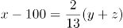······①，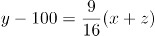······②，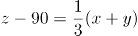······③，联立方程组，解得x=200，y=370，z=280。故甲、乙、丙三人开始时一共带了x+y+z=200+370+280=850元。

方法二：题干出现比例，虽然钱数不一定是整数，但选项均为整数，说明总钱数一定为整数，故优先考虑利用倍数特性解题。由题意可知，，即甲-100为2份，乙+丙为13份，则甲+乙+丙-100为15份，即三人总钱数减去100是15的倍数，观察选项，排除B、C两项；丙用会员卡需支付元，则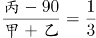，即丙-90为1份，甲+乙为3份，则甲+乙+丙-90为4份，即总钱数-90是4的倍数，排除D项，只有A项符合。

故正确答案为A。

备注：本题考场上应该选择倍数特性法，如果用方程法则太浪费时间。

### 第 57 题

某电商平台每隔5千米有一座仓库，共有A、B、C、D四座仓库，图中数字表示各仓库库存货物的吨数。现需要把所有的货物集中存放在其中某一个仓库中，如果每吨货物运输1千米需要运费3元，要使运费最少，则需将货物集中到哪座仓库？

A. 仓库A

B. 仓库B

C. 仓库C

D. 仓库D

第 57 题 · 答案与解析

**参考答案（粉笔题库参考内容）**

C

**解析**

方法一：根据题意直接代入选项计算总运费。

若将货物集中到仓库A，则运费为y=3×(20×5+15×5×2+25×5×3)=3×5×125元;

若将货物集中到仓库B，则运费为y=3×(10×5+15×5+25×5×2)=3×5×75元；

若将货物集中到仓库C，则运费为y=3×(10×5×2+20×5+25×5)=3×5×65元；

若将货物集中到仓库D，则运费为y=3×(10×5×3+20×5×2+15×5)=3×5×85元；

则运费最少的是将货物集中到仓库C。

方法二：货物集中问题，只与各个仓库的存放量有关，与距离及运费无关。先考虑AB打包，CD打包，显然前者存放量（30吨）不如后者（40吨）多，因此AB的货物均需要向CD方向移动，先移到仓库C中。此时仓库C共有货物10+20+15=45吨，仓库D有25吨，则仓库D向仓库C移动，最后货物都集中到仓库C中。

故正确答案为C。

### 第 58 题

某会展中心布置会场，从花卉市场购买郁金香、月季花、牡丹花三种花卉各20盆，每盆均用纸箱打包好装车运送至会展中心，再由工人搬运至布展区。问至少要搬出多少盆花卉才能保证搬出的鲜花中一定有郁金香？

A. 20盆

B. 21盆

C. 40盆

D. 41盆

第 58 题 · 答案与解析

**参考答案（粉笔题库参考内容）**

D

**解析**

根据问法“至少······才能保证······”，可判定本题为最不利构造型最值问题。考虑最不利情况为前面搬出的花卉都是月季花和牡丹花，则一共搬出20+20=40盆花卉。在此基础上再搬1盆花，就可以保证一定是郁金香，则至少需要搬20+20+1=41盆花卉。

故正确答案为D。

### 第 59 题

村民陶某承包一块长方形种植地，他将地分割成如图所示的4个小长方形，在A、B、C、D四块长方形土地上分别种植西瓜、花生、地瓜、水稻。其中长方形A、B、C的周长分别是20米、24米、28米，那么长方形D的最大面积是：

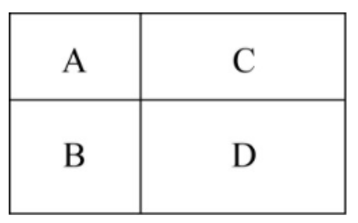

A. 42平方米

B. 49平方米

C. 64平方米

D. 81平方米

第 59 题 · 答案与解析

**参考答案（粉笔题库参考内容）**

C

**解析**

如下图所示，假设标注的四条边长分别为a、b、c、d，已知长方形A、B、C的周长分别是20米、24米、28米，根据长方形周长=2(长+宽)，可得2(a+b)+2(a+d)+2(b+c)=20+24+28=72，化简得2a+2b+c+d=36，即20+c+d=36，解得c+d=16。而c、d分别代表长方形D的长和宽，c+d和一定时，当且仅当c=d时面积最大，此时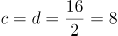米，故长方形D的最大面积=8×8=64平方米。

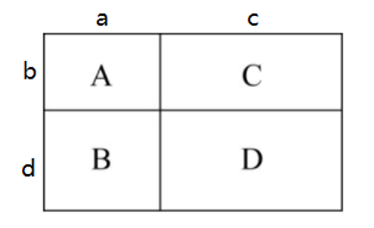

故正确答案为C。

### 第 60 题

野外生存需要用一个简易的圆锥型过滤器（如下图所示）装满溪水进行过滤。过滤器的底面直径为20cm，高为6cm。问全部过滤完毕后，在不考虑损耗的情况下，可使底面半径为5cm，高为15cm的圆柱型容器的水面高度达到：

A. 4cm

B. 6cm

C. 8cm

D. 12cm

第 60 题 · 答案与解析

**参考答案（粉笔题库参考内容）**

C

**解析**

根据圆锥体积公式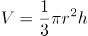可知，过滤溪水体积为。根据圆柱体积公式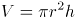可得，圆柱型容器的水面高度达到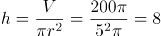cm。

故正确答案为C。

### 第 61 题

把下面六个图形分为两类，使每一类图形都有各自的共同特征或规律，分类正确的一项是：

A. ①⑤⑥，②③④

B. ①②⑤，③④⑥

C. ①②④，③⑤⑥

D. ①③⑤，②④⑥

第 61 题 · 答案与解析

**参考答案（粉笔题库参考内容）**

A

**解析**

元素组成不同，优先考虑属性规律。对称、曲直均无明显规律，考虑开闭性。图①⑤⑥均为带有封闭区域的图形，图②③④均为全开放的图形，即①⑤⑥为一组，②③④为一组。

故正确答案为A。

### 第 62 题

把下面的六个图形分为两类，使每一类图形都有各自的共同特征或规律，分类正确的一项是：

A. ①④⑥，②③⑤

B. ①③⑥，②④⑤

C. ①②⑥，③④⑤

D. ①②④，③⑤⑥

第 62 题 · 答案与解析

**参考答案（粉笔题库参考内容）**

D

**解析**

元素组成不同，优先考虑属性规律。观察发现，图①②④均是轴对称图形，图③⑤⑥均是中心对称图形，因此图①②④为一组，图③⑤⑥为一组。

故正确答案为D。

### 第 63 题

从所给的四个选项中，选择最适合的一个填入问号处，使之呈现一定的规律性：

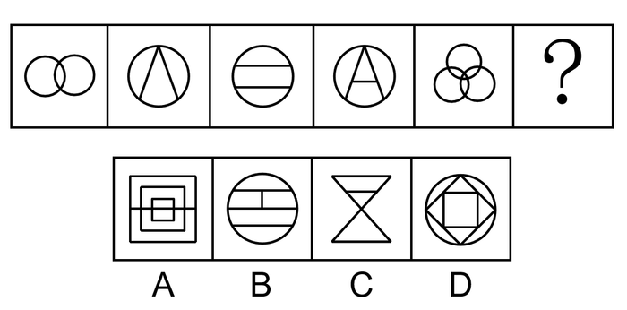

A. A

B. B

C. C

D. D

第 63 题 · 答案与解析

**参考答案（粉笔题库参考内容）**

C

**解析**

元素组成不同，优先考虑属性规律。题干图形规整，考虑轴对称。观察对称轴，题干对称轴数量依次为2、1、2、1、3，无明显规律。属性无规律，考虑数量规律。再次观察图形发现，图1和图5出现“相交圆”，即笔画数的特征图，题干笔画数依次为1、1、2、2、1，无规律。题干图形线与线交叉明显，考虑交点数量。题干交点数依次为2、3、4、5、6、？，即“？”处应选择交点数为7的图形。选项交点数依次为18、8、7、8，C项符合。

故正确答案为C。

### 第 64 题

从所给的四个选项中，选择最合适的一个填入问号处，使之呈现一定的规律性：

A. A

B. B

C. C

D. D

第 64 题 · 答案与解析

**参考答案（粉笔题库参考内容）**

C

**解析**

元素组成相同，优先考虑位置规律。九宫格图形优先按横行来看，观察第一行图形，发现图1通过顺时针旋转90°得到图2，图2通过左右翻转得到图3。第二行验证，同样满足此规律。因此问号处的图形应该是第三行中的图2通过左右翻转得到，四个选项中只有C项符合。

故正确答案为C。

### 第 65 题

一圆锥台如下图所示，从正中心挖掉一个小圆锥体，然后从任意面剖开，下面哪一项不可能是该圆锥台的截面？

A. A

B. B

C. C

D. D

第 65 题 · 答案与解析

**参考答案（粉笔题库参考内容）**

D

**解析**

本题考查截面图，逐一分析选项。

A项：从图形腰部向下底面斜切即可得到，能切出，排除；

B项：沿图形水平方向切出即可得到，能切出，排除；

C项：从图形正中间竖直向下切即可得到，能切出，排除；

D项：图形中间有从上底面到下底面的空心圆锥，无法切出整圆，当选。

本题为选非题，故正确答案为D。

### 第 66 题

联觉是一种感觉器官受到刺激时引起性质完全不同的其他感觉的现象。它是不同感觉间相互作用的结果，也是一种条件反射现象。联觉现象在所有感觉中都存在，表现有个别差异。在现实生活中，由于某一种事物属性的出现经常伴随着另一种事物属性的出现，这两种事物属性所引起的感觉之间就形成了固定的条件联系。

根据上述定义，下列选项不属于联觉的是：

A. 小徐看到涂成蓝色的墙壁，浑身充满凉意

B. 各种菜肴香味飘来，小刘听到了旋律变化

C. 小李对人十分热情，人们都说他好像一团火

D. 看到写在纸上的手机号，小冯感到阵阵发麻

第 66 题 · 答案与解析

**参考答案（粉笔题库参考内容）**

C

**解析**

第一步：找出定义关键词。

“一种感觉器官受到刺激时引起性质完全不同的其他感觉的现象”。

第二步：逐一分析选项。

A项：小徐看到涂成蓝色的墙壁，浑身充满凉意，是视觉受到刺激后引起了触觉的变化，符合“一种感觉器官受到刺激时引起性质完全不同的其他感觉的现象”，符合定义，排除；

B项：各种菜肴香味飘来，小刘听到了旋律变化，是嗅觉受到刺激后引起了听觉的变化，符合“一种感觉器官受到刺激时引起性质完全不同的其他感觉的现象”，符合定义，排除；

C项：小李对人十分热情，人们都说他好像一团火，是对小李的整体评价，没有涉及多种感觉，不符合“一种感觉器官受到刺激时引起性质完全不同的其他感觉的现象”，不符合定义，当选；

D项：看到写在纸上的手机号，小冯感到阵阵发麻，是视觉受到刺激后引起了触觉的变化，符合“一种感觉器官受到刺激时引起性质完全不同的其他感觉的现象”，符合定义，排除。

本题为选非题，故正确答案为C。

### 第 67 题

热传导是介质内无宏观运动时的传热现象，其在固体、液体和气体中均可发生。但严格而言，只有在固体中才是纯粹的热传导，在流体（泛指液体和气体）中又是另外一种情况，流体即使处于静止状态，也会由于温度梯度所造成的密度差而产生自然对流，因此在流体中热对流与热传导可能会同时发生。

根据上述定义，下列选项不存在热传导现象的是：

A. 海洋上层高温水体和下层低温水体因温度差而交换

B. 铁棒的一端放入热水中，另一端温度升高

C. 太阳照射，导致地球表面温度升高

D. 在热水中加入冷水，热水变成温水

第 67 题 · 答案与解析

**参考答案（粉笔题库参考内容）**

C

**解析**

第一步：找出定义关键词。

“介质内无宏观运动”、“传热现象”、“流体中由于温度梯度所造成的密度差”。

第二步：逐一分析选项。

A项：海洋内部水体交换，符合“介质内无宏观运动”，海洋上层高温水体和下层低温水体因温度差而交换，符合“传热现象”、“流体中由于温度梯度所造成的密度差”，符合定义，排除；

B项：铁棒的一端放入热水中，符合“介质内无宏观运动”，热量沿着铁棒传递到另一端，使得温度升高，符合“传热现象”，符合定义，排除；

C项：太阳照射，使地球表面温度升高，太阳与地球表面之间是真空环境，没有介质，不符合“介质内无宏观运动”，不符合定义，当选；

D项：热水中加入冷水，符合“介质内无宏观运动”，冷水和热水因温度差而发生热传递，最终变成温水，符合“传热现象”、“流体中由于温度梯度所造成的密度差”，符合定义，排除。

本题为选非题，故正确答案为C。

### 第 68 题

疼痛共情的偏好性，是指个体对他人疼痛的感知、判断和情绪反应，总是由于个体与他人之间的亲疏远近关系或情感认同程度不同而不同。

根据上述定义，下列没有体现疼痛共情的偏好性的是（ ）。

A. 小明看到《西游记》里的白骨精被孙悟空打死，高兴得跳了起来

B. 小张看到外来游客不幸溺水而亡，从此再也不敢去那条河里游泳

C. 小李在看歌剧《白毛女》时跳上戏台拉住喜儿，不让黄世仁抢走

D. 小红听奶奶回忆自己在旧社会的苦日子时，禁不住潸然泪下

第 68 题 · 答案与解析

**参考答案（粉笔题库参考内容）**

B

**解析**

第一步：找出定义关键词。

“个体对他人疼痛的感知、判断和情绪反应”、“由于个体与他人之间的亲疏远近关系或情感认同程度不同而不同”。

第二步：逐一分析选项。

A项：小明看到《西游记》里的白骨精被孙悟空打死，高兴得跳了起来。小明对孙悟空和白骨精的情感认同程度不同，《西游记》中，孙悟空是正面形象，而白骨精是反面形象，通常人们对作品中的正义形象是支持和赞同的，所以小明看到正义获胜会很高兴、很支持，符合“个体对他人疼痛的感知、判断和情绪反应”、“由于个体与他人之间的亲疏远近关系或情感认同程度不同而不同”，符合定义，排除；

B项：小张看到外来游客不幸溺水而亡，从此再也不敢去那条河里游泳，小张与溺水游客属于陌生的关系，但溺水的不论是谁，小张都不会再去那条河里游泳，没有因为关系或认同感的不同而有区别，而是一种经验教训，不符合“由于个体与他人之间的亲疏远近关系或情感认同程度不同而不同”，不符合定义，当选；

C项：小李在看歌剧《白毛女》时跳上戏台拉住喜儿，不让黄世仁抢走，歌剧中喜儿的角色让观众怜惜，黄世仁的角色让观众厌恶，因此小李认知上会亲近喜儿，疏远黄世仁，最终跳上戏台阻止，符合“个体对他人疼痛的感知、判断和情绪反应”、“由于个体与他人之间的亲疏远近关系或情感认同程度不同而不同”，符合定义，排除；

D项：小红听奶奶回忆自己在旧社会的苦日子时，禁不住潸然泪下，小红正因为是她亲近的奶奶曾遭受了痛苦，所以忍不住得哭了，正常来讲大家对苦难的生活都有一定经历和承受力，如果是陌生人或者是讨厌的经历了苦难生活，我们未必会有特别大的情绪反应，符合“个体对他人疼痛的感知、判断和情绪反应”、“由于个体与他人之间的亲疏远近关系或情感认同程度不同而不同”，符合定义，排除。

本题为选非题，故正确答案为B。

### 第 69 题

亲环境行为是指个体通过减少或消除自身活动对环境的负面影响以达到改善生态系统结构的行为。它的本质是通过有效减轻环境问题实现环境改善，核心任务是构造环境稳态友好型的社会。

根据上述定义，下列选项属于亲环境行为的是：

A. 植树造林

B. 低碳出行

C. 细水长流

D. 围海造田

第 69 题 · 答案与解析

**参考答案（粉笔题库参考内容）**

B

**解析**

第一步：找出定义关键词。

“个体通过减少或消除自身活动对环境的负面影响”、“改善生态系统结构”。

第二步：逐一分析选项。

A项：植树造林是新造或更新森林的生产活动，不符合“个体通过减少或消除自身活动对环境的负面影响”，不符合定义，排除；

B项：低碳出行是一种降低“碳”的出行方式，符合“个体通过减少或消除自身活动对环境的负面影响”，符合“改善生态系统结构”，符合定义，当选；

C项：细水长流是指节约使用财物，精细安排，长远打算，与生态环境无关，不符合“个体通过减少或消除自身活动对环境的负面影响”，也不符合“改善生态系统结构”，不符合定义，排除；

D项：围海造田是把海洋变成陆地、田地，有效利用海洋空间，不符合“个体通过减少或消除自身活动对环境的负面影响”，也不符合“改善生态系统结构”，不符合定义，排除。

故正确答案为B。

注——本题出处如下：

王玉珏的论文《亲环境行为研究综述》中提到：个体亲环境行为可分为四类，其中私人领域的环保行为就包括“使用环保的出行工具”，即本题B项的“低碳出行”。

### 第 70 题

错觉是完全不符合刺激本身特征的失真的或扭曲事实的知觉经验，生活中，凭知觉经验所作的解释显然是失真的，甚至是错误的。幻觉是在没有相应的外界客观事物直接作用下发生的不真实感知。幻觉具有与真实知觉类似的特点，但它是虚幻的。正常人在某些特殊的状态下，如强烈的情绪体验并伴有生动的想象、回忆，或期待的心情、紧张的情绪，或处于催眠状态，都可能会出现幻觉。在入眠或醒觉状态的过程中，也会发生幻觉。

根据上述定义，下列属于幻觉的是：

A. 杯弓有蛇影，草木疑皆兵

B. 相看两不厌，唯有敬亭山

C. 寝兴目存形，遗音犹在耳

D. 蝉噪林逾静，鸟鸣山更幽

第 70 题 · 答案与解析

**参考答案（粉笔题库参考内容）**

C

**解析**

第一步：找出定义关键词。

错觉：“不符合刺激本身特征”、“失真的或扭曲事实的”、“凭知觉经验所作的解释显然是失真的，甚至是错误的”；

幻觉：“没有相应的外界客观事物”、“不真实感知”。

第二步：逐一分析选项。

A项：杯弓有蛇影，出自东汉学者应劭的《风俗通义·怪神》，意思是将映在酒杯里的弓影误认为蛇；草木疑皆兵，出自《晋书·苻坚载记》，意思是把山上的草木都当做敌兵，符合“不符合刺激本身特征”、“失真的或扭曲事实的”，符合“错觉”定义，不符合“幻觉”定义，排除；

B项：相看两不厌，唯有敬亭山，出自唐代李白的《独坐敬亭山》，意思是敬亭山和我对视着，谁都看不够，看不厌，看来理解我的只有这敬亭山了，不符合“失真的或扭曲事实的”以及“没有相应的外界客观事物”，不符合任何一个定义，排除；

C项：寝兴目存形，遗音犹在耳，出自魏晋诗人潘安的《悼亡诗三首》，意思是睡下和起床的时候都还能看到你，你的声音仿佛还在我的耳边，表达了对亡妻深深的思念之情，符合“没有相应的外界客观事物”、“不真实感知”，也能对应题干“在入眠或醒觉状态的过程中”，符合“幻觉”定义，当选；

D项：蝉噪林逾静，鸟鸣山更幽，出自南朝王籍的《入若耶溪》，意思是蝉声高唱，树林却显得格外宁静，鸟鸣声声，深山里倒比往常更清幽，不符合“失真的或扭曲事实的”以及“没有相应的外界客观事物”，不符合任何一个定义，排除。

故正确答案为C。

### 第 71 题

鸳：鸯

A. 蚱蜢：蝗虫

B. 白猫：黑猫

C. 雄鸡：雌鸡

D. 红男：绿女

第 71 题 · 答案与解析

**参考答案（粉笔题库参考内容）**

C

**解析**

第一步：判断题干词语间逻辑关系。

鸳鸯是一种鸟类，鸳指雄鸟，鸯指雌鸟，二者为并列关系，且为并列关系中的矛盾关系。

第二步：判断选项词语间逻辑关系。

A项：蚱蜢和蝗虫的关系较有争议，多数资料显示二者为全同关系，与题干逻辑关系不一致，排除；

B项：白猫和黑猫是并列关系，但为并列关系中的反对关系，与题干逻辑关系不一致，排除；

C项：雄鸡和雌鸡是并列关系，且为并列关系中的矛盾关系，与题干逻辑关系一致，当选；

D项： 红男绿女，意思是指穿着各种漂亮服装的青年男女，二者为并列关系，但不是矛盾关系，与题干逻辑关系不一致，排除。

故正确答案为C。

### 第 72 题

牵牛花：喇叭花

A. 乞巧节：七夕节

B. 七巧板：橡皮泥

C. 人行道：车行道

D. 防腐剂：添加剂

第 72 题 · 答案与解析

**参考答案（粉笔题库参考内容）**

A

**解析**

第一步：判断题干词语间逻辑关系。

牵牛花又称喇叭花，二者为全同关系。

第二步：判断选项词语间逻辑关系。

A项：乞巧节又称七夕节，二者为全同关系，与题干逻辑关系一致，当选；

B项：七巧板和橡皮泥均为儿童玩具，二者为并列关系，与题干逻辑关系不一致，排除；

C项：人行道和车行道为并列关系，与题干逻辑关系不一致，排除；

D项：防腐剂是添加剂的一种，二者为种属关系，与题干逻辑关系不一致，排除。

故正确答案为A。

### 第 73 题

售后：品控

A. 数据：科学

B. 融资：风投

C. 龙骨：地板

D. 听证：监管

第 73 题 · 答案与解析

**参考答案（粉笔题库参考内容）**

D

**解析**

第一步：判断题干词语间逻辑关系。

售后需要品控，二者为对应关系，且品控不只是售后阶段存在，所有阶段都需要品控。

第二步：判断选项词语间逻辑关系。

A项：科学研究需要数据，但两词顺序与题干相反，与题干逻辑关系不一致，排除；

B项：风投是一种融资方式，二者为种属关系，与题干逻辑关系不一致，排除；

C项：龙骨是用来支撑造型、固定结构的一种建筑材料，龙骨用来支撑地板，与题干逻辑关系不一致，排除；

D项：听证需要监管，二者为对应关系，且监管不只是听证阶段存在，所有阶段都需要监管，与题干逻辑关系一致，当选。

故正确答案为D。

### 第 74 题

羊：羊奶：腥膻

A. 蚕：蚕丝：雪白

B. 蜘蛛：蛛丝：粘缚

C. 蜂：蜂蜜：甘甜

D. 雨燕：燕窝：营养

第 74 题 · 答案与解析

**参考答案（粉笔题库参考内容）**

C

**解析**

第一步：判断题干词语间逻辑关系。

羊奶是羊的产出物，腥膻是羊奶的必然属性，且腥膻是一种味道。

第二步：判断选项词语间逻辑关系。

A项：蚕丝是蚕的产出物，但雪白不是蚕丝的必然属性，且雪白也不是一种味道，与题干逻辑关系不一致，排除；

B项：蛛丝是蜘蛛的产出物，但粘缚是蛛丝的功能，而非属性，与题干逻辑关系不一致，排除；

C项：蜂蜜是蜂的产出物，甘甜是蜂蜜的必然属性，且甘甜是一种味道，与题干逻辑关系一致，当选；

D项：燕窝是雨燕科几种金丝燕分泌的唾液及其绒羽混合粘结所筑成的巢穴，而燕窝并非是雨燕直接产出的，且营养也不是一种味道，与题干逻辑关系不一致，排除。

故正确答案为C。

### 第 75 题

初伏：中伏：末伏

A. 火星：木星：土星

B. 大雨：小雨：谷雨

C. 上旬：中旬：下旬

D. 大暑：小暑：处暑

第 75 题 · 答案与解析

**参考答案（粉笔题库参考内容）**

C

**解析**

第一步：判断题干词语间逻辑关系。

初伏、中伏、末伏，三者之间是并列关系，并且三者按照三伏天的时间先后顺序排列，先初伏，再中伏，最后末伏。

第二步：判断选项词语间逻辑关系。

A项：火星、木星、土星是太阳系八大行星中的三个行星，三者之间是并列关系，但是没有时间先后顺序，与题干逻辑关系不一致，排除；

B项：大雨、小雨是两种不同的天气，谷雨是二十四节气之一，三者不构成并列关系，与题干逻辑关系不一致，排除；

C项：上旬、中旬、下旬，三者之间是并列关系，并且三者按照一个月份的不同时间段的时间先后顺序排列，先上旬，再中旬，最后下旬，与题干逻辑关系一致，当选；

D项：大暑、小暑、处暑是二十四节气中的三个节气，三者之间是并列关系，但是它们的时间先后顺序应该是先小暑，再大暑，最后处暑，与题干逻辑关系不一致，排除。

故正确答案为C。

### 第 76 题

牡丹：洛阳：郑州

A. 荷花：青岛：济南

B. 木芙蓉：成都：成都

C. 菊花：太原：石家庄

D. 凤凰花：厦门：福州

第 76 题 · 答案与解析

**参考答案（粉笔题库参考内容）**

D

**解析**

第一步：判断题干词语间逻辑关系。

牡丹是洛阳市花，郑州是河南省的省会城市，洛阳和郑州均为河南省的城市。

第二步：判断选项词语间逻辑关系。

A项：荷花是济南市花，青岛是山东省的城市，济南是山东省的省会城市，与题干逻辑关系不一致，排除；

B项：木芙蓉是成都市花，成都是四川省的省会城市，但成都和成都为同一个城市，与题干逻辑关系不一致，排除；

C项：菊花是太原市花，太原是山西省的省会城市，石家庄是河北省的省会城市，太原和石家庄是不同省份的城市，与题干逻辑关系不一致，排除；

D项：凤凰花又叫凤凰木，为厦门市树，厦门是福建省的城市，福州是福建省的省会城市，与题干逻辑关系一致，当选。

故正确答案为D。

### 第 77 题

空运：海运：运输

A. 平装：精装：装帧

B. 货轮：客轮：邮轮

C. 晚会：聚会：集会

D. 试飞：试航：航天

第 77 题 · 答案与解析

**参考答案（粉笔题库参考内容）**

A

**解析**

第一步：判断题干词语间逻辑关系。

空运和海运是两种不同的运输方式，前两词为并列关系，并与第三词构成种属关系。

第二步：判断选项词语间逻辑关系。

A项：平装和精装是两种不同的装帧方式，前两词为并列关系，并与第三词构成种属关系，与题干逻辑关系一致，当选；

B项：货轮和客轮分别是用来运载货物和乘客的船舶，二者为并列关系，邮轮指的是在海洋中航行的旅游客轮，所以邮轮是客轮的一种，与货轮不构成种属关系，与题干逻辑关系不一致，排除；

C项：晚会是指在晚上举行的集会，多以文娱活动为主，聚会是指人数较多，有明确主题的集体活动，二者不构成并列关系，与题干逻辑关系不一致，排除；

D项：试飞是指在飞机交付使用前进行的试验性飞行，试航是指飞机、船只等在正式航行前进行的试验性航行，二者和航天没有必然关系，与题干逻辑关系不一致，排除。

故正确答案为A。

### 第 78 题

十年寒窗：悬梁刺股：囊萤映雪

A. 七月流火：以荻画地：临池学书

B. 三月肉味：蓝田种玉：程门立雪

C. 一寸光阴：凿壁偷光：闻鸡起舞

D. 一日三秋：卧薪尝胆：铁杆磨针

第 78 题 · 答案与解析

**参考答案（粉笔题库参考内容）**

C

**解析**

第一步：判断题干词语间逻辑关系。

十年寒窗、悬梁刺股和囊萤映雪都是形容刻苦攻读，勤学上进，三者为近义关系。

第二步：判断选项词语间逻辑关系。

A项：七月流火指夏去秋来，寒天将至；以荻画地是指用荻杆在地上写字画画；临池学书指刻苦练习书法；三者语义没有关系，与题干逻辑关系不一致，排除；

B项：三月肉味形容专心一意，全神贯注；蓝田种玉比喻男女获得了称心如意的美好姻缘；程门立雪指尊敬师长，重视自己的教育事业；三者语义没有关系，与题干逻辑关系不一致，排除；

C项：一寸光阴是指时间非常宝贵；凿壁偷光用来形容家贫而读书刻苦；闻鸡起舞是指听到鸡啼就起来舞剑，比喻有志报国的人及时奋起；三者均形容珍惜时间，勤学刻苦，为近义关系，与题干逻辑关系一致，当选；

D项：一日三秋比喻分别时间虽短，却觉得很长，形容思念殷切；卧薪尝胆比喻刻苦自励、发奋图强；铁杆磨针比喻只要有决心，肯下工夫，多么难的事情也能做成功；三者语义没有关系，与题干逻辑关系不一致，排除。

故正确答案为C。

### 第 79 题

（ ）对于 世味年来薄似纱 相当于 达观 对于（ ）

A. 忧郁；前度刘郎今又来

B. 感伤；莫道谗言如浪深

C. 讽刺；道是无晴却有晴

D. 斥责；金陵王气黯然收

第 79 题 · 答案与解析

**参考答案（粉笔题库参考内容）**

B

**解析**

逐一代入选项。

A项：“世味年来薄似纱”出自南宋陆游的《临安春雨初霁》，体现了诗人对世态炎凉的无奈和客籍京华的蹉跎，与“忧郁”无明显逻辑关系，“前度刘郎今又来”出自唐代刘禹锡的《再游玄都观》，描写的是曾经被排挤的人又回来了，暗寓自己不屈之志，与“达观”无明显逻辑关系，前后逻辑关系不一致，排除；

B项：“世味年来薄似纱”出自南宋陆游的《临安春雨初霁》，表达了诗人的“感伤”之情，“莫道谗言如浪深”出自唐代刘禹锡的《杂曲歌辞·浪淘沙》，描写的是不要说流言蜚语如同凶恶的浪涛一样令人恐惧，体现了诗人拼搏、乐观的心境，表达了“达观”之情，前后逻辑关系一致，当选；

C项：“世味年来薄似纱”与“讽刺”无明显逻辑关系，“道是无晴却有晴”出自唐代刘禹锡的《竹枝词二首·其一》，表面是说无晴但还有晴，实际上想表达说是没有感情但其实有情，是运用谐音双关的手法，把天“晴”和爱“情”这两件不相关的事物巧妙地联系起来，表现出初恋少女忐忑不安的微妙感情，与“达观”无明显逻辑关系，前后逻辑关系不一致，排除；

D项：“世味年来薄似纱”与“斥责”无明显逻辑关系，“金陵王气黯然收”出自唐代刘禹锡的《西塞山怀古》，描写的是东吴的王气黯然消逝，表明国家统一是人心所向，与“达观”无明显逻辑关系，前后逻辑关系不一致，排除。

故正确答案为B。

### 第 80 题

（ ）对于 裁判 相当于 案件 对于（ ）

A. 球员；法庭

B. 黑哨；上诉

C. 比赛；法官

D. 比分；律师

第 80 题 · 答案与解析

**参考答案（粉笔题库参考内容）**

C

**解析**

逐一代入选项。

A项：球员是裁判监督的对象，二者为主体和对象的对应关系，法庭是案件审判的场所，二者为场所对应关系，前后逻辑关系不一致，排除；

B项：黑哨是足球运动中裁判违反公平性原则的行为，二者为对应关系，上诉案件，二者为动宾关系，前后逻辑关系不一致，排除；

C项：裁判是一种职业，裁判可以判决比赛，法官是一种职业，法官可以判决案件，二者是职业主体和对象的对应关系，且主体与对象之间的关系均体现为“判决”，前后逻辑关系一致，当选；

D项：裁判是一种职业，裁判可以记录比分，律师是一种职业，律师可以处理案件，二者是职业主体和对象的对应关系，但主体与对象之间的关系不一致，前面为“记录”，后面为“处理”，前后逻辑关系不一致，排除。

故正确答案为C。

### 第 81 题

在市场竞争十分激烈的时候，一个企业要是不激流勇进，创造出富有竞争力的产品，也不适时撤退、主动割爱，放弃没有前景的市场，那么这个企业最后一定会陷入危机之中。

如果以上论断为真，下列说法正确的是（ ）。

A. 某企业未能创造出富有竞争力的产品，最后一定会惨遭淘汰

B. 某企业紧要关头急流勇退，转向其它市场，就可以避免危机

C. 某企业放弃已显颓势的产业，转向新产品的开发，它可能不会被淘汰

D. 某企业研发出了富有竞争力的产品，它最后一定不会陷入危机之中

第 81 题 · 答案与解析

**参考答案（粉笔题库参考内容）**

C

**解析**

第一步：翻译题干。

\-（激流勇进，创造出富有竞争力的产品）且-（适时撤退，主动割爱，放弃没有前景的市场）→陷入危机

第二步：逐一分析选项。

A项：翻译为-创造出有市场竞争力的产品→淘汰，“-创造出有市场竞争力的产品”是对题干翻译前件“且”关系一部分的肯定，据此无法判断整个“且”关系的真假，进而无法得出确定性结论，不能推出，排除；

B项：翻译为“急流勇退，转向其他市场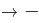陷入危机”，“急流勇退，转向其他市场”即“适时撤退、主动割爱，放弃没有前景的市场”，是对题干翻译前件“且”关系的一部分的否定，否前不能得到确定性结论，不能推出，排除；

C项：翻译为放弃已显颓势的产业→可能不会被淘汰，放弃已显颓势的产业是否定题干翻译前件“且关系”的一部分，否前不能得到确定性结论，但是C选项后面说的是可能不会被淘汰，是一种可能性的表述，可以推出，当选；

D项：翻译为富有竞争力的产品→-陷入危机，是否定题干翻译前件“且关系”的一部分，否前不能得到确定性结论，不能推出，排除。

故正确答案为C。

### 第 82 题

近年来，“类脑计算”从理念走向实践，正走出一条制造类人智能的新途径。所谓“类脑计算”，是指仿真、模拟和借鉴大脑神经系统结构和信息处理过程的装置、模型和方法，其目标是制造类脑计算机。然而有人提出质疑：大脑奥秘尚未揭示，我们还不了解智能背后的基本原理，怎么能制造出具有“大脑智能”的类脑计算机呢？

以下哪项如果为真，最能反驳上述质疑？

A. 类脑计算机的器件速度是生物神经元和突触的百万倍，一旦产生智能，后果难以预料

B. 关于“类脑计算”的伦理制度和风险评估等必须与“类脑计算”的技术发明同步展开

C. 揭示大脑奥秘和发明类脑计算机是相互作用的复杂过程，不是“前者决定后者”的简单关系

D. 国内已经启动集合各高校、科研机构和企业优势研究力量的10多项“类脑计算”研究项目

第 82 题 · 答案与解析

**参考答案（粉笔题库参考内容）**

C

**解析**

第一步：找出论点和论据。

论点：大脑奥秘尚未揭示，我们还不了解智能背后的基本原理，怎么能制造出具有“大脑智能”的类脑计算机。

论据：无。

本题论点讨论揭示大脑奥秘，了解智能背后的基本原理和制造“大脑智能”的类脑计算机之间的关系，没有论据，优先考虑否定论点，即揭示大脑奥秘，了解智能背后的基本原理和制造“大脑智能”的类脑计算机之间没有必然联系。

第二步：逐一分析选项。

A项：选项讨论类脑计算机产生智能的后果，论点讨论的是能否制造出类脑计算机，话题不一致，无法削弱，排除；

B项：选项讨论的是“类脑计算”的伦理制度和风险评估，论点讨论的是能否制造出类脑计算机，话题不一致，无法削弱，排除；

C项：论点意为因为没有揭示大脑奥秘，不了解智能背后的基本原理，所以不能制造类脑计算机，选项指出了揭示大脑奥秘和发明类脑计算机不是简单的“前者决定后者”的关系，否定论点，可以削弱，当选；

D项：选项讨论的是国内已启动多项“类脑计算”研究项目，启动了项目不等于就能制造出类脑计算机，话题不一致，无法削弱，排除。

故正确答案为C。

### 第 83 题

师范类院校学生来自全国各地，甲大学是师范类院校，所以甲大学的学生来自全国各地。

下列选项所犯逻辑错误与上述推理最相似的是：

A. 牛不是食肉动物，而狮子不是牛，所以狮子不是食肉动物

B. 父母爱读书的孩子爱运动，小黄爱运动，所以小黄的父母爱读书

C. 私人捐赠的教学楼遍布全国各高校，何况是邵逸夫先生捐赠的逸夫楼

D. 文明司机都是礼让行人的，有些公务司机礼让行人，所以有些公务司机是文明司机

第 83 题 · 答案与解析

**参考答案（粉笔题库参考内容）**

C

**解析**

第一步：翻译题干。

A（师范类院校学生）B（来自全国各地），C（甲大学）A（师范类院校），结论：C（甲大学的学生）B（来自全国各地）。

第二步：逐一分析选项。

A项：A（牛）B（不是食肉动物），C（狮子）A（牛），结论：C（狮子）B（不是食肉动物），与题干推理形式不一致，排除；

B项：A（父母爱读书）B（孩子爱运动），C（小黄）B（爱运动），结论：C（小黄）A（父母爱读书），与题干推理形式不一致，排除；

C项：该句的后半句“何况是邵逸夫先生捐赠的逸夫楼”是反问，可以理解为“逸夫楼是私人捐赠的教学楼，所以逸夫楼遍布全国各高校”。即A（私人捐赠的教学楼）B（遍布全国各高校），C（逸夫楼）A（私人捐赠的教学楼），结论：C（逸夫楼）B（遍布全国各高校），与题干推理形式一致，当选；

D项：A（文明司机）B（礼让行人），C（有些公务司机）B（礼让行人），结论：C（有些公务司机）A（文明司机），与题干推理形式不一致，排除。

故正确答案为C。

### 第 84 题

食品添加剂是现代食品工业的重要组成部分，按规定使用食品添加剂既对人体无害，而且能够改善食品品质，起到防腐、保鲜的作用。正是因为有了食品添加剂的发展，才有了大量的方便食品，给人们的生活带来极大的便利。如果不加入食品添加剂，大部分食品要么难看、难吃或者难以保鲜，要么就是价格昂贵。

下列说法能够支持上面论点的是（ ）。

A. 食品添加剂和人类文明史一样悠久，例如点豆腐用的卤水

B. 如果不使用添加剂，食品会因微生物作用而引起食物中毒

C. 宣称无食品添加剂往往是商家迎合消费者心理造成的噱头

D. 三聚氰胺也是一种添加剂，在水泥里能够作为高效减水剂

第 84 题 · 答案与解析

**参考答案（粉笔题库参考内容）**

B

**解析**

第一步：找出论点和论据。

论点：食品添加剂是现代食品工业的重要组成部分，按规定使用食品添加剂既对人体无害，而且能够改善食品品质，起到防腐、保鲜的作用。正是因为有了食品添加剂的发展，才有了大量的方便食品，给人们的生活带来极大的便利。如果不加入食品添加剂，大部分食品要么难看、难吃或者难以保鲜，要么就是价格昂贵。

论据：无

本题只有论点，没有论据，加强优先考虑补充论据，即解释为什么食品添加剂按规定添加既对人体无害，并且能够改善食品品质，防腐，保鲜，或举例证明某些食品添加剂对人体无害，并且能够改善食品品质，防腐，保鲜。

第二步：逐一分析选项。

A项：论点说的是食品添加剂按规定添加既对人体无害，并且能够改善食品品质，防腐，保鲜，该项说的是食品添加剂和人类文明一样历史悠久，话题不一致，无法加强，排除；

B项：若不使用食品添加剂，食品会因微生物作用而导致食物中毒，说明食品添加剂对于食品是有好处的，解释了为什么我们要在食品中添加食品添加剂，当选；

C项：论点说的是食品添加剂按规定添加既对人体无害，并且能够改善食品品质，防腐，保鲜，该项说的是商家会以什么样的噱头来吸引消费者，话题不一致，无法加强，排除；

D项：论点强调的是食品添加剂按规定添加既对人体无害，并且能够改善食品品质，防腐，保鲜，该项说的是三聚氰胺在不同的环境中所起到的作用，与题干话题不一致，排除。

故正确答案为B。

### 第 85 题

心理学家考察了450位中年男性和女性，他们中有白领阶层，也有蓝领阶层；有技能判断型人群，也有决策制定型人群。结果发现，那些身居重要职位的高管人士普遍比一般员工更胖。研究者认为，做出许多决定所承受的压力通过饮食方式得到排解，这最终在一定程度上改变了高管人士之前的饮食习惯，如果你的职位幸运地得到晋升，你将发现不仅是薪水变多，自己的腰围也在变粗，伴随着体重上升。

以下哪项如果为真，最能质疑上述结论？（ ）

A. 比较而言，技能判断型人群的腰围较小，决策制定型人群的腰围较大

B. 比较而言，身居要职的高管人士更难抽出时间投入锻炼以缩小腰围

C. 每晋升一次，技能判断型人群的腰围平均会减少0.5厘米

D. 每晋升一次，决策制定型人群的腰围平均会增大0.28厘米

第 85 题 · 答案与解析

**参考答案（粉笔题库参考内容）**

B

**解析**

第一步：找出论点和论据。

论点：做出许多决定所承受的压力通过饮食方式得到排解，这最终在一定程度上改变了高管人士之前的饮食习惯，如果你的职位幸运地得到晋升，你将发现不仅是薪水变多，自己的腰围也在变粗，伴随着体重上升。

论据：心理学家考察了450位中年男性和女性，他们中有白领阶层，也有蓝领阶层；有技术判断性人群，也有决策判断性人群，结果发现，那些身居重要职位的高管人士普遍比一般职员更胖。

本题的论据是做了一个研究，论点是研究之后的结果，并且以因果的方式呈现，所以可以考虑他因削弱和因果倒置。

第二步：逐一分析选项。

A项：比较技术判断型人和决策制定型人的腰围大小，和题干压力大饮食习惯变化导致腰围增加的论点没有关系，属于无关选项，排除；

B项：高管难抽出时间锻练无法减少腰围，论点是高管因为压力大饮食习惯发生变化导致腰围增加，而选项说明腰围变化的原因在于是否进行锻练，属于他因削弱，当选；

C项：技术判断型人群平均腰围随着晋升减少，题干说的是高管，而职级晋升不一定就是高管，属于不明确选项，排除；

D项：决策制定型人群平均腰围随着晋升增加，题干说的是高管，而职级晋升不一定就是高管，属于不明确选项，排除。

故正确答案为B。

### 第 86 题

一项最新研究发现，世界上的绿海龟越来越“雌性化”。专家估计，到2100年，约有93%的新生绿海龟为雌性。研究表明，决定绿海龟性别的主要因素是绿海龟孵化时周围沙子的温度。如果沙子的温度在28到30度之间，孵化出来的绿海龟雌雄比例差不多；如果温度高出这个范围，那孵化出来的绿海龟大多数是雌性，相反，则大多数为雄性。

以下哪项如果为真，最能支持上述论断？

A. 绿海龟终将无法正常繁殖最后在地球上灭绝

B. 绿海龟是一种由孵化时温度决定性别的动物

C. 温室效应将导致全球气候变暖问题日趋严重

D. 温度的持续升高使绿海龟孵化的死亡率增加

第 86 题 · 答案与解析

**参考答案（粉笔题库参考内容）**

C

**解析**

第一步：找出论点和论据。

论点：到2100年，约有93%的新生绿海龟为雌性。

论据：决定绿海龟性别的主要因素是海龟孵化时周围沙子的温度。如果沙子的温度在28到30度之间，孵化出来的绿海龟雌雄比例差不多；如果温度高出这个范围，那孵化出来的绿海龟大多数是雌性，相反，则大多数为雄性。

本题的论点讨论的是绿海龟到2100年新生绿海龟将有93%的为雌性，而论据讨论的是决定海龟性别的是温度，温度达到以上孵化的绿海龟中雌性的比例较大，论点论据话题不一致，优先考虑搭桥，即建立起“2100年”与“温度达到以上”的关系。

第二步：逐一分析选项。

A项：该项说的是绿海龟繁殖和灭绝之间的关系，论点论据讨论的是绿海龟性别和孵化温度的关系，话题不一致，无法加强，排除；

B项：该项只是指出了绿海龟孵化的性别与温度有关，没有明确说明雌性与温度的具体关系，也不明确未来温度是否会达到30度以上，属于不明确选项，无法加强，排除；

C项：该项讨论了温室效应将导致未来全球变暖更加严重，表明了未来温度将会升高，因此2100年的气温很有可能超过，如果气温超过孵化出的绿海龟大多数将为雌性海龟，搭桥项，可以加强，当选；

D项：论点说的是绿海龟性别和孵化温度的关系，该项讨论的是温度与绿海龟死亡率之间的关系，话题不一致，无法加强，排除。

故正确答案为C。

### 第 87 题

二氧化碳的排放量剧增导致全球气候变暖，使珠穆朗玛峰所在的喜马拉雅地区冰川面临急剧缩小的危险。研究显示，珠峰海拔在5000米到6000米的冰川集中区域出现快速融化的现象，这些地方将只在冬季而不是在温暖的季节时看到结冰。专家推论说，根据未来的气候变化趋势，喜马拉雅地区的冰川减少的速度还有可能加快，如果本世纪内气温如预计的一样继续升高，该地区的冰川最终将消失殆尽。

如果以下各项为真，最能削弱上述论证的是：

A. 喜马拉雅冰川每年缩小约0.1%到0.6%

B. 喜马拉雅其他地区冰川对温度不敏感

C. 过去50年珠峰周边冰川覆盖面积减少了33.3%

D. 珠穆朗玛峰7000米以上区域未出现冰川快速融化现象

第 87 题 · 答案与解析

**参考答案（粉笔题库参考内容）**

B

**解析**

第一步：找出论点和论据。

论点：根据未来的气候变化趋势，喜马拉雅地区的冰川减少的速度还有可能加快，如果本世纪内气温如预计的一样继续升高，该地区的冰川最终将消失殆尽。

论据：珠峰海拔在5000米到6000米的冰川集中区域出现快速融化的现象，这些地方将只在冬季而不是在温暖的季节时看到结冰。

论点说的是喜马拉雅地区的冰川将会消失殆尽，论据是珠峰海拔在5000米到6000米的冰川集中区域出现快速融化的现象，因此本题目的论证关系是通过珠穆朗玛峰5000米-6000米区域的变化，来预测喜马拉雅山未来整体的情况，论点和论据的话题不一致，要想否定论证，可以补充5000米-6000米之外的地方冰川不会消融来进行否定，即通过局部是推不出整体这种方式来进行否定。

第二步：逐一分析选项。

A项：选项说喜马拉雅冰川每年缩小约0.1%到0.6%，补充论据说明冰川在不断缩小，有加强力度，排除；

B项：选项说喜马拉雅其他地区冰川对温度不敏感，说明在珠穆朗玛峰5000米-6000米之外的其他地区冰川并不会受温度的影响，那么就说明从题干中的论据是推不出论点的，可以削弱，当选；

C项：过去50年珠峰周边冰川覆盖面积减少了33.3%，补充论据说明冰川在不断缩小，有加强力度，排除；

D项：珠穆朗玛峰7000米以上区域未出现冰川快速融化现象，通过举反例来证明冰川不会完全消失，但该项只是举出了7000米以上的地区，不如B项包含的范围广，可以削弱，但是力度比B项弱，排除。

故正确答案为B。

### 第 88 题

学界一直认为第一个到达澳大利亚的是欧洲人。但有研究指出，来自今天的坦桑尼亚的东非人率先到达了澳大利亚，考古学家在澳大利亚的埃尔科岛上发现了一枚来自非洲中部的贸易城市基卢瓦（今属坦桑尼亚）的硬币。因此，有人提出，东非人到达澳大利亚的时间可能要比第一批欧洲探险者早数百年。

以下各项如果为真，最能支持上述观点的是：

A. 该硬币的重量尺寸与常见的基卢瓦硬币存在差异

B. 基卢瓦岛从13世纪开始与印度一直存在贸易联系

C. 东非与大洋洲在11世纪到16世纪间商贸往来十分频繁

D. 葡萄牙人于1505年先后袭击了基卢瓦和埃尔科岛并留下了这枚硬币

第 88 题 · 答案与解析

**参考答案（粉笔题库参考内容）**

C

**解析**

第一步：找出论点和论据。

论点：东非人到达澳大利亚的时间可能要比第一批欧洲探险者早数百年。

论据：来自今天的坦桑尼亚的东非人率先到达了澳大利亚，考古学家在澳大利亚的埃尔科岛上发现了一枚来自非洲中部的贸易城市基卢瓦（今属坦桑尼亚）的硬币。

本题论点是东非人到达澳大利亚的时间可能要比第一批欧洲探险者要早，论据是通过在澳大利亚的埃尔科岛上发现的一枚来自非洲中部的贸易城市基卢瓦（今属坦桑尼亚）的硬币确定来自今天的坦桑尼亚的东非人率先到达了澳大利亚。二者话题一致，加强优先考虑补充论据。

第二步：逐一分析选项。

A项：选项说该硬币的重量尺寸与常见的基卢瓦硬币存在差异，硬币的尺寸存在差异，说明发现的硬币不一定是东非人带来的，具有削弱作用，无法加强，排除；

B项：选项说基卢瓦岛从13世纪开始与印度一直存在贸易联系，题干论点与论据均与印度的贸易联系无关，话题不一致，无法加强，排除；

C项：选项说东非与大洋洲在11世纪到16世纪间商贸往来十分频繁，澳大利亚是大洋洲的主要组成部分，证明东非与澳大利亚之间很有可能早在11世纪到16世纪间就存在频繁的商贸往来，有利于论点的成立，补充论据，当选；

D项：选项说葡萄牙人于1505年先后袭击了基卢瓦和埃尔科岛并留下了这枚硬币，说明是葡萄牙人留下的这枚硬币，而不是东非人，具有削弱作用，排除。

故正确答案为C。

注：由于题目中完全没有涉及到欧洲人到达澳大利亚的具体时间，也没有涉及到东非人到达澳大利亚的具体时间，因此选项中的时间无法准确判断早晚，因此C项虽然只是一种可能性的加强，但其他选项无任何加强作用，故答案确定为C。而根据原文（如下图中最后一句）可知，已知确定的率先到达澳大利亚的欧洲人时间在1606年（17世纪），而C项中东非与大洋洲的贸易时间在11世纪到16世纪，早于1606年，因此根据原文C项具有加强作用。

### 第 89 题

一项心理学研究认为，出身经济层次最低家庭的人中年后出现代谢综合征的比例最高，无论他们获得多大成就都是如此。该研究同时发现代谢综合征虽与童年生活状况有关，但该群体中那些拥有慈母的人不容易出现该综合征。究其原因，慈母具有同情心，会告诉孩子如何应对压力并鼓励他们健康饮食，保持良好生活方式。因此，我们在现实中可以设计一套方案，指导母亲教育孩子如何应对压力、健康生活和掌控命运。

由此可以推出：

A. 设计针对母亲的指导方案，有助于降低特定群体出现代谢综合征的比例

B. 因为缺少母爱，出身经济层次最低家庭的人出现代谢综合征的比例最高

C. 因为父亲不教导孩子保持良好生活方式，所以父亲对孩子的健康没影响

D. 出身经济层次最低家庭的人，童年如受到慈母呵护，中年后身体很健康

第 89 题 · 答案与解析

**参考答案（粉笔题库参考内容）**

A

**解析**

日常结论题，根据题干信息逐一分析选项。

A项：根据题干可知拥有慈母的人不容易出现代谢综合征，慈母可以教育孩子如何应对压力、健康生活和掌握命运，因此，设计一套方案指导母亲，可帮助出身经济最低的人群降低出现代谢综合征的几率，当选；

B项：由文段可以得出，出身经济层次最低家庭的人中年后出现代谢综合征的比例最高，慈母可以降低这一比例，但是并没有提到出现代谢综合征是否是因为缺少母爱，无法推出，排除；

C项：父亲不教导孩子保持良好生活方式，题干中并未出现父亲相关描述，属于无中生有，排除；

D项：出身经济层次最低的人群，受到慈母呵护，只能得出代谢综合征的情况不易出现，并不能说明身体整体的健康情况，属于偷换概念，排除。

故正确答案为A。

### 第 90 题

肌萎缩侧索硬化症（ALS），俗称“渐冻症”。某科研团队研究发现，ALS的疾病发展与肠道微生物AM菌的数量密切相关。研究人员观察和比较了37名ALS患者及29名健康亲属的肠道菌群和血液、脑脊液样本。他们发现肠道细菌菌株有差异，其中有一种菌株与烟酰胺的产生有关。此外，在这些ALS患者的血液和脑脊液中，烟酰胺水平有所下降。

若要上述研究发现成立，需要补充的前提是：

A. 人类肠道中的微生物非常复杂

B. 烟酰胺是肠道微生物AM菌的代谢物

C. 小鼠补充烟酰胺后，ALS症状得到了减轻

D. 人体肠道细菌的变化与ALS的疾病发展速度有关

第 90 题 · 答案与解析

**参考答案（粉笔题库参考内容）**

B

**解析**

第一步：找出论点和论据。

论点： ALS的疾病发展与肠道微生物AM菌的数量密切相关。

论据： 研究人员观察和比较了37名ALS患者及29名健康亲属的肠道菌群和血液、脑脊液样本。他们发现肠道细菌菌株有差异，其中有一种菌株与烟酰胺的产生有关。此外，在这些ALS患者的血液和脑脊液中，烟酰胺水平有所下降。

本题论点说的是ALS疾病与AM菌数量的关系，论据说的是ALS疾病与烟酰胺水平的关系，论点论据话题不一致，优先考虑搭桥的加强方式，即说明烟酰胺和AM菌之间存在关系。

第二步:逐一分析选项。

A项：人类肠道中微生物复杂，未提及“AM菌”与“ALS疾病”的关系，与论点话题不一致，属于无关项，无法加强，排除；

B项：烟酰胺是肠道微生物AM菌的代谢物，在“烟酰胺”和“AM菌”之间建立了关系，说明通过ALS患者烟酰胺水平下降可以判断ALS疾病与AM菌数量之间存在关系，搭桥项，可以加强，当选；

C项：小鼠补充烟酰胺后，ALS症状得到了减轻，说的是“ALS疾病”与“烟酰胺”的关系，未提及“ALS疾病”与“AM菌”或“烟酰胺”与“AM菌”之间的关系，与论点话题不一致，属于无关项，无法加强，排除；

D项：人体肠道细菌的变化与ALS的疾病发展速度有关，说的是“ALS疾病”与“人体肠道细菌”的关系，肠道细菌指的是不是“AM菌”不明确，属于不明确项，无法加强，排除。

故正确答案为B。

## 材料 1

2019年6月，全国发行地方政府债券8996亿元，同比增长68.37%，环比增长195.63%。其中，发行一般债券3178亿元，同比减少28.33%，环比增长117.08%，发行专项债券5818亿元，同比增长540.04%，环比增长268.46%；按用途划分，发行新增债券7170亿元，同比增长127.11%，环比增长332.71%，发行置换债券和再融资债券1826亿元，同比减少16.47%，环比增长31.75%。

2019年6月，地方政府债券平均发行期限11.1年，其中新增债券10.4年，置换债券和再融资债券13.4年；地方政府债券平均发行利率3.55%，其中新增债券3.52%，置换债券和再融资债券3.65%。

2019年1至6月，全国发行地方政府债券28372亿元，同比增长101.09%。其中，发行一般债券12858亿元，同比增长23.21%，发行专项债券15514亿元，同比增长322.38%；按用途划分，发行新增债券21765亿元，同比增长553.80%，发行置换债券和再融资债券6607亿元，同比减少38.71%。

2019年1至6月，地方政府债券平均发行期限9.3年，其中一般债券11.2年，专项债券7.8年；地方政府债券平均发行利率3.47%，其中一般债券3.53%，专项债券3.43%。

2019年全国地方政府债务限额为240774.3亿元。其中，一般债务限额133089.22亿元，专项债务限额107685.08亿元。截至2019年6月末，全国地方政府债务余额205477亿元，其中，一般债务118397亿元，专项债务87080亿元。

### 第 91 题

2019年6月，全国发行的地方政府债券比2018年6月多约：

A. 6151亿元

B. 5953亿元

C. 3653亿元

D. 3043亿元

第 91 题 · 答案与解析

**参考答案（粉笔题库参考内容）**

C

**解析**

根据题干“2019年6月，······比2018年6月多约”，判定本题为增长量计算问题。定位文字材料第一段“2019年6月，全国发行地方政府债券8996亿元，同比增长68.37%”。根据公式：增长量。代入数据，2019年6月，全国发行的地方政府债券的同比增长量亿元，与C项最接近。

故正确答案为C。

### 第 92 题

2018年1至5月，全国发行地方政府债券约：

A. 23029亿元

B. 19376亿元

C. 14109亿元

D. 8766亿元

第 92 题 · 答案与解析

**参考答案（粉笔题库参考内容）**

D

**解析**

根据题干“2018年1至5月······约”，定位材料第一段“2019年6月，全国发行地方政府债券8996亿元，同比增长68.37%”，第三段“2019年1至6月，全国发行地方政府债券28372亿元，同比增长101.09%”，可判定本题为基期和差问题。根据公式：基期量，可知2018年1至5月，全国发行地方政府债券亿元，与D项最接近。

故正确答案为D。

### 第 93 题

2018年1至6月，发行一般债券的占比较发行专项债券的占比约：

A. 低9.36%

B. 低52.81%

C. 高47.93%

D. 高53.43%

第 93 题 · 答案与解析

**参考答案（粉笔题库参考内容）**

C

**解析**

根据题干“2018年1至6月······占比约”，结合材料时间，可判定本题为基期比重问题。结合文字资料第三段“2019年1至6月，全国发行地方政府债券28372亿元，同比增长101.09%。其中，发行一般债券12858亿元，同比增长23.21%，发行专项债券15514亿元，同比增长322.38%”。代入公式：基期量和比重，可得所求比重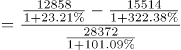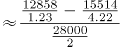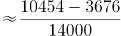，与C项最接近。

故正确答案为C。

### 第 94 题

2018年6月，发行置换债券和再融资债券约为：

A. 3157亿元

B. 2186亿元

C. 1657亿元

D. 1386亿元

第 94 题 · 答案与解析

**参考答案（粉笔题库参考内容）**

B

**解析**

根据题干“2018年6月”，结合选项单位与材料时间，可判定本题为基期计算问题。根据文字材料第一段“（2019年6月）发行置换债券和再融资债券1826亿元，同比减少16.47%”。结合公式：基期量可得，2018年6月发行置换债券和再融资债券亿元，与B项最接近。

故正确答案为B。

### 第 95 题

不能从上述资料推出的是：

A. 截至2019年6月末，地方政府一般债务余额和专项债务余额都控制在限额之内

B. 2019年1至6月，地方政府一般债券的平均发行利率高于专项债券0.1个百分点

C. 2019年5月，地方政府新增债券的平均发行期限比置换债券和再融资债券短

D. 2019年地方一般债务限额比专项债务限额多25404.14亿元

第 95 题 · 答案与解析

**参考答案（粉笔题库参考内容）**

C

**解析**

A项：定位文字材料最后一段“2019年······一般债务限额133089.22亿元，专项债务限额107685.08亿元。截至2019年6月末······一般债务118397亿元，专项债务87080亿元”，由于118397亿元＜133089.22亿元、87080亿元＜107685.08亿元，说明都控制在限额之内，正确；

B项：定位文字材料第四段“2019年1至6月，······其中一般债券3.53%，专项债券3.43%”，则一般债券平均发行利率-专项债券平均发行利率=3.53%-3.43%=0.1个百分点，正确；

C项：定位文字材料第二段“2019年6月，······其中新增债券10.4年，置换债券和再融资债券13.4年”，只有2019年6月的年份数据，无法计算出2019年5月的数据，故无法推出，错误；

D项：定位文字材料最后一段“2019年······其中，一般债务限额133089.22亿元，专项债务限额107685.08亿元”，一般债务限额-专项债务限额=133089.22-107685.08=25404.14亿元，正确。

本题为选非题，故正确答案为C。

## 材料 2

截至2018年底，中国人工智能市场规模约为238.2亿元，同比增长率达到56.6%。从中国人工智能企业地域分布情况来看，北京企业数量最多，企业数量为368家；其次为广东，人工智能企业数量为185家；排名第三的是上海，数量为131家。

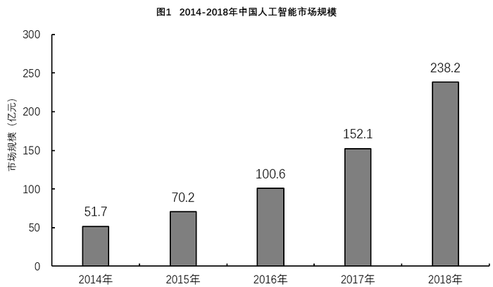

### 第 96 题

截至2017年底，中国人工智能市场规模约为：

A. 141.1亿元

B. 152.1亿元

C. 156.1亿元

D. 164.1亿元

第 96 题 · 答案与解析

**参考答案（粉笔题库参考内容）**

B

**解析**

定位柱形图1可得，2017年中国人工智能市场规模约为152.1亿元。

故正确答案为B。

注：若本题没有发现柱形图1的数据，直接看到文字材料，可以按照求解基期量计算。根据文字材料“截至2018年底，中国人工智能市场规模约为238.2亿元，同比增长率达到56.6%”，可得2017年中国人工智能市场规模约为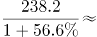亿元，与B项最接近。

### 第 97 题

2017年中国人工智能市场规模同比增长率与2015年相比约：

A. 减少了13.3个百分点

B. 增加了13.3个百分点

C. 减少了15.4个百分点

D. 增加了15.4个百分点

第 97 题 · 答案与解析

**参考答案（粉笔题库参考内容）**

D

**解析**

根据题干“2017年······同比增长率与2015年相比”，可判定本题为一般增长率问题。定位柱形图1，2017年和2016年中国人工智能市场规模分别为152.1亿元和100.6亿元，则2017年中国人工智能市场规模同比增长率约为，2015年和2014年中国人工智能市场规模分别为70.2亿元和51.7亿元，则2015年中国人工智能市场规模同比增长率约为，故2017年中国人工智能市场规模同比增长率与2015年相比约增加了51.5%-35.6%=15.9%，即增加了15.9个百分点，与D项最接近。

故正确答案为D。

### 第 98 题

2015至2018年，中国人工智能市场规模同比增长率最高的年份是：

A. 2015年

B. 2016年

C. 2017年

D. 2018年

第 98 题 · 答案与解析

**参考答案（粉笔题库参考内容）**

D

**解析**

根据题干“····同比增长率最高···”，可判定本题为一般增长率的比较问题。定位材料图1可知每一年的现期量与基期量，代入增长率公式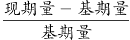：

2015年：；

2016年：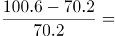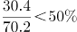；

2017年：；

2018年： 定位文字材料，截至2018年底，中国人工智能市场规模约为238.2亿元，同比增长率达到56.6%。

比较可知，2018年增长率最高。

故正确答案为D。

### 第 99 题

图2中排名第二的省（市），其人工智能企业数量的个数约是排名后四位的数量之和的多少倍？

A. 11.3

B. 12.3

C. 12.8

D. 13.3

第 99 题 · 答案与解析

**参考答案（粉笔题库参考内容）**

B

**解析**

根据题干“···约是···的多少倍”，可判定本题为现期倍数计算问题。定位图2可得：排名第二的省（市）是广东，其人工智能企业数量为185个，排名后四位的为广西、重庆、河南、辽宁，其人工智能企业数量依次为1个、3个、5个、6个。因此所求倍数。

故正确答案为B。

### 第 100 题

下列说法正确的是：

A. 截至2018年底，中国人工智能市场规模每年同比增长率都超过50%

B. 截至2018年底，中国人工智能企业地域分布情况中，广东企业数量最多

C. 截至2018年底，中国人工智能企业北京企业数量不超过上海企业数量的50%

D. 截至2018年底，福建人工智能企业的数量等于河南、天津、广西三省企业数量之和

第 100 题 · 答案与解析

**参考答案（粉笔题库参考内容）**

D

**解析**

A项：定位图1，2015年中国人工智能市场规模同比增长率为，错误；

B项：定位文字材料，截至2018年底，中国人工智能企业地域分布中，北京企业数量最多，而非广东，错误；

C项：定位文字材料，截至2018年底，北京企业数量368家，上海企业数量131家，368＞131×50%，错误；

D项：定位图2，截至2018年底，福建人工智能企业数为16家，河南、天津和广西分别为5家、10家和1家，16=5+10+1，福建人工智能企业数量等于河南、天津、广西三省企业数量之和，正确。

故正确答案为D。

