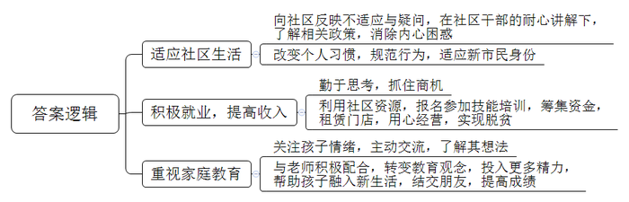
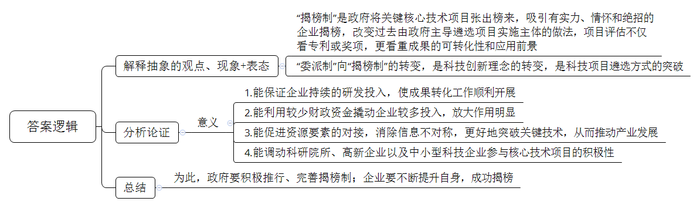
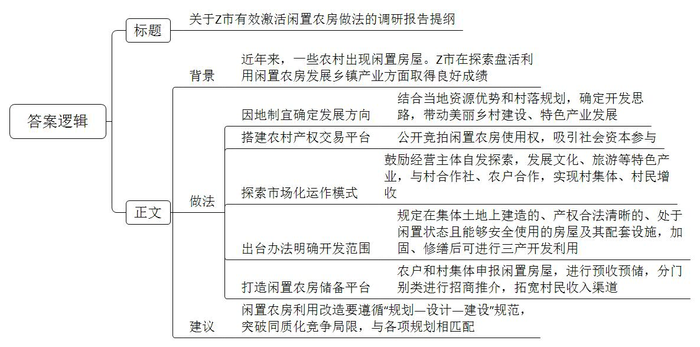
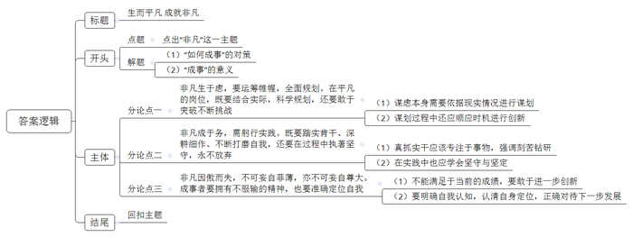

# 2021年公务员多省联考《申论》题（吉林乙卷）

<!-- gwy:overview:start -->
> **吉林 · 2021 · 申论 · 乙级** ｜ 4 题 · 图片 4 处 · 答案随题折叠

导航：[题目](#题目) · [材料 1](#材料-1)
<!-- gwy:overview:end -->

> 候选采集稿。参考答案及解析来自粉笔页面，不代表官方答案或真实高分答卷；来源使用许可与原卷对应关系仍需人工核实。

## 给定材料

### 材料 1

“每个人都了不起！”在辞别2020年，开启2021年新年贺词中，习近平总书记由衷地表达敬意：“我为伟大的祖国和人民而骄傲，为自强不息的民族精神而自豪。”

“了不起”三个字背后，是无数的时代面孔，老英雄张富清一辈子坚守初心，不改本色，用朴实纯粹、淡泊名利书写精彩人生，吃亏书记李连成，以“干部就应该能吃亏”为座右铭，三次创业带领村民横跨三产，让为民情怀照亮小康梦想。揽月“天团”在坚守中开拓创新，将中国人开拓创新的勇敢身姿起舞于深空探测领域。“扶贫之花”黄文秀在脱贫攻坚第一线倾情投入、奉献自我，用美好青春诠释了共产党人的初心使命。平凡铸就伟大，英雄来自人民。每一份伟大的成就，无不立足于平凡的岗位和工作；每一段不凡的人生，无不依托于平凡的日积月累，把每一项平凡工作做好，把每一件日常小事做好，这是成就不平凡人生的必然之路。

### 材料 2

“去趟镇上就靠一双脚板子，都是山路，车子进不来呀！”说起自己的老家大娄山脉的双河村，小冯满是感慨，双河村地势陡峭，四面环山，道路不畅，外面的建材很难送进来，村民只好就地取材，筑起了木房子，“木房时间长了就容易变形，腐烂的都有。”小冯说。遇到刮风下雨，生怕房子漏雨、甚至垮塌，觉都睡不安稳。一家守着不足3亩的陡坡地过活，靠天吃饭。成家后，虽然小冯也曾拖家带口地出去闯过，却没有攒下多少积蓄。后来，小冯有了第二个孩子，加之老母亲身体不好，常年吃药，夫妻俩只能辞职回家，没撑几年就成了贫困户。

接到易地扶贫搬迁的消息时，小冯还有点不敢相信：“一家子5口人还能搬出大山，做梦都没想到。”2018年7月，小冯全家从大山深处搬到了县城，成了新市民。房子面积100平方米，宽敞的卧室、独立的厨房、干净的卫生间……“下雨天终于能睡个安稳觉了。”但没住几天，小冯却有点不自在：“地面都铺了亮堂堂的瓷砖，稍微落点灰或者踩个脚印都看得清清楚楚。”从村里人成为新市民，有很多新的不适应：垃圾得倒进楼下的垃圾桶，上厕所用不惯冲水坐便，邻居间串门少了……让小冯尤其困惑的就是物业费，“住的是自己的房子，为啥每月还得交钱？”不只是他，许多搬迁户刚开始都想不通。“他们毕竟过惯了山里的日子，能理解。”针对居民们的困惑，社区干部们“双管齐下”：一方面挨家挨户走访，了解需求和想法；另一方面“一对一”讲政策、做工作。不让困惑“发酵”。经过一段时间的沟通和适应，搬迁户们慢慢习惯了社区的生活。小冯有点不好意思，“啥事儿都有个过程嘛，懂了就习惯了。”

进了城，刚安顿好，小冯就开始找工作。一天，转累了的小冯想找个地方垫垫肚子，周边就几家餐馆，还坐满了人。正要离开时，他突然有了一个想法：“谁都得吃饭，周边餐馆不多，这是个机会。”转过头，小冯又犯难了：干惯了体力活儿，炒菜的水平不够怎么办？妻子也发愁：店面租金也是笔不小的数目，一时半会儿也难凑出来。2018年底，随着最后一批搬迁户入住，社区开始组织不同类型的就业技能培训。一看到有厨师培训班，早有想法的小冯跟妻子立马报了名。两个多月后，在社区的帮助下，小冯用凑齐的5万元，以8年为期，租下了一间门面，期盼许久的小餐馆就这样“上线”了。小馆子环境干净，口味地道，加上两口子手脚勤快又热情，赢得了不少回头客。看到生意一天比一天好，小冯终于能缓口气。“现在一个月能挣七八千块，早就脱贫啦。”

走出大山，工作也有了着落，还能照顾家里人，小冯觉得很满足，但另一件心事也随之而来，“以前村里没学校，孩子只能到镇上念书，一大早就得摸着黑出门，沿着山路走两个多小时。”时间长了，大人都受不了，更何况孩子。后来外出打工，孩子就跟了一路。“因为经常换工作，孩子几乎没有在固定的地方上完一年学。”一说到这儿，小冯满是惭愧。

搬到县城后，小冯家距学校只有十几分钟路程，上学不愁了。原以为在家门口上学是件高兴事儿，但出乎意料的是，开学第一周，小冯明显感觉孩子的情绪不太高。几番询问，他才弄清楚：“之前我们外出打工，孩子常年跟着在外地念书。现在回到家乡的学校上学，反而有些不习惯。”老师也发现了这个问题，还专门儿来家里了解情况，跟小冯和孩子认真谈了一次心，临走前，提醒小冯夫妇也要多帮助孩子融入新生活。“还是观念有问题，过去老觉得教育孩子就靠学校，不靠家长。”小冯说，“以后我们对孩子的教育要更上心才行。”如今，孩子慢慢认识了不少新朋友，成绩也提高了不少。这一切，小冯看在眼里，乐在心里。

脱贫摘帽不是终点，而是新生活、新奋斗的起点。从搬出大山到县城安家扎根，小冯觉得，尽管有些磕磕绊绊，但日子越过越有奔头。

### 材料 3

“要把芯片技术领域的十年经验凝练到一场不到半小时的PPT汇报里，还得接受专家现场提问，这是一场大考，不敢大意。”恒心科技有限公司陈总说。这场“考试”是由Q市科技局组织，共有32家单位“参考”，以“揭榜制”形式择优确定8家单位，其中，恒心科技有限公司提出的“面向5G技术的芯片攻关类”项目，最终“揭榜”成立。

从过去的“委派制”到如今的“揭榜制”，不仅是科技创新理念的重大转变，更是科技项目遴选方式的重大突破。“揭榜制”一改过去由政府主导遴选项目实施主体的做法，在项目评估中，不仅仅看专利或奖项，更看重成果的可转化性和应用前景。陈总说：“这种做法保证了企业持续的研发投入，使成果转化工作不半途而废，毕竟成果转化不是一蹴而就。”“1元财政资金就能撬动企业10元投入，放大作用明显。”同样揭榜成功的银创科技有限公司责任人认为，“揭榜制方式，能促进资源要素的对接，消除信息不对称，更好地突破关键技术，从而推动产业发展。”

作为大赛评委，郭教授深有感触：“无论是科研院所、高新企业，还是一些中小型科技企业，都踊跃参加，这证明了这种揭榜制在Q市得到了大家的认可和欢迎。”Q市科技部门负责人表示，“把需要的关键核心技术项目张出榜来，英雄不论出处，谁有本事谁就揭榜，这些揭榜单位不简单——他们需要有实力，能接得住；有情怀，愿意接；有绝招，干得好。”

### 材料 4

近年来，随着城镇化进程加快，一些农村出现不少闲置房屋，Z市不少地方着力探索盘活利用闲置农房发展乡镇产业的有效途径和措施，取得良好成绩，为此，Z市发展研究中心组织调研组进行了专题调研。

位于东湖镇新泉村的新泉中学，因优化农村学校布局，多年前已不再办学，老教学楼被列入闲置房屋，有人提议拆掉建住宅，但村两委最终统一意见，拆掉“太可惜”，还是应该盘活利用，壮大村集体经济。东湖镇产茶历史悠久，周边茶农集中，老房子联手茶产业，能发挥盘活利用的效益。村两委确定了发展方向为主营茶产业、发展茶文化，通过镇里的农村产权交易平台公开竞拍老楼使用权。

泉江茶业有限公司竞拍租下来，改造成了专题博物馆，让更多的人到这里感受工夫茶的历史文化积淀，2017年11月，茶叶博物馆正式开放，曾经凋敝的老屋重焕生机，博物馆入口处的接待台是用老房子的木楼梯板搭建；二楼的品茶室，还能看出原先教学楼的格局模样；楼梯拐角墙上完整保留着当年捐资兴学的石刻铭文。同时作为青少年茶文化教育基地，博物馆还常举办特色研学活动，“去年接待游客三万多人次。”茶业有限公司郑董事长说。经镇村牵线搭桥，博物馆与村里的专业合作社、农户定点合作，与200多户茶农结对，帮助他们实施绿色无公害茶叶种植管理，“每斤40到60元的收购价，比以前高出一截。”茶农老周说。从闲置教学楼到茶文化综合体的蝶变，折射出闲置农房盘活后“包袱变财富”的改革之路。

2018年8月，Z市出台有关办法，明确规定农村范围内在集体土地上建造的、产权合法清晰、处于闲置状态且能够安全使用的房屋及其配套设施（主要包括农户闲置住宅房、村集体闲置用房和原卫生院、学校、站所等闲置房屋）。实施加固，修缮后可进行旅游、休闲等三产开发利用。

一座占地500多平方米，长期闲置的私塾老建筑。多年无人问津，被村民堆满了杂物，成了村容村貌整治中的一处“死角”。2019年7月，乡贤老孙通过镇里的农村产权交易中标，将这座老建筑改造成融生产销售、非遗传承和文化体验于一体的越庄酒坊。“父亲做了一辈子酒，能在这里把传统古法酿造的流程展示出来，特别有意义。”老孙说。白墙黛瓦，青砖铺地、木格花窗，一年过去，越庄酒坊修旧如旧，开门迎客，成为乡村风貌的一抹亮色。“过去做仓库堆货，年租金不过4000多元，如今涨到6万多元，仅越庄酒坊一个项目，就带动村集体经济实现增收。”唐仁村唐书记感慨，这座老建筑之所以能成功激活，关键是跟镇里的酿酒特色产业发展与美丽乡村建设挂上了钩，“盘活利用要找对路子，因地制宜，才能真正激发活力、持续产生效益。”唐仁村里的唐仁老街历史悠久，港街百余间传统民宅，不少处于闲置状态。这段时间，唐书记和村干部都正忙着与外地客商对接，将闲置农房激活同古村落的新规划有机结合起来，“期待盘活出更多越庄酒坊这样有特色的‘点’，串联带动起美丽乡村建设、特色产业发展的‘面’。”

岭北镇孚家村老吴全家住在外地，老宅空置多年。一位村干部建议他把闲置房存进“银行”。这个特殊的“银行”就是镇里的闲置农房储备平台，农户和村集体可供利用的闲置农房，都可登记申报。“正式‘激活’前，房子归自己管，等激活利用了再按租赁合同得收益。”村干部介绍，老吴和儿子商量后，将老宅存进“银行”，没多久，一位外地企业家通过平台相中了老吴等5户村民的闲置房，准备承租修缮、用于民宿经营。岭北镇试点运行闲置农房储备平台，镇里通过平台对可利用的闲置农房预收预储，分门别类进行招商推介，北周村废旧织布厂通过平台统一对外推介，由社会资本、乡贤和村集体共同入股出资，将老厂房改造成土特产展销中心，中心运行以来，农产品销售额已达100多万元。

截至2020年底，Z市有激活意愿、尚待开发利用的闲置农房近50万平方米。市社科院刘教授认为，一些闲置的农村住房厂房，村集体用房破旧不堪，要修缮很费钱，弃之拆之又可惜，而同时拓宽农民的增收渠道，促进农民收入持续增长，需要建立健全农民财产性收入增长机制，唤醒沉睡的农房资源。既能给农民增加财产性收入，又能为乡下创业人员提供创业场所，像这样的自发探索，在Z市农村不断涌现，怎么找准方向？善加利用，至关重要，闲置农房利用改造要遵循“规划-设计-建设”的规范，避免一窝蜂开发，突破同质化竞争的局限，与村落布点规划、村庄建设规划、土地利用规划相匹配。

### 材料 5

B市，这座繁华的特大城市，吸引了不少务工者，他们在平凡的岗位上不断打磨自己，用智慧和热情创造美好生活，也为城市的发展注入力量。

小任，经营着一家加盟品牌奶茶店。2016年她从音乐学院钢琴专业毕业后听从父母的建议，回到老家成为一名小学音乐老师，经过一年半的时间，工作节奏与内心对事业的渴望产生偏差，小任选择了辞职，开启了自己的创业人生，开工作室，商场美食档口……后来小任与丈夫一起来B市闯荡。她一边在商场打工，一边考察创业项目，看准了一家奶茶品牌进行加盟，即使工作再忙，小任也从未放下过自己的钢琴专业，一直坚持训练。小任说：“每一个决策都需要勇气，这些年的经历让我明白，人一定要能接受得了平凡，但同时也必须有不服输的精神。”

小朱，B市某餐厅的面点主厨，回头看在B市的十年，小朱与当初那个“连刀都不会拿”的小女孩相去甚远。小朱认为自己需要掌握一门手艺，于是来到饭店做面点学徒，严格的训练带给她的不仅是技艺，还有勤学苦练的认真态度，从那以后她永远是来得最早，走得最晚的那个人，她经常挂在嘴边的话就是“师傅领进门，修行在个人”。小朱表示：“我的想法没有那么多，只是单纯地认为做一件事就要好好做，认真地学习一门技艺并且用好它，每一次历练都需要勤奋，每一份收获都需要坚定。”

《管子·乘马》言：“是故事者生于虑，成于务，失于傲。不虑则不生，不务则不成，不傲则不失。”虽说前路并非一片坦途，但要坚信的是，一往无前、永不止步，戒骄戒躁，从来都是成就伟大事业的最正确姿态。

## 题目

### 第 1 题

**给定资料**2**提到，小冯在易地扶贫搬迁后，感受到“尽管有些磕磕绊绊，但日子越过越有奔头”。请归纳小冯是如何解决生活中遇到的“磕磕绊绊”的。（20分）**

关联材料：材料 2

作答要求：

要求：内容全面，语言准确，条理清晰，不超过200字。

第 1 题 · 答案与解析

**参考答案（粉笔题库参考内容）**

一、适应社区生活。向社区反映不适应与疑问，在社区干部的耐心讲解下，了解相关政策，消除内心困惑；改变个人习惯，规范行为，适应新市民身份。

二、积极就业，提高收入。勤于思考，抓住商机；利用社区资源，报名参加技能培训，筹集资金，租赁门店，用心经营，实现脱贫。

三、重视家庭教育。关注孩子情绪，主动交流，了解其想法；与老师积极配合，转变教育观念，投入更多精力，帮助孩子融入新生活，结交朋友，提高成绩。

**解析**

**参考答案说明：**参考答案从“适应社区生活”“积极就业，提高收入”“重视家庭教育”三个不同方面分条撰写，各条答案要点之间在内容上是并列关系，没有交叉。

### 第 2 题

**给定资料**3**提到了Q市科技项目遴选从“委派制”向“揭榜制”的转变，谈谈你对此的看法。（15分）**

关联材料：材料 3

作答要求：

要求：观点明确，分析透彻，条理清晰，不超过300字。

第 2 题 · 答案与解析

**参考答案（粉笔题库参考内容）**

“揭榜制”是政府将关键核心技术项目张出榜来，吸引有实力、情怀和绝招的企业揭榜，改变过去由政府主导遴选项目实施主体的做法，项目评估不仅看专利或奖项，更看重成果的可转化性和应用前景。“委派制”向“揭榜制”的转变，是科技创新理念的转变，是科技项目遴选方式的突破。

这一做法意义重大：1.能保证企业持续的研发投入，使成果转化工作顺利开展。2.能利用较少财政资金撬动企业较多投入，放大作用明显。3.能促进资源要素的对接，消除信息不对称，更好地突破关键技术，从而推动产业发展。4.能调动科研院所、高新企业以及中小型科技企业参与核心技术项目的积极性。

为此，政府要积极推行、完善揭榜制；企业要不断提升自身，成功揭榜。

**解析**

**参考答案说明：**（1）思路方面，本参考答案按照观点现象分析题“解释抽象的观点、现象+表态+分析论证+总结”的答题思路展开。（2）内容方面，本参考答案先解释了“揭榜制”，然后对其进行了表态；“分析论证”部分主要分析了“揭榜制”的意义；最后在“总结”部分提出了对策。（3）词句表达方面，本参考答案加上了“为此”等连接词来承接上下文。

### 第 3 题

**假如你是Z市调研组成员，请根据给定资料**4**，就Z市有效激活闲置农房的做法，写一份调研报告提纲。（25分）**

关联材料：材料 4

作答要求：

要求：紧扣资料，要点完整，内容具体，条理清晰，不超过400字。

第 3 题 · 答案与解析

**参考答案（粉笔题库参考内容）**

关于Z市有效激活闲置农房做法的调研报告提纲

一、背景：近年来，一些农村出现闲置房屋。Z市在探索盘活利用闲置农房发展乡镇产业方面取得良好成绩。

二、做法：1.因地制宜确定发展方向。结合当地资源优势和村落规划，确定开发思路，带动美丽乡村建设、特色产业发展。2.搭建农村产权交易平台。公开竞拍闲置农房使用权，吸引社会资本参与。3.探索市场化运作模式。鼓励经营主体自发探索，发展文化、旅游等特色产业，与村合作社、农户合作，实现村集体、村民增收。4.出台办法明确开发范围。规定在集体土地上建造的、产权合法清晰的、处于闲置状态且能够安全使用的房屋及其配套设施，加固、修缮后可进行三产开发利用。5.打造闲置农房储备平台。农户和村集体申报闲置房屋，进行预收预储，分门别类进行招商推介，拓宽村民收入渠道。

三、建议：闲置农房利用改造要遵循“规划—设计—建设”规范，突破同质化竞争局限，与各项规划相匹配。

**解析**

**参考答案说明**：（1）本题是公文题，要求写一份调研报告提纲，不必考虑格式，只写正文即可，但为了保险起见，建议加上标题。（2）本参考答案的内容方面，围绕着“Z市有效激活闲置农房做法”这一主题，先介绍了调研背景；接着又从“因地制宜确定发展方向”“搭建农村产权交易平台”“探索市场化运作模式”“出台办法明确开发范围”“打造闲置农房储备平台”五个方面阐述了Z市激活闲置农房的“做法”；最后给出了发展建议。形式方面，本参考答案做到了分段、分条撰写，整体上条理较为清晰。

### 第 4 题

**给定资料**5**提到，“是故事者生于虑，成于务，失于傲。不虑则不生，不务则不成，不傲则不失。”根据你对这句话的理解，结合给定资料，联系实际，自拟题目，自选角度，写一篇议论文。（40分）**

关联材料：材料 1、材料 2、材料 3、材料 4、材料 5

作答要求：

要求：

（1）观点明确，内容充实，论证合理，结构清晰，语言流畅；

（2）结合给定资料，但不拘泥于给定资料；

（3）字数800~1000字。

第 4 题 · 答案与解析

**参考答案（粉笔题库参考内容）**

**生而平凡** **成就非凡**

《管子·乘马》言：“是故事者生于虑，成于务，失于傲。不虑则不生，不务则不成，不傲则不失。”在庆祝改革开放40周年大会上，习近平总书记引用了这句古语，强调伟大的梦想与事业都是拼出来、干出来的，**告诫我们想要在平凡的岗位，成就非凡事业，都要用深谋远虑的眼光、真抓实干的行动和自我警醒的意识来干事创业，实现国家从站起来到富起来再到强起来的伟大飞跃**。

**非凡****生****于虑，要运筹帷幄，全面规划。在平凡的岗位，既要结合实际，科学规划，还要敢于突破不断挑战。**只有深谋远虑才能行稳致远，否则看似稳步向前，实际上却透支了发展潜力，缺乏长久性、持续性。当前社会处于转型期，社会环境浮躁，人们盲目跟风，心态浮躁，缺少对人生目标规划，闪电入职、离职，消耗大量时间，不利于成长。所以，在当今这个时代，要结合时代潮流，国家政策，站在巨人的肩膀上对人生的目标进行规划并努力践行，同时还要有试错机制，敢于尝试新鲜事物，不断挑战自我。

**非凡****成****于务，****需****躬行实践****。****既要踏实肯干、深耕细作、不断打磨自我****，****还要在过程中执著坚守，永不放弃****。**后疫情时代，疫情的压抑积攒了企业现实生存的难题，加之隔离状态下的互联网流量效应，无奈下却给予了人们更多择业空间。众多拥有智慧与热情的年轻人在外卖、快递、主播等职业扎根，在平凡岗位上不断磨砺，为城市发展注入新鲜血液。其实，每一份职业都需要历练，在我们勇于践行新选择时，还应秉持勤学苦练的认真态度，以坚实的立场、笃实的决心、踏实的行动砥砺前行，真正实现快马加鞭自奋蹄。

**非凡****因傲而失，不可妄自菲薄，亦不可妄自尊大。成事者要拥有不服输的精神，也要准确定位自我。**无论是扎根大漠50余年潜心石窟研究的樊锦诗，还是“生命不息，治沙不止”的王有德，都是因为有一颗不认输、不妥协的坚毅之心，才能在平凡岗位创造出不平凡的辉煌。当然，在前进的路途中，我们也不能盲目自信，过分抬高自我，而是要从实际出发，从自我认识出发，合理规划人生，踏实前行。“尺有所短，寸有所长”，只有足够了解自己，不卑不亢，才能扬长避短，充分发挥自己的优势，少走弯路，勇攀高峰。

伟大出自平凡，平凡造就伟大。平凡的工作，也可以创造不平凡的成就；平凡的人，也可以获得不平凡的人生。中国的今天，从无数平凡人的奋斗中得来；中国的明天，在14亿人的伟大奋斗中开创！

**文章分析**

**生而平凡** **成就非凡**

【**标题的优点：**首先，范文的标题“生而平凡 成就非凡”突出了“非凡”这一主题。其次，它在形式上采用对称式结构，使标题更有文采。】

《管子·乘马》言：“是故事者生于虑，成于务，失于傲。不虑则不生，不务则不成，不傲则不失。”在庆祝改革开放40周年大会上，习近平总书记引用了这句古语，（1）<u>强调伟大的梦想与事业都是拼出来</u>、<u>干出来的</u>，告诫我们<u>想要在平凡的岗位</u>，成就非凡事业，<u>都要用深谋远虑的眼光、真抓实干的行动和自我警醒的意识来干事创业</u>，（2）<u>实现国家从站起来到富起来再到强起来的伟大飞跃</u>。

【**开头的优点：**★内容方面。范文的开头是紧扣题目给定的“是故事者生于虑，成于务，失于傲。不虑则不生，不务则不成，不傲则不失”这句话展开的。首先，开头第一句话点出主题，做到了主题明确。其次，对“成事/非凡”这一主题进行了分析阐述，指出了（1）“如何成事”的对策；（2）“成事”的意义。★文字表达方面。使用了名言警句，增强了文章的说服力。】

**非凡生于虑，要运筹帷幄，全面规划。在平凡的岗位，既要结合实际，科学规划，还要敢于突破不断挑战。**只有深谋远虑才能行稳致远，否则看似稳步向前，实际上却透支了发展潜力，缺乏长久性、持续性。当前社会处于转型期，（1）<u>社会环境浮躁</u>，<u>人们盲目跟风</u>，<u>心态浮躁</u>，<u>缺少对人生目标规划</u>，闪电入职、离职，消耗大量时间，<u>不利于成长</u>。所以，在当今这个时代，（2）要<u>结合时代潮流</u>，<u>国家政策</u>，<u>站在巨人的肩膀上对人生的目标进行规划并努力践行</u>，同时还要<u>有试错机制</u>，<u>敢于尝试新鲜事物</u>，<u>不断挑战自我</u>。

【**论述段****1的优点：**★观点句：范文的观点句是紧扣“成事/非凡”这一文章主题提出的。形式上，它在段首处直接写出，位置突出，容易发现。内容上，关键词突出，内容要点明确，可以明显看出它是从“运筹帷幄，全面规划”入手，指出了“非凡生于虑”。★论述内容：（1）谋虑本身需要依据现实情况进行谋划；（2）谋划过程中还应顺应时机进行创新。注意：以上两个方面层次清晰，论述的针对性强。在论述方法上主要采用了讲道理、举例子相结合的方式。】

**非凡成于务，需躬行实践。既要踏实肯干、深耕细作、不断打磨自我，还要在过程中执著坚守，永不放弃。**后疫情时代，疫情的压抑积攒了企业现实生存的难题，加之隔离状态下的互联网流量效应，无奈下却给予了人们更多择业空间。（1）众多拥有智慧与热情的年轻人在外卖、快递、主播等职业扎根，<u>在平凡岗位上不断磨砺</u>，<u>为城市发展注入新鲜血液</u>。其实，每一份职业<u>都需要历练</u>，在我们<u>勇于践行新选择时</u>，还应<u>秉持勤学苦练的认真态度</u>，（2）以<u>坚实的立场、笃实的决心、踏实的行动砥砺前行</u>，真正实现快马加鞭自奋蹄。

【**论述段****2****的优点：**★观点句：范文的观点句是紧扣“成事/非凡”这一文章主题提出的。形式上，它在段首处直接写出，位置突出，容易发现。内容上，关键词突出，内容要点明确，可以明显看出它是从“需躬行实践”入手，指出了“非凡成于务”。★论述内容：（1）真抓实干应该专注于事物，强调刻苦钻研；（2）在实践中也应学会坚守与坚定。注意：以上两个方面层次清晰，论述的针对性强。在论述方法上主要采用了讲道理、举例子相结合的方式。】

**非凡因傲而失，不可妄自菲薄，亦不可妄自尊大。成事者要拥有不服输的精神，也要准确定位自我。**无论是扎根大漠50余年潜心石窟研究的樊锦诗，还是“生命不息，治沙不止”的王有德，（1）都是<u>因为有一颗不认输、不妥协的坚毅之心</u>，才能<u>在平凡岗位创造出不平凡的辉煌</u>。当然，在前进的路途中，（2）我们也<u>不能盲目自信</u>，<u>过分抬高自我</u>，而是要<u>从实际出发</u>，<u>从自我认识出发</u>，<u>合理规划人生</u>，<u>踏实前行</u>。“尺有所短，寸有所长”，只有足够了解自己，不卑不亢，才能扬长避短，充分发挥自己的优势，少走弯路，勇攀高峰。

【**论述段****3****的优点：**★观点句：范文的观点句是紧扣“成事/非凡”这一文章主题提出的。形式上，它在段首处直接写出，位置突出，容易发现。内容上，关键词突出，内容要点明确，可以明显看出它是从“不可妄自菲薄，亦不可妄自尊大”入手，指出了“非凡因傲而失”。★论述内容：（1）不能满足于当前的成绩，要敢于进一步创新；（2）要明确自我认知，认清自身定位，正确对待下一步发展。注意：以上两个方面层次清晰，论述的针对性强。在论述方法上主要采用了讲道理、举例子相结合的方式。】

【**论述段之间的关系：**★内容的内在逻辑：按时间顺序展开，论述段1从规划谋略论证成事的前提，论述段2从躬行实践层面论证成事的过程，论述段3从不可妄自菲薄层面论证成事后的进一步延续。三个论述段相互并列，逻辑清晰。】

伟大出自平凡，平凡造就伟大。平凡的工作，也可以创造**不平凡**的成就；平凡的人，也可以获得不平凡的人生。中国的今天，从无数平凡人的奋斗中得来；中国的明天，在14亿人的伟大奋斗中开创！

【**结尾的优点**：范文的结尾回扣了“非凡”这个主题词，语言精悍富有文采，不拖沓。】

**解析状态：unknown（来源未提供）**

