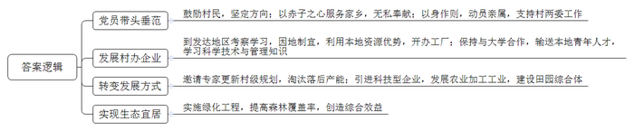
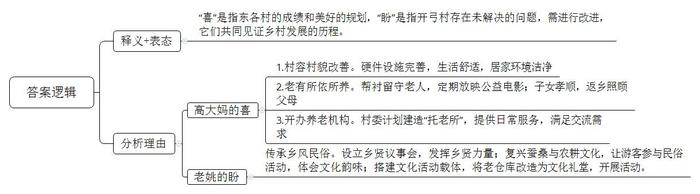
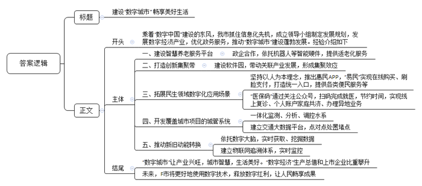
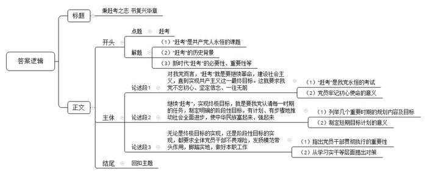

# 2021年公务员多省联考《申论》题（吉林甲卷）

> 候选采集稿。参考答案及解析来自粉笔页面，不代表官方答案或真实高分答卷；来源使用许可与原卷对应关系仍需人工核实。

## 给定材料

### 材料 material-27f0f59213ca945c

永济村在解放前是“光山秃岭乱石沟，十人见了十人愁；旱涝风雹年年有，庄稼十年九不收”。全村有大大小小239条干涸贫瘠的沟壑，332座光秃秃的山头，森林覆盖率不到2%。50年代初，22岁的张一雁成为了永济村的党支部书记。为了改变生存环境，张一雁带着村民上山种树。由于经验不足，树的成活率极低，村民们泄了气。张一雁鼓励大家说：“我们改不了天，但我们可以换地！不管前方的路有多苦多难，只要方向正确，我们的日子一定会一天比一天红火。”

时光荏苒，转眼就到了2015年。这一年，从省里某部门退休的副厅级干部阎永强经过村党支部换届选举成为了永济村新一任村支书。阎永强带回来的不仅是身份，还有服务家乡的赤子之心。他把自己的党组织关系转回村里，“又成了一个真正的永济人”。阎永强说：“为了村里的发展，我不会领取任何工资报酬，只希望能像老书记一样，让家乡百姓的日子一天比一天好。”

阎永强向记者介绍起了永济村的致富史。1980年冬，张一雁率几名村干部到南方考察。所到之处，乡镇企业给农民带来的巨大变化令张一雁一行眼热心跳。经过慎重考虑，村里决定利用本地丰富的铁矿资源建一座钢铁厂，这也是省里当年的第一家村办企业。当第一炉火红的铁水滚滚流出的时候，许多党员激动得哭了。后来，永济村又先后创办了铝合金厂、石料厂等企业。张一雁说：“办企业不同于当年我们上山栽树，不是光有憨劲就行。企业需要的是懂技术、会管理的人才。”这以后，永济村与许多大学联系，送青年农民到那里学企业管理、财务、农作物栽培等科学技术。

阎永强说，老书记最爱说的一句话是“有了好头头，群众不发愁”。这好头头就是党支部，就是共产党员的先锋带头作用。在村办企业多年发展的背后，高耗能重污染的弊端日渐显现。2015年，村两委邀请省农业大学农村发展研究所的专家帮助完成了新的村级规划。根据新规划，要淘汰一批落后产能，当时许多村民都担心“下岗”，不太情愿。全体党员以身作则，并动员家属、亲戚支持村两委的决定。2016年，村两委引来了展望农业科技有限公司，在铝合金厂的旧址上，建起一条年产500吨食用保健油的冷榨加工生产线，同时建立了一个集餐饮、住宿、观光于一体的田园综合体。广大村民不仅实现了“再就业”，收入还比过去翻了一番。

“小时候村周围到处是荒山秃岭，现在满眼郁郁葱葱。”2020年春，在永济村外不远处的一座山坡上，阎永强正带队搞绿化工程。如今的永济村森林覆盖率超过87%，曾经的一座座荒山变成了一条条“绿龙”，成了村民的“绿色银行”。阎永强说：“看到村里环境一天天变美，老百姓日子一天天富裕，我耳边常常回响起老书记那句话，‘只要方向正确，我们的日子一定会一天比一天红火’。”

### 材料 material-94384d10d6f39852

新春伊始，《新农村》记者小梁到基层调研，以下是他在两个村庄采访的片段。

“村子真干净”，这是外来人对东各村的第一印象。村道上见不到一张纸片，家家院里院外也清清爽爽。79岁的高大妈笑着把小梁往屋里迎。冬季取暖煤改电以后，高大妈家装了地暖，外面再冷屋里也舒服。高大妈自己收拾得利索，家里拾掇得干净，屋里屋外的花都修剪得齐齐整整。她言语间透着喜悦，“儿子孝顺，春节前辞了城里的工作回来，专门照顾我们老两口”“爸妈上了年纪，身体都不大好，有个头疼脑热，身边没个人照顾那肯定不成。”高大妈的儿子小曾买完菜刚一进门就接过了话头。

东各村是太行山脉的一个小山村。村子不大，一共250多口人，但老龄化程度不低，60岁以上的老人就有70多位。平时，村里就是这些老人“守着”。村委会一周放两次公益电影，捧场的也都是这些老人。“村里的大爷大妈都是居家养老，儿女负责赡养。子女外出打工的，只能是老两口互相照顾。村里打算建个‘托老所’，解决老人的日间吃饭和活动、照料问题。”村党支部委员李大姐介绍说，她时常会到高大妈家来看看，帮衬帮衬。听说要建“托老所”，高大妈觉得不错，“老姊妹能时常见上一面，唠唠嗑。”“老爸腿脚不好，出不了门，我们在跟前伺候着才放心。”小曾说。儿子能在身边尽孝，高大妈心里满意，可也着急。她跟李大姐商量，“咱村里能不能办个产业，让我儿子也能有点收入，不然他光照顾我们了，以后咋办？”

李大姐说，东各村边有条远近闻名的宋代古道，村内还保留着古道上唯一的一座三孔拱桥，来的游客不少。村里已经有10多户拿到了农家乐的经营执照，她说：“要是乡村旅游搞起来，不愁你儿子没事干！”

坐落在太湖之滨的水乡小村开弓村，则是另外一种景象，弯弯的小清河穿村而过，如箭在弦，村名由此而来。

甜茶、昆曲、桥文化……在开弓村文化纪念馆，或图文，或影像，或模型，地方风土人情跃然眼前。陈列厅里，一件件旧物件，散发着浓浓的年代感。“有不少是村民自己捐赠的，像这排老式碗橱，还有那套八仙桌椅，现在已经很难看到了。”被村里人称为“农民教授”的老姚感叹，这里存放的是村民共同的乡村文化记忆。开弓村越来越富，村民的生活和城里无异，但老姚喜中有忧。开弓村曾经是“处处倚蚕箔，家家下鱼筌”；如今，农耕文化、蚕桑文化却有淡化之势，“这是我们的根啊。”老姚颇有感慨。

如何传承乡风民俗？“首先要发挥好乡贤的力量。大家都有共识，要有个乡贤议事会。”老姚说。在成立后的乡贤议事会上，大家一致认为，要以有形的形式展现开弓村文化，如熏豆制作工艺，婚嫁习俗，摇三橹船，桑、蚕、丝到蚕丝被的一条龙产业……为什么要以“有形的形式”？老姚说：“让来到开弓村的人，从亲身参与民俗活动中体味到农耕文化和蚕桑文化的韵味。”村民的文化活动要有载体，开弓村发展较早，能用的土地已经不多，怎么解决？经过商议，村里准备把老仓库改造成文化礼堂。老姚高兴地说：“脚手架已经搭起来了，估计5月份就能启用。”按照规划，礼堂能容纳100人左右，今后村里的党员活动、小型培训、会议、文艺演出都可以使用。

未来，开弓村的文化回味必定更悠长。

### 材料 material-53b4e35ca65ecae2

在导诊员的指引下，老王通过手机完成了挂号、诊间结算、取药取报告、预约复诊等就医环节，全程不到半小时。他高兴地说：“太方便了，只要关注医院微信号，对着机器扫医保码，几秒就能看病、开药。看完病后，医生滑动鼠标，我们再扫码，就自动划扣了医保费用，不用再到窗口排队缴费，省时省事多了。”

随着医保码落地，F市市民使用医保已经从“卡时代”跨入“码时代”，“码”不仅运用于医院内的就医流程，还可用于院外买药。据医疗保障局统计，医生花费数秒扫码的时间，就可为患者平均节省在医院就医等待的时间约43分钟。截至2020年底，全市已有120万余名参保人员开通了医保码，有36家医院、近500家药店实现了医保码结算。

蔡先生首次体验到了“云医疗”的便捷。他通过市中心医院客户端微信小程序，向市中心医院心内科张主任发起了复诊高血压病的申请。通过视频问诊，张主任在线为蔡先生开出了一张电子处方，经过药师在线审方，就完成了医保在线结算。接下来，蔡先生在家就能收到由医院寄来的药品。F市已有多家医院开通线上医保结算权限。市民开通了医保码，只要近三个月在互联网医院所属的实体医院有就诊记录，就可以在互联网医院进行在线复诊、慢病续方、医保自动结算等。实行医保码扫码结算，不仅优化了结算流程，解决了市民线上看病买药不能报销的痛点，还有效降低了线下就诊感染风险，改善了老百姓的就医体验。

2020年7月以来，F市在全国率先实现医保个人账户家庭共济，在省内不同地方的家庭成员，也支持加入共济账户。这不仅方便了家庭成员申领医保码，而且参保人员还可以和家人一起分享共济账户里的个人账户资金。

60岁的林阿姨到广州帮儿子照顾孩子已有10年。这些年因为青光眼、鼻炎等大小疾病在广州的医院做过多次手术，她说住院治疗所产生的医疗费用垫付压力大，而且可选择的省外定点医疗机构也不多，每年她都要奔波一千多公里往返广州与F市，还要准备各种证明材料，才能报销医保，十分麻烦。对于像林阿姨这样的流动人口及外出务工人员来说，看病、报销不方便一直是他们就医的痛点。随着医保码落地，流动人口或随迁人员再也不用垫付医疗费，也不用大老远奔波报销医保了。一方面，参保人可以通过医保码在全国办理有关医保业务；另一方面，通过电子政务平台——政务通APP，F市居民可在线办理跨省异地就医备案、参保关系转移、参保缴费证明打印等多项医保经办业务，同时可以自助查询个人账户、个人待遇、消费明细、报销结果等个人数据。

### 材料 material-94671b1dd336e4be

1949年3月23日下午，西柏坡阳光明媚，毛泽东同志从住了10个月的小院里走出来，正好碰到迎上来的周恩来同志。他望着远处连绵雄伟的太行山，意味深长地说：“今天是进京赶考的日子。”周恩来答道：“我们都应当考及格，不要退回来。”毛泽东坚定地说：“退回来就失败了。我们决不当李自成！我们共产党人进北平，是要继续革命，建设社会主义，直到实现共产主义。”

2013年7月，习近平总书记在河北省调研时指出：“当年党中央离开西柏坡时，毛泽东同志说是‘进京赶考’。60多年过去了，我们取得了巨大进步，中国人民站起来了，富起来了，但我们面临的挑战和问题依然严峻复杂，应该说，党面临的‘赶考’远未结束。”

2020年10月，党的十九届五中全会审议通过了《中共中央关于制定国民经济和社会发展第十四个五年规划和二〇三五年远景目标的建议》。2021年3月，十三届全国人大四次会议审议通过了《中华人民共和国国民经济和社会发展第十四个五年规划和二〇三五年远景目标纲要》。对于中国发展来说，“五年规划”是党治国理政的重要方式，也是量度中国步伐的显著路碑。从1953年新中国开始实行第一个“五年计划”，到2020年“十三五”规划完成，一个又一个五年，诠释了不同时期的历史标识，推动中华民族迎来了从站起来、富起来到强起来的伟大飞跃。

## 题目

### 第 1 题

**给定资料**2**中介绍了永济村的致富史，请归纳永济村的经验做法。（20分）**

关联材料：material-27f0f59213ca945c

作答要求：

要求：全面、准确，有条理，不超过200字。

### 第 2 题

**给定资料**3**提到了高大妈的“喜”和老姚的“盼”，请对此谈谈你的看法。（15分）**

关联材料：material-94384d10d6f39852

作答要求：

要求：

（1）准确全面；

（2）分条陈述；

（3）不超过250字。

### 第 3 题

**省里召开****“数字城市”建设座谈会，F市被邀请做经验介绍，假设汪副市长参加此次会议，请根据“给定资料**4**\-**5**”，为汪副市长拟写一份发言提纲。（25分）**

关联材料：material-53b4e35ca65ecae2

作答要求：

要求：紧扣资料，要点完整，内容具体，条理清晰；不超过450字。

### 第 4 题

**结合全篇给定资料，以****“赶考”为话题，联系实际，自选角度，自拟题目，写一篇议论文。（40分）**

关联材料：material-94671b1dd336e4be

作答要求：

要求：

（1）观点明确，内容充实，结构清晰，语言流畅；

（2）结合给定资料，但不拘泥于给定资料；

（3）字数800～1000字。

## 答案与解析

第 1 题

**参考答案（粉笔题库参考内容）**

1.党员带头垂范。鼓励村民，坚定方向；以赤子之心服务家乡，无私奉献；以身作则，动员亲属，支持村两委工作。

2.发展村办企业。到发达地区考察学习，因地制宜，利用本地资源优势，开办工厂；保持与大学合作，输送本地青年人才，学习科学技术与管理知识。

3.转变发展方式。邀请专家更新村级规划，淘汰落后产能；引进科技型企业，发展农业加工工业，建设田园综合体。

4.实现生态宜居。实施绿化工程，提高森林覆盖率，创造综合效益。

**解析**

**参考答案说明：**本参考答案从“党员带头垂范”“发展村办企业”“转变发展方式”“实现生态宜居”等四个方面进行了分条撰写。各条要点之间在内容上相互并列，没有交叉。

**考点**：考点经验启示类

**来源**：来源2021年公务员多省联考《申论》题（吉林甲卷）

粉笔申论页面对本题只提供「解析视频」入口，该入口是会员推广位，页面无视频地址与文字解析。

第 2 题

**参考答案（粉笔题库参考内容）**

“喜”是指东各村的成绩和美好的规划，“盼”是指开弓村存在未解决的问题，需进行改进，它们共同见证乡村发展的历程。

高大妈的喜：1.村容村貌改善。硬件设施完善，生活舒适，居家环境洁净。2.老有所依所养。帮衬留守老人，定期放映公益电影；子女孝顺，返乡照顾父母。3.开办养老机构。村委计划建造“托老所”，提供日常服务，满足交流需求。

老姚的盼：传承乡风民俗。设立乡贤议事会，发挥乡贤力量；复兴蚕桑与农耕文化，让游客参与民俗活动，体会文化韵味；搭建文化活动载体，将老仓库改造为文化礼堂，开展活动。

**解析**

**参考答案说明**：思路方面，本参考答案按照“表态（释义+表态）+分析理由”的思路展开。内容方面，本参考答案先对高大妈的“喜”和老姚的“盼”进行了解释，并表态；“分析理由”部分从“高大妈的喜”和“老姚的盼”两个方面进行了分析；因材料中未涉及“总结评价”部分的内容，可省略。

**考点**：考点观点现象分析类

**来源**：来源2021年公务员多省联考《申论》题（吉林甲卷）

粉笔申论页面对本题只提供「解析视频」入口，该入口是会员推广位，页面无视频地址与文字解析。

第 3 题

**参考答案（粉笔题库参考内容）**

建设“数字城市” 畅享美好生活

乘着“数字中国”建设的东风，我市抓住信息化先机，成立领导小组制定发展规划，发展数字经济产业，优化政务服务，推动“数字城市”建设蓬勃发展。经验介绍如下：

一、建设智慧养老服务平台。政企合作，依托机器人等智能硬件，提供适老化服务。二、打造创新集聚带。建设软件园，带动关联产业发展，形成集聚效应。三、拓展民生领域数字化应用场景。坚持以人为本理念，推出惠民APP，“易民”实现在线购买、刷脸支付，打造统一入口，提供各类便民服务等；“医保码”通过关注公众号，扫码完成就医，节约时间，实现线上复诊、个人账户家庭共济、办理异地业务。四、开发覆盖城市项目的城管系统。一体化监测、分析、调控水系；建立交通大数据平台，点对点处置堵点。五、推动新旧动能转换。依托数字大脑，实时获取、挖掘数据；建立物联网追溯体系，实时监控。

“数字城市”让产业兴旺，城市智慧，生活美好。“数字经济”生产总值和上市企业比重攀升。未来，F市将更好地使用数字技术，释放数字红利，让人民畅享成果。

**解析**

**参考答案说明：**（1）本参考答案包括标题、正文，符合发言提纲的格式要求。（2）正文部分，一方面，内容上，围绕着“F市‘数字城市’建设”这一主题，开头写到了F市“数字城市”建设的背景和宏观做法；主体部分从“建设智慧养老服务平台”“打造创新集聚带”“拓展民生领域数字化应用场景”“开发覆盖城市项目的城管系统”“推动新旧动能转换”五个方面介绍了经验；最后结尾部分总结了F市“数字城市”建设的意义以及对未来的展望。另一方面，形式上，本参考答案做到了分段、分条撰写，整体上条理较为清晰。

**考点**：考点总结类

**来源**：来源2021年公务员多省联考《申论》题（吉林甲卷）

粉笔申论页面对本题只提供「解析视频」入口，该入口是会员推广位，页面无视频地址与文字解析。

第 4 题

**参考答案（粉笔题库参考内容）**

**秉赶考之志 书复兴华章**

中国共产党的执政之路就是“赶考之路”，这是毛泽东同志高瞻远瞩提出的重大命题，也是一代又一代共产党人薪火相传的永恒课题。新中国成立初期，共产党人进京赶考，树立继续革命，努力建设社会主义，直到实现共产主义这一终极目标。经过几十年发展，我党带领人民群众在一个又一个短期规划中取得瞩目成就，但也面临各种各样的问题与挑战，这就需要我党继承“赶考精神”，回答好新时代考题，成就民族复兴的伟大事业。

**对我党而言，****“赶考”****就是要继续革命，建设社会主义，直到实现共产主义这一****最终目标。这****就****要求我党不忘初心****、****坚定****信念、****一往无前。**“赶考”是历史赋予我党的考试，是人民对我党永不谢幕的考试。在这场“大考”中，我党唯有将国家发展、人民幸福放在心头，常怀赤子之心，才能以顽强的意志、过硬的作风，为建设社会主义，实现共产主义伟大理想而奋斗。唯有勇往直前，躬行实践，才能不断成长，战胜一切险阻。唯有在成就面前戒骄戒躁，始终理性冷静，才能不断自我革新，才能取得最终的胜利。

实现共产主义是一个漫长的过程，需经历众多发展阶段。而每个阶段都有不同的任务、不同的问题，这就要我党不懈努力，继续“赶考”。

**继续****“赶考”，实现终极目标，就是要我党认清每一时期的任务，制定明确的阶段性目标，有计划、有步骤地推动社会全面进步，使中华民族富起来、强起来。**从“一五”计划集中力量进行工业化建设，奠定工业化、现代化基础，到“十一五”计划促进区域协调发展，促进国民经济发展，再到“十三五”规划实施创新驱动发展战略，实现脱贫攻坚，确保经济高质量发展……正是一个又一个阶段性计划，才为国家建设提供方向，才将中国打造为世界第二大经济体，才夯实了社会主义现代化的根基。

**无论是终极目标的实现，还是阶段性目标的实现，都要求全体党员干部不畏艰险，发扬****模范带头****作用****，****脚踏实地，做好本职工作。**无论是高瞻远瞩的长远规划，还是短期的阶段性计划，最终都要党员干部认真贯彻执行。然而，当前部分党员干部忽视岗位职责，奉行形式主义，消极对待群众，长此以往，必会削弱我党执行力，影响政策规划落地。为此，全体党员要摒弃形式主义、官僚主义等不良作风，带头垂范，坚定正确方向，在本职岗位上兢兢业业、无私奉献，推动社会事业稳步发展。

“赶考”之路是一条闯关路，这路并非坦途。面对成绩，我们不能骄傲，面对挑战，我们不能退缩。我们要肩负时代重任，为努力实现中华民族伟大复兴而奋斗不止！

**解析**

**文章分析**

**秉赶考之志 书复兴华章**

【**标题的优点：**标题直接突出“赶考”这一主题，简明、清晰。】

（1）中国共产党的执政之路就是“赶考之路”，这是毛泽东同志高瞻远瞩提出的重大命题，也是一代又一代共产党人薪火相传的永恒课题。（2）新中国成立初期，共产党人进京赶考，树立继续革命，努力建设社会主义，直到实现共产主义这一终极目标。（3）经过几十年发展，我党带领人民群众在一个又一个短期规划中取得瞩目成就，但也面临各种各样的问题与挑战，这就需要我党继承“赶考精神”，回答好新时代考题，成就民族复兴的伟大事业。

【**开头的优点：**★内容方面。范文的开头是紧扣题目给定的“赶考”这一主题展开的。首先，指出“赶考”是共产党人永恒的课题；其次，介绍了“赶考”的历史背景；最后，阐述了新时代“赶考”的必要性、重要性。★文字表达方面。使用了“这是……也是……”“但”等连接词，使语言表达有逻辑性。】

**对我党而言，****“赶考”****就是要继续革命，建设社会主义，直到实现共产主义这一****最终目标。这****就****要求我党不忘初心****、****坚定****信念、****一往无前。**（1）“赶考”是历史赋予我党的考试，是人民对我党永不谢幕的考试。在这场“大考”中，（2）我党唯有将国家发展、人民幸福放在心头，常怀赤子之心，才能以顽强的意志、过硬的作风，为建设社会主义，实现共产主义伟大理想而奋斗。唯有勇往直前，躬行实践，才能不断成长，战胜一切险阻。唯有在成就面前戒骄戒躁，始终理性冷静，才能不断自我革新，才能取得最终的胜利。

【**论述段****1的优点：**★观点句：范文的观点句是紧扣“赶考”这一文章主题提出的。形式上，它在段首处直接写出，位置突出，容易发现。内容上，关键词突出，内容要点明确，可以明显看出它是从“最终目标”的角度出发，阐述“赶考”的内涵。★论述内容：（1）指出“赶考”是我党永恒的考试；（2）从三个层面指出党员牢记初心使命的意义。注意：以上两个方面层次清晰，论述的针对性强。在论述方法上主要采用了讲道理、引用名言等方式，增强了论证的说服力。】

实现共产主义是一个漫长的过程，需经历众多发展阶段。而每个阶段都有不同的任务、不同的问题，这就要我党不懈努力，继续“赶考”。

**继续****“赶考”，实现终极目标，就是要我党认清每一时期的任务，制定明确的阶段性目标，有计划、有步骤地推动社会全面进步，使中华民族富起来、强起来。**（1）从“一五”计划集中力量进行工业化建设，奠定工业化、现代化基础，到“十一五”计划促进区域协调发展，促进国民经济发展，再到“十三五”规划实施创新驱动发展战略，实现脱贫攻坚，确保经济高质量发展……（2）正是一个又一个阶段性计划，才为国家建设提供方向，才将中国打造为世界第二大经济体，才夯实了社会主义现代化的根基。

【**论述段****2的优点：**★观点句：范文的观点句是紧扣“赶考”这一文章主题提出的。形式上，它在段首处直接写出，位置突出，容易发现。内容上，关键词突出，内容要点明确，可以明显看出它是从“阶段性目标”的角度出发，阐述“赶考”的内涵。★论述内容：（1）列举了几个重要时期“五年规划”的内容及目标；（2）总结了制定短期目标计划的意义。注意：以上两个方面层次清晰，论述的针对性强。在论述方法上主要采用了讲道理和举例子相结合的方式，使内容更加充实。】

**无论是终极目标的实现，还是阶段性目标的实现，都要求全体党员干部不畏艰险，发扬****模范带头****作用****，****脚踏实地，做好本职工作。**（1）无论是高瞻远瞩的长远规划，还是短期的阶段性计划，最终都要党员干部认真贯彻执行。（2）然而，当前部分党员干部忽视岗位职责，奉行形式主义，消极对待群众，长此以往，必会削弱我党执行力，影响政策规划落地。为此，（3）全体党员要摒弃形式主义、官僚主义等不良作风，带头垂范，坚定正确方向，在本职岗位上兢兢业业、无私奉献，推动社会事业稳步发展。

【**论述段****3的优点：**★观点句：范文的观点句是紧扣“赶考”这一文章主题提出的。形式上，它在段首处直接写出，位置突出，容易发现。内容上，关键词突出，内容要点明确，可以明显看出它是从“落实实干”的角度出发，阐述“赶考”的内涵。★论述内容：（1）指出党员干部贯彻执行的重要性；（2）从学习实干等层面提出对策。注意：以上两个方面层次清晰，论述的针对性强。在论述方法上主要采用了讲道理和举例子相结合的方式，使内容更加充实。】

【**论述段之间的关系：**★内容的内在逻辑：论述段1从“最终目标”的角度指出赶考的内涵，论述段2从“阶段性目标”的角度指出赶考的内涵，论述段3从“落实实干”的角度指出赶考的内涵，三个论述段整体按照“理论-实践”的思路进行论述。】

“赶考”之路是一条闯关路，这路并非坦途。面对成绩，我们不能骄傲，面对挑战，我们不能退缩。我们要肩负时代重任，为努力实现中华民族伟大复兴而奋斗不止！

【**结尾的优点**：范文的结尾回扣了“赶考”这个主题，语言精悍，不拖沓。】

**考点**：考点文章写作题

**来源**：来源2021年公务员多省联考《申论》题（吉林甲卷）

粉笔申论页面对本题只提供「解析视频」入口，该入口是会员推广位，页面无视频地址与文字解析。

