# 2021 吉林省公务员录用考试 行测（统考）

> 行测 · 100 题 · 吉林 2021

## 第 1 题　qid 3522334 · 时事政治

在2020年12月召开的中央农村工作会议上，习近平总书记强调，在向第二个百年奋斗目标迈进的历史关口，巩固和拓展脱贫攻坚成果，全面推进乡村振兴，加快农业农村现代化，是需要全党高度重视的一个关系大局的重大问题。下列有关会议主要内容表述正确的是：

- **A**. 脱贫攻坚目标完成后，对摆脱贫困的县，从脱贫之日起设立3年过渡期
- **B**. 要健全防止返贫动态监测和帮扶机制，对易返贫致贫人口实施常态化监测
- **C**. 构建新发展格局，把战略基点放在开源节流上，农村有巨大空间，可以大有作为
- **D**. 要牢牢把住粮食生产主动权，严防死守13亿亩耕地红线，落实最严格的耕地保护制度

## 第 2 题　qid 3522742 · 新思想

脱贫攻坚的重大胜利，为实现第一个百年奋斗目标打下了坚实基础，极大增强了人民群众获得感、幸福感、安全感，彻底改变了贫困地区的面貌，改善了生产生活条件，提高了群众生活质量，“两不愁三保障”全面实现。以下习近平总书记的“金句”与脱贫攻坚无直接相关的是：

- **A**. 脚下沾有多少泥土，心中就沉淀多少真情
- **B**. 小康不小康，关键看老乡
- **C**. 扶贫必扶智，治贫先治愚
- **D**. 只争朝夕，不负韶华

## 第 3 题　qid 3522343 · 新思想

下列选项，在国家主席习近平发表的2021年新年贺词中没有提到的是：

- **A**. 我们克服疫情影响，统筹疫情防控和经济社会发展取得重大成果
- **B**. 2020年，全面建成小康社会取得伟大历史性成就，决战脱贫攻坚取得决定性胜利
- **C**. 我国在世界主要经济体中率先实现正增长，预计2020年国内生产总值迈上百万亿元新台阶
- **D**. 京津冀协同发展、长江经济带发展、粤港澳大湾区建设、长三角一体化发展按下快进键，黄河流域生态保护和高质量发展成为国家战略

## 第 4 题　qid 3522341 · 时事政治

碧空如洗，草木竞荣，2020年初夏召开的全国两会极不平凡。两会期间，习近平总书记多次“下团组”，对做好统筹疫情防控和经济社会发展工作、应对当前的风险和挑战、永远保持同人民群众的血肉联系等方面作出重要指示，传递出攻坚克难、化危为机的坚定信心和力量。以下选项对应关系不一致的是：

- **A**. 谈经济社会发展——“在危机中育新机、于变局中开新局”
- **B**. 谈生态文明建设——“坚定信心不动摇，咬定目标不放松”
- **C**. 谈疫情防控——“慎终如始、再接再厉”
- **D**. 谈执政为民——“人民至上、生命至上”

## 第 5 题　qid 3522336 · 人文常识

“十四五”时期是我国全面建成小康社会、实现第一个百年奋斗目标之后，乘势而上开启全面建设社会主义现代化国家新征程、向第二个百年奋斗目标进军的第一个五年。下列有关说法正确的是：

- **A**. 提出到本世纪中叶基本实现社会主义现代化远景目标，人均国内生产总值达到中等发达国家水平，中等收入群体显著扩大
- **B**. 坚持把发展经济着力点放在实体经济上，坚定不移建设制造强国、质量强国、网络强国、数字中国
- **C**. 坚持又快又好工作总基调，以推动高质量发展为主题，以深化供给侧结构性改革为主线
- **D**. “十四五”规划是在党的十九届四中全会上审议通过的，将于2021年开始实施

## 第 6 题　qid 3522338 · 法律常识

2020年底颁布的《政府督查工作条例》是我国政府督查领域的第一部行政法规，是政府督查工作长期实践的系统总结 。下列有关说法正确的是：

- **A**. 政府督查机构可以根据督查结论或者整改核查结果，直接对督查对象追究责任
- **B**. 应当严格控制督查频次和时限，科学运用督查方式，严肃督查纪律，提前培训督查人员
- **C**. 政府督查可以采取开展检查、访谈，组织座谈、听证的方式，但不可采取暗访的方式进行
- **D**. 督查对象对督查结论有异议的，可以自收到该督查结论之日起60天内，向作出该督查结论的人民政府申请复核

## 第 7 题　qid 3522744 · 人文常识

下列国家勋章和国家荣誉称号与人名对应关系不正确的是：

- **A**. 共和国勋章：申纪兰、屠呦呦、钟南山
- **B**. 人民科学家：吴文俊、南仁东、程开甲
- **C**. 人民英雄：张伯礼、张定宇、陈薇
- **D**. 人民楷模：王文教、王继才、张桂梅

## 第 8 题　qid 3522745 · 人文常识

下列有关我国疫情防控的说法错误的是：

- **A**. 被隔离的人员，有工作单位的，工作单位不得停止支付其隔离期间的工作报酬
- **B**. 根据《传染病防治法》的规定，发现传染病病人时，应当及时向附近的公安机关报告
- **C**. 全国抗击新冠肺炎疫情表彰大会于2020年9月在人民大会堂举行，习近平总书记在大会上发表重要讲话
- **D**. 2020年6月发布的《抗击新冠肺炎疫情的中国行动》白皮书，是真实记录中国抗疫艰辛历程的重要文献

## 第 9 题　qid 3522345 · 科技常识

下列有关我国2020年科技成就的说法正确的是：

- **A**. 2020年12月，嫦娥五号返回器成功着陆，这是我国首次完成月球采样返回任务
- **B**. 我国研制的“奋斗者”号载人潜水器于2020年11月坐底菲律宾海沟，创造了我国载人深潜新纪录
- **C**. 中国环流器二号M装置于2020年底建成并实现首次放电，为我国核裂变堆的设计建造打下了坚实基础
- **D**. 2020年7月，北斗三号全球卫星导航系统全面建成并开通服务，我国成为第四个独立拥有全球卫星导航系统的国家

## 第 10 题　qid 3522346 · 法律常识

下列有关《中华人民共和国民法典》的说法不正确的是：

- **A**. 民法典将人格权独立成编，调整的是因人格权的享有和保护产生的民事关系
- **B**. 八周岁以上的未成年人为限制民事行为能力人，不可独立实施纯获利益的民事法律行为
- **C**. 民法典实施后，婚姻法、继承法、民法通则、收养法、担保法、合同法、物权法、侵权责任法、民法总则同时废止
- **D**. 民法典规定，自然人享有隐私权，隐私是自然人的私人生活安宁和不愿为他人知晓的私密空间、私密活动、私密信息

## 第 11 题　qid 3522743 · 人文常识

下列有关我国抗美援朝战争的说法正确的是：

- **A**. 志愿军与美军第一次交锋，是在仁川登陆战
- **B**. 抗美援朝战争中，中国人民志愿军的司令员是粟裕
- **C**. 中国人民志愿军在战争中涌现出一大批英雄官兵，杨根思、黄继光、解秀梅是其中的优秀代表
- **D**. 2020年是抗美援朝出国作战70周年，我国拍摄了《金刚川》《芳华》等一系列影视作品展现志愿军英勇无畏的优秀品质

## 第 12 题　qid 3522335 · 经济常识

下列关于风险管理的做法合适的是：

- **A**. 某商业银行对不同信用等级的客户适用相同的贷款利率
- **B**. 李某担心家中古董被盗造成损失，向保险公司购买财产保险
- **C**. 考虑到大人和小孩风险承受力强弱不一，购买保险时小孩应优先于大人
- **D**. 某外贸公司将要进口一批美国货物，为规避美元升值风险，向银行申请开立保函

## 第 13 题　qid 3522365 · 人文常识

下列表述按照所代表的年龄从小到大排序正确的是：

- **A**. 
从心之年舞勺之年知非之年期颐之年鲐背之年

- **B**. 
舞勺之年知非之年从心之年鲐背之年期颐之年

- **C**. 
舞勺之年从心之年知非之年期颐之年鲐背之年

- **D**. 
从心之年舞勺之年知非之年鲐背之年期颐之年

## 第 14 题　qid 3522348 · 人文常识

下列四位作家原名与其作品、笔名对应错误的是：

- **A**. 李尧棠——《寒夜》——巴金
- **B**. 万家宝——《原野》——曹禺
- **C**. 舒庆春——《月牙儿》——老舍
- **D**. 郭开贞——《太阳照在桑干河上》——丁玲

## 第 15 题　qid 3523373 · 人文常识

下列关于历代正式行政区划的描述，正确的是：

- **A**. 秦代：郡—县
- **B**. 唐代：道—州、府—县
- **C**. 汉代：道—郡—县
- **D**. 宋代：路—军、州—县

## 第 16 题　qid 3522344 · 人文常识

下列谚语不涉及二十四节气的是：

- **A**. 花木管时令，鸟鸣报农时
- **B**. 白露身不露，寒露脚不露
- **C**. 日晕三更雨，月晕午时风
- **D**. 秋分早，霜降迟，寒露种麦正当时

## 第 17 题　qid 3523426 · 人文常识

如下图所示，装有水的烧杯放在天平一端，另一端放置砝码使天平平衡，此时再放入一手指在水中，若手指完全静止在水中且没有触碰烧杯壁和烧杯底部，且水也没有溢出，那么这时天平的状态是：

- **A**. 继续保持平衡状态
- **B**. 放置砝码的一端下沉了
- **C**. 放置烧杯的一端下沉了
- **D**. 无法判断

## 第 18 题　qid 3523372 · 科技常识

下列物理现象与地球自转无关的是：

- **A**. 日月星辰四季方位的变化
- **B**. 昼夜更替
- **C**. 在北半球，物体从高空自由下落，存在落点偏东的现象
- **D**. 在北半球，水自然形成的漩涡是逆时针方向的

## 第 19 题　qid 3522355 · 科技常识

下列变化过程包含化学反应的有：
①鬼火
②光合作用
③水垢形成
④高粱酿酒
⑤舞台云雾的生成

- **A**. ②③④⑤
- **B**. ①②④⑤
- **C**. ①③④⑤
- **D**. ①②③④

## 第 20 题　qid 3522347 · 人文常识

生活中，厨师在烹饪过程中除了使用酱油调色上色外，还可以采用下列哪一食材来给食物上色：

- **A**. 食盐
- **B**. 冰糖
- **C**. 香叶
- **D**. 花椒

## 第 21 题　qid 3522455 · 逻辑填空

现代体育比赛不仅是各国运动员速度与力量的竞技场，也是世界各国展示形象、尖端科技与体育融合的大舞台。随着人类对挑战自身的执着追求，各竞技项目的成绩不断        人体能力的极限，要想进一步提高比赛成绩，哪怕是提高百分之一甚至千分之一，教练与运动员都要竭尽全力采用各种方式和技术去实现，科技的赋能作用也就愈发重要。
填入划横线部分最恰当的一项是：

- **A**. 刷新
- **B**. 挑战
- **C**. 考验
- **D**. 逼近

## 第 22 题　qid 3522456 · 逻辑填空

《周书》曰：“小满之日苦菜秀。”小满时节，麦类、谷物等农作物子粒开始饱满，但尚未成熟，恰是青黄不接的时候。而田间地头的野菜正蓬勃生长，采食野菜来度过饥荒，自是            。
填入划横线部分最恰当的一项是：

- **A**. 不容置疑
- **B**. 顺理成章
- **C**. 水到渠成
- **D**. 理所当然

## 第 23 题　qid 3523492 · 逻辑填空

早在商汤时代，浴盘上就镌刻有“苟日新，日日新，又日新”的铭词，旨在激励自己澡身而浴德，澡雪而精神，既要盥洗身体，更要涤荡心灵，保持向新求新的精神，产生            的进步。
填入划横线部分最恰当的一项是：

- **A**. 与日俱进
- **B**. 日新月异
- **C**. 竿头日上
- **D**. 突飞猛进

## 第 24 题　qid 3522972 · 逻辑填空

在高山相夹的谷底，有时能直观地看到地形对云的        ：气流翻山越岭被抬升形成波动气流，在气流的波峰与波谷之前，云也随之上下扭曲。在一些情况下，大气温度和高度成反比，处于波谷处的温度更高，达不到云        的温度，而波峰处的温度可以形成云，这样就形成了有云和无云条带反复交错的波状云天空。
依次填入划横线部分最恰当的一项是：

- **A**. 塑造 凝结
- **B**. 制造 凝集
- **C**. 打造 凝聚
- **D**. 创造 凝固

## 第 25 题　qid 3522899 · 逻辑填空

人体是一个庞大的共生体。人体皮肤表面、口腔、呼吸道、肠道        着大量微生物，它们的数量是人体本身细胞的数十倍，编码的基因是人体基因的100倍。每个人的身体里都会有微生物留存的痕迹，而人体的健康会与体内的菌群            。人们将特定环境中包括微生物在内的总DNA称为宏基因组。
依次填入划横线部分最恰当的一项是：

- **A**. 寄生 同气连枝
- **B**. 依附 表里相依
- **C**. 潜伏 如影随形
- **D**. 生存 休戚与共

## 第 26 题　qid 3522850 · 逻辑填空

人脸识别系统深度学习的数据越多，人脸识别的效果就会越精确。只要给予足够多的人脸攻击大数据样本，机器就能够自主地学习到伪造图像或合成视频中的        ，最终就能得到对于这些攻击的分辨能力。并且，随着学习数据的不断增多，深度学习系统也会一天比一天强大，让各种各样的“换脸”            。
依次填入划横线部分最恰当的一项是：

- **A**. 弊端 无计可施
- **B**. 瑕疵 无所遁形
- **C**. 错误 插翅难逃
- **D**. 缺陷 束手无策

## 第 27 题　qid 3523502 · 逻辑填空

我国的大禹治水传说和西方的诺亚方舟故事为我们呈现了中西文化的美丽景观，“娴静”的中国传统文化与“跃动”的西方文化相映，东方的责任意识和西方的权力思想相辅，        我们走向中西文化差异的源头，启发我们        中西文化的特质和精髓，促使我们相互借鉴、彼此“扬弃”，绘写多彩的人类文明图画。
依次填入划横线部分最恰当的一项是：

- **A**. 引领 思考
- **B**. 指引 拷问
- **C**. 引导 思索
- **D**. 指示 追寻

## 第 28 题　qid 3523497 · 逻辑填空

随着微信用户群体不断扩大，微信在流量获取、社群运营、用户规模与黏性方面的优势越发明显，越来越多的教育产品开始        微信生态探索新的服务模式，吸引用户进行            分享，以降低获得新用户的成本，提升用户黏性。
依次填入划横线部分最恰当的一项是：

- **A**. 借用 全方位
- **B**. 借助 持续性
- **C**. 依托 聚变式
- **D**. 凭借 立体化

## 第 29 题　qid 3522941 · 逻辑填空

实体书店不仅是一种商业业态，也是一个文化标志，更是一座城市的文化招牌。实体书店要想在图书市场上赢得竞争，关键要找准定位，        自己的比较优势和市场价值，在服务上做得更加周到精准，才能让读者            ，让逛书店成为文化时尚，让更多人浸润在浓郁书香中。
依次填入划横线部分最恰当的一项是:

- **A**. 明晰 络绎不绝
- **B**. 确定 源源不断
- **C**. 明确 纷至沓来
- **D**. 确立 客似云来

## 第 30 题　qid 3522447 · 逻辑填空

当前，构建中国特色文艺理论体系已渐成学界共识，但在推进建设的道路上，            易，具体而微难；空喊口号易，付诸实践难。中国特色文艺理论体系建设，除了宏观维度的考量，更需要大功细作，从概念、范畴、术语及具体议题设置等微观层面入手，            ，聚沙成塔，一砖一瓦搭建大厦。
依次填入划横线部分最恰当的一项是：

- **A**. 大而化之    条分缕析
- **B**. 坐而论道    步步为营
- **C**. 小题大做    集腋成裘
- **D**. 通观大局    精雕细琢

## 第 31 题　qid 3522879 · 逻辑填空

除了用于作战外，现代头盔经过改良已被广泛应用于民用领域。自行车场地比赛很早就有佩戴头盔的规定，一方面是因为比赛时            ，碰撞事故频发；另一方面是二十世纪八九十年代侧重空气动力学的场地赛车研发，将选手身体纳入到设计因素中，头盔也成为        阻力的重要配件之一。
依次填入划横线部分最恰当的一项是：

- **A**. 你追我赶 降低
- **B**. 短兵相接 提高
- **C**. 夹枪带棒 降低
- **D**. 针锋相对 提高

## 第 32 题　qid 3523005 · 逻辑填空

“我思故我在”“我劳故我在”，这种存在方式带给我两书柜的劳绩，好比几根火柴捆绑在一起，多少有了一点        。这种存在方式也带给我        的生活习性。活得实在、活得真实，在我看来是整个人生的真谛。我喜欢像罗丹的《思想者》那样，没有        、没有装点，通过自己的文字，赤膊面对这个世界。
依次填入划横线部分最恰当的一项是：

- **A**. 硬度 简朴 遮掩
- **B**. 厚度 简单 掩饰
- **C**. 亮度 简洁 遮挡
- **D**. 温度 简练 修饰

## 第 33 题　qid 3522957 · 逻辑填空

解释国家兴衰是许多学科            的学术好奇心所在，经济学家更是            地发展出各种理论框架，期冀破解经济增长之谜。激励学者们把中国这个经历了由盛至衰的历史作为主要研究对象的，是以著名的中国科技史学家李约瑟命名的所谓“李约瑟之谜”。这个谜题尝试回答为什么在前现代社会，中国科技            于其他文明，而近现代中国不再具有这样的领先地位。
依次填入划横线部分最恰当的一项是：

- **A**. 绵延不绝 孜孜矻矻 迥然不同
- **B**. 旷日持久 孜孜不倦 遥遥领先
- **C**. 亘古不变 皓首穷经 名列前茅
- **D**. 持之以恒 殚精竭虑 一枝独秀

## 第 34 题　qid 3522432 · 逻辑填空

颠覆性技术具有两面性，既可能产生正面结果，也可能带来负面影响。它可能对已有的技术和市场带来革命性        ，甚至改变世界力量        。通常，这类技术的出现没有规律，更难以        。
依次填入划横线部分最恰当的一项是：

- **A**. 作用 均衡 预料
- **B**. 影响 平衡 预测
- **C**. 变革 均匀 预想
- **D**. 改革 平均 预估

## 第 35 题　qid 3522410 · 逻辑填空

“回输”是细胞治疗需要        的主要手段之一。将细胞注射回人体，犹如将一艘艘小船放回航道，而人体内是一个密织交错的“航道网”，如果没有有效的、执行力强的“导航”设备，只能“            ”。无法到达指定位置的细胞治疗，功效将被大大        ，甚至不起作用。
依次填入划横线部分最恰当的一项是：

- **A**. 仰仗 随波逐流 稀释
- **B**. 凭借 离弦走板 侵蚀
- **C**. 依靠 返本还原 缩小
- **D**. 依仗 随俗浮沉 减弱

## 第 36 题　qid 3522955 · 片段阅读

常温常压下，天然气的气态轻烃有4种，甲烷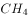、乙烷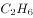、丙烷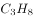和丁烷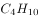。轻烃的含碳数越高，每个分子里需要供给的氢的数量也越多。腐殖型有机质含氢的数量较少，无法为碳数较多的轻烃提供足够的氢。另外，随着碳数越多，轻烃的形成温度也依次升高。烃源岩在低温的时候（左右），就能够大量地生成甲烷。由于很多地方的地温达不到那么高，所以也无法形成高碳数的气态轻烃。

上述文段意在说明：

- **A**. 轻烃的含碳数越高，氢的数量也越多
- **B**. 含碳数越多，轻烃所需的温度也越高
- **C**. 在天然气中，甲烷是占比最多的成分
- **D**. 在天然气中，丁烷是占比最多的成分

## 第 37 题　qid 3522549 · 片段阅读

为了进一步探索乌龙茶香气的酶促形成，团队成员系统研究了乌龙茶香气的酶促形成与胁迫的关联性。通过筛选各类胁迫因子，发现在乌龙茶加工过程中，损伤和低温胁迫是诱导茶叶香气酶促形成的关键胁迫因子。乌龙茶加工过程中做青阶段的连续损伤可诱导来自不同生物合成路径的香气物质合成关键基因的表达水平升高，进而促使这些香气物质的蓄积。此外，低温和损伤双胁迫对这些香气物质的合成具有显著协同效应。
这段文字意在说明：

- **A**. 乌龙茶香气的酶促形成主要与胁迫相关
- **B**. 做青阶段连续损伤可诱导香气物质的蓄积
- **C**. 胁迫使香气物质合成关键基因表达水平升高
- **D**. 损伤和低温是香气酶促形成的关键胁迫因子

## 第 38 题　qid 3522420 · 片段阅读

捆扎蔬菜的胶带实际上是涂过粘合剂的塑料膜。虽然胶带不是食品，但由于会和食品接触，也要遵守食品安全标准。不过，在塑料膜和粘合剂的生产过程中，由于聚合不完全或溶剂挥发不完全，确实可能有少量甲醛等小分子残留。但捆扎蔬菜用的胶带在自然放置状态下很稳定，降解释放大量甲醛的可能性极小。同时，市面上用来捆绑蔬菜的不只是普通胶带，有的是由动物胶和植物胶制成的胶带，自然也不会对人体造成危害。另外，体重为60公斤的成年人，只要他每日甲醛摄入量不超过12毫克，就不会对健康产生影响。
根据这段文字，以下说法正确的是：

- **A**. 食用了胶带捆扎的蔬菜影响健康的概率小
- **B**. 捆扎蔬菜的胶带自然放置时并不产生甲醛
- **C**. 植物胶制成的胶带才不会对人体造成危害
- **D**. 60公斤成年人每天只应摄入12毫克甲醛

## 第 39 题　qid 3523500 · 片段阅读

西方经典说，文学是一朵金蔷薇，由无数的金子碎屑合成。《红楼梦》无疑是中国文学的“金蔷薇”，而细节正是形成金蔷薇的那些碎金屑。它庞大丰富的内容，都是通过细节来表达的。当一个人要告诉另一个人：《红楼梦》这书好在哪里，为什么会百读不厌，书里的人物如何使人感动，作者的意图怎样含蓄、巧妙地传达······就要带着那另一个人去领略细节，回味对话，感受心灵的悸动。就像一座大观园，须要开门后一处处走来，一亭一院进去，一草一木赏过，才能知道这园子如何精美，如何曲径通幽。
最适合做这段文字标题的是：

- **A**. 细节的芳香
- **B**. 心灵的悸动
- **C**. 金蔷薇的魅力
- **D**. 品味《红楼梦》

## 第 40 题　qid 3522416 · 片段阅读

大熊猫分布区内目前分布的4种大型食肉动物，即豺、狼、豹和雪豹，其分布区范围自20世纪中期以来均出现明显缩小，其中以豺最为严重——过去10年间，豺与狼在大熊猫分布区内均只有零星记录（豺仅被记录到4次，狼11次），在部分山系可能处于濒临消失的边缘。大型食肉动物的窘迫与大熊猫卓有成效的保护形成了明显反差，究其原因，可能主要是大型食肉动物处在食物链顶端，对栖息地面积和质量的要求远比其他动物苛刻。
根据上述文段，可以推出：

- **A**. 提供大面积、高质量的栖息地或是留住大型食肉动物的关键
- **B**. 对大熊猫保护的投入广泛惠及了跟它同区域分布的其他动物
- **C**. 对大熊猫的全面保护极大地挤压了大型食肉动物的生存空间
- **D**. 维护生态系统的完整性和原真性可使大型动物得到全面保护

## 第 41 题　qid 3522994 · 片段阅读

考古学家在阿拉伯半岛的阿尔马塔夫遗址中已清理出9000多件遗物，其中以上为当地的朱尔法陶，包括一件完整的朱尔法夹砂红陶罐；西亚釉陶仍为孔雀绿釉陶和熔块胎陶；中国产的瓷器有龙泉窑青瓷，景德镇窑青花瓷、白瓷、青白瓷及广东地区产酱釉粗瓷等；另有泰国产青瓷。中国产的瓷器年代以明中晚期至清代为主。此外，出土了较多的玻璃手镯，还出土了一件侈口、细颈、圆形扁腹玻璃瓶。参考中国瓷器的年份，该区至少存在一个16至17世纪葡萄牙占领时期的人类活动层。

根据上述材料可以推出：

- **A**. 阿尔马塔夫最具地方特色的陶器是朱尔法陶器
- **B**. 明初中国已与阿尔马塔夫存在频繁的官方往来
- **C**. 阿尔马塔夫是古代亚欧文化艺术交流的集散地
- **D**. 葡萄牙殖民者占领时期的阿尔马塔夫繁荣发达

## 第 42 题　qid 3522419 · 片段阅读

孔子以“有教无类”“因材施教”“教学相长”为方针，以培养“博学通才之士”为目标，对学生进行礼、乐、御、射、书、数“六艺”教育，其中，数即数学，乐和声学有关，御和力学有关，射和机械有关。《中庸》上说，“博学之，审问之，慎思之，明辨之，笃行之”，学、问、思、辨、行，完全符合认识过程和研究科学的方法，即获取信息、提出问题、思维推理、检验结果、躬身实践。在儒家崇尚务实和“经世致用”思想影响下，中国古代科技具有强烈的实用性，形成了以农、医、天、算四大学科和以“四大发明”为代表的技术发明创造。
这段文字意在说明：

- **A**. 中华古代文明具有文理交融的包容性
- **B**. 古代科技是传统儒家思想的实现途径
- **C**. 传统文化和古代科技存在必然的联系
- **D**. 传统文化对古代科技发展有积极影响

## 第 43 题　qid 3522426 · 片段阅读

退行心理是一种心理防御机制，是指人们在遭受挫折、面临困难时，以比较幼稚的态度，选择早期生活阶段的某种行为方式来应对当前情况。对于二三十岁的成年人来说，经常要面临来自各个方面的多重压力，于是在比较自由的环境中，很多人都会通过退行心理来调节情绪、释放压力，自称宝宝便是一种具体表现。事实上只要无伤大雅，这种暂时性的退行心理不仅是正常的，而且在某些情况下是极其有必要的。但如果一个人在遇到困难时，总利用退行心理去逃避现实问题或博取别人的同情，就很有可能发展成为某种心理疾病。
根据这段文字，下列说法正确的是：

- **A**. 经常自称宝宝会发展为某种心理疾病
- **B**. 时常回忆年幼时光是退行心理的表现
- **C**. 人不应沉溺于用退行心理来逃避现实
- **D**. 二三十岁的成年人自称宝宝极有必要

## 第 44 题　qid 3522425 · 片段阅读

与数字应用相伴而生的是“数字鸿沟”难题。老龄群体在适应数字时代上的吃力，一方面是使用技能缺乏、文化程度限制或设备不足，另一方面许多数字产品在设计中忽视了老年人需求。我们正在步入老龄化社会，在线上线下日趋融合的当下，从立法规划、政府决策到产业发展都应该着眼长远，充分保障老年人的社会需求、权利和尊严，而不能仅仅把目光停留在年轻人身上。这就需要在科技进步的同时，兼顾消除老龄群体参与社区、社会生活的种种障碍，为他们提供一个安全、便捷、多彩、温暖的社会环境。
这段文字意在强调：

- **A**. 数字化生活应该重视老龄群体的需要
- **B**. 部分老龄群体适应数字时代存在困难
- **C**. 代际间的“数字鸿沟”现象如何产生
- **D**. 建设老年人友好型社会需要依靠数字技术

## 第 45 题　qid 3522422 · 语句表达

①获得相对的自由，从而充分地达到自我实现的境界
②“美”是人生的最高境界
③人只有满足自己和社会的需要才能达到“善”
④“善”侧重于掌握人的需要
⑤而“美”则侧重于在“真”“善”的前提下，超越二者的局限性
⑥“真”侧重于人掌握客观规律
将以上6个句子重新排列，语序正确的是：

- **A**. ⑥④⑤③②①
- **B**. ④③⑥⑤①②
- **C**. ②④③⑤⑥①
- **D**. ②⑥④③⑤①

## 第 46 题　qid 3522976 · 语句表达

近日，由中国、意大利、美国学者组成的研究团队，最新研发出一种三维石墨烯—碳纳米管复合网络支架。这种生物支架能很好地模拟大脑神经网络结构，未来，将可用于药物筛选或植入大脑帮助治疗脑部疾病，该碳神经支架由我国率先提出并完成材料制备。科学家                    。科研人员发现，相比在二维的培养皿中观察、培养神经细胞，三维支架更接近脑部实际环境。
将下列四个句子重新排列，填入划横线处，语序正确的是：
①把体内正常的神经干细胞移植到细小的碳纳米管中
②用石墨烯模拟大脑内部四通八达的三维框架
③从而构建出一个“互联互通”的人造神经网络
④增殖和定向分化神经元细胞

- **A**. ①②③④
- **B**. ②④①③
- **C**. ①③②④
- **D**. ②①④③

## 第 47 题　qid 3523017 · 片段阅读

制造业智能时代在创造出大量新的产品和服务的同时，也衍生出例如机器人操作和维护、工业数据工程师等全新的职业方向，就业形式上出现了更多自由职业者和兼职岗位，工作内容上也更加体现专业协作。制造业智能化产生的新兴岗位巨大供需差，要求职业院校准确把握专业方向，根据制造业产业链的变化对专业链进行及时调整和更新，以实现智能化产品在性能、质量和生产效率方面质的飞跃。
上述文字意在强调的是：

- **A**. 岗位快速更迭要求专业动态调整
- **B**. 技术技能人才培养目标发生变革
- **C**. 制造业智能化衍生出全新职业方向
- **D**. 职业教育为制造业智能化升级助力

## 第 48 题　qid 3523015 · 片段阅读

观照历史上多次出现过的媒介融合的进程结果，媒介材料的变更，绝不等于思想生活变现，正如汉字生产的主线，也绝不会因为纸张代替了简牍而出现颠覆性变化一样。事实上，简牍的汉字同纸张的汉字，并无太大差别，顶多只是字体有些不同而已。不可否认媒介变化肯定会带来表达的不同，如新近出现的网言网语，肯定是互联网语境下的表达产物。但无论媒介技术怎样发展变化，任何文明主干、任何文化血脉，都是一以贯之的。
这段文字意在强调：

- **A**. 正确认识媒介革命的特殊性与普遍性，重视传统文化的传承
- **B**. 媒介革命不仅涉及媒介技术，还关乎人们的思想观念等问题
- **C**. 借鉴历史上简牍与纸张之媒介融合的经验，推动新媒介融合
- **D**. 媒介革命必定改变人们观念，助力社会进步和提升文明层次

## 第 49 题　qid 3523008 · 语句表达

从时间的精密测量与相对论的密切关系，我们可以感受到万物相通的奥妙。根据广义相对论，地面（或任何星球）上的两点之间，如果高度不同，时间流逝速度就会有所不同，高处略快。地面上每米的高度差，时间流逝差异大约为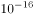。这意味着，<u>                    </u>，就能推测两点的高度差。这进一步表明，原子钟在测地学、水文学里都会有巨大的应用潜力。

填入划横线部分最恰当的一句是：

- **A**. 只要用原子钟精确测量两点的时间流逝的差异
- **B**. 只要明确时间的精密测量与相对论的密切关系
- **C**. 只要能掌握原子钟碰撞频移的规律和基本参数
- **D**. 只要能够运用自然界万物相通的法则举一反三

## 第 50 题　qid 3523490 · 语句表达

虽然树种对水分的利用规律大同小异，但不同的森林类型涵养水源的作用大小不一。科学评估显示，长江上游天然林保护工程的实施为岷江上游的水生态安全做出了明显贡献，但大面积的人工植被覆盖可能加重区域生态用水，从而降低流域产水量，且大规模集中连片种植的人工纯林引发的外来物种入侵、病虫害、生态系统健康问题凸显。因此，应首先                    。
填入划横线部分最恰当的一句是：

- **A**. 保护现存的天然林植被
- **B**. 发挥森林涵养水源功能
- **C**. 保障水资源和生态安全
- **D**. 加强人工造林植被建设

## 第 51 题　qid 3522354 · 数学运算

小明去某楼盘售楼部咨询售房情况。置业顾问告诉他，如果再卖出50套，则已卖出的数量与未卖出的数量相等；如果再卖出150套，则已卖出的数量比未卖出的数量多一半，问该楼盘目前还剩下多少套房子未卖出？

- **A**. 350套
- **B**. 450套
- **C**. 550套
- **D**. 650套

## 第 52 题　qid 3522371 · 数学运算

不超过100名的小朋友站成一列。如果从第一人开始依次按1，2，3，···，9的顺序循环报数，最后一名小朋友报的是7；如果按1，2，3，···，11的顺序循环报数，最后一名小朋友报的是9，那么一共有多少名小朋友？

- **A**. 98
- **B**. 97
- **C**. 96
- **D**. 95

## 第 53 题　qid 3522412 · 数学运算

大江两岸有两个正面相对的码头，可供客轮往返。如下图所示，根据河流水文情况，“幸福号”客轮星期一沿着河岸60度夹角方向前行，刚好达到对岸码头；星期二“幸福号”准备返回时，发现河流水文情况发生变化，船长调整航向，沿河岸30度夹角方向返回，顺利到达码头。假设客轮往返速度均是千米/小时，且行驶过程中河水流速是恒定的，问返程时河水流速是去程时的多少倍？

- **A**. 

- **B**. 

- **C**. 

- **D**. 
2

## 第 54 题　qid 3522373 · 数学运算

随着人们生活水平的提高，汽车拥有量迅速增长，汽车牌照号码需要扩容。某地级市交通管理部门出台了一种小型汽车牌照组成办法，每个汽车牌照后五位的要求必须是：前三位为阿拉伯数字，后两位为两个不重复的英文字母（字母O、I不参与组牌），那么用这种方法可以给该地区汽车上牌照的数量为：

- **A**. 397440辆
- **B**. 402400辆
- **C**. 552000辆
- **D**. 576000辆

## 第 55 题　qid 3522399 · 数学运算

送奶工人给11楼住户送牛奶，由于小区停电导致电梯无法使用。如果他走楼梯从第1层到第2层需要5秒，以后每多走一层需多花2秒，其中走到5层以后每多走一层需多休息5秒，那么他走到11层需要多少秒？

- **A**. 210
- **B**. 215
- **C**. 220
- **D**. 235

## 第 56 题　qid 3522392 · 数学运算

某商场为了促销，进行掷飞镖游戏。每位参与人员投掷一次，假设掷出的飞镖均扎在飞镖板上且位置完全随机，扎中阴影部分区域（含边线）即为中奖。该商场预设中奖概率约为，仅考虑中奖概率的前提下，以下四幅图形（图中的正三角形和正方形均与圆外切或内接）最适合作为飞镖板的是：

- **A**. 

- **B**. 

- **C**. 

- **D**. 

## 第 57 题　qid 3522375 · 数学运算

某装修公司订购了一条长为2.5m的长方体条形不锈钢管，要剪裁成60cm和43cm长的两种规格长度不锈钢管若干根，所裁钢管的横截面与原来一样，不考虑剪裁时材料的损耗，要使剩下的钢管尽量少，此时材料的利用率为：

- **A**. 0.998
- **B**. 0.996
- **C**. 0.928
- **D**. 0.824

## 第 58 题　qid 3522372 · 数学运算

如下图1所示，在一个金字塔造型（底面为正方形，侧面为四个全等的等腰三角形）的铸造件内部挖空一个圆柱。现沿铸造件顶点A且垂直底面的方向切开，切开后的截面如下图2所示，已知DE、GF为圆柱的高，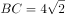分米，分米，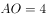分米，那么挖后铸造件的体积是：

- **A**. 
立方分米

- **B**. 
立方分米

- **C**. 
立方分米

- **D**. 
立方分米

## 第 59 题　qid 3522411 · 数学运算

我国一支工兵部队在某国执行维和任务，负责道路抢修工作。某天，该部队负责的道路被炮弹炸出一个球面形状的大坑。经测量，弹坑直径16m，深4m。现需用车辆运送混凝土填充弹坑，铺平道路，假设每车次可运输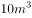的混凝土，问抢修道路至少需要出动运输车多少车次？（球缺体积计算公式为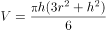，其中为球半径，为球缺高，为球缺体积）

- **A**. 65
- **B**. 66
- **C**. 67
- **D**. 68

## 第 60 题　qid 3522397 · 数学运算

某果品公司急需将一批不易存放的水果从A市运到B市销售。现有四家运输公司可供选择，这四家运输公司提供的信息如下：

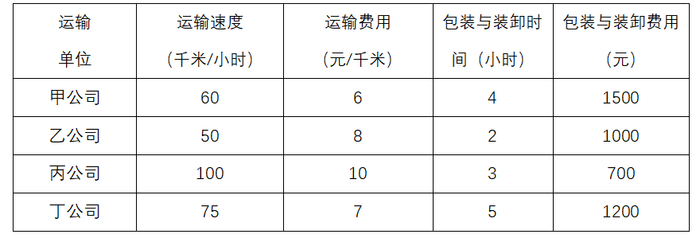

如果A、B两市的距离为S千米（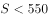千米），且这批水果在包装与装卸以及运输过程中的损耗为300元/小时，那么要使果品公司支付的总费用（包装与装卸费用、运输费用及损耗三项之和）最小，应选择哪家运输公司？

- **A**. 甲
- **B**. 乙
- **C**. 丙
- **D**. 丁

## 第 61 题　qid 3523357 · 图形推理

把下面的图形分为两类，使每一类图形都有各自的共同特征或规律，分类正确的一项是：

- **A**. ①④⑥，②③⑤
- **B**. ①③⑤，②④⑥
- **C**. ①②④，③⑤⑥
- **D**. ①⑤⑥，②③④

## 第 62 题　qid 3522441 · 图形推理

从所给的四个选项中，选择最合适的一个填入问号处，使之呈现一定的规律性：

- **A**. A
- **B**. B
- **C**. C
- **D**. D

## 第 63 题　qid 3523382 · 图形推理

从所给的四个选项中，选择最合适的一个填入问号处，使之呈现一定的规律性：

- **A**. A
- **B**. B
- **C**. C
- **D**. D

## 第 64 题　qid 3522437 · 图形推理

从所给的四个选项中，选择最合适的一个填入问号处，使之呈现一定的规律性：

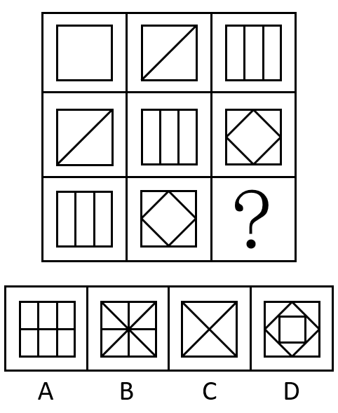

- **A**. A
- **B**. B
- **C**. C
- **D**. D

## 第 65 题　qid 3522445 · 类比推理

下图右侧四个选项中，哪一个不是左侧零件的立面？

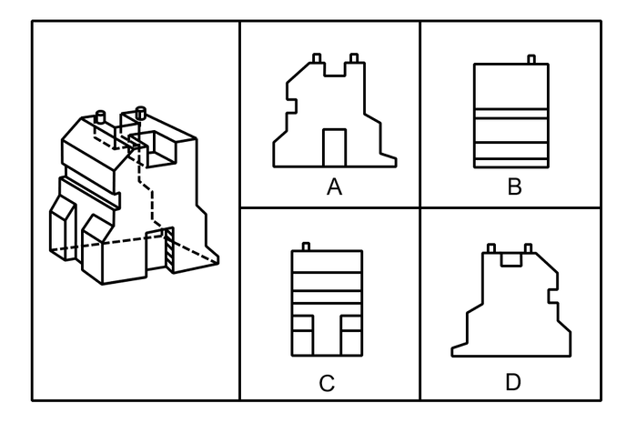

- **A**. A
- **B**. B
- **C**. C
- **D**. D

## 第 66 题　qid 3522394 · 定义判断

迎臂效应也被称为“请到我家后院来”。从表面意思来看，迎臂就是张开双臂欢迎的意思，是指某个地区的居民认为相关机构、设施、景观具有正的外部效应，能给本社区发展带来好处，因此，不排斥甚至欢迎这些项目在本社区落地。
根据上述定义，下列选项属于迎臂效应的是：

- **A**. 群众深度参与，点赞街道残障康复中心成立
- **B**. 公司升级业态，积极在社区推广无人零售店
- **C**. 新设备耗电低，企业要求园区加快引进速度
- **D**. 加气站易漏气，附近居民担心火灾要求搬迁

## 第 67 题　qid 3522386 · 定义判断

先赋资本是指建立在血缘、遗传等先天条件下，不经过个人努力就可以拥有的资本。自致资本是指通过个人后天努力取得，为个人所支配的资本。
根据上述定义，下列选项中的内容均属于自致资本的是：

- **A**. 婚姻、职业、政治面貌
- **B**. 家世、民族、文化程度
- **C**. 国籍、收入、工作单位
- **D**. 种族、户口、父辈职业

## 第 68 题　qid 3522389 · 定义判断

虚假相关指的是两个没有因果关系的事件之间，基于一些其他未见的因素（潜在变量）而推断出因果关系，引致两个事件是“有所联系”的假象，但这种联系并不能通过客观的试验来证实。
根据上述定义，下列选项不属于虚假相关的是:

- **A**. 童鞋的大小与孩子的语言能力
- **B**. 冷饮的销量与泳池溺水的人数
- **C**. 惯性的大小与汽车的核载重量
- **D**. 网民的数量与房屋的折旧程度

## 第 69 题　qid 3522393 · 定义判断

色素色是指有机色素通过选择性地吸收、反射和投射特定频率的光线后直观呈现出的颜色。结构色又称物理色，是指通过可见光与物质物理上的微观结构（如物体表面或表层的纹、刻点、沟缝或颗粒等）发生相互作用，这些大量的微观有序结构对不同波长的光散射、衍射或干涉后产生的各种颜色。
根据上述定义，下列颜色属于色素色的是:

- **A**. 用激光束刻录的光盘上的彩色花纹
- **B**. 蝴蝶翅膀上的鳞片呈现出五颜六色
- **C**. 阳光下肥皂泡泡呈现缤纷的虹彩色
- **D**. 用乌饭树叶捣汁煮出的糯米饭呈现黑色

## 第 70 题　qid 3522381 · 定义判断

单质是由同一种元素组成的纯净物。化合物是由两种或两种以上元素的原子（不同元素的原子）组成的纯净物。混合物是指由两种或两种以上不同的单质或化合物机械混合而成的物质，无固定化学式，混合物的各种成分之间没有发生化学反应，混合物可以用物理的方法将所含的物质分离。
根据上述定义，下列选项同时具有以上三类物质的是：

- **A**. 氮气、氧气、二氧化碳、空气
- **B**. 食盐水、盐酸、氨水、蒸馏水
- **C**. 氢气、氖气、水蒸气、汞蒸气
- **D**. 二氧化碳、水蒸气、矿泉水、天然气

## 第 71 题　qid 3522378 · 类比推理

戊：己：庚

- **A**. 钠：镁：铝
- **B**. 寅：卯：巳
- **C**. 牛：虎：龙
- **D**. 秦：汉：隋

## 第 72 题　qid 3522379 · 类比推理

优雅：天鹅

- **A**. 风沙：塞外
- **B**. 高洁：梅花
- **C**. 友好：同窗
- **D**. 幽默：笑话

## 第 73 题　qid 3522384 · 类比推理

赫兹：频率

- **A**. 法拉：电容
- **B**. 焦耳：功率
- **C**. 牛顿：压强
- **D**. 电阻：欧姆

## 第 74 题　qid 3522388 · 类比推理

巴蜀：燕赵

- **A**. 京津：淮海
- **B**. 闽越：荆湘
- **C**. 齐鲁：秦晋
- **D**. 殷商：云贵

## 第 75 题　qid 3522390 · 类比推理

顿悟：醍醐灌顶

- **A**. 渴望：望梅止渴
- **B**. 移交：完璧归赵
- **C**. 消费：坐吃山空
- **D**. 孝顺：彩衣娱亲

## 第 76 题　qid 3522387 · 类比推理

超声波：次声波：军事

- **A**. 处女作：代表作：文学
- **B**. 路由器：隔离卡：网络
- **C**. 潜水艇：核潜艇：科技
- **D**. 北极星：北斗星：星辰

## 第 77 题　qid 3522391 · 类比推理

握瑜：怀瑾：美玉

- **A**. 南辕：北辙：马车
- **B**. 金戈：铁马：战争
- **C**. 敲金：击石：乐器
- **D**. 锦衣：玉食：珍馐

## 第 78 题　qid 3522400 · 类比推理

高屋建瓴 对于 （    ） 相当于 （    ） 对于 技艺

- **A**. 格局 左支右绌
- **B**. 形势 目无全牛
- **C**. 气势 天造地设
- **D**. 地势 逆水行舟

## 第 79 题　qid 3522404 · 类比推理

晕轮效应 对于 （    ） 相当于 （    ） 对于 变本加厉

- **A**. 扬长避短 墨菲定理
- **B**. 以偏概全 破窗效应
- **C**. 欲扬先抑 增减效应
- **D**. 举一反三 蝴蝶效应

## 第 80 题　qid 3523355 · 类比推理

防爆膜：防刮花：抗撞击

- **A**. 驱蛇粉：驱动器：驱逐舰
- **B**. 萤火虫：荧光棒：荧惑星
- **C**. 防晒伞：超轻便：抗强风
- **D**. 净水器：除杂质：去异味

## 第 81 题　qid 3522380 · 逻辑判断

如果一片森林的树木物种多样性非常丰富，那么这时缺失一个物种对于整个森林的生产力来讲，影响还并不是太大；但在物种多样性越稀缺的时候，树的种类继续变少，对整个森林生产力产生的打击就会越来越大。
由此可以推出：

- **A**. 除非树木物种多样性锐减，整个森林的生产力不会受到影响
- **B**. 只要森林的树木物种减少，整个森林的生产力就会受到影响
- **C**. 如果森林的生产力下降，那么森林的树木物种多样性就已经受损
- **D**. 要么森林的树木物种多样性非常丰富，要么森林的生产力非常可观

## 第 82 题　qid 3522385 · 逻辑判断

某科学家在一个宇宙科学网站上刊载了一项成果，该成果宣称找到了地球生命来自彗星的“证据”，引发了广泛关注。他声称在一块坠落到斯里兰卡的陨石里找到了微观硅藻化石，该石头有着疏松多孔的结构，密度比在地球上找到的所有东西都低。他推断这是一颗彗星的一部分，并指出样本中找到的微观硅藻化石与恐龙时代留存下来的化石中的微观有机体类似，从而为彗星胚种论提供了强有力的证据。
以下哪项如果为真，最能反驳该科学家的观点？

- **A**. 发表该成果的网站缺乏可信性，所载论文良莠不齐，有些曾沦为笑柄
- **B**. 该科学家是彗星胚种论的狂热支持者，曾宣称SARS和流感来自彗星
- **C**. 该成果配图中被标示成“丝状硅藻”的东西实际上只是硅藻细胞断片
- **D**. 该成果根本无法证明该石头是碳质球粒陨石，甚至难以确定其是陨石

## 第 83 题　qid 3522402 · 逻辑判断

最近有研究团队以问卷调查的方式，调查了519名从未吸过传统香烟，年龄在18岁至25岁间的年轻人，调查内容包括这些年轻人吸电子烟的情况和吸传统香烟的意向等，研究报告称，在从未吸过传统香烟的年轻人中，那些正在吸电子烟的人更可能尝试传统香烟，有关电子烟的监管政策要注意保护年轻人。
以下各项如果为真，最能支持上述结论的是：

- **A**. 受访者中有20%的人尝试过电子烟或未来很可能会尝试电子烟
- **B**. 即使只尝了两三口电子烟，也有可能提高吸传统香烟的可能性
- **C**. 受访者中正在吸电子烟的有60%表示未来一定会尝试传统香烟
- **D**. 电子烟对健康的危害比传统香烟小，但仍然含有很多有害物质

## 第 84 题　qid 3522405 · 逻辑判断

吴老师、张老师、孙老师、苏老师都是某校教师，分别教授语文、生物、物理、化学四门课程。
已知：
①如果吴老师教语文，那么张老师不教生物
②或者孙老师教语文，或者吴老师教语文
③如果张老师不教生物，那么苏老师不教物理
④或者吴老师不教化学，或者苏老师教物理
以下哪项如果为真，可以推出孙老师教语文：

- **A**. 吴老师教语文
- **B**. 张老师不教生物
- **C**. 吴老师教化学
- **D**. 苏老师不教物理

## 第 85 题　qid 3522407 · 逻辑判断

慢性疲劳综合征危害极大，它使人在正常的工作后感到极度疲劳，怎么休息也无济于事。这种疾病过去不能通过验血或其他检查得出明确的生物指标，因此其病因历来被归为心理因素。最近，研究人员对诊断为慢性疲劳综合征的48名患者和39名健康志愿者的大便和血液样本进行研究后得出结论：肠道细菌和血液中的致炎因子可能与该疾病有关。
以下哪项如果为真，最不能支持上述结论？

- **A**. 该疾病患者的大便样本中肠道细菌的多样性较低且抗炎细菌较少
- **B**. 该疾病患者的血液样本中被检测出致炎因子，而健康志愿者没有
- **C**. 目前不确定肠道细菌是导致该疾病的原因还是该疾病导致的结果
- **D**. 最新研究表明饮食治疗和益生菌等无助于为该疾病患者缓解疲劳

## 第 86 题　qid 3523364 · 逻辑判断

普通消费者囿于专业弱势群体的地位无从对错误或失真的负面信息进行有效甄别，即便企业努力澄清，但在当前“好事不出门，坏事传千里”的舆论传播环境下，强烈的记忆效应将使得追求风险规避的人们很难改变原有的错误认知，他们仍然会将之作为未来相当长一段时间内的消费决策指南，致使某些守法企业的“不白之冤”难以澄清，也给企业带来了严重损失。
以下哪项如果为真，最能削弱上述观点？

- **A**. 传媒利用其便利且易与大众认知结构相契合的特点向社会普及专业知识
- **B**. 监管部门为企业建立信用档案，为消费者提供企业情况的动态信息全景
- **C**. 那些有过“前科”但力图“改过自新”的企业很难回归正常的交易轨道
- **D**. 不良声誉一旦成为社会的集体记忆，在公众的认知中就会有很强的粘性

## 第 87 题　qid 3522461 · 逻辑判断

近几年，一些大城市的社区银行频频出现关门潮。与此同时，无人银行、5G银行、智能银行等一系列新概念银行不断出现，银行网点正在告别冷冰冰的玻璃柜台和金属板凳，传统网点交易处理的功能变弱了，定制服务、产品体验、社交互动等功能越来越突出。因此，有专家预测：二十年内，传统银行网点会消失。
以下各项如果为真，最能支持上述专家观点的是：

- **A**. 客户需进门取号、等待叫号，办理一项简单的业务耗费较长时间
- **B**. 人工智能等科技手段的引进，改变了人们对银行网点的固有印象
- **C**. 复杂业务必须到银行网点面签办理，如开户、销户等需本人办理且务必人工审核
- **D**. 网上银行、手机银行等接连涌现，银行网点作为服务主渠道的地位正在不断弱化

## 第 88 题　qid 3522462 · 逻辑判断

越来越多的人已经习惯于在“云端”漫步，享受快速发展带来的成果，却不见：德国正在推进“工业4.0”计划，美国正在呼唤“再工业化”；却不知：没有强大的生产制造能力、创新设计能力，国计民生就没有保障，国家实力就无从谈起，“互联网”也就只能是空中楼阁；却不思：只醉心于虚拟经济是靠不住的。越是在宏观层面，越要充分认识到互联网的诸多局限性。

如果以上为真，则以下哪项为真？

- **A**. 
“互联网”使很多人沉迷于虚拟经济

- **B**. 
“互联网”在微观层面的局限性更少

- **C**. 
只有国计民生得到保障，才能发展“互联网”

- **D**. 
只有提高生产制造和创新设计能力，才能发展“互联网”

## 第 89 题　qid 3523354 · 逻辑判断

不粘锅常见的不粘涂层为特氟龙涂层。全氟辛酸铵是特氟龙生产过程中使用的含量极微的一种加工助剂。数据表明，高剂量的全氟辛酸铵有可能导致胆固醇水平升高、甲状腺疾病及不育。特氟龙在常温及常态下具有非常稳定的理化性质，使用特氟龙不粘涂层的炊具在常温至的温度范围内都不会发生任何变化，但是当温度超过时，涂层逐渐向不稳定状态转变，当温度超过时会发生分解。正常烹调时，水的沸点是，温度较高的爆炒通常也只是左右，即使采用油炸的方式，油温也不会超过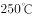。然而，如果在炒菜时喜欢把锅烧干、烧红后再加油，锅内温度就容易超过。

由此无法推出的是：

- **A**. 日常生活中，可以用不粘锅来烧开水和煮粥
- **B**. 烹饪时不粘涂层分解会导致胆固醇水平升高
- **C**. 炒菜时应避免把不粘锅烧干、烧红后再加油
- **D**. 正常烹调通常无需担心不粘锅释放有害物质

## 第 90 题　qid 3522465 · 定义判断

气象研究团队开发出一种基于人工智能的计算模型，用以检测云的旋转运动。研究人员鉴定并标记了逗点状云系的形态和运动，并利用计算机视觉和机器学习技术，“教会”计算机自动识别和检测卫星图像中的逗点状云系，以帮助人们更高效地在海量天气数据中及时发现恶劣天气的“端倪”。该计算模型有助于更快、更准确地预测恶劣天气。
以下各项如果为真，不属于上述结论必要前提的是：

- **A**. 
该计算模型能检测出逗点状云系，准确率达，甚至在其完全形成前就能检测到

- **B**. 
从卫星图像中看，逗点状云系因其外形类似于逗号而得名，与气旋的形成密切相关

- **C**. 
该计算模型如与其他天气预报模型相结合，将能有效地预测出的恶劣天气事件

- **D**. 
气象学认为气旋的形成可导致冰雹雷暴、大风和暴风雨等各种恶劣天气事件发生

## 材料 1

        截至2019年12月31日，中国共产党党员总数为9191.6万名，同比增长。在党员的性别、民族和学历上，女党员2559.9万名，少数民族党员680.3万名，大专及以上学历党员4661.5万名。在党员的入党时间上，新中国成立前入党的17.4万名，新中国成立后至党的十一届三中全会前入党的1550.9万名，党的十一届三中全会后至党的十八大前入党的6127.7万名，党的十八大以来入党的1495.6万名。在党员的职业上，工人（含工勤技能人员）644.5万名，农牧渔民2556.1万名，企事业单位、社会组织专业技术人员1440.3万名，企事业单位、社会组织管理人员1010.4万名，党政机关工作人员767.8万名，学生196.0万名，其他职业人员710.4万名，离退休人员1866.1万名。

        2019年共发展党员234.4万名，比上年增长。其中，发展女党员99.4万名，占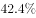；发展少数民族党员23.6万名，占；发展35岁及以下党员188.3万名，占；发展具有大专及以上学历的党员106.8万名，占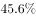。发展党员的职业上，工人（含工勤技能人员）14.3万名，企事业单位、社会组织专业技术人员31.6万名，企事业单位、社会组织管理人员25.3万名，农牧渔民42.4万名，党政机关工作人员13.4万名，学生84.4万名，其他职业人员22.9万名。

### 第 91 题　qid 3522352 · 比重

若阴影部分代表大专及以上学历党员人数，那么下列哪幅图最能反映截至2019年12月31日大专及以上学历党员占党员总数的比例？

- **A**. A
- **B**. B
- **C**. C
- **D**. D

### 第 92 题　qid 3522356 · 综合

截至2019年12月31日，新中国成立后至党的十八大前入党的人数约是其余时间入党人数的：

- **A**. 3.8倍
- **B**. 4.1倍
- **C**. 4.6倍
- **D**. 5.1倍

### 第 93 题　qid 3522360 · 比重

截至2019年12月31日，资料所列8种党员职业类型中，党员人数占比不低于的有：

- **A**. 3类
- **B**. 4类
- **C**. 5类
- **D**. 6类

### 第 94 题　qid 3522363 · 比重

2018年，发展党员数占同期党员总数的比例约为：

- **A**. 
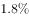

- **B**. 

- **C**. 

- **D**. 

### 第 95 题　qid 3522369 · 综合

不能从上述资料中推出的是：

- **A**. 
2019年发展的党员人数中，学生党员占比超过

- **B**. 
截至2019年12月31日，55岁以下党员占党员总数的比不超过

- **C**. 
截至2019年12月31日，61岁及以上的党员人数中，新中国成立前入党的不超过

- **D**. 
截至2019年12月31日，从事农牧渔民职业的党员人数与工人（含工勤技能人员）党员人数之比超过

## 材料 2

### 第 96 题　qid 3523365 · 综合

2019年6月下旬，价格按从高到低排列居于第六位的生产资料是：

- **A**. 苯乙烯
- **B**. 聚乙烯
- **C**. 聚丙烯
- **D**. 涤纶长丝

### 第 97 题　qid 3523366 · 综合

2019年7月上旬，价格环比涨幅超过的生产资料有：

- **A**. 6种
- **B**. 7种
- **C**. 8种
- **D**. 9种

### 第 98 题　qid 3523367 · 综合

2019年6月下旬，电解铜的价格约是无缝钢管的：

- **A**. 9.5倍
- **B**. 9.8倍
- **C**. 10.1倍
- **D**. 10.4倍

### 第 99 题　qid 3523369 · 综合

按照2019年7月上旬的环比涨跌幅，2019年7月中旬聚乙烯的价格约为：

- **A**. 7929.1元/吨
- **B**. 8031.5元/吨
- **C**. 8134.3元/吨
- **D**. 8236.9元/吨

### 第 100 题　qid 3523370 · 综合

能够从上述资料中推出的是：

- **A**. 2019年6月下旬，烧碱的价格比甲醇低1401元/吨
- **B**. 2019年7月上旬，黑色金属中的线材价格环比涨幅最快
- **C**. 2019年6月下旬，铝锭、铅锭、锌锭三者的价格之和比电解铜高2948.9元/吨
- **D**. 2019年7月上旬，化工产品中按价格从高到低排名前三位的是顺丁胶，涤纶长丝，苯乙烯

## 答案与解析

第 1 题

**答案**：B

**来源参考解析（非官方标准答案）**

本题考查政治常识。中央农村工作会议于2020年12月28日至29日在北京举行。习近平出席会议并发表重要讲话强调，在向第二个百年奋斗目标迈进的历史关口，巩固和拓展脱贫攻坚成果，全面推进乡村振兴，加快农业农村现代化，是需要全党高度重视的一个关系大局的重大问题。
A项错误，习近平强调，党中央决定，脱贫攻坚目标任务完成后，对摆脱贫困的县，从脱贫之日起设立5年过渡期。过渡期内要保持主要帮扶政策总体稳定。
B项正确，习近平指出，要健全防止返贫动态监测和帮扶机制，对易返贫致贫人口实施常态化监测，重点监测收入水平变化和“两不愁三保障”巩固情况，继续精准施策。
C项错误，习近平强调，从中华民族伟大复兴战略全局看，民族要复兴，乡村必振兴。从世界百年未有之大变局看，稳住农业基本盘、守好“三农”基础是应变局、开新局的“压舱石”。构建新发展格局，把战略基点放在扩大内需上，农村有巨大空间，可以大有作为。
D项错误，习近平指出，要牢牢把住粮食安全主动权，粮食生产年年要抓紧。要严防死守18亿亩耕地红线，采取长牙齿的硬措施，落实最严格的耕地保护制度。
故正确答案为B。

---

第 2 题

**答案**：D

**来源参考解析（非官方标准答案）**

本题考查政治常识。
A项正确，2015年6月18日，习总书记在部分省区市扶贫攻坚与“十三五”时期经济社会发展座谈会上的讲话当中指出，选派扶贫工作队是加强基层扶贫工作的有效组织措施，要做到每个贫困村都有驻村工作队、每个贫困户都有帮扶责任人。脚下沾有多少泥土，心中就沉淀多少真情。工作队和驻村干部要一心扑在扶贫开发工作上，强化责任要求，有效发挥作用。对在基层一线干出了成绩、群众拥护的驻村干部，要注意培养使用，让他们在扶贫开发工作中发挥更大作用。
B项正确，“小康不小康，关键看老乡”是2013年4月9日习近平总书记到博后村考察时提出的重要论述。这一重要论述，深深扎根于3600多名博后村村民的心底，也从这里传到大江南北老乡的心坎里，鼓舞全国亿万农民奋力奔向小康社会。
C项正确，2016年7月20日习总书记在《东西部扶贫协作座谈会上的讲话》中指出，摆脱贫困首要并不是摆脱物质的贫困，而是摆脱意识和思路的贫困。扶贫必扶智，治贫先治愚。贫穷并不可怕，怕的是智力不足、头脑空空，怕的是知识匮乏、精神委顿。脱贫致富不仅要注意富口袋，更要注意富脑袋。
D项错误，2019年12月31日，在新年贺词的最后，习近平总书记说到“让我们只争朝夕，不负韶华，共同迎接2020年的到来。”故“只争朝夕，不负韶华”与脱贫攻坚无直接关系。
本题为选非题，故正确答案为D。

---

第 3 题

**答案**：D

**来源参考解析（非官方标准答案）**

本题考查政治常识。
A、C两项正确，国家主席习近平发表的2021年新年贺词指出，艰难方显勇毅，磨砺始得玉成。我们克服疫情影响，统筹疫情防控和经济社会发展取得重大成果。“十三五”圆满收官，“十四五”全面擘画。新发展格局加快构建，高质量发展深入实施。我国在世界主要经济体中率先实现正增长，预计2020年国内生产总值迈上百万亿元新台阶。
B项正确，国家主席习近平发表的2021年新年贺词指出，2020年，全面建成小康社会取得伟大历史性成就，决战脱贫攻坚取得决定性胜利。我们向深度贫困堡垒发起总攻，啃下了最难啃的“硬骨头”。历经8年，现行标准下近1亿农村贫困人口全部脱贫，832个贫困县全部摘帽。
D项错误，国家主席习近平发表的2020年新年贺词指出，2019年，我们用汗水浇灌收获，以实干笃定前行。京津冀协同发展、长江经济带发展、粤港澳大湾区建设、长三角一体化发展按下快进键，黄河流域生态保护和高质量发展成为国家战略。
本题为选非题，故正确答案为D。

---

第 4 题

**答案**：B

**来源参考解析（非官方标准答案）**

本题考查政治常识。
A项正确，2020年5月23日，习近平总书记看望参加全国政协十三届三次会议的经济界委员，听取意见和建议。在讲话中，习近平用全面、辩证、长远的眼光分析当前全球经济形势，剖析我国经济的优势和潜力，强调“在危机中育新机、于变局中开新局”，要求“确保各项决策部署落地生根，确保完成决胜全面建成小康社会、决战脱贫攻坚目标任务”，推动我国经济乘风破浪、行稳致远。
B项错误，2019年3月7日，习近平总书记参加甘肃代表团审议时强调，要坚定信心不动摇，咬定目标不放松，整治问题不手软，落实责任不松劲，转变作风不懈怠，确保脱贫攻坚任务如期完成。
C项正确，2020年5月24日，习近平总书记来到十三届全国人大三次会议湖北代表团参加审议。习近平强调，要时刻绷紧疫情防控这根弦，慎终如始、再接再厉，持续抓好外防输入、内防反弹工作，决不能让来之不易的疫情防控成果前功尽弃。
D项正确，2020年5月22日，中共中央总书记、国家主席、中央军委主席习近平参加十三届全国人大三次会议内蒙古代表团的审议。他强调：“在全国范围调集最优秀的医生、最先进的设备、最急需的资源，全力以赴投入疫病救治，救治费用全部由国家承担。人民至上、生命至上，保护人民生命安全和身体健康可以不惜一切代价。”
本题为选非题，故正确答案为B。

---

第 5 题

**答案**：B

**来源参考解析（非官方标准答案）**

本题考查政治常识。2020年10月29日，中国共产党第十九届中央委员会第五次全体会议通过了《中共中央关于制定国民经济和社会发展第十四个五年规划和二〇三五年远景目标的建议》（以下简称《建议》）。
A项错误：《建议》指出：“到二〇三五年基本实现社会主义现代化远景目标。党的十九大对实现第二个百年奋斗目标作出分两个阶段推进的战略安排，即到二〇三五年基本实现社会主义现代化，到本世纪中叶把我国建成富强民主文明和谐美丽的社会主义现代化强国。展望二〇三五年，······人均国内生产总值达到中等发达国家水平，中等收入群体显著扩大，基本公共服务实现均等化，城乡区域发展差距和居民生活水平差距显著缩小；平安中国建设达到更高水平，基本实现国防和军队现代化；人民生活更加美好，人的全面发展、全体人民共同富裕取得更为明显的实质性进展。”
B项正确：《建议》指出：“坚持把发展经济着力点放在实体经济上，坚定不移建设制造强国、质量强国、网络强国、数字中国，推进产业基础高级化、产业链现代化，提高经济质量效益和核心竞争力。”
C项错误：《建议》指出：“坚持稳中求进工作总基调，以推动高质量发展为主题，以深化供给侧结构性改革为主线，以改革创新为根本动力，以满足人民日益增长的美好生活需要为根本目的，统筹发展和安全，加快建设现代化经济体系，加快构建以国内大循环为主体、国内国际双循环相互促进的新发展格局，推进国家治理体系和治理能力现代化，实现经济行稳致远、社会安定和谐，为全面建设社会主义现代化国家开好局、起好步。”
D项错误，2021年3月11日，十三届全国人大四次会议表决通过了《中华人民共和国国民经济和社会发展第十四个五年规划和2035年远景目标纲要》（简称“十四五”规划）。“十四五”规划将于2021年开始实施。
故正确答案为B。

---

第 6 题

**答案**：B

**来源参考解析（非官方标准答案）**

本题考查法律常识。
A项错误，根据《政府督查工作条例》第二十一条规定：“政府督查机构可以根据督查结论或者整改核查结果，提出对督查对象依法依规进行表扬、激励、批评等建议，经本级人民政府或者本级人民政府行政首长批准后组织实施。政府督查机构可以根据督查结论或者整改核查结果，提出对督查对象依法依规追究责任的建议，经本级人民政府或者本级人民政府行政首长批准后，交有权机关调查处理。”因此，政府督查机构不能直接对督查对象追究责任。
B项正确，根据《政府督查工作条例》第十五条第一款规定：“开展政府督查工作应当制定督查方案，明确督查内容、对象和范围；应当严格控制督查频次和时限，科学运用督查方式，严肃督查纪律，提前培训督查人员。”
C项错误，根据《政府督查工作条例》第十二条规定：“政府督查可以采取以下方式：（一）要求督查对象自查、说明情况；（二）听取督查对象汇报；（三）开展检查、访谈、暗访；（四）组织座谈、听证、统计、评估······”因此，可采取暗访的方式进行。
D项错误，根据《政府督查工作条例》第十七条规定：“督查对象对督查结论有异议的，可以自收到该督查结论之日起30日内，向作出该督查结论的人民政府申请复核。收到申请的人民政府应当在30日内作出复核决定。参与作出督查结论的工作人员在复核中应当回避。”
故正确答案为B。

---

第 7 题

**答案**：D

**来源参考解析（非官方标准答案）**

本题考查政治常识。
A项正确，2019年9月，为了庆祝中华人民共和国成立70周年，隆重表彰为新中国建设和发展作出杰出贡献的功勋模范人物，弘扬民族精神和时代精神，第十三届全国人民代表大会常务委员会第十三次会议决定，授予于敏、申纪兰、孙家栋、李延年、张富清、袁隆平、黄旭华、屠呦呦“共和国勋章”。2020年8月，第十三届全国人大常委会第二十一次会议表决通过关于授予在抗击新冠肺炎疫情斗争中作出杰出贡献的人士国家勋章和国家荣誉称号的决定，授予钟南山“共和国勋章”。
B项正确，2019年9月，为了庆祝中华人民共和国成立70周年，隆重表彰为新中国建设和发展作出杰出贡献的功勋模范人物，弘扬民族精神和时代精神，第十三届全国人民代表大会常务委员会第十三次会议决定，授予叶培建、吴文俊、南仁东、顾方舟、程开甲“人民科学家”国家荣誉称号。
C项正确，2020年8月，第十三届全国人大常委会第二十一次会议表决通过关于授予在抗击新冠肺炎疫情斗争中作出杰出贡献的人士国家勋章和国家荣誉称号的决定，授予张伯礼、张定宇、陈薇“人民英雄”国家荣誉称号。
D项错误，2019年9月，为了庆祝中华人民共和国成立70周年，隆重表彰为新中国建设和发展作出杰出贡献的功勋模范人物，弘扬民族精神和时代精神，第十三届全国人民代表大会常务委员会第十三次会议决定，授予王文教、王有德（回族）、王启民、王继才、布茹玛汗·毛勒朵（女，柯尔克孜族）、朱彦夫、李保国、都贵玛（女，蒙古族）、高德荣（独龙族）“人民楷模”国家荣誉称号。2020年12月，在如期完成新时代脱贫攻坚目标任务、决战脱贫攻坚取得重大胜利之际，中宣部向全社会宣传发布张桂梅同志的先进事迹，授予她“时代楷模”称号。
本题为选非题，故正确答案为D。

---

第 8 题

**答案**：B

**来源参考解析（非官方标准答案）**

本题考查政治常识。
A项正确，根据《传染病防治法》第四十一条第二款规定：“在隔离期间，实施隔离措施的人民政府应当对被隔离人员提供生活保障；被隔离人员有工作单位的，所在单位不得停止支付其隔离期间的工作报酬。”
B项错误，根据《传染病防治法》第三十一条规定：“任何单位和个人发现传染病病人或者疑似传染病病人时，应当及时向附近的疾病预防控制机构或者医疗机构报告。”
C项正确，2020年9月8日，全国抗击新冠肺炎疫情表彰大会在北京人民大会堂隆重举行。习近平总书记向国家勋章和国家荣誉称号获得者颁授勋章奖章并发表重要讲话。
D项正确，2020年6月发布的《抗击新冠肺炎疫情的中国行动》白皮书是真实记录中国抗疫艰辛历程的重要文献，约3.7万字，包括前言、正文和结束语。正文分为四个部分，分别是中国抗击疫情的艰辛历程、防控和救治两个战场协同作战、凝聚抗击疫情的强大力量、共同构建人类卫生健康共同体。
本题为选非题，故正确答案为B。

---

第 9 题

**答案**：A

**来源参考解析（非官方标准答案）**

本题考查科技常识。
A项正确，2020年12月17日，探月工程嫦娥五号返回器在内蒙古四子王旗预定区域成功着陆，标志着我国首次月球采样返回任务圆满完成。
B项错误，2020年11月10日8时12分，中国“奋斗者”号载人潜水器在马里亚纳海沟成功坐底，坐底深度10909米，创造了中国载人深潜的新纪录。
C项错误，2020年12月4日14时，新一代“人造太阳”装置——中国环流器二号M装置（HL-2M）在成都建成并实现首次放电，标志着中国自主掌握了大型先进托卡马克装置的设计、建造、运行技术，为我国核聚变堆的自主设计与建造打下坚实基础。
D项错误，北斗系统是党中央决策实施的国家重大科技工程。工程自1994年启动，2000年完成北斗一号系统建设，2012年完成北斗二号系统建设。北斗三号全球卫星导航系统全面建成并开通服务，标志着工程“三步走”发展战略取得决战决胜，我国成为世界上第三个独立拥有全球卫星导航系统的国家。目前，全球已有120余个国家和地区使用北斗系统。
故正确答案为A。

---

第 10 题

**答案**：B

**来源参考解析（非官方标准答案）**

本题考查法律常识。
A项正确，根据《中华人民共和国民法典》第九百八十九条规定：“本编调整因人格权的享有和保护产生的民事关系。”民法典将人格权独立成编，调整的是因人格权的享有和保护产生的民事关系。
B项错误，根据《中华人民共和国民法典》第十九条规定：“八周岁以上的未成年人为限制民事行为能力人，实施民事法律行为由其法定代理人代理或者经其法定代理人同意、追认；但是，可以独立实施纯获利益的民事法律行为或者与其年龄、智力相适应的民事法律行为。”因此，八周岁以上的未成年人可以独立实施纯获利益的民事法律行为或者与其年龄、智力相适应的民事法律行为。
C项正确，根据《中华人民共和国民法典》第一千二百六十条规定：“本法自2021年1月1日起施行。《中华人民共和国婚姻法》、《中华人民共和国继承法》、《中华人民共和国民法通则》、《中华人民共和国收养法》、《中华人民共和国担保法》、《中华人民共和国合同法》、《中华人民共和国物权法》、《中华人民共和国侵权责任法》、《中华人民共和国民法总则》同时废止。”
D项正确，根据《中华人民共和国民法典》第一千零三十二条规定：“自然人享有隐私权。任何组织或者个人不得以刺探、侵扰、泄露、公开等方式侵害他人的隐私权。隐私是自然人的私人生活安宁和不愿为他人知晓的私密空间、私密活动、私密信息。”
本题为选非题，故正确答案为B。

---

第 11 题

**答案**：C

**来源参考解析（非官方标准答案）**

本题考查毛中特。
A项错误，云山之战，是抗美援朝战争第一次战役的一次重要战斗，是中国人民志愿军与美军在朝鲜战场上首次交锋。云山之战从1950年11月1开始至3日结束，志愿军取得了同美军第一次较量的胜利。
B项错误，1950年10月19日，中国人民志愿军在司令员兼政治委员彭德怀率领下，跨过鸭绿江，赶赴朝鲜战场，25日，揭开抗美援朝战争序幕。
C项正确，杨根思是中国人民解放军全国战斗英雄、中国人民志愿军第一位特等功臣和特级战斗英雄，中国人民志愿军第一位“朝鲜民主主义人民共和国英雄”。解秀梅是我军在抗美援朝战争中唯一荣立一等功的女战士。黄继光在朝鲜上甘岭战役中，用胸膛堵住疯狂扫射的敌机枪眼英勇牺牲。中国人民志愿军给他追记特等功，追授“特级英雄”称号，所在部队追认他为中国共产党党员；朝鲜民主主义人民共和国追授他“朝鲜民主主义人民共和国英雄”称号和金星奖章和一级国旗勋章。
D项错误，《芳华》是根据严歌苓同名小说改编，以1970至1980年代为背景，讲述了在充满理想和激情的军队文工团，一群正值芳华的青春少年，经历着成长中的爱情萌发与充斥着变数的人生命运故事，与抗美援朝故事无关。
故正确答案为C。

---

第 12 题

**答案**：B

**来源参考解析（非官方标准答案）**

本题考查经济常识。风险管理流程主要包括风险识别、风险计量、风险监测和风险控制四个步骤，其中风险控制是对经过识别和计量的风险采取分散、对冲、转移、规避和补偿等措施，进行有效管理和控制的过程。
A项错误，商业银行可以预先在金融资产定价中充分考虑到各种风险因素，通过价格调整来获得合理的风险回报，而对于那些无法通过风险分散、风险对冲、风险转移或风险规避进行有效管理的风险，商业银行可以采取在交易价格上附加更高的风险溢价，即通过提高风险回报的方式，获得承担风险的价格补偿。不同的信用的等级的客户有着不同程度的违约风险，应该适用不同的贷款利率，而不是相同的贷款利率，低信用等级的贷款利率由于信用风险更高，银行为了获得风险的价格补偿，应提供相对较高的贷款利率。
B项正确，风险转移是指通过购买某种金融产品或采取其他合法的经济措施将风险转移给其他经济主体的一种策略性选择。风险转移可分为保险转移和非保险转移，其中保险转移是指通过买保险，以缴纳保险费为代价，将风险转移给承保人。李某担心家中古董被盗造成财产损失，可以通过向保险公司购买财产保险，将财产损失的风险转移给保险公司。
C项错误，根据购买保险的原则，大人应该优先于小孩。如果优先给小孩配置保险，一旦大人生病或发生意外事故，则家庭将失去主要的经济来源，同时还要负担大笔的医疗费用支出，小孩的生活、教育开支将同样受到影响。因此，在购买保险时应该优先考虑大人，尤其是家中的经济支柱。
D项错误，保函，又称保证书，是指银行、保险公司、担保公司或担保人应申请人的请求，向受益人开立的一种书面信用担保凭证。保证在申请人未能按双方协议履行其责任或义务时，由担保人代其履行一定金额、一定时限范围内的某种支付或经济赔偿责任。银行保函以银行为担保人转移违约风险，但并不能转移美元升值的外汇风险。进口商为了避免美元升值所带来的外汇风险，可以采取远期外汇交易的套期保值，买入远期美元，而不是找银行开立保函。
故正确答案为B。

---

第 13 题

**答案**：B

**来源参考解析（非官方标准答案）**

本题考查人文常识。

舞勺之年，出自《礼记·内则》，意为男孩子13至15岁期间学习舞勺。

知非之年，出自《淮南子·原道训》，意为到了五十岁，才知道以前四十九年中的错误，后人因此称五十岁为知非之年。

从心之年，出自《论语·为政》，意为随心所欲的年龄，后用为七十岁的称谓。

鲐背之年，出自《诗经·大雅·行苇》：“黄耇台背，以引以翼。”指九十岁高龄的时候，形容老人高寿。

期颐之年，出自《礼记·曲礼上》，用以指活到百岁之人。

正确顺序为：舞勺之年知非之年从心之年鲐背之年期颐之年。

故正确答案为B。

---

第 14 题

**答案**：D

**来源参考解析（非官方标准答案）**

本题考查人文常识。
A项正确，巴金，原名李尧棠，字芾甘，代表作有《爱情三部曲》《寒夜》等。
B项正确，曹禺，原名万家宝，代表作有《雷雨》《日出》《原野》《北京人》等。
C项正确，老舍，原名舒庆春，字舍予，代表作有《骆驼祥子》《四世同堂》《月牙儿》等。
D项错误，丁玲，原名蒋伟，字冰之，代表作有《太阳照在桑干河上》等；郭沫若，本名郭开贞，代表作有《抱和儿浴博多湾中》《凤凰涅槃》等。
本题为选非题，故正确答案为D。

---

第 15 题

**答案**：A

**来源参考解析（非官方标准答案）**

本题考查人文常识。
A项正确，秦朝行政区划分为郡、县两级，以郡统县。秦始皇在前221年分全国为36郡，到秦末增加到40多个郡。县共有1000多个，一个郡一般管十几到二三十个县。
B项错误，从汉朝开始逐渐成形的州郡县三级制，唐高祖建国后，将郡改称州，长官复称汉朝的刺史，成为一级行政区划，下领县，实行州县两级制。唐太宗贞观元年（627年）又将全国分为十个道，唐玄宗开元年间，改为十五道，设置采访处置使，相当于汉武帝时的刺史。另外，玄宗以后，还将一些地位特殊的州改称为府。至唐末共有十几个府。安史之乱以后，形成了以掌兵权的节度使作为地方行政长官的制度。一个节度使管几个州，其辖区也叫道，形成了道—州—县三级行政区划制度。
C项错误，汉武帝元封五年（前106年）将全国分为十三个监察区，名为州，州设刺史，由中央管辖。到东汉时，州已经成为一级行政区划，形成了州、郡、县三级制。
D项错误，宋朝行政区划，实行州、县二级制，在西南少数民族地区，继承了唐朝的羁縻制度，也可以算是一定程度上的民族自治。同时在地方设置路，路是直辖于中央并高于府、州、军、监的一级监察区。
故正确答案为A。

---

第 16 题

**答案**：C

**来源参考解析（非官方标准答案）**

本题考查人文常识。

二十四节气，是干支历中表示自然节律变化以及确立“十二月建”的特定节令。现行的“二十四节气”是依据太阳在回归黄道上的位置制定，即把太阳周年运动轨迹划分为24等份，每为1等份，每1等份为一个节气，始于立春，终于大寒。“二十四节气”是中华民族悠久历史文化的重要组成部分。

A项正确，“花木管时令，鸟鸣报农时”，意为不管是花草也好，鸟兽也罢，它们的活动大多呈现出季节性以及规律性，因此，被当作区分时令的重要参考。该谚语涉及二十四节气。

B项正确，“白露身不露，寒露脚不露”，意为白露节气一过，穿衣服就不能再赤膊露体；寒露节气一过，应注重足部保暖。该谚语涉及二十四节气。

C项错误，“日晕三更雨，月晕午时风”，意为若出现日晕的话，夜半三更将有雨，若出现月晕，则次日中午会刮风。该谚语不涉及二十四节气。

D项正确，“秋分早，霜降迟，寒露种麦正当时”，意为把握种麦时间，秋分时种麦早了，霜降时种麦迟了，而寒露时种麦是最好的。该谚语涉及二十四节气。

本题为选非题，故正确答案为C。

---

第 17 题

**答案**：C

**来源参考解析（非官方标准答案）**

本题考查科技常识。
将一手指放在水中，手指没有触碰烧杯壁和烧杯底部，此时手受到水的浮力。因为力的作用是相互的，水会受到浮力的反作用力。力会传到天平上，放置烧杯的一端受到的压力增大，所以放置烧杯的一端会下沉。
故正确答案为C。

---

第 18 题

**答案**：A

**来源参考解析（非官方标准答案）**

本题考查地理国情。
A项错误，日月星辰泛指宇宙的天体，日月星辰四季方位的变化也就是地球绕着太阳公转，转一圈是四个季节，每个季节的位置不同。日月星辰四季方位是由于地球公转引起的。
B项正确，由于地球是一个既不透明、也不发光的球体，所以在同一时间里，太阳只能照亮地球表面的一半。向着太阳的半球是白天，背着太阳的半球是黑夜。由于地球不停地自转，昼夜也就不断地更替。
C项正确，落体偏东是由于地球自西向东的旋转引起的。由于随地球自转而具有的线速度，一定大于地面上物体的线速度。所以该物体下落时必然相对地面有一个偏东的速度，落点自然就会偏东。
D项正确，在北半球，由于地球自转所形成的自转偏向力是向右的，因此水自然形成的漩涡是逆时针方向的。
本题为选非题，故正确答案为A。

---

第 19 题

**答案**：D

**来源参考解析（非官方标准答案）**

本题考查科技常识。
①正确，“鬼火”也被称为“磷火”，是化学中的自燃现象，常发生在农村，一般出现在夏季的坟墓周围。发生“鬼火”的原因是人的骨头里含有磷元素，尸体腐烂后经过变化会生成磷化氢，磷化氢的燃点很低，可以自燃。
②正确，光合作用是指含有叶绿素等光合色素的绿色植物和某些细菌，在可见光的照射下，经过光反应和碳反应，利用光合色素，将二氧化碳和水转化为有机物，并释放出氧气的生化过程。同时也有将光能转变为有机物中化学能的能量转化过程。
③正确，含有钙、镁等盐类杂质的水进入水壶后，在烧水时吸收了许多热量，钙、镁盐类杂质便会发生化学反应，生成难以溶解的物质，最后析出，析出物随着沸水的不断蒸发而逐渐浓缩，当达到一定浓度时，就会成为固体，并沉淀附着在水壶内壁上，形成一层白色的“膜”。这就是我们所说的水垢，它的主要成分是碳酸钙、碳酸镁等。
④正确，酿酒是利用微生物发酵生产含一定浓度酒精饮料的过程。高粱在微生物作用下，经过复杂的生物化学反应，产生乙醇和白酒中的香味物质。
⑤错误，干冰是固态的二氧化碳，其升华时吸收大量的热，使其周围的温度迅速降低。处于低温区内的水蒸气就会液化成小水珠，许多细小的水珠聚在一起，在空中飘浮，就成为舞台上的云雾，属于物理变化。
因此①②③④包含化学反应。
故正确答案为D。

---

第 20 题

**答案**：B

**来源参考解析（非官方标准答案）**

本题考查科技常识。
B项正确，冰糖一般是以白砂糖为原料，溶成浓糖浆，倒入结晶容器中逐步制成的。冰糖可以用于做菜上色。例如：做红烧肉可采用冰糖上色，把油烧热后放入冰糖，使冰糖融化，冰糖融化后会出现焦糖色反应，此时放入用开水焯好的肉类，翻炒均匀后收汁即可。
故正确答案为B。

---

第 21 题

**答案**：D

**来源参考解析（非官方标准答案）**

根据“随着人类对挑战自身的执着追求”以及后文“要想进一步提高比赛成绩······都要竭尽全力······去实现”可知，横线处要体现在人类的执着追求下，竞技项目的成绩被不断地提高，越来越接近“人体能力极限”。A项“刷新”意思是刷洗之后使之变新，“刷新”成绩不一定能接近人体能力极限，与文意不符，排除；B项“挑战”一般搭配人，“人挑战极限”或“人挑战自身”等等，一般不与“成绩”搭配，排除；C项“考验”的常见搭配为“考验能力”，与“极限”搭配不当，排除；D项“逼近”意思是向前靠近，接近，能体现出成绩不断接近人体能力极限，符合文意，当选。
故正确答案为D。
【文段出处】光明日报《体育中的“黑科技”》

---

第 22 题

**答案**：B

**来源参考解析（非官方标准答案）**

由“麦类、谷物······尚未成熟······而田间地头的野菜正蓬勃生长”可知，人们在谷物青黄不接时可食用野菜充饥，故横线处应表达在没有食物可吃的情况下，人们采食田间地头的野菜是自然而然发生的事情。B项“顺理成章”既指写文章或做事情，顺着条理就能做好，也指某种情况合乎情理，自然产生某种结果，符合文意，当选。A项“不容置疑”指不允许加以怀疑，形容绝对真实可信，强调论证严密，无可怀疑，程度过重，排除；C项“水到渠成”比喻条件成熟，事情自然成功，文段并未体现“条件成熟”之意，与文意不符，排除；D项“理所当然”指从道理上讲应当这样，强调应当如此，文段并未强调理应如此，而是强调顺应某种情况自然发生的结果，与文意不符，排除。
故正确答案为B。
【文段出处】《节气｜小满初晴麦气薰》

---

第 23 题

**答案**：B

**来源参考解析（非官方标准答案）**

根据横线前“保持向新求新的精神”可知，横线处应体现“新”的意思，且与“进步”搭配。B项“日新月异”形容每天都在更新，每月都有变化，可体现出“新”的意思，且搭配恰当，符合文意，当选。
A项“与日俱进”指随着时间一天天地进步，形容不断进步或提高。“与日俱进”侧重“提高进步”，且“与日俱进”与“进步”存在语义上的重复，搭配不当，排除；
C项“竿头日上”比喻学业进步很快，体现不出“新”的意思，排除；
D项“突飞猛进”形容进步和发展特别迅速，文段并未体现“进步和发展特别迅速”，且“突飞猛进”与“进步”重复，搭配不当，排除。
故正确答案为B。
【文段出处】《文明：文以化人 日新其德》

---

第 24 题

**答案**：A

**来源参考解析（非官方标准答案）**

第一空，横线后出现冒号提示解释说明，根据“气流翻山越岭被抬升形成波动气流，在气流的波峰与波谷之前，云也随之上下扭曲”可知，文段意在说明地形对云的形状产生影响。A项“塑造”指通过培养、改造使人或事物达到某种预定的目标，可体现“影响”之意，保留。B项“制造”、C项“打造”、D项“创造”均强调从无到有的过程，而文段中云已然存在，强调的是地形对云的形状产生影响，与文意不符，排除。
第二空，代入验证，A项“凝结”能体现水蒸气变成云的过程，搭配恰当，符合文意，当选。
故正确答案为A。

---

第 25 题

**答案**：D

**来源参考解析（非官方标准答案）**

本题从第二空入手，根据前文“人体是一个庞大的共生体”以及“每个人的身体里都会有微生物留存的痕迹”可知，横线处想要体现的是“人体的健康”和“体内的菌群”之间关系密切、共同生存的含义。A项“同气连枝”比喻同胞的兄弟姐妹，“人体的健康”和“体内的菌群”之间并无同胞的关系，排除。B项“表里相依”指关系密切，互相依存，C项“如影随形”比喻两个事物关系密切或两个人关系密切不能分离，D项“休戚与共”形容关系密切，利害相同，三个词语均有关系密切的含义，但是B项“表里相依”和C项“如影随形”两个词语侧重强调两者之间无法分离，相互依存的关系，D项“休戚与共”则更侧重两者关系紧密，利害相同。结合前文提到的“人体”和“菌群”之间是一种“共生”的关系，即两者生活在一个环境里边，健康和菌群之间相互影响，所以D项“休戚与共”更能体现两者之间利害相同，祸福相依这样一种关系，保留，排除B、C两项。
第一空，代入验证，人体当中“生存”着大量微生物，符合文意，D项当选。
故正确答案为D。
【文段出处】《基因测序“黑科技” 给生命来个完整的“数字化解读”》

---

第 26 题

**答案**：B

**来源参考解析（非官方标准答案）**

第一空，根据“人脸识别系统深度学习的数据越多，人脸识别的效果就会越精确”以及“只要给予足够多的人脸攻击大数据样本”可知，在数据足够多的前提下，人脸识别系统是非常精确的，所以即便“伪造图像”“合成视频”中存在特别小的问题，也能被发现，故横线所填词语应表达微小问题之意。B项“瑕疵”指微小的缺点，符合文意，保留。A项“弊端”指由于工作上有漏洞而发生的损害公益的事情，C项“错误”指不正确的事物、行为，D项“缺陷”指欠缺或不够完备的地方，均程度过重，排除。
第二空，代入验证，B项“无所遁形”指没有地方可以隐藏形迹、身影，赤裸裸地展现在人们面前，可以体现随着深度学习系统的强大，“伪造图像”“合成视频”等“换脸”行为会被人脸识别系统识别，暴露在人们的面前，符合文意，当选。
故正确答案为B。

---

第 27 题

**答案**：C

**来源参考解析（非官方标准答案）**

第一空，文段为相同句式表达的并列关系，故横线处所填词语应与“启发”和“促使”构成对应，体现出带领我们走向源头的含义。A项“引领”指引导、带领，B项“指引”意思是指点、引导，C项“引导”指带领、指引，均符合文意，保留；D项“指示”意思是指明显示，或安排、命令，多用于上级对下级，与文意不符，排除。
第二空，横线处所填词语与“特质和精髓”搭配，A项“思考”和C项“思索”均搭配得当，保留；B项“拷问”指拷打审问，与“特质和精髓”搭配不当，排除。进一步对比A项“思考”和C项“思索”，“思索”指反复思考探索，语义上比思考更丰富，而我们对于中西文化的特质和精髓除了思考也是需要探索的，故C项“思索”更符合文意，当选。
故正确答案为C。
【文段出处】《从大禹治水到诺亚方舟看中西文化差异》

---

第 28 题

**答案**：B

**来源参考解析（非官方标准答案）**

本题可从第二空入手，横线处搭配“用户”，根据文段“随着微信用户群体不断扩大，微信在······的优势越发明显，越来越多的······”可知，文段论述的是微信用户不断扩大的过程。B项“持续性”能够体现微信用户不断扩大的延续过程，保留。A项“全方位”指所有的方面，C项“聚变式”指轻原子核聚合为重原子核并放出巨大能量的过程，D项“立体化”指包括各方面的，均与文意不符，排除。
第一空，代入验证，横线处搭配“微信生态”，B项“借助”搭配得当，当选。
故正确答案为B。
【文段出处】《朋友圈“打卡”扰民 应该如何规范？》

---

第 29 题

**答案**：C

**来源参考解析（非官方标准答案）**

第一空，搭配“比较优势和市场价值”，且由“关键要找准定位”可知，所填词语应体现出准确之意，A项“明晰”指清楚；不模糊，B项“确定”指明确而肯定，C项“明确”指使清晰明白而确定不移，均能体现出准确之意，符合文意，保留。D项“确立”指稳固地建立或树立，置于此处搭配不当，排除。
第二空，搭配“读者”，且由文段可知所填词语应体现出“实体书店能够吸引更多读者来”的意思，C项“纷至沓来”指连续不间断地到来，符合文意，当选。A项“络绎不绝”形容行人车马来来往往，接连不断，常用来形容街道、码头等人来人往十分热闹的场景，文段并非强调“实体书店”让“读者”来来往往，置于此处与文意不符，排除。B项“源源不断”形容连续而不间断，多用于形容事物，而少用于形容人，置于此处搭配不当，排除。
故正确答案为C。
【文段出处】《实体书店回暖 浸润浓郁书香》

---

第 30 题

**答案**：A

**来源参考解析（非官方标准答案）**

第一空，由分号后的句子“空喊口号易，付诸实践难”可知，横线处所填词语应与“具体而微”构成反义并列，表达不具体、不细致的含义。A项“大而化之”形容做事情不小心谨慎，粗枝大叶，符合文意，保留；B项“坐而论道”指坐着空谈大道理，强调口头说说，不见行动，与文段想要表达的是否具体细致无关，排除；C项“小题大做”指拿小题目作大文章，比喻不恰当地把小事当作大事来处理，有故意夸张的意思，也与文意想表达的不具体不细致无关，排除；D项“通观大局”指通盘筹划，综合看待问题，侧重的是看待事情全面，有统筹协调的意识，文意想表达的是不够具体不够细致，与文意不符，排除。
第二空，代入验证，前文论述中国特色文艺理论体系建设需要大功细作，需要从微观层面入手，强调从细处入手，A项“条分缕析”指有条有理地细细分析，置于此处表达我们做事情需要有条有理地仔细地去分析梳理，符合文意，当选。
故正确答案为A。
【文段出处】《更好用中国文艺理论解读文艺实践》

---

第 31 题

**答案**：A

**来源参考解析（非官方标准答案）**

第一空，根据后文“碰撞事故频发”可知，横线处应体现自行车比赛十分激烈的含义。A项“你追我赶”形容竞赛激烈，大家都不甘落后，B项“短兵相接”比喻面对面的进行激烈斗争，均能体现出自行车比赛的激烈，符合文意，保留。C项“夹枪带棒”指言语中暗藏讽刺，D项“针锋相对”比喻双方在策略、论点方面尖锐对立，均体现不出自行车比赛激烈的特点，不符合文意，排除。
第二空，由“侧重空气动力学的场地赛车研发”可知，“阻力”在自行车比赛中起到消极的作用，应尽量减小自行车比赛中的阻力。A项“降低”符合文意，当选。B项“提高”与文意相悖，排除。
故正确答案为A。
【文段出处】《头盔：古老护具的前世今生》

---

第 32 题

**答案**：A

**来源参考解析（非官方标准答案）**

第一空，根据“好比几根火柴捆绑在一起”“多少有了一点”可知，横线处所填词语应体现多根火柴捆在一起后所形成的状态，A项“硬度”指固体坚硬的程度，可体现一根火柴很脆弱、易折断，而几根捆绑在一起时，便不易折断，符合文意，保留。B项“厚度”指扁的物体上下两面之间的距离，与火柴搭配不当，排除；C项“亮度”、D项“温度”，均为火柴点燃后所带来的结果，文段只是强调将火柴捆绑在一起所带来的结果，没有强调是否点燃，不符合文意，排除。
第二空，代入验证，A项“简朴”意为朴素简单，可对应后文“活得实在、活得真实”“赤膊面对这个世界”，体现生活习性十分简单，符合文意，保留。
第三空，代入验证，A项“遮掩”意为掩饰、隐瞒，可与后文“装点”构成并列关系，且“没有遮掩”对应后文“赤膊面对”，符合文意，当选。
故正确答案为A。
【文段出处】《柳鸣九：桥上的人生》

---

第 33 题

**答案**：B

**来源参考解析（非官方标准答案）**

第一空，搭配“学术好奇心”，B项“旷日持久”指耗费时日，在文中可指学科的学术好奇心长时间存在，搭配恰当，符合文意，保留；D项“持之以恒”指长久地坚持下去，搭配恰当，保留。A项“绵延不绝”形容相同的自然景观一个接一个不间断地出现，与“学术好奇心”搭配不当，排除；C项“亘古不变”指从古到今没有变化，表达过于绝对，排除。
第二空，根据“把中国这个经历了由盛至衰的历史作为主要研究对象”可知，文段意在表达经济学家进行了长时间研究。B项“孜孜不倦”指工作或学习勤奋不知疲倦，D项“殚精竭虑”形容用尽心思，均符合文意，保留。
第三空，根据“而近现代中国不再具有这样的领先地位”可知，文段意在说明前现代社会中国科技领先于其他文明。B项“遥遥领先”指远远地走在最前面，可准确对应“领先”，符合文意，当选。D项“一枝独秀”形容在同类事物中最为突出，最为优秀，不如B项对应“领先地位”准确，且一般不与“于”搭配使用，排除。
故正确答案为B。
【文段出处】《改革开放是中国经济由衰至盛的转折点》

---

第 34 题

**答案**：B

**来源参考解析（非官方标准答案）**

此题可从第二空入手。横线处所填词语搭配“世界力量”，且根据前文“颠覆性技术······影响”可知，颠覆性技术可能会改变世界力量当前的状态。B项“平衡”与“世界力量”搭配恰当，符合文意，保留。A项“均衡”虽语义与“平衡”相近，但与之相比更侧重平均分配，如营养均衡，膳食均衡，“平衡”更侧重彼此协调。文段显然并非指“世界力量”分配较为平均，而是彼此协调，彼此制衡，故A项与文意不符，排除。C项“均匀”、D项“平均”均与“世界力量”搭配不当，排除。
验证第一空，颠覆性技术可能对已有的技术和市场带来革命性影响，能够体现“颠覆性技术具有两面性”，故B项“影响”符合文意，保留。
验证第三空，根据前文“这类技术的出现没有规律”可知，这类技术何时出现，人们是不清楚的。B项“预测”指预先测定或推测，置于此处可体现这类技术出现的规律难以提前预知，符合文意，当选。
故正确答案为B。
【文段出处】《颠覆性技术的预测与展望》

---

第 35 题

**答案**：A

**来源参考解析（非官方标准答案）**

第一空，横线处搭配“手段”，A项“仰仗”指依靠、依赖、凭仗，B项“凭借”指依靠，C项“依靠”意为指望，D“依仗”指倚仗、依赖，均搭配得当，保留。
第二空，根据横线处的引号以及横线前的“航道网”“导航”等形象表达可知，横线处应表达出在没有导航设备的情况下只能没有方向地漂浮之意。A项“随波逐流”指随着波浪起伏，跟着流水漂荡。比喻没有坚定的立场，缺乏判断是非的能力，只能随着别人走，符合文意，且可以与横线前形象表达对应，保留。B项“离弦走板”原义指箭离开弓弦，唱戏不合板眼，用来比喻言行偏离公认的准则，C项“返本还原”指返回根本，恢复原样，后多指返回原来的状况，两项均不合符文意，且无法与横线前形象表达对应，排除；D项“随俗浮沉”与A项“随波逐流”对比，“随俗”指跟随世俗大众，不如“随波”与文段“航道”对应恰当，且“浮沉”指下沉上浮，而文段强调没有“导航”，即没有方向，与文意不符，排除。
第三空，代入验证。横线搭配“功效”且根据横线后“甚至不起作用”可知，横线处应程度较轻，即体现出起到作用不明显之意，A项“稀释”意为在原有的溶液中再加入溶剂使其浓度变小，可以体现出功效作用减弱之意，且能与前文的形象表达对应，当选。
故正确答案为A。
【文段出处】科技日报《放个微型机器人 让细胞“指哪打哪”》

---

第 36 题

**答案**：C

**来源参考解析（非官方标准答案）**

文段首先引出了“天然气的气态轻烃”这个话题，接着指出由于客观条件，碳数较多的轻烃无法获得足够的氢，故天然气中以低碳数的气态轻烃即甲烷为主，后文通过“另外”表并列，阐述轻烃随着碳数增多，形成温度也会发生变化，而多地都达不到的温度让气态轻烃无法形成高碳数的气态轻烃，只能生成甲烷。故文段通过并列结构，全面论述甲烷是天然气中占比最多的成分，对应C项。
A项“氢的数量”、B项“温度”分别对应并列的两个方面，表述片面，D项与文段表述完全相反。且A、B、D三项均未提到低碳数的气态轻烃即甲烷，主题词不符，排除。
故正确答案为C。

---

第 37 题

**答案**：A

**来源参考解析（非官方标准答案）**

文段开头指出团队成员系统研究了乌龙茶香气的酶促形成与胁迫的关联性以探索乌龙茶香气的酶促形成，接着介绍了研究发现的内容，指出在“损伤和低温胁迫是诱导茶叶香气酶促形成的关键胁迫因子”，然后指出“连续损伤可促使香气物质的蓄积”以及“低温和损伤双胁迫对这些香气物质的合成具有显著协同效应”，都在说明胁迫因子中的“损伤和低温威胁”对乌龙茶的香气物质形成有一定的作用，故文段是通过后文的研究来说明乌龙茶香气的酶促形成与胁迫有关，对应A项。
B、C、D三项均为后文解释部分的内容，未包含文段主题词“乌龙茶”，排除。
故正确答案为A。
【文段出处】《研究发现中国乌龙茶香气酶促形成机制》

---

第 38 题

**答案**：A

**来源参考解析（非官方标准答案）**

根据提问方式可知，本题为细节判断题。
A项，文段从自然放置状态下稳定、制作原料和摄入量三个角度论述了捆扎蔬菜的胶带的健康安全问题，即一般对人体健康不会产生影响，表述正确，当选；
B项，根据“捆扎蔬菜用的胶带在自然放置状态下很稳定，降解释放大量甲醛的可能性极小”可知，在自然状态下胶带释放甲醛的可能性极小，但并非不产生，绝对表述，排除；
C项，根据“有的是由动物胶和植物胶制成的胶带，自然也不会对人体造成危害”可知，由动物胶、植物胶制成的胶带都不会对人体造成危害，但该项表述为“只有植物胶制成的胶带才是安全的”，与原文不符，排除；
D项，根据“另外，体重为60公斤的成年人，只要他每日甲醛摄入量不超过12毫克，就不会对健康产生影响”可知，不超过12毫克是每日甲醛摄入量的安全阈值，而非每日推荐摄入量，表述错误，排除。
故正确答案为A。
【文段出处】《长期食用胶带捆扎的蔬菜可能致癌？这个真没有》

---

第 39 题

**答案**：A

**来源参考解析（非官方标准答案）**

本题为标题填入题。文段开篇引出话题，以“金蔷薇”比喻红楼梦，以“碎金屑”比喻细节，强调红楼梦的成功之处在于其优质的细节。后文通过详细的论述进一步对红楼梦细节的优质进行解释说明。故文段重点强调细节是一部好作品的关键，主题词为“细节”。A项契合文段主题，当选。
B、C、D三项均未涉及文段主题词“细节”，排除。
故正确答案为A。
【文段出处】《细节的芳香——品味&lt;红楼梦&gt;》

---

第 40 题

**答案**：A

**来源参考解析（非官方标准答案）**

A项，根据“大型食肉动物的窘迫与大熊猫卓有成效的保护形成了明显反差，究其原因，可能主要是大型食肉动物处在食物链顶端，对栖息地面积和质量的要求远比其他动物苛刻”可知，大型食肉动物窘迫的原因在于：由于处于食物链顶端，对栖息地面积和质量的要求很高也很苛刻，故可以推出“提供大面积、高质量的栖息地或是留住大型食肉动物的关键”，当选；
B项，根据“大型食肉动物的窘迫与大熊猫卓有成效的保护形成了明显反差”可知，对大熊猫的保护并未提及惠及其他动物，无中生有，排除；
C项，原文并没有强调对大熊猫的保护会影响大型食肉动物的生存，两者没有必然联系，该项强加因果，排除；
D项，根据“大熊猫分布区内目前分布的4种大型食肉动物”及“大型食肉动物的窘迫与大熊猫卓有成效的保护形成了明显反差，究其原因，可能主要是大型食肉动物处在食物链顶端，对栖息地面积和质量的要求远比其他动物苛刻”可知，文段是围绕大型食肉动物展开论述，故“大型动物”范围扩大；且“维护生态系统的完整性和原真性”“全面保护”文段并未提及，该项无中生有，排除。
故正确答案为A。
【文段出处】《李晟研究组揭示大熊猫分布区内大型食肉动物分布与保护现状》

---

第 41 题

**答案**：C

**来源参考解析（非官方标准答案）**

文段首句引出阿尔马塔夫遗址出土当地文物，接着列举了出土的中国产瓷器、泰国产青瓷等，尾句提出存在葡萄牙占领时期的人类活动层，可知文段重在强调阿尔马塔夫是古代亚欧文化艺术交流的集散地，对应C项。

A项，根据“阿拉伯半岛的阿尔马塔夫遗址中已清理出9000多件遗物，其中以上为当地的朱尔法陶”可知，出土最多的是当地的“朱尔法陶”，无法说明最具地方特色的陶器是朱尔法陶器，偷换概念，排除；

B项，根据“中国产的瓷器年代以明中晚期至清代为主”可知，明中晚期中国与阿尔马塔夫才存在频繁的官方往来，“明初”错误，排除；

D项，根据“该区至少存在一个16至17世纪葡萄牙占领时期的人类活动层”可知，文段只论述存在人类活动层，并未论述此时的阿尔马塔夫繁荣发达，属于无中生有，排除。

故正确答案为C。

【文段出处】《拉斯海马的陶瓷遗存与中国考古》

---

第 42 题

**答案**：D

**来源参考解析（非官方标准答案）**

文段开篇指出孔子的教学方针和目标都具有一定的实用性，接着描述《中庸》中的思想也与实际实践中的认识过程和研究科学息息相关，最后“在······思想影响下”指代前文提到的思想，且引出结论，强调在传统文化的影响下中国古代科技形成“四大学科”和“四大发明”等技术的发明创造，故文段重点在尾句结论，强调传统文化对古代科技发展产生的积极影响，对应D项。
A项，文段并未提及“文理交融”，属无中生有，排除；
B项，文段强调的是在儒家思想影响下形成古代科技，而非儒家思想得以实现，排除；
C项，“必然的联系”表述不明确，文段强调产生了积极影响，排除。
故正确答案为D。
【文段出处】《国学与科学》

---

第 43 题

**答案**：C

**来源参考解析（非官方标准答案）**

A项，根据尾句“总利用退行心理去逃避现实问题或博取别人的同情，就很有可能发展成为某种心理疾病”可知，经常自称宝宝不一定会发展为某种心理疾病，表述过于绝对，排除；
B项，根据首句退行心理的定义“人们在遭受挫折、面临困难时，以比较幼稚的态度，选择早期生活阶段的某种行为方式来应对当前情况”可知，“回忆年幼时光”不一定是在“遭受挫折、面临困难”时的选择，且“回忆年幼时光”也不属于“幼稚的态度”“早期生活阶段的某种行为方式”，表述错误，排除；
C项，根据尾句“总利用退行心理去逃避现实问题或博取别人的同情，就很有可能发展成为某种心理疾病”可知，人不可过分沉溺于用退行心理逃避现实，表述正确，当选；
D项，根据文段后文介绍的退行心理的利弊影响可知，过于依赖退行心理逃避现实可能引发某种心理疾病，故“极有必要”表述错误，排除。
故正确答案为C。
【文段出处】《成年人总自称宝宝竟是种病！》

---

第 44 题

**答案**：A

**来源参考解析（非官方标准答案）**

文段开篇提出在数字应用的背景下存在“数字鸿沟”这一问题，紧接着通过“一方面······另一方面······”论述老龄群体存在这一问题的具体原因，而后提出在老龄化社会的背景下，应从多个角度保障老年人的社会需求、权力和尊严，尾句通过“这”总结上文提出具体对策，应在发展科技的同时兼顾消除老龄群体的障碍，为其提供良好的社会环境。故文段重点强调在数字化生活的当下，要着重关注老龄群体的需求，对应A项。
B项，“存在困难”为问题表述，非文段重点，排除；
C项，“数字鸿沟”产生的原因对应文段开篇，非文段重点，排除；
D项，文段重在强调要关注老龄群体的需求，而非强调“数字技术"的重要性，排除。
故正确答案为A。
【文段出处】《互联网时代，助力解决老龄群体面临“数字鸿沟”难题》

---

第 45 题

**答案**：D

**来源参考解析（非官方标准答案）**

根据选项判断首句，⑥句介绍了“真”的侧重，④句介绍了“善”的侧重，②句对美下定义，三者均可以作为首句，选择其他方法。⑤句强调“美”在“真”“善”的前提下能超越二者的局限性，因此⑤句在④句和⑥句之后，排除C项。②句最先引出“美”的定义，因此②句在⑤句之前，排除A项和B项。
故正确答案为D。
【文段出处】《美育需要每个家庭投入其中》

---

第 46 题

**答案**：D

**来源参考解析（非官方标准答案）**

本题是语句排序题与语句填空题的复合题型，需将句子排列整齐后放于文段横线处，横线出现在文段中间，所以还需要注意与前后文的衔接。
观察选项，判断首句。①句指出将正常的神经干细胞移植到碳纳米管中，②句论述用石墨烯模拟大脑的三维框架，根据前文可知，该框架就是指碳纳米管复合网络支架，按照逻辑顺序，应先有框架，再进行内容填充，先有了三维框架，才能将神经干细胞移植到其中，故②句应在①句前，排除A、C两项。
对比B、D两项，尾句均为③句，区别在于①句和④句的先后顺序，①句讲神经干细胞的移植，④句讲神经元细胞，按照逻辑顺序，应该先有神经干细胞，再分化为神经元细胞，故①句应在④句前，排除B项，锁定D项。
故正确答案为D。
【文段出处】《石墨烯——碳纳米管复合支架可模拟脑神经网络》

---

第 47 题

**答案**：A

**来源参考解析（非官方标准答案）**

文段围绕制造业智能时代的岗位更迭展开，首句介绍制造业智能时代衍生出许多全新职业，就业形式与内容也发生变化，接下来通过“要求”，就新兴岗位的巨大供需差提出应对措施，即职业院校需要对专业进行及时调整。文段重在尾句的对策，即面对岗位更迭变化，职业院校要对专业进行及时调整，对应A项。
B项，“人才培养目标”在文段中并未提及，无中生有，排除；
C项，“衍生出全新职业方向”为对策前的内容，非重点，排除；
D项，“职业教育为制造业智能化升级助力”并非对策表述，与文段重点形式不符，且文段尾句已交代了具体助力的对策即调整专业，相比A项，表述不明确，排除。
故正确答案为A。
【文段出处】《面对制造业智能化的机遇和挑战 职业教育准备好了吗》

---

第 48 题

**答案**：A

**来源参考解析（非官方标准答案）**

文段首句指出媒介材料的变更不等于思想生活变现，通过“正如”以纸张代替简牍没有改变汉字生产的主线为例，论证了媒介材料变更不等于思想发生改变，接着通过“事实上”进一步说明了简牍和纸张没有太大差别。接下来论述媒介变化确实会带来表达的不同，最后通过转折词“但”强调无论媒介技术怎么变，都不会改变文明和文化，故文段重点在尾句，强调媒介革命会带来多种情况，不变的是文明和文化，A项是文段重点的同义替换，当选。
B项，对应到文段开篇，非重点，排除；
C项，缺乏主题词“媒介革命”，偏离文段核心话题，排除；
D项，“必定改变”与文意相悖，“助力社会进步和提升文明层次”无中生有，排除。
故正确答案为A。
【文段出处】《媒介融合之历史观照》

---

第 49 题

**答案**：A

**来源参考解析（非官方标准答案）**

横线位于文段中间，需联系上下文进行分析。横线前主要介绍了在地面上，高度差与时间流逝速度差之间的关系，横线后强调“原子钟”的重要作用，再结合横线前后的“这意味着”和“就能推测两点的高度差”，横线处所填内容应能体现“时间流逝速度差”和“原子钟”，表示利用原子钟测量两点的时间流逝差就能推测出两点的高度差，对应A项。
B项，明确“时间的精密测量与相对论的密切关系”无法推测出两点的高度差，且未涉及“原子钟”，排除；
C项，“原子钟碰撞频移的规律和基本参数”与前文无关，排除；
D项，“自然界万物相通的法则”表述过于宽泛，排除。
故正确答案为A。
【文段出处】《引力波通信”将成真？物理学家说，只要未来时钟足够“准”》

---

第 50 题

**答案**：A

**来源参考解析（非官方标准答案）**

横线出现在文段末尾，根据“因此”以及“应首先”可知，所填入句子为针对上文问题的解决对策。文段首先说明了不同森林类型涵养水源的作用大小不一，接下来指出长江上游天然林保护工程为岷江上游的水生态安全做出了贡献，随后通过转折词“但”强调大面积的人工植被覆盖会带来一些问题，影响生态系统健康。故横线处所填内容需解决“大面积的人工植被覆盖”的问题，即应首先保护现有的天然林，而非大面积栽种人工植被，对应A项。
B项“发挥森林涵养水源功能”、D项“加强人工造林植被建设”均无法解决“大面积的人工植被覆盖”的问题，排除；
C项，“保障水资源和生态安全”没有提及具体的保护对策，表述不明确，排除。
故正确答案为A。
【文段出处】《森林与水是什么关系？中国林科院首次深度“揭秘”》

---

第 51 题

**答案**：C

**来源参考解析（非官方标准答案）**

设目前已卖、未卖分别为、套，根据题意列方程组：

······①

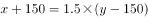······②

联立①②求解可得，，即目前还剩下550套房子未卖出。

故正确答案为C。

---

第 52 题

**答案**：B

**来源参考解析（非官方标准答案）**

根据题意，总人数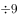余7、总人数余9，代入排除：

A项，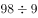余8，不满足题意，排除；B项，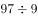余7，余9，满足题意，当选；C项，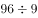余6，不满足题意，排除；D项，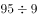余5，不满足题意，排除。所以只有B项满足，则共有97名小朋友。

故正确答案为B。

---

第 53 题

**答案**：A

**来源参考解析（非官方标准答案）**

由题干可知船最终都是到达正对岸，说明船速与水速的合成速度的方向均在虚线上。假设去程的水速为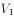千米/小时，去程时间为小时；返程的水速为 千米/小时，返程时间为小时。如图所示，由题干可推出，，。根据直角三角形EFD的三边关系则有：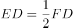，化简得，；同理在直角三角形ABC中，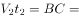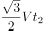，化简得，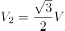。则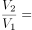倍。

故正确答案为A。

---

第 54 题

**答案**：C

**来源参考解析（非官方标准答案）**

先安排前三位，0-9共10个数字，所以前三位排法有种；再安排后两位，英文字母共26个，字母O、I不参与组牌，剩24个，且不重复，所以后两位排法有种。可以给该地区汽车上牌照的数量为辆。

故正确答案为C。

---

第 55 题

**答案**：B

**来源参考解析（非官方标准答案）**

根据题意可知，走各层楼梯用时是公差为2的等差数列。从第1层走到第2层用时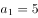秒，根据，从第十层走到第十一层用时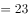秒，再根据等差数列求和公式：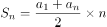，可得走楼梯用时为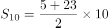秒；休息用时是公差为5的等差数列，秒，到第十层休息用时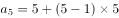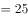秒，中途休息总用时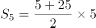秒；总用时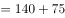秒。

故正确答案为B。

---

第 56 题

**答案**：B

**来源参考解析（非官方标准答案）**

最适合作为飞镖板即阴影部分所占面积比例约为，故需分别求出四个选项阴影所占面积比例。

A项，赋值圆半径为1，则，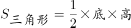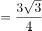，阴影面积所占比例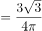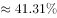（，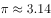）；

B项，赋值圆半径为1，则，，阴影面积所占比例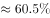；

C项，赋值圆半径为1，则，，阴影面积所占比例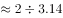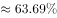；

D项，赋值圆半径为1，，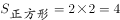，阴影面积所占比例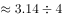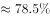。

B选项最接近。

故正确答案为B。

---

第 57 题

**答案**：B

**来源参考解析（非官方标准答案）**

设剪裁成60cm的不锈钢管根，剪裁成43cm的不锈钢管根，根据题意，长方体条形不锈钢管长为2.5m，单位统一为250cm，即：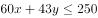；

当时，解得，cm，剩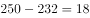cm；

当时，解得，cm，剩cm；

当时，解得，cm，剩cm。

由此可知剩下的钢管最少为1cm，利用率。

故正确答案为B。

---

第 58 题

**答案**：B

**来源参考解析（非官方标准答案）**

由题意可知，所求体积。

四棱锥：由题干可知四棱锥的底面为正方形，且边长分米，高分米，那么立方分米。

圆柱：由题干可知四棱柱侧面均为等腰三角形，即三角形ABC为等腰三角形，又从A点垂直底面切开，所以AO既是垂线也是平分线，那么分米，又因为三角形DBE与三角形ABO是相似三角形，所以，所以，则圆柱底面半径，那么立方分米。则题干所求立方分米。

故正确答案为B。

备注：考试过程中由于选项后半部分都是，故算出四棱锥的体积后即可选择B项。

---

第 59 题

**答案**：C

**来源参考解析（非官方标准答案）**

球缺是指球被平面截下的部分，题干中的大坑即为一个球缺。如图所示，球缺高即为BD线段长，m；在直角三角形OCD中，根据“弹坑直径16m”，可知截面半径CDm，ODm，OCm，依据勾股定理，，解得；将球的半径与球缺高代入球缺体积公式，可得球缺体积，所需车次，即66车次不够，至少需要67车次。

故正确答案为C。

【备注】本题不严谨，题干所给公式中的，理论上应为球缺底面的半径，但在考场上，按照命题人所给的公式及字母含义解题即可。

---

第 60 题

**答案**：C

**来源参考解析（非官方标准答案）**

根据运输时间，各公司运输费用情况如下：

甲公司与丁公司总运费相同，因此二者均不可能为最小，排除A、D两项，丙公司总费用小于乙公司，可知丙公司总费用最小。

故正确答案为C。

---

第 61 题

**答案**：A

**来源参考解析（非官方标准答案）**

本题为分组分类题目。元素组成不同，无明显属性规律，考虑数量规律。观察发现，每幅图均有4个元素，且均存在两个相同元素，图①④⑥中相同元素都是相对的，图②③⑤中相同元素都是相邻的。即①④⑥为一组，②③⑤为一组。
故正确答案为A。

---

第 62 题

**答案**：D

**来源参考解析（非官方标准答案）**

元素组成相同，优先考虑位置规律。观察发现，题干第一组图形中的两个白球在九宫格外圈整体顺时针平移2格，而两个“十字”在九宫格外圈整体顺/逆时针平移4格。第二组图形应遵循同样规律，只有D项满足。
故正确答案为D。

---

第 63 题

**答案**：A

**来源参考解析（非官方标准答案）**

题干图形元素组成不同，且无明显属性规律，优先考虑数量规律。题干第二、四幅图及四个选项中的图形均为立体图形，虚线为所视角度下看不见的棱，题干图形的交点（顶点）数分别为：3、4、5、6，所以问号处图形的交点数应为7个，选项图形的交点数分别为7、5、8、6，只有A项符合规律。
故正确答案为A。

---

第 64 题

**答案**：B

**来源参考解析（非官方标准答案）**

元素组成相似，优先考虑样式规律，经过验证无规律。继续观察发现，图形均明显被分割，考虑数量规律中的面数量。第一行图形中面的数量满足：，第二行图形中面的数量满足：，则第三行图形中面的数量应满足：，A、C、D三项均不满足，B项当选。

故正确答案为B。

---

第 65 题

**答案**：A

**来源参考解析（非官方标准答案）**

本题考查三视图。如下图所示，B、C、D三项按图中箭头方向观察，均可看到，排除；A项最上面凹槽处缺少一根线，无法看到，当选。

本题为选非题，故正确答案为A。

---

第 66 题

**答案**：A

**来源参考解析（非官方标准答案）**

第一步：找出定义关键词。
“某个地区的居民”、“认为相关机构、设施、景观具有正的外部效应，能给本社区发展带来好处”、“不排斥甚至欢迎这些项目在本社区落地”。
第二步：逐一分析选项。
A项：群众深度参与，符合“某个地区的居民”，点赞街道残障康复中心成立，说明群众认可、十分欢迎，符合“认为相关机构、设施、景观具有正的外部效应，能给本社区发展带来好处”，也符合“不排斥甚至欢迎这些项目在本社区落地”，符合定义，当选；
B项：公司升级业态，积极在社区推广无人零售店，没有体现出被推广社区居民的态度，是否欢迎，不符合定义，排除；
C项：新设备耗电低，企业要求园区加快引进速度，园区不是社区，企业也不是社区居民，不符合“某个地区的居民”，不符合定义，排除；
D项：加气站易漏气，附近居民担心火灾要求搬迁，是居民害怕带来危险，不符合“认为相关机构、设施、景观具有正的外部效应，能给本社区发展带来好处”、“不排斥甚至欢迎这些项目在本社区落地”，不符合定义，排除。
故正确答案为A。

---

第 67 题

**答案**：A

**来源参考解析（非官方标准答案）**

第一步：找出定义关键词。
先赋资本：“建立在血缘、遗传等先天条件下”、“不经过个人努力就可以拥有”；
自致资本：“通过个人后天努力取得”、“为个人所支配”。
第二步：逐一分析选项。
A项：婚姻、职业、政治面貌都是通过后天努力取得的，均符合自致资本的定义，当选； 
B项：家世、民族是建立在遗传的先天条件下，不经过个人努力就可以拥有的，符合先赋资本的定义；文化程度是通过后天努力取得的，符合自致资本的定义，排除；
C项：国籍是建立在遗传的先天条件下，不经过个人努力就可以拥有的，符合先赋资本的定义；收入和工作单位是通过后天努力取得的，均符合自致资本的定义，排除；
D项：种族、户口和父辈职业都是建立在血缘、遗传等先天条件下，不经过个人努力就可以拥有的，均符合先赋资本的定义，排除。
故正确答案为A。

---

第 68 题

**答案**：C

**来源参考解析（非官方标准答案）**

第一步：找出定义关键词。
“两个没有因果关系的事件”、“基于一些其他未见的因素（潜在变量）而推断出因果关系”、“引致两个事件是‘有所联系’的假象，但这种联系并不能通过客观的试验来证实”。
第二步：逐一分析选项。
A项：童鞋的大小与孩子的语言能力不存在直接联系，二者没有因果关系，符合关键词“两个没有因果关系的事件”，但二者可能都与“年龄”相关，年龄大可能导致童鞋大，同时导致语言能力较强，基于“年龄”这一潜在变量，二者之间“有所联系”，符合关键词“基于一些其他未见的因素（潜在变量）而推断出因果关系”、“引致两个事件是‘有所联系’的假象，但这种联系并不能通过客观的试验来证实”，符合定义，排除；
B项：冷饮的销量与泳池溺水的人数不存在直接联系，二者没有因果关系，符合关键词“两个没有因果关系的事件”，但二者可能都是由于“天气炎热”引起的，基于“天气炎热”这一潜在变量，二者之间“有所联系”，符合关键词“基于一些其他未见的因素（潜在变量）而推断出因果关系”、“引致两个事件是‘有所联系’的假象，但这种联系并不能通过客观的试验来证实”，符合定义，排除；
C项：惯性与物体的质量有关，物体的质量越大则惯性越大，而汽车核载重量与汽车质量成正比，所以惯性的大小与汽车的核载重量存在因果关系，不符合关键词“两个没有因果关系的事件”，且惯性和物体重量之间的关系可通过实验来证实，不符合关键词“引致两个事件是‘有所联系’的假象，但这种联系并不能通过客观的试验来证实”，不符合定义，当选；
D项：网民的数量与房屋的折旧程度不存在直接联系，二者没有因果关系，符合关键词“两个没有因果关系的事件”，但二者可能都与“时间”相关，随着时间推移，网民数量逐渐增多，同时房屋折旧程度越高，基于“时间”这一潜在变量，二者之间“有所联系”，符合关键词“基于一些其他未见的因素（潜在变量）而推断出因果关系”、“引致两个事件是‘有所联系’的假象，但这种联系并不能通过客观的试验来证实”，符合定义，排除。
本题为选非题，故正确答案为C。

---

第 69 题

**答案**：D

**来源参考解析（非官方标准答案）**

第一步：找出定义关键词。
色素色：“有机色素”、“通过选择性地吸收、反射和投射特定频率的光线后直观呈现出的颜色”；
结构色：“通过可见光与物质物理上的微观结构（如物体表面或表层的纹、刻点、沟缝或颗粒等）发生相互作用”、“这些大量的微观有序结构对不同波长的光散射、衍射或干涉后产生的各种颜色”。
第二步：逐一分析选项。
A项：用激光束刻录的光盘上的彩色花纹，光盘本身的颜色是单一色，而光盘上的彩色花纹是由于光盘表面的特殊结构对光散射、衍射或干涉形成的，符合“通过可见光与物质物理上的微观结构（如物体表面或表层的纹、刻点、沟缝或颗粒等）发生相互作用”、“这些大量的微观有序结构对不同波长的光散射、衍射或干涉后产生的各种颜色”，符合结构色的定义，不符合色素色的定义，排除；
B项：蝴蝶翅膀上的鳞片呈现出五颜六色，主要是由于鳞片表面凹凸不平的奇特构造，使光线发生反射、折射或干涉等光学作用而产生，符合“通过可见光与物质物理上的微观结构（如物体表面或表层的纹、刻点、沟缝或颗粒等）发生相互作用”、“这些大量的微观有序结构对不同波长的光散射、衍射或干涉后产生的各种颜色”，符合结构色的定义，不符合色素色的定义，排除；
C项：阳光下肥皂泡泡呈现缤纷的虹彩色，肥皂泡本身是无色的，在阳光的照耀下呈现出虹彩色是由于肥皂泡表面的膜产生的，符合“通过可见光与物质物理上的微观结构（如物体表面或表层的纹、刻点、沟缝或颗粒等）发生相互作用”、“这些大量的微观有序结构对不同波长的光散射、衍射或干涉后产生的各种颜色”，符合结构色的定义，不符合色素色的定义，排除；
D项：用乌饭树叶捣汁煮出的糯米饭呈现黑色，主要是因为乌饭树叶中的色素与糯米饭中的蛋白质发生了一系列复杂反应，生成物可以吸收绝大部分光，所以呈现出来是黑色的，符合“有机色素”、“通过选择性地吸收、反射和投射特定频率的光线后直观呈现出的颜色”，符合色素色的定义，当选。
故正确答案为D。

---

第 70 题

**答案**：A

**来源参考解析（非官方标准答案）**

第一步：找出定义关键词。
单质：“由同一种元素组成的纯净物”；
化合物：“由两种或两种以上元素的原子（不同元素的原子）组成的纯净物”；
混合物：“由两种或两种以上不同的单质或化合物机械混合而成”、“无固定化学式”。
第二步：逐一分析选项。
A项：氮气是由氮元素组成的纯净物，氧气是由氧元素组成的纯净物，均符合“由同一种元素组成的纯净物”，符合单质的定义；二氧化碳是由碳元素和氧元素组成的纯净物，符合“由两种或两种以上元素的原子（不同元素的原子）组成的纯净物”，符合化合物的定义；空气由氮气、氧气、二氧化碳等物质组成，符合“由两种或两种以上不同的单质或化合物机械混合而成”、“无固定化学式”，符合混合物的定义。选项同时具有三类物质，符合题干要求，当选； 
B项：食盐水是由氯化钠和水等组成的溶液，盐酸是氯化氢和水组成的溶液，氨水是氨和水组成的溶液，均符合“由两种或两种以上不同的单质或化合物机械混合而成”、“无固定化学式”，符合混合物的定义；蒸馏水是由氢元素和氧元素组成的纯净物，符合“由两种或两种以上元素的原子（不同元素的原子）组成的纯净物”，符合化合物的定义。选项缺少单质，不符合题干要求，排除；
C项：氢气是由氢元素组成的纯净物，氖气是由氖元素组成的纯净物，汞蒸气是汞蒸发而成的纯净物，均符合“由同一种元素组成的纯净物”，符合单质的定义；水蒸气是由氢元素和氧元素组成的纯净物，符合“由两种或两种以上元素的原子（不同元素的原子）组成的纯净物组成的纯净物”，符合化合物的定义。选项缺少混合物，不符合题干要求，排除；
D项：二氧化碳是由碳元素和氧元素组成的纯净物，水蒸气是由氢元素和氧元素组成的纯净物，均符合“由两种或两种以上元素的原子（不同元素的原子）组成的纯净物”，符合化合物的定义；矿泉水由水、矿物盐、二氧化碳等物质组成，天然气由烃类和非烃类气体混合而成，均符合“由两种或两种以上不同的单质或化合物机械混合而成”、“无固定化学式”，符合混合物的定义。选项缺少单质，不符合题干要求，排除。
故正确答案为A。

---

第 71 题

**答案**：A

**来源参考解析（非官方标准答案）**

第一步：判断题干词语间逻辑关系。
天干是中国古代的一种文字计序符号，其包括：甲、乙、丙、丁、戊、己、庚、辛、壬、癸，被称为“十天干”。戊、己、庚是“十天干”中的三个，三者是并列关系，且三者在天干中排列紧密连续。
第二步：判断选项词语间逻辑关系。
A项：钠、镁、铝是元素周期表中的三个元素，三者是并列关系，且三者在元素周期表中排列紧密连续，与题干逻辑关系一致，当选；
B项：寅、卯、巳是古代十二地支中的三个地支，三者是并列关系，但三者在十二地支中的排列并不是紧密连续的，与题干逻辑关系不一致，排除；
C项：牛、虎、龙是十二生肖中的三个生肖，三者是并列关系，但三者在十二生肖中的排列并不是紧密连续的，与题干逻辑关系不一致，排除；
D项：秦、汉、隋是我国古代的三个朝代，三者是并列关系，但三者在古代朝代中的排列并不是紧密连续的，与题干逻辑关系不一致，排除。
故正确答案为A。

---

第 72 题

**答案**：B

**来源参考解析（非官方标准答案）**

第一步：判断题干词语间逻辑关系。
天鹅象征着优雅，二者为比喻象征关系。
第二步：判断选项词语间逻辑关系。
A项：塞外有风沙，二者为地点对应关系，与题干逻辑关系不一致，排除；
B项：梅花象征着高洁的品质，二者为比喻象征关系，与题干逻辑关系一致，当选；
C项：同窗是指同在一个学校学习的人，同窗之间的关系可以是友好的，二者为对应关系，与题干逻辑关系不一致，排除；
D项：“笑话”是“幽默”的一种表现形式，二者为属性对应关系，与题干逻辑关系不一致，排除。
故正确答案为B。

---

第 73 题

**答案**：A

**来源参考解析（非官方标准答案）**

第一步：判断题干词语间逻辑关系。
“赫兹”是国际单位制中“频率”的单位，二者为对应关系。
第二步：判断选项词语间逻辑关系。
A项：“法拉”是国际单位制中“电容”的单位，二者为对应关系，与题干逻辑关系一致，当选；
B项：“焦耳”是“能量和做功”的国际单位，“瓦特”是国际单位制中“功率”的单位，焦耳和功率二者无明显逻辑关系，与题干逻辑关系不一致，排除；
C项：“牛顿”是“力”的国际单位，“帕斯卡”（简称帕）是国际单位制中表示“压强”的基本单位，牛顿和压强二者无明显逻辑关系，与题干逻辑关系不一致，排除；
D项：“欧姆”是“电阻”的国际单位，但二者与题干顺序相反，与题干逻辑关系不一致，排除。
故正确答案为A。

---

第 74 题

**答案**：C

**来源参考解析（非官方标准答案）**

第一步：判断题干词语间逻辑关系。
“巴蜀”指的是巴国和蜀国，“燕赵”指的是燕国和赵国，四者都属于中国历史上存在的国家，为并列关系中的反对关系。
第二步：判断选项词语间逻辑关系。
A项：“京津”指的是北京和天津，“淮海”指的是以徐州为中心的淮河以北及海州（今连云港市西南）一带的地区，并不是国家，与题干逻辑关系不一致，排除；
B项：“闽越”指的是闽越国，“荆湘”指的是长江中游地区的江汉—洞庭湖平原，并不全是国家，与题干逻辑关系不一致，排除；
C项：“齐鲁”指的是齐国和鲁国，“秦晋”指的是秦国和晋国，四者都属于中国历史上存在的国家，为并列关系中的反对关系，与题干逻辑关系一致，当选；
D项：“殷商”指的商朝，“云贵”指的是云南和贵州地区，并不是国家，与题干逻辑关系不一致，排除。
故正确答案为C。

---

第 75 题

**答案**：D

**来源参考解析（非官方标准答案）**

第一步：判断题干词语间逻辑关系。
醍醐灌顶意思是将牛奶中精炼出来的乳酪浇到头上，比喻灌输智慧，使人得到启发，彻底醒悟，与顿悟是近义关系。
第二步：判断选项词语间逻辑关系。
A项：望梅止渴意思是梅子酸，人想吃梅子就会流涎，因而止渴，比喻愿望无法实现，用空想安慰自己。与渴望不是近义关系，与题干逻辑关系不一致，排除；
B项：完璧归赵意思是蔺相如将完美无瑕的和氏璧，完好地从秦国带回赵国，后比喻把物品完好地归还给物品的主人。与移交不是近义关系，与题干逻辑关系不一致，排除；
C项：坐吃山空意思是只坐着吃，山也要空，指光是消费而不从事生产，即使有堆积如山的财富，也要耗尽。与消费不是近义关系，与题干逻辑关系不一致，排除；
D项：彩衣娱亲意思是传说春秋时有个老莱子，很孝顺，七十岁了还穿着彩色衣服扮成幼儿，引父母发笑，后作为孝顺父母的典故。与孝顺是近义关系，与题干逻辑关系一致，当选。
故正确答案为D。

---

第 76 题

**答案**：B

**来源参考解析（非官方标准答案）**

第一步：判断题干词语间逻辑关系。
超声波是指频率高于20000赫兹的声波，次声波是指频率小于20赫兹的声波，二者为并列关系；且超声波和次声波都可以运用在军事上，为对应关系。
第二步：判断选项词语间逻辑关系。
A项：有的处女作是代表作，有的处女作不是代表作，有的代表作是处女作，有的代表作不是处女作，二者为交叉关系，与题干逻辑关系不一致，排除；
B项：路由器是连接两个或多个网络的硬件设备，在网络间起网关的作用；隔离卡是一种应用在计算机上的硬件，使得计算机在完全安全状态下联结内网和外网，二者均为电脑硬件设备，为并列关系。且路由器和隔离卡都可以运用在网络连接上，为对应关系，与题干逻辑关系一致，当选；
C项：核潜艇是潜水艇的一种，二者为种属关系，与题干逻辑关系不一致，排除；
D项：北极星又称北辰、紫微星，指的是最靠近北天极的一颗恒星；北斗星又称北斗七星，是大熊座的组成部分，属于紫微垣的一个星官。二者不是并列关系，但二者都是星辰，前两词分别与第三词构成种属关系，与题干逻辑关系不一致，排除。
故正确答案为B。

---

第 77 题

**答案**：C

**来源参考解析（非官方标准答案）**

第一步：判断题干词语间逻辑关系。
“瑜”和“瑾”指美玉，且握瑜和怀瑾都是动宾结构。
第二步：判断选项词语间逻辑关系。
A项：“辕”指车前驾牲畜的两根直木，“辙”指车轮压的痕迹，二者均不能用来指马车，且南辕和北辙都不是动宾结构，与题干逻辑关系不一致，排除；
B项：“戈”指古代的一种兵器，“马”指马匹，二者均不能直接指战争，且金戈和铁马都不是动宾结构，与题干逻辑关系不一致，排除；
C项：“金”和“石”指钟磬一类的乐器，且敲金和击石均为动宾结构，与题干逻辑关系一致，当选；
D项：“衣”指衣服，“食”指食物，二者均不能用来指珍馐，且锦衣和玉食都不是动宾结构，与题干逻辑关系不一致，排除。
故正确答案为C。

---

第 78 题

**答案**：B

**来源参考解析（非官方标准答案）**

逐一代入选项。
A项：高屋建瓴意思是把瓶子里的水从高层顶上倾倒，形容居高临下的形势，与格局无必然联系；左支右绌意思是力量不足，应付了这一方面，那一方面又有了问题，与技艺无必然联系，前后逻辑关系不一致，排除；
B项：高屋建瓴意思是把瓶子里的水从高层顶上倾倒，形容居高临下的形势，高屋建瓴形容形势；目无全牛意思是眼中没有完整的牛，只有牛的筋骨结构，形容人的技艺高超，得心应手，已经到达非常纯熟的地步，目无全牛形容技艺，前后逻辑关系一致，当选；
C项：高屋建瓴意思是把瓶子里的水从高层顶上倾倒，形容居高临下的形势，与气势无必然联系；天造地设意思是自然形成而合乎理想，不必再加工，与技艺无必然联系，前后逻辑关系不一致，排除；
D项：高屋建瓴意思是把瓶子里的水从高层顶上倾倒，形容居高临下的形势，与地势无必然联系；逆水行舟意思是比喻学习或做事就好像逆水行船，不努力就要退步，与技艺无必然联系，前后逻辑关系不一致，排除。
故正确答案为B。

---

第 79 题

**答案**：B

**来源参考解析（非官方标准答案）**

逐一代入选项。
A项：“晕轮效应”是指在人际知觉中所形成的以点概面或以偏概全的主观印象，其本质是一种用片面的观点看待整体问题的认知偏误；“扬长避短”是指发扬优点、回避缺点，二者没有明显逻辑关系。“墨菲定理”的根本内容是：如果事情有变坏的可能，不管这种可能性有多小，它总会发生；“变本加厉”指情况变得比本来更加严重，二者没有明显逻辑关系。前后逻辑关系不一致，排除；
B项：“以偏概全”是指片面地根据局部现象来推论整体，得出错误的结论，是“晕轮效应”的本质；“破窗效应”是指环境中的不良现象如果被放任存在，会诱使人们仿效，甚至变本加厉，“变本加厉”是其本质，前后逻辑关系一致，当选；
C项：“欲扬先抑”是指要发扬、放开，就要先控制、压抑，与“晕轮效应”之间没有明显逻辑关系；“增减效应”是指人们最喜欢那些对自己的喜欢显得不断增加的人，最不喜欢那些对自己的喜欢显得不断减少的人，与“变本加厉”之间没有明显逻辑关系，前后逻辑关系不一致，排除；
D项：“举一反三”是指从懂得的一点，类推而知道其他，与“晕轮效应”之间没有明显逻辑关系；“蝴蝶效应”是指初始条件下微小的变化能带动整个系统的长期的巨大的连锁反应，与“变本加厉”之间没有明显逻辑关系，前后逻辑关系不一致，排除。
故正确答案为B。

---

第 80 题

**答案**：D

**来源参考解析（非官方标准答案）**

第一步，判断题干词语间逻辑关系。
防爆膜的功能是防刮花和抗撞击，后两词分别与第一词构成功能的对应关系。
第二步，判断选项词语间逻辑关系。
A项：驱动器和驱逐舰均不是驱蛇粉的功能，三词间无明显的逻辑关系，与题干逻辑关系不一致，排除；
B项：荧光棒和荧惑星均不是萤火虫的功能，荧惑星是指火星，与前两词无明显逻辑关系。与题干逻辑关系不一致，排除；
C项：超轻便是防晒伞的属性，第一词与第二词为属性对应关系，与题干逻辑关系不一致，排除；
D项：净水器的功能是除杂质和去异味，后两词分别与第一词构成功能的对应关系，与题干逻辑关系一致，当选。
故正确答案为D。

---

第 81 题

**答案**：C

**来源参考解析（非官方标准答案）**

第一步：翻译题干。

①物种多样性丰富对森林生产力影响不大

注：题干第一句话可以理解为“如果一片森林的树木物种多样性非常丰富，（即使缺失一个物种），对于整个森林的生产力影响还并不是太大”

如果A，即使B，那么C。此处的“即使B”不是充要条件，可以忽略，最后翻译为AC即可。例.如果你不好好学习，即使你再聪明，也不能圆梦，翻译为好好学习圆梦。

第二步：逐一分析选项。 

A项：翻译为森林生产力受影响物种多样性锐减（即“物种多样性丰富”），仅根据“森林生产力受影响”无法判断影响的大小，无法推出，排除；

B项：翻译为树木物种减少森林生产力受影响，仅根据“树木物种减少”无法判断是减少一种还是多种，是否影响树木物种丰富性，无法推出，排除；

C项：翻译为森林的生产力下降（即“对森林生产力影响大”）树木物种多样性受损（即“树木物种多样性不丰富”），是对题干①的否后推否前，可以推出，当选；

D项：“要么···要么···”表示两者之间只能成立一个且必须成立一个，题干重点论述的是“树木物种多样性”对“森林的生产力”的影响，而不是二者只能有一种情况发生，无法推出，排除。

故正确答案为C。

---

第 82 题

**答案**：D

**来源参考解析（非官方标准答案）**

第一步：找出论点和论据。
论点：地球生命来自彗星。
论据：一块坠落到斯里兰卡的陨石里找到了微观硅藻化石，该石头有着疏松多孔的结构，密度比在地球上找到的所有东西都低。他推断这是一颗彗星的一部分，并指出样本中找到的微观硅藻化石与恐龙时代留存下来的化石中的微观有机体类似，从而为彗星胚种论提供了强有力的证据。
本题的论据说的是陨石找到的微观硅藻化石与恐龙时代留存下来的化石中的微观有机体类似，同时该研究还推断该陨石是一颗彗星的一部分，即说明该陨石（彗星的一部分）与生命有关系，而论点说的是地球生命来自彗星，所以，二者讨论话题一致，削弱可以考虑削弱论点，也可以考虑削弱论据。
第二步：逐一分析选项。
A项：该成果的网站缺乏可信性，所载论文良莠不齐，代表不了这次实验成果的可靠性，属于无关项，排除；
B项：只是说该科学家是彗星胚种论的狂热支持者，支持者说的话无法辨别真假，同时即便SARS和流感来自彗星，也无法判断生命是否来源于彗星，不明确选项，排除；
C项：选项是说配图中的东西本质是硅藻细胞断片，一定程度上质疑了题干研究成果的可信性，可能削弱论据，保留；
D项：该成果根本无法证明该石头是陨石，直接质疑了论据的研究成果，直接削弱论据，保留。
对比C、D两项：C项为可能削弱论据，D项为直接削弱论据，D项当选。
故正确答案为D。

---

第 83 题

**答案**：C

**来源参考解析（非官方标准答案）**

第一步：找出论点和论据。

论点：在从未吸过传统香烟的年轻人中，那些正在吸电子烟的人更可能尝试传统香烟，有关电子烟的监管政策要注意保护年轻人。

论据：无。

本题只有论点，没有论据，优先考虑补充论据加强，即解释或举例证明“正在吸电子烟的年轻人更可能尝试传统香烟”。

第二步：逐一分析选项。

A项：论点说的是更可能尝试传统香烟，该项说的是有多少人尝试过电子烟，以及未来可能会尝试，话题不一致，无法加强，排除；

B项：选项表明吸电子烟的人相比于不吸电子烟的人而言，更可能吸传统香烟，该项是针对论点的可能性加强，属于补充论据，保留；

C项：该项表明受访者中正在吸电子烟的有60%表示未来一定会尝试传统香烟，该项比B项加强力度更大，原因有二：

一是题干论点强调保护年轻人，而C项的受试者正是年轻人，表明的是吸电子烟的年轻人的意愿，B项没分，年纪大小都可以，那为什么不保护年纪大的，而要特别保护年轻人呢？

二是如下图原文所示，C项把原文中的“可能或肯定”，改为“一定”，应该是为了区分B的可能，综上C项更有可能是出题人想设置的正确答案；

D项：论点说的是正在吸电子烟的年轻人更可能尝试传统香烟，该项说的是电子烟的危害，话题不一致，无法加强，排除。

故正确答案为C。

---

第 84 题

**答案**：C

**来源参考解析（非官方标准答案）**

第一步：翻译题干。

①吴老师教语文张老师教生物；

②孙老师教语文或者吴老师教语文；

③张老师教生物苏老师教物理；

④吴老师教化学或者苏老师教物理。

第二步：逐一分析选项。

提问为“推出孙老师教语文”，本题是给出了结论，需要从结论出发倒推条件。

根据条件②可知：想要推出“孙老师教语文”，需要吴老师不教语文；

根据条件①可知：想要得到“吴老师不教语文”，需要张老师教生物；

根据条件③可知：想要得到“张老师教生物”，需要苏老师教物理；

根据条件④可知：想要得到“苏老师教物理”，需要吴老师教化学。

即：想要推出“孙老师教语文”，需要吴老师教化学。

故正确答案为C。

---

第 85 题

**答案**：D

**来源参考解析（非官方标准答案）**

第一步：找出论点和论据。
论点：肠道细菌和血液中的致炎因子可能与慢性疲劳综合征有关。
论据：无。
首先注意本题问的是“······最不能支持上述结论？”，我们的做题思路是找出哪些是能支持的排除，如果不能支持的选项中出现无关选项，不明确选项和削弱选项，首选削弱项。
第二步：逐一分析选项。
A项：患者的肠道细菌多样性低且抗炎细菌较少，说明了肠道细菌可能与该疾病有关，为题干中论点补充了论据，属于加强选项。题干问的是最不能支持的，排除；
B项：患者的血液样本中有致炎因子，而健康志愿者没有，说明了血液中的致炎因子可能与该疾病有关，补充论据，属于加强选项。题干问的是最不能支持的，排除；
C项：不确定肠道细菌是病因还是该疾病导致的结果，但无论是原因还是结果，都能证明肠道细菌与该疾病确实有关，属于加强选项，题干问的是最不能支持的，排除；
D项：饮食治疗和益生菌对缓解患者疲劳无用，与题干论点无关，不能加强，当选。 
本题为选非题，故正确答案为D。

---

第 86 题

**答案**：B

**来源参考解析（非官方标准答案）**

第一步：找出论点和论据。
论点：某些守法企业的“不白之冤”难以澄清，给企业带来了严重损失。
论据：普通消费者囿于专业弱势群体的地位无从对错误或失真的负面信息进行有效甄别······强烈的记忆效应将使得追求风险规避的人们很难改变原有的错误认知，他们仍然会将之作为未来相当长一段时间内的消费决策指南。
本题论点论据话题一致，讨论的都是普通消费者无法对错误或失真的负面信息不能有效甄别，最终会导致企业的“不白之冤”难以澄清，给企业带来损失。削弱优先考虑削弱论点，即守法企业的“不白之冤”可以澄清，不会给企业带来严重损失。
第二步：逐一分析选项。
A项：指出传媒向社会普及专业知识，但无法判断专业知识的具体内容是什么，也无法判断专业知识是否可以改变原有的错误认知，属于不明确项，无法削弱，排除；
B项：指出监管部门为企业建立信用档案和为消费者提供企业情况的动态信息全景，说明普通消费者可以通过该档案了解真实情况，企业的“不白之冤”可以澄清，削弱论点，当选；
C项：题干论点讨论的是某些“守法企业”的不白之冤难以澄清，而C项的主体是有过“前科”的企业，讨论主体不一致，排除；
D项：指出不良声誉一旦成为社会的集体记忆，在公众的认知中就会有很强的粘性，说明强烈的记忆效应将使得人们很难改变原有的错误认知，企业的“不白之冤”难以澄清，具有加强作用，无法削弱，排除。
故正确答案为B。

---

第 87 题

**答案**：D

**来源参考解析（非官方标准答案）**

第一步：找出论点和论据。
论点：二十年内，传统银行网点会消失。
论据：近几年，一些大城市的社区银行频频出现关门潮。与此同时，无人银行、5G银行、智能银行等一系列新概念银行不断出现，银行网点正在告别冷冰冰的玻璃柜台和金属板凳，传统网点交易处理的功能变弱了，定制服务、产品体验、社交互动等功能越来越突出。
本题论点讨论的是传统银行网点会消失，论据陈述了传统银行的一些现状，论点和论据讨论的话题一致，加强可以考虑补充论据。
第二步：逐一分析选项。
A项：办理一项简单的业务耗费较长时间，讨论的是办理业务时间长短的问题，不能得出传统银行网点会消失的结论，无法加强，排除；
B项：人工智能等科技手段改变了人们对银行网点的固有印象，和论点讨论的传统银行网点是否会消失无关，无法加强，排除；
C项：复杂业务必须到银行网点面签办理，说明传统银行网点很重要，不会消失，削弱论点，无法加强，排除；
D项：银行网点地位弱化，补充论据解释了传统银行网点会消失的原因，可以加强，当选。
故正确答案为D。

---

第 88 题

**答案**：D

**来源参考解析（非官方标准答案）**

第一步：翻译题干。

①强大的生产制造能力、创新设计能力国计民生有保障

②强大的生产制造能力、创新设计能力国家实力

③强大的生产制造能力、创新设计能力“互联网”

第二步：逐一分析选项。

A项：题干只涉及醉心于虚拟经济靠不住，并不涉及“互联网”和使很多人沉迷于虚拟经济的关系，无法推出，排除；

B项：题干只涉及在宏观层面要充分认识到互联网的局限性，并不涉及“互联网”在微观层面的局限性，无法推出，排除；

C项：翻译为发展“互联网”国计民生有保障，两者不存在推出关系，排除；

D项：翻译为发展“互联网”提高生产制造、创新设计能力，是对③的否后，否后必否前，可以推出，当选。

故正确答案为D。

---

第 89 题

**答案**：B

**来源参考解析（非官方标准答案）**

日常结论题，根据题干信息逐一分析选项。

A项：根据题干“正常烹调时，水的沸点是，温度较高的爆炒通常也只是左右，即使采用油炸的方式，油温也不会超过”，可知烧水等正常烹调不会超过，说明特氟龙不粘涂层不会发生分解，可以推出可以用不粘锅来烧开水和煮粥，排除；

B项：题干中指出高剂量的全氟辛酸铵有可能导致胆固醇水平升高、甲状腺疾病及不育，但是题干中也指出“全氟辛酸铵是特氟龙生产过程中使用的含量极微的一种加工助剂”，因此涂层中的全氟辛酸铵剂量是否达到了能够导致胆固醇水平升高的剂量不明确，同时“高剂量的全氟辛酸铵有可能导致胆固醇水平升高”，也不是一定会导致胆固醇水平升高，无法推出，当选；

C项：根据题干“如果在炒菜时喜欢把锅烧干、烧红后再加油，锅内温度就容易超过”，可知炒菜时把不粘锅烧干、烧红后再加油会导致锅内温度超过，此时特氟龙不粘涂层会向不稳定状态转变，因此应避免此做法，可以推出炒菜时应避免把不粘锅烧干、烧红后再加油，排除；

D项：根据题干“正常烹调时，水的沸点是，温度较高的爆炒通常也只是左右，即使采用油炸的方式，油温也不会超过”，可知正常烹调不会超过，说明特氟龙不粘涂层不会发生分解，可以推出正常烹调通常无需担心不粘锅释放有害物质，排除。

本题为选非题，故正确答案为B。

---

第 90 题

**答案**：C

**来源参考解析（非官方标准答案）**

第一步：找出论点和论据。

论点：基于人工智能的计算模型有助于更快、更准确地预测恶劣天气。

论据：研究人员鉴定并标记了逗点状云系的形态和运动，并利用计算机视觉和机器学习技术，“教会”计算机自动识别和检测卫星图像中的逗点状云系，以帮助人们更高效地在海量天气数据中及时发现恶劣天气的“端倪”。

本题论点和论据都在讨论该计算模型有助于发现、预测恶劣天气，二者话题一致，必要前提优先考虑必要条件。本题为选非题，找出结论成立的必要条件排除即可。

第二步：逐一分析选项。

A项：选项说明该计算模型准确率达，甚至在其完全形成前就能检测到，若该计算模型准确率低或者不能检测出逗点状云系，则该计算模型就无法预测恶劣天气，是上述结论的必要前提，排除；

B项：选项说明逗点状云系与气旋形成密切相关，若逗点状云系与气旋形成无关，则不能根据逗点状云系预测恶劣天气，是上述结论的必要前提，排除；

C项：选项说明该计算模型如果与其他天气预报模型结合，能有效预测出的恶劣天气事件，但是有效地预测情况是否为该计算模型的作用，不能确定，不是上述结论的必要前提，当选；

D项：论点是通过检测气旋的形成来预测恶劣天气的，选项说气旋的形成可导致恶劣天气，是上述结论的必要前提，排除。

本题为选非题，故正确答案为C。

---

第 91 题

**答案**：C

**来源参考解析（非官方标准答案）**

根据题干“······2019年12月31日······占······的比例”，结合材料时间为2019年12月31日，可判定本题为现期比重问题。定位文字材料第一段可得“截至2019年12月31日，中国共产党党员总数为9191.6万名，······大专及以上学历党员4661.5万名。”故2019年12月31日大专及以上学历党员占党员总数的比例。结合饼状图，阴影部分代表大专及以上学历党员人数，所占比例约等于一半，C项满足。

故正确答案为C。

---

第 92 题

**答案**：D

**来源参考解析（非官方标准答案）**

根据题干“2019年12月31日······是······”，结合选项求倍数，且材料时间为2019年12月31日，可判定本题为现期倍数问题。定位文字材料第一段可得“在党员的入党时间上，新中国成立前入党的17.4万名，新中国成立后至党的十一届三中全会前入党的1550.9万名，党的十一届三中全会后至党的十八大前入党的6127.7万名，党的十八大以来入党的1495.6万名。”则新中国成立后至党的十八大前入党的人数为，其余时间入党人数为，故新中国成立后至党的十八大前入党的人数约是其余时间入党人数的。

故正确答案为D。

---

第 93 题

**答案**：A

**来源参考解析（非官方标准答案）**

根据题干“2019年12月31日······占比不低于······”，结合材料时间为2019年12月31日，可判定本题为现期比重问题。定位文字材料第一段可得“中国共产党党员总数为9191.6万名，…在党员的职业上，工人（含工勤技能人员）644.5万名，农牧渔民2556.1万名，企事业单位、社会组织专业技术人员1440.3万名，企事业单位、社会组织管理人员1010.4万名，党政机关工作人员767.8万名，学生196.0万名，其他职业人员710.4万名，离退休人员1866.1万名。”则2019年12月31日中国共产党党员总数的。故党员人数占比不低于的有农牧渔民2556.1万名，企事业单位、社会组织专业技术人员1440.3万名，离退休人员1866.1万名，共3类。

故正确答案为A。

---

第 94 题

**答案**：B

**来源参考解析（非官方标准答案）**

根据题干“2018年······占······的比例约为”，结合材料时间为2019年，可判定本题为基期比重问题。定位文字材料第一段可得“截至2019年12月31日，中国共产党党员总数为9191.6万名（B），同比增长（b）”，定位文字材料第二段可得“2019年共发展党员234.4万名（A），比上年增长（a）”。根据基期比重公式可得：。

故正确答案为B。

---

第 95 题

**答案**：D

**来源参考解析（非官方标准答案）**

A项：定位文字材料第二段：“2019年共发展党员234.4万名，……发展学生84.4万名”，则2019年发展的党员人数中，学生党员占比为，说法正确，排除；

B项：定位图1，截至2019年12月31日，55岁以上党员人数，则55岁及以下党员占党员总数的比55岁以上党员占党员总数的比，故55岁以下党员占党员总数的比不超过，说法正确，排除；

C项：定位文字材料第一段，新中国成立前入党的17.4万名；定位图1，截至2019年12月31日61岁以上党员人数为2657.7万名。而截至2019年12月31日，新中国成立前入党的人员都已满61岁。故61岁及以上的党员人数中，新中国成立前入党的人数占比为，说法正确，排除；

D项：定位文字材料第一段：“在党员的职业上，工人（含工勤技能人员）644.5万名，农牧渔民2556.1万名”，则从事农牧渔民职业的党员人数与工人（含工勤技能人员）党员人数之比为，说法错误，当选。

本题为选非题，故正确答案为D。

---

第 96 题

**答案**：A

**来源参考解析（非官方标准答案）**

根据题干“2019年6月下旬，价格按从高到低排列居于第六位······”，结合材料时间为2019年7月上旬，可判定本题为基期比较问题。根据公式，基期量，定位表格材料可得：第1名是电解铜，元/吨；第2名是锌锭，元/吨；第3名是铅锭，元/吨；第4名是铝锭，元/吨；第5名是顺丁胶，元/吨；第6名是苯乙烯，元/吨。

故正确答案为A。

---

第 97 题

**答案**：C

**来源参考解析（非官方标准答案）**

根据题干“2019年7月上旬，价格环比涨幅超过的生产资料有”，可判定本题为一般增长率计算问题。根据公式，增长率。定位表格数据，可知2019年7月上旬：螺纹钢价格环比；线材价格环比；热轧普通薄板价格环比；纯苯价格环比；苯乙烯价格环比；聚乙烯价格环比；聚丙烯价格环比；涤纶长丝价格环比；共8个增长率大于，其余种类增长率均小于。

故正确答案为C。

---

第 98 题

**答案**：C

**来源参考解析（非官方标准答案）**

根据题干“2019年6月下旬······”，材料给的时间是2019年7月上旬，并结合选项，可判定本题为基期倍数问题。根据基期倍数定义，定位表格数据，可得基期倍数倍。

故正确答案为C。

---

第 99 题

**答案**：D

**来源参考解析（非官方标准答案）**

根据题干“按照2019年7月上旬的环比涨跌幅，2019年7月中旬聚乙烯的价格约为”，结合选项单位为元/吨，可判定本题为现期计算问题。定位表格数据：2019年7月上旬聚乙烯的价格为8081.7元/吨，比上期价格上涨152.6元/吨，则2019年7月上旬环比涨幅为，因此2019年7月中旬聚乙烯的价格为元/吨，与D项最接近。

秒杀技巧：2019年7月上旬聚乙烯的价格为8081.7元/吨，比上期价格上涨152.6元/吨，按照2019年7月上旬环比涨跌幅，因基期量变大，则2019年7月中旬的增长量应大于152.6元/吨，因此2019年7月中旬聚乙烯的价格元/吨元/吨，即2019年7月中旬聚乙烯的价格元/吨，只有D项符合。

故正确答案为D。

---

第 100 题

**答案**：D

**来源参考解析（非官方标准答案）**

A项：定位表格材料，2019年6月下旬，烧碱的价格比甲醇低元/吨（可利用尾数法判定），并非低1401元/吨，错误；

B项：环比涨幅的比较，需要比较。结合材料中给出的数据和增长率比较技巧，直接比较的大小即可。2019年7月上旬，螺纹钢该数据线材该数据，说明螺纹钢价格环比涨幅大于线材价格环比涨幅，而非黑色金属中的线材价格环比涨幅最快，错误；

C项：定位表格材料，2019年6月下旬，铝锭、铅锭、锌锭三者的价格之和为元/吨，电解铜价格为元/吨，铝锭、铅锭、锌锭三者的价格之和比电解铜高元/吨（可利用尾数法判定），并非高2948.9元/吨，错误；

D项：定位表格材料，2019年7月上旬，化工产品中按价格从高到低排名前三位的是顺丁胶（10505.0元/吨），涤纶长丝（8996.9元/吨），苯乙烯（8994.1元/吨），正确。

故正确答案为D。

---

