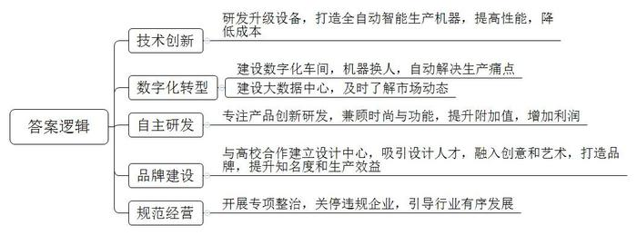
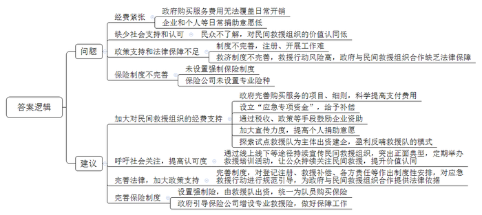
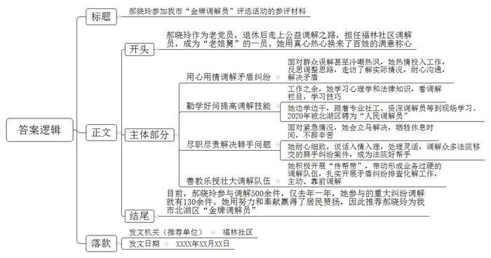
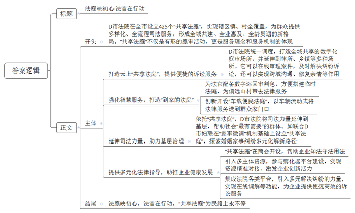

# 2023年公务员多省联考《申论》题（吉林丙卷）

> 候选采集稿。参考答案及解析来自粉笔页面，不代表官方答案或真实高分答卷；来源使用许可与原卷对应关系仍需人工核实。

## 给定材料

### 材料 material-b576accd27589d95

“你们做袜子，可是低端产业啊！”如果10多年前有人和陈鹏说这样的话，尽管明白话里的潜台词，他也只能面带赧色点头承认，“没办法，话不顺耳，但人家说的是事实啊……”

可如今，再有人这样说，陈鹏一定会笑着“怼”回去：“你说的都是‘老黄历’啦！到我们茂源来，看看现在咱做袜子的，到底是低端还是高端！”

陈鹏是A市长纺精工机械有限公司的总经理。20多年前，他的企业落户A市茂源镇。和聚集在这里的众多创业者一样，目标只有一个——做袜子。当时，茂源镇已是闻名遐迩的“东北袜乡”。起步于改革开放之初，历经二三十年磨砺，踩准市场步点，茂源镇形成了30多家企业、近万从业人员的袜业集群。作为东北地区重要的袜子生产基地，茂源年产袜子占东北产量的三成。但是，随着时代发展、技术革新，“东北袜乡”疲态尽显，产品滞销，一双袜子的利润只有几分钱……

“人家说咱低端，是实情，咱认；但说这个状况会一直延续下去，咱不认！”陈鹏心有不甘。陈鹏的心声，也是众多茂源制袜人的心声。无数的“心有不甘”汇在一起，促成了茂源袜业的转型升级。

“那时候，企业的大部分利润，都被动辄几十万元一台的进口袜机拿走了。”陈鹏说。于是，他跑遍国内外大部分知名袜机企业，琢磨自己改良袜机。2016年，“长纺精工”首台全自动智能一体袜机研发成功，一口气申报了23项专利，性能堪与国际大牌媲美，价格却便宜一半。

“长纺精工”的成功不是个例。在A市，类似“长纺精工”的企业已经有3家，这令A市成为东北最大的织缝翻一体袜机生产基地，每年可生产袜机1000台。

走进A市丝蕴纺织品有限公司的生产车间，宛如置身科幻世界。在全自动生产线上，一条条机械臂快速运转，智能机器人娴熟地进行各项操作，控制室大屏上各项数据不断跳动刷新……“遇到问题，电脑控制系统会自动报警。原来人工计数、人工排单导致的数据不准确、原材料浪费等痛点，也都一揽子解决了。”姜总经理介绍，目前A市已经建成市级数字化车间27个，在役工业机器人超100台，联网袜业设备超500台……镇里还有个茂源袜业大数据中心，在中心的电子显示屏上，茂源袜子在全球、全国各地的销售占比，流行色彩和袜子材质排序的实时变化，甚至各地消费者脚型特点都能一一呈现。

看着订单被不停打印出来，梦莲袜业有限公司王总经理非常开心：“过去我们搞贴牌加工，现在我们专注研发时尚功能性运动袜，你看这款运动袜，是我们自主设计的，脚踝处藏着减少运动损伤的隐形扎带，袜筒处有压力补偿功能，袜跟处有一个防磨导流系统，不仅能减少脚和鞋子间的摩擦，还能将运动时产生的热量导出去。这双拥有发明专利的袜子，利润是普通袜子的几十倍。”

梦莲袜业联合国内多所纺织高校院所，建立了东北袜业设计中心，更多的优秀设计人才聚集在这里，为袜企提供设计服务。如今，在茂源袜艺小镇，一双袜子并不仅仅是一件简单的商品，“创意+”“艺术+”早已融入茂源袜业的肌理。梦莲袜业设计师子涵所追求的是“做一双有故事的袜子”。在她看来，袜子是年轻人彰显个性品位的饰物。公司主打的“萌袜”，客户群体以“90后”“00后”为主，每一季推出的新设计都有明确主题。公司在国内袜业市场中迅速崛起，成为A市袜企转型升级中的标杆。

“童袜世界”是A市首家专业童袜企业，设计、生产和销售婴幼儿和儿童袜子，企业的“七彩鹿”品牌是行业内知名品牌，依托这一品牌，其产品已经延伸到童装领域。“自主品牌和贴牌生产的效益是不可同日而语的。”企业创办者孙静深有体会地说。

从2016年开始，茂源镇通过规范出租房管理、取缔无证照经营、规范个体税收征管秩序等六大专项整治，关停了近半数的袜业相关企业。A市社科院经济所陈研究员认为，产业的发展都遵循着市场规律，可以由一个人或一家企业带动辐射发展起来，成为地方发展经济的金字招牌。不过，要是有序引导不足的话，模仿经济过后会呈现出“小散乱”等问题。

在一次次蝶变之后，茂源镇袜业产业不断跃升。“‘只有夕阳产品，没有夕阳产业’，这是至理名言！你说说，今天咱茂源做袜子的，到底是低端还是高端？”陈鹏笑问。

### 材料 material-96c2316a33dd79c7

近年来，洪水、火灾、泥石流、地震等自然灾害频发，给人民群众生命财产安全带来重大损失，漂流、穿越、极限越野等挑战性强的运动也越来越受到大众追捧，发生意外的可能性增加，这些都让救援力量疲于应对。

作为国家应急救援力量的重要补充，民间救援组织正逐渐走入大众视野，N市汇爱救援队创始人虎哥介绍，一支中等规模的救援队，仅装备费用一项，一年就得30多万。目前民间救援组织的经费主要来自两方面：一是政府部门购买服务，二是企业和个人捐助。虎哥表示，尽管救援队也承接了一些政府购买的服务，一年仍有20万左右的资金缺口。政府采购的往往是服务于特定活动的项目，但民间救援组织大量的成本消耗是在活动之外，比如采购装备、组织训练、购买保险，以及在自发参与救援活动中的各项开销。

而在捐助方面，只有大灾来临的时候，企业、基金会、个人才比较愿意资助民间救援行动，这是目前公益筹款领域所面临的一个困境。公众更愿意把钱捐给让孩子吃饭、上学这些接近平常人生活体验的公益项目，很少有人支持平时基本看不到、也不太了解具体怎么运作的民间救援组织。

中国乡村发展基金会是国内为数不多的在平时也愿意资助民间救援的公益组织，即便是中国乡村发展基金会，想要为民间救援组织筹措经费也很难。由于民间救援组织的公益性质，整个运行中所有花费除了少量的政府购买和社会捐助，其余的资金缺口都要靠队员自掏腰包补足，因此，探索一条自我造血之路才是长久之计。N市星火救援队队员李金曾提出，以救援队为主体出资筹建企业，通过企业的盈利反哺救援队，并就此咨询民政和市场监管部门，答复却是国内还没有这样的先例。

N市一位政协委员曾建议，政府应当从“突发事件应对工作专项资金”中给予民间救援组织一定比例的合理补偿。但政府的补贴、补偿不可能很多，大概率覆盖不了这样多的民间救援组织。

目前，一些民间救援队是在当地企业支持下存活下来的，甚至不少救援队的创始人就是企业主。N市芒果救援队的创始人老雷就是一位物流公司的老板。“我们的志愿者来自各行各业，基本上都是上有老下有小。志愿者出人、出时间来做公益，我不能再叫他们出钱。”老雷说，因为几乎包办了每次救援行动的各类费用，他被队友们称为“财神”。但是，为民间救援队输血的企业规模普遍不大，数量也相当有限。

“我父母一直不大同意我参与救援，觉得我还是个‘宝宝’，怎么能去救援别人？我都是瞒着家里人参加救援活动。”N市独行者救援队的小马说。同时，对于上班一族的救援队员来说，如果请假去参与救援，即便不被单位领导批评，也会留下工作不上心的印象。

N市社科院王研究员认为，公众是民间救援组织最大的受益者，一个成熟社会不仅需要专业的公益组织，也需要有能认同他们价值、并愿意为之埋单的民众。“专业应急救援力量各有所长、社会应急救援力量有效辅助、基层应急救援力量有效覆盖”是应急救援力量建设目标，对社会应急救援力量参与抢险救援工作应作出制度性安排。

救不救人？谁来救？谁为民间救援行动承担风险？为他们提供什么样的政策支持和法律保障？N市蛟龙水上义务救援队队长祝元说：“我们去民政局申办相关手续，但是像我们这样的团队没有具体的业务主管单位，所以迟迟办不下来，我们救援队干啥都受限。”另外，据相关律师介绍，我国当前的法律法规对于民间救援行动中出现的人身事故责任认定不明确，意外伤害险和户外专门领域保险、抚恤金等救济制度不完善，政府与民间救援组织的合作缺乏法律保障。

救援队员万一有伤亡怎么办？救援队大都由志愿者组成，只有部分救援队员自掏腰包上保险，而这份保险还不是专业的救援险。为此，几支救援队都跑过多家保险公司，但没有一家推出专业救援险。专业险种的缺失意味着队员万一发生意外，只能自己承担后果。

回想这几年救援队的经历，祝元的声音中带着几分无奈：“民间救援队也需要被‘救援’”。

### 材料 material-515e6498306d8764

在C市北湖区的各个社区，活跃着一批社区调解员，居民们亲切地称他们“老娘舅”。他们走门串户，调解纠纷，看似风光，其实，在他们的生活工作中，委屈从来都不少，郝晓玲就是他们中的一员。2018年退休后，她担任了福林社区的调解员，说起这几年的经历，她用一句话概括：“酸甜苦辣，一言难尽！”

年轻的时候，郝晓玲当过乡团委副书记，还担任过服装厂副厂长。退休后，在社区负责人的邀请下，她走上了公益调解之路，“我这老党员还年轻着呢，能做一些事。”郝晓玲笑着说。

上门调解被拒绝、受“夹板气”，是郝晓玲刚上岗时遇到的第一个难题，也是她在后来工作中经常遇到的一大堵心事。

一次，郝晓玲去调解一起邻里纠纷。一位老大娘家里漏水，把楼下邻居的地板泡了，两家因为赔偿问题起了纠纷。了解基本情况后，她敲开老人家的门，表明身份，没想到却迎来了一句中气十足的话：“滚，我不需要调解！”

“虽然不是第一次被拒绝，但心里仍很不是滋味，我这也是一把年纪的人了。”郝晓玲说。她并未就此灰心，而是反思自己的工作方法，调整了调解思路。她走访了周围邻居，了解到老人目前独自居住，儿子在外地工作，平时很少回来看望她，加之有些老年病，睡眠不好，情绪容易激动。郝晓玲想方设法联系到老人的儿子，反复与之沟通，让他回来看看母亲并做做母亲的思想工作。她又苦口婆心地说通了楼下邻居，把赔偿金额下调了一些。经过反反复复几次奔波之后，老人终于与邻居达成了和解，矛盾得到了妥善解决。

郝晓玲说，自己出去调解时，经常被问“你们‘老娘舅’一年工资几万啊”，还常有人说风凉话，“拿了高工资就要好好干，不要瞎调解”。面对经常遇到的误解甚至冷嘲热讽，有时候真觉得吃力不讨好，心里憋屈死了。其实，辛辛苦苦做这个调解员，几乎就是义务劳动。可这一切并没有让她退缩，她依然热情地投入到社区的调解工作中。

郝晓玲发现要做好调解工作，光凭热情还不够，还要有相关的知识和技能，特别是准确洞察矛盾各方心理，这对调解成功至关重要。于是，她拿起了厚厚的心理学书籍，对已经60多岁的郝晓玲来说，困难可想而知，但她有一股不服输的劲儿，平时她的包里总放一本心理学方面的书，一有空儿就拿出来看，朋友笑她要成为心理专家了。除了心理学知识，储备一定的法律知识也是必不可少的，一部《民法典》就让郝晓玲“啃”了很久。另外，她还经常看电视上的专业调解栏目，学习别人的调解技巧。

郝晓玲觉得，实践比单纯的记忆要有效得多，她开始跟着专业社工到现场学习各种调解技能。后来，郝晓玲又与街道资深调解员老张组队调解。老张是社区老干部，经验非常丰富。跟着老张一起调解纠纷，边干边学，她的调解技能在实践锻炼中越来越高。2020年1月，郝晓玲被北湖区人民调解委员会聘为“人民调解员”。

一个下着小雨的深夜，突然有人来敲郝晓玲家的门，说他家楼道里有股电线烧焦的气味，害怕出火灾，想请“老娘舅”赶紧去查查源头。郝晓玲当即觉得事情重大，如果发生火灾，后果不堪设想，必须马上查清问题。可她不懂线路的事情，只好叫上老伴儿，一起一层楼一层楼地排查。终于发现，是十楼一户人家电箱有问题。于是她赶忙找来电工，修好了电箱，前后忙活了大半宿。

在郝晓玲的桌子上，摞着厚厚一堆材料，都是法院矛盾调解中心移交过来的调解案子。由于她的调解能力得到了广泛认可，北湖区法院交办的调解案子多数都由她来牵头办理。“郝阿姨做调解时，耐心细致，态度亲切，说起话来入情入理，处理问题方式灵活，成功地调解了很多棘手的纠纷案子，是我们法院的好帮手。”北湖区法院一位法官说。

郝晓玲没有把自己的矛盾调解本领当作“独门秘籍”，而是积极开展“传帮带”。在她的带动下，福林社区渐渐形成了一支业务能力过硬的调解队伍。郝晓玲和队员们扎实开展各类矛盾纠纷排查化解工作，主动、靠前调解各类矛盾纠纷，在打造共建、共治、共享的基层社会治理格局中，书写了属于“老娘舅”们的精彩篇章。

北湖区组建“老娘舅”队伍已有6年，累计调解纠纷将近5000件。其中郝晓玲参与调解的有500余件，仅去年一年，她参与的重大矛盾纠纷调解就有130余件。北湖区连续多年被评为“平安城区”，“老娘舅”们用自己的辛勤努力和无私奉献赢得了居民的信任和尊重、笑脸和赞扬，成为创建“平安北湖”的重要力量。

### 材料 material-1ebeb123a15a4d54

在D市，“共享法庭”应用已成为常态。截至目前，D市法院已在全市设立425个“共享法庭”，实现“共享法庭”在辖区所有镇（街道）、村（社区）全覆盖，其中包括49个特设“共享法庭”，为群众提供多样化、全流程司法服务，形成了全域共建、全业惠及、全龄贯通的“共享法庭”新格局。“共享法庭”不仅仅是一种有形的庭审活动，更是一种服务理念和服务机制的体现。

社区居民李大爷是位独居老人，因摔伤无法按时到法院参加庭审，老人的侄子联系到了承办此案的温法官寻求解决办法。考虑到李大爷身体情况，如不能及时开庭可能对老人的权益造成影响，温法官安排李大爷通过他所在社区的“共享法庭”参与在线庭审。庭审过程十分顺利，随着法槌落下，李大爷也舒了一口气。

D市L县新立镇某村村民闹了矛盾，村委协调不了，通过“共享法庭”邀请镇法庭陈法官在线指导调解。经过陈法官释法明理，一场纠纷得到平息。陈法官还录制、保存了这次在线指导的视频，组织其他村的村干部学习，帮助他们更好地应对同类问题。

云上“共享法庭”是由D市法院统一调度、全域共享的数字化庭审场所。它不仅可以审理案件，还可以发挥跨域沟通、修复亲情等多方面作用。目前，D市各级法院的云上“共享法庭”共有111个，并延伸到律所、金融机构和其他社会组织等多种场所。

D市H县是一个农业大县，山地多、群众居住分散，部分地区群众有诉讼需求，但是到县城法院路途较远，需求难以满足。2022年5月以来，H县人民法院抓住开展“为群众办实事示范法院”创建活动的契机，先后在芳林乡等五个乡镇设立“共享法庭”。对于更偏远的地方，就把临时法庭设到农家院里。

在毛庄村，高粱红遍田间地头。不远处，几位法官背着国徽与数字巡回审判包，徒步行走在乡间小道上。来到当事人家门口，一行人拿出摄像机、笔记本电脑、打印机等装备，迅速布置好“法庭”。“现在开庭！”随着法槌敲响，一起赡养纠纷案在院坝里正式开庭。最终，在法官的积极调解下，双方当事人达成一致意见，法官现场出具了调解书，签下调解书，老人开心地向法官说：“高粱红了，法官来了，矛盾没了！”一个审判包加上几把桌椅，就地搭起的临时法庭虽然简易，诠释的却是实实在在的为民情怀。

去年以来，具备AI身份识别、5G直播等功能的“车载便民法庭3.0版”，频频驶入D市街镇村社，将诉讼调解、巡回审判、法治宣传等服务送到群众家门口，以车辆流动式服务有效弥补了传统法庭定点式服务的先天不足，被人民群众亲切地称呼为“到家的法庭”。2022年，在省法院组织的人民法院重大科技创新成果评选活动中，“车载便民法庭”脱颖而出，荣获“特等奖”。

D市民营经济发达，市场主体众多，为了给民营企业健康发展提供法律指导，2022年4月，D市法院通过设在铁马镇商会的“共享法庭”，组织辖区企业家观看D市法院知识产权司法保护新闻发布会，让企业家们对知识产权保护有了新感受。5月，制作了《“共享法庭”服务企业专刊（劳动争议专题）》，通过司法数据和真实案例，为企业如何规范用工提出建议。“原来看似微不足道，其中竟隐藏着这么多诉讼风险，真是受益匪浅……”企业家们说。

三河区法院还依托“共享法庭”法律服务平台，以点带面引入政府、企业、高校、行业领域专家学者等参与孵化器平台建设，帮助企业实现资源精准对接，让孵化器中守法诚信企业获得更多政策支持，促进创新资源要素合理流动，全面激发企业创新创造活力。

依托“共享法庭”，D市法院还将司法力量延伸到基层最末梢，并在帮助社会“最有需要”的群体方面，做出了不少有益探索。如联合D市妇联在“家事微调”机制基础上设立“共享法庭”妇女儿童活动中心服务站，探索婚姻家事纠纷多元化解新路径，还入选了省示范“共享法庭”。

“共享法庭”依托互联网技术，以“一根网线、一块屏”为标准配置，集成D市移动微法院、人民法院调解平台、人民法院网上保全系统、D市法院诉讼服务网等平台，引入教科、司法、公安、行业协会等多元解决纠纷的力量，实现在线调解、网上立案、法治宣传等功能，为企业提供“近在咫尺”的便捷高效诉讼服务。截至目前，先后开展法律咨询30余场，帮助18家企业完善合同40余项，开展企业“法律体检”23次，发出风险提示63条。

## 题目

### 第 1 题

**根据****“给定资料**1**”，概括茂源镇袜子产业实现转型升级的做法。（20分****）**

关联材料：material-b576accd27589d95、material-96c2316a33dd79c7、material-515e6498306d8764、material-1ebeb123a15a4d54

作答要求：

要求：全面、准确、有条理；不超过200字。

### 第 2 题

**假如你是****N市应急管理局的相关工作人员。请根据“给定资料**2**”****，****梳理****N市民间救援组织发展中存在的问题，并就如何实现N市民****间救援****组织良性发展提出建议。（****25分****）**

关联材料：material-b576accd27589d95、material-96c2316a33dd79c7、material-515e6498306d8764、material-1ebeb123a15a4d54

作答要求：

要求：

（1）紧扣资料，内容全面；

（2）所提建议有针对性、可行性；

（3）准确简明，条理清晰；

（4）不超过500字。

### 第 3 题

**C市北湖区司法局拟开展“金牌调解员”评选活动，假如你是福林社区相关工作人员，请根据“给定资料**3**”，为****郝****晓玲****撰****写一份参评材料。（****25分）**

关联材料：material-b576accd27589d95、material-96c2316a33dd79c7、material-515e6498306d8764、material-1ebeb123a15a4d54

作答要求：

要求：

（1）紧扣资料，内容全面；

（2）逻辑清晰，语言准确；

（3）不超过500字。

### 第 4 题

**省法院拟在****微信公众号****“基层巡礼”栏目介绍****D市设立“共享法庭”的经验，请根据“给定资料**4**”，以“法庭映初心·法官在行动”为题，写一篇宣传稿。（30分）**

关联材料：material-b576accd27589d95、material-96c2316a33dd79c7、material-515e6498306d8764、material-1ebeb123a15a4d54

作答要求：

要求：

（1）紧扣资料，主题明确；

（2）内容全面，条理清晰，语言流畅；

（3）不超过600字。

## 答案与解析

第 1 题

**参考答案（粉笔题库参考内容）**

1.技术创新。研发升级设备，打造全自动智能生产机器，提高性能，降低成本。

2.数字化转型。建设数字化车间，机器换人，自动解决生产痛点；建设大数据中心，及时了解市场动态。

3.自主研发。专注产品创新研发，兼顾时尚与功能，提升附加值，增加利润。

4.品牌建设。与高校合作建立设计中心，吸引设计人才，融入创意和艺术，打造品牌，提升知名度和生产效益。

5.规范经营。开展专项整治，关停违规企业，引导行业有序发展。

**解析**

**参考答案说明**：本参考答案从“技术创新”“数字化转型”“自主研发”“品牌建设”和“规范经营”这五个方面展开。各条答案要点在内容上相互并列，没有交叉。

**考点**：考点概括措施类

**来源**：来源2023年公务员多省联考《申论》题（吉林丙卷）

粉笔申论页面对本题只提供「解析视频」入口，该入口是会员推广位，页面无视频地址与文字解析。

第 2 题

**参考答案（粉笔题库参考内容）**

问题：1.经费紧张。政府购买服务费用无法覆盖日常开销；企业和个人等日常捐助意愿低。2.缺少社会支持和认可。民众不了解，对民间救援组织的价值认同低。3.政策支持和法律保障不足。制度不完善，注册、开展工作难；救济制度不完善，救援行动风险高，政府与民间救援组织合作缺乏法律保障。4.保险制度不完善。未设置强制保险制度；保险公司未设置专业险种。

建议：1.加大对民间救援组织的经费支持。政府完善购买服务的项目、细则，科学提高支付费用；设立“应急专项资金”，给予补偿；通过税收、政策等手段鼓励企业资助；加大宣传力度，提高个人捐助意愿；探索试点救援队为主体出资建企，盈利反哺救援队的模式。2.呼吁社会关注，提高认可度。通过线上线下等途径持续宣传民间救援组织，突出正面典型，定期举办救援培训活动，让公众持续关注民间救援，提升价值认同。3.完善法律，加大政策支持。完善制度，对登记注册、救援补偿、各方责任等作出制度性安排，对应急救援行动进行规范引导，为政府与民间救援组织合作提供法律依据。4.完善保险制度。设置强制险，由救援队出资，统一为队员购买保险；政府引导保险公司增设专业救援险，做好保障工作。

**解析**

**参考答案说明**：本参考答案从“问题”“对策”两个方面展开，首先，从“经费紧张”“缺少社会支持和认可”“政策支持和法律保障不足”“保险制度不完善”这四个方面阐述问题；其次，从“加大对民间救援组织的经费支持”“呼吁社会关注，提高认可度”“完善法律，加大政策支持”“完善保险制度”这四个方面提出对策，做到所提建议与问题相对应。各条要点之间在内容上相互并列，没有交叉。

**考点**：考点提出对策类

**来源**：来源2023年公务员多省联考《申论》题（吉林丙卷）

粉笔申论页面对本题只提供「解析视频」入口，该入口是会员推广位，页面无视频地址与文字解析。

第 3 题

**参考答案（粉笔题库参考内容）**

郝晓玲参加我市“金牌调解员”评选活动的参评材料

郝晓玲作为老党员，退休后走上公益调解之路，担任福林社区调解员，成为“老娘舅”的一员。她用真心热心换来了百姓的满意称心。

用心用情调解矛盾纠纷。面对群众误解甚至冷嘲热讽，她热情投入工作，反思调整思路，走访了解实际情况，耐心沟通，解决矛盾。勤学好问提高调解技能。工作之余，她学习心理学和法律知识，看调解栏目，学习技巧；她边学边干，跟着专业社工、资深调解员等到现场学习。2020年被北湖区聘为“人民调解员”。尽职尽责解决棘手问题。面对紧急情况，她会立马解决，牺牲休息时间，不辞辛苦；她耐心细致，说话入情入理，处理灵活，调解众多法院移交的棘手纠纷案件，成为法院好帮手。善教乐授壮大调解队伍。她积极开展“传帮带”，带动形成业务过硬的调解队伍，扎实开展矛盾纠纷排查化解工作，主动、靠前调解。

目前，郝晓玲参与调解500余件，仅去年一年，她参与的重大纠纷调解就有130余件。她用努力和奉献赢得了居民赞扬，因此推荐郝晓玲为我市北湖区“金牌调解员”。

福林社区

XXXX年XX月XX日

**解析**

**参考答案说明：**（1）格式方面，本参考答案写到了“标题+正文+落款”三个部分。（2）正文部分，从内容上来看，本参考答案的开头先介绍了郝晓玲的个人信息及其担任社区调解员的背景信息；接着，主体部分从“用心用情调解矛盾纠纷”“勤学好问提高调解技能”“尽职尽责解决棘手问题”“善教乐授壮大调解队伍”四个方面介绍了郝晓玲参与社区调解工作过程中的优秀做法；最后，结尾部分对郝晓玲参与的社区调解工作进行了总结。从形式来看，本参考答案做到了分段、分条撰写，整体上条理较为清晰。

**考点**：考点总结类

**来源**：来源2023年公务员多省联考《申论》题（吉林丙卷）

粉笔申论页面对本题只提供「解析视频」入口，该入口是会员推广位，页面无视频地址与文字解析。

第 4 题

**参考答案（粉笔题库参考内容）**

**法庭映初心****·法官在行动**

D市法院在全市设立425个“共享法庭”，实现辖区镇、村全覆盖，为群众提供多样化、全流程司法服务，形成全域共建、全业惠及、全龄贯通的新格局。“共享法庭”不仅是有形的庭审活动，更是服务理念和服务机制的体现。

**打造云上****“共享法庭”，提供便捷的诉讼服务。**D市法院统一调度，打造全域共享的数字化庭审场所，并延伸到律所、乡镇等多种场所。它可以在线审理案件，及时解决纠纷诉讼，还可以实现跨域沟通、修复亲情等作用。

**强化智慧服务，打造****“到家的法庭”。**为法官配备数字巡回审判包，方便搭建临时法庭，为偏远山村带去法律服务；创新开设“车载便民法庭”，以车辆流动式将法律服务送到群众家门口。

**延伸司法力量，助力基层治理。**依托“共享法庭”，D市法院将司法力量延伸到基层，帮助社会“最有需要”的群体。如联合D市妇联在“家事微调”机制基础上设立“共享法庭”，探索婚姻家事纠纷多元化解新路径。

**提供多元化法律指导，助推企业健康发展。**“共享法庭”在商会开设，帮助企业知法守法用法；引入多主体资源，参与孵化器平台建设，实现资源精准对接，激发企业创新活力；集成法院各类平台，引入多元解决纠纷的力量，实现在线调解等功能，为企业提供便捷高效的诉讼服务。

法庭映初心，法官在行动，“共享法庭”为民路上永不停。

**解析**

**参考答案说明**：（1）格式方面，本参考答案写到了“标题”“正文”两个部分。（2）正文部分，一方面从内容上来看，围绕“D市设立‘共享法庭’”这一主题，本参考答案的开头先介绍了D市“共享法庭”的相关背景情况；主体部分从“打造云上‘共享法庭’，提供便捷的诉讼服务”“强化智慧服务，打造‘到家的法庭’”“延伸司法力量，助力基层治理”“提供多元化法律指导，助推企业健康发展”这四个方面介绍了D市设立“共享法庭”的经验。另一方面，形式上，本参考答案做到了分段、分条撰写，整体上条理较为清晰。

**考点**：考点宣传类

**来源**：来源2023年公务员多省联考《申论》题（吉林丙卷）

粉笔申论页面对本题只提供「解析视频」入口，该入口是会员推广位，页面无视频地址与文字解析。

