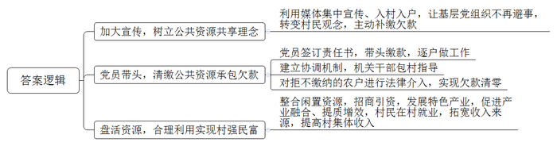
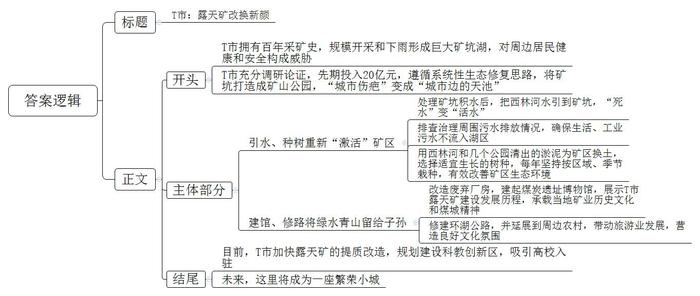
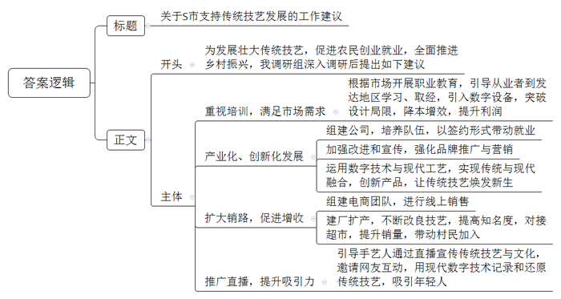
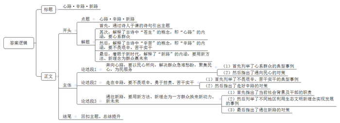

# 2023年公务员多省联考《申论》题（吉林乙卷）

<!-- gwy:overview:start -->
> **吉林 · 2023 · 申论 · 乙级** ｜ 4 题 · 图片 4 处 · 答案随题折叠

导航：[题目](#题目) · [材料 1](#材料-1)
<!-- gwy:overview:end -->

> 候选采集稿。参考答案及解析来自粉笔页面，不代表官方答案或真实高分答卷；来源使用许可与原卷对应关系仍需人工核实。

## 给定材料

### 材料 1

A县郭家镇秀玉村以北，有几排整齐排列的红瓦房，靠近可闻到一阵阵粮食发酵的气味。“这里以前是3排坍塌的校舍，我们改建成了烧酒坊，周围种了100亩水稻、300亩高粱作为酿酒原料，以后这里还可以发展旅游研学产业。”项目技术负责人王青介绍。

促使坍塌校舍变成烧酒坊的是A县两年前启动的“乡村公共资源共享行动”。该行动围绕乡村公共资源的综合有效利用，推动涉农镇街整合闲置资源，盘活公共资源，推动强村富民，助力乡村振兴。

乡村公共资源即村集体的山、水、林、地、路等资源，这些资源应取之于民用之于民，让群众共享乡村公共资源利用成果。A县机关党工委工作人员徐剑表示，一段时间以来，一些本该属于集体所有、村民共享的公共资源，因决策不科学、监管不到位、签约不规范等而被少数人私占乱占、低效利用或闲置浪费。

A县启动“乡村公共资源共享行动”以后，利用电视、报纸、公众号等媒体集中宣传，村里也到处挂上了宣传标语，“明白纸”发到了家家户户。持续有力的宣传让基层党组织不再避事，也让村民们转变了思想观念，主动补缴各类土地、林地承包租赁费。

在炉石镇的一间办公室里，摆放着厚厚一摞《责任状》。“问题整治、债权清缴比例应达到80%以上，与村庄综合绩效挂钩……”该镇59名基层党组织书记全部签下了“乡村公共资源共享行动”责任状。旁边的档案盒里，存放着更厚的几摞《承诺书》，“本人带头参与‘乡村公共资源共享行动’，主动组织家庭户成员规范各类承包合同，缴纳拖欠的承包费……”该镇1884名党员全都签字、按手印。

镇党委组织委员陈晓东介绍，镇里对“乡村公共资源共享行动”建立了日通报、周调度机制。每个网格村都有机关干部包村指导，每名党员都要带头清缴，同时包保联系5至10户，挨家挨户做工作。

党员李芳在孩子结婚买房、自己常年治病花钱的情况下，找亲戚朋友借钱，带头补缴3万元欠款；党员赵丽不仅自己第一时间缴齐欠款，还帮12户想缴欠款却临时缺钱的村民垫付6万元……“党员干部的行为，群众看在眼里，纷纷跟着补缴欠费。”陈晓东说。

杨家店村一名承包户拖欠村集体承包费50多万元，多次催收无果后，镇司法所统筹法律服务团队介入，最终达成分期付款协议，该承包户先行支付了30多万元。油坊村党支部通过法律顾问协助，对多次拒不缴纳的农户依法下达催缴函，实现欠款清零。目前全县“乡村公共资源共享行动”成效显著：已收取各类承包合同复印件900份，整改问题合同92份，摸底债权3701.8万元，收回债权2200余万元。

秀玉村烧酒坊就是在“乡村公共资源共享行动”中建成的。秀玉村引进天马烧坊生物科技有限公司，将村头废弃的几排校舍重新翻修，落地了特色烧酒项目，不仅为秀玉村盘活了闲置资源，带来了租金收入，还为当地村民创造了就业机会。“出家门骑电动车5分钟到工厂，每天工作8小时，每月工资5000多元，每月还能休息四五天。”烧酒坊工人小胡说。

和平乡幸福村所处的老爷岭山地面积广、荒草多、粮食种植产量低，一直无人问津，防火压力还大。村里深挖荒山潜力，盘活老爷岭400余亩集体土地，利用当地生态资源优势，推出“老爷岭茶”“老爷岭鸡”“老爷岭矿泉水”等特色产品，稳步提高村集体收入。截至目前，提供就业岗位50个，带动村集体增收20余万元，荒山开出了“幸福花”。

冬日里，A县乡村建设“共享厂房”的阵阵热浪迎面扑来，在距离银锁镇街区不远处的一幢标准化厂房前，镇党委李书记介绍，这个地方本是一个养殖场，环境整治拆除后建成了这幢4100平方米的标准化厂房，总投入210万元，资金来自全镇12个村账面上闲置的钱，厂房建好后按每平方米60元出租给商家，每年租金按出资多少分配给12个村。仅去年，银锁镇就先后启动了4.3万平方米的“共享厂房”建设。

在马鞍镇的飞驰纺织公司车间里，年逾六旬的老徐夫妻俩正忙着纺线称重、打包，“每包可以赚手工费1.5元，一天可以挣一二百元。”老徐说。“让村民在家门口有业可就、有钱可挣，是建设‘共享厂房’的初衷之一。”马鞍镇张镇长说，这个地方原是零散村落，迁出五六十户人家后，整合出60多亩可建设用地，引来外地客商投资1200万元，建成了17000平方米的厂房，现已有三家企业租驻。搬迁村民以宅基地使用权入股，流转土地租金和入股分红每年每亩可收入1500元左右。

A县县委党校宋教授认为，盘活农村公共资源推动了村集体经济更加“强起来”、农民更加“富起来”，实现了农村产业融合发展、提质增效，可以说“闯”出的效果是显著的。

### 材料 2

观光车沿T市露天矿生态公园的佳人湖行驶，和风徐徐，水鸟低飞，市民撑伞漫步，远处的雾气在湖面氤氲，又多了些许缥缈。

“以前这里可是满目疮痍，烟尘高百丈，污水遍地流。”公园管理处负责人清晰地记得当初的场景。曾是采矿遗留的“城市伤疤”，经过数年治理才成就现在的模样，如今市民都称它是“城市边的天池”，湖水特别漂亮。

T市有着“百年煤城”的别称，拥有130多年煤炭开采史，大规模的开采在矿区形成了一个长约6公里，宽约1公里的巨大矿坑。随着多年雨水积聚，又形成矿坑湖。由于当时开采、处理技术落后，加之没有进水及泄水设施，湖水酸化，影响周边居民健康。随着湖水水位上涨，又对周边地区形成严重的安全隐患。

“以前谁都不愿意来这里，到处臭气熏天，并且刑事案件多发，我们生活环境太差了。”附近的村民说。一位当年的市领导回忆：“不管吧，现场坑塘密布、环境恶劣，不仅难看，而且危险；管吧，又需要巨大投入，而且很难见到效益。”

痛定思痛，T市决定，先期投入20亿元，改矿坑为公园。彼时矿区仍有价值千亿的丰富矿产资源，对于T市的经济发展无疑十分重要。经过数十次现场调研和论证后，T市决定，在露天矿矿区范围内，一律不得进行挖掘、采矿、建设等活动，矿坑及其附近区域统筹考虑打造成矿山公园。

不同于传统采取单一手段和措施逐项修复的方式，露天矿修复需遵循系统性生态修复思路进行。在对矿坑原有积水处理的基础上，把西林河水引到矿坑，“死水”变“活水”，并将矿坑湖命名为“佳人湖”。同时，排查治理周围污水排放情况，确保生活、工业污水不流入湖区。“目前，对矿坑湖的监测显示水质均达标，矿坑湖水质的改善也解决了周边约8800亩农田的灌溉问题。”T市生态环境局相关负责人介绍。

矿区原始地貌板结，下雨不渗水，天旱时像铁板，这样的土壤种不了树。当地想方设法，用西林河和几个公园清出的淤泥为矿区换土。同时，选择适宜生长的树种，每年坚持按区域、季节栽种。至今，露天矿区已完成9000多亩、50余万株的复绿工程，有效地改善了矿区生态环境。

“请往这边走，这边展示的是露天矿的发展历史……”在露天矿的修复中，当地通过改造废弃厂房，建起了该省首家煤炭遗址博物馆，主要展示一百多年来T市露天矿建设发展的历程，承载着当地矿业历史文化和煤城精神。

“环湖路很平坦，周围空气又清新，周末休息就喜欢到公园走走，特别舒服。”细雨中，市民小吴和女友撑着伞沿湖散步。如今，40公里的环湖公路已全线贯通，并延展到周边农村。

随着矿区、周边乡村道路通畅，环境改善，假期休闲、旅游的市民越来越多。今年春节期间，露天矿生态公园累计接待游客80余万人次，排在当地热门景区首位。依托客流，附近的天河村也正发展观光农业、民宿旅游、农家乐等，村民多了条致富路。

公园也让当地文化氛围日益浓厚。去年底，首届T市生态马拉松在露天矿生态公园开跑，从公园木屋区出发，穿过佳人湖绿道、长堤、人工沙滩等，3000多名参赛者畅快环跑。

目前，T市露天矿的生态修复还在继续，将聚焦矿山遗址、乡村振兴、户外运动，加快露天矿生态公园提质改造。依托佳人湖良好的生态资源，T市政府规划建设了一个占地达20平方公里的佳人湖科教创新区，四所高校已经确定入驻，三年内将有4万名大学生来到佳人湖。未来，随着各类高端科研机构、文创项目的引进，佳人湖边将诞生一座人口规模达20万人的繁荣小城。

### 材料 3

近日，为发展壮大传统技艺，促进农民创业就业，全面推进乡村振兴，S市乡村振兴局组织调研组，对本市传统技艺发展情况展开调研。

尽管是周末，B县木雕文创园里仍在开足马力生产。园区的李副主任介绍，做木雕，工人收入比较可观，每天工资不低于500元，还包吃住，如今B县“雕客”群体已有11万人，散布在全国各地。

“这些年市场变化了，以前的小型工艺品市场萎缩，现在转向工程类，比如城市景观、寺庙建筑、乡村浮雕墙等等。传统的‘雕客’，其技艺都是代代相传，技术手法和审美风格都偏于传统，遇到现代雕刻，往往会面临一些尴尬，要么是理解不了艺术家的设计不敢接招，要么做出来的产品与原设计有偏离。更关键的是，没有专业知识，他们自己也没法搞设计，一个项目里面设计的利润能占到30%-40%呢。”李副主任说。

近年来，B县通过开展职业教育，每年都能培养出大批毕业生，28岁的黎光就是其中的优秀代表。16岁起就跟父亲学习雕刻技艺的他看到了父辈的局限：“很多时候搞不懂那个设计图，又不想丢单子，只能找会做的来搭伙干。”为了突破这些局限，黎光格外重视学习，毕业后他还积极参加各种培训，到其他省市学习、取经。在山东，他看到了数字雕刻技术的先进；在河北，他发现了雕刻产品的多样化；在美术学院，他进行了现代雕刻知识的学习。

2020年，黎光引入数字雕刻设备，将生产效率提高40%以上，成本降低30%左右，订单越接越多。“今年夏天在美院学习了3个月，我现在已经能自己做设计了。”黎光说，目前他看好庭院美化市场，准备先开发一套产品，现已完成了3个产品的设计图。

C县织锦的代表性传承人郭红则走出了一条不同的路。2019年，在C县政府的大力支持下，郭红组建了C县织锦文化旅游发展有限公司，通过县妇联组织绣娘培训，在带动农村妇女就业的同时，也为C县织锦的传承培养了队伍，目前公司签约绣娘已有300余人。改进和宣传C县织锦，推广“太阳花”品牌，是郭红目前工作的重中之重。“现在产业基础有了，但同类型的产品特别多，因此，必须要有自己的品牌，讲好我们的织锦故事，进行品牌化营销。”郭红说。

郭红极其重视产品创新，培养了5名设计师，在保留原技艺、文化不变的基础上，运用大数据分析，及时掌握流行趋势和人们的审美偏好，并运用数字技术改进工艺，C县织锦产品颜色、图案更精美，风格也越来越多元化。目前，公司销售产品中原创占比高达95%。“当然，不管怎么变，传统工艺才是这个产业的魂，现代工艺只是辅助手段，只有合理区分、有机结合，才能在保留传统工艺独特韵味的同时，借助现代工艺让老技艺焕发新生。”郭红说。

时值正午，调研组来到D县藤编非物质文化遗产传承人陈顺工作的合作社，大到桌椅、小到瓶篓，各色藤编产品琳琅满目，它们大都出自这位农民之手。

“D县藤编有100多种编织技法，编这样一个小筐就要36道工序。”陈顺有一双大手，新伤压旧痕，手指已磨出老茧。一捏起藤条，他的手指就仿佛轻盈起舞，不一会儿，散落的根根藤条便被编成各式花纹。“7岁起就跟父亲学习藤编，以前我们这里家家户户都会些藤编手艺，但如今坚持做的人不多了。”陈顺说，“藤编是我们的乡村记忆，把它传承好，对乡村振兴也很有好处。”

为藤编寻个好市场，是陈顺几十年来的梦想，儿子陈凯帮他实现了。2017年，陈凯开起网店帮助父亲卖藤编，把深山里的农家手工艺品推向全国，甚至海外。现在陈凯已组建了一支“95后”电商团队负责线上销售。“非遗产品上了网，根本不愁卖！去年‘双11’，仅一天线上销售额就突破了20万元。”陈凯说。

清晨6点，家住E县百家镇的王海准时走出家门，将一张张薄如纸、色如金、韧如绸的干豆腐撇到开往县城的货车上。一个小时后，这些印有“百家镇”字样的干豆腐就被送进了县里的超市。再过上几个小时，这些干豆腐就将变成一道道菜肴，出现在千家万户的餐桌上……这便是在当地颇有名气的“百家干豆腐”。

2018年，王海成立了百家镇手工干豆腐厂，平均每天生产干豆腐1500多斤，一年的营业额达到400多万元，带动周边村民也加入豆腐生产加工行业，每年帮助乡亲增收100余万元。

这几年来，王海一直在思考如何让制作干豆腐的手艺更精湛，如何在工具上进行改良，使干豆腐的口感更加细腻，满足更多人的口味，打开更大的销路。

“嗤嗤……嗤嗤……”在F县牛湾村，箍桶40余年的周师傅正在给一个木桶进行打磨。在店里的一角，堆放着他最近做的面桶、盒子盘、斗、锅盖等箍桶制品。

随着社会与科技的发展进步，各种新材料、新工艺层出不穷，以前家家必备的笨重木桶逐渐被人们用塑料桶或不锈钢桶取代，从事箍桶匠这个职业的人也逐渐减少。谈及箍桶技艺的传承，周师傅遗憾他的儿子并没有继承他的手艺，“现在的年轻人不喜欢这个，也定不下心。”

一把剪刀，一张红纸，一双巧手，在手机镜头下，省级非物质文化遗产“孟祥剪纸”的代表性传承人，“90后”青年梦梦开始了网络直播。从冰墩墩、雪容融等年轻人喜爱的形象，到吉祥窗花、凤戏牡丹等传统的民俗题材，网友们如同“点菜”一般在评论区里提出创意。梦梦则通过剪纸将大家的想法一一呈现。

之前，梦梦在线下开剪纸店，到乡村、社区、企业举办剪纸沙龙或培训，但覆盖范围有限。在朋友的建议下，她抱着试一试的想法开通了直播账号，刚开始直播时，梦梦还有些腼腆，但慢慢地，她学会了和网友互动，状态越来越自然。她会特意选取小纸片，方便网友看清作品全貌，还会边剪边讲解，比如龙要从鼻子开始剪，然后才是眼睛和头……她还时不时停下，方便大家截图学习。“我相信，在现代数字技术加持下，对传统技艺进行记录和还原，这门技艺就永远不会失传。”梦梦说。

“谁说年轻人不爱非遗了？其实，我们的热情高着呢！”梦梦感慨。如今，她的粉丝已有28万，很多年轻网友在她的影响下学习剪纸，在朋友圈里晒作品，还发私信请她指导。

### 材料 4

峻岭村山高路险、坡陡林密，通村的泥碎路经常因暴雨、山体滑坡而阻断，大家急切盼望这条道路能早日加固、硬化。

村民的诉求很快被转到了县交通运输局进行办理。“那里山势陡峭，材料运不上去，施工难度太大了。”局党委会上，大家都说这是块“硬骨头”，不好“啃”。“这项工作就交给我来带头落实吧。”关键时刻，党委委员马骁站了出来，主动接下了这件“苦差事”。事实也证明，这确实是一条艰辛之路。

第二天，他就带着负责现场勘查的技术员一起到了峻岭村。那是一段陡峭的山路，一面是石壁，一面是深不见底的沟壑。为了让村民早日走上安心路，马骁吃住在工地，翻山越岭了解情况，督促工程进度，发动当地群众给施工队送水送饭，为项目推进提供全方位、“保姆式”服务。

峻岭村道路竣工了，村民们高兴地说：“道路畅通了，大家的‘心路’也敞亮了。”

28岁的童猛是凳子村乡村振兴驻村工作队队长，凳子村属于传统的“边村”“小村”，绝大部分青壮年劳动力都外出务工，村民的主要收入来源是传统农耕及少量的家禽养殖。土鸡、土鸭这些在城里很受欢迎的农产品，村民们却找不到销路。

摸清村情后，童猛与村两委反复研究，最终确定了凳子村养殖麻黑鸡的发展思路和发展方向。目前，凳子村已实现村域养殖麻黑鸡1.2万余只，日产蛋2000余枚，发展养殖大户6户，带动农户80余户，年经济产值80万元。通过直播带货，童猛把凳子村的麻黑鸡、鸡蛋卖到了全国20多个省市。他还为村里成功引进一家电商企业，创建了“凳子村土特产馆”线上商城，半年来销售金额已达百万。

村民的钱袋子鼓了，幸福感和获得感日益增强。村支书陈刚说：“童猛为我们村的发展带来了新理念，注入了新动力，找到了新路子。”

坐落在半山腰的虎牙村，是Y县海拔最高的行政村。2018年，赵波以驻村“第一书记”的身份来到这里，一干就是5年。

驻村不久，就遇到旱灾，村里的水塘快干了，不少村民家连饮用水都没了。赵波联系相关部门募集到300桶爱心水，大家把水拉到村部，用广播通知村民们前来领水，奇怪的是，并没有村民响应。

“我家离你们村部那么远，用完水还桶又得折腾一趟，不如你们帮我送到家里吧！”有村民抱怨道。“村民的话让我很受挫，没想到居然有人懒成这样。”赵波回忆道。后来，村干部就说，装水的水桶不用送回，爱心水才被一抢而空。赵波看到这场景，心里更不是滋味。还有一次，镇里给每家补助400元修建厕所，有村民不配合：“才400？给我1000块钱还差不多！”

赵波意识到，虎牙村面临的不只是恶劣的生存环境，还有散了的人心。

但是，赵波没有气馁。他一家家走，一户户看，走访了全村的每一个人，大华家的院子硬化，他挽起袖子，弯下腰就动手干了起来；老晏家房子下地基，他二话不说挑起灰浆桶就忙活起来；周大爷家的老树压了屋顶，他爬上去就帮着砍了起来……

赵波所做的一切，村民看在眼里。慢慢地，村里喝酒打牌的人少了，咨询政策、琢磨干事的人多了，村民家里遇到什么困难也愿意跟他讲了，村民对赵波的称呼也从“赵书记”变成“赵兄弟”了。

## 题目

### 第 1 题

**根据****“给定资料**1**”，概括A县实施“乡村公共资源共享行动”的主要做法。（15分）**

关联材料：材料 1

作答要求：

要求：全面、准确、有条理；不超过200字。

第 1 题 · 答案与解析

**参考答案（粉笔题库参考内容）**

1.加大宣传，树立公共资源共享理念。利用媒体集中宣传、入村入户，让基层党组织不再避事，转变村民观念，主动补缴欠款。

2.党员带头，清缴公共资源承包欠款。党员签订责任书，带头缴款，逐户做工作；建立协调机制，机关干部包村指导；对拒不缴纳的农户进行法律介入，实现欠款清零。

3.盘活资源，合理利用实现村强民富。整合闲置资源，招商引资，发展特色产业，促进产业融合、提质增效，村民在村就业，拓宽收入来源，提高村集体收入。

**解析**

**参考答案说明：**本参考答案从“加大宣传，树立公共资源共享理念”“党员带头，清缴公共资源承包欠款”“盘活资源，合理利用实现村强民富”三个方面展开，各条答案要点之间在内容上相互并列，没有交叉。

**考点**：概括措施类

**来源**：2023年公务员多省联考《申论》题（吉林乙卷）

### 第 2 题

**省里拟建立****“污染防治攻坚战”典型案例库，T市露天矿改造案例成功入选。假如你是T市生态环境局相关工作人员，请根据“给定资料**2**”，将T市露天矿改造的经验做法整理成案例材料入库，供大家学习参考。（20分）**

关联材料：材料 2

作答要求：

要求：

（1）主题明确，内容全面；

（2）逻辑清晰，语言流畅；

（3）不超过400字。

第 2 题 · 答案与解析

**参考答案（粉笔题库参考内容）**

T市：露天矿改换新颜

T市拥有百年采矿史，规模开采和下雨形成巨大矿坑湖，对周边居民健康和安全构成威胁。T市充分调研论证，先期投入20亿元，遵循系统性生态修复思路，将矿坑打造成矿山公园，“城市伤疤”变成“城市边的天池”。

引水、种树重新“激活”矿区。处理矿坑积水后，把西林河水引到矿坑，“死水”变“活水”；排查治理周围污水排放情况，确保生活、工业污水不流入湖区。用西林河和几个公园清出的淤泥为矿区换土，选择适宜生长的树种，每年坚持按区域、季节栽种，有效改善矿区生态环境。

建馆、修路将绿水青山留给子孙。改造废弃厂房，建起煤炭遗址博物馆，展示T市露天矿建设发展历程，承载当地矿业历史文化和煤城精神；修建环湖公路，并延展到周边农村，带动旅游业发展，营造良好文化氛围。

目前，T市加快露天矿的提质改造，规划建设科教创新区，吸引高校入驻。未来，这里将成为一座繁荣小城。

**解析**

**参考答案说明：**（1）格式方面，本参考答案写到了“标题”“正文”两个部分。（2）正文部分，一方面从内容上来看，围绕“T市露天矿改造”这一主题，本参考答案的开头先介绍了T市露天矿改的背景、成效，以及总体做法、思路；接着，主体部分从“引水、种树重新‘激活’矿区”“建馆、修路将绿水青山留给子孙”两个方面介绍了T市露天矿改造的具体做法；最后，结尾部分进行了总结展望。另一方面，形式上，本参考答案做到了分段、分条撰写，整体上条理较为清晰。

**考点**：总结类

**来源**：2023年公务员多省联考《申论》题（吉林乙卷）

### 第 3 题

**假如你是****S市乡村振兴局调研组成员，请根据“给定资料**3**”，就S市如何支持传统技艺发展，写一份工作建议。（25分）**

关联材料：材料 3

作答要求：

要求：

（1）内容全面，条理清晰；

（2）所提建议有针对性、可行性；

（3）不超过400字。

第 3 题 · 答案与解析

**参考答案（粉笔题库参考内容）**

关于S市支持传统技艺发展的工作建议

为发展壮大传统技艺，促进农民创业就业，全面推进乡村振兴，我调研组深入调研后提出如下建议：

一、重视培训，满足市场需求。根据市场开展职业教育，引导从业者到发达地区学习、取经，引入数字设备，突破设计局限，降本增效，提升利润。

二、产业化、创新化发展。组建公司，培养队伍，以签约形式带动就业；加强改进和宣传，强化品牌推广与营销；运用数字技术与现代工艺，实现传统与现代融合，创新产品，让传统技艺焕发新生。

三、扩大销路，促进增收。组建电商团队，进行线上销售；建厂扩产，不断改良技艺，提高知名度，对接超市，提升销量，带动村民加入。

四、推广直播，提升吸引力。引导手艺人通过直播宣传传统技艺与文化，邀请网友互动，用现代数字技术记录和还原传统技艺，吸引年轻人。

**解析**

**参考答案说明**：（1）格式方面，本参考答案写到了“标题”“正文”两个部分。（2）正文部分，一方面从内容上来看，本参考答案的开头先介绍了S市支持传统技艺发展的背景，接着主体部分围绕“重视培训，满足市场需求”“产业化、创新化发展”“扩大销路，促进增收”“推广直播，提升吸引力”这四个方面介绍了S市支持传统技艺发展的建议。另一方面，形式上，本参考答案做到了分段、分条撰写，整体上条理较为清晰。

**考点**：方案类

**来源**：2023年公务员多省联考《申论》题（吉林乙卷）

### 第 4 题

**结合****“给定资料**4**”，以“心路·辛路·新路”为题，联系实际，自选角度，写一篇议论文。（40分****）**

关联材料：材料 1、材料 2、材料 3、材料 4

作答要求：

要求：

（1）观点明确，见解深刻；

（2）参考给定资料，但不拘泥于给定资料；

（3）思路清晰，语言流畅；

（4）字数800-1000字。

第 4 题 · 答案与解析

**参考答案（粉笔题库参考内容）**

**心路·辛路·新路**

六百多年前，诗人于谦不畏艰苦，志存开济，在《咏煤炭》中抒怀：“但愿苍生俱饱暖，不辞辛苦出山林。”“苍生”的概念及至今日，指领导干部要心系民众，以人为本，通民心，聚民心。“辛苦”意味着干事创业不会一帆风顺，要不畏艰辛、苦干实干。新时代，为民服务要与时俱进，用新方法、新理念才能给一方百姓带来新世界。

这条路，心路是根本、方向，辛路是过程、是途径，新路是结果、目的。三个“xin”，同音不同义，但却彼此依托，依次发展，循环往复，螺旋上升，推动社会进步。

**奔向心路，要以民心所向，解决群众急难愁盼，聚集民心，为民服务。**焦裕禄带领群众排内涝、战风沙、治盐碱；李保国把家安在了太行山区，帮助百姓脱贫致富；张富清60多年深藏功名，坚守初心不改本色，为民造福……他们心中装着人民，解决群众急难愁盼，人民的心里系着他们。通向民心，不能只关注群众的物质生活，还要重视精神文明建设。当下，一些群众还存在“等靠要”的观念，于是，有的干部身体力行，带着群众干；有的干部着力打造“文明实践品牌”建设活动，丰富百姓精神生活……奔向心路，是干群间的一场双向奔赴。

**走在辛路，要不畏艰辛、勇于担责、苦干实干。**筚路蓝缕，以启山林。过去，有河南林县领导干部带领当地人民，以“重新安排林县河山”的决心，苦战十个春秋，在太行山悬崖峭壁上修成红旗渠；现在，有黄大发带领村民历时36年，在悬崖绝壁上开凿出“生命渠”，解决群众用水问题……犯其至难而图其至远，领导干部要敢于向最难处攻坚，持之以恒打“硬仗”啃“硬骨”，解决群众的真问题；另一方面，要始终心怀理想信念，充满斗志向最难处攻坚。走在辛路，是一场对身心的淬炼。

**通往新路，要用新方法、新理念为一方群众换来新动力、新未来。**当下，我国经历着供给侧结构调整，领导干部要深刻理解新发展格局，贯彻执行好新发展理念。例如生态文明已愈发重要，谁能把握落实好，谁就能发展好。于是，有的乡村大力发展生态产业，开发特色农产品，促进产业融合，助力乡村振兴；有的城市腾笼换鸟，稳步推进产业转型升级，转向资源节约、环境友好、技术密集、附加值高的产业，为城市注入新动能。天以新为运，人以新为生。通往新路，是一场对创新的生动实践。

“天下大同”一直是仁人志士所追求的理想世界，这条路布满荆棘。但只要重民心，不畏艰辛，勇于创新，则前路必然充满光明。

**文章分析**

**心路·辛路·新路**

【**标题的优点：**严格按照题目的要求，以“心路·辛路·新路”为标题。】

（1）六百多年前，<u>诗人于谦</u>不畏艰苦，志存开济，在《咏煤炭》中抒怀：“<u>但愿苍生俱饱暖</u>，<u>不辞辛苦出山林</u>。”（2）“<u>苍生</u>”的概念及至今日，<u>指领导干部要心系民众</u>，<u>以人为本</u>，<u>通民心</u>，<u>聚民心</u>。（3）“<u>辛苦</u>”<u>意味着</u>干事创业不会一帆风顺，<u>要不畏艰辛</u>、<u>苦干实干</u>。（4）<u>新时代</u>，<u>为民服务要与时俱进</u>，<u>用新方法</u>、<u>新理念才能给一方百姓带来新世界</u>。

【**开头的优点：**★内容方面：范文的开头是紧扣“心路·辛路·新路”这一主题展开的。首先，通过诗人于谦的诗句引出主题；其次，解释了古诗中“苍生”的概念，即“心路”的内涵，要心系群众；然后，解释了古诗中“辛苦”的概念，即“辛路”的内涵，要不畏艰辛、苦干实干；最后，着眼于新时代，解释了“新路”的内涵，要用新方法、新理念为群众赢未来。★文字表达方面：长短句配合使用，使语言表达有节奏感。】

这条路，心路是根本、方向，辛路是过程、是途径，新路是结果、目的。三个“xin”，同音不同义，但却彼此依托，依次发展，循环往复，螺旋上升，推动社会进步。

【**过渡段的优点：**范文过渡段分析了“心路”“辛路”“新路”的本质，其中“这条路，心路是根本、方向，辛路是过程、是途径，新路是结果、目的”是用来引起下文的过渡句。】

**奔向心路，要以民心所向，解决群众急难愁盼，聚集民心，为民服务。**（1）<u>焦裕禄</u>带领群众排内涝、战风沙、治盐碱；<u>李保国</u>把家安在了太行山区，帮助百姓脱贫致富；<u>张富清</u>60多年深藏功名，坚守初心不改本色，为民造福……<u>他们心中装着人民</u>，<u>解决群众急难愁盼</u>，<u>人民的心里系着他们</u>。（2）<u>通向民心</u>，<u>不能只关注群众的物质生活</u>，<u>还要重视精神文明建设</u>。当下，一些群众还存在“等靠要”的观念，于是，<u>有的干部身体力行</u>，<u>带着群众干</u>；<u>有的干部着力打造</u>“<u>文明实践品牌</u>”<u>建设活动</u>，<u>丰富百姓精神生活</u>……<u>奔向心路</u>，<u>是干群间的一场双向奔赴</u>。

【**论述段****1的优点：**★观点句：范文的观点句是紧扣“心路·辛路·新路”这一文章主题提出的。形式上，它在段首处直接写出，位置突出，容易发现。内容上，关键词突出，内容要点明确，可以明显看出他是从“心路”入手，指出了“心路”的根本方向就是要心系群众。★论述内容：（1）首先列举了心系群众的典型事例；（2）然后指出了通向民心的对策，要关注群众物质生活和精神生活，实现干群双向奔赴。注意：以上两个方面的内容都是紧扣“奔向心路，要以民心所向，解决群众急难愁盼，聚集民心，为民服务”这个观点句论述的，论述的针对性强，内容层次丰富。在论述方法上采用了讲道理、举例子相结合，做到了丰富多样。】

**走在辛路，要不畏艰辛、勇于担责、苦干实干。**（1）筚路蓝缕，以启山林。过去，有<u>河南林县领导干部带领当地人民</u>，以“重新安排林县河山”的决心，<u>苦战十个春秋</u>，<u>在太行山悬崖峭壁上修成红旗渠</u>；现在，有<u>黄大发带领村民历时36年</u>，<u>在悬崖绝壁上开凿出</u>“<u>生命渠</u>”，解决群众用水问题……（2）犯其至难而图其至远，<u>领导干部要敢于向最难处攻坚</u>，<u>持之以恒打</u>“<u>硬仗</u>”<u>啃</u>“<u>硬骨</u>”，解决群众的真问题；另一方面，<u>要始终心怀理想信念</u>，<u>充满斗志向最难处攻坚</u>。<u>走在辛路</u>，<u>是一场对身心的淬炼</u>。

【**论述段****2****的优点：**★观点句：范文的观点句是紧扣“心路·辛路·新路”这一文章主题提出的。形式上，它在段首处直接写出，位置突出，容易发现。内容上，关键词突出，内容要点明确，可以明显看出他是从“辛路”入手，指出了“辛路”就是不畏艰辛、苦干实干的过程途径。★论述内容：（1）首先列举了不畏艰辛、苦干实干的典型事例；（2）然后指出了走好辛路的对策，要在身心上下功夫，打硬仗、树信念。注意：以上两个方面的内容都是紧扣“走在辛路，要不畏艰辛、勇于担责、苦干实干”这个观点句论述的，论述的针对性强，内容层次丰富。在论述方法上采用了讲道理、举例子相结合，做到了丰富多样。】

**通往新路，要用新方法、新理念为一方群众换来新动力、新未来。**（1）<u>当下</u>，<u>我国经历着供给侧结构调整</u>，<u>领导干部要深刻理解新发展格局</u>，<u>贯彻执行好新发展理念</u>。（2）例如<u>生态文明已愈发重要</u>，<u>谁能把握落实好</u>，<u>谁就能发展好</u>。于是，<u>有的乡村大力发展生态产业</u>，开发特色农产品，促进产业融合，<u>助力乡村振兴</u>；<u>有的城市</u>腾笼换鸟，<u>稳步推进产业转型升级</u>，转向资源节约、环境友好、技术密集、附加值高的产业，<u>为城市注入新动能</u>。（3）<u>天以新为运</u>，<u>人以新为生</u>。<u>通往新路</u>，<u>是一场对创新的生动实践</u>。

【**论述段****3****的优点：**★观点句：范文的观点句是紧扣“心路·辛路·新路”这一文章主题提出的。形式上，它在段首处直接写出，位置突出，容易发现。内容上，关键词突出，内容要点明确，可以明显看出他是从“新路”入手，指出了“新路”的结果目的就是要用新方法、新理念为群众赢未来。★论述内容：（1）首先指出了当前社会背景及干部的职责；（2）然后列举了不同地区利用生态文明新理念实现发展的事例；（3）最后指出了通往新路的对策，要加强创新。注意：以上三个方面的内容都是紧扣“通往新路，要用新方法、新理念为一方群众换来新动力、新未来”这个观点句论述的，论述的针对性强，内容层次丰富。在论述方法上采用了讲道理、举例子相结合，做到了丰富多样。】

【**论述段之间的关系：**★内容的内在逻辑：论述段1先写了“奔向心路，要以民心所向，解决群众急难愁盼，聚集民心，为民服务”，论述段2接着写了“走在辛路，要不畏艰辛、勇于担责、苦干实干”，论述段3最后写了“通往新路，要用新方法、新理念为一方群众换来新动力、新未来”，各论述段分别从“心路是根本方向”“辛路是过程途径”“新路是结果目的”展开，论述段之间有先后顺序，但又相辅相成，逻辑清晰。】

“天下大同”一直是仁人志士所追求的理想世界，这条路布满荆棘。但只要重民心，不畏艰辛，勇于创新，则前路必然充满光明。

【**结尾的优点：**范文的结尾回扣了“心路·辛路·新路”这个主题，并且进行了总结提升。】

**解析状态：unknown（来源未提供）**

**考点**：文章写作题

**来源**：2023年公务员多省联考《申论》题（吉林乙卷）

