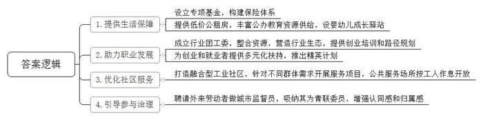
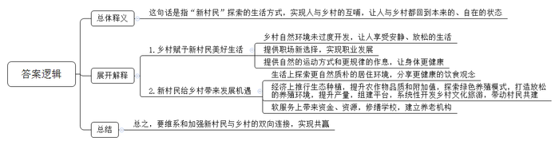
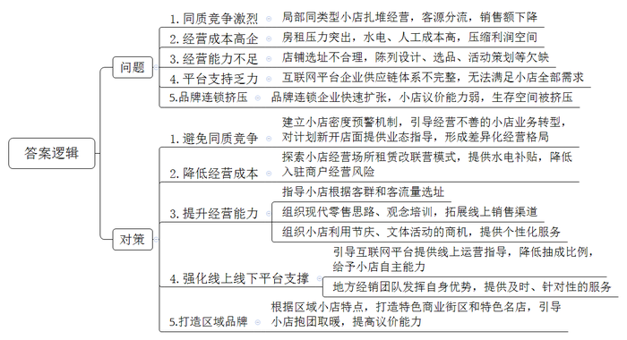
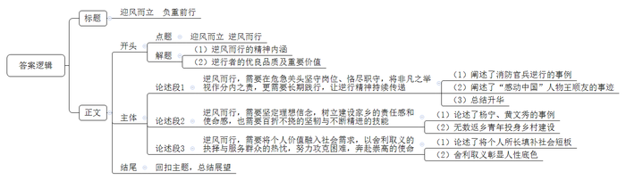

# 2023年公务员多省联考《申论》题（吉林甲卷）

<!-- gwy:overview:start -->
> **吉林 · 2023 · 申论 · 统考** ｜ 4 题 · 图片 4 处 · 答案随题折叠

导航：[题目](#题目)
<!-- gwy:overview:end -->

> 候选采集稿。参考答案及解析来自粉笔页面，不代表官方答案或真实高分答卷；来源使用许可与原卷对应关系仍需人工核实。

## 给定材料

### 材料 material-a57c53ef75bc0eab

“何处是归宿？”3年前，带着一脸迷茫的小谭来到W市务工。刚到没几天，小谭就住进了市里提供的公租房，租金一个月只要300多元，负责接待外来人员就业的劳动部门向他解读了一系列政策和鼓励措施，还有专人帮助他进行职业规划……短短3年间，小谭通过技能等级提升，从一名普通的车间工人成长为质检负责人。今年，他还被评为区里的“金牌工人”。他把妻儿从老家接了过来，儿子也很顺利地就读了当地的公办小学。

2020年，W市设立了成长、创业、教育、关爱四大专项基金，构建了基本养老、基本医疗、工伤、失业四大保险体系，呵护技术工人职业发展；丰富公办教育资源供给，外来人员子女公办学校就读率从2020年的77％提升至现在的96％；针对“随迁子女”缺乏照护的痛点，设置了172所婴幼儿成长驿站，提高了外来务工人员的幸福感。

前悦社区是一个融合型工业社区，主要服务对象为3000余名产业工人。“我们的工作，就是根据工人的实际需求，量身打造各种贴心服务。”社区党支部刘书记说。针对年轻职工多、“小候鸟”多、“老漂族”多的特点，社区分别打造了青年再造项目、“小候鸟”成长项目、关爱“老漂族”项目。共享书房、健身房等公共服务场所，都根据工人作息时间开放。

在小勇所从事的街舞行业中，很多从业者都是青年人，他们普遍缺乏企业管理、宣传、运营、维护的经验，而这个群体早已走进了W市共青团的“朋友圈”。在团市委的支持下，W市街舞行业团工委成立了，团工委把全市200多家街舞相关机构整合起来，街舞文化传播的空间和氛围很快就形成了。对于街舞行业面临的问题，相关部门组织专业的投资、管理培训，帮助创业青年规划发展路径。“不一定每个人都能成功，但真能帮助很多人学习和进步，大家能感受到城市的关怀，让我们找到归属感。”小勇说。

2018年，阿凯来到W市，成为一名外卖骑手，起初他的想法就是“挣点钱后回家做小买卖”。工作中，该市不少党群活动中心、社区都为他们提供了休息、喝水、遮风挡雨的地方。街道还聘请阿凯做城市“监督员”，请他利用走街串巷的机会，将发现的不文明和不安全行为及时上报相关部门，这让阿凯觉得自己是这个城市的主人。“可以把像阿凯一样的外来青年称作是社区治理的重要力量，他们已经从城市的旁观者逐渐转变为参与者。”W市青年发展研究所郭所长说。“这是一个温暖的城市，我和女朋友决定在这里安家，不回老家了。”阿凯说。让阿凯更高兴的是，包括他在内的多名快递小哥、外卖骑手刚刚被吸纳为W市青联委员。

土生土长的W市人小孙，博士毕业后前往一线城市创业。经过几年打拼，小有成就的他得知家乡鼓励青年创业，他决定回去看看，家乡的创业环境让他果断决定留下。项目需要足够大的场地，回来后，他的企业就享受到了1000平方米厂房的3年免租政策，还获得了区里的专项基金支持。企业发展迅速，当年就实现了盈利。

“我们团队成员来自天南海北，现在都成了本地人。”小孙说，大伙很享受这里的风土人情。曾经一度离开家乡的小孙承认：“我越来越喜欢这座城市了。它为我提供了自由发展的土壤，让我的知识和技术有了用武之地，更让我的个人价值得到了实现。其实，人和城市，应该是一场‘双向奔赴’。”

W市力推的“精英计划”已经成为最具辨识度的引才品牌，吸引了大批青年人才，仅在一个工业园区，就集聚了116名省级以上人才、403名市级以上人才。可以说，现在的W市，已经成长为一个具有鲜明特色的“新势力城市”，正成为越来越多青年人的归宿。

### 材料 material-5ea739513917a887

走过一条小小的夹弄，屋后沿河有一个小院子，这个院子如今的主人叫赵清。四年前，她到琴浦村参加公益活动，因为喜欢这里没有过度人为开发的痕迹，在探访了两次后，赵清将这栋房子稍稍收拾了一下，便从市区搬到了这里，成了一名“新村民”。

赵清的丈夫是生物学博士，开了家生物公司，公司在邻市，开车去上班，一个多小时的车程并不长，而晚上和休息日，那种安静和放松的生活是城里人很难享受到的。

赵清的院子临河，在河的另一头也有一栋农舍，屋前的架子上摞着十来只桨板。这些桨板的女主人盈盈和她的丈夫都是专业的水上项目运动员，一个偶然的机会来到琴浦村，一眼就爱上了这条村级河道。小河是盈盈夫妻俩的训练场，也是他们的职场，他们在离住处不远的地方又租了房子，办了一个儿童水上运动训练工作室。不但吸引了城里的孩子来训练，也让农村的孩子有了了解和学习这项运动的机会。

对于“新村民”来说，琴浦村的一切都令他们惊喜。农舍是没有经过装饰的，小路是狭窄的，河边是原始的芦苇丛。夏天的夜里，芦苇上有无数萤火虫舞动，和天上的繁星交相辉映。在他们微博、微信和个人视频中，琴浦村频频出现，很多人看了这些信息慕名而来，然后，就有更多的人向村民租了房子，住到琴浦村。

新老村民的家很容易分辨——凡是将院墙砌得很坚固，铁栅栏上做了尖尖的防盗装置的，通常是“老村民”。“新村民”的院墙大多像赵清家这样，低矮、简单，以木栅栏或竹篱笆为主。走到院子里，区别更加明显，“老村民”的院子大多用水泥做成平地，考究的还会铺上地砖。而“新村民”则更多用红砖铺地，留出泥土空间，绝大部分“新村民”院子里都会种上绿植。因为绿植，村里还曾经发生过令人哭笑不得的事情，有保洁人员上门收垃圾，看“新村民”院子里的绿植长势“散漫”，顺手将绿植拔了。

石磊从小努力离开乡村，一路念书去大城市，去国外留学、生活，回国后努力创业，渴望成功。近二十年的奋斗之后，他做了个决定：把自己的孩子带回中国、带回乡村。

回琴浦村后，石磊从奔走在项目现场、PPT上“谈兵”的建筑设计师，变成了第一次触摸着土地、石头、溪流，跟乡村泥瓦匠一起盖房子的“新村民”。

石磊还带领同伴们租下9亩柑橘园，探索“不打农药，不施化肥”的生态种植。橘园里的实验让“老村民”们感觉不现实：“不打农药怎么行？一群地都没有下过的人。”

停止使用农药后，他们用酵素混合液助力果子“抗敌”。改变种植方法后的丑柑，口感酸甜平衡，且200多项农残检测无一超标。去年，9亩果园产出了近1.3万公斤丑柑，虽然亩产只有村民的六成，但价格却卖到了普通丑柑的8倍以上。他们还把这些丑柑搬到了大城市的百货公司，和时尚品牌出现在同一个橱窗里。“能不能把酵素配方给我们？”“老村民”们围住他们央求，那天他们手写了10余份方子，但越写越开心。

小伙伴们轮值做饭，日常最常做的一道菜是西红柿炒鸡蛋。西红柿是自己种的，鸡蛋是自家产的。他们还动手盖了一座“鸡舍”别墅，屋顶铺了太阳能板用于照明，安装了太阳能音箱，每天放古典乐。他们想看看在放松的环境下，鸡的产蛋量能否提升。“老村民”们一脸疑惑，不知道他们在干啥。

花朵、藤叶、果实，一顿丑柑做的创意料理，只需简单烹饪，少糖少盐，这是“新村民”想分享给更多人的饮食观念。“地里摘的南瓜花炸酥，就能做主菜？”“老村民”王晓最开始不理解，她是第一个在村里办起农家乐的人，用来吸引城里游客的卖点可是浓香的柴火鸡。后来，“新村民”的那些菜品也出现在了她农家乐的菜谱里。

“我们不是要教‘老村民’做事，而是共建。”石磊觉得。目前，石磊团队在乡里陆续孵化了8家机构，有6家公司和2个社会组织，组成了一个系统性开发乡村文化旅游的平台。

“不只是乡村赋予‘新村民’美好生活，‘新村民’的到来也给乡村带来更多发展机遇。他们除了帮助激发乡村发展内生动力，还有许多人带着资金、资源来到乡村扎根生活。他们帮忙出资修缮学校、建立养老机构，为提升乡村软服务贡献了力量。”社会学者鲍教授说。

村里的生活开销也不大，没有健身房，最好的运动就是去田里耕作。“不熬夜，身体也变好了。”初秋里平常的一天，石磊陪着孩子种香草、抓瓢虫。他觉得，人真正要投入的是回到本来的、自在的状态，土地也一样。

和“老村民”大多不习惯城市生活不同，当久了“新村民”的“石磊们”并不排斥城市生活。在石磊心里，“新村民”并非一定住在农村。其实，“新村民”体现的是一种人与土地、自然连接的方式。

### 材料 material-f79216369246e0d8

根据商务部《全国小店经济发展指南》中的定义，小店是指面向居民消费的批发、零售、住宿、餐饮等行业的个体工商户，雇员10人以下或年营业额100万元以下的微型企业及年营业额1500万元以下的网店。

事实上，不管是互联网连锁、区域品牌连锁的单体店还是个人店，正是这些形形色色的小店构成了中国小店经济的脉络。为帮扶小店发展，B市商务局派出调研组对该市小店现状进行调研。

B市西关区，干洗店的老板小程抱着衣服忙进忙出。20平方米的小店满满当当，门口处摆放着蔬菜水果等物，里面是一张简陋的小桌子，一个孩子坐在旁边看书。“孩子放学就来做作业，关店再一起回去。”小程说。这个小店是他们白天的家，工作、吃饭都在这里，为了增加收入，小店也从之前单纯的洗衣物增添了售卖水果蔬菜的项目。

“前几年的时候，我这个便利店日销售额能达到5000元，效益不错，后来大家都争相开店，小区原本就有3家便利店，现在又开了4家，一下子就多了这么多竞争对手，现在一天的销售额都不到3000元，仅够维持房租、水电、人工成本，基本没啥赚头。”便利店老板老李对调研组说。

开店还不满一年的小谢夫妇则抱怨：“还在亏本，一个月房租一万多，感觉自己像是在给房东打工，一转眼，又要交房租了。”小谢夫妇辗转多地开了十多年夫妻店，去年刚刚加盟某餐饮电商的线下店，但是，像小谢夫妇这样的夫妻早餐店，即便有品牌撑腰，想要盈利仍然十分困难。“这主要是由于店铺选址的原因，品牌不是影响小店盈亏最主要的因素，店面选址才是客群定位和客流量的决定性因素。此外，还有店面陈列设计、选品、促销活动策划等要考虑。”商业观察人士蔡女士说。

“传统的夫妻店都是年纪比较大的，像我们父辈这种年纪来经营的，他们的思路比较落后，虽然进的东西价格便宜，品类又多，但不符合年轻人的口味。”小贺说。作为一个年轻的夫妻店店主，他明确地表示出了对传统夫妻店未来的不看好。

小贺的担忧，也是当地政府所关注的。B市政策研究室刘主任认为，通过政府组织免费培训的方式，让传统小店能够了解现代零售的新思路、新观念，让他们学会使用网络，利用网络平台拓展销售渠道，应该成为传统小店的一条新出路。

调研组了解到，去年以来，B市把恢复和扩大消费摆在优先位置，积极实施“小店计划”，从引客流聚人气、降成本增效益等方面入手，为城市经济添能量、增活力。今年春节假期，B市发放了消费助力券5000万元，使用场景向小店倾斜。

之前，王超对开不开店很纠结：“我们的货品讲究个性定制，但开店成本高，何时回本心里没底。”“可以‘拎包开店’，免租金，帮助装修，赚钱之前风险共担，赚到钱后街区抽成15％。”金花街道商业街区运营平台打来电话。原来，区里为落实“小店计划”，将经营场所改租赁为联营，降低入驻商户经营投入成本，这让王超下定了开店的决心。金花街道还根据区域内的小店经营特点，打造了一批特色商业街区和特色名店，做到每个街区有一个共享品牌，一个业态有一个亮点品牌，变小店“单打独斗”为“抱团取暖”，形成了区域性品牌。

小柯的杂货店入驻了一家外卖平台。“那时候外卖是新鲜事物，我们也都不懂。”出乎小柯的意料，小店上线后，局面一下子打开了，订单一个接一个蹦出来。和小柯一样，绝大多数年轻的小店店主都接入了外卖平台这样的大数据平台。

“大数据为小店提供了发展机遇，但就目前的状况来看，互联网平台企业还未能形成完整的供应链体系，无法满足小店的全部需求，无论是在品类、服务还是在价格上。”B市社科院王研究员认为，“我特别希望互联网平台企业接下去能释放更多资源，让小店搭上大数据这列快车。作为互联网平台企业，既要给小店赋能，比如教他们做线上运营，又要给小店足够的自主能力，不能在里面分走太多的利润。因为小店本身的产量、产能、产出是有限的。”

大圣活动策划公司陈经理说：“其实，小店也可以扩展营销场景。比如，政府可以组织餐饮、住宿小店搭载重大节日节庆、重大文体活动的顺风车，发挥小店灵活机动的长处，推出个性化服务，填补大企业在这些场景中遗留的空间。”

曾自创地区性连锁便利店品牌，开了十几家连锁店的小楼说：“虽然互联网有数据优势、资金优势、品牌优势，但是地方性品牌也有地方性优势，比如，本地经销商的业务团队会对自己负责区域的小店进行定期维护，上门抄单，发现缺货的产品会及时送货上门，这样经年累月的人情关系、周到的服务是互联网不具备的。”

“小时候，便利店就像小区里的社交场所，门口总摆着几张凳子，居民们围坐在一起聊聊家常。”在老小区里长大的赵毅回忆道，“虽然现在互联网购物也很方便了，可以选购的品类更多、价格也更透明，还能直接送货上门，但我更喜欢的还是门口的小店，那里充满了人情味儿。”

B市市委党校于教授认为，像美发店、早餐店、洗衣店这样的小店，多服务于周边社区居民，核心竞争力在于锁定回头客，老顾客越多，生存能力就会越强。但现阶段，这些小店也面临着很多困难，品牌连锁企业快速扩张，不断挤压小店的生存空间，加之小店议价能力较弱，小店的利润空间越来越小，亟需管理部门出台扶持政策。

## 题目

### 第 1 题

**根据****“给定资料**1**”，概括W市是如何成为青年人归宿的。（20分）**

关联材料：材料 material-a57c53ef75bc0eab

作答要求：

要求：全面、准确、有条理；不超过200字。

第 1 题 · 答案与解析

**参考答案（粉笔题库参考内容）**

1.提供生活保障。设立专项基金，构建保险体系；提供低价公租房，丰富公办教育资源供给，设婴幼儿成长驿站。

2.助力职业发展。成立行业团工委，整合资源，营造行业生态，提供创业培训和路径规划；为创业和就业者提供多元化扶持，推出精英计划。

3.优化社区服务。打造融合型工业社区，针对不同群体需求开展服务项目，公共服务场所按工人作息开放。

4.引导参与治理。聘请外来劳动者做城市监督员，吸纳其为青联委员，增强认同感和归属感。

**解析**

**参考答案说明：**本参考答案从“提供生活保障”“助力职业发展”“优化社区服务”“引导参与治理”等不同的方面进行了分条撰写。各条要点之间在内容上相互并列，没有交叉。

**考点**：考点概括措施类

**来源**：来源2023年公务员多省联考《申论》题（吉林甲卷）

粉笔申论页面对本题只提供「解析视频」入口，该入口是会员推广位，页面无视频地址与文字解析。

### 第 2 题

**根据****“给定资料**2**”，谈谈你对“‘新村民’体现的是一种人与土地、自然连接的方式”这句话的理解。（15分）**

关联材料：材料 material-5ea739513917a887

作答要求：

要求：分析全面，条理清晰；不超过300字。

第 2 题 · 答案与解析

**参考答案（粉笔题库参考内容）**

这句话是指“新村民”探索的生活方式，实现人与乡村的互哺，让人与乡村都回到本来的、自在的状态。

具体体现在：1.乡村赋予新村民美好生活：乡村自然环境未过度开发，让人享受安静、放松的生活；提供职场新选择，实现职业发展；提供自然的运动方式和更规律的作息，让身体更健康。2.新村民给乡村带来发展机遇：生活上探索更自然质朴的居住环境，分享更健康的饮食观念；经济上推行生态种植，提升农作物品质和附加值，探索绿色养殖模式，打造放松的养殖环境，提升产量，组建平台，系统性开发乡村文化旅游，带动村民共建；软服务上带来资金、资源，修缮学校，建立养老机构。

总之，要维系和加强新村民与乡村的双向连接，实现共赢。

**解析**

**参考答案说明**：（1）思路方面，本参考答案按照词句解释题“总体释义+展开解释+总结”的一般答题思路展开。（2）内容方面，本参考答案首先对“‘新村民’体现的是一种人与土地、自然连接的方式”的含义进行了总体释义，再分别从“乡村赋予新村民美好生活”“新村民给乡村带来发展机遇”这两个层面展开解释，最后进行了总结。（3）词句表达方面，本参考答案加上了“总之”等连接词来承接上下文，使答案更加顺畅。

**考点**：考点词句解释类

**来源**：来源2023年公务员多省联考《申论》题（吉林甲卷）

粉笔申论页面对本题只提供「解析视频」入口，该入口是会员推广位，页面无视频地址与文字解析。

### 第 3 题

**假如你是****B市商务局调研组的成员，请根据“给定资料**3**”，梳理B市小店发展面临的问题并提出建议。（25分）**

关联材料：材料 material-f79216369246e0d8

作答要求：

要求：

（1）问题梳理全面、准确、有条理；

（2）所提建议有针对性、可行性；

（3）不超过500字。

第 3 题 · 答案与解析

**参考答案（粉笔题库参考内容）**

问题：

1.同质竞争激烈。局部同类型小店扎堆经营，客源分流，销售额下降。

2.经营成本高企。房租压力突出，水电、人工成本高，压缩利润空间。

3.经营能力不足。店铺选址不合理，陈列设计、选品、活动策划等欠缺。

4.平台支持乏力。互联网平台企业供应链体系不完整，无法满足小店全部需求。

5.品牌连锁挤压。品牌连锁企业快速扩张，小店议价能力弱，生存空间被挤压。

对策：

1.避免同质竞争。建立小店密度预警机制，引导经营不善的小店业务转型，对计划新开店面提供业态指导，形成差异化经营格局。

2.降低经营成本。探索小店经营场所租赁改联营模式，提供水电补贴，降低入驻商户经营风险。

3.提升经营能力。指导小店根据客群和客流量选址；组织现代零售思路、观念培训，拓展线上销售渠道；组织小店利用节庆、文体活动的商机，提供个性化服务。

4.强化线上线下平台支撑。引导互联网平台提供线上运营指导，降低抽成比例，给予小店自主能力；地方经销团队发挥自身优势，提供及时、针对性的服务。

5.打造区域品牌。根据区域小店特点，打造特色商业街区和特色名店，引导小店抱团取暖，提高议价能力。

**解析**

**参考答案说明：**本参考答案分为“问题”和“对策”两个部分。其中“问题”部分从“同质竞争激烈”“经营成本高企”“经营能力不足”“平台支持乏力”“品牌连锁挤压”五个方面展开；“对策”部分从“避免同质竞争”“降低经营成本”“提升经营能力”“强化线上线下平台支撑”“打造区域品牌”五个方面展开。本参考答案做到了分类分条撰写，各条答案要点之间在内容上相互并列，没有交叉。

**考点**：考点提出对策类

**来源**：来源2023年公务员多省联考《申论》题（吉林甲卷）

粉笔申论页面对本题只提供「解析视频」入口，该入口是会员推广位，页面无视频地址与文字解析。

### 第 4 题

**请深入思考****“给定资料**4**”中三则“逆行者”的事例，联系实际，自拟题目，自选角度，写一篇议论文。（40分）**

关联材料：材料 material-a57c53ef75bc0eab

作答要求：

要求：

（1）观点明确，见解深刻；

（2）参考给定资料，但不拘泥于给定资料；

（3）思路清晰，语言流畅；

（4）字数800-1000字。

第 4 题 · 答案与解析

**参考答案（粉笔题库参考内容）**

**迎风而立** **负重前行**

“趋利避害，人之常情，而逆风者方知迎风之妙也，是人生之磨炼。”这句话道出了逆行者的精神内核。在时代浪潮中，总有一些人冲破世俗，向着困难与需要的方向前行。他们用行动诠释着责任、信念与价值，为社会注入温暖与力量。

**逆风而行，需要在危急关头坚守岗位****、****恪尽职守，将非凡之举视作分内之责，更需要长期践行，让逆行精神持续传递。**2015年天津港“8・12”火灾爆炸事故中，消防官兵第一时间奔赴火场，即便面临再次爆炸的危险，也无人退缩，只将此视作应尽职责。“感动中国”人物王顺友，在四川凉山的马班邮路上坚守30余年。他从未因山路艰险而退缩，也未因名利诱惑而动摇，从青春年少践行到两鬓斑白。这种从“危急坚守”到“长期践行”的延续，让逆行精神突破了时间与场景的限制，在日常服务中不断传递。

**逆风而行，需要坚定理想信念，树立建设家乡的责任感和使命感，也需要百折不挠的坚韧与不断精进的技能。**杨宁大学毕业后，回到家乡担任村官，扎根苗寨十余年，带领村民发展特色产业；黄文秀放弃大城市工作机会，回到家乡百色，将青春永远留在了扶贫路上。如他们一般的还有无数返乡青年，他们挣脱“离农”的世俗期望，以专业为刃，劈开对乡村命运的陈旧定义，面对失败与质疑，他们从未动摇，百折不挠地直面困难，不断精进技能，证明了青年用知识反哺乡土的可能。以技术为桨、毅力为帆，在逆流中驶向共同富饶的彼岸。

**逆风而行，需要将个人价值融入社会需求，以舍利取义的抉择与服务群众的热忱，努力攻克困难，奔赴崇高的使命。**当个人所长恰好能填补社会短板、回应群众期盼时，这样的价值才更具分量与温度。而在这个过程中，困难与诱惑往往如影随形，或是环境的恶劣、资源的匮乏；或是名利的诱惑、捷径的吸引。此时，“舍利取义”便成为逆风者的精神标尺，选择放下个人的短期利益，优先满足群众的迫切需求；选择直面困难而非逃避，用持续的热情与行动破解难题。这种抉择，彰显了逆行者最为光辉的人性底色——在成就他人中圆满自我，在奉献社会中升华生命。

在充满机遇与挑战的当下，或许无需人人都做出惊天动地的逆行壮举，但若能汲取“逆行”精神，在各自岗位上坚守职责、以专业知识回馈社会、在利益面前保有情怀，便能汇聚无数微光，逆风而行也就不再是个别英雄的史诗。

**解析**

**文章分析**

**迎风而立** **负重前行**

【**标题的优点**：范文的标题“迎风而立”突出了“逆风而行”这一主题，主题鲜明。】

（1）“趋利避害，人之常情，而逆风者方知迎风之妙也，是人生之磨炼。”这句话道出了逆行者的精神内核。在时代浪潮中，（2）总有一些人冲破世俗，向着困难与需要的方向前行。他们用行动诠释着责任、信念与价值，为社会注入温暖与力量。

【**开头的优点：**★内容方面：范文的开头是紧扣“逆风而行”这一主题展开的。首先，开头点出主题，做到了主题明确。其次，对“逆风而行”这一主题进行了分析阐述：（1）逆风而行的精神内涵；（2）逆行者的优良品质及重要价值。★文字表达方面：运用对比、排比等修辞手法，语言凝练有力，富有哲理性和感染力。】

**逆风而行，需要在危急关头坚守岗位、恪尽职守，将非凡之举视作分内之责，更需要长期践行，让逆行精神持续传递。**（1）2015年天津港“8・12”火灾爆炸事故中，消防官兵第一时间奔赴火场，即便面临再次爆炸的危险，也无人退缩，只将此视作应尽职责。（2）“感动中国”人物王顺友，在四川凉山的马班邮路上坚守30余年。他从未因山路艰险而退缩，也未因名利诱惑而动摇，从青春年少践行到两鬓斑白。（3）这种从“危急坚守”到“长期践行”的延续，让逆行精神突破了时间与场景的限制，在日常服务中不断传递。

【**论述段****1的优点**：★观点句：范文的观点句是紧扣“逆风而行”这一文章主题提出的。形式上，它在段首处直接写出，位置突出，容易发现。内容上，关键词突出，内容要点明确，可以明显看出主要从“危急关头坚守岗位并长期践行”的维度进行论述。★论述内容：（1）阐述了消防官兵逆行的事例；（2）阐述了“感动中国”人物王顺友的事迹；（3）总结升华。注意：以上三个方面的内容都是紧扣“逆风而行，需要在危急关头坚守岗位、恪尽职守，将非凡之举视作分内之责，更需要长期践行，让逆行精神持续传递”这个观点句进行分析论述的，论述的针对性强，内容层次丰富。在论述方法上主要采用了举例子的方式，论述深刻。】

**逆风而行，需要坚定理想信念，树立建设家乡的责任感和使命感，也需要百折不挠的坚韧与不断精进的技能。**（1）杨宁大学毕业后，回到家乡担任村官，扎根苗寨十余年，带领村民发展特色产业；黄文秀放弃大城市工作机会，回到家乡百色，将青春永远留在了扶贫路上。（2）如他们一般的还有无数返乡青年，他们挣脱“离农”的世俗期望，以专业为刃，劈开对乡村命运的陈旧定义，面对失败与质疑，他们从未动摇，百折不挠地直面困难，不断精进技能，证明了青年用知识反哺乡土的可能。以技术为桨、毅力为帆，在逆流中驶向共同富饶的彼岸。

【**论述段****2****的优点**：★观点句：范文的观点句是紧扣“逆风而行”这一文章主题提出的。形式上，它在段首处直接写出，位置突出，容易发现。内容上，关键词突出，内容要点明确，可以明显看出主要从“投身家乡建设，不断精进技能”的维度进行论述。★论述内容：（1）论述了杨宁、黄文秀的事例；（2）无数返乡青年投身乡村建设。注意：以上两个方面的内容都是紧扣“逆风而行，需要坚定理想信念，树立建设家乡的责任感和使命感，也需要百折不挠的坚韧与不断精进的技能”这个观点句进行分析论述的，论述的针对性强，内容层次丰富。在论述方法上主要采用了举例子的方式，能够结合实际。】

**逆风而行，需要将个人价值融入社会需求，以舍利取义的抉择与服务群众的热忱，努力攻克困难，奔赴崇高的使命。**（1）当个人所长恰好能填补社会短板、回应群众期盼时，这样的价值才更具分量与温度。而在这个过程中，困难与诱惑往往如影随形，或是环境的恶劣、资源的匮乏；或是名利的诱惑、捷径的吸引。（2）此时，“舍利取义”便成为逆风者的精神标尺，选择放下个人的短期利益，优先满足群众的迫切需求；选择直面困难而非逃避，用持续的热情与行动破解难题。这种抉择，彰显了逆行者最为光辉的人性底色——在成就他人中圆满自我，在奉献社会中升华生命。

【**论述段****3****的优点**：★观点句：范文的观点句是紧扣“逆风而行”这一文章主题提出的。形式上，它在段首处直接写出，位置突出，容易发现。内容上，关键词突出，内容要点明确，可以明显看出主要从“将个人价值融入社会需求，舍利取义”的维度进行论述。★论述内容：（1）论述了将个人所长填补社会短板；（2）舍利取义彰显人性底色。注意：以上两个方面的内容都是紧扣“逆风而行，需要将个人价值融入社会需求，以舍利取义的抉择与服务群众的热忱，努力攻克困难，奔赴崇高的使命”这个观点句进行分析论述的，论述的针对性强，内容层次丰富。在论述方法上主要采用了讲道理的方式，论述清晰。】

在充满机遇与挑战的当下，或许无需人人都做出惊天动地的逆行壮举，但若能汲取“逆行”精神，在各自岗位上坚守职责、以专业知识回馈社会、在利益面前保有情怀，便能汇聚无数微光，逆风而行也就不再是个别英雄的史诗。

【**结尾的优点**：范文的结尾紧扣了“逆风而行”这一主题，并且进行了展望，发出了号召。】

**考点**：考点文章写作题

**来源**：来源2023年公务员多省联考《申论》题（吉林甲卷）

粉笔申论页面对本题只提供「解析视频」入口，该入口是会员推广位，页面无视频地址与文字解析。

