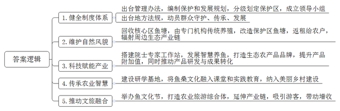
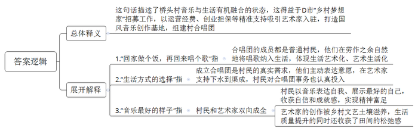
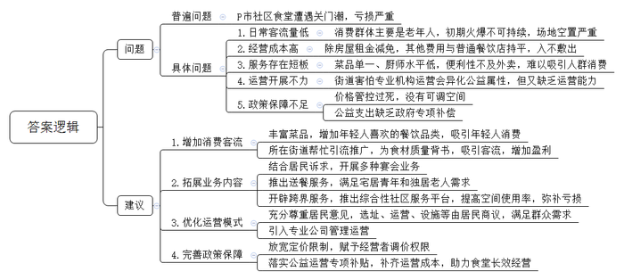

# 2025年公务员多省联考《申论》题（吉林甲卷）（网友回忆版）

<!-- gwy:overview:start -->
> **吉林 · 2025 · 申论 · 甲级** ｜ 4 题 · 图片 3 处 · 答案随题折叠

导航：[题目](#题目) · [材料 1](#材料-1)
<!-- gwy:overview:end -->

> 候选采集稿。参考答案及解析来自粉笔页面，不代表官方答案或真实高分答卷；来源使用许可与原卷对应关系仍需人工核实。

## 给定材料

### 材料 1

远处是星罗棋布的方塘，近处是郁郁葱葱的桑林，脚下是蜿蜒绵长的蚬壳路，还有那嬉闹搅起涟漪的池鱼……这里就是被誉为农业文化“活化石”的H市桑基鱼塘系统。

2500多年前，太湖沿岸的先民苦于雨季的洪涝灾害，将洼池挖深变成鱼塘，塘泥堆放于水塘的周围作为塘基，在塘基上种植桑树。久而久之，这里演变成以“池塘养鱼、塘基种桑、桑叶养蚕、蚕沙喂鱼、鱼粪肥塘、塘泥壅桑”为内涵的生态循环模式。

十年之前，桑基鱼塘曾遭遇危机。H市蚕桑首席专家介绍，“当时很多蚕农觉得养蚕还不如到企业打工稳当、合算，从而出现了弃桑不管、有桑不养蚕的现象，导致许多桑基鱼塘系统自行萎缩、退化乃至消失。”为了保护发展具有悠久的历史渊源、独特的农业产品、丰富的生物资源、完善的知识技术体系以及较高的美学和文化价值的桑基鱼塘，2013年9月，《H市桑基鱼塘保护区管理办法》出台。2014年9月，H市委托Z大学编制了桑基鱼塘系统保护和发展规划，划定核心保护区、次保护区和一般保护区，并成立了两级政府保护利用领导小组，确保了保护与发展、保护与利用工作科学有序开展。2017年11月，桑基鱼塘被联合国粮农组织认定为全球重要农业文化遗产。

有一段时间，部分鱼塘养殖户为获得最大经济效益，悄悄扩大鱼塘面积，高密度放养和大量投放饵料饲养鱼苗，导致水体富营养化，鱼塘生态环境被破坏。还有村民甚至砍掉桑树，腾出土地来种植蔬菜。要维护好桑基鱼塘的自然风貌，就要杜绝养殖户不计后果的放养行为。但不让他们投放大量鱼苗，刚过上的好日子就要打折扣，村民们显然不买账。“我们决定要三步走，先把核心区的桑基鱼塘回收，由专门机构进行传统养殖，再将保护区的鱼塘进行改造，对有意向返租的农户出租，最后再以桑基鱼塘为中心辐射周边生态产业链。”乡镇干部们信心十足，可实践中却碰了不少钉子。

张大伯是桑基鱼塘保护区内的养殖户，也是保护区内鱼塘土地流转的“钉子户”。“新采购的马达、鱼苗，政府都能按规定补偿给你。以后鱼塘修复好，也可以再返租给你们，有专家一起帮你们养鱼养蚕，你们还怕效益不好吗？”干部们给张大伯耐心地释法说理。“好，我就相信你们一次。我倒要看看，你们到底有多大本事。”

张大伯态度虽然有所缓和，却大有作壁上观的意味。经过清淤、修复堤岸、丰富周边产业，原先从农民手中流转过来的旧鱼塘，又被农户争抢着预定承租。张大伯看着周围村民日子越过越红火，便也主动租了一方鱼塘。

吴大爷守着桑田与鱼塘，生活特别有规律。农历一二月管理桑树，放养鱼苗；三四月为桑树施肥；五六月养蚕售茧；七八月清淤，培固塘基；秋天到年底的几个月捕鱼卖鱼。“现在是专家站指导的科学高密度养鱼，在手机上就能观测鱼塘情况。”吴大爷打开手机里的智慧养鱼程序，每个鱼塘的溶氧量、水温、pH值、水深等信息一览无余，甚至还能用手机进行投喂、增氧等操作。一旦塘内有任何异常，程序会自动预警。“过去一斤鱼卖十几元，如今‘生态鱼’的牌子打响了，每斤能卖三四十元。”吴大爷说的专家站是H市农业文化遗产院士专家工作站。“我们主要开展桑基鱼塘动态保护与适应性管理研究，推动产品研发和成果转化。桑葚汁、桑葚茶、蚕蛹鲜味肽、桑果酥等这些产品卖得特别好。”工作站里年轻的博士小朱对他们的研发成果如数家珍。

做蚕茧灯、绘蚌壳画、制作蚕丝纸……研学基地里孩子们正专注地绘画、剪纸，体味着古老的蚕桑文化。“近年来，我们还将鱼桑文化融入小学课堂、实践教育，并纳入美丽乡村建设内容，让古老的农业智慧一代一代传承下去。”研学基地负责人说。

鱼乐、鱼歌、鱼舞、鱼宴、艺术展……第15届H市鱼文化节在隆港村如期举行，吸引了来自世界各地的几万名游客体验原汁原味的鱼桑文化风情，感受农业文化遗产的魅力。

保有1000余亩桑基鱼塘的隆港村就以桑基鱼塘鱼桑文化和古村落文化为依托，重点打造了集休闲度假、生态农业、文化创意、研学实践教育等于一体的农业旅游综合体。“我们正在不断延伸鱼桑文化旅游产业链，去年吸引游客约18万人次，带动旅游和土特产销售近两千万元。《隆港村旅游发展与风貌景观提升规划》，让水乡焕发新活力。隆港坐落于全球重要农业文化遗产，桑基鱼塘的核心保护区，要用好这个‘活化石’。”隆港村党委书记杨光说。

“现在打下界桩，保护区需要大家一起保护，不能随意破坏。”在射月村，村党支部书记老谈边打界桩，边向村民普及《H市桑基鱼塘系统保护规定》的相关内容。“要是故意损毁桑地，最高罚款一万元。”

2024年，上述《规定》实施，这是该市首部围绕重要农业文化遗产的地方立法。H市文化遗产保护与发展研究中心的黎研究员认为，通过界桩建设、村规民约纳入等举措，可动员大家一起守护好、传承好、发展好桑基鱼塘系统，守住桑茂、蚕盛、鱼旺的美好景象，让千年农业文化瑰宝发光发亮。

### 材料 2

这是一个普通的午后，D市三都镇桥头村没有发生任何新鲜事。如果非要说一件，那就是72岁的农民李玉英没去料理她的菜园，50岁的服务员周凤珍不在整理民宿的房间，42岁的家庭主妇洪娟没有钻进厨房准备晚饭……在桥头村文化礼堂的一间房间里，包括她们在内的十几位村民正坐在回字形会议桌边，挺胸抬头，双手叉腰，试图“找到”自己的胸腔和腹腔之间的一块肌肉——横膈膜。

“对，就是这样，跟我一起发出嘶的声音，嘶……”此时，一名头戴蓝色复古报童帽、气质优雅的女士正中气十足地带领着他们练嗓。她叫周霞，虽然上了年纪，但不需要借助话筒就能让自己的声音填满整个房间：“感受你们的横膈膜在发力，注意气息的稳定。”

“嘶……”李玉英模仿着她，感觉自己化身成了菜园里的一条小花蛇。而当周霞用“哞”的一声来展示什么是鼻腔共鸣时，在场的村里人都忍不住笑了：“这不就是老牛叫嘛！”“对，就是要学牛叫！”周霞眉开眼笑，本来放在琴键上的双手舞到了空中，指挥大家一起练习。于是，在这样一个普通的午后，桥头村文化礼堂内传出此起彼伏的“牛叫声”。

“里头是什么声音？”有外来人问。“哦！是我们村的合唱团在排练呢！”一位村民回答。“村里还有合唱团？”“有啊！我带你去看看。”

“我们也想唱歌，您能不能教我们唱歌？”2023年年初，当西北流行音乐学会秘书长、词曲作家吴适在桥头村打造原创音乐基地时，村民找到他表达村民们想成立合唱团的心愿。

“你们要唱，我们就试着组织。”吴适答应了下来，但没太把这当回事。他想，估计村民们就是想玩玩而已，跟跳广场舞一样，把这当做一种消遣。那时他正在创作一首新歌，因为旋律不是特别复杂，他决定让村民们试着唱一下。“我把谱子和范唱音频交给他们后，过了两天我还在想怎么教呢，没想到他们已经会唱了，我才知道他们对这件事如此投入，如此认真。”吴适了解后发现，这支队伍里卧虎藏龙，有唱婺剧的农民、喜欢流行音乐的渔民、退休多年的文艺骨干……他们参加合唱团，不是为了随便唱一唱。

“没有吴适老师，就不会有‘歌之桥’合唱团。合唱团的周霞老师是他请来的，歌曲是他创作的，器材也是他提供的。”桥头村的村民们说，他们打心底感激这位从大西北过来的艺术家。而吴适之所以能够与桥头村结缘，要得益于D市的“乡村梦想家——我在D市有个村”招募工作。正是通过该项目，吴适入驻桥头村，在运营经费、创业担保等方面得到了精准支持，利用闲置4年的农房打造国风音乐创作基地，并吸引全国各地的“圈内好友”来此采风创作。

“其实，相较于我创立了‘歌之桥’合唱团的说法，我更认为合唱团的出现是一种自发的过程。首先是村民有了这个意愿，我们只是把握住了他们的真实需求，这种需求也不是外力生造出来的，而是天时地利人和下的水到渠成。”吴适说，“而我这样一个‘外来人’愿意在桥头村扎根，也是因为感受到了这里能滋养我创作的文艺土壤，所以我们是互相成全。”

今天，农民唐淑芬在闲暇时间钻研怎么用胸腔共鸣把《我和我的祖国》这首歌唱出气势，而回想过去，她说过去家里连种田的肥料都是借钱买的，早上四点多钟就要去割稻子，只能把孩子带到田边去。“现在这样的生活是天上过的日子嘞！”唐淑芬感慨道。而对于习惯了城市生活的吴适跟周霞来说，直接搬到村里住后，生活质量不但没有下降，还感受到田间的松弛感。

9月时，他们参加大型的演唱节目，在演唱节目前，周霞问他们：“你们觉得这歌唱的是谁？”他们自然地回答道：“桥头村。”“错了。”周霞说，“这一首，唱的是你们自己，你们把最好的自己展示给大家看就可以了。”村民们眼睛湿润了，唱歌更大声了，胸膛也更挺了。

那天，望着舞台上大家认真唱歌的模样，吴适很想哭。亲眼看见过，他才确信：“我可以回家做个饭，再回来唱个歌，这是一种生活方式的选择，也是音乐最好的样子。”

### 材料 3

2022年底P市一家名为惠百家的社区食堂，因为“5元吃饱，9元吃好”的宣传语在引来诸多媒体竞相报道的同时，也引发了当地社区食堂建设的热潮。不到三个月的时间，P市基础设施完善的地区几乎每个街道都有社区食堂开业，社交平台上不少居民也忙着分享各个食堂的坐标和喜爱之情。“第一次去社区食堂就被其划算程度震撼了，鸡腿5元，大白菜炖豆腐3元，小菜免费，汤免费……”网友程程在网络平台上表示。

然而这股热潮刮得虽猛，过得却比风还快。仅仅一年后，P市都市报刊发的一篇名为《何去何从 惠百家的艰难选择》的文章，从惠百家面临的窘境切入，报道了P市首批社区食堂关门潮的状况，使社区食堂的话题再次成为大众关注的焦点。

2022年10月份的时候，住建部和民政部联合发布的一个通知，提到试点社区应规划配建食堂等便民商业服务设施。“我们认为社区食堂会迎来一次风口，没想到我们经营一年就亏损了近17万，无奈跟街道签的三年合同还没到期，只能挺着。”惠百家经理抱怨着。

走进幸福社区食堂已经是午饭时间，100㎡的餐厅只有10多个老人。“当初社区这个食堂概念提出来的时候，我们预想着会出现人流火爆的情况。刚开业那两个月的确如此，因为价格实惠嘛，但是后来却并没有大家想象得那么多。真正愿意到社区食堂就餐的大多是社区内的一些老人。”食堂经理李宝贵说，“为啥不营利？你听我给你算笔账。社区食堂具有公益性质，但它的运营也得遵循市场机制，成本投入跟外面的餐饮店是一样的，包括租金、原材料、人工、水电、燃气等。除了街道给减免了一些房屋租金，其他费用一样不少，就拿我们这个店来说，每月的人工支出高达2万，房租也需要上万，再加上水电费，一天才三四十人的客流，能不亏吗？”

“很少去，我周边的朋友去得也不多，好多人都说不清楚社区食堂在哪儿。”一对年轻人在被问是否经常去社区食堂用餐的时候这样回答，“他们的厨师水平有限，做出来的菜比较单一，再便宜吃两顿也够了，而且不如网上订餐方便。”

截至2024年10月，P市开办的第一批约100余家社区食堂中，有一半以上已经停止运营，还有一些靠着政府补贴勉强维持。然而，这些社区食堂停业的同时，新的社区食堂也在不断涌现。

走进茂发食品集团，2025年初在P市开办的名为茂发城市厨房的社区食堂装修简洁清新，菜品丰富多样，最便宜的菜品仅5元，还有烘焙、咖啡等，成了不少年轻人喜爱的网红餐厅，食堂经理纪先生强调：“性价比是社区食堂的特点，所以我们想抢先进入这块儿市场。”

“社区食堂靠的就是人多量大、薄利多销，我们这是街道经常帮我做引流推广，还以政府的名义为我们的食材质量背书，客流量大，盈利自然就上去了。”大兴社区食堂负责人王利说。

星期天下午，一场活动正在靠山社区食堂举行。门口宣传栏上写着：本食堂结合社区居民不同的诉求，开展婚宴、寿宴、生日宴、升学宴等宴会业务。

负责人崔先生说：“考虑到一些宅居青年和独居老人的特殊情况，我们已推出送餐服务，近期还打算开辟一些跨界的服务，比如健康讲座、体检服务、亲子活动等，推出综合性社区服务平台，通过提高空间使用率弥补食堂亏损。”

福林社区是一个超大型社区，比较早的开办了社区食堂。“食堂创办时，曾想交给机构运营，但怕他们会把食堂变成自己的钱袋子，让公益属性变了味儿，所以我们选择自己挑头干，但不到半年时间，街道赔了太多钱，就暂停了。去年7月居民要求食堂重新开业，这次我们充分尊重居民意见，食堂建立在哪里，需采取哪种运营模式，包括桌椅板凳，都是居民商议的结果。我们还引入了一家专业公司作为管理方，运行相当成功。看来专业的事还得专业的人来办。”街道办主任赵青说。

“要改变社区食堂营收能力弱的局面，就不能把价格控制得太死，要给运营者一定的价格可调空间，而且体现公益性的支出，政府一定要给予适当的补偿。”P市社会科学院研究员佟梅说。

### 材料 4

《哪吒之魔童降世》中申公豹有一句高光台词——人心中的成见是一座大山。近日，《哪吒2》中通过石矶娘娘人设的反转，再一次巧妙地讲述了这一主题，并在各大社交平台上引起热议。

在大多数观众的印象里，石矶娘娘本来是2003版动画片《哪吒传奇》中喊着要“让妖怪横行天下”的邪恶反派角色。而电影《哪吒2》中一开始哪吒带领捕妖队铲平石矶娘娘居住的大山时，不少观众还在拍手称快，但当剧情逐渐展开，大家发现妖族、魔族中也不乏正义、善良之辈时，回想被收服的石矶娘娘，其实也只是个没做任何坏事的“宅女”。在她身上，人们甚至能看到不在魔镜的奉承前迷失自我的清醒。

电影上映后，导演饺子对石矶娘娘的人物内核进行了阐释：“她是一个心思单纯的、可爱的、憨憨的女孩子。而且她其实可以变化成任意的模样，可胖可瘦，她只是活在自己的世界当中，没有以别人的眼光来判定自己。”心中的成见，有时候甚至是在还未被察觉时，就已经影响了我们的判断。

最近听到一首歌，里面有一句歌词“种完麦子我就往南走”，让人费解。后来才知道，这背后是一个真实的故事。去年，一位60多岁的阿姨出现在主持人大冰的连麦直播里。她说自己是个农民，手里只有5000块钱和一辆不带棚的三轮车，她没有明确的目的地，但有一个如诗般的梦想：“种完麦子，我就往南走，去西双版纳，过个冬天。”

朴实的话语，有一种直抵人心的动人。谁说农民就应该面朝黄土背朝天？麦田、土地、耕作的老人，和一条开往温暖南方的路连绵在一起，像一个童话。每个看过这段直播的人都惦记着这位“麦子阿姨”。

从古至今，人们对考试都有着崇高的信仰。古代文人从小便开始了读书、写字生涯，家中人这些年的心血都倾注在一人手中，期待他能够早日考中状元，光宗耀祖。《范进中举》主人公五十多中举人，一家人得了消息之后，开心地在大街上欢呼雀跃，一夜之间，从曾经人人看不起到突然备受尊敬。中举后便能改变人生，中国人的传统观念，使大部分人拼了命考名校、考研考博，一年考不上甚至要考好几年，这或许也是源于心中成见。

从小妈妈告诉女儿“女孩子应该温柔乖巧”到工作中领导和同事给出的定义标签，这些标签看似具体而微，却对我们产生了宏大而深远的影响——它让我们越来越不像我们自己，越来越成为别人希望我们成为的自己。社会学家张忠宝教授认为，打破别人的成见很难，打破自己心中的成见更难，成长从来不是一蹴而就的，而是一次又一次突破并遇见更好的自己，从而走向成功的过程。

## 题目

### 第 1 题

**根据“给定资料1”，谈谈H市是如何让桑基鱼塘系统这个“活化石”闪闪发光的。（20分）**

关联材料：材料 1

作答要求：

要求：全面，准确，有条理，不超过250字。

第 1 题 · 答案与解析

**参考答案（粉笔题库参考内容）**

1.健全制度体系。出台管理办法，编制保护和发展规划，分级划定保护区，成立领导小组；出台地方法规，动员群众守护、传承、发展。

2.维护自然风貌。回收核心区鱼塘，由专门机构传统养殖，改造保护区鱼塘，返租给农户，辐射周边生态产业链。

3.科技赋能产业。搭建院士专家工作站，发展智慧养鱼，打造生态农产品品牌，提升产品附加值，同时推动产品研发与成果转化。

4.传承农业智慧。建设研学基地，将鱼桑文化融入课堂和实践教育，纳入美丽乡村建设。

5.推动文旅融合。举办鱼文化节，打造农业旅游综合体，延伸产业链，吸引游客，带动增收。

**解析**

**参考答案说明：**本参考答案从“健全制度体系”“维护自然风貌”“科技赋能产业”“传承农业智慧”“推动文旅融合”等五个方面进行了分条撰写。各条答案要点之间在内容上相互并列，没有交叉。

**考点**：概括措施类

**来源**：2025年公务员多省联考《申论》题（吉林甲卷）（网友回忆版）

### 第 2 题

**根据“给定资料2”，谈一谈对划线句子“我可以回家做个饭，再回来唱个歌，这是一种生活方式的选择，也是音乐最好的样子”的理解。（15分）**

关联材料：材料 2

作答要求：

要求：分析全面，条理清晰，不超过300字。

第 2 题 · 答案与解析

**参考答案（粉笔题库参考内容）**

这句话描述了桥头村音乐与生活有机融合的状态，这得益于D市“乡村梦想家”招募工作，以运营经费、创业担保等精准支持吸引艺术家入驻，打造国风音乐创作基地，组建村合唱团。

1.“回家做个饭，再回来唱个歌”指：合唱团的成员都是普通村民，他们在劳作之余自然地将唱歌纳入生活，体现生活艺术化、艺术生活化。

2.“生活方式的选择”指：成立合唱团是村民的真实需求，他们主动表达意愿，在艺术家支持下水到渠成，村民对合唱团事务也认真投入。

3.“音乐最好的样子”指：村民和艺术家双向成全。村民以音乐表达自我、展示最好的自己，收获自信和成就感，实现精神富足；艺术家的创作被乡村文艺土壤滋养，生活质量提升的同时还收获了田间的松弛感。

**解析**

**参考答案说明：**（1）思路方面，本参考答案按照词句解释题“总体释义+展开解释”的一般答题思路展开。（2）内容方面，本参考答案先对题干划线句子进行了总体释义；展开解释部分分别从“回家做个饭，再回来唱个歌”“生活方式的选择”“音乐最好的样子”三个方面解释了划线句子的具体含义。（3）词句表达方面，本参考答案加上了“也”“指”等连接词来承接上下文，使答案更加顺畅。

**考点**：词句解释类

**来源**：2025年公务员多省联考《申论》题（吉林甲卷）（网友回忆版）

### 第 3 题

**假如你是P市民政局的工作人员，请根据“给定资料3”，梳理P市社区食堂发展面临的问题，并对如何进一步推动本市社区食堂发展提出建议。（25分）**

关联材料：材料 3

作答要求：

要求：

（1）问题梳理全面、准确、有条理；

（2）所提建议有针对性，切实可行；

（3）层次分明，有逻辑性；

（4）字数不超过500字。

第 3 题 · 答案与解析

**参考答案（粉笔题库参考内容）**

P市社区食堂遭遇关门潮，亏损严重。具体面临：1.日常客流量低。消费群体主要是老年人，初期火爆不可持续，场地空置严重。2.经营成本高。除房屋租金减免，其他费用与普通餐饮店持平，入不敷出。3.服务存在短板。菜品单一、厨师水平低，便利性不及外卖，难以吸引人群消费。4.运营开展不力。街道害怕专业机构运营会异化公益属性，但又缺乏运营能力。5.政策保障不足。价格管控过死，没有可调空间；公益支出缺乏政府专项补偿。

建议：1.增加消费客流。丰富菜品，增加年轻人喜欢的餐饮品类，吸引年轻人消费；所在街道帮忙引流推广，为食材质量背书，吸引客流，增加盈利。2.拓展业务内容。结合居民诉求，开展多种宴会业务；推出送餐服务，满足宅居青年和独居老人需求；开辟跨界服务，推出综合性社区服务平台，提高空间使用率，弥补亏损。3.优化运营模式。充分尊重居民意见，选址、运营、设施等由居民商议，满足群众需求；引入专业公司管理运营。4.完善政策保障。放宽定价限制，赋予经营者调价权限；落实公益运营专项补贴，补齐运营成本，助力食堂长效经营。

**解析**

**参考答案说明：**本参考答案整体分为“问题”和“建议”两个部分。其中“问题”部分，先指出普遍问题，再从“日常客流量低”“经营成本高”“服务存在短板”“运营开展不力”“政策保障不足”五个方面指出具体问题；“建议”部分则从“增加消费客流”“拓展业务内容”“优化运营模式”“完善政策保障”四个方面展开，各条答案要点之间在内容上相互并列，没有交叉。

**考点**：提出对策类

**来源**：2025年公务员多省联考《申论》题（吉林甲卷）（网友回忆版）

### 第 4 题

**“给定资料4”中提到“成长从来不是一蹴而就的，而是一次又一次突破并遇见更好的自己，从而走向成功的过程。”对资料中提到的这句话进行深刻理解，结合给定资料，联系实际，自选角度，自拟标题，写一篇文章。（40分）**

关联材料：材料 1、材料 2、材料 3、材料 4

作答要求：

要求：

（1）观点明确，立意深刻；

（2）思路清晰，语言流畅；

（3）参考给定资料，但不拘泥于给定资料；

（4）1000-1200字。

第 4 题 · 答案与解析

**参考答案（粉笔题库参考内容）**

**在突破中遇见更好的自己**

“成见”是困住自我成长的无形枷锁，固有认知、世俗标签、传统偏见都会桎梏思想、局限人生。而成长绝非一蹴而就，其本质便是不断打破思维固化、破除认知局限、挣脱世俗桎梏的自我迭代之路。唯有坚守独立思考、明辨是非，拓宽眼界格局、突破盲区，撕掉世俗标签、掌控人生，方能在一次次自我突破中淬炼成长、沉淀蜕变，遇见更好的自己。

**成长的突破，在于打破固有成见，坚持独立思考，练就不随波逐流的自我主见。**现实中，很多人容易被大众观点、固有经验裹挟，习惯性跟风盲从、人云亦云，渐渐丧失自主判断、独立思辨的能力，最终困于平庸、止步不前，难以实现自我成长与突破。中世纪时，“地心说”是世人深信不疑的权威定论，世人皆被动接纳，无人质疑。哥白尼却坚持独立思考，不盲从权威，通过长期观测与严谨推演提出“日心说”，打破了认知谬误，实现了颠覆性的思想突破。因此，我们应主动跳出固化思维的束缚，时刻保持清醒的思辨能力，不盲从舆论潮流，不迷信固有定论，不跟风世俗选择。唯有坚持自主研判、理性思考，我们才能冲破成见的迷雾，在人生道路上辨明方向，笃定前行。

**成长的突破，在于跳出狭隘认知，了解事物全貌，拓宽眼界格局，破除认知盲区。**《庄子·秋水》有言：“井蛙不可以语于海者，拘于虚也。”一个人的认知边界，往往就是其世界的边界；一个人的眼界格局，往往就是其人生的高度。当我们囿于一方天地，便容易将局部当作整体，将一隅认作全貌，在信息不对称中做出短视的判断。想要突破自我，就要主动探索更广阔的世界，全方位、多角度看待事物、审视自我，在不断见闻中开阔眼界、提升格局。唯有如此，我们才能以更长远、更全面、更立体的眼光看待问题、应对挑战，在持续认知迭代中不断突破自我上限、拓宽成长边界，让每一次眼界的拓宽，都转化为自我蜕变、稳步成长的坚实力量。

**成长的突破，在于撕掉定义标签，挣脱传统观念束缚，打破世俗规训，掌握人生主导权。**“安稳至上”“女孩子应该温柔乖巧”……这些固有标准就像钢刀，试图将人修剪成标准化的盆景，框定了无数人的人生轨迹。但人生从不是被定义的剧本，而是自我书写的篇章。有人打破“体制内才是安稳归宿”的世俗观念，勇敢投身乡村创业创新，凭借实干拼搏闯出别样天地；有人撕掉“女性就该相夫教子”的标签，在职场中披荆斩棘、勇挑重担，走出属于自己的坦途。因此，真正的成长，是勇敢挣脱无形的枷锁，不盲从大众的人生范式，不局限于既定的人生轨迹，遵从本心、自主抉择，主动掌控人生的节奏与方向，活出独一无二的自我。

真正的成长，是一场向内探寻、向外突围的修行。它要求我们在众声喧哗中坚持独立思考的定力，在方寸天地间开拓眼界格局，在世俗定义中夺回人生主导权。不断突破，便能遇见那个更丰盈、更坚定、更从容的自己。

**解析**

**考点**：文章写作题

**来源**：2025年公务员多省联考《申论》题（吉林甲卷）（网友回忆版）

