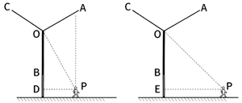
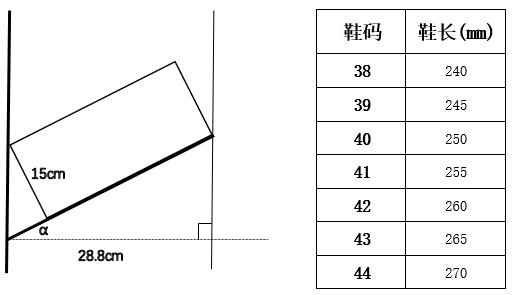
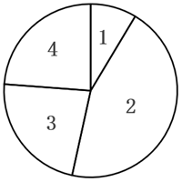

# 2026年吉林省公务员录用考试《行测》题（网友回忆版）

> 候选采集稿。参考答案及解析来自粉笔页面，不代表官方答案或真实高分答卷；来源使用许可与原卷对应关系仍需人工核实。

## 题型与作答说明

政治理论

（15题）

根据题目要求，在四个选项中选出一个最恰当的答案。

常识判断

（15题）

常识判断部分主要考查考生的基本常识和基本经验。请根据题目要求，在四个选项中选出一个正确答案。

言语理解与表达

（25题）

本部分包括表达与理解两方面内容。请根据题目要求，在四个选项中选出一个最恰当的答案。

数量关系

（10题）

在这部分试题中，要求你充分利用所给条件，迅速准确地计算出答案。

判断推理

（25题）

本部分包含图形推理、时间排序、定义判断、类比推理和逻辑判断五个部分，根据要求选出符合要求的一项。

资料分析

（10题）

在这部分试题中，要求你充分利用所给条件，迅速准确地计算出答案。

## 题目

### 第 1 题

制定“十五五”规划建议，系统谋划“十五五”时期经济社会发展，是实现党的二十大描绘的宏伟蓝图、分阶段有步骤推进中国式现代化的需要，意义重大。关于“十五五”规划建议，下列表述正确的有几项？

①适度超前建设新型基础设施，推进信息通信网络、全国一体化算力网、重大科技基础设施等建设和集约高效利用

②推动量子科技、生物制造、第六代移动通信等成为新的经济增长点

③建设法治经济、信用经济，打造市场化法治化国际化一流营商环境

④健全与常住人口相匹配的公共资源配置机制，加强县域基本公共服务供给统筹

A. 1项

B. 2项

C. 3项

D. 4项

### 第 2 题

加强数字政府建设是创新政府治理理念和方式、形成数字治理新格局、推进国家治理体系和治理能力现代化的重要举措。下列关于数字政府建设的基本原则，表述正确的有几项?

①坚持党的全面领导，充分发挥党总揽全局、协调各方的领导核心作用

②坚持以市场为中心，始终把满足人民群众物质生活的迫切需求作为目标

③坚持整体协同，强化系统观念，加强系统集成，全面提升数字政府集约化建设水平

④坚持数据赋能，建立健全数据治理制度和标准体系，加强数据汇聚融合、共享开放和开发利用

A. 1项

B. 2项

C. 3项

D. 4项

### 第 3 题

习近平总书记指出，各级干部要深刻懂得用权为民、担责成事、廉洁立身的道理，自觉把担当和自律统一起来，在构建亲清政商关系上亮明态度、付诸行动。关于亲清政商关系，下列表述正确的有几项？

①对于领导干部而言，所谓“亲”，就是要坦荡真诚同民营企业接触交往

②对于领导干部而言，所谓“清”，就是洁身自好，减少同民营企业家的来往

③对于民营企业家而言，所谓“亲”，就是积极主动同各级党委和政府及部门多沟通多交流

④对于民营企业家而言，所谓“清”，就是遵纪守法办企业、光明正大搞经营

⑤“亲”和“清”本质上是干事和干净的关系，是辩证统一的，完全可以并行不悖

A. 2项

B. 3项

C. 4项

D. 5项

### 第 4 题

习近平总书记指出，讲好中国故事，传播好中国声音，展示真实、立体、全面的中国，是加强我国国际传播能力建设的重要任务。关于加强我国国际传播能力建设，下列表述正确的是：

①要提升国际传播体系稳定性，防范国际传播格局重构

②要全面提升国际传播效能，建强适应新时代国际传播需要的专门人才队伍

③要倡导和平的国际舆论环境，不参与国际舆论斗争，塑造谦逊谦和的大国形象

④推动走出去、请进来管理便利化，扩大国际人文交流合作

A. ①②

B. ②④

C. ①③

D. ③④

### 第 5 题

习近平总书记指出，对我们这样一个有着14亿人口的大国来说，农业基础地位任何时候都不能忽视和削弱。关于增强粮食等重要农产品供给保障能力，下列说法正确的有几项？

①在确保省内耕地保护任务不降低前提下，稳妥有序退出河道内影响行洪安全等的不稳定耕地

②加强中小河流治理和大中型灌区建设改造，推进蓄滞洪区关键设施建设和管理机制改革

③严格生猪屠宰检疫执法监管，强化重大动物疫病和重点人畜共患病防控

④建设现代化防洪减灾体系，全面开展病险水库除险加固

⑤加力落实新一轮百亿斤粮食产能提升任务

A. 5项

B. 4项

C. 3项

D. 2项

### 第 6 题

从“四个全面”战略布局到发展“全链条、全方位、全覆盖”的全过程人民民主，从“全方位、全地域、全过程”开展生态文明建设到“全方位、全过程、全周期”从严治理腐败。一个“全”字，集中凸显了习近平总书记治国理政的哪种思维？

A. 历史思维

B. 底线思维

C. 创新思维

D. 系统思维

### 第 7 题

下列选项中，习近平用语与其蕴含的思想、观点对应恰当的是：

①我将无我，不负人民——全心全意为人民服务

②功成不必在我、功成必定有我——方向决定前途，道路决定命运

③江山就是人民，人民就是江山——民为邦本

④时代是出卷人，我们是答卷人，人民是阅卷人——时代造就英雄，伟大来自平凡

A. ①②

B. ①③

C. ②④

D. ③④

### 第 8 题

党的二十届四中全会指出，“十五五”时期是基本实现社会主义现代化夯实基础、全面发力的关键时期，在基本实现社会主义现代化进程中具有承前启后的重要地位。关于“十五五”规划，下列说法正确的是：

A. 加强原始创新和关键核心技术攻关，推动科技创新和产业创新深度融合

B. 把发展经济的着力点向传统实体产业转移，巩固壮大传统实体产业根基

C. 积极稳妥推进和实现碳达峰，发展集中式能源，逐步缩减全国碳排放权交易市场

D. 发挥积极财政政策作用，适当加强地方事权、提高地方财政支出比重，增加地方自主财力

### 第 9 题

习近平总书记指出，中国愿同世界各国一道，把握信息革命发展的历史主动，携手构建网络空间命运共同体，让互联网更好造福人民、造福世界。关于构建网络空间命运共同体，下列表述正确的是：

①尊重网络主权，维护网络安全，共同构建和平、安全、开放、合作的网络空间

②全球网络主要由跨国公司提供，网络空间未来应由跨国公司携手经营

③倡导发展优先，构建更加普惠繁荣的网络空间

④保障数据安全，建立单边、保密的国际互联网治理体系

⑤深化网络安全务实合作，有力打击网络违法犯罪行为

A. ①③⑤

B. ①④⑤

C. ①②③⑤

D. ①②③④⑤

### 第 10 题

党的十八大以来，以习近平同志为核心的党中央坚定不移推进全面从严治党，取得一系列理论创新、实践创新、制度创新成果，构建起全面从严治党体系，开辟了百年大党自我革命新境界。下列关于全面从严治党的表述准确的是（ ）。

①严密党的组织体系，关键是坚持党中央权威和集中统一领导，根本在做到“两个维护”

②制度建设要与管党治党需要相适应、与党的各项建设相配套，全方位织密制度的笼子

③新时代党的建设是以党的组织建设为统领、党的各项建设同向发力综合发力的系统工程

④着力抓好政治监督、领导班子特别是“一把手”监督、“三重一大”事项监督以及权力集中、资金密集、资源富集等重点领域的监督

A. ①②③

B. ①②④

C. ②③④

D. ①②③④

### 第 11 题

党的十八大以来，以习近平同志为核心的党中央高度重视海洋工作和海洋事业发展，将海洋强国建设作为实现中华民族伟大复兴的重大战略任务，通盘谋划、整体推进海洋强国建设。关于建设海洋强国，下列表述准确的是：

①统筹处理人与自然的关系、发展和保护的关系是推进海洋强国建设的重大原则

②建设海洋强国必须进一步关心海洋、认识海洋、经略海洋，加快海洋科技创新步伐

③建设强大的现代化海军是建设世界一流军队的重要标志，是建设海洋强国的战略支撑

④建设海洋强国所需的关键技术主要靠对外开放引进，靠充分发挥国外关键技术经验优势

A. ①②③

B. ①②④

C. ①③④

D. ②③④

### 第 12 题

推进中国式现代化是一个系统工程，需要统筹兼顾、系统谋划、整体推进，正确处理好一系列重大关系。下列与之相关的表述正确的有（ ）。

①活力与秩序：中国式现代化应当而且能够实现活而不乱、活跃有序的动态平衡

②守正与创新：守正才能不迷失方向、不犯颠覆性错误，创新才能把握时代、引领时代

③战略与策略：要增强策略的前瞻性，准确把握事物发展的必然趋势，以科学的战略预见未来、引领未来

④效率与公平：中国式现代化既要创造比资本主义更高的效率，又要更有效地维护社会公平，更好实现效率与公平相兼顾、相促进、相统一

A. 1项

B. 2项

C. 3项

D. 4项

### 第 13 题

城乡融合发展是中国式现代化的必然要求。关于城乡融合发展，下列说法正确的有几项？

①要把乡村振兴战略这篇大文章做好，必须走城乡融合发展之路

②在现代化进程中，如何处理好工农关系、城乡关系，在一定程度上决定着现代化的成败

③要顺应城乡融合发展大趋势，破除妨碍城乡要素平等交换、双向流动的制度壁垒

④振兴乡村，不能就乡村论乡村，还是要强化以工补农、以城带乡，加快形成工农互促、城乡互补、协调发展、共同繁荣的新型工农城乡关系

A. 1项

B. 2项

C. 3项

D. 4项

### 第 14 题

优化政务服务、提升行政效能是优化营商环境、建设全国统一大市场的必然要求，对加快构建新发展格局、推动高质量发展具有重要意义。关于优化政务服务、提升行政效能，下列举措恰当的是：

①推进关联事项集成办，为企业和群众提供“一件事一次办”“一类事一站办”服务

②推进线下办事“只进一门”，要求所有的银行网点、邮政网点、园区等都要设置便民服务点

③推进企业和群众诉求“一线应答”，根据需要设置重点领域专席，不断提升12345热线接办效率

④推进线上办事“一网通办”，推动各类政务服务事项和应用“应接尽接、应上尽上”，政府服务事项全面纳入同级政务服务平台管理和办理

A. ①②

B. ①③

C. ②④

D. ③④

### 第 15 题

习近平总书记曾说：“我们要有钉钉子的精神，钉钉子往往不是一锤子就能钉好的，而是要一锤一锤接着敲，直到把钉子钉实钉牢，钉牢一颗再钉下一颗，不断钉下去，必然大有成效。如果东一榔头西一棒子，结果很可能是一颗钉子都钉不上、钉不牢。”这句话最能体现的哲学原理是：

①量变与质变辩证统一

②肯定与否定辩证统一

③主要矛盾与次要矛盾辩证统一

④尊重客观规律与发挥主观能动性辩证统一

A. ①②

B. ②③

C. ③④

D. ①④

### 第 16 题

“二十四史”是中国历代史学家精心编撰的纪传体史书，是中华民族珍贵的文化遗产。下列说法正确的是：

A. 《后汉书》记载了侯景之乱

B. 《南史》是南朝范晔编撰的史书

C. 《汉书》中《艺文志》是记述经济制度的专篇

D. 《史记》卷次中《五帝本纪》排序在《殷本纪》之前

### 第 17 题

关于我国考古发现，下列说法错误的是:

A. 良渚文化主要分布于太湖地区，其文化遗址最大特色是所出土的玉器

B. 仰韶文化主要分布在黄河支流汇集的中原地区，其中较著名的是元谋人遗址

C. 大汶口文化主要分布在泰山周围地区，氏族墓地中晚期出现了男女合葬现象

D. 龙山文化是新石器时代晚期的文化，其陶器已开始使用轮制技术，器型规整

### 第 18 题

下列诗文与人物对应错误的是（ ）。

A. 服牛乘马，衣裳是制—轩辕氏

B. 尝谷教民，爰制农事—神农氏

C. 木德风姓，八卦创焉—老聃

D. 始作书契，以代结绳—仓颉

### 第 19 题

《黄帝内经》中“是故圣人不治已病治未病”的思想是中医养生的重要理念，倡导通过饮食、运动、情志调节等方式增强体质，未病先防。下列古诗词中描述的行为不符合“治未病”理念的是（ ）。

A. 天寒常早睡，不待日光敛

B. 修性以保神，安心以全身

C. 抽刀断水水更流，举杯消愁愁更愁

D. 食惟半饱无兼味，酒至三分莫过频

### 第 20 题

中国共产党党报党刊的发展历程，与中国共产党的奋斗历程密不可分。下列说法错误的是：

A. 《布尔塞维克》是解放战争时期中国共产党创办的中央机关刊物

B. 《人民日报》由《晋察冀日报》和晋冀鲁豫《人民日报》合并而来

C. 《红色中华》创刊于江西瑞金，初期为中华苏维埃共和国临时中央政府机关报

D. 《求是》杂志是党中央指导全党全国工作的重要思想理论阵地，前身是中共中央主办的《红旗》杂志

### 第 21 题

《民营经济促进法》规定平等对待民营经济组织，保障公平竞争。下列做法符合该规定的是：

A. 某市规范性文件规定，限制信用等级B级以下的民营企业参加政府采购交易活动

B. 某市严格把控数据安全，限缩民营企业使用公共交通数据的授权范围

C. 某银行风控规范要求，民营企业信贷审批需要公司法人提供连带保证

D. 某银行合理设置小型民营企业不良贷款容忍度、健全尽职免责机制

### 第 22 题

下列语句与其所蕴含的经济学原理对应正确的是：

A. 物以多为贱——沉没成本

B. 酒香不怕巷子深——买方市场

C. 众人拾柴火焰高——规模经济

D. 物至而反，冬夏是也。致至而危，累棋是也——边际效用递增

### 第 23 题

我国幅员辽阔，各地风土人情迥异，天南地北皆有壮美景色。下列有关说法错误的是（ ）。

A. 新疆天山天池和长白山天池同属火山湖

B. 海南是个多民族聚居的省份，其少数民族中黎族人口最多

C. 福建武夷山、四川青城山、江西龙虎山都属于典型的丹霞地貌

D. 山东泰山地形高峻，河流短小流急，多瀑布，形成潭瀑交替的景观

### 第 24 题

根据《中华人民共和国广告法》，下列属于违法行为的有几项？

①在广告中使用国旗、国歌

②在广告中使用国家机关工作人员的名义或者形象

③电视台以介绍健康、养生知识等形式变相发布医疗、药品、医疗器械、保健食品广告

④教育、培训广告中利用科研单位、学术机构、专业人士的名义或者形象作推荐、证明

A. 1项

B. 2项

C. 3项

D. 4项

### 第 25 题

肥胖会严重影响人体健康，饮食控制是治疗肥胖症的一种有效手段。在摄入量相同且不考虑烹饪方式的情况下，下列四份食谱中热量值最低的是（ ）。

A. 鸭肉、馒头、马铃薯、葡萄

B. 鲈鱼、大米饭、黄瓜、橙子

C. 鸡蛋、花卷、胡萝卜、榴莲

D. 五花肉、烧饼、鲜香菇、西瓜

### 第 26 题

炎炎夏日，花露水是人们常备的避暑物品。花露水以乙醇、香精、蒸馏水为主要原料混合配制，颜色多为淡湖蓝、绿、黄。下列有关说法正确的是（ ）。

A. 花露水具有消毒杀菌作用

B. 花露水可以消除蚊子叮咬的肿包

C. 花露水放在暴晒的车内没有安全隐患

D. 在患处擦拭花露水能有效改善过敏性皮炎症状

### 第 27 题

咖啡因是一种中枢神经兴奋剂，能够暂时驱走睡意并恢复精力，咖啡、茶和能量饮料中都含有咖啡因成分。下列有关说法正确的是（ ）。

A. 过量饮用能量饮料可能引发心脏不适

B. 茶叶颜色的深浅能反映咖啡因的含量多少

C. 未经发酵的绿茶，咖啡因含量比完全发酵的红茶高

D. 相比常压下煮出的咖啡，蒸汽加压煮的咖啡所含咖啡因含量更低

### 第 28 题

下列选项体现的物理原理与其他选项不同的是（ ）。

A. 三角形的泡泡棒吹出的泡泡总是趋于球状

B. 植物根部的毛细管从土壤中吸收水分

C. 眼镜镜片的表面镀膜可以防蓝光

D. 雨后荷叶上的水珠呈球形

### 第 29 题

关于社会保险，下列说法正确的是：

A. 灵活就业人员可以参加职工基本医疗保险

B. 失业者领取失业保险金的期限与累计缴费年限无关

C. 同一统筹地区内用人单位工伤保险执行统一缴费费率

D. 生育保险待遇中的生育津贴按职工本人上年度的月平均工资计发

### 第 30 题

极光是一种绚丽多彩的大气发光现象，一般只在南北两极的高纬度地区出现，它的形成与太阳活动、地球磁场和高层大气的相互作用有关。由此判断观测极光需要的条件是（ ）。

A. 太阳活动强烈，月圆的夜晚

B. 太阳活动强烈，晴朗的夜晚

C. 太阳活动微弱，多云的夜晚

D. 太阳活动微弱，下雨的夜晚

### 第 31 题

当前人类已全面进入知识经济时代，高质量发展越来越依靠知识和创新。教育强国、科技强国、人才强国具有共生性，            。科技强国要求高科技自立自强，成为世界主要科学中心；人才强国要求提高自主培养质量，成为世界重要人才中心。科技和人才离不开高质量教育体系，因此“三大强国”的统筹部署有利于支撑“两个中心”建设。

填入画横线部分最恰当的一项是：

A. 异曲同工

B. 同气连枝

C. 同日而语

D. 同声相应

### 第 32 题

中国有着悠久灿烂的文明，同时开创了人类历史上最为            的现代化进程，中国故事精彩非凡、激动人心，也需要精彩讲述、更好传播。

填入画横线部分最恰当的一项是：

A. 五彩斑斓

B. 流光溢彩

C. 波澜壮阔

D. 汹涌澎湃

### 第 33 题

《永乐大典》成书于明永乐六年，是中国古代最大的类书，《不列颠百科全书》称其为“世界有史以来最大的百科全书”，共计22937卷，11095册，约3.7亿字，收先秦至明初的各类典籍七八千种，被称为典籍        、佚书宝库。

A. 本源

B. 渊薮

C. 桂冠

D. 文荟

### 第 34 题

未来，数字科技将会持续深度赋能文化产业，数字文化产业新模式、新业态更加丰富，文化产业的产业链、生态链、价值链更为        。我们应着重培养市场主体，探索建构文化全产业链，        文化供给与文化需求的错位，引导文化企业坚持社会效益与经济效益的高度统一，不断提升文化产品和服务的供给质量。

依次填入画横线部分最恰当的一项是：

A. 完备 消解

B. 完善 拉开

C. 完好 弥补

D. 完美 避开

### 第 35 题

高山草甸四周海拔较高的陡峭山地往往是不同生态系统的交界处，生存环境和食物资源更为多样，这使得赤狐可以大展拳脚，        在不同景观的边缘，将捕食效率最大化，同时也将风险降至最低，可谓            。即使在内蒙古达赉湖、宁夏贺兰山等地，赤狐的洞穴也经常出现。

依次填入画横线部分最恰当的一项是：

A. 逡巡 从容不迫

B. 盘桓 张弛有度

C. 游走 进退自如

D. 驻留 攻守兼备

### 第 36 题

这些“山环水绕”的地方虽然山不高，水的形态也无太大差别，但这里是自然优美的        。这里有花岗岩、石灰岩、红色砂岩三大造景岩石，每一种都造就了独具        的美，如花岗岩的雄浑、石灰岩的秀美、红色砂岩造就的赤壁丹霞······然而，这块“山环水绕”之地，永远在          中展现出无穷的多样性，如花岗岩造就的黄山式的景观在江西三清山上再现，红色砂岩造就的广东仁化碧水丹崖式的风景在福建泰宁重演。

依次填入画横线部分最恰当的一项是：

A. 代表 生态 丰富性

B. 特例 风情 共同性

C. 范例 形态 同一性

D. 典范 个性 统一性

### 第 37 题

考古学的早期实践是自然史的延伸，就是以进化模式来安排考古材料。人类的历史和文化被看作是一种        的过程，世界各地的文化发展遵循相同的轨迹，文化差异是由发展速率的快慢所造成。这种直线进化论存在明显弱点，导致种族主义考古学        ，把原住民文化看作生物学因素造成的        现象，无法发展到更高级的阶段。

依次填入画横线部分最恰当的一项是：

A. 自然 泛滥 滞后

B. 加速 盛行 反常

C. 累进 流行 落后

D. 演变 胜出 极端

### 第 38 题

史诗类电视剧可以被视为一种文化记忆的        ，其目的不仅是呈现特定时期的历史社会文本，而且也是向观众传递镌刻在历史中的社会价值和思想观念。经由历史重现，向观众传递正确的社会价值和思想观念，是史诗类电视剧创制的            。

依次填入画横线部分最恰当的一项是：

A. 表现 金科玉律

B. 投影 玉圭金臬

C. 展示 不二之选

D. 再现 应有之义

### 第 39 题

一种能监测心脏术后并发症的新设备可以完成比传统的起搏器更复杂的监测。起搏器只能提供心脏的整体图像，但新设备可以提供更        的图像，具体显示出心脏哪些区域功能不正常。其上分布的微电极阵列可从心房的多个位置绘制电信号活动，并按需传递电刺激，以便在        的时候解除房颤，恢复正常心律。

依次填入画横线部分最恰当的一项是：

A. 清晰 需要

B. 细致 关键

C. 直观 适当

D. 完整 凶险

### 第 40 题

人工智能技术飞速发展，逐渐向人类智能水平逼近。科学家们在研究过程中愈发清晰地意识到，许多棘手的问题并非单凭一家公司之力就能成功解决。除了至今            的“电车难题”外，还有日益重要的价值观        问题——当AI拥有了自主设定目标的能力时，又该如何确保这些由AI自行确定的目标符合人类利益、与人类价值观相        ？

依次填入画横线部分最恰当的一项是：

A. 争论不休 构建 吻合

B. 流口常谈 践行 出入

C. 悬而未决 对齐 契合

D. 束手无策 匹配 切合

### 第 41 题

目前，以京津冀、长三角、粤港澳大湾区、成渝、中部地区城市群为核心的快递枢纽集群建设已基本成形，全球性国际寄递中心、境外地面网络和海外仓加快建设，农村寄递服务网络实现下乡进村，宅递、箱递、站递等多元化末端服务体系初步形成。我国快递业拥有专业物流园区400多个，营业网点41.3万处，快递运输汽车27万多辆，全货机近200架。重点城市群内快件1日达、国内重点城市间次日达已成为常态。

这段文字意在说明：

A. 我国快递业通过完善基础设施推动了城乡寄送服务均衡发展

B. 我国快递业将聚焦全球寄递网络建设以提升国际运输时效

C. 我国快递业依托“枢纽+网络”建设实现了物流及寄递能力全面发展

D. 我国快递业在农村寄递网络建设及寄递时效提升上成效显著

### 第 42 题

在我国，对农业生产造成重大危害的多数昆虫都具有迁飞性。草地贪夜蛾、黏虫等具有“春夏北迁，秋冬南迁”的习性。由于昆虫个体小、重量轻，飞行能力有限，远距离迁飞主要借助气流运载。季风、台风、西太平洋副热带高压的位置与强度变化等因素都会对害虫的迁飞扩散产生重要影响。每年春夏，害虫大军从中南半岛等地随西南季风迁飞入我国，之后又随西南季风或东南季风暖湿气流继续北上。到了秋冬，草地贪夜蛾、黏虫等为逃避低温环境，只好迁回温暖的南方。这是昆虫逃避不良环境条件的一种生存对策。

这段文字重在说明害虫大军迁飞的：

A. 地域密码

B. 季节规律

C. 环境影响

D. 生存策略

### 第 43 题

20世纪中叶，分子生物学诞生，开启了在分子水平上研究生命及其活动的现代生命科学时代。这个时期的研究者采用“碎片化”的模式来研究生命及其生理或病理活动。但是，研究者逐渐认识到，生命活动并非是由一个个基因或蛋白质“零件”独立完成的，而是建立在生命体内众多基因、蛋白质和其他化学小分子形成的复杂相互作用之上；对于高等生物而言，除了分子层面复杂的相互作用网络外，还有着细胞、组织和器官等不同介观层面各种组分之间的相互作用。

根据这段文字，可以推出：

A. 生命活动是一种复杂系统的整体行为

B. 低等生物的生命活动由基因独立完成

C. 分子层面的研究是理解高等生物的关键

D. 现代科学主要采用“碎片化”模式研究生命活动

### 第 44 题

晚安牛奶的最大卖点在于“高褪黑素含量”。有品牌标明“褪黑素含量：12500pg/盒”，1pg等于万亿分之一克。而褪黑素的有效剂量在0.1~0.3毫克，这意味着需要喝约8000盒这种牛奶才能达到治疗剂量，因此晚安牛奶助眠更依赖于其安慰剂效应。如果某人有轻微的失眠困扰，还达不到临床上失眠的诊断标准，又能够排除器质性或精神疾病因素导致的失眠，个体比较相信晚安牛奶，或者喝后有效，在这种有益无害的前提下，不妨食用。

这段文字意在强调：

A. 晚安牛奶的助眠效果主要源自心理作用

B. 晚安牛奶能助眠是商家的虚假宣传

C. 多喝晚安牛奶才能起到助眠作用

D. 晚安牛奶有较好的助眠效果

### 第 45 题

近日，一种名叫“RoboCap”的机器人胶囊问世，体积相当于维生素大小，一端在容器中装载有效药物，表面涂有明胶，可调节其在特定pH下溶解。当涂层溶解时，pH的变化会触发“RoboCap”胶囊内部的一个微型马达旋转，有助于胶囊进入粘液并移位。胶囊上覆盖着小螺柱，可以像牙刷一样刷掉粘液。旋转运动还可帮助侵蚀携带药物的隔室，将药物释放到消化道。也就是说，该胶囊的“机器人帽”到达小肠时，会旋转并穿过粘液屏障，使胶囊携带的药物进入肠道内的细胞。研究人员表示，机器人胶囊有朝一日或能取代注射给药的方式。

这段文字未涉及机器人胶囊的：

A. 应用前景

B. 适用对象

C. 工作原理

D. 内部结构

### 第 46 题

近年来，一系列具有人文情怀的文化综艺类节目集体走红。在融媒体时代，文化综艺类节目如何创新成了摆在创作者面前的一道难题。创新要找到令年轻人感兴趣的点进行嫁接，但又不能丢掉主流媒体的审美、价值观和社会责任。文化综艺的创新，应该走文化传统和现代时尚相结合之路，不能脱离对传统经典文化的传承凭空打造所谓现代时尚，而是要把传统与时代精神相结合，走进人民群众最接地气的生活，在寓教于乐中让人受到启迪。

下列选项与这段文字意思不符的是：

A. 文化综艺类节目的创新要扎根人民、扎根生活

B. 文化综艺类节目要以传承传统文化为首要目的

C. 文化综艺类节目不能流于说教而忽视其娱乐性

D. 文化综艺类节目创新要关注年轻人的精神需求

### 第 47 题

①如今，有些文字砖在未被发现前就已经消匿了，尽量多地发现并解读文字砖，成为了钩沉历史的重要途径

②我国古代的很多国家工程都实行“物勒工名”制

③砖上的文字记录了长城修建者的信息，甚至还有远隔百里千里之外的地名

④在今天河北、北京、山西等地的明长城上有一些带有文字的砖，它们被称为长城文字砖

⑤长城文字砖上的每个文字都是史书之外的鲜活符号，为我们解锁那段历史提供了秘钥

⑥透过文字砖，我们可以辨识出某段长城是由谁修造的，还可通过上面的地名探察明朝国防的客兵制度

将以上6个句子重新排列，语序正确的是：

A. ②③④⑥⑤①

B. ④⑤②⑥③①

C. ②④⑥⑤③①

D. ④③②⑥⑤①

### 第 48 题

智能社会的演进模糊了社会心态与社会行为的边界，呈现出线上线下虚实共生、心态风险与行动风险交织缠绕的特征，这对社会心态的治理策略与治理工具提出了新的挑战。社交软件的分享机制与算法推荐规律，都以对人类心理特征的精准利用为前提。此类技术往往把复杂的人类互动过程简化为点赞、转发等二元化的态度立场或简单行为，虽然便利了个体表达观点，却可能导致网络行为高度两极化，让许多事实错误但情绪饱满的虚假信息快速传播，成为网络空间治理的一大顽疾。

这段文字意在强调：

A. 智能社会对社会心态治理提出了新的挑战

B. 智能化加速了从社会心态到社会行为的转化

C. 社交软件的算法可能导致网络行为高度两极化

D. 智能社会当务之急是要加强网络空间治理

### 第 49 题

人形机器人的传感器像是人类的眼睛、耳朵和皮肤，扮演着感知器官的角色。视觉传感器通过摄像头捕捉环境图像；声音传感器接收并解析语音指令；力觉传感器仿效人体的力觉感受，精确感知与外界的接触力；触觉传感器模仿人类触觉，精准感知物体的形状和硬度。控制系统是人形机器人的大脑，借助计算单元和智能算法处理数据并作出决策。多种智能算法的应用让机器人越来越接近人类，比如利用深度神经网络，处理视觉、语音识别等任务。

根据这段文字，对“人形机器人的设计原理”概括最准确的是：

A. 借助多功能传感器实现智能化处理

B. 仿生学与机械工程的有机融合

C. 赋予精准触觉，提升感知能力

D. 传感技术与控制理论的集成突破

### 第 50 题

通过将城市物联网系统与互联网系统进行充分融合，借助大数据、云计算等数字信息处理技术，管理者可以将城市运行过程中所产生的海量数据资源进行充分整合，在提取有效信息后进行优化决策，形成科学可行的城市治理方案。利用物联网技术改造城市传统基础设施，将其接入城市物联网系统并使其智能化，由此可以增进城市各子系统同使用者、管理者之间的高效协作关系，                    。

填入画横线处最恰当的是：

A. 进而提高城市系统的整体运行效率

B. 从而更好发挥物联网的价值创造功能

C. 有效提升互联网和物联网的可靠性和安全性

D. 从多个维度改善城市环境和人们的生活质量

### 第 51 题

“低空风怪”也叫下击暴流，是一股从雷暴云中快速下沉的强烈气流。如同瀑布一泻千里直击山石，“风怪”在触及地面后向四周爆发出强大的冲击力。当“风怪”呼啸而下时，速度最高可达每秒100米，比高铁还快。不仅如此，它还会在低空形成猛然四散的强风，击中地面时爆发出的水平风力最大可达17级，足以掀翻火车、轮船。“风怪”造成的大风会在几百米内风向突变，对飞机起降危害很大。

接下来作者最有可能讲述的是：

A. “低空风怪”的定义及其特征

B. “低空风怪”威力强、危害大

C. 能否对“低空风怪”作出预警

D. “低空风怪”与龙卷风的差异

### 第 52 题

斑翅果蝇的雌虫会在多种软皮水果中产卵，其幼虫在果实内取食，导致水果腐烂。近日，科研人员利用“基因剪刀”技术将影响斑翅果蝇性别发育的基因修改成让雌虫无法正常产卵但对雄虫无影响的版本后，斑翅果蝇的绝大多数后代都会继承这个基因变化，实现基因驱动。科学家认为，人为实现基因驱动，让特定基因在生物群体中传播开来，可以控制有害生物的数量或增强濒危物种的抗病能力。此前已有研究团队用相关方法消灭传播疟疾的蚊子，此次用于斑翅果蝇这种农业害虫尚属首次。

这段文字主要介绍了：

A. “基因剪刀”技术是一项高效的抗虫害技术

B. “基因剪刀”技术增强了濒危物种的抗病能力

C. 通过基因驱动可以控制有害生物的数量

D. 研究人员用“基因剪刀”技术对抗斑翅果蝇

### 第 53 题

有人认为海山是孤立的水下岛屿。事实真是这样吗？因为海洋的分割，岛屿上确实会形成相对孤立的岛屿生物群，生物群落比较独特，特有种比例高，但总体多样性低。在海山上，除鱼虾等游泳动物外，大型生物主要是一些固着生活或移动能力差的动物，它们主要通过海流转移和扩散幼体。海山是否“孤立”，取决于栖息其上的生物幼体扩散是否受到限制。地形和海流的相互作用可在海山顶部形成封闭环流，从而留住幼虫。但这些现象出现的频率很低，即便出现也不持久，因此难以将海山长期隔离成水下孤岛。

最适合做这段文字标题的是：

A. 人类最不了解的生物栖息地

B. 海山：特有种的乐园

C. 海山是孤立的水下岛屿吗？

D. 海山：深海中的生命孤岛

### 第 54 题

在深度学习的过程中，实际确定误差并非易事。为解决这一问题，当前深度学习领域应用“损失函数”实现误差最小化，即在人工智能的学习过程中，找到能够最小化损失函数值的参数。但损失函数的形式会随具体情况而有所不同，难以全面掌握其特性，因此需要引入微分。微分主要用于分析某个变量的变化如何影响函数的值。通过对损失函数进行微分，可以明了参数变化时损失函数值的变化，进而调整参数值，让损失函数的值尽可能小。在针对性地进行编程后，人工智能能够自动完成上述任务。

对这段文字概括最恰当的是：

A. 通过对损失函数进行微分，深度学习能实现误差最小化

B. 引入微分后，损失函数能帮助人工智能实现自主深度学习

C. 损失函数在深度学习中主要用于确定误差

D. 损失函数对深度学习的参数优化具有重要意义

### 第 55 题

绿色供应链是一种在整个供应链中综合考虑环境影响和资源效率的现代管理模式。它以绿色制造理论和供应链管理技术为基础，涉及供应商、生产商、销售商、消费者和回收商，目的是使产品从物料获取、加工、包装、仓储、运输、使用到报废处理的整个过程，对环境影响最小，资源利用率最高。资源材料是绿色供应链的基础，其可持续性供给是实现绿色供应链的根本条件。

根据这段文字，可以推出的是：

A. 传统供应链对环境影响的关注度较低

B. 应用绿色供应链，生产商和供应商最为关键

C. 绿色供应链的核心目标是增强可持续发展

D. 若资源材料供给不可持续，绿色供应链则难以实现

### 第 56 题

运动心率即人体在运动时保持的心率状态，保持最佳的运动心率对于运动安全及运动效果来说都十分重要。一般来说，正常人最佳运动心率的范围是：最大运动心率=（220-年龄）×0.8次/分；最小运动心率=（220-年龄）×0.6次/分。那么正常人40岁时，最佳运动心率的范围为：

A. 108~132次/分

B. 132~144次/分

C. 108~144次/分

D. 144~176次/分

### 第 57 题

木星冲日，即木星、地球和太阳三者处于一条直线上，且地球位于太阳和木星之间。已知2024年12月8日发生了木星冲日，若木星绕太阳公转的周期约为12个地球年，则下一次木星冲日发生于下列哪个时间段？

A. 2025年7月~9月

B. 2026年1月~3月

C. 2026年4月~6月

D. 2026年7月~9月

### 第 58 题

某县拟对某段运河开展河道治理。甲公司治理1米需要用时1.5天，投入5万元；乙公司治理1米需要用时2天，投入4万元。甲、乙两公司不能同时作业，若要求在365天内完成不少于200米的治理工作，则至少需要治理费用：

A. 832万元

B. 845万元

C. 860万元

D. 870万元

### 第 59 题

杜甫在《绝句》中写道：“两个黄鹂鸣翠柳，一行白鹭上青天。”从这十四个字中任取两个字，则声母相同的概率是多少？

A. 

B. 

C. 

D. 

### 第 60 题

体操世锦赛男团预赛一共有单杠、双杠、自由体操、鞍马、吊环、跳马六个项目，每个国家的比赛项目顺序由抽签决定。那么某个国家第一个比赛项目不是单杠，且自由体操不在双杠之后的概率是多少?

A. 

B. 

C. 

D. 

### 第 61 题

一家三口去旅游，拍摄单人照、合照一共68张。合照的数量比单人照的两倍少一张；合照中，全家福占了三分之二，且孩子出现的次数为爸爸妈妈出现次数之和的一半；孩子的单人照比爸爸、妈妈单人照数量之和多1张。那么孩子出现的照片一共有：

A. 52张

B. 48张

C. 45张

D. 37张

### 第 62 题

随着新型清洁能源、现代生态农牧的发展，昔日戈壁荒滩不仅成为光伏“蓝海”，还变成了养殖数万只“光伏羊”的繁茂草原。牧民甲、乙家中都有若干只“光伏羊”，乙若给甲20只羊，甲的羊数将是乙的K倍；甲若给乙K只羊，乙的羊数将是甲的一半；若K为正整数，那么K的值可能有多少个？

A. 5

B. 6

C. 7

D. 8

### 第 63 题

某风力发电机的三片风叶之间两两所成的角度为，当其中一片风叶OB与塔杆叠合时，一位身高1.8米的技术人员站在另一片风叶OA端头的正下方，测得塔杆顶部仰角为（如左下图所示）；若该技术人员站在离塔杆60米处，则测得塔杆顶部仰角为（如右下图所示）。那么风叶转动时叶片顶端最高离地面：

A. 81.8米

B. 89.8米

C. 95.8米

D. 101.8米

### 第 64 题

小刚新做了一个鞋柜，鞋柜的纵截面如左下图所示。鞋柜水平深度28.8厘米，隔板与水平面夹角为，这个格子刚好放得下一个15厘米高的鞋盒，则这双鞋的鞋码最大是：（参考数据：，，）

A. 40

B. 41

C. 42

D. 43

### 第 65 题

某款蛋堡锅的锅盘为直径24厘米的圆，其中排布着7个全等的深度均为2厘米的圆柱状凹槽，锅盘的金属用料与表面积成正比（厚度忽略不计，锅盘可近似看作如右下图所示的图形）。厂家现推出凹槽加深30%的升级款，则升级后的锅盘用料约增加多少倍？

A. 0.13

B. 0.21

C. 0.3

D. 0.69

### 第 66 题

可编程物质是指一种可以根据用户输入或自主感应而以编程方式来改变自身物理性质的物质。

根据上述定义，下列不涉及可编程物质的是：

A. 某智能水泥通过内嵌的传感器，自主控制水泥应力的释放以保持建筑物结构稳定

B. 某智能布料由高分子复合纤维织成，输入不同电压会改变其电场，从而根据预设编码显现不同图案

C. 通过添加纳米颗粒和化学反应物，某新型水泥可以实现自动修复裂缝和损坏，从而延长建筑的寿命

D. 某智能玻璃使用Socket网络编程技术，可根据外部光照强度和内部信号来改变透明度，调节室内光线以节省能源

### 第 67 题

凯伊效应是指当一束高粘度的假塑性流体倾倒至固体表面时，固体表面会把液束向上反弹出去。其原理为快速下落的液束冲击下方堆积的黏性流体，流体表面因为受到冲击粘度变小，受到撞击后形成一个酒窝状的凹坑，同时粘度降低的表面充当了润滑剂的作用，最终使得下落的液束被反弹出去。

根据上述定义，下列属于凯伊效应的是：

A. 用肥皂水冲洗勺子，肥皂水碰到勺子后会沿着勺子曲面流下去

B. 在喷水池喷出的水柱上放乒乓球，水柱会托举乒乓球向上跳跃

C. 水流冲过土壤中的孔隙或裂缝时，形成了类似管道的水流通道

D. 将洗发水从高处快速倒向桌面，堆积的洗发水会突然跳起一束

### 第 68 题

某些电介质在沿一定方向上受到外力的作用而变形时，其内部会产生极化现象，同时在它的两个相对表面上出现正负相反的电荷。当外力去掉后，它又会恢复到不带电的状态，这种现象被称为正压电效应。相反，当在电介质的极化方向上施加电场，电介质会发生变形，电场去掉后，电介质的变形随之消失，这种现象被称为逆压电效应。

根据上述定义，下列体现了逆压电效应的是：

A. 超声波清洗是利用超声波的机械振动来清洗物体表面

B. 液晶显示器利用液晶材料改变光通过的方向和强度，从而显示动态图像

C. 打火机的打火器被按下后能瞬间产生高压，在极小的间隙下击穿空气，点燃气体

D. 风力发电机工作时将风的动能转化为风轮轴的机械能，发电机在风轮轴的带动下旋转发电

### 第 69 题

复冰现象是指当冰的表面受压，压力令其熔点降低，使得冰化成水，一旦压力消失，熔点提高至原来的水平，水又变为冰的现象。

根据上述定义，下列不属于复冰现象的是：

A. 将两块水平放置的冰砖面对面压实，松手后两块冰砖粘在了一起

B. 在一块很大的冰上放一条金属线，金属线两端分别连着两个重物，金属线缓慢穿越冰块而且不会将其切开

C. 在滑冰场上滑冰时，冰刀留下道道痕迹，但很快刀痕会全部消失，留下完好如初的冰面

D. 水结冰时，所释放的热量在其内部形成压力、产生气泡，这使得结成的冰看上去不透明

### 第 70 题

疤痕效应是指人在遭受创伤后，伤口经过一段时间的恢复会愈合，但留下的疤痕会时刻提醒人们过去的伤痛，并对人的心理造成持续的影响。在社会学中，疤痕效应泛指重大事件会使人们的行为模式趋于保守，更加厌恶风险，进而导致人们对于事物的看法和决策产生偏差。

根据上述定义，下列未体现疤痕效应的是：

A. 一朝被蛇咬，十年怕井绳

B. 经历台风袭击后，老刘会经常囤积一些非必要生活用品，以备不时之需

C. 五年前老陈投资失败后，将所有积蓄存入银行，不再选择其他理财方式

D. 杨教授儿时经历过饥荒，深刻理解粮食的重要性，矢志培育优质高产的小麦种子

### 第 71 题

端粒是染色体末端的一段重复的核苷酸序列。当端粒长度变得非常短时，就更容易导致细胞的衰老和凋亡。有研究发现，每天每增加一杯速溶咖啡摄入量，端粒长度对应的等效年龄减少0.38年，因而速溶咖啡摄入量与端粒长度呈负相关。不过，研究结果也显示，研磨咖啡摄入量与端粒长度的相关性没有统计学意义，不能证实研磨咖啡也会减少端粒长度对应的等效年龄。该研究认为，饮用速溶咖啡会导致衰老，饮用研磨咖啡则不会，因而后者更健康。

以下哪项如果为真，不能支持上述结论？

A. 速溶咖啡中往往会添加白砂糖、乳粉等，这些成分容易导致衰老

B. 实验中使用的部分速溶咖啡样本，其实是现场研磨咖啡豆制作的

C. 与相同量的研磨咖啡相比较，速溶咖啡中导致衰老的铅含量更高

D. 制作研磨咖啡时，会使用滤纸吸附咖啡白醇等对人体有害的物质

### 第 72 题

鱼通过鳃的呼吸作用，从水中吸收钙离子，进入耳石囊内与碳酸根离子结合形成碳酸钙、随后沉积形成耳石，它具有维持鱼身平衡及辅助听觉的作用。鱼耳石的日周轮、年轮和产卵轮等时间记号，记录了鱼类生长过程中的环境信息。通过分析鱼耳石形态和化学组成等方式，我们可以了解鱼类生活史特征及其栖息环境的变化。

以下哪项如果为真，最能加强上述论证？

A. 许多鱼类的寿命可长达数十年之久

B. 环境污染可能导致鱼停止生长甚至死亡

C. 不同鱼类的耳石大小不同，难以据此判断鱼类的生长环境情况

D. 相对于鳞片、鳍条，鱼耳石的形态结构和化学组成更稳定，保存时间更长

### 第 73 题

一项关于离子通道Piezo2的介导性慢性疼痛超敏反应功能的研究表明，Piezo2是一个机械敏感通道，会在压力的刺激下激活伤害性感受器，当Piezo2发生功能丧失型突变时，患者对轻微的触摸或振动不再敏感；当它发生功能获得型突变时，患者通常被诊断为其它疾病。

以下哪项如果为真，最能削弱上述结论？

A. 有的慢性疼痛综合征患者的伤害性感受器在无机械刺激时仍然活跃

B. 有的Piezo2功能丧失型突变患者在强烈挤压皮肤时激活了伤害性感受器

C. 有的患者发生Piezo2功能获得型突变，被诊断出患有复杂发育障碍疾病

D. 有的患者发生Piezo2功能丧失型突变，伤害性感受器对机械刺激更敏感

### 第 74 题

近年来，东海海域经常出现鲸搁浅现象，海洋学家推测是因为东海海岸线很长，而且这里拥有丰富的浮游生物和鱼类资源，容易引鲸洄游至此，进而导致鲸搁浅的现象发生。

以下描写鲸搁浅的选项中，最能支持上述结论的是（ ）。

A. 闰鱼，无定形，闰年秋潮，飓风推出海，其大吞舟也

B. 房鱼，出海，极大，如房。或随潮汐陷沙上，土人割脂熬油

C. 大凡东海有巨鱼流入内地者，必无目，无目，故随潮而进也

D. 见大鲸驱群鲛，逐肥鱼于渤澥之尾······贪而不能止，北蹙于碣石，槁焉

### 第 75 题

近日，考古学家发现了一块展示约1.25亿年前肉食性哺乳动物爬兽袭击较大植食性恐龙鹦鹉嘴龙的化石。化石中，鹦鹉嘴龙呈俯卧姿态，后肢折叠在身体两侧；爬兽的身体向右盘绕，俯坐在鹦鹉嘴龙背侧，抓扒着猎物的下巴并撕咬肋骨，其小腿则被鹦鹉嘴龙的后腿夹住。研究者认为，这一发现挑战了“恐龙在白垩纪期间几乎没有受到同时代哺乳动物威胁”的观点。

以下哪项如果为真，最不能支持上述研究者的结论？

A. 已能够确认爬兽与鹦鹉嘴龙纠缠在一起并同时葬身于火山喷发

B. 在发现该标本前就有其他观点认为爬兽会捕食鹦鹉嘴龙等恐龙

C. 通过恐龙骨架上的牙印证明了爬兽当时正啃食鹦鹉嘴龙的尸体

D. 在一块爬兽标本的胃中曾发现有鹦鹉嘴龙幼年个体的骨骼残留

### 第 76 题

紫杉醇是治疗癌症的明星药物。紫杉醇通过作用于细胞内的微管蛋白，保持微管的稳定性来抑制细胞的有丝分裂，控制癌细胞发展，从而达到治疗目的。香榧中含有紫杉醇，因此，有观点认为，多食用香榧可以治疗癌症。

以下哪项如果为真，最能削弱上述结论？

A. 紫杉醇对正常细胞产生的影响目前还未可知

B. 香榧中紫杉醇含量微乎其微，几乎可以忽略不计

C. 香榧含有丰富的蛋白质，可以增强癌症患者的免疫力

D. 对于分裂速度比正常细胞快的癌细胞，紫杉醇表现出更明显的抑制作用

### 第 77 题

小王把仙女座、猎户座、大熊座、人马座、狮子座五个星座在星空图上的位置用A、B、C、D、E随机标记。已知：如果仙女座或猎户座中有一个在位置C上，则大熊座在位置B上；如果狮子座在位置C上，则人马座在位置E上。

如果人马座在位置B上，那么下列哪项必然为真？

A. 大熊座在位置C上

B. 狮子座在位置C上

C. 仙女座在位置C上

D. 猎户座在位置C上

### 第 78 题

某研究团队发布了一项关于视觉感知对热舒适判断影响机制的研究，研究选取典型景观实景照片在实验室进行视觉刺激实验，从心理、行为、生理三个维度展开互证，发现人们通过快速扫视捕获热环境相关景观要素信息，视觉感知信息结合个体热联想经验会转换为热舒适判断，且视觉刺激引发的皮电变化率与阴影、植物总体占比率呈显著正相关，说明阴影和植物总体占比率可能是影响公园热舒适体验的关键因素。

要使上述结论成立，还需基于以下哪一前提?

A. 光照强度变化不会通过非视觉途径影响皮电反应及热舒适判断

B. 阴影和植物总体占比率高的区域，实际热环境温度通常更低

C. 个体热联想经验主要源于日常生活中的户外环境体验

D. 皮电变化率可作为衡量人体热舒适感受的指标

### 第 79 题

研究人员发现，与摄入盐水的对照组小鼠相比，摄入葡萄球菌肠毒素SEA的小鼠会出现明显干呕现象。人类癌症患者使用化疗药物也会有类似的恶心和呕吐反应。研究显示，小鼠肠道内的SEA毒素激活了肠内壁的肠嗜铬细胞，释放出血清素，血清素又与肠道的感觉神经元受体结合，将信号传递到脑干中的特定神经元从而引发干呕，当特定神经元被灭活后，小鼠干呕显著减少。研究还发现，特定神经元被灭活后，其他动物的干呕也会显著减少。

由此可以推出：

A. 如果不摄入葡萄球菌肠毒素，那么小鼠就不会出现干呕现象

B. 开发出灭活特定神经元的药物或能帮助化疗病人减少呕吐

C. SEA毒素与肠道的感觉神经元受体结合会引发动物的干呕

D. 切断小鼠脑干中特定神经元的信号传递或能引发干呕

### 第 80 题

青藏高原被誉为“亚洲水塔”，是全球气候变化敏感区和指示区。这里分布着地球海拔最高数量最多的高原湖泊群，面积约占全国的百分之五十，对区域水循环、生态环境和气候调节具有重要意义。如果青藏高原降水增加或者冰川加速消融，那么青藏高原的湖泊将会持续扩张，并且导致潜在的流域合并或重组，威胁到该地区的基础设施和生态安全。由此可以推出：

A. 如果青藏高原的湖泊没有持续扩张，那么青藏高原的降水没有增加且冰川并没有加速消融

B. 如果青藏高原降水增加或者冰川加速消融，将会导致其潜在的流域合并

C. 如果青藏高原降水没有增加，那么其潜在的流域没有合并和重组

D. 如果青藏高原的流域合并或重组，那么青藏高原降水增加

### 第 81 题

从所给的四个选项中，选择最合适的一个填入问号处，使之呈现一定的规律性。

A. A

B. B

C. C

D. D

### 第 82 题

把下面的六个图形分为两类，使每一类图形都有各自的共同特征或规律，分类正确的一项是：

A. ①②④，③⑤⑥

B. ①②⑥，③④⑤

C. ①③⑥，②④⑤

D. ①④⑥，②③⑤

### 第 83 题

从所给的四个选项中，选择最合适的一个填入问号处，使之呈现一定的规律：

A. A

B. B

C. C

D. D

### 第 84 题

左图是一个带把手的立方体纸盒，右边哪项可能是其外表面展开图？

A. A

B. B

C. C

D. D

### 第 85 题

从所给的四个选项中，选择最合适的一个填入问号处，使之呈现一定的规律性：

A. A

B. B

C. C

D. D

### 第 86 题

寓意：寓言

A. 序言：正文

B. 情节：童话

C. 报告文学：新闻

D. 著作：诗集

### 第 87 题

照相机：凸透镜：照相

A. 火炕：煤炭：取暖

B. 潜水艇：鱼鳔：潜水

C. 飞机：起落架：飞行

D. 微波炉：磁控管：烹饪

### 第 88 题

（ ）对于 庐山 相当于 车水马龙 对于（ ）

A. 游人如织 街市

B. 惊鸿一瞥 人群

C. 天然画卷 剧场

D. 鬼斧神工 陋巷

### 第 89 题

光刻机 对于 （ ） 相当于 （ ） 对于 核燃料

A. 芯片 离心机

B. 计算器 核电站

C. 光盘 压铸机

D. 紫外线光源 核裂变

### 第 90 题

清明：传统节日：春节

A. 神话：民间文学：舞蹈

B. 手机：家用电器：冰箱

C. 电话：通讯工具：快递

D. 足球：体育用品：哑铃

## 材料 1

2025年上半年，Q市12348公共法律服务热线有效接听解答咨询量（以下简称法律热线咨询量）为102428人次。按咨询事项分类统计，前十事项的咨询量合计占法律热线咨询量的85.85%，同比提升0.65个百分点。法律热线咨询量超过1万人次的共四项：咨询量最多的事项是民事诉讼程序，数量为20846人次，同比增长38.3%；其次为经济合同，数量为16819人次；第三名劳动合同与第四名劳动报酬相差无几，分别为10708人次、10682人次。

### 第 91 题

2025年第一季度Q市法律热线咨询量环比增长速度约为：

A. 24.23%

B. 19.50%

C. \-19.68%

D. \-16.44%

### 第 92 题

2024年上半年Q市法律热线咨询量同比增速约为：

A. \-4.6%

B. \-4.0%

C. \-3.5%

D. \-3.1%

### 第 93 题

以下折线图中，最能准确反映2022-2025年间Q市法律热线咨询量第二季度环比增量变化趋势的是：

A. 

B. 

C. 

D. 

### 第 94 题

2024年上半年Q市法律热线咨询量中前十事项的咨询量约为：

A. 9.19万人次

B. 8.27万人次

C. 7.89万人次

D. 6.38万人次

### 第 95 题

能够从上述资料中推出的是：

A. 2024年上半年民事诉讼程序咨询量不超过1.4万人次

B. 2022-2024年，下半年法律热线咨询量均高于上半年

C. 2023-2024年，法律热线咨询量出现同比增长的季度有7个

D. 2025年上半年，前十事项咨询量中劳动合同的占比超过11%

## 材料 2

### 第 96 题

按照投资者持有总额的环比增速，若保持2025年6月投资者持有结构不变，那么2025年7月商业银行的地方政府债券持有额在下列哪个范围内？

A. 375000~385000亿元

B. 385000~395000亿元

C. 395000~405000亿元

D. 405000~415000亿元

### 第 97 题

2025年1-4月，再融资债券发行额占地方政府债券累计发行额的比重在下列哪个范围内？

A. 35%~45%

B. 45%~55%

C. 55%~65%

D. 65%~75%

### 第 98 题

关于2025年6月各类地方政府债券发行额的环比增速，下列排序正确的是：

A. 再融资专项债券>新增一般债券>再融资一般债券>新增专项债券

B. 新增一般债券>新增专项债券>再融资一般债券>再融资专项债券

C. 再融资专项债券>再融资一般债券>新增一般债券>新增专项债券

D. 再融资专项债券>新增一般债券>新增专项债券>再融资一般债券

### 第 99 题

下列选项和如下饼图相符的是：

A. 2025年5月各发行场所发行额：1-中央结算公司、2-上海证券交易所、3-深圳证券交易所、4-北京证券交易所

B. 2025年6月各发行场所发行额：1-中央结算公司、2-上海证券交易所、3-深圳证券交易所、4-北京证券交易所

C. 2025年5月地方政府债券发行额：1-新增一般债券、2-新增专项债券、3-再融资一般债券、4-再融资专项债券

D. 2025年6月地方政府债券发行额：1-新增一般债券、2-新增专项债券、3-再融资一般债券、4-再融资专项债券

### 第 100 题

能够从上述资料中推出的是：

A. 与2025年5月相比，所有机构在6月均增持了地方政府债券

B. 2025年1-4月地方政府债券平均发行额低于6月地方政府债券发行额

C. 2025年5月与6月上海证券交易所发行额占1-6月总发行额的比重差异超过7个百分点

D. 对比2025年5月与6月的机构投资者持有情况，不存在持有金额上升、占比却下降的机构

## 答案与解析

第 1 题

**参考答案（粉笔题库参考内容）**

D

**解析**

本题考查新思想。

2025年10月23日，中国共产党第二十届中央委员会第四次全体会议通过《中共中央关于制定国民经济和社会发展第十五个五年规划的建议》（以下简称《建议》）。

①正确，《建议》在“三、建设现代化产业体系，巩固壮大实体经济根基”部分指出：“（10）构建现代化基础设施体系。加强基础设施统筹规划，优化布局结构，促进集成融合，提升安全韧性和运营可持续性。适度超前建设新型基础设施，推进信息通信网络、全国一体化算力网、重大科技基础设施等建设和集约高效利用，推进传统基础设施更新和数智化改造。”

②正确，《建议》在“三、建设现代化产业体系，巩固壮大实体经济根基”部分指出：“前瞻布局未来产业，探索多元技术路线、典型应用场景、可行商业模式、市场监管规则，推动量子科技、生物制造、氢能和核聚变能、脑机接口、具身智能、第六代移动通信等成为新的经济增长点。”

③正确，《建议》在“二、‘十五五’时期经济社会发展的指导方针和主要目标”部分指出：“坚持有效市场和有为政府相结合。充分发挥市场在资源配置中的决定性作用，更好发挥政府作用，构建统一、开放、竞争、有序的市场体系，建设法治经济、信用经济，打造市场化法治化国际化一流营商环境，形成既‘放得活’又‘管得好’的经济秩序。”

④正确，《建议》在“十一、加大保障和改善民生力度，扎实推进全体人民共同富裕”部分指出：“（44）稳步推进基本公共服务均等化。建立基本公共服务均等化评价标准，完善基本公共服务范围和内容，制定实现基本公共服务均等化的目标、路径、措施，推动更多公共服务向基层下沉、向农村覆盖、向边远地区和生活困难群众倾斜，健全与常住人口相匹配的公共资源配置机制。加强县域基本公共服务供给统筹，完善投入保障长效机制。全面深化事业单位改革。”

综上，①②③④表述正确，共4项。

故正确答案为D。

第 2 题

**参考答案（粉笔题库参考内容）**

C

**解析**

本题考查新思想。

2022年6月23日，国务院发布了《关于加强数字政府建设的指导意见》，以下简称《意见》。

①正确，《意见》“一、发展现状和总体要求”中“2.基本原则”部分指出：“坚持党的全面领导。充分发挥党总揽全局、协调各方的领导核心作用，全面贯彻党中央、国务院重大决策部署，将坚持和加强党的全面领导贯穿数字政府建设各领域各环节，贯穿政府数字化改革和制度创新全过程，确保数字政府建设正确方向。”

②错误，《意见》“一、发展现状和总体要求”中“2.基本原则”部分指出：“坚持以人民为中心。始终把满足人民对美好生活的向往作为数字政府建设的出发点和落脚点······”故“以市场为中心，始终把满足人民群众物质生活的迫切需求作为目标”说法错误，应为“以人民为中心，始终把满足人民对美好生活的向往作为数字政府建设的出发点和落脚点”

③正确，《意见》“一、发展现状和总体要求”中“2.基本原则”部分指出：“坚持整体协同。强化系统观念，加强系统集成，全面提升数字政府集约化建设水平，统筹推进技术融合、业务融合、数据融合，提升跨层级、跨地域、跨系统、跨部门、跨业务的协同管理和服务水平······”

④正确，《意见》“一、发展现状和总体要求”中“2.基本原则”部分指出：“坚持数据赋能。建立健全数据治理制度和标准体系，加强数据汇聚融合、共享开放和开发利用，促进数据依法有序流动，充分发挥数据的基础资源作用和创新引擎作用，提高政府决策科学化水平和管理服务效率，催生经济社会发展新动能。”

故①③④正确，共3项。

故正确答案为C。

第 3 题

**参考答案（粉笔题库参考内容）**

C

**解析**

本题考查新思想。

①③④正确，②错误，2016年3月4日下午，习近平总书记看望了参加全国政协十二届四次会议的民建、工商联委员，并参加联组会，听取委员们意见和建议。习近平总书记指出：“对领导干部而言，所谓‘亲’，就是要坦荡真诚同民营企业接触交往，特别是在民营企业遇到困难和问题情况下更要积极作为、靠前服务，对非公有制经济人士多关注、多谈心、多引导，帮助解决实际困难。所谓‘清’，就是同民营企业家的关系要清白、纯洁，不能有贪心私心，不能以权谋私，不能搞权钱交易。对民营企业家而言，所谓‘亲’，就是积极主动同各级党委和政府及部门多沟通多交流，讲真话，说实情，建诤言，满腔热情支持地方发展。所谓‘清’，就是要洁身自好、走正道，做到遵纪守法办企业、光明正大搞经营。”故②中“就是洁身自好，减少同民营企业家的来往”表述错误，应为“就是同民营企业家的关系要清白、纯洁，不能有贪心私心，不能以权谋私，不能搞权钱交易”。

⑤正确，2025年2月17日，习近平总书记在京出席民营企业座谈会时候指出：“五是进一步构建亲清政商关系。这个问题我讲过多次了，现在仍有不少干部认识不到位、工作片面化简单化。我再次重申，‘亲’和‘清’本质上是干事和干净的关系，是辩证统一的，完全可以并行不悖。”

①③④⑤正确，共4项。

故正确答案为C。

第 4 题

**参考答案（粉笔题库参考内容）**

B

**解析**

本题考查新思想。

①错误，④正确，《中共中央关于进一步全面深化改革、推进中国式现代化的决定》在“十、深化文化体制机制改革”部分中指出：“（41）构建更有效力的国际传播体系。推进国际传播格局重构，深化主流媒体国际传播机制改革创新，加快构建多渠道、立体式对外传播格局。加快构建中国话语和中国叙事体系，全面提升国际传播效能。建设全球文明倡议践行机制。推动走出去、请进来管理便利化，扩大国际人文交流合作。”故“防范国际传播格局重构”表述错误，应为“推进国际传播格局重构”。

②正确，③错误，2021年5月31日，习近平总书记在中共中央政治局第三十次集体学习时指出：“我们党历来高度重视对外传播工作……积极推动中华文化走出去，有效开展国际舆论引导和舆论斗争，初步构建起多主体、立体式的大外宣格局······要全面提升国际传播效能，建强适应新时代国际传播需要的专门人才队伍······”故“不参与国际舆论斗争”表述错误，应为“有效开展国际舆论引导和舆论斗争”。

综上，②④表述正确。

故正确答案为B。

第 5 题

**参考答案（粉笔题库参考内容）**

B

**解析**

本题考查新思想。

2025年2月23日，《中共中央、国务院关于进一步深化农村改革 扎实推进乡村全面振兴的意见》（以下简称《意见》）发布。

①正确，《意见》在“一、持续增强粮食等重要农产品供给保障能力”部分指出：“（三）强化耕地保护和质量提升······稳步推进盐碱地综合利用试点，加强东北黑土区侵蚀沟、南方酸化退化耕地治理。分类推进撂荒地复垦利用。在确保省域内耕地保护任务不降低前提下，稳妥有序退出河道内影响行洪安全等的不稳定耕地。”

②④正确，《意见》在“一、持续增强粮食等重要农产品供给保障能力”部分指出：“（五）加强农业防灾减灾能力建设······建设现代化防洪减灾体系，全面开展病险水库除险加固，加强中小河流治理和大中型灌区建设改造，推进蓄滞洪区关键设施建设和管理机制改革。”

③正确，《意见》在“一、持续增强粮食等重要农产品供给保障能力”部分指出：“（二）扶持畜牧业稳定发展······落实灭菌乳国家标准，支持以家庭农场和农民合作社为主体的奶业养殖加工一体化发展。严格生猪屠宰检疫执法监管，强化重大动物疫病和重点人畜共患病防控。”

⑤错误，《意见》在“一、持续增强粮食等重要农产品供给保障能力”部分指出：“（一）深入推进粮油作物大面积单产提升行动······进一步扩大粮食单产提升工程实施规模，加大高产高效模式集成推广力度，推进水肥一体化，促进大面积增产。加力落实新一轮千亿斤粮食产能提升任务。”故“百亿”表述错误，应为“千亿”。

故①②③④表述正确，共4项。

故正确答案为B。

第 6 题

**参考答案（粉笔题库参考内容）**

D

**解析**

本题考查新思想。

D项正确，A、B、C三项错误，历史思维是指以历史视角、历史规律看待现实问题，从历史中汲取经验、把握走向，强调以史为鉴、知古鉴今。底线思维是指要立足最不利情况，预判风险、守住边界，强调防风险、守底线、稳大局。创新思维强调突破常规、开拓新思路新方法，强调敢闯敢试、破旧立新。系统思维强调从整体、全局、联系出发，统筹各领域、各环节、各要素，强调整体性、协同性、全覆盖、全过程。题干反复突出“全”，强调整体统筹、全域覆盖、全程贯通、协同联动，正是系统思维的典型体现。

故正确答案为D。

第 7 题

**参考答案（粉笔题库参考内容）**

B

**解析**

本题考查新思想。

①正确，“我将无我，不负人民”出自习近平总书记于2019年3月首次提出的重要表述，源于其回答意大利众议长关于执政理念的提问。该表述集中体现了中国共产党领导人以人民为中心的执政思想，强调为中国人民谋幸福、为中华民族谋复兴的使命担当。“全心全意为人民服务”是中国共产党始终坚持的根本宗旨，体现了党与人民群众的根本关系。其核心要求是将人民利益置于首位，以实现、维护和发展最广大人民根本利益为一切工作的出发点和落脚点。故二者蕴含的思想、观点对应恰当。

②错误，“功成不必在我、功成必定有我”出自习近平总书记于2018年4月在深入推动长江经济带发展座谈会上的讲话。该表述意为功绩、事业的成功未必在我手中、在我任期、在我有生之年得到实现，但成功的过程一定有我的参与贡献。“方向决定前途，道路决定命运”出自习近平总书记于2018年12月18日在庆祝改革开放40周年大会上发表的重要讲话，讲的是道路、方向、制度问题。故二者蕴含的思想、观点对应不恰当。

③正确，“江山就是人民，人民就是江山”是习近平总书记于2021年2月20日在党史学习教育动员大会上首次完整、公开提出的。这一表述彰显了中国共产党人民至上的根本立场，阐明了人民是国家主人、是历史创造者，党打江山守江山守的是人民的心，始终为人民谋幸福、依靠人民创造历史伟业。“民为邦本”出自《尚书·五子之歌》，意思是老百姓是国家的根本，根本牢固了国家才能安宁，体现了我国早期的民本思想。故二者蕴含的思想、观点对应恰当。

④错误，“时代是出卷人，我们是答卷人，人民是阅卷人”出自习近平总书记于2018年1月5日在学习贯彻党的十九大精神研讨班开班式上发表的讲话。这句话深刻回答了新赶考路上“谁来出卷”“谁来答卷”“谁来阅卷”等根本问题，生动诠释了中国共产党一以贯之的初心使命。“时代造就英雄，伟大来自平凡”是习近平总书记于2021年2月25日在全国脱贫攻坚总结表彰大会上发表重要讲话时提出的，它深刻阐释了伟大与平凡、时代与个人的辩证关系，是对奋斗精神、人民力量、英雄观的高度概括。故二者蕴含的思想、观点对应不恰当。

故①③表述正确。

故正确答案为B。

第 8 题

**参考答案（粉笔题库参考内容）**

A

**解析**

本题考查新思想。

2025年10月23日，中国共产党第二十届中央委员会第四次全体会议通过《中共中央关于制定国民经济和社会发展第十五个五年规划的建议》（以下简称《建议》）。

A项正确，《建议》在“四、加快高水平科技自立自强，引领发展新质生产力”部分指出：“（11）加强原始创新和关键核心技术攻关。完善新型举国体制，采取超常规措施，全链条推动集成电路、工业母机、高端仪器、基础软件、先进材料、生物制造等重点领域关键核心技术攻关取得决定性突破······（12）推动科技创新和产业创新深度融合。统筹国家战略科技力量建设，增强体系化攻关能力。强化科技基础条件自主保障，统筹科技创新平台基地建设。完善区域创新体系，布局建设区域科技创新中心和产业科技创新高地，强化国际科技创新中心策源功能······”

B项错误，《建议》在“三、建设现代化产业体系，巩固壮大实体经济根基”部分指出：“现代化产业体系是中国式现代化的物质技术基础。坚持把发展经济的着力点放在实体经济上，坚持智能化、绿色化、融合化方向，加快建设制造强国、质量强国、航天强国、交通强国、网络强国，保持制造业合理比重，构建以先进制造业为骨干的现代化产业体系。”故“把发展经济的着力点向传统实体产业转移，巩固壮大传统实体产业根基”表述错误，应为“坚持把发展经济的着力点放在实体经济上，巩固壮大实体经济根基”。

C项错误，《建议》在“十二、加快经济社会发展全面绿色转型，建设美丽中国”部分指出：“（47）积极稳妥推进和实现碳达峰。实施碳排放总量和强度双控制度。深入实施节能降碳改造。推动煤炭和石油消费达峰。完善碳排放统计核算体系，稳步实施地方碳考核、行业碳管控、企业碳管理、项目碳评价、产品碳足迹等政策制度。发展分布式能源，建设零碳工厂和园区。扩大全国碳排放权交易市场覆盖范围，加快温室气体自愿减排交易市场建设······”故“发展集中式能源，逐步缩减全国碳排放权交易市场”表述错误，应为“发展分布式能源，扩大全国碳排放权交易市场覆盖范围”。

D项错误，《建议》在“六、加快构建高水平社会主义市场经济体制，增强高质量发展动力”部分指出：“（20）提升宏观经济治理效能。发挥积极财政政策作用，增强财政可持续性······适当加强中央事权、提高中央财政支出比重。增加地方自主财力。加强财会监督。加快构建同高质量发展相适应的政府债务管理长效机制。”故“适当加强地方事权、提高地方财政支出比重”表述错误，应为“适当加强中央事权、提高中央财政支出比重”。

故正确答案为A。

第 9 题

**参考答案（粉笔题库参考内容）**

A

**解析**

本题考查新思想。

①正确，2014年11月19日，习近平总书记在向首届世界互联网大会致贺词中强调：“中国正在积极推进网络建设，让互联网发展成果惠及13亿中国人民。中国愿意同世界各国携手努力，本着相互尊重、相互信任的原则，深化国际合作，尊重网络主权，维护网络安全，共同构建和平、安全、开放、合作的网络空间，建立多边、民主、透明的国际互联网治理体系。”

②错误，2022年11月7日，国务院新闻办公室发布的《携手构建网络空间命运共同体》白皮书在“三、构建网络空间命运共同体的中国贡献”部分“（三）积极参与网络空间治理”中指出：“中国始终认为，国家不分大小、强弱、贫富，都是平等成员，都有权平等参与国际规则与秩序建构，确保网络空间未来发展由各国人民共同掌握。”同时，全球网络基础设施与治理体系以主权国家为核心主体，跨国公司仅为重要的商业服务提供者，而非“主要提供者”。故“网络空间未来应由跨国公司携手经营”表述错误，应为“确保网络空间未来发展由各国人民共同掌握”。

③正确，2023年11月8日，习近平总书记向2023年世界互联网大会乌镇峰会开幕式发表的视频致辞指出：“我们倡导发展优先，构建更加普惠繁荣的网络空间。深化数字领域国际交流合作，加速科技成果转化。加快信息化服务普及，缩小数字鸿沟，在互联网发展中保障和改善民生，让更多国家和人民共享互联网发展成果。”

④错误，2015年12月16日，习近平总书记在第二届世界互联网大会开幕式上的讲话中指出：“第五，构建互联网治理体系，促进公平正义。国际网络空间治理，应该坚持多边参与、多方参与，由大家商量着办，发挥政府、国际组织、互联网企业、技术社群、民间机构、公民个人等各个主体作用，不搞单边主义，不搞一方主导或由几方凑在一起说了算······”故“建立单边、保密的国际互联网治理体系”表述错误，应为“国际网络空间治理，应该坚持多边参与、多方参与，由大家商量着办”。

⑤正确，2023年11月9日，《人民日报》发表的文章《共同推动构建网络空间命运共同体迈向新阶段》指出：“‘我们倡导安危与共，构建更加和平安全的网络空间。’只有尊重网络主权，遵守网络空间国际规则，深化网络安全务实合作，有力打击网络违法犯罪行为，加强数据安全和个人信息保护，才能妥善应对科技发展带来的规则冲突、社会风险、伦理挑战，更好维护网络空间安全。”

故①③⑤表述正确。

故正确答案为A。

第 10 题

**参考答案（粉笔题库参考内容）**

B

**解析**

本题考查新思想。

2025年2月16日，《求是》杂志发表习近平总书记重要文章《健全全面从严治党体系》。

①正确，文章指出：“第一，健全上下贯通、执行有力的组织体系······只有党的组织体系严密起来，党的各级组织政治功能和组织功能充分发挥出来，全面从严治党才能持续向纵深推进。严密党的组织体系，关键是坚持党中央权威和集中统一领导，根本在做到‘两个维护’。”

②正确，文章指出：“第四，健全科学完备、有效管用的制度体系。全面从严治党政治性、原则性强，必须有一套科学完备的制度来规范。制度建设要与管党治党需要相适应、与党的各项建设相配套，全方位织密制度的笼子。”

③错误，文章指出：“······新时代党的建设是以党的政治建设为统领、党的各项建设同向发力综合发力的系统工程，必须以党中央关于党的建设的重要思想、关于党的自我革命的重要思想为根本遵循，坚持和加强党的全面领导和党中央集中统一领导······”故“以党的组织建设为统领”表述有误，应为“以党的政治建设为统领”。

④正确，文章指出：“第三，健全精准发力、标本兼治的监管体系······要突出监督重点，着力抓好政治监督、领导班子特别是‘一把手’监督、‘三重一大’事项监督以及权力集中、资金密集、资源富集等重点领域的监督，切实让特权现象和腐败问题无所遁形。”

综上，①②④表述准确。

故正确答案为B。

第 11 题

**参考答案（粉笔题库参考内容）**

A

**解析**

本题考查新思想。

①正确，2024年1月11日，求是网发表的文章《准确把握新形势下海洋资源开发保护要求》指出：“美丽海洋是美丽中国的重要组成部分，碧海蓝天也是金山银山。统筹处理人与自然的关系、发展和保护的关系是推进海洋强国建设的重大原则······”

②正确，2018年6月12日，习近平总书记在山东青岛考察时强调：“海洋经济发展前途无量。建设海洋强国，必须进一步关心海洋、认识海洋、经略海洋，加快海洋科技创新步伐。”

③正确，2017年5月24日，习近平总书记视察海军机关时强调：“建设强大的现代化海军是建设世界一流军队的重要标志，是建设海洋强国的战略支撑，是实现中华民族伟大复兴中国梦的重要组成部分。”

④错误，2022年4月10日，习近平总书记在中国海洋大学三亚海洋研究院调研考察时，对建设海洋强国作出重要指示，强调要推动海洋科技实现高水平自立自强，加强原创性、引领性科技攻关，把装备制造牢牢抓在自己手里，努力用我们自己的装备开发油气资源，提高能源自给率，保障国家能源安全。故建设海洋强国所需的关键技术不能主要靠对外开放引进，而应加强原创性、引领性科技攻关，把装备制造牢牢抓在自己手里。

综上，①②③表述准确。

故正确答案为A。

第 12 题

**参考答案（粉笔题库参考内容）**

C

**解析**

本题考查新思想。

2023年10月1日，《求是》杂志发表习近平总书记重要文章《推进中国式现代化需要处理好若干重大关系》，以下简称文章。

①正确，文章指出：“五是活力与秩序的关系。在现代化的历史进程中，处理好这对关系是一道世界性难题。中国式现代化应当而且能够实现活而不乱、活跃有序的动态平衡。”

②正确，文章指出：“三是守正与创新的关系。守正创新是我们党在新时代治国理政的重要思想方法。守正才能不迷失方向、不犯颠覆性错误，创新才能把握时代、引领时代。”

③错误，文章指出：“二是战略与策略的关系。战略与策略是我们党领导人民改造世界、变革实践、推动历史发展的有力武器······要增强战略的前瞻性，准确把握事物发展的必然趋势，敏锐洞悉前进道路上可能出现的机遇和挑战，以科学的战略预见未来、引领未来。”故“策略的前瞻性”表述有误，应为“战略的前瞻性”。

④正确，文章指出：“四是效率与公平的关系。中国式现代化既要创造比资本主义更高的效率，又要更有效地维护社会公平，更好实现效率与公平相兼顾、相促进、相统一。”

故①②④表述正确，共3项。

故正确答案为C。

第 13 题

**参考答案（粉笔题库参考内容）**

D

**解析**

本题考查新思想。

①正确，2018年9月21日，习近平总书记在十九届中央政治局第八次集体学习时讲话指出：“要把乡村振兴战略这篇大文章做好，必须走城乡融合发展之路。我们一开始就没有提城市化，而是提城镇化，目的就是促进城乡融合。要向改革要动力，加快建立健全城乡融合发展体制机制和政策体系。”

②正确，2018年9月21日，习近平总书记在十九届中央政治局第八次集体学习时讲话指出：“我一直强调，没有农业农村现代化，就没有整个国家现代化。在现代化进程中，如何处理好工农关系、城乡关系，在一定程度上决定着现代化的成败。”

③正确，2022年12月23日，习近平总书记在中央农村工作会议上讲话指出：“要顺应城乡融合发展大趋势，破除妨碍城乡要素平等交换、双向流动的制度壁垒，促进发展要素、各类服务更多下乡，率先在县域内破除城乡二元结构。”

④正确，2020年12月28日，习近平总书记在中央农村工作会议上讲话指出：“第六，推动城乡融合发展见实效。振兴乡村，不能就乡村论乡村，还是要强化以工补农、以城带乡，加快形成工农互促、城乡互补、协调发展、共同繁荣的新型工农城乡关系。”

综上，①②③④说法正确，共4项。

故正确答案为D。

第 14 题

**参考答案（粉笔题库参考内容）**

B

**解析**

本题考查新思想。

2024年01月16日，《国务院关于进一步优化政务服务提升行政效能推动“高效办成一件事”的指导意见》（以下简称《意见》）发布。

①正确，《意见》在“三、全面深化政务服务模式创新”部分指出：“（四）推进关联事项集成办。从企业和群众视角出发，将需要多个部门办理或跨层级办理，关联性强、办理量大、办理时间相对集中的多个事项集成办理，为企业和群众提供‘一件事一次办’、‘一类事一站办’服务。明确每个‘一件事’的牵头部门和配合部门及各自职责，强化跨部门政策、业务、系统协同和数据共享······”

②错误，《意见》在“二、全面加强政务服务渠道建设”部分指出：“（一）推进线下办事‘只进一门’······有关部门单设的政务服务窗口应整合并入本级政务服务中心，确不具备整合条件的要纳入一体化管理，按统一要求提供规范服务。结合经济社会发展状况、人口分布情况，统筹推进乡镇（街道）便民服务中心和村（社区）便民服务站建设。鼓励在有条件、有需求的银行网点、邮政网点、园区等设置便民服务点，探索利用集成式自助终端提供‘24小时不打烊’服务。国务院部门可根据实际需要设立政务服务大厅，集中提供办事服务。”故“要求所有的银行网点、邮政网点、园区等都要设置便民服务点”表述错误，应为“鼓励在有条件、有需求的银行网点、邮政网点、园区等设置便民服务点”。

③正确，《意见》在“二、全面加强政务服务渠道建设”部分指出：“（三）推进企业和群众诉求‘一线应答’。依托12345政务服务便民热线加强政务服务热线归并，根据需要设置重点领域专席，不断提升12345热线接办效率，高效受理政务服务咨询、投诉、求助、建议和在线办理指导等诉求。建立健全‘接诉即办’机制，更好发挥热线直接面向企业和群众的窗口作用，及时了解问题建议，推动解决服务问题······”。

④错误，《意见》在“二、全面加强政务服务渠道建设”部分指出：“（二）推进线上办事‘一网通办’······加强省级政务服务平台网上统一受理端建设，推动办件信息实时共享，实现办事申请‘一次提交’、办理结果‘多端获取’。依托各级政务服务平台整合联通各类办事服务系统，推动各类政务服务事项和应用‘应接尽接、应上尽上’，除法律法规另有规定或涉及国家秘密等外，政务服务事项全部纳入同级政务服务平台管理和办理。”故“政府服务事项全面纳入同级政务服务平台管理和办理”表述错误，应为“除法律法规另有规定或涉及国家秘密等外，政务服务事项全部纳入同级政务服务平台管理和办理”。

综上，①③表述正确。

故正确答案为B。

第 15 题

**参考答案（粉笔题库参考内容）**

D

**解析**

本题考查马克思主义。

①正确，钉钉子要一锤一锤接着敲，直到钉实钉牢，体现了量的积累（每一锤）达到一定程度必然引起质的飞跃（钉牢一颗钉子）；不断钉下去，必然大有成效，体现了量变与质变的辩证统一关系。

②错误，“肯定与否定辩证统一”指事物内部包含肯定和否定的因素，要通过辩证否定实现发展。题干强调的是持续用力、循序渐进，并未涉及对事物自身的肯定与否定。

③错误，“主要矛盾与次要矛盾辩证统一”指在复杂事物发展过程中要抓关键、抓重点，统筹兼顾。题干强调的是工作方法上的持续性和连贯性，批评“东一榔头西一棒子”，重在防止分散用力，而非区分主次矛盾。

④正确，钉钉子要尊重“一锤子钉不好”的客观规律，必须一锤一锤钉，又要发挥主观能动性，一锤一锤接着敲，不断钉下去，只有把二者结合起来，才能取得实效，体现了尊重客观规律与发挥主观能动性的辩证统一关系。

故①④表述正确。

故正确答案为D。

第 16 题

**参考答案（粉笔题库参考内容）**

D

**解析**

本题考查人文常识。

A项错误，《后汉书》是南朝宋范晔编撰的史书，创作于南朝宋元嘉年间，是一部记载东汉历史的纪传体断代史。《后汉书》主要记述了上起东汉的汉光武帝建武元年（25年），下至汉献帝建安二十五年（220年），共195年的史事。而侯景之乱发生在南北朝时期的梁朝，属于南朝历史事件，时间远晚于东汉，不可能出现在《后汉书》中。

B项错误，《南史》是中国历代官修正史“二十四史”之一，记述上起宋武帝刘裕永初元年（420年），下迄陈后主陈叔宝祯明三年（589年），包含南朝宋、齐、梁、陈四个朝代共一百七十年的历史。《南史》与《北史》为姊妹篇，由李大师及其子李延寿两代人编撰完成，而非范晔。

C项错误，《汉书》由东汉班固编撰，班昭、马续补作，是中国首部纪传体断代史，成书于汉和帝年间，与《史记》《后汉书》《三国志》并称“前四史”。《汉书》中的《艺文志》在西汉刘歆《七略》基础上改编而成，是中国古代第一部系统性的图书目录、学术源流专篇，主要记录当时存世典籍、分类与学术流派。而记述经济制度、财政、农业、工商业等内容的专篇是《食货志》。

D项正确，《史记》是西汉史学家司马迁撰写的纪传体史书，是中国历史上第一部纪传体通史，记载了上至上古传说中的黄帝时代，下至汉武帝太初四年间共三千多年的历史。全书由十二本纪、十表、八书、三十世家、七十列传构成，其中“本纪”是全书提纲，以王朝的更替为体，按年月时间记述帝王的言行政绩，照历史时间顺序：《五帝本纪》居首，其后依次为《夏本纪》《殷本纪》《周本纪》等。五帝时代早于殷商，因此《五帝本纪》在卷次排序上位于《殷本纪》之前。

故正确答案为D。

第 17 题

**参考答案（粉笔题库参考内容）**

B

**解析**

A项正确，良渚文化是我国长江下游太湖流域新石器时代晚期的重要文化，距今约5300—4300年。该文化以大型古城址、祭坛、水利系统和大量制作精美的玉琮、玉璧、玉钺等礼器为突出特征，玉器工艺发达，象征着较高的社会等级与早期国家形态。

B项错误，仰韶文化是黄河中游地区新石器时代的代表性文化，以彩陶为典型标志，著名遗址有陕西西安半坡遗址、河南陕县庙底沟遗址等。元谋人遗址位于云南元谋县，属于旧石器时代早期古人类遗址，与仰韶文化在时代、地域、文化属性上均不相符。

C项正确，大汶口文化主要分布在以泰山为中心的黄河下游地区，距今约6500—4500 年。其墓葬材料丰富，早期以单人葬为主，中晚期出现男女合葬、夫妻合葬，同时墓葬规模与随葬品差异明显，反映出私有制出现、贫富分化与社会阶层逐步形成。

D项正确，龙山文化是新石器时代晚期文化，主要分布于黄河中下游地区，距今约4500—4000 年。该文化普遍掌握快轮制陶技术，陶器以黑陶为代表，胎质细腻、器壁轻薄、造型规整，标志着我国史前制陶工艺达到较高水平。

本题为选非题，故正确答案为B。

第 18 题

**参考答案（粉笔题库参考内容）**

C

**解析**

本题考查人文常识。

A项正确，出自三国时期曹植的《黄帝赞》，意思为驯服牛马作为交通工具，制作衣裳，开创文明礼制。歌颂黄帝（轩辕氏）做出的贡献。

B项正确，出自明代孙承恩的《古像赞二百零五首·其三·神农》，意思为神农氏亲自尝试各种谷物，教导民众耕种，并制定了农耕的规章制度。此外，神农氏也尝百草，发明医药等。

C项错误，出自三国时期曹植的《伏羲赞》，意思为伏羲作为东方木德之君，承风姓之始，首创八卦。因此对应的人物为伏羲。老聃就是老子，姓李名耳，字聃，春秋末期思想家、哲学家，道家学派创始人。

D项正确，出自《四体书势》，意思为仓颉最早创造了文字，用来代替过去结绳记事的方法。

本题为选非题，故正确答案为C。

第 19 题

**参考答案（粉笔题库参考内容）**

C

**解析**

本题考查文化常识。

“治未病”意为未病先防、养生、顺自然。

A项正确，诗句出自宋代释文珦的五言古诗《早睡》。意思为天气冷了就早早睡觉，不等太阳完全落山就休息。选项内容顺应天时、规律作息，符合“治未病”的养生理念。

B项正确，诗句出自三国魏嵇康的经典养生名篇《养生论》。意思为修养性情、调摄心性，以此保养精神、守护心神；安定内心、平和情志，以此保全身体、养护生命。选项内容符合“治未病”的养生理念。

C项错误，诗句出自唐代李白的《宣州谢朓楼饯别校书叔云》。意思为拔刀断水水却更加汹涌奔流，举杯消愁愁情上却更加浓烈。过量饮酒伤神伤身，不符合“治未病”理念。

D项正确，诗句出自明代龚廷贤的养生名篇《摄养诗》。意思为吃饭只吃半饱（七八分饱），不追求多种油腻、浓烈的味道，饮食清淡简单。喝酒只喝到三分微醺即可，不要频繁饮酒。饮食有节、不过量饮酒，符合“治未病”的养生理念。

本题为选非题，故正确答案为C。

第 20 题

**参考答案（粉笔题库参考内容）**

A

**解析**

本题考查人文常识。

A项错误，《布尔塞维克》于1927年10月至1932年7月出版，其名称源自俄语“共产党”的音译，属于中共中央在第二次国内革命战争时期的地下理论机关刊物。而解放战争时期是1946年至1949年。

B项正确，1948年5月，晋察冀与晋冀鲁豫边区合并为华北解放区，同年6月15日，《晋察冀日报》和晋冀鲁豫《人民日报》合并为《人民日报》，是中国共产党中央委员会机关报。

C项正确，1931年12月11日，《红色中华》创刊于江西瑞金，初期为中华苏维埃共和国临时中央政府机关报，《红色中华》的任务是发挥中央政府对苏维埃运动的积极领导作用。

D项正确，《求是》杂志是中国共产党中央委员会主办的机关刊物，是党中央指导全党全国工作的重要思想理论阵地。《求是》杂志创刊于1988年7月1日，其前身是1958年中共中央创办的《红旗》杂志。

本题为选非题，故正确答案为A。

第 21 题

**参考答案（粉笔题库参考内容）**

D

**解析**

本题考查法律常识。

A项错误，根据《中华人民共和国民营经济促进法》第十四条第一款规定：“公共资源交易活动应当公开透明、公平公正，依法平等对待包括民营经济组织在内的各类经济组织。”本项中，以信用等级为由限制民营企业参与政府采购，属于排斥民营经济组织参与公共资源交易，违反平等对待、公平竞争原则，因此，某市限制信用等级B级以下的民营企业参加政府采购交易活动，不符合《中华人民共和国民营经济促进法》规定。

B项错误，根据《中华人民共和国民营经济促进法》第十二条规定：“国家保障民营经济组织依法平等使用资金、技术、人力资源、数据、土地及其他自然资源等各类生产要素和公共服务资源，依法平等适用国家支持发展的政策。”第十三条规定：“各级人民政府及其有关部门依照法定权限，在制定、实施政府资金安排、土地供应、排污指标、公共数据开放、资质许可、标准制定、项目申报、职称评定、评优评先、人力资源等方面的政策措施时，平等对待民营经济组织。”因此，限缩民营企业使用公共数据的授权范围，剥夺其平等使用数据要素的权利，不符合《中华人民共和国民营经济促进法》规定。

C项错误，根据《中华人民共和国民营经济促进法》第二十四条规定：“金融机构在授信、信贷管理、风控管理、服务收费等方面应当平等对待民营经济组织。金融机构违反与民营经济组织借款人的约定，单方面增加发放贷款条件、中止发放贷款或者提前收回贷款的，依法承担违约责任。”因此，对民营企业单独设置“法人连带保证”的额外担保要求，违反金融机构平等对待民营经济组织的原则，不符合《中华人民共和国民营经济促进法》规定。

D项正确，根据《中华人民共和国民营经济促进法》第二十条规定：“国务院有关部门依据职责发挥货币政策工具和宏观信贷政策的激励约束作用，按照市场化、法治化原则，对金融机构向小型微型民营经济组织提供金融服务实施差异化政策，督促引导金融机构合理设置不良贷款容忍度、建立健全尽职免责机制、提升专业服务能力，提高为民营经济组织提供金融服务的水平。”因此，某银行合理设置小型民营企业不良贷款容忍度、健全尽职免责机制，符合《中华人民共和国民营经济促进法》规定。

故正确答案为D。

第 22 题

**参考答案（粉笔题库参考内容）**

C

**解析**

本题考查经济常识。

A项错误，“物以多为贱”反映的是供给影响价格的供需原理，供大于求，价格下跌；供小于求，价格上升。所以“物以多为贱”反映的是商品供给过剩导致价格下跌。沉没成本指已发生且不可回收的支出，如已经流逝的时间、金钱或精力等，与物品贵贱无关。

B项错误，买方市场指商品供大于求导致买方占据交易优势的市场形态。反之，卖方市场指商品供不应求促使卖方掌握主动权的市场形态。“酒香不怕巷子深”描述优质产品无需广告即可吸引消费者，体现的是卖方占据主导地位，所以应该是卖方市场。

C项正确，规模经济指随着生产规模扩大，单位产品的平均成本下降，效率提升。“众人拾柴火焰高”形象比喻集体协作能放大产出效益，与企业通过扩大生产、分工协作降低单位成本的经济逻辑相符合。

D项错误，“物至而反，冬夏是也。致至而危，累棋是也”大意为事物发展到极致必转向反面，对应经济学中的边际效用递减，即随着消费者对某种物品消费量的增加，每增加消费一单位该物品带来的满足感递减，甚至转为负效用。而边际效用递增是指随着消费者对某种物品的消费量增加，每增加消费一单位该物品所带来的满足感逐步上升。

故正确答案为C。

第 23 题

**参考答案（粉笔题库参考内容）**

A

**解析**

本题考查地理国情。

A项错误，长白山天池是火山多次喷发后，火山口塌陷积水形成的典型火山口湖，属于火山湖的范畴；而新疆天山天池是冰川刨蚀、冰碛物堵塞形成的冰碛堰塞湖，不属于火山湖的范畴。

B项正确，海南省是我国多民族聚居的热带岛屿省份，有30余个民族成分，世居民族包含黎族、苗族、回族等。根据第七次全国人口普查数据，其中黎族人口超149万，占全省少数民族总人口84%以上，是海南人口最多的少数民族，也是海南独有的世居少数民族。

C项正确，丹霞地貌以陆相红色砂砾岩为成景基底，经流水侵蚀、风化剥落等作用形成赤壁丹崖的核心景观。福建武夷山、江西龙虎山、四川青城山均为我国丹霞地貌典型代表；其中武夷山是世界文化与自然双重遗产，江西龙虎山是“中国丹霞”世界自然遗产的核心组成部分。

D项正确，泰山为断块隆升山地，主峰玉皇顶与周边平原相对高差超1300米，整体地形高峻、地势起伏剧烈。受地形限制，区域内河流短小流急，流水侵蚀作用形成大量瀑布与冲蚀深潭，最终造就了潭瀑交替的特色水文景观。

本题为选非题，故正确答案为A。

第 24 题

**参考答案（粉笔题库参考内容）**

D

**解析**

本题考查法律常识。

①错误，根据《中华人民共和国广告法》第九条第一项规定：“广告不得有下列情形：（一）使用或者变相使用中华人民共和国的国旗、国歌、国徽，军旗、军歌、军徽；”因此，无论商业目的如何，在广告中使用国旗、国歌均属于违法行为。

②错误，根据《中华人民共和国广告法》第九条第二项规定：“广告不得有下列情形：（二）使用或者变相使用国家机关、国家机关工作人员的名义或者形象；”因此，国家机关及其工作人员的形象代表公权力，将其在广告中使用属于违法行为。

③错误，根据《中华人民共和国广告法》第十九条规定：“广播电台、电视台、报刊音像出版单位、互联网信息服务提供者不得以介绍健康、养生知识等形式变相发布医疗、药品、医疗器械、保健食品广告。”选项中，电视台以健康、养生知识为幌子，实则发布医疗、药品等禁止类广告，属于典型的变相发布，因此，属于违法行为。

④错误，根据《中华人民共和国广告法》第二十四条第三项规定：“教育、培训广告不得含有下列内容：（三）利用科研单位、学术机构、教育机构、行业协会、专业人士、受益者的名义或者形象作推荐、证明。”因此，教育、培训广告中利用科研单位、学术机构、专业人士的名义或者形象作推荐、证明属于违法行为。

故①②③④均属于违法行为，共4项。

故正确答案为D。

第 25 题

**参考答案（粉笔题库参考内容）**

B

**解析**

本题考查科技常识。

相同摄入量且不考虑烹饪方式的情况下，食材中脂肪、糖类或碳水化合物含量越高，整体热量值越高；低脂优质蛋白、高膳食纤维蔬菜及低糖水果占比越高，整体热量值越低。

A项错误，鸭肉脂肪含量中等，馒头与马铃薯均为淀粉含量较高的主食，葡萄含糖量偏高。整体食材脂肪与碳水化合物占比偏高，因此该食谱整体热量处于中等水平。

B项正确，鲈鱼为低脂高蛋白的白肉，热量密度显著偏低，大米饭为常规精制主食，黄瓜属于极低热量的高纤维蔬菜，橙子为低糖水果。全餐以低脂、低糖、高纤维食材为主，脂肪与精制碳水占比最低，故该食谱热量值最低。

C项错误，花卷为精制淀粉类主食，胡萝卜相比黄瓜而言，碳水化合物含量较高，榴莲为高脂高糖水果，热量密度极高，大幅提升了整份食谱的热量水平。

D项错误，五花肉为高脂肪肉类，热量密度极高，烧饼属于高油高淀粉主食，二者共同构成极高热量来源，即便鲜香菇与西瓜热量较低，也无法降低整体热量，故该食谱为四组中热量最高的组合。

故正确答案为B。

第 26 题

**参考答案（粉笔题库参考内容）**

A

**解析**

本题考查科技常识。

A项正确，花露水以乙醇、香精、蒸馏水为主要原料配制而成，其中乙醇（酒精）浓度通常在50%-75%，主流产品多为70%左右，该浓度区间能使微生物蛋白质变性，起到良好的消毒杀菌作用，可用于日常去污、抑菌、防痱、止痒等场景。

B项错误，花露水对于蚊虫叮咬后产生的肿包没有促进消除的作用，酒精挥发吸热可以暂时止痒，某些花露水中含有的薄荷、冰片等成分也有清凉止痒效果。被蚊虫叮咬后，如果皮肤已有破损，涂抹花露水反而可能加重创面刺激，正确的做法是选用炉甘石洗剂或合规的糖皮质激素类药膏。

C项错误，花露水含有大量酒精，属于易燃易爆物品。在夏季暴晒的车内，温度可高达以上，密闭空间内酒精大量挥发，会形成易燃易爆的混合气体，遇静电、明火极易引发燃烧甚至爆炸，因此花露水严禁长时间放在暴晒的车内。

D项错误，花露水中的酒精、香精等成分会刺激本就受损的皮肤屏障，加重过敏性皮炎的红肿、灼热感，甚至诱发更严重的过敏反应。皮炎患者应避免使用花露水，及时就医并使用专用药物治疗。

故正确答案为A。

第 27 题

**参考答案（粉笔题库参考内容）**

A

**解析**

本题考查科技常识。

A项正确，能量饮料通常含有高浓度咖啡因及其他兴奋成分（如牛磺酸、瓜拉纳等），过量摄入咖啡因会导致中枢神经与心血管系统兴奋，可能引发心脏不适，导致心率加快、血压升高、心悸、心律异常等。

B项错误，茶叶颜色的深浅与咖啡因含量无直接关联。茶叶颜色由发酵程度和氧化程度决定（如绿茶未发酵，颜色浅；红茶全发酵，颜色深），而咖啡因含量主要取决于茶树品种、采摘部位、冲泡方式等。

‌C项错误，未经发酵的绿茶与完全发酵的红茶之间的咖啡因含量高低无固定规律，同原料前提下，绿茶与红茶咖啡因总量相近。因为咖啡因实际含量更多取决于茶树品种、嫩度、冲泡条件，与是否发酵无必然高低关系。

D项错误，咖啡因溶出率与压力、温度、时间呈正相关，相比常压下煮出的咖啡，蒸汽加压（如意式浓缩咖啡的制作方法）属于高温高压短时间萃取，单位体积咖啡液中所含咖啡因含量更高，而非“更低”。

故正确答案为A。

第 28 题

**参考答案（粉笔题库参考内容）**

C

**解析**

本题考查科技常识。

A、D两项正确，三角形的泡泡棒吹出的泡泡最终呈球形，雨后荷叶上的水珠呈球形，都是因为液体表面张力的作用，表面张力会使液体表面尽可能收缩到最小表面积（相同体积下球形表面积最小），因此体现的是表面张力原理。

B项正确，毛细作用是液体表面对固体表面的吸引力。当毛细管插入浸润液体中，管内液面上升，高于管外液面；毛细管插入不浸润液体中，管内液体下降，低于管外液面。植物根部毛细管从土壤中吸水，利用的是毛细现象，而毛细现象本质上是液体表面张力与附着层分子相互作用力共同作用的结果，核心原理是表面张力。

C项错误，眼镜镜片的表面镀膜防蓝光，利用的是光的干涉原理。镜片表面镀多层纳米级光学薄膜，蓝光入射时，在膜层上表面与下表面分别反射，两束反射光相位相反、发生相消干涉，大幅降低蓝光透过率。与表面张力无关。

本题为选非题，故正确答案为C。

第 29 题

**参考答案（粉笔题库参考内容）**

A

**解析**

本题考查经济常识。

A项正确，根据《中华人民共和国社会保险法》第二十三条第二款规定：“无雇工的个体工商户、未在用人单位参加职工基本医疗保险的非全日制从业人员以及其他灵活就业人员可以参加职工基本医疗保险，由个人按照国家规定缴纳基本医疗保险费。”

B项错误，根据《中华人民共和国社会保险法》第四十六条规定：“失业人员失业前用人单位和本人累计缴费满一年不足五年的，领取失业保险金的期限最长为十二个月；累计缴费满五年不足十年的，领取失业保险金的期限最长为十八个月；累计缴费十年以上的，领取失业保险金的期限最长为二十四个月。重新就业后，再次失业的，缴费时间重新计算，领取失业保险金的期限与前次失业应当领取而尚未领取的失业保险金的期限合并计算，最长不超过二十四个月。”因此，失业者领取失业保险金的期限与累计缴费年限有关。

C项错误，根据《工伤保险条例》第八条规定：“工伤保险费根据以支定收、收支平衡的原则，确定费率。国家根据不同行业的工伤风险程度确定行业的差别费率，并根据工伤保险费使用、工伤发生率等情况在每个行业内确定若干费率档次。行业差别费率及行业内费率档次由国务院社会保险行政部门制定，报国务院批准后公布施行。统筹地区经办机构根据用人单位工伤保险费使用、工伤发生率等情况，适用所属行业内相应的费率档次确定单位缴费费率。”因此，同一统筹地区内的工伤保险会根据不同行业确定差别费率，而不是执行统一缴费费率。

D项错误，根据《中华人民共和国社会保险法》第五十六条规定：“职工有下列情形之一的，可以按照国家规定享受生育津贴：（一）女职工生育享受产假；（二）享受计划生育手术休假；（三）法律、法规规定的其他情形。生育津贴按照职工所在用人单位上年度职工月平均工资计发。”因此，生育津贴按照职工所在用人单位上年度职工月平均工资计发，而不是‌按职工本人月均工资计发。

故正确答案为A。

第 30 题

**参考答案（粉笔题库参考内容）**

B

**解析**

本题考查科技常识。

A项错误，B项正确，极光的产生依赖于太阳活动释放的高能带电粒子与地球磁场的相互作用。当太阳活动强烈时，更多高能带电粒子进入地球两极，激发高层大气中的原子发光，形成极光。而极光亮度较低，需在无云层遮挡且无其他光污染的晴朗夜晚才能清晰观测。但月圆的夜晚通常月光强烈，明亮的月光会严重削弱极光的可见度，甚至使其完全不可见。故“太阳活动强烈，晴朗的夜晚”可以观测到极光。

‌C、D两项错误，太阳活动微弱时，太阳风强度降低，进入地球两极的高能带电粒子减少，极光出现的频率和强度显著降低，甚至无法形成可见极光。下雨意味着云层厚密，而在多云的夜晚，云层会完全遮挡极光，不具备极光的观测条件。

故正确答案为B。

第 31 题

**参考答案（粉笔题库参考内容）**

B

**解析**

根据“教育强国、科技强国、人才强国具有共生性”“科技强国要求高科技自立自强，成为世界主要科学中心；人才强国要求提高自主培养质量，成为世界重要人才中心。科技和人才离不开高质量教育体系”可知，横线处应体现三者互相离不开、联系紧密之意。B项“同气连枝” 比喻同胞的兄弟姐妹，现引申为彼此的关系很密切，互相依存，符合文意，当选。A项“异曲同工”指不同的做法收到同样效果，并未体现三者关系紧密之意，排除；C项“同日而语”指放在同一时间谈论，多用于否定句式，文段并未讨论时间关系，排除；D项“同声相应”指志趣、意见相同的人互相响应，自然地结合在一起，与文意不符，排除。

故正确答案为B。

【文段出处】华中师范大学国家教育治理研究院《教育科技人才三位一体 共同支撑高质量发展》

第 32 题

**参考答案（粉笔题库参考内容）**

C

**解析**

横线处所填成语搭配“现代化进程”，且根据文意可知，横线处应体现中国现代化进程气势宏大、规模宏伟。C项“波澜壮阔”比喻声势雄壮或规模巨大，多用于形容事业、进程等，与“现代化进程”搭配恰当，且符合文意，当选。

A项“五彩斑斓”指多种颜色错杂而繁多耀眼，B项“流光溢彩”形容光彩明亮华丽，跳动闪烁，均多用于形容色彩，与“现代化进程”搭配不当，排除；D项“汹涌澎湃”多形容声势浩大，不可阻挡，常用来形容水流、情绪等，与“现代化进程”搭配不当，排除。

故正确答案为C。

【文段出处】人民网《以中国话语讲好中国故事（新论）》

第 33 题

**参考答案（粉笔题库参考内容）**

B

**解析**

顿号提示横线处与“佚书宝库”构成并列，且根据“世界有史以来最大的百科全书”“收先秦至明初的各类典籍七八千种”可知，横线处应体现《永乐大典》汇聚了各类典籍之意，B项“渊薮”指人或事物聚集的地方，置于此处表达典籍汇集之意，为常见表达，符合文意，当选。

A项“本源”指事物产生的根源，横线处强调的是典籍的汇聚，而非根源，排除；

C项“桂冠”指竞赛中的冠军，与文意无关，排除；

D项“文荟”指文化、文艺精华汇聚之所或文化荟萃的状态‌，常被用作机构、场所或活动的名称，“文”与“典籍”重复，排除。

故正确答案为B。

【文段出处】长江日报《<永乐大典>是怎样上“热搜”的》

第 34 题

**参考答案（粉笔题库参考内容）**

A

**解析**

本题可从第二空入手，横线处词语搭配“错位”，根据 “应着重培养市场主体，探索建构文化全产业链”“引导文化企业坚持社会效益与经济效益的高度统一”可知，横线处应表达要解决、消除文化供给与需求不匹配、不协调的问题。A项“消解”意为消释、消除，与“错位”搭配恰当，符合文意，保留。B项“拉开”指摆开，放开，增加差距，置于此处表达让错位变得更大，与文意相悖，排除；C项“弥补”指补偿、填补，常搭配“短板”“不足”等，与“错位”搭配不当，排除；D项“避开”指躲开、回避，侧重主动绕开问题，不主动解决，文段强调要主动消除错位，与“错位”搭配不当且与文意不符，排除。

第一空，代入验证。搭配“产业链、生态链、价值链”，且根据“数字科技将会持续深度赋能文化产业，数字文化产业新模式、新业态更加丰富”可知，横线处应表达相关产业链条变得齐全，完整，A项“完备”指应该有的全都有了，符合文意，当选。

故正确答案为A。

【文段出处】云南师范大学学报（哲学社会科学版）《“十四五”我国文化产业高质量发展的战略定位与路径选择》

第 35 题

**参考答案（粉笔题库参考内容）**

C

**解析**

第一空，根据“······在不同景观的边缘，将捕食效率最大化，同时也将风险降至最低”可知，横线处所填词语需体现赤狐能够主动、灵活地穿梭在不同景观边缘的意思，C项“游走”指四处走动、来回移动，置于此处能够体现赤狐的动态性和灵活性，符合文意，保留。A项“逡巡”指有所顾虑而徘徊不前，文段并未体现赤狐有所顾虑，排除；B项“盘桓”指逗留、徘徊，D项“驻留”指在某处暂时停留，两项均强调“停留不走”的状态，与文意不符，排除。

第二空，代入验证。C项“进退自如”指无论是前进还是后退都能得心应手，可对应前文“捕食效率最大化”（进）和“风险降至最低”（退），与文意相符，当选。

故正确答案为C。

第 36 题

**参考答案（粉笔题库参考内容）**

D

**解析**

第一空，根据“这里有花岗岩、石灰岩、红色砂岩三大造景岩石，每一种都造就了独具······的美”可知，横线处意在表达这些“山环水绕”的地方能够体现出自然优美之意。A项“代表”指显示同一类共同特征的人或事物，C项“范例”指可以当作典范的事例，D项“典范”指可以作为学习、效仿标准的人或事物，均符合文意，保留。B项“特例”指特殊的事例，由前文“虽然山不高，水的形态也无太大差别”可知，文段并未体现这里有“特殊”之意，排除。

第二空，根据“如花岗岩的雄浑、石灰岩的秀美、红色砂岩造就的赤壁丹霞······”可知，横线处应体现三大造景岩石造就的美各有独特之处。D项“个性”指事物的特性，能够体现出“不一样”之意，保留。A项“生态”指生物在一定的自然环境下生存和发展的状态，也指生物的生理特性和生活习性，与文中造景岩石的地质景观之美无关，且无法体现出独特之处，排除；C项“形态”指事物的形状或表现，侧重外在形状、样貌，而后文“雄浑”“秀美”强调的是景观的气质与风格，并非单纯外在形态，与文意不符，排除。

第三空，代入验证。根据“如花岗岩造就的黄山式的景观在江西三清山上再现，红色砂岩造就的广东仁化碧水丹崖式的风景在福建泰宁重演”可知，横线处应体现不同地域的同类景观存在共通特质。D项“统一性”指共有的特质和特性，与文意相符，且能与“多样性”对应，当选。

故正确答案为D。

第 37 题

**参考答案（粉笔题库参考内容）**

C

**解析**

第一空，根据“以进化模式来安排考古材料”“文化差异是由发展速率的快慢所造成”“这种直线进化论”可知，横线处应体现不断进化之意。C项“累进”指以一定方式逐步增加，D项“演变”指发展变化，均符合文意，保留。A项“自然”指自由发展，不受外界干预，侧重自发产生，无法体现进化之意，与文意不符，排除；B项“加速”指加快速度，与文意不符，排除。  

第二空，根据文意可知，横线处应体现种族主义考古学比较盛行之意，C项“流行”指广泛传布、盛行，可以体现种族主义考古学比较盛行之意，符合文意，保留。D项“胜出”指在比赛或竞争中胜过对手，文段并未体现战胜对手之意，与文意不符，排除。

第三空，代入验证。根据“无法发展到更高级的阶段”可知，横线处应体现水平较低、不高级之意，C项“落后”指不先进，符合文意，当选。

故正确答案为C。

【文段出处】齐鲁学刊《考古学如何重建上古史》

第 38 题

**参考答案（粉笔题库参考内容）**

D

**解析**

第一空，横线处形容“史诗类电视剧”与“文化记忆”之间的关系，根据横线后“呈现特定时期的历史社会文本”可知，横线处应体现出“史诗类电视剧”能够把文化记忆呈现、还原出来之意，A项“表现”意为表示出来，C项“展示”指清楚地摆出来、明显地表现，D项“再现”指（过去的事情）再次出现，均符合文意且与“文化记忆”搭配恰当，保留。B项“投影”意为投射在一个面或一条线上的物体的影子或图形，比喻甲事物在乙事物上面表现出来的迹象，文段并无“投射”之意，排除。

第二空，根据横线前“也是向观众传递镌刻在历史中的社会价值和思想观念”及“向观众传递正确的社会价值和思想观念”可知，横线处应体现“史诗类电视剧”应该通过其创作向观众传达正确的社会价值和思想观念之意，D项“应有之义”指应该有的义理，符合文意，当选。A项“金科玉律”比喻必须遵守、不能变更的信条，具有强制性和权威性，置于此处程度过重，排除；C项“不二之选”意为没有比这个选择更好的了，文段并无“选择”的语境，与文意不符，排除。

故正确答案为D。

【文段出处】光明日报《在酸甜苦辣中向阳而生》

第 39 题

**参考答案（粉笔题库参考内容）**

B

**解析**

第一空，根据横线前转折词“但”及后文“具体显示出心脏哪些区域功能不正常”可知，横线处所填词语应与“整体”构成转折关系，表达新设备提供的图像更具体、更精细之意。B项“细致”指精细周密，符合文意，保留。A项“清晰”指清楚，而文段并未对比图像的清晰度，且其反义词应为“模糊”，无法与“整体”构成转折，排除；C项“直观”指直接观察的，与具体、精细无关，排除；D项“完整”指没有损坏或残缺，与“整体”语义相近，无法构成转折关系，排除。

第二空，代入验证。B项“关键”比喻事物最紧要的部分，对事情起决定作用的因素，置于此处能表达在重要、紧急时刻解除房颤之意，逻辑合理，当选。

故正确答案为B。

【文段出处】《可溶解的心脏监测设备》

第 40 题

**参考答案（粉笔题库参考内容）**

C

**解析**

第一空，搭配“电车难题”，且根据“许多棘手的问题并非单凭一家公司之力就能成功解决”可知，横线处所填成语应表达“电车难题”至今没有解决之意，C项“悬而未决”指一直拖在那里，没有得到解决，符合文意，保留。A项“争论不休”比喻双方或多方对某一个问题各执一端，讨论不出最终的结果，谁也不肯停下来，B项“流口常谈”指人人挂在嘴上的老话，均无法体现没有解决之意，排除；D项“束手无策”形容遇到问题时毫无解决的办法，程度过重，且主语通常为人，一般表述为“令人束手无策的‘电车难题’”，排除。

第二空，代入验证。搭配“价值观”，C项“对齐”指的是使两个或多个事物在位置、方向或功能上达到整齐、一致或协调的状态，与“价值观”搭配恰当，保留。

第三空，代入验证。根据“、”可知，横线处所填词语与“符合”意思接近，C项“契合”指投合，符合，符合文意，当选。

故正确答案为C。

【文段出处】微信公众号：中国战略新兴产业《从互撕到约谈：马斯克与奥特曼的“AI冷战”突然破冰？》

第 41 题

**参考答案（粉笔题库参考内容）**

C

**解析**

文段开篇指出“以城市群为核心的快递枢纽集群”已基本建设成形，随后指出“全球性国际寄递中心、境外地面网络和海外仓”加快建设、“农村寄递服务网络”实现下乡进村。接下来通过列数据的形式说明我国快递业物流能力显著增强，进而提升了寄递能力。故文段通过并列结构说明快递业依托枢纽集群与地面网络，提升了物流能力和寄递能力，对应C项。

A项“城乡”、B项“全球寄递网络”、D项“农村”均仅对应文段部分内容，文段提及我国快递业覆盖城市与农村，同时“全球性国际寄递中心、境外地面网络和海外仓”也加快建设，表述片面，排除。

故正确答案为C。

【文段出处】求是网《更好发挥快递业引领作用 有效降低全社会物流成本》

第 42 题

**参考答案（粉笔题库参考内容）**

B

**解析**

文段开篇引出话题“多数昆虫都具有迁飞性”，随后提出观点，草地贪夜蛾、黏虫等具有“春夏北迁，秋冬南迁”的习性，即害虫大军迁飞的季节规律。后文对其进行原因解释，从季风、台风、西太平洋副热带高压的位置与强度变化等因素具体论述如何影响其迁飞的季节规律，文段最后一句通过“这”对前文“逃避低温环境”进行补充说明。故文段重在说明害虫大军迁飞的季节规律，对应B项。

A项“地域密码”文段并非重点描述，虽然提及南北方，但“春夏北迁，秋冬南迁”重点是强调季节的规律，排除；

C项“环境影响”对应“季风、台风、西太平洋副热带高压的位置与强度变化等因素”，为原因解释部分内容，非重点，排除；

D项“生存策略”出现在尾句，是对“逃避低温环境”进行的补充说明，并非全文重点，排除。

故正确答案为B。

【文段出处】中国农业科学院植物保护研究所《一探究竟 “虫军”迁飞的气象“密码”》

第 43 题

**参考答案（粉笔题库参考内容）**

A

**解析**

A项，根据“生命活动并非是由一个个基因或蛋白质‘零件’独立完成的，而是建立在生命体内众多基因、蛋白质和其他化学小分子形成的复杂相互作用之上······还有着细胞、组织和器官等不同介观层面各种组分之间的相互作用”可知，表述正确，当选；

B项，根据“生命活动并非是由一个个基因或蛋白质‘零件’独立完成的”可知，文段是一个普遍性的陈述，并未区分低等生物和高等生物，尽管后文提及高等生物有额外的介观层面相互作用，但并不意味着低等生物的生命活动可以由基因独立完成，无中生有，排除；

C项，根据“除了分子层面复杂的相互作用网络外，还有着细胞、组织和器官等不同介观层面各种组分之间的相互作用”可知，除了“分子层面的研究”，还存在“细胞、组织和器官等不同介观层面”，未提及分子层面的研究是理解高等生物的“关键”，偷换逻辑，排除；

D项，根据“20世纪中叶，分子生物学诞生······这个时期的研究者采用‘碎片化’的模式来研究生命及其生理或病理活动”和“但是，研究者逐渐认识到，生命活动并非是······”可知，20 世纪中叶使用了“碎片化”的模式，后来研究者逐渐认识到该模式的弊端，故无法得出现代科学“主要采用”“碎片化”模式研究生命活动，排除。

故正确答案为A。

【文段出处】中国网《生命大科学：从微观到介观的组学研究》

第 44 题

**参考答案（粉笔题库参考内容）**

A

**解析**

文段首先通过晚安牛奶的最大卖点，引出“高褪黑素含量”话题，之后通过数据对比指出品牌标明的褪黑素含量远远达不到褪黑素的治疗剂量，随后通过结论词“因此”引出结论，即晚安牛奶助眠更依赖于其安慰剂效应。最后进行补充说明，指出在某些轻微、非器质性或精神疾病因素导致的失眠且在本人相信等情况下可以食用。故文段重在强调晚安牛奶助眠效果的真正来源是安慰剂作用，即心理作用，对应A项。

B项，“商家的虚假宣传”文段并未提及，无中生有，排除；

C项，“多喝晚安牛奶才能起到助眠作用”非重点，虽然文段提到“需要喝约8000盒”，但这只是为了证明晚安牛奶的褪黑素含量低，排除；

D项，“晚安牛奶有较好的助眠效果”偏离重点，文段重点强调“晚安牛奶的助眠效果主要靠安慰剂作用”，排除。

故正确答案为A。

【文段出处】中华网《网红“晚安牛奶”真能助眠吗？医生：喝8000瓶才有效》

第 45 题

**参考答案（粉笔题库参考内容）**

B

**解析**

A项，根据“研究人员表示，机器人胶囊有朝一日或能取代注射给药的方式”可知，“应用前景”文段有所提及，排除；

B项，“适用对象”在文段中并未提及，无中生有，当选；

C项，根据“当涂层溶解时，pH的变化会触发‘RoboCap’胶囊内部的一个微型马达旋转，有助于胶囊进入粘液并移位。胶囊上覆盖着小螺柱，可以像牙刷一样刷掉粘液。旋转运动还可帮助侵蚀携带药物的隔室，将药物释放到消化道”可知，“工作原理”文段有所提及，排除；

D项，根据“一端在容器中装载有效药物，表面涂有明胶”“胶囊内部的一个微型马达”“携带药物的隔室”可知，“内部结构”文段有所提及，排除。

本题为选非题，故正确答案为B。

【文段出处】科技日报《机器人胶囊可将药物送入消化道》

第 46 题

**参考答案（粉笔题库参考内容）**

B

**解析**

A项，根据“走进人民群众最接地气的生活”可知，“扎根人民、扎根生活”与文意相符，排除；

B项，根据“应该走文化传统和现代时尚相结合之路······要把传统与时代精神相结合”可知，“以传承传统文化为首要目的”文段并未提及，无中生有，当选；

C项，根据“在寓教于乐中让人受到启迪”可知，“不能流于说教而忽视其娱乐性”与文意相符，排除；

D项，根据“创新要找到令年轻人感兴趣的点进行嫁接”可知，“创新要关注年轻人的精神需求”与文意相符，排除。

本题为选非题，故正确答案为B。

【文段出处】中国文化报《文化综艺如何“玩转”传统文化？》

第 47 题

**参考答案（粉笔题库参考内容）**

D

**解析**

对比选项，确定首句。②句介绍中国古代很多国家都实行“物勒工名”这一制度，介绍“物勒工名”的背景，④句通过下定义，引出“长城文字砖”这一话题，二者均适合作为首句，无法排除选项。

观察题干，可以发现①句、⑤句、⑥句都介绍了“长城文字砖”对解答历史的重要意义，③句介绍了长城文字砖上的文字信息。故根据行文逻辑可以判断，文段应先介绍文字砖上的信息内容，再介绍基于其具备的重要历史价值。因此③句应在①句、⑤句、⑥句之前，排除B、C两项，保留A、D两项。

对比A、D两项发现，可通过确定③句和④句的顺序确定答案。③句介绍长城文字砖上记录的具体信息，④句通过下定义的方式引出长城文字砖的话题，应先引出文字砖的话题，再具体介绍砖上的信息内容，故④句应在③句之前，排除A项，D项当选。

故正确答案为D。

【文段出处】中国国家地理《透过文字砖 看明长城隐藏的历史信息》

第 48 题

**参考答案（粉笔题库参考内容）**

A

**解析**

文段开篇介绍了智能社会演进所呈现的特征，并指出这对社会心态的治理提出了新挑战。随后指出社交软件的分享机制与算法推荐规律会简化人类的互动行为，导致网络行为高度两极化，让虚假信息传播，成为网络空间治理的一大顽疾，即对前文进行了解释说明。故文段重点在首句，强调智能社会的演进对社会心态治理提出了新挑战，对应A项。

B项，“加速了从社会心态到社会行为的转化”无中生有，文段未提及，排除；

C项，“可能导致网络行为高度两极化”对应分述句部分，非重点，且缺少文段主题词“智能社会”，排除；

D项，文段的问题是“智能社会对社会心态的治理提出新挑战”，若想提对策，也应该是针对“社会心态”，“要加强网络空间治理”偏离文段核心，对策不具备针对性，排除。

故正确答案为A。

【文段出处】光明日报《以“智”臻“善”：社会心态治理的发展趋势》

第 49 题

**参考答案（粉笔题库参考内容）**

D

**解析**

文段首先指出人形机器人的传感器扮演感知器官的角色，并具体介绍视觉、声音、力觉和触觉传感器的作用。随后指出控制系统如同人类大脑，借助计算单元和智能算法处理数据并作出决策，并说明智能算法的应用使其更接近人类。故文段为并列结构，从传感器与控制系统两个角度论述了人形机器人的设计原理，对应D项。

A项“多功能传感器”、C项“触觉”和“提升感知能力”均仅对应传感器部分，未提及“控制系统”，表述片面，排除；

B项，“机械工程”文段未提及，无中生有，排除。

故正确答案为D。

【文段出处】人民日报《探索人形机器人的奥秘（开卷知新）》

第 50 题

**参考答案（粉笔题库参考内容）**

A

**解析**

横线出现在文段结尾，且为尾句的分句，故需结合横线前内容以及横线所在尾句内容进行分析。文段开篇提出城市物联网与互联网融合能形成科学可行的城市治理方案，紧接着论述通过物联网技术改造传统基础设施能增进城市各子系统同使用者、管理者之间的高效协作关系，故横线处应承接前文“高效协作”，体现其对城市系统的直接影响，即提升城市系统整体运行效率，对应A项。

B项，“发挥价值创造功能”偏离文段核心话题“城市治理”，表述片面，排除；

C项，“可靠性和安全性”文段中未提及，无中生有，排除；

D项，“城市环境和人们的生活质量”文段中未提及，无中生有，且与前文“高效协作”衔接不当，排除。

故正确答案为A。

【文段出处】经济与管理评论编辑部《新发展阶段物联网赋能经济高质量发展的路径与支持体系研究 》

第 51 题

**参考答案（粉笔题库参考内容）**

C

**解析**

本题为接语选择题，需要在通读全文的基础上，重点关注文段最后讨论的核心话题。文段开篇引出“低空风怪”这一话题，随后分别论述了其冲击力强、风速快、风力大的特点，尾句强调“低空风怪”的危害，即对飞机起降危害性很大。故下文应该继续围绕“低空风怪”的危害性进一步延伸，最有可能探讨预警“低空风怪”的相关话题，C项当选。

A项“‘低空风怪’的定义及其特征”与B项“‘低空风怪’威力强、危害大”均为前文已论述过的内容，后文不会再次论述，排除；

D项，“龙卷风”文段并未提及，与前文衔接不当，排除。

故正确答案为C。

【文段出处】光明网·文摘报《降服“低空风怪”》

第 52 题

**参考答案（粉笔题库参考内容）**

D

**解析**

文段首先指出斑翅果蝇雌虫产卵会危害软皮水果，接着说明科研人员用“基因剪刀”技术修改其性别发育基因，实现基因驱动，随后介绍基因驱动具有控制有害生物数量或增强濒危物种抗病能力的作用，尾句进一步强调，此次将该技术用于斑翅果蝇这种农业害虫是首次尝试。故文段围绕“基因剪刀”技术与“斑翅果蝇”展开，重点强调研究人员运用“基因剪刀”技术对抗斑翅果蝇这一具体研究，对应D项。

A项，“高效的抗虫害技术”侧重对技术本身的属性评价，但文段并未提及该技术是否“高效”，且文段核心是介绍该技术针对斑翅果蝇的具体应用实践，选项缺少文段主题词“斑翅果蝇”，偏离文段重点，排除；

B项，“增强了濒危物种的抗病能力”仅为“基因剪刀”技术实现基因驱动后可能带来的效果之一，并非文段所阐述的核心内容，表述片面且非重点，且缺少文段主题词“斑翅果蝇”，排除；

C项，“控制有害生物的数量”仅为基因驱动可能带来的效果之一，并非文段所阐述的核心内容，表述片面且非重点，且缺少文段主题词“基因剪刀”技术与“斑翅果蝇”，排除。

故正确答案为D。

【文段出处】新华网《美国研究用“基因剪刀”对抗农业害虫斑翅果蝇》

第 53 题

**参考答案（粉笔题库参考内容）**

C

**解析**

文段开篇引出“海山是否是孤立的水下岛屿”的话题，然后进行分析，先是介绍了岛屿的生物群落总体多样性较低，接着又阐述了在海山上大型生物基本都是靠海流转移和扩散幼体，然后指出海山是否“孤立”与生物幼体扩散是否受到限制有关，又分析封闭环流虽然能够留住幼虫，但这些现象出现的频率很低，最后通过“因此”引出观点，说明海山并非是水下孤岛。故文段整体围绕海山是否是孤立的水下岛屿这一话题展开，对应C项。

A项，缺少文段主题词“海山”，排除；

B项，“特有种”属于结论词“因此”之前的内容，非重点，排除；

D项，与文意相悖，文段强调海山难以被隔离成水下孤岛，排除。

故正确答案为C。

【文段出处】《这类深海秘境人类只探索过其中1%，那里是生命“孤岛”还是“绿洲”？》

第 54 题

**参考答案（粉笔题库参考内容）**

A

**解析**

文段开篇介绍在深度学习过程中确定实际误差并非易事，接下来指出用“损失函数”实现误差最小化，随后“但”转折引出损失函数形式会随具体情况而有所不同，难以全面掌握其特性，紧接着通过“因此”强调需要引入微分，后文继续说明对损失函数微分能明确参数变化对损失值的影响，进而调整参数值让损失函数的值尽可能小，且进行针对性编程后人工智能就可自动完成任务。故文段核心在于对损失函数进行微分能帮助深度学习实现误差最小化，对应A项。

B项，文段重点是“误差最小化”，并非“实现自主深度学习”，偏离文段中心，排除；

C、D两项，均缺少“微分”这一主题词，偏离文段中心，排除。

故正确答案为A。

第 55 题

**参考答案（粉笔题库参考内容）**

D

**解析**

A项，文段仅介绍了绿色供应链“综合考虑环境影响”，未提及传统供应链对环境影响的关注度，无中生有，排除；

B项，根据“它以绿色制造理论和供应链管理技术为基础，涉及供应商、生产商、销售商、消费者和回收商”可知，“生产商和供应商最为关键”表述过于绝对，排除；

C项，根据“目的是使产品从物料获取、加工、包装、仓储、运输、使用到报废处理的整个过程，对环境影响最小，资源利用率最高”可知，“核心目标是增强可持续发展”表述错误，排除；

D项，根据“资源材料是绿色供应链的基础，其可持续性供给是实现绿色供应链的根本条件”可知，若资源材料供给不可持续，作为根本条件缺失，绿色供应链则难以实现，表述正确，当选。

故正确答案为D。

【文段出处】中国知网《打造绿色供应链 如何让电机“转”得更省》

第 56 题

**参考答案（粉笔题库参考内容）**

C

**解析**

根据题干给出的公式，当正常人40岁时，最大运动心率=（220-40）×0.8=144次/分；最小运动心率=（220-40）×0.6=108次/分。故正常人40岁时，最佳运动心率的范围为：108~144次/分。

故正确答案为C。

第 57 题

**参考答案（粉笔题库参考内容）**

B

**解析**

已知地球绕太阳公转的周期为1个地球年，相当于钟表的分针（短且快）；木星绕太阳公转的周期约为12个地球年，相当于钟表的时针（长且慢）。“木星冲日，即木星、地球和太阳三者处于一条直线上，且地球位于太阳和木星之间”，相当于分针和时针重合。两针角速度差为圈/年，则重合周期为年1年零33天。已知2024年12月8日发生了木星冲日，则下一次约为2026年1月10日，在B项范围内。

故正确答案为B。

第 58 题

**参考答案（粉笔题库参考内容）**

D

**解析**

根据题意要求总费用最少，则需治理总量尽量少，即完成200米的治理工作即可。又因甲公司治理费用为5万元/米，乙公司为4万元/米，要使总治理费用最低，则需乙公司治理距离尽量长。设乙公司治理x米，则甲公司治理（200-x）米，根据治理天数在365天内，可列式：，解得，x最大为130。则总治理费用最低为5×（200-130）+4×130=870万元。

故正确答案为D。

第 59 题

**参考答案（粉笔题库参考内容）**

B

**解析**

从十四个字中任取两个字，总的情况数为种。十四个字的拼音分别为“liǎng gè huáng lí míng cuì liǔ，yì háng bái lù shàng qīng tiān。”其中相同的声母只有4个“l”和2个“h”。其中两个字声母均为l的情况数为种，两个字声母均为h的情况数为种，分类用加法，则满足“两个字声母相同”条件的情况数为6+1=7种。根据公式：概率，则题干所求概率。

故正确答案为B。

第 60 题

**参考答案（粉笔题库参考内容）**

A

**解析**

根据题意，第一个比赛项目是六个项目中的任意一项的概率均为，则第一个比赛项目不是单杠的概率为；自由体操要么在双杠之前，要么在双杠之后，要求自由体操不在双杠之后，则自由体操在双杠之前，概率为。分步用乘法，则所求概率。

故正确答案为A。

第 61 题

**参考答案（粉笔题库参考内容）**

A

**解析**

根据“单人照、合照一共68张。合照的数量比单人照的两倍少一张”，可得单人照为张，合照为68−23=45张。因为“孩子的单人照比爸爸、妈妈单人照数量之和多1张”，则孩子单人照为张，爸爸、妈妈单人照为23−12=11张。由于“合照中，全家福占了三分之二”，则全家福数量为张，两人合照数量为45−30=15张。

设有孩子的两人合照为x张，则没有孩子的两人合照为(15−x)张。根据 “合照中孩子出现的次数为爸爸妈妈出现次数之和的一半”，可得方程，解得x=10。所以孩子出现的照片一共有12+30+10=52张。

故正确答案为A。

第 62 题

**参考答案（粉笔题库参考内容）**

D

**解析**

设牧民甲、乙家中的光伏羊分别有x只、y只。根据题意可列方程组：，将①式x=k（y-20）-20代入②式可得：k（y-20）-20-k=2（y+k），整理可得，变形后可得，根据题意y为正整数，且k为正整数，则k-2为66的约数。对66进行因式分解：66=1×66=2×33=3×22=6×11，因此66的约数共8个，k-2共8种情况：

当k-2=1时，k=3，y=89只，x=187只；

当k-2=2时，k=4，y=56只，x=124只；

当k-2=3时，k=5，y=45只，x=105只；

当k-2=6时，k=8，y=34只，x=92只；

当k-2=11时，k=13，y=29只，x=97只；

当k-2=22时，k=24，y=26只，x=124只；

当k-2=33时，k=35，y=25只，x=155只；

当k-2=66时，k=68，y=24只，x=252只。

则k值共有8种可能。

故正确答案为D。

第 63 题

**参考答案（粉笔题库参考内容）**

D

**解析**

根据题意，在风叶转动过程中，叶片垂直地面达到最高点时顶端距地面最远，如图所示，最大距离=OA+OD+1.8米。

根据题干右图所示，且，可得为等腰直角三角形，技术人员离塔杆60米，可得OE=EP=60米；根据题干左图所示，且，根据勾股定理可得，直角三边之比为，则米；根据题意，相邻风叶夹角均为，则且，人在A点正下方，则，，同理可得直角三边之比为，则米。

综上，题干所求=OA+OD+1.8米=40米+60米+1.8米=101.8米。

故正确答案为D。

第 64 题

**参考答案（粉笔题库参考内容）**

B

**解析**

如下图所示，已知，，，所以，。

在直角中，，所以；

在直角中，，所以；

所以，BC=CE-BE=30-4.35=25.65cm=256.5mm，对应题中表格可知，最大可放41码的鞋。

故正确答案为B。

第 65 题

**参考答案（粉笔题库参考内容）**

A

**解析**

根据题意，锅盘的表面积=直径24厘米的圆形面积+7个等深的圆柱体侧面积。锅盘升级后，圆形面积不变，圆柱体的高变大30%。则锅盘半径cm，每个圆形小凹槽的半径cm，升级后的高为2×(1+30%)=2.6cm。根据圆柱侧面积公式，则题干所求。

故正确答案为A。

第 66 题

**参考答案（粉笔题库参考内容）**

C

**解析**

第一步：找出定义关键词。

“根据用户输入或自主感应”、“以编程方式”、“改变自身物理性质”。

第二步：逐一分析选项。

A项：智能水泥通过内嵌的传感器自主控制应力的释放来保持建筑物结构稳定，属于“自主感应”、“以编程方式”、“改变自身物理性质”，符合定义，排除；

B项：智能布料通过输入不同电压改变电场，根据预设编码显现不同图案，属于“用户输入”、“以编程方式”、“改变自身物理性质”，符合定义，排除；

C项：新型水泥通过添加纳米颗粒和化学反应物实现自动修复，属于材料本身的化学特性，不符合“根据用户输入或自主感应”、“以编程方式”，不符合定义，当选；

D项：智能玻璃通过网络编程技术，根据外部光照强度和内部信号来改变透明度，属于“自主感应”、“以编程方式”、“改变自身物理性质”，符合定义，排除。

本题为选非题，故正确答案为C。

第 67 题

**参考答案（粉笔题库参考内容）**

D

**解析**

第一步：找出定义关键词。

“高粘度的假塑性流体倾倒至固体表面”、“液束向上反弹出去”。

第二步：逐一分析选项。

A项：肥皂水碰到勺子后沿着勺子曲面流下去，液束没有反弹，不符合“液束向上反弹出去”，不符合定义，排除；

B项：水柱托举乒乓球向上跳跃，不涉及液束反弹，不符合“液束向上反弹出去”，不符合定义，排除；

C项：水流冲过孔隙或裂缝形成类似管道的水流通道，不涉及液束反弹，不符合“液束向上反弹出去”，不符合定义，排除；

D项：将洗发水从高处快速倒向桌面，洗发水是高粘度假塑性流体，符合“高粘度的假塑性流体倾倒至固体表面”，堆积的洗发水突然跳起一束，符合“液束向上反弹出去”，符合定义，当选。

故正确答案为D。

第 68 题

**参考答案（粉笔题库参考内容）**

A

**解析**

第一步：找出定义关键词。

正压电效应：“电介质受外力作用变形”、“内部产生极化现象”、“两个相对表面出现正负相反电荷”、“外力去掉后恢复不带电状态”；

逆压电效应：“在电介质的极化方向上施加电场”、“电介质发生变形”、“电场去掉后，变形随之消失”。

第二步：逐一分析选项。

A项：超声波清洗是利用超声波的机械振动来清洗物体表面，超声波发生器在电介质极化方向施加电场，使电介质发生变形产生机械振动，符合“在电介质的极化方向上施加电场”、“电介质发生变形”，符合“逆压电效应”的定义，当选；

B项：液晶显示器利用液晶材料改变光通过的方向和强度，从而显示动态图像，液晶显示器仅通过电场改变液晶分子排列来控光，未涉及电介质的变形，不符合“在电介质的极化方向上施加电场”、“电介质发生变形”，不符合“逆压电效应”的定义，排除；

C项：打火机的打火器被按下后能瞬间产生高压，是对压电材料施加外力使其产生电荷，符合“电介质受外力作用变形”、“内部产生极化现象”、“两个相对表面出现正负相反电荷”，压力去掉后，电介质不带电，符合“外力去掉后恢复不带电状态”，符合“正压电效应”的定义，不符合“逆压电效应”的定义，排除；

D项：风力发电机将“风的动能”转化为“机械能”，发电机在风轮轴的带动下旋转发电，没有在电介质的极化方向上施加电场，不符合“在电介质的极化方向上施加电场”、“电介质发生变形”、“电场去掉后，变形随之消失”，不符合“逆压电效应”的定义，排除。

故正确答案为A。

本题定义内容专业性较强，选项也涉及专业领域知识，仅靠常识较难直接判断。在结合下图资料表述进行匹配，综合关键限定条件比对后，A项更符合定义要求，优选A项。

第 69 题

**参考答案（粉笔题库参考内容）**

D

**解析**

第一步：找出定义关键词。

“冰受压化成水”、“压力消失水又变为冰”。

第二步：逐一分析选项。

A项：两块冰砖压实，说明冰在受压时先化成了水，松开粘一块说明刚刚化的水又结冰了，符合“冰受压化成水”、“压力消失水又变为冰”，符合定义，排除；

B项：金属线能够穿过冰，说明冰受压化成了水，金属线穿过之后压力解除，但冰不会被切开，说明水又结冰，符合“冰受压化成水”、“压力消失水又变为冰”，符合定义，排除；

C项：刀痕消失，说明冰刀离开冰面后，压力消失，水膜重新结冰，冰面恢复平整，符合“冰受压化成水”、“压力消失水又变为冰”，符合定义，排除；

D项：水结冰时内部产生压力和气泡，仅仅是水结冰的单向凝固过程，并没有体现冰化水现象，不符合“冰受压化成水”、“压力消失水又变为冰”，不符合定义，当选。

本题为选非题，故正确答案为D。

第 70 题

**参考答案（粉笔题库参考内容）**

D

**解析**

第一步：找出定义关键词。

“重大事件”、“趋于保守”、“更加厌恶风险”、“人们对于事物的看法和决策产生偏差”。

第二步：逐一分析选项。

A项：意思是被蛇咬伤的创伤事件后，长达十年里看到外形相似的绳子都会心生恐惧，被蛇咬属于重大创伤事件，怕井绳是行为上的风险回避，符合“重大事件”、“趋于保守”、“更加厌恶风险”、“人们对于事物的看法和决策产生偏差”，符合定义，排除；

B项：经历台风袭击后，符合“重大事件”，老刘经常囤积非必要生活用品，说明行为模式转为保守，决策因过往创伤出现偏差，符合“趋于保守”、“更加厌恶风险”、“人们对于事物的看法和决策产生偏差”，符合定义，排除；

C项：五年前投资失败后，符合“重大事件”，老陈将所有积蓄存银行，不再选择其他理财方式，说明他厌恶风险，决策因过往创伤发生根本性的保守转变，符合“趋于保守”、“更加厌恶风险”、“人们对于事物的看法和决策产生偏差”，符合定义，排除；

D项：杨教授儿时经历过饥荒，矢志培育优质高产的小麦种子，说明他主动投身科研，并未厌恶风险，而是将经历转化为解决问题的动力，不符合“趋于保守”、“更加厌恶风险”、“人们对于事物的看法和决策产生偏差”，不符合定义，当选。

本题为选非题，故正确答案为D。

第 71 题

**参考答案（粉笔题库参考内容）**

B

**解析**

第一步：找出论点和论据。

论点：饮用速溶咖啡会导致衰老，饮用研磨咖啡则不会，因而后者更健康。

论据：每天每增加一杯速溶咖啡摄入量，端粒长度对应的等效年龄减少0.38年，因而速溶咖啡摄入量与端粒长度呈负相关。不过，研究结果也显示，研磨咖啡摄入量与端粒长度的相关性没有统计学意义，不能证实研磨咖啡也会减少端粒长度对应的等效年龄。

本题论点与论据都在说饮用速溶咖啡会导致衰老，但饮用研磨咖啡则不会。论点和论据话题一致，加强优先考虑补充论据，即解释原因或举例子，且本题为选非题，将可以加强的选项排除即可。

第二步：逐一分析选项。

A项：该项讨论的是速溶咖啡中往往会添加白砂糖、乳粉等，这些成分容易导致衰老，解释了为什么饮用速溶咖啡会导致衰老，补充论据，可以加强，排除；

B项：该项讨论的是实验中使用的部分速溶咖啡样本，其实是现场研磨咖啡豆制作的，那么就不确定造成衰老的是否为速溶咖啡，说明实验不科学、不准确，可以削弱，不能加强，当选；

C项：该项讨论的是与相同量的研磨咖啡相比较，速溶咖啡中导致衰老的铅含量更高，说明饮用速溶咖啡会导致衰老，饮用研磨咖啡则相较不会，补充论据，可以加强，排除；

D项：该项讨论的是制作研磨咖啡时，会使用滤纸吸附咖啡白醇等对人体有害的物质，解释了为什么饮用研磨咖啡会更加健康，补充论据，可以加强，排除。

本题为选非题，故正确答案为B。

第 72 题

**参考答案（粉笔题库参考内容）**

D

**解析**

第一步：找出论点和论据。

论点：通过分析鱼耳石形态和化学组成等方式，我们可以了解鱼类生活史特征及其栖息环境的变化。

论据：鱼耳石的日周轮、年轮和产卵轮等时间记号，记录了鱼类生长过程中的环境信息。

本题论点和论据均在讨论“分析鱼耳石有助于了解鱼类生活的环境”，二者话题一致，加强可以考虑补充论据。

第二步：逐一分析选项。

A项：该项说的是许多鱼类的寿命很长，而论点讨论的是分析鱼耳石有助于了解鱼类生活的环境，话题不一致，不能加强，排除;

B项：该项说的是环境污染对鱼的不良影响，而论点讨论的是分析鱼耳石有助于了解鱼类生活的环境，话题不一致，不能加强，排除;

C项：该项说的是根据耳石难以判断鱼类的生长环境，是对论点进行削弱，不能加强，排除;

D项：该项说的是鱼耳石形态结构和化学组成更稳定，保存时间更长，补充论据说明鱼耳石在了解鱼类的生活史特征及其栖息环境的变化方面更有优势，可以加强，当选。

故正确答案为D。

第 73 题

**参考答案（粉笔题库参考内容）**

D

**解析**

第一步：找出论点和论据。

论点：Piezo2是一个机械敏感通道，会在压力的刺激下激活伤害性感受器，当Piezo2发生功能丧失型突变时，患者对轻微的触摸或振动不再敏感；当它发生功能获得型突变时，患者通常被诊断为其它疾病。

论据：无。

本题论点讨论的是Piezo2会在压力的刺激下激活伤害性感受器，并给出Piezo2功能丧失型突变和功能获得型突变的两种表现。只有论点，没有论据，削弱优先考虑削弱论点。

第二步：逐一分析选项。

A项：该项指出有的慢性疼痛综合征患者伤害性感受器在“无机械刺激时”仍活跃，而论点讨论的是Piezo2通道在“压力刺激时”的表现，话题不一致，无法削弱，排除；

B项：该项指出有的Piezo2功能丧失型突变患者在“强烈挤压皮肤时”激活了伤害性感受器，但不明确其在“轻微的触摸或振动时”是否能激活伤害性感受器，不明确选项，无法削弱，排除；

C项：该项指出有的患者发生Piezo2功能获得型突变，被诊断出患有复杂发育障碍疾病，对论点中“发生功能获得型突变时，患者通常被诊断为其它疾病”进行支持，具有一定加强力度，无法削弱，排除；

D项：该项指出有的患者发生Piezo2功能丧失型突变，伤害性感受器对机械刺激更敏感，举例削弱论点中“Piezo2发生功能丧失型突变时，患者对轻微的触摸或振动不再敏感”，削弱论点，可以削弱，当选。

故正确答案为D。

第 74 题

**参考答案（粉笔题库参考内容）**

D

**解析**

第一步：找出论点和论据。

论点：东海海岸线很长，且拥有丰富的浮游生物和鱼类资源，容易引鲸洄游至此，进而导致鲸搁浅的现象发生。

论据：无。

本题只有论点，没有论据，加强优先考虑补充论据。

第二步：逐一分析选项。

A项：该项翻译为：一种只在闰年出现的、形态不定的鱼（闰鱼），在闰年秋季的大潮期间，被风暴推上海岸，其体型巨大到足以吞没船只。该项表明巨鱼是被飓风推上岸的，与论点中“食物吸引洄游导致搁浅”无关，话题不一致，无法加强，排除；

B项：该项翻译为：房鱼，出现在海里，体型极大，如同房屋一般。有时会随着潮汐搁浅在沙滩上，当地人便割取其脂肪来熬油。该项表明巨鱼因潮汐被困沙滩，与论点中“食物吸引洄游导致搁浅”无关，话题不一致，无法加强，排除；

C项：该项翻译为：凡是东海有巨大的鱼流入内陆水域的，必定没有眼睛，因为没有眼睛，所以只能随着潮水进退。该项表明巨鱼因无目才随潮水进入内地搁浅，与论点中“食物吸引洄游导致搁浅”无关，话题不一致，无法加强，排除；

D项：该项翻译为：看到大鲸驱赶一群鲨鱼，追逐肥美的鱼群于渤海近海区域······因为贪食无法停止，最终向北困于碣石一带，最终干涸搁浅。该项表明鲸鱼是追逐食物（鱼类资源）而来，最终搁浅，补充论据，可以加强，当选。

故正确答案为D。

第 75 题

**参考答案（粉笔题库参考内容）**

A

**解析**

第一步：找出论点和论据。

论点：恐龙在白垩纪期间受到过同时代哺乳动物威胁。

论据：考古学家发现了一块展示约1.25亿年前肉食性哺乳动物爬兽袭击较大植食性恐龙鹦鹉嘴龙的化石。化石中，鹦鹉嘴龙呈俯卧姿态，后肢折叠在身体两侧；爬兽的身体向右盘绕，俯坐在鹦鹉嘴龙背侧，抓扒着猎物的下巴并撕咬肋骨，其小腿则被鹦鹉嘴龙的后腿夹住。

从论据“化石显示二者身体纠缠在一起”到论点“恐龙受到过威胁”，注意身体纠缠威胁，所以论据到论点的推理是有漏洞的，可以补充论据填补漏洞，也可以直接加强论点。

第二步：逐一分析选项。

A项：该项指出能够确认爬兽与鹦鹉嘴龙纠缠在一起，论据讨论的也是二者在化石中呈现的纠缠在一起的形态，所以该项的表述是对论据内容的重复，保留；

B项：该项指出在发现该标本前就有其他观点认为爬兽会捕食恐龙，补充了其他观点的论据说明哺乳动物对恐龙有威胁，保留；

C项：该项指出可证明爬兽当时正啃食鹦鹉嘴龙的尸体，结合论据中“二者身体纠缠在一起”的表述，说明在鹦鹉嘴龙死之前有和爬兽纠缠的过程，可体现出哺乳动物对恐龙的威胁，保留；

D项：该项指出在爬兽标本的胃中发现有鹦鹉嘴龙幼年个体的骨骼残留，结合论据中“二者身体纠缠在一起”的表述，说明爬兽对恐龙有威胁，保留；

对比四个选项，从论据“纠缠”到论点“威胁”，

A还在说纠缠，重复论据

B举例加强论点，确实在捕食，有威胁

论据（纠缠）+C（捕食），可以推出论点（威胁）

论据（纠缠）+D（捕食），可以推出论点（威胁）

B、C、D三项均从其他角度补充了论据，证明了可能有“威胁”，只有A项是对题干论据的重复，对于加强而言，补充其他角度的论据比单纯重复题干论据更有说服力，因此，对比择优，A项最不能支持。

本题为选非题，故正确答案为A。

第 76 题

**参考答案（粉笔题库参考内容）**

B

**解析**

第一步：找出论点和论据。

论点：多食用香榧可以治疗癌症。

论据：香榧中含有紫杉醇，紫杉醇通过作用于细胞内的微管蛋白，保持微管的稳定性来抑制细胞的有丝分裂，控制癌细胞发展，从而达到治疗目的。

本题论点在讨论“多食用香榧可以治疗癌症”，论据在讨论“香榧中的紫杉醇能治疗癌症”，论点和论据话题不一致，削弱优先考虑拆桥，即拆断“食用香榧”和“紫杉醇”之间的联系。

第二步：逐一分析选项。

A项：该项指出“紫杉醇对正常细胞产生的影响目前还未可知”，而题干讨论的是“紫杉醇对癌细胞的影响”，话题不一致，无法削弱，排除；

B项：论点讨论的是“多食用香榧可以治疗癌症”，原因是“香榧中的紫杉醇能治疗癌症”，该项指出“香榧中紫杉醇含量微乎其微，几乎可以忽略不计”，即不能通过日常食用香榧取得治疗癌症的效果，断开了论点和论据之间的联系，为拆桥项，可以削弱，当选；

C项：该项指出“香榧可以增强癌症患者的免疫力”，但增强免疫力不等于可以治疗癌症，话题不一致，无法削弱，排除；

D项：该项指出“紫杉醇能抑制癌细胞”，补充论据，为加强项，无法削弱，排除。

故正确答案为B。

第 77 题

**参考答案（粉笔题库参考内容）**

A

**解析**

第一步：翻译题干条件。

（1）仙女座在位置C 或 猎户座在位置C大熊座在位置B；

（2）狮子座在位置C人马座在位置E；

（3）人马座在位置B。

第二步：根据题干条件进行推理。

根据条件（3）人马座在位置B，可知大熊座不在位置B，是对条件（1）的否后，根据否后必否前，可以推出仙女座不在位置C且猎户座不在位置C，排除C、D两项；

根据条件（3）人马座在位置B，可知人马座不在位置E，是对条件（2）的否后，根据否后必否前，可以推出狮子座不在位置C，排除B项。

故正确答案为A。

第 78 题

**参考答案（粉笔题库参考内容）**

D

**解析**

第一步：找出论点和论据。

论点：阴影和植物总体占比率可能是影响公园热舒适体验的关键因素。

论据：人们通过快速扫视捕获热环境相关景观要素信息，视觉感知信息结合个体热联想经验会转换为热舒适判断，且视觉刺激引发的皮电变化率与阴影、植物总体占比率呈显著正相关。

本题论点讨论的是“阴影和植物总体占比率”和“热舒适体验”之间的关系，论据讨论的是“皮电变化率”和“阴影和植物总体占比率”之间的关系，二者话题不一致，加强优先考虑搭桥，即在“热舒适体验”和“皮电变化率”之间建立联系。

第二步：逐一分析选项。

A项：该项强调的是光照强度变化不会通过非视觉途径影响皮电反应及热舒适判断，说明实验中关于视觉感知对热舒适判断的影响研究是严谨的，有一定的加强力度，但不是上述论证成立的前提，排除；

B项：该项强调的是阴影和植物总体占比率高的区域实际温度反而更低，而论点讨论的是影响公园热舒适体验的关键因素是阴影和植物总体占比率，话题不一致，无法加强，排除；

C项：该项指出个体热联想经验的来源是户外环境体验，而论点讨论的是影响公园热舒适体验的关键因素是阴影和植物总体占比率，话题不一致，无法加强，排除；

D项：该项指出衡量人体热舒适感受的指标是皮电变化率，建立了“皮电变化率”和“热舒适体验”之间的联系，为搭桥项，是论证成立的前提，当选。

故正确答案为D。

第 79 题

**参考答案（粉笔题库参考内容）**

B

**解析**

日常结论题，根据题干信息逐一分析选项。

A项：题干指出“摄入葡萄球菌肠毒素SEA的小鼠会出现明显干呕现象”，并未提到不摄入葡萄球菌肠毒素的情况，无法推出，排除；

B项：题干指出“人类癌症患者使用化疗药物也会有类似的恶心和呕吐反应”和“当特定神经元被灭活后，小鼠干呕显著减少。研究还发现，特定神经元被灭活后，其他动物的干呕也会显著减少”，说明灭活特定神经元能减少动物干呕，而化疗呕吐与此相似，因此开发出灭活特定神经元的药物有可能帮助化疗病人减少呕吐，可以推出，当选；

C项：题干指出“小鼠肠道内的SEA毒素激活了肠内壁的肠嗜铬细胞，释放出血清素，血清素又与肠道的感觉神经元受体结合，将信号传递到脑干中的特定神经元从而引发干呕”，说明与受体结合的是血清素，并非SEA毒素，无法推出，排除；

D项：题干指出“当特定神经元被灭活后，小鼠干呕显著减少”，说明切断信号传递能够减少干呕，而非引发干呕，无法推出，排除。

故正确答案为B。

第 80 题

**参考答案（粉笔题库参考内容）**

A

**解析**

第一步：翻译题干。

青藏高原降水增加 或 冰川加速消融（青藏高原的湖泊将会持续扩张） 且 （潜在的流域合并 或 重组）。

第二步：逐一分析选项。

A项：翻译为：-青藏高原的湖泊将会持续扩张青藏高原降水增加 且 -冰川加速消融，是否定题干箭头后“且关系”的一部分，否后必否前，可以推出，当选；

B项：翻译为：青藏高原降水增加 或 冰川加速消融潜在的流域合并，是对题干的肯前，肯前必肯后，应推出“潜在的流域合并 或 重组”，而非“潜在的流域合并”，不能推出，排除；

C项：翻译为：-青藏高原降水增加潜在的流域合并和重组，是否定题干箭头前“或关系”的一部分，不是否前，且否前得不到确定结论，不能推出，排除；

D项：翻译为：青藏高原的流域合并 或 重组青藏高原降水增加，是肯定题干箭头后“且关系”的一部分，不是肯后，且肯后得不到确定结论，不能推出，排除。

故正确答案为A。

第 81 题

**参考答案（粉笔题库参考内容）**

B

**解析**

元素组成不同，且无明显属性规律，考虑数量规律。观察发现，题干图形出现明显封闭区域，优先考虑数面。题干图形的面数量依次为10、9、8、？、6、5，故“？”处图形的面数量应为7，只有B项符合。

故正确答案为B。

第 82 题

**参考答案（粉笔题库参考内容）**

C

**解析**

本题为分组分类题目。元素组成相似，且相同元素“圆”重复出现，优先考虑样式规律中的遍历。观察发现，图①③⑥中的圆均位于图形内部，图②④⑤中的圆均位于图形外部，即图①③⑥为一组，图②④⑤为一组。

故正确答案为C。

第 83 题

**参考答案（粉笔题库参考内容）**

D

**解析**

元素组成不同，且无明显属性规律，考虑数量规律。观察发现，题干图形均由黑块和白块构成，且分堆明显，考虑部分数。第一组图，黑块部分数明显无规律，白块部分数为2、3、4，依次递增1；第二组图，前两幅图白块部分数依次为2、3，故问号处图形白块部分数应为4，对应D项。

故正确答案为D。

第 84 题

**参考答案（粉笔题库参考内容）**

B

**解析**

A项：数字1的面和数字4的面为相对面，相对面不能同时出现，选项展开图与题干立体图不一致，排除；

B项：选项展开图与题干立体图一致，当选；

C项：题干立体图中，数字4的面和数字6的面中的数字书写方向是一致的，而选项中这两个面中的数字书写方向不一致，选项展开图与题干立体图不一致，排除；

D项：题干立体图中，数字4的面和数字6的面中的数字书写方向是一致的，而选项中这两个面中的数字书写方向不一致，选项展开图与题干立体图不一致，排除。

故正确答案为B。

第 85 题

**参考答案（粉笔题库参考内容）**

B

**解析**

本题考查立体拼合。第一组图的图一由图二和图三拼合而成，第二组图的图一也应由图二与“？”处图形拼合而成，对应B项。

故正确答案为B。

第 86 题

**参考答案（粉笔题库参考内容）**

B

**解析**

第一步：判断题干词语间逻辑关系。

寓言是用假托的故事或自然物的拟人手法来说明某个道理或教训的文学作品，寓意是寓言所包含的核心内涵，二者是组成关系。

第二步：判断选项词语间逻辑关系。

A项：序言和正文是同一篇作品里的两个组成部分，二者是并列关系，与题干逻辑关系不一致，排除；

B项：童话是通过丰富的想象、幻想和夸张来编写的适合于儿童欣赏的故事，情节是童话的核心组成部分，二者是组成关系，与题干逻辑关系一致，当选；

C项：报告文学是一种散文体裁，以现实生活中具有典型意义的真人真事为题材,经过适当的艺术加工而成,兼有新闻报道特点，报告文学和新闻不是组成关系，与题干逻辑关系不一致，排除；

D项：所有诗集都是著作，二者是种属关系，与题干逻辑关系不一致，排除。

故正确答案为B。

第 87 题

**参考答案（粉笔题库参考内容）**

D

**解析**

第一步：判断题干词语间逻辑关系。

凸透镜是照相机的组成部分，二者为组成关系；照相是照相机的功能，且该功能依靠凸透镜实现。

第二步：判断选项词语间逻辑关系。

A项：煤炭在火炕里，二者为地点对应关系，不是组成关系，与题干逻辑关系不一致，排除；

B项：鱼鳔是潜水艇设计灵感的来源，二者为仿生对应关系，不是组成关系，与题干逻辑关系不一致，排除；

C项：起落架是飞机的组成部分，二者为组成关系；飞行是飞机的功能，但起落架的主要功能是帮助飞机起落，而非在飞行过程中使用，因此飞行功能不依靠起落架实现，与题干逻辑关系不一致，排除；

D项：磁控管是微波炉的组成部分，二者为组成关系；烹饪是微波炉的功能，且该功能依靠磁控管实现，与题干逻辑关系一致，当选。

故正确答案为D。

第 88 题

**参考答案（粉笔题库参考内容）**

A

**解析**

逐一代入选项。

A项：游人如织形容游人多得像织布的线一样，密密麻麻，可以用来形容庐山的景象，二者为特点与描述对象的对应关系；车水马龙指车如流水，马如游龙一般，形容热闹繁华的景象，可以用来形容街市，二者为特点与描述对象的对应关系，前后逻辑关系一致，当选；

B项：惊鸿一瞥指人只是匆匆看了一眼，却给人留下极深的印象，与庐山无明显逻辑关系；车水马龙指车如流水，马如游龙一般，形容热闹繁华的景象，不能用来形容人群，前后逻辑关系不一致，排除；

C项：天然画卷指自然形成的、未经人工加工修饰的美丽景观，可以用来形容庐山的景象；车水马龙指车如流水，马如游龙一般，形容热闹繁华的景象，不能用来形容剧场，前后逻辑关系不一致，排除；

D项：鬼斧神工原意是像鬼神制作出来的，形容艺术技巧高超，不像是人力所能达到的，可以用来形容庐山的景象；车水马龙指车如流水，马如游龙一般，形容热闹繁华的景象，不能用来形容陋巷，前后逻辑关系不一致，排除。

故正确答案为A。

第 89 题

**参考答案（粉笔题库参考内容）**

A

**解析**

逐一代入选项。

A项：光刻机是生产芯片的设备，二者为生产设备与产品的对应关系；离心机是生产核燃料的设备，二者为生产设备与产品的对应关系，前后逻辑关系一致，当选；

B项：光刻机是生产计算器中的芯片的设备，二者对应关系；核燃料是核电站的能量来源，二者为能量来源的对应关系，前后逻辑关系不一致，排除；

C项：光刻机是生产芯片的设备，光盘是一种利用激光扫描记录和读取信息的光学存储介质，二者没有明显逻辑关系；压铸机是用于压力铸造的机器，核燃料是可在核反应堆中通过核裂变或核聚变释放核能的材料，二者没有明显逻辑关系，前后逻辑关系不一致，排除；

D项：紫外线光源是光刻机的组成部分，二者为组成关系；核裂变是核燃料释放能量的方式，二者为对应关系，前后逻辑关系不一致，排除。

故正确答案为A。

第 90 题

**参考答案（粉笔题库参考内容）**

D

**解析**

第一步：判断题干词语间逻辑关系。

清明和春节都是传统节日，二者为并列关系中的反对关系，且均与第二个词构成包容关系中的种属关系。

第二步：判断选项词语间逻辑关系。

A项：舞蹈不是民间文学，后两词不构成种属关系，与题干逻辑关系不一致，排除；

B项：手机不是家用电器，前两词不构成种属关系，与题干逻辑关系不一致，排除；

C项：快递不是通讯工具，后两词不构成种属关系，与题干逻辑关系不一致，排除；

D项：足球和哑铃都是体育用品，二者为反对关系，且均与第二个词构成种属关系，与题干逻辑关系一致，当选。

故正确答案为D。

第 91 题

**参考答案（粉笔题库参考内容）**

D

**解析**

根据题干“2025年第一季度······环比增长速度约为”，可判定本题为一般增长率问题。定位统计图可得：2024年第四季度、2025年第一季度Q市法律热线咨询量分别为63193人次、52802人次。根据公式：增长率，可得2025年第一季度Q市法律热线咨询量环比增长速度，与D项最接近。

故正确答案为D。

第 92 题

**参考答案（粉笔题库参考内容）**

B

**解析**

根据题干“2024年上半年······同比增速约为”，可判定本题为一般增长率问题。定位统计图可得：2023年第一、二季度Q市法律热线咨询量分别为47010人次、49483人次，2024年第一、二季度Q市法律热线咨询量分别为42504人次、50085人次。根据公式：，可得2024年上半年Q市法律热线咨询量同比增速，与B项最接近。

故正确答案为B。

第 93 题

**参考答案（粉笔题库参考内容）**

A

**解析**

根据题干“······第二季度环比增量变化趋势的是”，可判定本题为增长量比较问题。定位统计图可知：2022年第一季度、第二季度Q市法律热线咨询量分别为34658人次、34027人次；2023年第一季度、第二季度Q市法律热线咨询量分别为47010人次、49483人次；2024年第一季度、第二季度Q市法律热线咨询量分别为42504人次、50085人次；2025年第一季度Q市法律热线咨询量为52802人次。定位文字材料可得：2025年上半年，Q市法律热线咨询量为102428人次。则2025年第二季度Q市法律热线咨询量为102428-52802=49626人次。（说明：2025年第二季度Q市法律热线咨询量本材料第一小题已计算过，本题求解时可直接用）。根据公式：增长量=现期量-基期量，可得2022-2025年Q市法律热线咨询量第二季度环比增量分别为：

2022年第二季度，人次；

2023年第二季度，人次；

2024年第二季度，人次；

2025年第二季度，人次。

综上可知，环比增量呈先上升后下降趋势，且2022年第二季度环比增量（-600人次）>2025年第二季度环比增量（-3000人次），与A项变化趋势一致。

故正确答案为A。

速算提示：

观察数据可知，2022年、2025年第二季度环比增量均为负，2023年、2024年第二季度环比增量均为正，即折线图第一个点和第四个点应处于较低的两个位置，排除C、D两项；2022年第二季度，人次，2025年第二季度，人次，则第四个点应为最低点，排除B项。

第 94 题

**参考答案（粉笔题库参考内容）**

C

**解析**

根据题干“2024年上半年Q市法律热线咨询量中前十事项的咨询量约为”，结合材料时间为2025年上半年，且材料中给出2025年上半年Q市法律热线咨询量中前十事项咨询量的占比，可判定本题为基期比重问题。定位文字材料可得：2025年上半年，Q市按咨询事项分类统计，前十事项的咨询量合计占法律热线咨询量的85.85%，同比提升0.65个百分点；定位统计图可得：2024年Q市一和二季度法律热线咨询量分别为：42504人次、50085人次。则2024年上半年Q市法律热线咨询量中前十事项咨询量占比为85.85%-0.65%=85.2%；2024年上半年Q市法律热线咨询量为42504+50085=92589人次。根据公式：部分=整体×比重，故题干所求为万人次，与C项最接近。

故正确答案为C。

第 95 题

**参考答案（粉笔题库参考内容）**

D

**解析**

A项：定位文字材料可得：2025年上半年，咨询量最多的事项是民事诉讼程序，数量为20846人次，同比增长38.3%。根据公式：基期量，则所求人次万人次，即2024年上半年民事诉讼程序咨询量超过1.4万人次，错误；

B项：定位统计图可知2022-2024年各季度法律热线咨询量。因上半年=一季度+二季度，下半年=三季度+四季度，则2023年上半年法律热线咨询量=47010+49483=96493人次，下半年法律热线咨询量=49429+39991=89420人次，即2023年下半年法律热线咨询量低于上半年，错误；

C项：定位统计图可知2022-2024年各季度法律热线咨询量。比较可知，2023年法律热线咨询量出现同比增长的季度有一季度、二季度、三季度，2024年出现同比增长的季度有二季度、三季度、四季度，共6个，错误；

D项：定位文字材料可得：2025年上半年，Q市12348公共法律服务热线有效接听解答咨询量（以下简称法律热线咨询量）为102428人次。按咨询事项分类统计，前十事项的咨询量合计占法律热线咨询量的85.85%，第三名劳动合同为10708人次。根据公式：比重，则所求，即占比超过11%，正确。

故正确答案为D。

第 96 题

**参考答案（粉笔题库参考内容）**

A

**解析**

根据题干“按照······环比增速，若保持2025年6月投资者持有结构不变，那么2025年7月······持有额在下列哪个范围内”，可判定本题为现期计算问题。定位表2可得：2025年5月、6月地方政府债券投资者持有总额分别为510036.49亿元、516550.47亿元；6月商业银行的持有占比为71.87%。根据公式：增长率、现期量=基期量×（1+增长率），则2025年6月投资者持有总额的环比增速为，故2025年7月投资者持有总额将为亿元。根据公式：部分=整体×比重，则2025年7月商业银行的地方政府债券持有额为523266×71.87%＜523300×（70%+2%）=366310+10466=376776亿元，在A项范围内。

故正确答案为A。

第 97 题

**参考答案（粉笔题库参考内容）**

C

**解析**

根据题干“2025年1-4月······占······的比重在下列哪个范围内”，结合材料时间为2025年，可判定本题为现期比重问题。定位表1可得：2025年1-6月地方政府债券累计发行额为54901.55亿元，6月发行额为11753.22亿元，5月发行额为7794.43亿元；2025年1-6月再融资债券累计发行额为28774.85亿元，6月发行额为5472.33亿元，5月发行额为2875.93亿元。根据公式：比重，且2025年1-4月=2025年1-6月累计-6月-5月，可得所求为，在C项范围内。

故正确答案为C。

第 98 题

**参考答案（粉笔题库参考内容）**

A

**解析**

根据题干“关于2025年6月······环比增速，下列排序正确的是”，可判定本题为一般增长率问题。定位表1可得2025年5月、6月地方新增一般债券、新增专项债券、再融资一般债券、再融资专项债券的发行额。根据公式：增长率，可得2025年6月各类地方政府债券发行额的环比增速分别如下：

新增一般债券：；

新增专项债券：；

再融资一般债券：；

再融资专项债券：。

综上，正确排序为再融资专项债券>新增一般债券>再融资一般债券>新增专项债券。

故正确答案为A。

第 99 题

**参考答案（粉笔题库参考内容）**

D

**解析**

A项：定位表1可知：2025年5月地方政府中央结算公司债券发行额3236.39亿元>上海证券交易所债券发行额2423.68亿元，与饼状图不符，错误；

B项：定位表1可知：2025年6月地方政府中央结算公司债券发行额6769.33亿元>上海证券交易所债券发行额3188.62亿元，与饼状图不符，错误；

C项：定位表1可知：2025年5月地方政府再融资一般债券发行额2112.62亿元，远大于再融资专项债券发行额763.31亿元，与饼状图不符，错误；

D项：定位表1可知：2025年6月地方政府新增一般债券发行额1009.95亿元、新增专项债券发行额5270.94亿元、再融资一般债券发行额2674.63亿元、再融资专项债券发行额2797.70亿元，与饼状图完全符合，正确。

故正确答案为D。

第 100 题

**参考答案（粉笔题库参考内容）**

B

**解析**

A项：定位统计表2可知2025年5月及6月各机构持有地方政府债券的相关金额。观察发现，2025年6月信用社持有地方政府债券（2630.15亿元）低于2025年5月（2662.62亿元），错误；

B项：定位统计表1可知，2025年5月、6月、1-6月地方政府债券发行额分别为7794.43亿元、11753.22亿元、54901.55亿元。根据公式：平均数，则2025年1-4月地方政府债券平均发行额亿元，即低于6月地方政府债券发行额（11753.22亿元），正确；

C项：定位统计表1可知，2025年5月、6月、1-6月上海证券交易所发行额分别为2423.68亿元、3188.62亿元、12343.77亿元。根据公式：比重，则所求为，即比重差异未超过7个百分点，错误；

D项：定位统计表2可知2025年5月及6月各机构投资者持有地方政府债券的相关金额及占比情况。观察发现，2025年6月商业银行持有金额（371255.62亿元）高于2025年5月（366807.08亿元），2025年6月商业银行所占比重（71.87%）低于2025年5月（71.92%），错误。

故正确答案为B。

