# 2008年四川省公务员录用考试《行测》题

<!-- gwy:overview:start -->
> **四川 · 2008 · 行测 · 统考** ｜ 100 题 · 图片 16 处 · 答案随题折叠

| 题型模块 | 题量 | 题号 |
| --- | ---: | ---: |
| 数量关系 | 15 | 1–15 |
| 言语理解与表达 | 30 | 16–45 |
| 判断推理 | 35 | 46–80 |
| 常识判断 | 5 | 81–85 |
| 资料分析 | 15 | 86–100 |
| **合计** | **100** | |

导航：[题型与作答说明](#题型与作答说明) · [题目](#题目) · [材料 1](#材料-1)
<!-- gwy:overview:end -->

> 候选采集稿。参考答案及解析来自粉笔页面，不代表官方答案或真实高分答卷；来源使用许可与原卷对应关系仍需人工核实。

## 题型与作答说明

数量关系

（15题）

本部分包括数字推理与数学运算两种类型的试题。

言语理解与表达

（30题）

本部分包括选词填空、语句表达与阅读理解三种类型的试题。

判断推理

（35题）

本部分包括图形推理、定义判断、逻辑判断与类比推理四种类型的题目。

常识判断

（5题）

要求你依据常识做出判断。请注意，似乎合理的答案可能有多种，你应选择最为合理的一个。

资料分析

（15题）

针对下列图、表或文字回答问题。你应该根据资料提供的信息进行分析、比较、计算、处理。

## 题目

### 第 1 题

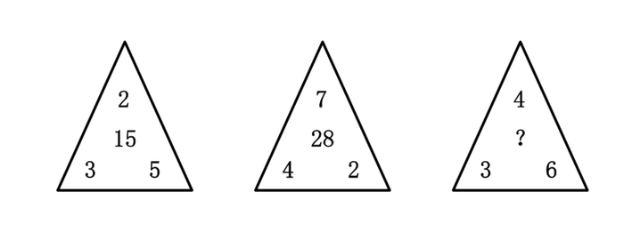

A. 16

B. 24

C. 25

D. 36

第 1 题 · 答案与解析

**参考答案（粉笔题库参考内容）**

D

**解析**

本题属于图形数阵题，由第一、第二个三角形可知规律为，三角形中间的数等于三个角上的数之积再除以2，也即2×3×5÷2=15，7×4×2÷2=28，故第三个三角形中间的数为4×3×6÷2=36。

故正确答案为D。

**来源**：2008年四川省公务员录用考试《行测》题第1题

### 第 2 题

2，-2，6，-10，22，（  ）

A. \-36

B. \-40

C. \-42

D. \-48

第 2 题 · 答案与解析

**参考答案（粉笔题库参考内容）**

C

**解析**

故正确答案为C。

**来源**：2014年新疆维吾尔自治区公务员录用考试《行测》题（网友回忆版）第52题

### 第 3 题

22，8，28，40，24，32，（  ）

A. 8

B. 16

C. 24

D. 36

第 3 题 · 答案与解析

**参考答案（粉笔题库参考内容）**

B

**解析**

观察数列，后项减去前项，可得次生数列-14，20，12，-16，8，对比原数列可看出原数列中每一项等于前两项差的绝对值的两倍，故最后一项等于|32－24|×2=16。

故正确答案为B。

**来源**：2008年四川省公务员录用考试《行测》题第3题

### 第 4 题

3，8，33，158 ，（  ）

A. 219

B. 378

C. 512

D. 783

第 4 题 · 答案与解析

**参考答案（粉笔题库参考内容）**

D

**解析**

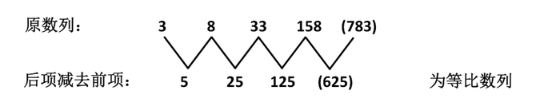

故正确答案为D。

**来源**：2008年四川省公务员录用考试《行测》题第4题

### 第 5 题

6，21，52 ，105 ，（  ）

A. 172

B. 186

C. 210

D. 224

第 5 题 · 答案与解析

**参考答案（粉笔题库参考内容）**

B

**解析**

对原数列做因式分解6 = 2 × 3，21=3×7，52 =4×13，105=5×21。其中左子列2、3、4、5为等差数列，右子列3、7、13、21为二级等差数列。故原数列下一项为6×31=186。

故正确答案为B。

**来源**：2008年四川省公务员录用考试《行测》题第5题

### 第 6 题

236²+768-148²的值为：

A. 33462

B. 33568

C. 34560

D. 34664

第 6 题 · 答案与解析

**参考答案（粉笔题库参考内容）**

C

**解析**

运用完全平方公式，236^2 + 768 − 148^2 =(236+148)×(236−148)+768=34560。

故正确答案为C。

**来源**：2008年四川省公务员录用考试《行测》题第6题

### 第 7 题

两个数各加2的比为3:2，两个数各减4的比为2:1，问这两个数分别是：

A. 16、10

B. 14、12

C. 16、8

D. 18、10

第 7 题 · 答案与解析

**参考答案（粉笔题库参考内容）**

A

**解析**

根据题意列方程：

(A+2)/(B+2)=3/2 ①，(A-4)/(B-4)=2/1 ②，A=2B-4 代入①式，解得B=10，A=16

故正确答案为A。

**考点**：和差倍比问题

**来源**：2008年四川省公务员录用考试《行测》题第7题

### 第 8 题

如果不堆叠，直径16厘米的盘子里面最多可以放（  ）个边长6公分的正方体。

A. 1

B. 2

C. 3

D. 4

第 8 题 · 答案与解析

**参考答案（粉笔题库参考内容）**

C

**解析**

画图分析：

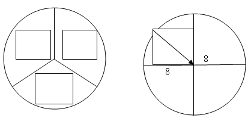

如果放四个正方体，正方体底面对角线长度为6√2 ＞ 8，因此正方体的底面不能全部坐落在盘子里，所以最多只能放3个。

故正确答案为C。

**考点**：几何公式类-立体图形

**来源**：2008年四川省公务员录用考试《行测》题第8题

### 第 9 题

某商品进价240元，8折销售后还可获利40元，则原销售价比进价提高了：

A. 17%

B. 45.83%

C. 60%

D. 145.83%

第 9 题 · 答案与解析

**参考答案（粉笔题库参考内容）**

B

**解析**

根据题意，商品打折后售价为240+40=280元，则商品的原价为280/0.8，比进价提高的比重等于(280/0.8 - 240)/240 = 280/(8 × 24) - 1 = 35/24 - 1 ≈ 0.4583，故商品原来的售价比进价提高了45.83%。

故正确答案为B。

**考点**：经济利润问题

**来源**：2008年四川省公务员录用考试《行测》题第9题

### 第 10 题

有四个学生恰好一个比一个大一岁，他们的年龄相乘等于93024，问其中最大的年龄是多少岁：

A. 16岁

B. 18岁

C. 19岁

D. 20岁

第 10 题 · 答案与解析

**参考答案（粉笔题库参考内容）**

C

**解析**

多位数相乘可以用尾数法简化计算过程，分别对每个选项进行验证，直到找到符合题意的答案为止。

A选项代入，6×5×4×3，尾数为0，不符合；

B选项代入，8×7×6×5，尾数为0，不符合；

C选项代入，9×8×7×6，尾数为4，符合；

D选项代入，0×9×8×7，尾数为0，不符合。

故正确答案为C。

**考点**：年龄问题

**来源**：2008年四川省公务员录用考试《行测》题第10题

### 第 11 题

一架飞机飞行在A、B两个城市之间，当风速为28千米/小时时，顺风飞行需2小时30分钟，逆风飞行需2小时50分钟，问飞机飞行的速度是多少千米/小时：

A. 338

B. 410

C. 448

D. 896

第 11 题 · 答案与解析

**参考答案（粉笔题库参考内容）**

C

**解析**

根据题意设飞机速度为a，则顺风速度为a+28，逆风速度是a-28，则(a + 28) × 15/6 = (a − 28) × 17/6，a=448。

故正确答案为C。

**考点**：流水行船

**来源**：2008年四川省公务员录用考试《行测》题第11题

### 第 12 题

从钟表的12点整开始，时针与分针的第1次垂直与再一次重叠中间相隔的时间是：

A. 43分钟

B. 45分钟

C. 49分钟

D. 61分钟

第 12 题 · 答案与解析

**参考答案（粉笔题库参考内容）**

C

**解析**

因为分针每60分钟转一圈360度，所以每分钟转6度，而时针每60分钟转30度，每分钟转0.5度，所以设经过m分钟后分针和时针第一次垂直，则有(6 − 0.5) × m = 90度，设经过n分钟后分针和时针再一次重合，则有(6 − 0.5) × n = 360度，n - m = 270 ÷ (6 - 0.5) ≈ 49分钟。

故正确答案为C。

**来源**：2008年四川省公务员录用考试《行测》题第12题

### 第 13 题

木材原来的水分含量为28%，由于挥发，现在的水分含量为10%，则现在这些木材的重量是原来的：

A. 50%

B. 60%

C. 70%

D. 80%

第 13 题 · 答案与解析

**参考答案（粉笔题库参考内容）**

D

**解析**

解析1：

设木材原料的原来的重量为100，水分含量28，则干燥的木材原料的重量为72，水分挥发至10%时，干燥的木材原料重量仍为72，且占总重量的90%，因此木材现在重量为72÷0.9=80，故现在这些木材的重量是原来的80%。

解析2：设木材原来总重量为M，含水0.28M，干燥木材本身的重量为M-0.28M=0.72M。挥发后，干燥木材的重量占总重量的90%，则挥发后木材重m=0.72M/0.9=0.8M，有m/M=0.8，故现在的木材的重量是原来的80%。

故正确答案为D。

**来源**：2008年四川省公务员录用考试《行测》题第13题

### 第 14 题

某公交线路有15站，假设一辆公交车从起点站出发，从起点站后，每一站都会有到前方每一站下车的乘客各一名上车，那么在第九站和第十站之间，车上有多少人：

A. 48

B. 54

C. 56

D. 60

第 14 题 · 答案与解析

**参考答案（粉笔题库参考内容）**

B

**解析**

解析1：

总站点数为M，求第N站和第N+1之间车上的人数，有下述公式，车上的人数= N×(M－N)，可知所求人数为9×(15-9)=9×6=54。

解析2：

第一站点有14个人上车，没有人下车，第二个站点有13个人上，1个人下车，所以到第九站时候，前面上车人数为14，13，12，11，10，9，8，7，6，根据等差数列求和公式，一共有(14+6)×9÷2=90人，下车的人数为1，2，3，4，5，6，7，8，一共有(1+8)×8÷2=36，则到第九站点后，车上人数等于第一到第九站上车的人减去第一到第九站下车的人数，即90-36=54。

故正确答案为B。

**考点**：数列问题

**来源**：2008年四川省公务员录用考试《行测》题第14题

### 第 15 题

在火车车厢的通道两边每排各有两个座位，且全部坐满，列车员A、B负责为某一车厢旅客倒水(限每位一杯)。A给右边的6位旅客倒完水时，被告知应负责左边的旅客，于是A重新到左边倒水，B接着给右边剩下的旅客倒水，之后B又帮A给10位旅客倒了水，最后两人同时结束工作。请问：多干的列车员比少干的列车员多为多少位旅客倒了水：

A. 24

B. 16

C. 8

D. 4

第 15 题 · 答案与解析

**参考答案（粉笔题库参考内容）**

C

**解析**

解析1：

设左、右两边各有T位乘客，A先在右边给6位乘客倒水，再换到左边继续倒水，A倒水T+6-10=(T-4)位，B从右边的第七位乘客开始倒水，倒完帮左边的A给10位乘客倒水，B倒水：T-6+10=(T+4)位，因此多倒了T+4-(T-4)=8位。

解析2：

设两边人数相等均为T，那么在相同的时间内，A倒了(T-10)位，B倒了T-6+10=(T+4)位，那么B比A多倒了T+4-(T-10)-6=8位。

故正确答案为C。

**考点**：和差倍比问题

**来源**：2008年四川省公务员录用考试《行测》题第15题

### 第 16 题

有人＿＿比较理想化的模式——“环状+楔状城市绿地系统”，这样的系统有利于城乡一体化的形式。填入画横线处最恰当的一项是：

A. 认为

B. 发现

C. 提出

D. 利用

第 16 题 · 答案与解析

**参考答案（粉笔题库参考内容）**

C

**解析**

此题考查实词搭配。句中破折号后的内容解释说明前面的“理想化模式”，空格处应选可以和“模式”搭配的词。“提出”是指揭示，提请考虑、讨论、接受或采纳。最符合语境搭配，所以C正确。

“认为”是指对人或事物确定某种看法，是做出某种判断；“发现”是指经过研究、探索等，看到或找到前人没有看到的事物或规律；“利用”指事物或人发挥效能。都不能与“模式”搭配，所以都不选。

故正确答案为C。

**考点**：实词填空、词的辨析-搭配对象

**来源**：2008年四川省公务员录用考试《行测》题第16题

### 第 17 题

我国荒漠化总体扩张的趋势还在延续，不断 ＿＿＿ 原本有限的生存空间，直接制约着国家社会经济的可持续发展。

A. 侵蚀

B. 占据

C. 损害

D. 蚕食

第 17 题 · 答案与解析

**参考答案（粉笔题库参考内容）**

D

**解析**

此题考查近义实词的语境搭配。

题干表达的是荒漠化扩张使原本有限的生存空间减少。“蚕食”指像吃桑叶那样，比喻逐步侵占，生动形象地展现了荒漠化对有限生存空间的逐步侵占。所以D最符合语境搭配。

“侵蚀”是逐渐侵害使变坏，不如“蚕食”更形象具体；“占据”和“损害”都表示对原本生存空间的伤害，但是体现不出逐步的过程。所以都不选。

故正确答案为D。

**考点**：实词填空、词的辨析-词义侧重

**来源**：2008年四川省公务员录用考试《行测》题第17题

### 第 18 题

经过10多万筑路大军历时5年的艰苦奋战，青藏铁路格尔木至拉萨段建成， ＿＿＿ 世界上海拔最高，线路最长的高原铁路青藏铁路全线胜利建成通车。填入画横线处最恰当的一项是：

A. 从此

B. 此时

C. 致此

D. 至此

第 18 题 · 答案与解析

**参考答案（粉笔题库参考内容）**

D

**解析**

此题考查近义实词的语境搭配。

题干的意思是“青藏铁路格尔木至拉萨段建成”，到这个时候，青藏铁路才算全线通车。

“至此”指到这个时候，符合句意。

“从此”是说从这一时间（现在或过去某一事件）起，不符合语境；“此时”指这时候，是一个时间点，也不符合语境；“致此”词语本身搭配错误。所以A、B、C都不选。

故正确答案为D。

**考点**：实词填空、对应关系-前后呼应、词的辨析-搭配对象

**来源**：2008年四川省公务员录用考试《行测》题第18题

### 第 19 题

开架的图书馆里，我可以自由地取阅架上任何我想翻阅的书，我竟成了 ＿＿＿ 的来客，不到闭馆时间，可以终日不离座位。填入画横线处最恰当的一项是：

A. 驾轻就熟

B. 轻车熟路

C. 囫囵吞枣

D. 饥不择食

第 19 题 · 答案与解析

**参考答案（粉笔题库参考内容）**

D

**解析**

此题考查的是成语的语境搭配。

题干想表达的是对看书的“饥渴”。“饥不择食”比喻急需的时候顾不得选择，与语意相符。所以D正确。

A项“驾轻就熟”和B项“轻车熟路”均比喻对某事有经验，很熟悉，做起来容易。

C项“囫囵吞枣”比喻对事物不加分析思考。

故正确答案为D。

**考点**：对应关系-前后呼应、成语填空

**来源**：2008年四川省公务员录用考试《行测》题第19题

### 第 20 题

下岗工人将获得7万美元补偿，这相当于普通蓝领工作两年的税后年薪，仅靠这笔钱，在美元疲软、物价上涨的时代并不能 ＿＿＿ ，不过尚能维持一个家庭几年的正常生活。填入画横线部分最恰当的一项是：

A. 高枕无忧

B. 一劳永逸

C. 丰衣足食

D. 为所欲为

第 20 题 · 答案与解析

**参考答案（粉笔题库参考内容）**

C

**解析**

此题考查成语的语境搭配。

题干想要表达的是在物价上涨的时代，靠着七万美元的补偿，家庭生活虽不算太富足，但尚可维持正常水平几年。“丰衣足食”是指吃的穿的都很丰富充足，符合语境。

A项“高枕无忧”是指垫高了枕头睡觉，无忧无虑，比喻平安无事，不用担忧，也比喻放松警惕，属于迷惑项。但是“高枕无忧”常用于摆脱危险，平安放心，不如“丰衣足食”更符合语境；

B项“一劳永逸”指辛苦一次，把事情办好，以后就不再费事了；

D项“为所欲为”是任意而为。均不符合语境。

故正确答案为C。

**考点**：对应关系-前后呼应、成语填空

**来源**：2008年四川省公务员录用考试《行测》题第20题

### 第 21 题

死了的植物如何会变成飞动的甲虫呢？我们若能这样追问，一切虚妄的学说都会 ＿＿＿ 。填入画横线部分最恰当的一项是：

A. 迎刃而解

B. 不攻自破

C. 烟消云散

D. 销声匿迹

第 21 题 · 答案与解析

**参考答案（粉笔题库参考内容）**

B

**解析**

此题考查成语的语境搭配。

题干表达的是凡事多追问几句，虚妄的学说自然能随之被破解。“不攻自破”指不用进行攻击，自己就会溃败。所以B选项符合语境。

A项“迎刃而解”比喻主要问题解决了，其他的问题就很容易解决。材料中并没有说主要问题、其他问题；

C项“烟消云散”比喻事物全部消失；

D项“销声匿迹”指隐藏起来或不公开露面，都不符合题意，所以不选。

故正确答案为B。

**考点**：对应关系-前后呼应、成语填空

**来源**：2008年四川省公务员录用考试《行测》题第21题

### 第 22 题

地铁的诞生不仅仅是一场交通革命，是解决一座城市交通拥堵的根本出路，它更是一个现代化大城市发展的重要标志。地铁能改善城市结构， ＿＿＿ 城市功能，提升城市的 ＿＿＿ ，对城市经济、文化的发展，都具有十分重要的战略意义。依次填入画横线部分最恰当的一项是：

A. 完善，知名度

B. 增强，国际化

C. 维持，影响力

D. 促进，智能化

第 22 题 · 答案与解析

**参考答案（粉笔题库参考内容）**

A

**解析**

此题考查近义实词的语境搭配。

题干说的是地铁对城市功能的正面作用。应选与“功能”搭配的有正面意义的词语。

第一空“维持”是指保持现状，不能体现对城市功能的积极意义，所以C不选；“促进”是指推进、加快，不能和“功能”搭配，D也不选；“完善”是使趋于完美，“增强”是增进、加强。都可以搭配“城市功能”。

再看第二个空格，提升“国际化”，缺少成分，不能搭配。所以B不选。

提升城市的“知名度”搭配合适，且符合题意。

故正确答案为A。

**考点**：实词填空、对应关系-前后呼应、词的辨析-搭配对象

**来源**：2008年四川省公务员录用考试《行测》题第22题

### 第 23 题

生命意识是 ＿＿＿ 一个民族文明程度的重要标尺。如果不逐渐 ＿＿＿ 自己的生命意识，就永远也无法走进高度文明的现代社会。

A. 判断，增添

B. 衡量，增强

C. 区别，提高

D. 甄别，提升

第 23 题 · 答案与解析

**参考答案（粉笔题库参考内容）**

B

**解析**

此题考查近义实词的语境搭配。

题干中缺少词应与“标尺”、“生命意识”形成完美搭配。

突破口在第一个空。“衡量”是指比较、评定，可以与“标尺”搭配并且符合语意。所以B符合语境搭配。“判断”是指断定、判决，一般是断定是非；“区别”是指区分、辨别；“甄别”是鉴别、审查。都不能与“标尺”搭配。

第二个空“增强”生命意识，搭配合理，并且语义通顺，所以可以印证答案为B。

故正确答案为B。

**考点**：实词填空、词的辨析-搭配对象

**来源**：2008年四川省公务员录用考试《行测》题第23题

### 第 24 题

知识在本质上不是书本＿＿＿＿＿给我们的现成结论，知识的本质是发现，只有在自由的环境中，人们才＿＿＿＿＿＿ 更多发现的可能。

A. 灌输，具有

B. 展示，拥有

C. 传递，争得

D. 呈现，获得

第 24 题 · 答案与解析

**参考答案（粉笔题库参考内容）**

B

**解析**

第一空，搭配“结论”，B项“展示”指明显地表现出来，D项“呈现”指显出，均与“结论”搭配恰当，保留。A项“灌输”指向人们输送倾注，多搭配“知识”“思想”等，与“结论”搭配不当，排除；C项“传递”指由一方交给另一方，侧重于交付的动作，文段并非强调交付的动作，与文意不符，且与“结论”搭配不当，排除。

第二空，搭配“发现的可能”，B项“拥有”指具有，与“发现的可能”搭配恰当，当选。D项“获得”指取得、得到，与“发现的可能”搭配不当，排除。

故正确答案为B。

【文段出处】《南风窗》杂志《窗下人语——知识分子的品质》

**考点**：实词填空、词的辨析-搭配对象

**来源**：2008年四川省公务员录用考试《行测》题第24题

### 第 25 题

双方领导人强调应对存在分歧的问题进行高级别政治对话和各级别 ＿＿＿ ，这对增进理解、扩大共识和 ＿＿＿ 双边关系具有重要意义。

A. 商讨，提高

B. 协商，增进

C. 磋商，提升

D. 商议，强化

第 25 题 · 答案与解析

**参考答案（粉笔题库参考内容）**

C

**解析**

此题考查近义实词的语境搭配。

第一空中，“商讨”是商量讨论，“协商”是指共同商量以便取得一致意见，“商议”是为了取得一致意见而进行讨论，“磋商”是指互相商议，交换意见，多用于正式场合。四个词都有商量的意思，但是题干中是国与国之间的交流，“磋商”最符合语境。对于两国之间的关系，“进行磋商”，“提升双边关系”属于固定搭配。

故正确答案为C。

**考点**：实词填空、词的辨析-搭配对象

**来源**：2008年四川省公务员录用考试《行测》题第25题

### 第 26 题

指出下面没有语病的句子是：

A. 经过各方面的努力，大火和消防隐患都得到了有效控制

B. 经过改变旧机制，企业干部的思想认识和福利待遇都有了很大提高

C. 成功的经验和失败的教训对于完成一项事业来讲都是很重要的

D. 教师、工人、农民在我国都是一种很神圣的职业

第 26 题 · 答案与解析

**参考答案（粉笔题库参考内容）**

C

**解析**

此题考查病句辨析。

C选项表述没有语病。

A项说“隐患”得到“有效控制”不对；

B项“思想意识”和“福利待遇”不能够并列使用；

D项“一种”和“都是”矛盾。

故正确答案为C。

**来源**：2008年四川省公务员录用考试《行测》题第26题

### 第 27 题

从给出的几句话中选出有语病的一句是：

A. 好奇本来就是人的天性，如果有不当的好奇心，那往往成为纷争的因由、祸患的起源

B. 好奇本来就是人的天性，但是不当的好奇心，却往往成为纷争的因由、祸患的起源

C. 好奇本来就是人的天性，但是好奇心不当，反而会成为纷争的因由、祸患的起源

D. 好奇本来就是人的天性，若有不当的好奇心，纷争往往难以避免，祸患也许就会降临

第 27 题 · 答案与解析

**参考答案（粉笔题库参考内容）**

C

**解析**

本题属于病句辨析题。

C项的句子成分不适，“好奇心不当”不能充当“反而会成为纷争的因由、祸患的起源”的主语，应改为“不当的好奇心”。

故正确答案为C。

**来源**：2008年四川省公务员录用考试《行测》题第27题

### 第 28 题

下列各句中，括号中的词语使用恰当的一句是：

A. 二恶英成了当今词汇以后，各种媒体对它的“包装”可谓（五花八门）。有的写成“二恶英”，有的写成“二恶因”，有的写作“二巫英”

B. 刚刚兴起跳交际舞的时候，我和妻极看不惯，不但自己不入“舞流”，而且还（颇有微言）

C. 自从中国颁布实施外商投资法规以来，不少外商（蠢蠢欲动），纷纷来中国投资

D. 据专家测算，在首都市内的空气污染中，汽车尾气的排放可算是（首当其冲），竟占了污染总量的45%

第 28 题 · 答案与解析

**参考答案（粉笔题库参考内容）**

A

**解析**

此题考查成语的正确运用。

A项“五花八门”指花样繁多，变化多端，从文中“有的······有的······有的”可以体现出来“多”的意思，正确。

B项“颇有微言”指说了很多深奥的道理和精微的话。文中说的“我和妻对于交际舞有意见”应该用“颇有微词”，错误；

C项“蠢蠢欲动”指敌人或坏分子策划或开始进行攻击破坏活动，C选项中“外商”不是坏分子，搭配不当，错误；

D项“首当其冲”比喻最先受到攻击或遭遇灾难，D选项是说汽车尾气排放量高，并不是首先受到攻击的意思，错误。

故正确答案为A。

**来源**：2008年四川省公务员录用考试《行测》题第28题

### 第 29 题

下面的四句话中有一句多一个“只”，请找出这一句（  ）。

A. 我不是不想去，只是没有时间而已

B. 他从不向人说起自己过去的功绩，人们都以为他只是一个普普通通的人

C. 这又让我们看到猜忌的残酷，它只找到一点借口，就可以将一个人顷刻间置于死地

D. 所谓综合，就是把部分结合成整体，它不只是各部分简单相加，而是再现事物各部分的本质联系

第 29 题 · 答案与解析

**参考答案（粉笔题库参考内容）**

D

**解析**

A、B项，“只是”意为“仅仅是、不过是”，符合文意。

C项，“只”表示强调限于某个情况或范围，与“一点借口”形成呼应，符合文意。

D项，“不只是”一般与“更是、而且是、甚至是”等词语搭配使用，与“而是”构成搭配的应为“不是”。应将“不只是”改为“不是”。

故正确答案为D。

**来源**：2008年四川省公务员录用考试《行测》题第29题

### 第 30 题

下列各句，哪一句的表述最连贯：

A. 只要肯约束自己的贪欲，把欲望减少到最低限度，就可以过上比较简单的生活

B. 只要把欲望减少到最低限度，就可以约束了自己的贪欲，满足于过比较简单的生活

C. 一个人只要肯约束自己的贪欲，满足于过比较简单的生活，就可以把欲望减少到最低限度

D. 一个人满足于过比较简单的生活的话，就可以把欲望减少到最低限度，从而约束自己的贪欲

第 30 题 · 答案与解析

**参考答案（粉笔题库参考内容）**

C

**解析**

C项“约束贪欲”、“满足过简单生活”和“把欲望减少到最低”三个短句存在逻辑上的关系，只有C项的表达最符合正常逻辑，并且语义通顺，表述连贯。

A项“约束贪欲，把欲望减少到最低限度”不是“过上比较简单的生活”的充分条件，所以A错；

B项中“把欲望减少到最低限度”也不是“约束贪欲”的充分条件，所以B也是错的；

D项“过简单的生活”也不是“把欲望减少到最低限度”的充分条件。所以以上都不选。

故正确答案为C。

**来源**：2008年四川省公务员录用考试《行测》题第30题

### 第 31 题

近年来，南方地区河川径流和水资源总量有所增加，增幅接近5%,而北方地区水资源量明显减少，其中以黄河、淮河、海河和辽河地区最为显著，资源总量减少了12%，按目前的正常需要，如果不超采地下水，正常年份全国缺水近400亿立方米。

这段文字意在强调：

A. 近年来全国缺水情况依旧很严重

B. 我国北方水资源总量明显低于南方

C. 我国水资源南方和北方分布不均衡

D. 全国水资源总量整体呈下降趋势

第 31 题 · 答案与解析

**参考答案（粉笔题库参考内容）**

A

**解析**

据提问“意在强调”可知此题为中心理解题。

材料首先说近年来南方地区水资源总量有所增加，北方水资源明显减少，又总结说按目前正常需要，正常年份全国还是缺水近400亿立方米，是分总结构，主旨为“总”的部分，即全国缺水的情况依旧很严重，选项A最能完整表达这个意思。

B、C选项是“分”部分表达和引申出来的内容，不是材料主要内容；D选项的表达材料中并没有提到。

故正确答案为A。

**考点**：分述句特征-引入铺垫

**来源**：2008年四川省公务员录用考试《行测》题第31题

### 第 32 题

王旦与寇准同为北宋真宗时期才能出众，政绩卓著的宰相，同样受到宋真宗的器重。一次王旦这边送公文到寇准那边，体例不合。寇准禀报上去，王旦被真宗批评，手下人也都跟着挨了罚。不久，寇准那边送来的公文也出了类似问题，王旦只派人送还给了寇准，请他改正后再呈送。平时说王旦坏话最多的数寇准，而王旦谈到寇准基本上都是称许的话。后来，寇准被免职，他私下托人请求王旦，说想当使相，王旦还是向真宗推荐了他。

这个故事说明：

A. 王旦做事公私分明

B. 王旦心胸宽广，有容人的雅量

C. 王旦的做事风格与寇准形成鲜明对照

D. 寇准与王旦的矛盾以王旦不计前嫌而化解

第 32 题 · 答案与解析

**参考答案（粉笔题库参考内容）**

C

**解析**

材料属于历史故事，据提问“故事说明”可知此题为中心理解题。

材料通过讲叙王旦和寇准的几个事例，以同样的事例不同的做法说明了王旦和寇准做事的不同风格。所以C选项符合题意。

寇准被免职私下托人请求王旦，王旦向真宗推荐了他，说明王旦不是“公私分明”，所以A不选；材料重点说的是王旦和寇准做事的不同风格，并不是单纯的要突出王旦的个人性格，所以B不选；D选项“矛盾”一词属于主观臆断，材料并没有说王旦和寇准之间存在矛盾。

故正确答案为C。

**来源**：2008年四川省公务员录用考试《行测》题第32题

### 第 33 题

新疆库车与敦煌相距二千多公里，在古代，前者属多民族聚居区域，后者却是汉民族集居区域。但是2007年在库车县城的改造建设过程中，发现了一批过去在新疆从未发现过的汉代古式墓葬。它们属于魏晋时期典型的汉式墓葬形式；在构筑方式、用材规格、雕砖风格、出土遗物等方面，与近年发现的甘肃敦煌佛爷庙湾墓地魏晋十六国时期的墓葬尤为相似甚至相同，与甘肃河西地区的同时期墓葬也大同小异。

下列说法与原文相符的是：

A. 2007年在库车和郭煌均首次发现了汉式古代墓葬

B. 魏晋时期汉式墓葬形式在库车地区比较流行

C. 魏晋时期库车墓葬形式受到了汉文化的影响

D. 魏晋时期河西地区具有多种墓葬形式

第 33 题 · 答案与解析

**参考答案（粉笔题库参考内容）**

C

**解析**

据提问可知此题属于细节判断题。

根据文意，在古代，新疆库车属多民族聚居区域，而2007年在库车县城的改建过程中，发现了一批过去在新疆从未发现过的汉代古式墓葬，它们属于魏晋时期典型的汉式墓葬形式，说明了魏晋时期库车墓葬形式受到了汉文化的影响。C项符合文意。

材料中说2007年是在库车发现了汉代古式墓葬，并非是库车和敦煌，所以A错；材料中说的是在库车发现了过去“在新疆从未发现过的”汉代古式墓葬，说明魏晋时期汉代古式墓葬在库车并非很流行，所以B错；材料只说在库车发现的汉代古式墓葬属于魏晋时期典型的墓葬形式，与甘肃河西地区的大同小异，并不能体现出河西地区具有“多种墓葬形式”，所以D错。

故正确答案为C。

**考点**：细节判断题

**来源**：2008年四川省公务员录用考试《行测》题第33题

### 第 34 题

近年来，汉语出现了许多新词新语。对同一事物或现象，有人愿意这样说，有人愿意那样说。对此，语言工作者应该进行客观冷静的分析。看到那种盲目效仿港台语，或者为表现个性而表现个性的刻意“创新”，不闻不问是不对的。我们应规范语言运用的主流，但过分强调规范，希望纯而又纯也不行。

对这段文字概括最准确的是：

A. 新词新语是人们社会生活的直接反映，折射出时代的色彩

B. 应该以科学的态度对语言运用的主流进行规范

C. 对盲目效仿和刻意“创新”的语言应进行规范

D. 对新词新语过分挑剔不利于语言的创新和发展

第 34 题 · 答案与解析

**参考答案（粉笔题库参考内容）**

B

**解析**

据提问“概括”可知此题为中心理解题。

材料前两句提出了“汉语出现新词新语”这一现象。根据关键词句“对此，语言工作者应该进行客观冷静的分析”可知，中间两句说的是语言工作者应怎样对待这个问题。最后一句为全段的总结句，再次对规范语言运用进行了重申。

材料属于典型的“提出问题”——“解决问题”——“进行评价”的总分总结构，主旨句应为最后的“总”，即“我们应规范语言运用的主流，但过分强调规范，希望纯而又纯也不行”，也就是用科学的态度对语言运用的主流进行规范，B选项正确。

A选项不是材料的内容概括；C、D选项是对B选项的支持，属于材料内容的其中一个方面。

故正确答案为B。

**考点**：关联词-对策

**来源**：2008年四川省公务员录用考试《行测》题第34题

### 第 35 题

飓风强度增大与海洋温度上升密切相关，最新研究成果应引起人们的警惕，海洋里这些额外的热量是人类制造的，开一次灯或踩一下油门，都可能导致一次破坏巨大的飓风诞生。

对这段文字理解正确的是：

A. 降低能源消耗可减少自然灾害

B. 降低海洋温度就不会有飓风

C. 人类对自然的破坏导致飓风的发生

D. 飓风强度与人类的活动密不可分

第 35 题 · 答案与解析

**参考答案（粉笔题库参考内容）**

D

**解析**

依据文段可知飓风强度与温度相关，海洋温度受人类影响，故飓风强度与人类有关， D项表示无误，当选。A项，“自然灾害”属于范围扩大，且该对策无中生有，排除；B项内容只是对材料表面内容的片面推测，所以B项错误，排除；材料中的“开一次灯或踩一下油门”并没有破坏自然，C项错误，排除。

故正确答案为D。

**考点**：细节判断题

**来源**：2008年四川省公务员录用考试《行测》题第35题

### 第 36 题

当小机器人“金字塔漫游者”吃力地沿着长约64米的“南通道”独自向上攀爬时，这段90分钟的孤独之旅显得格外漫长，一如这昏暗的甬道本身的寿命。“人畏惧时间，而时间畏惧金字塔”这句阿拉伯谚语的真意，在此刻突显无疑。

这段话意在强调：

A. 小机器人的攀爬过程非常缓慢

B. 金字塔“南通道”路况非常糟糕

C. 阿拉伯人充分了解金字塔的特点

D. 小机器人攀爬的金字塔历史悠久

第 36 题 · 答案与解析

**参考答案（粉笔题库参考内容）**

D

**解析**

据提问“意在”可知题目属于中心理解题。

材料属于寓言启示类，通过小机器人对金字塔“南通道”的攀爬说明攀爬时间很长，用“格外漫长”一词印证后文引用的“人畏惧时间”。但是又说“时间畏惧金字塔”，是要证明金字塔的历史相当的悠久，以至于时间都“畏惧”。引申可知材料强调的是金字塔的历史悠久，D选项正确。

A项是材料表面内容的一部分；B项明显错误，材料中并未表明路况的糟糕；C项表述的不是文章的主要意思。

故正确答案为D。

**来源**：2008年四川省公务员录用考试《行测》题第36题

### 第 37 题

在社会生活中，人的角色支配了我们的感知，我们的注意力常常被人们日常的活动所吸引，往往缺乏对角色之外人的内心深处的了解，因而在一些看似深刻的关于人的认识中不免存在着基于表面化或主观化的观点。这段话直接支持的观点是：

A. 在社会生活中，人们都要充当各式各样的角色

B. 我们在社会生活中的认识是建立在对各种角色理解之上的

C. 缺乏对角色之外的人的了解，就会产生主观化或表面化的认识

D. 避免角色的影响，才能对社会中的人有更加客观深刻的了解

第 37 题 · 答案与解析

**参考答案（粉笔题库参考内容）**

C

**解析**

据提问可知此题属于中心理解题。

材料首先说我们缺乏对角色之外人的内心深处的了解，然后用“因此”表明这样造成的结果就是缺乏对“人”本身的了解，因此得出一些表面化的结论。C选项完整地表述了材料的意思，所以C正确。

A项所述与论证无关，首先排除。B项是对所给材料的简单重复，材料所要否定的观点就是单纯建立在“角色”基础之上的简单理解。迷惑项是D，D项是关于所给文字的合理结论，并不是材料“直接”支持的观点。

故正确答案为C。

**考点**：关联词-因果

**来源**：2008年四川省公务员录用考试《行测》题第37题

### 第 38 题

在我们的印象中，鞋只是穿在脚上以利于行走的一种物品。虽然一双制作精良、美观大方的鞋子会使人看上去精神倍增，但绝少有人会想到它的文化内涵。对这段话的理解不正确的是：

A. 鞋的文化内涵很少被人想到

B. 鞋的文化内涵在于它能使人精神倍增

C. 制作精良、美观大方的鞋具有文化内涵

D. 鞋既有实用价值，又有文化内涵

第 38 题 · 答案与解析

**参考答案（粉笔题库参考内容）**

B

**解析**

据提问可知题目属于细节判断题。

制作精良、美观大方的鞋能使人精神倍增，这是鞋子给人带来的实用价值，而不是文化内涵，所以B项内容错误，当选。

A、C、D项明显可以看出是对材料的正确理解。

本题为选非题，故正确答案为B。

**考点**：细节判断题

**来源**：2008年四川省公务员录用考试《行测》题第38题

### 第 39 题

要帮孩子学电脑，最好家长先学会使用电脑，这样既可以向孩子推荐好的软件，也可以有效地防止孩子使用不健康的软件，并可为孩子树立一个不断学习、勇于进取的人生榜样。

这段话的主要意思是：

A. 家长学会使用电脑对孩子学电脑有直接帮助

B. 孩子学电脑需要家长的多方帮助

C. 家长学会使用电脑对帮助孩子学习和成长有诸多好处

D. 家长要帮助孩子学电脑，首先自己要学会电脑

第 39 题 · 答案与解析

**参考答案（粉笔题库参考内容）**

C

**解析**

据提问“主要意思”可知题目为中心理解题。

通过关联词“既……也……并”可以看到后三个短句都是在说“家长先学会使用电脑的好处”，材料主要表达的是家长学会使用电脑对帮助孩子学习有诸多的好处，C选项正确。

A、B项概括不全面；D项把“家长学会电脑”作为“帮助孩子学电脑”的必要条件，有失偏颇。

故正确答案为C。

**考点**：关联词-并列

**来源**：2008年四川省公务员录用考试《行测》题第39题

### 第 40 题

如果一直往上看的话，就会觉得一直在下面；如果一直往下看的话，就会觉得一直在上面；如果一直觉得在后面，肯定是一直在向前看。目光决定不了位置，但位置却永远因为目光而存在。关键是，即使我们处于一个确定的位置，目光却仍然可以投往任何一个方向。符合这段文字的寓意的是：

A. 即便现在处于逆境，我们也应当积极面对未来

B. 我们应当树立远大目标来鼓励自己并为之努力

C. 我们应当切实地认识自己，不要为虚无的幻想所牵绊

D. 不论是何时、何地、何种情况，我们都应当独立地进行思考，正确认识自己，不被虚幻迷惑

第 40 题 · 答案与解析

**参考答案（粉笔题库参考内容）**

A

**解析**

材料开篇运用三个并列的句子告诉我们目光的方向不同可以影响人对于位置的感知判断。随后通过转折词强调虽然目光对于位置所在起不了决定性作用，但永远不可忽视。最后使用程度词“关键是”再次强调，位置虽是确定的，但更需要关注的是目光应投向哪个方向，即如何看待境遇的问题。对应A项，即便处境不顺，也应善用目光，积极面对。

B项，文段并未提及“远大目标”，脱离文段重点内容，排除；

C项，脱离文段主题词“目光”，且“虚无的幻想”无中生有，排除；

D项，“独立地思考”无中生有，排除。

故正确答案为A。

**考点**：关联词-对策

**来源**：2008年四川省公务员录用考试《行测》题第40题

### 第 41 题

有专家认为，上世纪80年代以来，通过多种融资渠道进行市场化运作的收费公路，确实从根本上改善了我国的交通条件，但这种市场化运作的公路投资管理体制，在解决我国交通供给严重短缺问题的同时，也付出了较大的代价，就是目前遍布全国的设卡收费的高价公路，已经成为影响我国经济持续快速健康发展的一个硬约束。

这段文字意在说明：

A. 公路采取市场化运作并非明智之举

B. 经济健康发展需要改变公路高价收费的现状

C. 采用市场化动作的公路投资管理体制得不偿失

D. 公路市场化运作是改善我国交通的必要条件

第 41 题 · 答案与解析

**参考答案（粉笔题库参考内容）**

B

**解析**

据提问“意在”可知本题属于中心理解题。

根据关键词“但”可知，材料前半部分是专家肯定了市场化运作的收费公路在我国起的积极作用，“但”这一转折词，表明“但”后面所要强调的重要内容是随着经济发展，“高价公路”已成为“我国经济持续快速健康发展的一个硬约束”，也意在说明经济要快速健康发展，高价公路收费状况需要得到改变。B选项正确。

材料前半部分，专家已经肯定了市场化运作的积极作用，所以可知市场化运作并非不是明智之举，A错；C选项“得不偿失”并没有体现出来；D选项表述错误。

故正确答案为B。

**考点**：关联词-转折

**来源**：2008年四川省公务员录用考试《行测》题第41题

### 第 42 题

新中国成立以来，中国近代史研究取得了很大成就，但还存在着一些薄弱环节甚至盲区。比如，一般民众的历史、普通人的历史，包括他们的思想观念、行为方式、风俗习惯、日常生活等，就未能引起足够的重视。我们的历史研究应该注重老百姓自己的真实故事。只有把老百姓的故事讲清楚了，才是一部真实的中国近代史。

这段话主要谈论的是中国近代史研究：

A. 取得的成就

B. 存在的问题

C. 发展的趋势

D. 突破的关键

第 42 题 · 答案与解析

**参考答案（粉笔题库参考内容）**

B

**解析**

据提问可知此题为提取主题词类的中心理解题。

通过关键字“但”可以知道，材料重点是“但”字后半句，即“近代史研究存在着一些薄弱环节甚至盲区”。“比如”一词引出具体的薄弱环节和盲区。所以，这段文字主要谈论的是中国近代史研究存在的问题。B选项正确。

A、C、D都不是材料主要表达的内容。

故正确答案为B。

**考点**：关联词-转折

**来源**：2008年四川省公务员录用考试《行测》题第42题

### 第 43 题

电视频道对于人们而言不再稀缺，电视频道的不断增加给了观众更多的选择，观众的注意力选择已经成为电视媒体追逐的稀缺资源。

这段文字最可能引起下面哪个话题：

A. 电视媒体在对观众注意力的争夺战中如何获胜

B. 传播过剩时代的电视观众应如何理智选择频道

C. 传播过剩时代对人们的生活将会产生什么影响

D. 热衷追逐观众注意力如何影响电视媒体的品位

第 43 题 · 答案与解析

**参考答案（粉笔题库参考内容）**

A

**解析**

据提问“最可能引起下面哪个话题”可知此题属于接语选择题。

本题对应的解法是识别陷阱类型中的思想或行为路径错误。从题干中可知由于电视频道的增多，观众才有了更多的选择；又因为观众有了更多选择，所以电视媒体把追逐观众注意力当作稀缺资源；又由于观众注意力成为稀缺资源，所以媒体才会想方设法吸引观众注意力，由此引出A选项的话题。

B、C项中的“传播过剩时代”在材料中并没有提到；D选项不是能直接引出的话题，而是接着A选项的话题才能引出的，由于观众注意力成为了稀缺资源，所以每天才会想方设法吸引观众注意力，进行对观众注意力的争夺战，然后才是影响，才会引出热衷追逐观众注意力对电视媒体的品味的影响。

故正确答案为A。

**考点**：接语选择题

**来源**：2008年四川省公务员录用考试《行测》题第43题

### 第 44 题

现代科学的思维方式在现代科学发展过程中经历了巨大的变化，形成了与近代科学差异很大的新角度、新方位，从机械观思维向以系统观为主导的思维转变，强调认识系统的整体性、动态性、复杂性和决定性。

这段话主要支持了这样一种论点，即（    ）。

A. 现代科学的思维方式在现代科学发展过程中经历了巨大的变化

B. 现代科学的思维方式明显不同于近代科学的思维方式

C. 现代科学的主导思想从机械观向系统观转变

D. 现代科学以系统观为主导思维

第 44 题 · 答案与解析

**参考答案（粉笔题库参考内容）**

C

**解析**

本题属于中心理解题。文段首先指出现代科学的思维方式经历了巨大变化，表现出与近代科学不同的特点，后指出具体的变化，即“从机械观思维向以系统观为主导的思维转变”，并进一步强调现代科学的思维方式的特征——整体性、动态性、复杂性、决定性。文段的中心是现代科学的思维方式经历的从机械观思维向以系统观为主导的思维转变。结合选项，C项符合文段中心。

A项，仅指出经历了变化，未指出具体的变化是什么，表述模糊，故排除。

B项，文段中心是强调现代科学的思维方式的具体变化，而不是与近代科学的比较，故排除。

D项，未指出“变化”这一中心，故排除。

故正确答案为C。

**考点**：特殊问法

**来源**：2008年四川省公务员录用考试《行测》题第44题

### 第 45 题

倘若城市的教育资源能够在不同学校之间公平分配，那么就不会出现重点校与普通校的区别，也不会有一些教师因教育资源的过度聚集而“暴富”。倘若教育资源在地域之间得到公平分配，边远地区的山村学校能获得更多的投入，那么，乡村教育就不会如此艰难。

这段文字主要谈论的是：

A. 教育资源的公平化

B. 教师收入的两极分化

C. 教育资源分配的地域差距化

D. 学校划分的等级化

第 45 题 · 答案与解析

**参考答案（粉笔题库参考内容）**

A

**解析**

据提问“主要谈论”可知此题为中心理解题。

材料中两个“倘若”是并列关系，假设了教育资源在不同学校、不同地域之间如果能做到公平分配的话，那么就不会出现诸多问题。所以材料主要谈论的问题是“教育资源的公平分配”，A正确。

B、C、D项的表达都是“教育资源的不公平分配”带来的后果，是材料内容的一部分，不是总结。

故正确答案为A。

**考点**：关联词-并列

**来源**：2008年四川省公务员录用考试《行测》题第45题

### 第 46 题

从所给四个选项中，选择最合适的一个填入问号处，使之呈现一定的规律性：

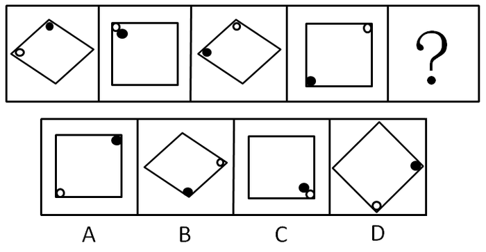

A. A

B. B

C. C

D. D

第 46 题 · 答案与解析

**参考答案（粉笔题库参考内容）**

B

**解析**

间隔元素组成相同，考查位置规律。

本题的规律为外框分别以矩形、菱形间隔出现，矩形内部小白点顺时针旋转，小黑点逆时针旋转，符合该规律的只有B项的图形。

故正确答案为B。

**考点**：位置规律-旋转

**来源**：2008年四川省公务员录用考试《行测》题第46题

### 第 47 题

从所给四个选项中，选择最合适的一个填入问号处，使之呈现一定的规律性：

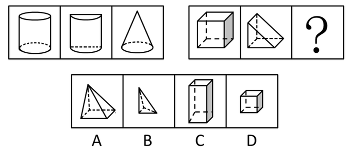

A. A

B. B

C. C

D. D

第 47 题 · 答案与解析

**参考答案（粉笔题库参考内容）**

A

**解析**

第一组图形中的三个小图形体积比为1：1/2：1/3，第二组图形中的三个小图形体积比也应该为1：1/2：1/3，符合此规律的只有A项中的图形。

故正确答案为A。

**来源**：2008年四川省公务员录用考试《行测》题第47题

### 第 48 题

从所给四个选项中，选择最合适的一个填入问号处，使之呈现一定的规律性：

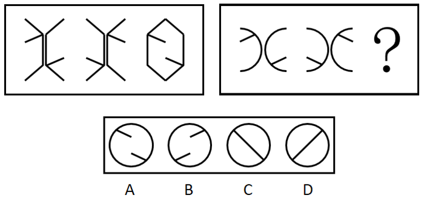

A. A

B. B

C. C

D. D

第 48 题 · 答案与解析

**参考答案（粉笔题库参考内容）**

A

**解析**

元素组成相同，考查位置规律。

第一组图形中第二个图形是第一个图形翻转得到的，第三个图形是第二个图形拼合得到的。第二组图形也应符合该规律，即第二组图形中第三个图形是由第二个图形拼合得到的。从线条方向来看排除B、D。又因为第二组图形中半圆内部直线的端点明显不在圆心处，所以拼合以后两条直线不会连接，A项正确。

故正确答案为A。

**考点**：位置规律-综合

**来源**：2008年四川省公务员录用考试《行测》题第48题

### 第 49 题

从所给四个选项中，选择最合适的一个填入问号处，使之呈现一定的规律性：

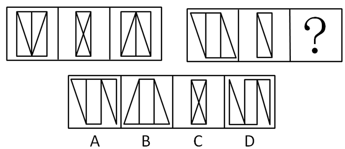

A. A

B. B

C. C

D. D

第 49 题 · 答案与解析

**参考答案（粉笔题库参考内容）**

D

**解析**

元素组成相同，优先位置规律。

第一组图形中第一个图形中间竖线左、右图形分别向右、向左移动依次得到第二个、第三个图形。第二组图形也应符合该规律，即第一个图形矩形左边、右边三角形分别向右、向左移动依次得到第二个、第三个图形，只有D项符合。

故正确答案为D。

**考点**：位置规律-平移

**来源**：2008年四川省公务员录用考试《行测》题第49题

### 第 50 题

从所给四个选项中，选择最合适的一个填入问号处，使之呈现一定的规律性：

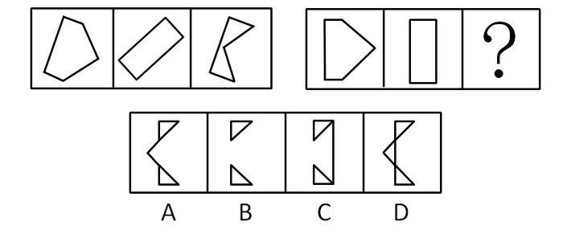

A. A

B. B

C. C

D. D

第 50 题 · 答案与解析

**参考答案（粉笔题库参考内容）**

A

**解析**

第一组图形中，将第二个图形叠放在第一个图形之上，并将其不能覆盖的部分翻折得到第三个图形，第二组图形也应符合该规律，通过分析只有A项中图形符合。

故正确答案为A。

**来源**：2008年四川省公务员录用考试《行测》题第50题

### 第 51 题

从所给四个选项中，选择最合适的一个填入问号处，使之呈现一定的规律性：

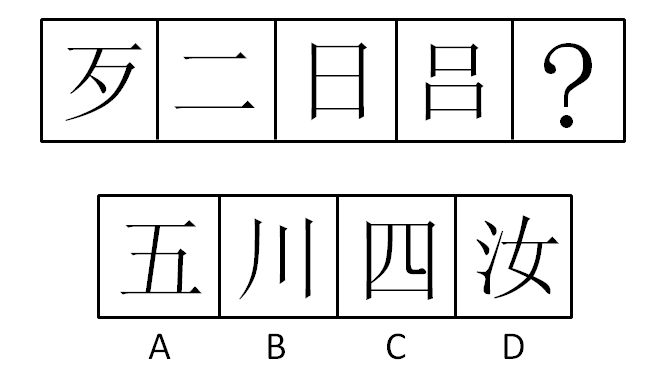

A. A

B. B

C. C

D. D

第 51 题 · 答案与解析

**参考答案（粉笔题库参考内容）**

A

**解析**

元素组成不同，且无明显属性规律，优先考虑数量规律。观察发现第三个图形为“日”，考虑笔画数。题干图形第一个、第三个都是四笔画，且都是独体字，因此第五个图形也应为四笔画且为独体字；第二个、第四个图形都是上下结构，通过分析，只有A项图形符合该规律。

故正确答案为A。

备注：独体字指汉字的一个字只有一个单个的形体，不是由两个或两个以上的形体组成的。

**考点**：数量规律-线、文字/字母/数字类

**来源**：2008年四川省公务员录用考试《行测》题第51题

### 第 52 题

从所给四个选项中，选择最合适的一个填入问号处，使之呈现一定的规律性：

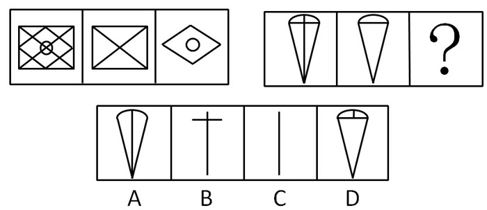

A. A

B. B

C. C

D. D

第 52 题 · 答案与解析

**参考答案（粉笔题库参考内容）**

C

**解析**

元素组成相似，元素叠加。

前两图叠加后去同存异形成第三个图形，通过分析，只有C项中图形符合。

故正确答案为C。

**考点**：样式规律-加减同异

**来源**：2008年四川省公务员录用考试《行测》题第52题

### 第 53 题

从所给四个选项中，选择最合适的一个填入问号处，使之呈现一定的规律性：

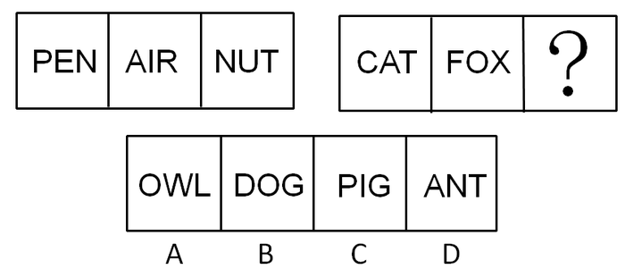

A. A

B. B

C. C

D. D

第 53 题 · 答案与解析

**参考答案（粉笔题库参考内容）**

A

**解析**

已知图形中每个图形三个字母中有且只有一个含有曲线，通过分析，只有A项中图形符合该规律。

故正确答案为A。

**考点**：属性规律-曲直性、文字/字母/数字类

**来源**：2008年四川省公务员录用考试《行测》题第53题

### 第 54 题

从所给四个选项中，选择最合适的一个填入问号处，使之呈现一定的规律性：

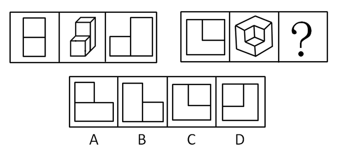

A. A

B. B

C. C

D. D

第 54 题 · 答案与解析

**参考答案（粉笔题库参考内容）**

D

**解析**

第一组图形当中，图1是图2的主视图，图3是图2的右侧视图，因此问号处也应该是前一个图形的右侧视图。

故正确答案为D。

**考点**：空间类-三视图

**来源**：2008年四川省公务员录用考试《行测》题第54题

### 第 55 题

左边给定的是纸盒外表面的展开图，右边哪一项能由它折叠而成？请把它找出来。

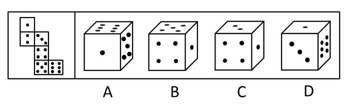

A. A

B. B

C. C

D. D

第 55 题 · 答案与解析

**参考答案（粉笔题库参考内容）**

D

**解析**

空间重构推理。

当有一个点的面在正前方，六个点的面在上方的时候，五个点的面应该在左边，所以排除A项；由平面上相对的面在立体图形中不可能相邻可知，有一个点的面和有四个点的面不可能相邻，排除B项；C答案中有一个点的面和有四个点的面是相对的面，不可能相邻，故排除；D答案中有三个点的面位于正前方，有一个点的面位于正上方时，六点的面在右边是正确的。

故正确答案为D。

**考点**：空间类-空间重构-六面体

**来源**：2008年四川省公务员录用考试《行测》题第55题

### 第 56 题

科技实力是指国家为了追求和实现发展战略目标，在全国和全球范围内，利用各种科学技术资源的能力。它包括科学创新能力、技术创新能力、利用新技术的能力、利用全球信息的能力和研究与发展投资的能力，一个国家的科技实力，为该国获取、利用和配置各类科技资源的能力集中体现。

根据以上定义，一个国家的科技实力是：

A. 科技是否在世界同类科技的先进水平

B. 在世界科技技术竞争格局下的总体实力情况

C. 该国科学技术的“绝对实力”

D. 该国科学技术的“静态实力”

第 56 题 · 答案与解析

**参考答案（粉笔题库参考内容）**

B

**解析**

第一步：抓住定义中的关键词。

关键词包括“利用各种科学技术资源的能力”，“获取、利用和配置各类科技资源的能力”。

第二步：逐一判断选项。

科技实力强调利用各种科学技术资源的能力，是一个能力集合，应该是总体实力情况。

A中的“同类科技”只是一种特定能力，因此A错；

B中“总体实力情况”符合题意，因此B正确；

C中的“绝对实力”和D中的“静态实力”不能从题干中得到具体指代什么，因此C和D均错。

故正确答案为B。

**考点**：单定义-其他句式

**来源**：2008年四川省公务员录用考试《行测》题第56题

### 第 57 题

法律文书是指司法机关依法制作的在其法律活动中承担法律职能、具有法律意义和法律效力的文书。

下列属于法律文书的是：

A. 张某关于其死后财产分割问题的遗嘱

B. 法院关于冻结李某银行账号的裁定

C. 检察院关于调整上下班时间的公告

D. 公安局关于规范干警职务行为的十条禁令

第 57 题 · 答案与解析

**参考答案（粉笔题库参考内容）**

B

**解析**

第一步：抓住定义中的关键词。

关键词包括“司法机关”，“法律活动”，“承担法律职能”。

第二步：逐一判断选项。

A中的张某不是司法机关，因此A错；

B中的裁定符合关键词，因此B正确；

C中的公告不承担法律职能，只是具有规范作用，因此C错；

D中的规范干警职务行为不属于法律活动，因此D错。

故正确答案为B。

**考点**：主客体

**来源**：2008年四川省公务员录用考试《行测》题第57题

### 第 58 题

标杆管理：不断寻找和研究同行一流公司的最佳实践，以此为基准与本企业进行比较、分析、判断，从而使自己企业得到不断改进，从而进入赶超一流公司创造优秀业绩的良性循环过程。其核心是向业内或业外的最优企业学习。

根据上述定义，下列属于标杆管理的是：

A. 空调业两大巨头公司合力投资、联合研发新一代生态环保空调

B. 某保险公司将本公司与业内最优公司的年终业绩差距与员工年终奖挂钩

C. 某公司将同行公司“生产产品之前先造就人才”的先进经营理念引入本公司

D. 某公司研究对手公司的优势和弱势，改进自身生产流程，增强了产品的市场竞争力

第 58 题 · 答案与解析

**参考答案（粉笔题库参考内容）**

D

**解析**

第一步：抓住定义中的关键词。

关键词包括：“寻找和研究同行一流公司的最佳实践”、“与本企业进行比较、分析、判断”、“使自己企业得到不断改进，从而进入赶超一流公司创造优秀业绩的良性循环过程”、“核心是向业内或业外的最优企业学习”。

第二步：逐一判断选项。

A项：涉及的是空调业的两大巨头相互合作的案例，并没有提到一个公司与另一个公司进行比较、分析、判断的学习过程，不属于标杆管理；

B项：保险公司的做法并没有体现出“寻找和研究同行一流公司的最佳实践”、“与本企业进行比较、分析、判断”，只是单纯地把员工的年终奖和业绩差距挂钩，这就有点像过去大学里把学位证和四级成绩挂钩一样，不属于标杆管理；

C项：首先，同行公司并不一定是本行业的一流公司，这里无法体现出“寻找和研究同行一流公司的最佳实践”；其次，这里引进的是个经营理念，体现不出“与本企业进行比较、分析、判断”的过程；再次，这里也没有说明引进先进经营理念后的效果如何，体现不出“创造优秀业绩”，不属于标杆管理；

D项：能够成为公司的对手，反映出对方公司具有一定的实力，在行业里处于一流地位，体现了“寻找和研究同行一流公司的最佳实践”；研究对手公司的优劣并加以改进自身的生产流程，体现出了“与本企业进行比较、分析、判断”的过程；增强了产品的市场竞争力，则符合“创造优秀业绩”，属于标杆管理。

故正确答案为D。

**考点**：方式目的

**来源**：2008年四川省公务员录用考试《行测》题第58题

### 第 59 题

非经济薪酬是指员工从自身工作中得到的报酬，指员工由于努力工作而受到表扬、晋升与重视，从而产生了工作荣誉感、成就感、责任感，并获得了社会的尊重与职业发展机会。

以下不属于非经济薪酬的是：

A. 在春节前组织部分员工出国旅游

B. 月度优秀员工得到一天额外的年假

C. 单位在年底总结会上为优秀员工发奖状

D. 在光荣榜中张贴业绩特别突出的员工照片

第 59 题 · 答案与解析

**参考答案（粉笔题库参考内容）**

A

**解析**

第一步：抓住定义中的关键词。

关键词包括“表扬、晋升与重视”，“工作荣誉感、成就感、责任感”，“社会的尊重与职业发展机会”。

第二步：逐一判断选项。

通过关键词可知，非经济薪酬注重的是精神方面，而不是物质方面。

A中的“出国旅游”只是组织行为，不符合关键词“表扬、晋升与重视”，因此不属于非经济薪酬；

B中的“年假”，C中的“奖状”，D中的“光荣榜”均符合关键词，都是非经济薪酬。

本题为选非题，故正确答案为A。

**考点**：原因结果

**来源**：2008年四川省公务员录用考试《行测》题第59题

### 第 60 题

文饰作用指人们在受挫折后会想出各种理由原谅自己或为自己的失败辩解的现象。

下列不属于该类现象的一项是（  ）。

A. 因经常上班迟到，小肖抱怨糟糕的交通

B. 小张没评上教授，他认为是自己没有走关系的缘故

C. 张先生因为丑闻颜面尽失，闭门不走

D. 因为晚归遭到父母追问，小红推说陪同学上医院看病

第 60 题 · 答案与解析

**参考答案（粉笔题库参考内容）**

C

**解析**

第一步：抓住定义中的关键词。

关键词包括“想出各种理由原谅自己”，“为自己的失败辩解”。

第二步：逐一判断选项。

A中小肖上班迟到抱怨糟糕的交通属于“想出各种理由原谅自己”，符合关键词，是文饰作用；

B中小张没评上教授认为原因是自己没有走关系属于“为自己的失败辩解”，符合关键词，是文饰作用；

C中张先生只是“闭门不出”，并没有想出各种理由原谅自己或为自己的失败辩解，因此不属于文饰作用；

D中小红为自己的晚归编理由属于“想出各种理由原谅自己”，符合关键词，是文饰作用。

本题为选非题，故正确答案为C。

**考点**：原因结果

**来源**：2008年四川省公务员录用考试《行测》题第60题

### 第 61 题

文化休克是指势单力薄的族群或个体在优势文化中接受同化的过程中，由于新文化与母文化的巨大差异，人们面临进行重大调整、适应的压力，容易产生困惑、紧张、焦虑、过分敏感、情感不稳定、“思乡病”等消极体验，并且常常伴发心身性障碍。

下列属于文化休克的是：

A. 公司派小张出国学习一年，当其回国后，在生活和工作中一遇到挫折，就想起国外的好处和方便，心里产生消极情绪，变得沮丧和消沉

B. 某学者发现女性土耳其移民多数有紧张感，其原因除疾病、职业、居住拥挤因素外，与她们长期夫妻分居、文化水平及宗教信仰、价值观念、生活方式与当地文化生活环境冲突、语言障碍等因素有关

C. 前几年一名美国白人在匹兹堡枪杀数名少数族裔。据了解他是一名移民事务所的律师，一方面为许多外国人办理移民事务，另一方面又极度恐惧和仇恨这些外国人

D. 小赵毕业后不顾家人阻拦放弃优厚的待遇毅然选择去西北边境执支教，由于环境的不适应，很快出现剧烈的高原反应，开始后悔自己做出的选择

第 61 题 · 答案与解析

**参考答案（粉笔题库参考内容）**

B

**解析**

第一步：抓住定义中的关键词。

关键词包括：“势单力薄的族群或个体”，“在优势文化中接受同化的过程中”，“由于新文化与母文化的巨大差异”，“重大调整、适应的压力”，“困惑、紧张、焦虑、过分敏感、情感不稳定，‘思乡病’等消极体验，并且常常伴发心身性障碍”。

第二步：逐一判断选项。

A项：小张出国学习一年后回来，遇到困难时产生了消极情绪，是因为觉得国外比国内好，他在国内不属于“势单力薄的族群或个体”，在本国文化范围内生活也不属于“在优势文化中接受同化的过程中”。因此不属于文化休克；

B项：女性土耳其移民在国外生活，属于“势单力薄的族群或个体”；她们远离本国穆斯林宗教文化氛围，属于“在优势文化中接受同化的过程中”；长期夫妻分居、文化水平及宗教信仰、价值观念、生活方式与当地文化生活环境冲突、语言障碍等因素符合“由于新文化与母文化的巨大差异”、“重大调整、适应的压力”；紧张感体现出其“困惑、紧张、焦虑、过分敏感、情感不稳定、‘思乡病’等消极体验，并且常常伴发心身性障碍”。因此属于文化休克；

C项：美国白人在匹兹堡枪杀少数族裔，匹兹堡是美国的一个城市，美国社会主要以白人为主，其不属于“势单力薄的族群或个体”，更不存在“由于新文化与母文化的巨大差异”问题。因此不属于文化休克；

D项：小赵去西北边远山区支教，不属于“在优势文化中接受同化的过程中”，大城市的文化水平相比边远山区是优势的。其出现高原反应不是心身性症状，而是生理性对环境的不适应。因此不属于文化休克。

综上所述，A、C、D都不属于文化休克。

故正确答案为B。

**考点**：大前提

**来源**：2008年四川省公务员录用考试《行测》题第61题

### 第 62 题

侵占罪是指以非法占有为目的，将为他人保管的财物或者其他遗忘物、埋藏物占为己有，数额较大且拒不交还的行为。

根据以上的定义，下面哪种行为是典型的侵占罪：

A. 某甲的朋友某乙到某甲家中做客。酒后某乙将自己的内有价值1.2万元的手包忘在某甲的家中，返回寻找时某甲称未曾看到此包

B. 某一中外合资企业的会计利用其经手公司财务的便利，将公司的一笔2万元的收入转借给其好友，但是好友由于生意不好而未归还

C. 一位中年男子由于手头拮据，在一天晚上到其邻居家串门时，顺手拿走一条价值5000元的项链

D. 王某几年前向朋友刘某借用1万元，多年后一直忘记归还

第 62 题 · 答案与解析

**参考答案（粉笔题库参考内容）**

A

**解析**

第一步：抓住定义中的关键词。

关键词包括“非法占有”，“为他人保管的财物或者其他遗忘物、埋藏物”，“拒不交还”。

第二步：逐一判断选项。

A中甲将乙留下的手包占为己有，符合关键词，属于侵占罪，因此A正确；

B中行为不符合关键词“为他人保管的财物或者其他遗忘物、埋藏物”，是挪用资金罪，因此B错；

C中行为不符合关键词“为他人保管的财物或者其他遗忘物、埋藏物”，是盗窃罪，因此C错；

D中行为三个关键词都不符合，不构成犯罪，因此D错。

故正确答案为A。

**考点**：方式目的

**来源**：2008年四川省公务员录用考试《行测》题第62题

### 第 63 题

模仿反射是指当一个人看到别人完成一个动作时，这个人大脑的相应神经元会兴奋，且人类大脑有一个基于个人自己模式的动作模版，因而大脑会自动模仿这个动作，以帮助得知动作的目标，从而明白动作产生主体的意图。

根据以上定义，下列不属于模仿反射的是：

A. 乙打哈欠，同一房间的甲也开始打哈欠

B. 甲看到有人把手伸向书架，便猜测这个人是要拿书

C. 篮球比赛中甲观察乙传球的动作，便知道乙要传给哪个队友

D. 一个小孩被大人的威吓动作给吓哭了

第 63 题 · 答案与解析

**参考答案（粉笔题库参考内容）**

D

**解析**

第一步：抓住定义中的关键词。

关键词包括“大脑的相应神经元”，“得知动作的目标”，“明白动作产生主体的意图”。

第二步：逐一判断选项。

从关键词可知，模仿反射是人的大脑的神经反射活动，这些活动的最终目的是得知对方动作的目标或意图。

A中“甲看到乙打哈欠自己也开始打哈欠”，B中“猜测这个人是要拿书”，C中“便知道乙要传给哪个队员”，以上均属于模仿反射；

D中大人只是威吓，并不会真的行动，但小孩不明白只是吓他的，因而哭了，不符合关键词，不属于模仿反射。

本题为选非题，故正确答案为D。

**考点**：方式目的

**来源**：2008年四川省公务员录用考试《行测》题第63题

### 第 64 题

负性强化是指一个行为的发生，随着这个行为出现了刺激的移去或刺激强度的降低，导致了行为的增强。下列属于负性强化的是：

A. 一位正在雨中等车的妇女撑起了雨伞

B. 莎莎在餐桌上打嗝，妈妈立刻生气地看着她

C. 琴琴在课上认真听讲，老师表扬她，琴琴更认真地听课

D. 自行车实行按件付酬，工人每天组装的车更多

第 64 题 · 答案与解析

**参考答案（粉笔题库参考内容）**

B

**解析**

第一步：抓住定义中的关键词。

关键词包括“行为的发生”，“刺激的移去或刺激强度的降低”，“行为的增强”。

第二步：逐一判断选项。

A中妇女下雨时才“撑起雨伞”，不下雨时就不会再撑伞，不存在行为的强化；

B符合关键词，属于负性强化；

C中的“老师表扬”，D中的“按件付酬”都属于正面刺激，都是正强化，因此C和D均错。

故正确答案为B。

**考点**：原因结果

**来源**：2008年四川省公务员录用考试《行测》题第64题

### 第 65 题

市场支配地位是指经营者在相关市场内具有能够控制商品价格、数量或者其他交易条件，或者能够阻碍、影响其他经营者进入相关市场能力的市场地位。

以下说法正确的是：

A. 某村只有一家豆腐店，该豆腐店可以自行决定豆腐的价格，因此可以认为该豆腐店具有市场支配地位

B. 某市有五家实力相当的家电企业，这些企业实力强大，其他同行很难进入该市的市场，因此可以认为该市的每家家电企业都具有市场支配地位

C. 某电讯公司在国内占有绝大部分的市场份额，消费者不得不接受其电讯业务收费的价格贵的现实，因此可以认为该电讯公司在国内具有市场支配地位

D. 某家具商城在某市很有知名度，很多市民都乐意去该家具商城买家具，而其他家具商城生意较为冷清，因此可以认为该家具商城在该市具有市场支配地位

第 65 题 · 答案与解析

**参考答案（粉笔题库参考内容）**

C

**解析**

第一步：抓住定义中的关键词。

关键词强调“相关市场”，“控制商品价格、数量或者其他交易条件”，“阻碍、影响其他经营者进入相关市场能力”。

第二步：逐一判断选项。

A项提到的市场过小，不符合关键词“相关市场”，因此A错；

B项虽然“同行很难进入该市的市场”，但具有支配地位的是五家家电企业，而不是每家家电企业，因此B错；

C项符合关键词，因此C正确；

D项只是因为该家具商城的知名度高、生意比较好而已，没有提到控制能力，因此D错。

故正确答案为C。

**考点**：单定义-其他句式

**来源**：2008年四川省公务员录用考试《行测》题第65题

### 第 66 题

近年来，生物燃料需要迅速增加，2000年至2007年全球乙醇产量增长了两倍，到2017年其产量还会再翻一番，生物柴油的产量10年内也将增长一倍多。这些生物燃料是由玉米等谷物、糖类和油料作物产生的，因此其产量的扩大必然导致相关农作物价格的飙升。

如果上述观点正确，可能推出：

A. 农产品价格上涨将导致生物燃料产量降低

B. 如果农产品价格下降则说明生物燃料产量没有提高

C. 如果生物燃料产量下降则说明农产品的价格提高

D. 乙醇等生物燃料产量增加是受农产品价格过低的影响

第 66 题 · 答案与解析

**参考答案（粉笔题库参考内容）**

B

**解析**

第一步：抓住每句话中的对象及其关系。

第一句强调生物燃料需要迅速增加，第二句说明生物燃料产量的扩大使得相关农作物价格的飙升，两句间是因果关系。利用充分必要条件得到逻辑关系为：生物燃料产量扩大⇒农作物价格上涨。

第二步：逐一翻译选项并判断选项的对错。

A中农作物价格上涨⇒－生物燃料产量扩大，“农作物价格上涨”属肯后件，无法推出绝对表达的结论，因此A错；

B中－农作物价格上涨⇒－生物燃料产量扩大，是题干推导关系的逆否规则，B正确；

C中－生物燃料产量扩大⇒农作物价格上涨，“－生物燃料产量扩大”属于否前件，无法推出绝对表达的结论，因此C错；

D中－农作物价格上涨⇒生物燃料产量扩大，“－农作物价格上涨”是题干推导关系的逆否，但是结论不正确，因此D错。

故正确答案为B。

**考点**：日常结论

**来源**：2008年四川省公务员录用考试《行测》题第66题

### 第 67 题

5000年来，长江流域的气候变迁幅度小于黄河流域，且雨量充沛，植被恢复能力也比北方强。每次严寒袭来，北方遭受的破坏要远大于南方，因此，中国经济中心就由北方移向南方。

最能反驳这一论述的是：

A. 自然环境并不是经济发展的主要因素

B. 并非纬度越高气候变迁的幅度越大

C. 北方并非年年遭遇严寒冬季

D. 长江流域降雨并非总多于黄河流域

第 67 题 · 答案与解析

**参考答案（粉笔题库参考内容）**

A

**解析**

第一步：找到论点和论据。

本题论点是中国经济中心就由北方移向南方，论据是北方自然条件差。

第二步：判断削弱方式。

论点强调经济中心的迁移，论据强调自然条件，所以论点与论据间不存在明显因果关系，需削弱论证，在论点和论据间拆桥。

第三步：逐一判断选项的作用。

A中说明自然条件并不是影响经济发展的主要原因，即在经济中心的迁移和自然条件间拆桥，证明二者无关，是削弱论证；

B中纬度和气候变迁的关系，C中北方有无遭遇严冬，D中降雨，均与经济中心的迁移无直接关系，属无关选项。

故正确答案为A。

**考点**：拆桥

**来源**：2008年四川省公务员录用考试《行测》题第67题

### 第 68 题

当臭氧达到一定浓度之后，会对人体造成严重的伤害。当人们吸入臭氧之后，臭氧就会因为其强氧化作用而使呼吸道产生灼烧感，造成呼吸系统充血或发炎，儿童、老人和患有呼吸道疾病的人受到臭氧的伤害尤为严重。据专家估计，在欧洲，臭氧污染导致欧洲人的死亡率增加了2％-12％，由此可以推知：

A. 臭氧污染目前在欧洲最为严重

B. 低浓度的臭氧并不会对人体造成伤害

C. 臭氧的强氧化作用是其对人有害的原因

D. 患有呼吸道疾病的人对臭氧污染最为敏感

第 68 题 · 答案与解析

**参考答案（粉笔题库参考内容）**

C

**解析**

第一步：抓住每句话中的对象及其关系。

题干讨论主体是臭氧，对其状态描述是伤害。

第二步：逐一判断选项的作用。

A，由“在欧洲，臭氧污染导致欧洲人的死亡率增加了2％-12%”不能推出臭氧污染目前在欧洲最为严重，因此A错误；

B，由“当臭氧达到一定浓度之后，会对人体造成严重的伤害”不能推知低浓度的臭氧并不会对人体造成伤害，因此B错误；

C，根据题干“臭氧会因其强氧化作用而使呼吸道产生灼烧感，造成呼吸系统充血或发炎，儿童、老人和患有呼吸道疾病的人受到臭氧的伤害尤为严重”，表明强氧化作用是臭氧对人有害的原因，可以推出，因此C正确；

D，由题干无法推知何种疾病对臭氧污染最为敏感，因此D错误。

故正确答案为C。

**考点**：日常结论

**来源**：2008年四川省公务员录用考试《行测》题第68题

### 第 69 题

在当前的笔记本电脑市场上，存在大量的通过非正规渠道进入市场的廉价“水货”，即按照厂商政策不允许在中国大陆销售的产品。大量的“水货”冲击了正规渠道产品的销售，有的分析人员认为导致这种现象的主要原因是“水货”价格上的优势太大。

以下哪项是这位分析人员在分析中必须隐含的前提：

A. 市场监督部门没有强力打击“水货”现象

B. 许多消费者无法承受正规渠道产品的价格

C. 厂商销售政策不合理，给“水货”横行留下了空间

D. “水货”与正规渠道的产品相比，性价比更高

第 69 题 · 答案与解析

**参考答案（粉笔题库参考内容）**

D

**解析**

第一步：找到论点和论据。

本题论点是大量的“水货”冲击了正规渠道产品的销售，论据是“水货”价格上的优势太大。

第二步：判断加强方式。

本题论点与论据间存在因果关系，所以需加强论点。

第三步：逐一判断选项的作用。

A中打击“水货”现象与“水货”价格上的优势无关，属无关选项；

B和C说的均是正品的问题，与“水货”的好坏无关，属无关选项；

D中提到“水货”性价比更高，即包含了水货质量不错这一含义，从而加强论点。

故正确答案为D。

**考点**：必要条件

**来源**：2008年四川省公务员录用考试《行测》题第69题

### 第 70 题

近来，我们对保险公司的保险商进行调查，结果显示那些工作环境比较好的保险商的工作业绩要比那些不好的高出25％。评价工作业绩的客观标准包括工作量和工作的复杂程度。这表明改善人工环境会提高他们的劳动生产率。那么，下述最不可能的是：

A. 劳动生产率提高的工人的工作时间并不多于生产率低的同事

B. 通常情况下，对劳动生产率高的工人回报以令人愉快的工作环境

C. 相对于令人愉快的劳动环境来说，不愉快的环境会降低工人的工作劲头

D. 平均来看，劳动生产率低的工人在工作岗位上所花费的时间少于生产率高的同事

第 70 题 · 答案与解析

**参考答案（粉笔题库参考内容）**

B

**解析**

第一步：抓住每句话中的对象及其关系。

第一句说调查结果显示：那些工作环境比较好的保险商的工作业绩要比那些不好的高出25％。第二句说评价工作业绩的客观标准。第三句说改善工人的工作环境会提高他们的劳动生产率。

第二步：判断整体关系。

本题第三句为结论，第一句为论据。

第三步：逐一判断选项的作用。

由第三句的结论可知如果“工作环境较好的话”，相同时间内有些工人的生产效率会比较高，也就是说生产率高的工人的工作时间并不比生产率低的工人多，A项可能；

B项说“对劳动生产率高的工人回报以令人愉快的工作环境”，而题干说“改善人的工作环境会提高劳动生产率”，B项和题干的表述完全相反，B项最不可能；

第三句说改善工人的工作环境会提高他们的劳动生产率，这也就意味着工作环境不好可能降低劳动生产率，C项可能；

生产率低的工人的业绩少于生产率高的工人，可能发生在前者在岗位上的时间等于后者的情况下，可能发生在前者在岗位上的时间多于后者的情况下，也可能发生前者在岗位上的时间少于后者的情况下，D项可能。

本题为选非题，故正确答案为B。

**考点**：日常结论

**来源**：2008年四川省公务员录用考试《行测》题第70题

### 第 71 题

如果有人出生于60年代，那么他肯定读过毛主席语录。李同读过毛主席语录，则 ：

A. 李同一定出生于60年代

B. 李同不可能出生在70年代

C. 李同可能出生于90年代

D. 李同可能出生于任何年代

第 71 题 · 答案与解析

**参考答案（粉笔题库参考内容）**

C

**解析**

第一步：翻译题干。利用充分必要条件。

第一句：人出生于60年代⇒读过毛主席语录，第二句：李同：读过毛主席语录，该句为事实信息，即已经成立的事实。

第二步：从事实信息开始推导，得到结论。

事实信息“李同读过毛主席语录”是对第一句中“人出生于60年代⇒读过毛主席语录”的肯后件，无法推出绝对表达的结论。

第三步：逐一判断选项的对错。

由第二步可知肯后件无法推出绝对表达的结论，而A和B项都是绝对表达的结论，因此A和B项均错误；

C和D都是可能性的结论，但D不符合常理，因而D错误，只有C正确。

故正确答案为C。

**考点**：常规翻译

**来源**：2008年四川省公务员录用考试《行测》题第71题

### 第 72 题

等到贝克特获得诺贝尔奖的时候，20世纪60年代已经接近尾声了。他的一生不是在等待，就是在被等待。作为《等待戈多》的作者，虽然最终没有出席诺贝尔奖颁奖典礼，不过，他也没有拒绝奖金，否则他就成了萨特。

根据这段文字，可以推出：

A. 萨特没有出席颁奖典礼

B. 萨特20世纪60年代获得诺贝尔奖

C. 《等待戈多》写作于20世纪60年代

D. 贝克特因《等待戈多》获得诺贝尔奖

第 72 题 · 答案与解析

**参考答案（粉笔题库参考内容）**

D

**解析**

第一步：抓住每句话中的对象及其关系。

第一句说明20世纪60年代贝克特获得诺贝尔奖，第二句与问题无关因此可以忽略，第三句说明贝克特没有出席诺贝尔奖颁奖典礼，但是他接受了奖金，而萨特没有接受奖金。

第二步：逐一判断选项的对错。

A由“不过，他也没有拒绝奖金，否则他就成了萨特”可以推出萨特拒绝了奖金，但并不知道萨特是否出席了颁奖典礼，因此A错；

B和C中题干并没有提到萨特的年代和《等待戈多》的写作年代，因此B、C均错误；

D由题干可知贝克特本应以《等待戈多》的作者的身份出席颁奖典礼，可推出他是因《等待戈多》而获得诺贝尔奖，因此D正确。

故正确答案为D。

**考点**：日常结论

**来源**：2008年四川省公务员录用考试《行测》题第72题

### 第 73 题

由于同一宗房地产在不同的时间价值会有所不同，所以，估价通常只是对评估对象在某个特定时间的价值做出估计，这个时间被称为估价时点。

根据这段文字，下列说法一定错误的是：

A. 根据不同的估价目的，估价时点可以是过去

B. 估价时点就是提前确定的估价作业开始的特定时间

C. 拆迁的房产项目会因估价时点的不同获得不同的补偿

D. 预测某一房地产项目建成后的价格时，估价时点为未来

第 73 题 · 答案与解析

**参考答案（粉笔题库参考内容）**

B

**解析**

第一步：抓住题干主要信息。

关键词包括“不同的时间价值不同”，“评估对象”，“某个特定时间的价值做出估计”。

第二步：逐一判断选项对错。

A估价时点是对某个特定时间，这个时间可以是过去，因此A正确；

B估价时对某个特定时间的价值做出估计，而不是估计作业开始的特定时间，因此B错误；

C和D中的描述，都符合估价时对某个特定时间的价值做出估计，因此C、D均正确。

本题为选非题，故正确答案为B。

**考点**：日常结论

**来源**：2008年四川省公务员录用考试《行测》题第73题

### 第 74 题

化学物质X溶于水成为溶液，此溶液温度升高时，X的化学活性增强；当X溶液与化学物质Y的溶液混合时，升高混合液的温度，Y的化学活性增强而X的活性不变；当单独加热Y溶液时，Y的活性保持不变。

由此可知：

A. 温度改变对X的活性不产生影响

B. 把X和Y混合时，二者表现出的活性与单独被研究时不同

C. 温度的改变对Y影响大于对X的影响

D. 当与X混合时，Y表现出的反应与单独被研究时相同

第 74 题 · 答案与解析

**参考答案（粉笔题库参考内容）**

B

**解析**

第一步：抓住每句话中的对象及其关系。

第一句说明温度升高能使X的化学活性增强，第二句说明X和Y混合时，温度升高使得Y的化学活性增强而X的活性不变，第三句说明温度升高时单独的Y的活性保持不变。

第二步：逐一判断选项的对错。

A中由第一句话可知A项错误；

B中由第一步中对三句话的理解综合考虑可知B项正确；

C中X和Y混合时，温度升高使得Y的化学活性增强而X的活性不变，但不能以此推断比较出温度对X和Y的影响的大小，因此C项错误；

D中通过对第二句和第三句的分析可知D项错误。

故正确答案为B。

**考点**：日常结论

**来源**：2008年四川省公务员录用考试《行测》题第74题

### 第 75 题

老王的四个儿子老大、老二、老三和老四中有一人买彩票中了大奖。有人问他们时，老大说“中大奖的可能是老三也可能是老四”，老二说“老四中了大奖”，老三说“我没有中大奖”，老四说“中大奖的肯定不是我”。了解儿子的老王说“他们中有三位绝对不会说谎话”。如果老王说得正确，则中大奖的为：

A. 老大

B. 老二

C. 老三

D. 老四

第 75 题 · 答案与解析

**参考答案（粉笔题库参考内容）**

D

**解析**

第一步：找突破口。

本题突破口为老二和老四之间的矛盾关系，两人的话必有一真和一假。

第二步：看其他的话。

本题只有一句为假，故老大和老三的话均为真话。由老大和老三所说的话可知，老三没中大奖，老四中大奖了。

故正确答案为D。

**考点**：只有一真/一假

**来源**：2008年四川省公务员录用考试《行测》题第75题

### 第 76 题

（  ）对于  跳水 相当于  跳高  对于（  ）

A. 游泳 田径

B. 表演 竞技

C. 起跳 助跑

D. 游泳 跳远

第 76 题 · 答案与解析

**参考答案（粉笔题库参考内容）**

D

**解析**

第一步：将选项逐一代入，判断各选项前后部分的逻辑关系。

A中前面部分是并列关系，后面部分是包容关系；

B中前面部分是前者包含后者的包容关系，后面部分是后者包含前者的包容关系；

C中前面部分是动作跟项目的对应关系，后面部分是项目跟动作的对应关系；

D中前面部分是并列关系，后面部分是并列关系。

第二步：逻辑关系相同即为答案。

根据第一步可知，逻辑关系完全相同的是D。

故正确答案为D。

**考点**：逻辑关系-并列关系

**来源**：2008年四川省公务员录用考试《行测》题第76题

### 第 77 题

（  ）对于 汽车 相当于 公寓 对于（  ）

A. 轮胎 别墅

B. 方向盘 钥匙

C. 道路 小区

D. 轿车 住宅

第 77 题 · 答案与解析

**参考答案（粉笔题库参考内容）**

D

**解析**

第一步：将选项逐一代入，判断各选项前后部分的逻辑关系。

A中前面部分是包容关系，后面部分是并列关系；

B中前面部分是包容关系，后面部分是对应关系；

C中前面部分是对应关系，后面部分是包容关系；

D中前面部分是包容关系，后面部分是包容关系。

第二步：逻辑关系相同即为答案。

根据第一步可知，逻辑关系完全相同的是D。

故正确答案为D。

**考点**：逻辑关系-包容关系

**来源**：2008年四川省公务员录用考试《行测》题第77题

### 第 78 题

小气 对于 吝啬 相当于 （  ）对于（  ）

A. 闲话 聊天

B. 发抖 战栗

C. 盐 氯化钠

D. 拷贝 复制

第 78 题 · 答案与解析

**参考答案（粉笔题库参考内容）**

B

**解析**

逐一代入选项。

A项：“小气”和“吝啬”均指胸襟不宽，二者为近义关系；“闲话”指与正事无关的话，“聊天”指人们通过言语交流，二者并非近义关系，前后逻辑关系不一致，排除；

B项：“小气”和“吝啬”均指胸襟不宽，二者为近义关系；“发抖”和“战栗”均指身体颤抖，二者为近义关系，前后逻辑关系一致，保留；

C项：“小气”和“吝啬”均指胸襟不宽，二者为近义关系；广义的“盐”指一类金属离子（包括铵离子）和酸根离子组成的化合物，“氯化钠”是“盐”的一种，二者为种属关系，狭义的“盐”指“食盐”，“氯化钠”是“食盐”的主要组成部分，二者为组成关系，前后逻辑关系不一致，排除；

D项：“小气”和“吝啬”均指胸襟不宽，二者为近义关系；“拷贝”和“复制”均指依照原件制作出相同的东西，二者为近义关系，前后逻辑关系一致，保留。

对比B、D两项，题干中的“小气”是口语，“吝啬”是书面语；B项中的“发抖”是口语，“战栗”是书面语；D项中的“拷贝”是音译词，并非口语，故B项与题干逻辑关系更为一致，当选。

故正确答案为B。

**考点**：语义关系-近义关系

**来源**：2008年四川省公务员录用考试《行测》题第78题

### 第 79 题

（    ）对于 痊愈 相当于 改革 对于（    ）

A. 服药 发展

B. 治疗 挫折

C. 疗养 创新

D. 诊断 论证

第 79 题 · 答案与解析

**参考答案（粉笔题库参考内容）**

A

**解析**

第一步：将选项逐一代入，判断各选项前后部分的逻辑关系。

A中前面部分是因果关系，后面部分是因果关系；

B中前面部分是因果关系，后面部分无明显逻辑关系；

C中前面部分是因果关系，后面部分是并列关系；

D中前面部分是对应关系，后面部分无明显逻辑关系。

第二步：逻辑关系相同即为答案。

根据第一步可知，逻辑关系完全相同的是A。

故正确答案为A。

**考点**：逻辑关系-对应关系

**来源**：2008年四川省公务员录用考试《行测》题第79题

### 第 80 题

（  ）对于 毁誉 相当于 赞赏 对于（  ）

A. 得失 奖励

B. 功过 教训

C. 褒贬 称道

D. 成败 诋毁

第 80 题 · 答案与解析

**参考答案（粉笔题库参考内容）**

C

**解析**

第一步：将选项逐一代入，判断各选项前后部分的逻辑关系。

A中前面部分无明显逻辑关系，后面部分是全同关系中的近义词；

B中前面部分是对应关系，后面部分无明显逻辑关系；

C中前面部分是全同关系中的近义词，后面部分是全同关系中的近义词；

D中前面部分无明显逻辑关系，后面部分是全同关系中的反义词。

第二步：逻辑关系相同即为答案。

根据第一步可知，逻辑关系完全相同的是C。

故正确答案为C。

**考点**：逻辑关系-全同关系

**来源**：2008年四川省公务员录用考试《行测》题第80题

### 第 81 题

政府机构改革中的“三定”是指：

A. 定任务、定人员、定机构

B. 定职能、定机构、定职务

C. 定任务、定职务、定职位

D. 定职能、定机构、定编制

第 81 题 · 答案与解析

**参考答案（粉笔题库参考内容）**

D

**解析**

1998年开始国务院机构改革，1999年开始地方各级政府机构改革。政府机构改革要求对政府机构职能进行配置和调整，任务之一就是实行定职能、定机构、定编制的“三定”方案。

故正确答案为D。

**来源**：2008年四川省公务员录用考试《行测》题第81题

### 第 82 题

我国宪法序言中的规定大都具有宣誓性质，不规定具体的权利义务内容，针对这些规定说法正确的是：

A. 法律都应规定具体的权利义务内容，因此宪法序言中的这些规定不具有法律效力

B. 宪法不同于一般法律，有一些宪法规范不规定具体的权利义务内容，这些宪法规范不具有法律效力

C. 宪法不同于一般法律，宪法规范都不规定权利义务的内容，但这些宪法规范具有法律效力

D. 宪法序言是宪法的组成部分，虽然大都没有规定权利义务的内容，但这些宪法规范具有法律效力

第 82 题 · 答案与解析

**参考答案（粉笔题库参考内容）**

D

**解析**

D项正确，宪法不同于一般法律，宪法序言虽然大都没有规定权利义务的内容，但同样具有法律效力。

解答本题时可以借助宪法是国家的根本大法这一常识来排除错误选项。

A、B两项错误，既然宪法是国家的根本大法，无论是序言还是正文，都是具有法律效力的；

C项错误，“宪法规范都不规定权利义务的内容”这一说法过于绝对。

故正确答案为D。

**考点**：宪法

**来源**：2008年四川省公务员录用考试《行测》题第82题

### 第 83 题

下列可以免税的个人收入是：

A. 稿酬所得

B. 国债和国家发行的金融债券利息

C. 财产转让所得

D. 偶然所得

第 83 题 · 答案与解析

**参考答案（粉笔题库参考内容）**

B

**解析**

免税是指按照税法规定免除全部应纳税款，是对某些纳税人或征税对象给予鼓励、扶持或照顾的特殊规定，是世界各国及各个税种普遍采用的一种税收优惠方式。根据《个人所得税法》的规定，稿酬所得、财产转让所得、偶然所得都应计税。

故正确答案为B。

本题相关知识点：

《个人所得税法》中规定个人转让有价证券、股权、建筑物、土地使用权、机器设备、车船以及其他自有财产给他人或单位而取得的所得需要计税。但对个人股票买卖取得的所得暂不征税。

目前我国免纳个人所得税的个人所得常见的有如下几种：（一）省级人民政府、国务院部委和中国人民解放军军以上单位，以及外国组织、国际组织颁发的科学、教育、技术、文化、卫生、体育、环境保护等方面的奖金；（二）国债和国家发行的金融债券利息；（三）按照国家统一规定发给的补贴、津贴；（四）福利费、抚恤金、救济金；（五）保险赔款等。

**考点**：劳动法和经济法

**来源**：2008年四川省公务员录用考试《行测》题第83题

### 第 84 题

交通控制表示停止的灯是红灯，公共场所的安全门上是红灯，自行车、汽车的尾灯也是红灯。这些地方使用红灯的主要原因是：

A. 红光鲜艳，便于识别

B. 红光波长长，穿透能力强，远处可以看到

C. 红光波长短，穿透能力强，远处可以看到

D. 从心理上分析，红光使人易警觉、兴奋

第 84 题 · 答案与解析

**参考答案（粉笔题库参考内容）**

B

**解析**

红、橙、黄、绿、青、蓝、紫七种颜色中，红色波长最长。波长越长，穿透周围介质的能力就越大，传播越远。

B项正确，在长度相同的条件下，红色显示得最远，人们对红色的感觉也比较敏感，在远处也可以看到；

C项错误，在可见光中，波长最短的是紫色。

故正确答案为B。

**考点**：生活常识

**来源**：2008年四川省公务员录用考试《行测》题第84题

### 第 85 题

第一届现代奥运会于19世纪末在古代奥运会的发源地召开，在形式、赛程设置等各个方面为现代奥运会奠定了基础。

以下关于第一届现代奥运会的说法不正确的是：

A. 于1896年召开

B. 地点在希腊的雅典

C. 不允许女子参加比赛

D. 马拉松没有被列入赛程

第 85 题 · 答案与解析

**参考答案（粉笔题库参考内容）**

D

**解析**

A、B、C表述正确，第一届现代奥运会于1896年4月6日至4月15日在希腊雅典举办。希腊沿袭了古奥运会旧制，不允许女子参加比赛；

D项表述错误，首届奥运会中，马拉松赛的场面气氛非常热烈，观看者达10万人之多，马拉松比赛的第一个冠军由希腊人斯皮里东·鲁易斯获得。

本题为选非题，故正确答案为D。

**来源**：2008年四川省公务员录用考试《行测》题第85题

## 材料 1

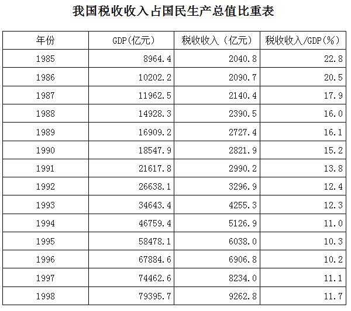

### 第 86 题

1985~1998年期间我国国内生产总值(GDP)总计为：

A. 451059.8亿元

B. 489870.3亿元

C. 491394.2亿元

D. 662167.8亿元

第 86 题 · 答案与解析

**参考答案（粉笔题库参考内容）**

C

**解析**

运用尾数法，要计算1985 ~ 1998年期间我国国内生产总值（GDP）总计，把小数部分相加即可，3 × 0.4 + 2 × 0.2 + 0.5 + 0.3 + 0.9+0.8+2×0.1+2×0.6+0.7= 1.2 + 1.8 + 1.3 + 1.9 = 6.2，故GDP总计的小数部分应为0.2。

故正确答案为C。

**考点**：简单加减计算、统计表

**来源**：2008年四川省公务员录用考试《行测》题第86题

### 第 87 题

1985~1998年期间我国税收收入占国内生产总值的比重（税收收入/GDP）比上年减少的年份共计有：

A. 5年

B. 7年

C. 8年

D. 10年

第 87 题 · 答案与解析

**参考答案（粉笔题库参考内容）**

D

**解析**

直接看表格最后一列数出税收收入/GDP（%）的比率比上年小的年份，分别为1986、1987、1988、1990、1991、1992、1993、1994、1995、1996，共计10年。

故正确答案为D。

**考点**：直接找数、统计表

**来源**：2008年四川省公务员录用考试《行测》题第87题

### 第 88 题

1985~1998年期间我国国内生产总值(GDP)增加额最大的年份是：

A. 1992年

B. 1994年

C. 1996年

D. 1998年

第 88 题 · 答案与解析

**参考答案（粉笔题库参考内容）**

B

**解析**

观察表格第二列，运用首数相减法：

1992年26638.1-21617.8=5\*\*\*；

1994年46759.4-34643.4=12\*\*\*；

1996年67884.6-58478.1=9\*\*\*；

1998年79395.7-74462.6=4\*\*\*。

故1994年GDP增加额最大。

故正确答案为B。

提示：和“尾数法”一样，“首数法”在某些复杂计算中非常简单快捷，应将二者一同掌握。

**考点**：增长量比较、统计表

**来源**：2008年四川省公务员录用考试《行测》题第88题

### 第 89 题

1985~1998年期间我国税收增长率最大的年份是：

A. 1993年

B. 1994年

C. 1996年

D. 1997年

第 89 题 · 答案与解析

**参考答案（粉笔题库参考内容）**

A

**解析**

1993年，(4255.3-3296.9)/3296.9≈958/3297；

1994年，(5126.9−4255.3)/4255.3≈872/4255；

1996年，(6906.8−6038)/6038 ≈ 869/6038；

1997年，(8234.0-6906.8)/6906.8≈1327/6907。

显然958/3297 ＞ 872/4255 ＞ 869/6038（分子越大，分母越小，分数越大）；958/3297与1327/6097相比，(958×2)/(3297×2)=1916/6594＞1327/6907，故958/3297最大，即1993年我国税收增长率最大。

故正确答案为A。

**考点**：一般增长率、统计表

**来源**：2008年四川省公务员录用考试《行测》题第89题

### 第 90 题

1985~1998年期间，我国国内生产总值(GDP)，税收收入，税收收入占我国国内生产总值(GDP)三者比上年同方向增减的年份共计有：

A. 1年

B. 3年

C. 5年

D. 6年

第 90 题 · 答案与解析

**参考答案（粉笔题库参考内容）**

B

**解析**

根据题干“······占······比上年”，可判定本题为两期比重问题。定位表格材料可得：1985~1998年期间，我国国内生产总值（GDP），税收收入逐年递增，税收收入占国内生产总值比重只在1989，1997，1998年比上年增加，则三者比上年同方向增减的年份为1989、1997、1998年，共3年。

故正确答案为B。

**考点**：两期比重、统计表

**来源**：2009年四川省公务员录用考试《行测》题（下半年）第81题

## 材料 2

根据下表回答以下各题。

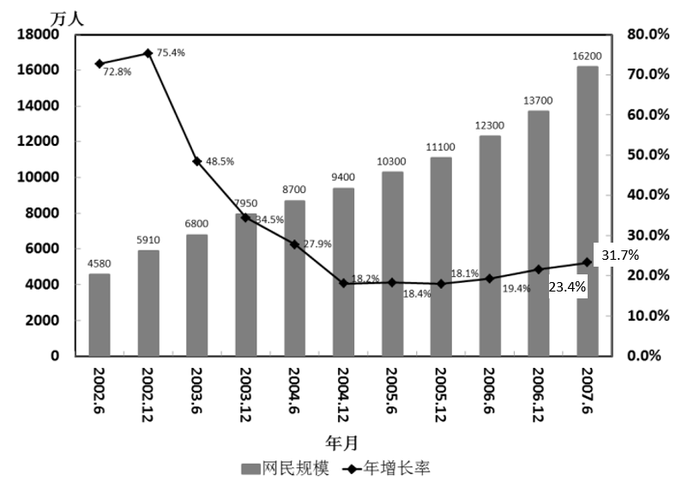

### 第 91 题

2007年6月与2006年同期相比，网民数增加了：

A. 1400万

B. 2000万

C. 2500万

D. 3900万

第 91 题 · 答案与解析

**参考答案（粉笔题库参考内容）**

D

**解析**

2007年6月，网民数量16200万人，2006年6月，网民数量12300万人，因此同比增加了16200-12300=3900万人。

故正确答案为D。

**考点**：增长量计算、统计图

**来源**：2008年四川省公务员录用考试《行测》题第91题

### 第 92 题

年底与年中相比，网民规模增长最快的年份是：

A. 2002年

B. 2003年

C. 2004年

D. 2006年

第 92 题 · 答案与解析

**参考答案（粉笔题库参考内容）**

A

**解析**

2002年，(5910 - 4580)/4580 = 1330/4580；

2003年，(7950-6800)/6800=1150/6800；

2004年，(9400 - 8700)/8700 = 700/8700；

2006年，(13700-12300)/12300 = 1400/12300。

1330/4580与1150/6800，700/8700相比，显然分母比其他两个分数分母小，分子比其他两个分数的分子大，因此，1330/4580＞1150/6800＞700/8700。1330/4580与1400/12300相比，(1330×2)/(4580×2)=2660/9160＞1400/12300，故1330/4580最大，即2002年增长率最快。

故正确答案为A。

**考点**：一般增长率、统计图

**来源**：2008年四川省公务员录用考试《行测》题第92题

### 第 93 题

2003～2006年，网民规模的年平均增长率是：

A. 21%

B. 23%

C. 32%

D. 34%

第 93 题 · 答案与解析

**参考答案（粉笔题库参考内容）**

A

**解析**

根据年均增长率的公式：A×(1+r)^n = B，2003~2006年，n=3，代入数据可得：7950×(1+r)^n = 13700，则(1+r)^n ≈ 1.7，取值计算r=20%，代入(1+20%)^3 = 1.2^3 = 1.44×1.2 ≈ 1.7，可知年均增长率最接近于20%，与A项最接近。

故正确答案为A。

**考点**：年均增长率、统计图

**来源**：2008年四川省公务员录用考试《行测》题第93题

### 第 94 题

2002年6月到2007年6月，网民的年平均增长数约为：

A. 1298 万

B. 1948 万

C. 2324 万

D. 2789 万

第 94 题 · 答案与解析

**参考答案（粉笔题库参考内容）**

C

**解析**

平均增长数=(16200−4580)÷5= 11620 ÷ 5 = 2324万人。

故正确答案为C。

**考点**：年均增长量、统计图

**来源**：2008年四川省公务员录用考试《行测》题第94题

### 第 95 题

下列说法正确的是：

A. 2002年到2007年，网民人数翻了两番

B. 从2003年开始，网民规模增长率开始持续下滑

C. 2002年到2007年，每6个月的网民增长人数保持在800万左右

D. 若保持2007年的同比增长率，则到2008年6月网民人数将超过20000万人

第 95 题 · 答案与解析

**参考答案（粉笔题库参考内容）**

D

**解析**

A选项错误，2002年网民规模为4580万人，翻两番等于4580×4=18320万人＞16200万人；

B选项错误，观察折线图，网民规模增长率从2005年起开始上升；

C选项错误，2002年至2007年，每6个月的网民增长数最少为700万人，最多为2500万人；

D选项正确，由图可知，2007年6月与2006年6月网民数分别为16200万人和12300万人，增长了16200-12300=3900万人，若保持2007年的同比增长率，则2008年6月网民人数比2007年6月网民人数的增长量至少应该在3900万人以上，所以2008年6月网民人数=16200+3900>20000万人。

故正确答案为D。

**考点**：统计图、综合分析

**来源**：2008年四川省公务员录用考试《行测》题第95题

## 材料 3

**根据下段文字回答以下各题。**

        2006年底，全国参加基本医疗保险人数为15737万人，比上年底增加1954万人。其中，参保职工11587万人，比上年底增加1565万人，参保退休人员4150万人。2006年，全国基本医疗保险基金收入1728亿元，支出1275亿元，分别比上年增长23.0%和18.1%。截止2006年底，基金累计结存1720亿元，其中统筹基金结存1056亿元，个人账户积累664亿元。

        2006年全年城镇基本养老保险基金比上年增长23.9%，其中征缴收入5215亿元，增长20.9%。各级财政补贴基本养老保险基金971亿元，中央财政预算安排774亿元。全年基金总支出4897亿元，比上年增长21.2%。

        2006年全国参加农村养老保险的人数为5374万，全年共有355万农民领取了养老金,比上年增加53万人,全年共支付养老金30亿元，年末农村养老保险基金累计结存354亿元。

        2006年底，全国参加失业保险人数为11187万人，比上年底增加539万人。2006年底，全国领取失业保险金人数为327万人，比上年底减少35万人。全国失业保险基金收入385亿元，比上年增长15.8%，支出193亿元，比上年下降6.9%。截止2006年底，基金累计结存708亿元。

### 第 96 题

2006年参保退休人数数量比上年增加了：

A. 9.37%

B. 10.34%

C. 13.51%

D. 19.91%

第 96 题 · 答案与解析

**参考答案（粉笔题库参考内容）**

B

**解析**

由文字材料第一段第一句话可计算出：2005年，参加基本医疗保险人数为15737-1954=13783万人，参保职工为11587-1565=10022万人，故参保退休人员为13783-10022=3761万人，(4150÷3761)-1 ≈ 10%，与B项最接近。

故正确答案为B。

**考点**：一般增长率、文字资料

**来源**：2008年四川省公务员录用考试《行测》题第96题

### 第 97 题

2005年全国基本医疗保险基金支出额为：

A. 1079.6亿元

B. 1123.7亿元

C. 989.4亿元

D. 1201.9亿元

第 97 题 · 答案与解析

**参考答案（粉笔题库参考内容）**

A

**解析**

根据材料第一段，2006年，全国基本医疗保险基金收入1728亿元，支出1275亿元，分别比上年增长23.0%和18.1%，因此2005年的全国基本医疗保险基金支出额= 1275/(1+18.1%) = 1275/1.181 ≈ 10**亿元，因选项差异较大，所以可以用首数相除法，计算结果最接近A。

故正确答案为A。

**考点**：基期计算、文字资料

**来源**：2008年四川省公务员录用考试《行测》题第97题

### 第 98 题

如果2007年全国城镇基本养老保险基金支出总额与2006年持平，且月支出额相当，那么，2006年结存的城镇基本养老保险基金大约可维持2007年多少个月的支出：

A. 4

B. 5

C. 6

D. 7

第 98 题 · 答案与解析

**参考答案（粉笔题库参考内容）**

B

**解析**

根据材料第二段，2006年全年城镇基本养老保险基金比上年增长23.9%，其中征缴收入5215亿元，增长20.9%。各级财政补贴基本养老保险基金971亿元，中央财政预算安排774亿元。全年基金总支出4897亿元，比上年增长21.2%；故可以算出2006年结存的城镇基本养老保险基金为：5215+971+774-4897=2063亿元，那么2006年结存的城镇基本养老保险基金大约可维持支出的月数为：2063 ÷ (4897 ÷ 12) ≈ 5个，故大约可维持5个月。

故正确答案为B。

**考点**：文字资料、现期平均数

**来源**：2008年四川省公务员录用考试《行测》题第98题

### 第 99 题

2005年年末失业保险基金累计结存：

A. 395亿元

B. 385亿元

C. 192亿元

D. 516亿元

第 99 题 · 答案与解析

**参考答案（粉笔题库参考内容）**

D

**解析**

根据材料第四段，2006年全国失业保险基金收入385亿元，比上年增长15.8%，支出193亿元，比上年下降6.9%。截止2006年底，基金累计结存708亿元。因此2005年年末失业保险基金累计结存=708-(385-193)=516亿元。

故正确答案为D。

**考点**：文字资料、简单加减计算

**来源**：2008年四川省公务员录用考试《行测》题第99题

### 第 100 题

2006年，资料中所述的四种保险中：

A. 全国基本医疗保险基金的结存额最高

B. 全国城镇基本养老保险基金收入和支出的增幅均最大

C. 全国农村养老保险，参加人数最少，基金支出额最低

D. 全国失业保险基金是唯一一项支出减少的基金

第 100 题 · 答案与解析

**参考答案（粉笔题库参考内容）**

D

**解析**

根据材料第一段，2006年底全国基本医疗保险基金累计结存1720亿元；根据第二段，2006年全年城镇基本养老保险基金累计结存额=5215+971+774-4897=2063亿元，城镇基本养老保险基金结存额高于基本医疗保险基金结存额，故A选项错误；

根据材料第三段，农村养老保险基金的收入和支出增幅无法得知，故B选项错误；

根据材料第二段，参加全年城镇基本养老保险的人数无法得知，故C选项错误。

故正确答案为D。

**考点**：文字资料、综合分析

**来源**：2008年四川省公务员录用考试《行测》题第100题

