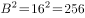
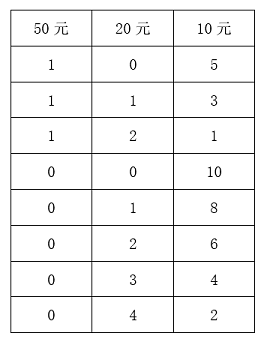
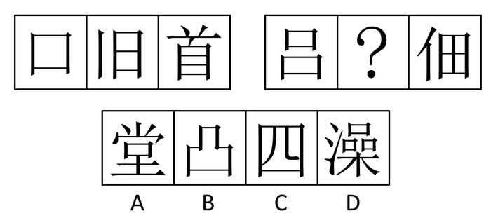
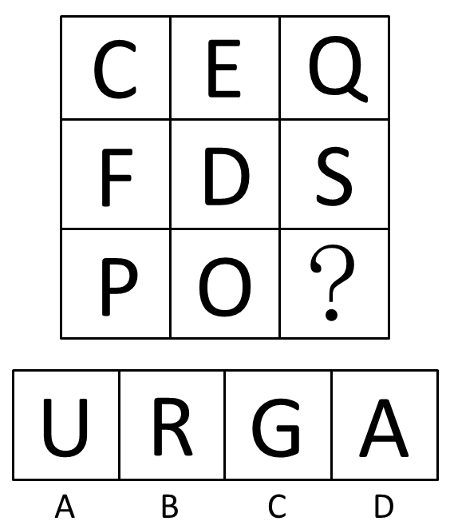
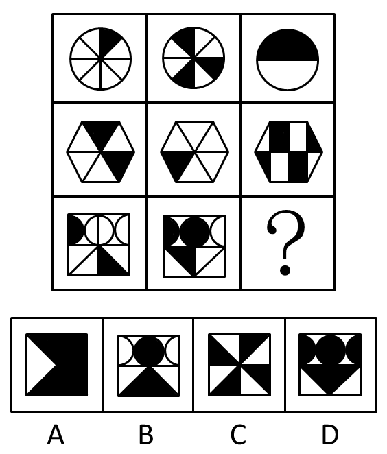
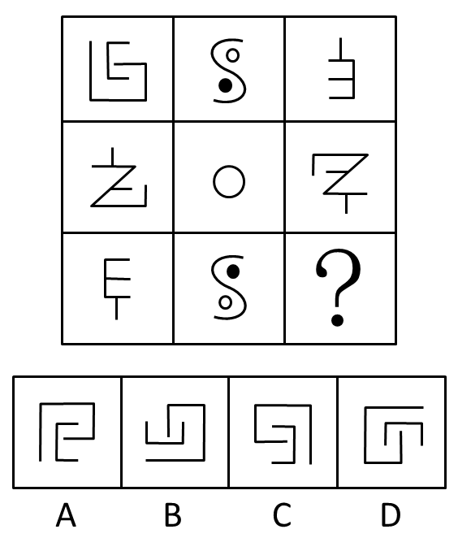
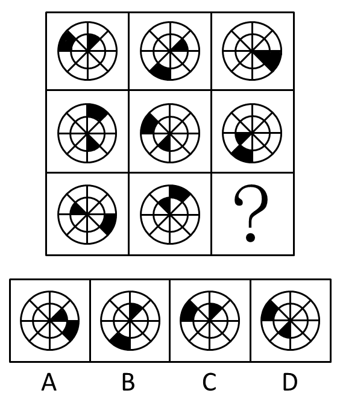
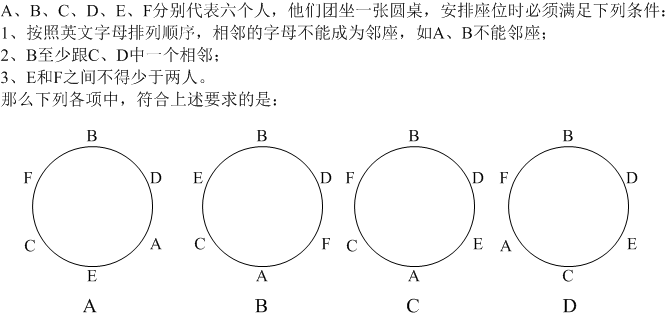

# 2009年四川省公务员录用考试《行测》题（下半年）

<!-- gwy:overview:start -->
> **四川 · 2009 · 行测 · 统考** ｜ 81 题 · 图片 41 处 · 答案随题折叠

| 题型模块 | 题量 | 题号 |
| --- | ---: | ---: |
| 数量关系 | 15 | 1–15 |
| 言语理解与表达 | 35 | 16–50 |
| 判断推理 | 25 | 51–75 |
| 常识判断 | 5 | 76–80 |
| 资料分析 | 1 | 81–81 |
| **合计** | **81** | |

导航：[题型与作答说明](#题型与作答说明) · [题目](#题目) · [材料 1](#材料-1)
<!-- gwy:overview:end -->

> 候选采集稿。参考答案及解析来自粉笔页面，不代表官方答案或真实高分答卷；来源使用许可与原卷对应关系仍需人工核实。

## 题型与作答说明

数量关系

（15题）

本部分包括数字推理与数学运算两种类型的试题。

言语理解与表达

（35题）

本部分包括逻辑填空、语句表达与阅读理解三种类型的试题。

判断推理

（25题）

本部分包括定义判断、逻辑判断、常识判断与类比推理四种类型的试题。

常识判断

（5题）

根据题目要求，在四个选项中选出一个最恰当的答案。

资料分析

（1题）

所给出的图、表或一段文字均有5个问题要你回答。你应根据资料提供的信息进行分析、比较、计算和判断处理，从四个备选答案中选出符合题意的答案。

## 题目

### 第 1 题

2，8，18，32，（  ）

A. 48

B. 50

C. 64

D. 72

第 1 题 · 答案与解析

**参考答案（粉笔题库参考内容）**

B

**解析**

观察数列，原数列可变形为2×1^2，2×2^2，2×3^2，2×4^2，则下一项为，故所求项为50。

故正确答案为B。

**来源**：2009年四川省公务员录用考试《行测》题（下半年）第1题

### 第 2 题

4，3，2，0，﹣3，﹣8，（  ）

A. ﹣15

B. ﹣16

C. ﹣17

D. ﹣18

第 2 题 · 答案与解析

**参考答案（粉笔题库参考内容）**

B

**解析**

观察数列，无明显特征且变化平缓且越来越小，优先考虑多级数列。作差，前一项减后一项得到新数列：1，1，2，3，5。观察新数列发现相邻三个数字之间的关系有1+1=2，即规律为：第一项+第二项=第三项。验证后面：1+2=3，2+3=5，均符合此规律，新数列下一项为3+5=8，则原数列所求项=-8-8=-16。

故正确答案为B。

**来源**：2009年四川省公务员录用考试《行测》题（下半年）第2题

### 第 3 题

6，22，39，60，90，（  ）

A. 136

B. 124

C. 118

D. 112

第 3 题 · 答案与解析

**参考答案（粉笔题库参考内容）**

A

**解析**

观察数列，无明显特征且变化相对平缓，优先考虑多级数列。作差，后一项减前一项得到二级数列：16，17，21，30，二级数列没有明显特征。继续作差得到新数列为：1，4，9，新数列依次为1^2， 2^2，3^2，则新数列下一项为4^2=16。因此二级数列下一项为30+16=46，则原数列所求项=90+46=136。

故正确答案为A。

**来源**：2009年四川省公务员录用考试《行测》题（下半年）第3题

### 第 4 题

33，37，42，49，59，（  ）

A. 71

B. 72

C. 73

D. 74

第 4 题 · 答案与解析

**参考答案（粉笔题库参考内容）**

C

**解析**

观察数列，无明显特征且变化平缓，优先考虑多级数列。作差，后一项减前一项得到二级数列：4，5，7，10，二级数列没有明显特征且变化平缓。继续作差得到新数列：1，2，3，是公差为1的等差数列，则新数列下一项为1+3=4，二级数列下一项为10+4=14，则原数列所求项=59+14=73。

故正确答案为C。

**来源**：2009年四川省公务员录用考试《行测》题（下半年）第4题

### 第 5 题

1/140，1/80，1/45，1/25，(     )

A. 1/15

B. 1/10

C. 1/7

D. 4/55

第 5 题 · 答案与解析

**参考答案（粉笔题库参考内容）**

D

**解析**

题干均为分数，考虑分数数列，观察数列，分子均为1。分母为：140，80，45，25，（    ）。无明显规律且变化较快，优先考虑递推，观察相邻两个数字之间的关系依次有：， ，，即规律为：前一项÷2与一个首项为10公比为1/2的数列依次相加，则分母下一项为，故原数列所求项。

故正确答案为D。

**来源**：2009年四川省公务员录用考试《行测》题（下半年）第5题

### 第 6 题

20102010×2009－2010×2009×10001＝

A. 2010

B. 2009

C. 1001

D. 0

第 6 题 · 答案与解析

**参考答案（粉笔题库参考内容）**

D

**解析**

将20102010转化为，则原式。

故正确答案为D。

**来源**：2009年四川省公务员录用考试《行测》题（下半年）第6题

### 第 7 题

式子√3-1，2-√2，√6-2，，√11-3中最大的一个是：

A. √3-1

B. 2-√2

C. 

D. √11-3

第 7 题 · 答案与解析

**参考答案（粉笔题库参考内容）**

A

**解析**

首先将题目里的式子进行分子有理化，原式依次为：，，，，。观察发现，这几个根式分数的分子相同，2/(√3+1)的分母最小，因此分数值最大，所以√3-1最大。

故正确答案为A。

**来源**：2009年四川省公务员录用考试《行测》题（下半年）第7题

### 第 8 题

甲、乙、丙三名羽毛球选手某天训练中分别用了A、B、C个羽毛球，总数为56个，若A：B＝B：C，那么乙选手所用羽毛球数是：

A. 16

B. 12

C. 9

D. 8

第 8 题 · 答案与解析

**参考答案（粉笔题库参考内容）**

A

**解析**

方法一：根据题干A∶B=B∶C可知，A、B、C三者成等比关系；总数56＝7×8，1＋2＋4＝7，满足A∶B∶C=1：2：4的比例关系，则乙用了2×8＝16个。

方法二：根据题干A∶B=B∶C，可得，代入A项，若B=16，则A+C=40，=A×C，当A＝32，C＝8时满足题意。

故正确答案为A。

**考点**：和差倍比问题

**来源**：2009年四川省公务员录用考试《行测》题（下半年）第8题

### 第 9 题

某单位职员在健身活动中举行乒乓球比赛，每个选手都要和其他选手各赛一场，一共120场比赛，则该单位参加人数是多少人：

A. 18

B. 16

C. 15

D. 14

第 9 题 · 答案与解析

**参考答案（粉笔题库参考内容）**

B

**解析**

根据题意，每个选手都要和其他选手各赛一场，可知进行的是单循环赛，需比赛场；整理得：，代入选项验证，当n=16时，，满足题意。

故正确答案为B。

**考点**：排列组合问题-其他

**来源**：2009年四川省公务员录用考试《行测》题（下半年）第9题

### 第 10 题

某人将一张百元人民币换成零钱，他希望所换零钱的最低币值为10元，共有换法总数为：

A. 8

B. 6

C. 4

D. 9

第 10 题 · 答案与解析

**参考答案（粉笔题库参考内容）**

A

**解析**

此题先分类再分步，第一类，含有50元币值，则20币值可能为0、1、2，共有3种；第二类，不含有50元币值，则20元币值可能为0、1、2、3、4，共有5种。因此，共有5＋3＝8种。

故正确答案为A。

**考点**：基础排列组合

**来源**：2009年四川省公务员录用考试《行测》题（下半年）第10题

### 第 11 题

某医院统计某天求诊的病人，内科150人，外科90人，内外科都求诊的20人，这天一共有多少病人：

A. 240

B. 220

C. 200

D. 170

第 11 题 · 答案与解析

**参考答案（粉笔题库参考内容）**

B

**解析**

根据两集合容斥原理可知，这一天共有150＋90－20＝220位病人。

故正确答案为B。

**考点**：两集合

**来源**：2009年四川省公务员录用考试《行测》题（下半年）第11题

### 第 12 题

AB两地间有条公路，甲从A地出发步行到B地，乙骑摩托车从B地不停的往返两地之间，若它们同时出发，80分钟后两人第一次相遇，100分钟后乙第一次超过甲，当甲到达B地时，甲乙相遇多少次？

A. 5

B. 7

C. 9

D. 10

第 12 题 · 答案与解析

**参考答案（粉笔题库参考内容）**

A

**解析**

设AB间距离为S，甲速度为a，乙速度为b。已知80分钟后两人第一次相遇可知：(a+b)×80=S，且100分钟后乙第一次超过甲可知：(b-a)×100=S。联立两式，化简可得：9a=b，即a:b=1:9。则设甲速度为1，乙速度为9，则S=(1+9)×80=800，当甲到达B地时，甲走过的距离为800，则乙走过的距离为。根据两端出发相遇公式，两人相遇第n次时走过的路程和为(2n-1)S，因此(2n-1)×800=800+7200，解得n=5.5，即相遇了5次，还没到第6次相遇。

故正确答案为A。

**考点**：相遇追及

**来源**：2009年四川省公务员录用考试《行测》题（下半年）第12题

### 第 13 题

学校给一批新入校的同学分宿舍，若每个房间住7人，则6人没有床位，若每个房间住8人，则空出3个房间，新同学人数是：

A. 188

B. 194

C. 206

D. 216

第 13 题 · 答案与解析

**参考答案（粉笔题库参考内容）**

D

**解析**

假设有x个房间，则根据题意可得，7x+6=8(x-3)，解得x＝30，则共有30×7＋6＝216名新同学。

故正确答案为D。

**考点**：和差倍比问题

**来源**：2009年四川省公务员录用考试《行测》题（下半年）第13题

### 第 14 题

有一辆火车运输2000只玻璃瓶，运费按到达时完好瓶子数目计算，每只2角，如有破损，破损一只还要倒赔2角，结果得到393.2元，破损只数是：

A. 17

B. 24

C. 34

D. 36

第 14 题 · 答案与解析

**参考答案（粉笔题库参考内容）**

A

**解析**

根据题意，设破损的玻璃瓶为x只，则完好的玻璃瓶为(2000－x)只，根据共得到393.2元，可列方程：，解得x＝17，即破损17只玻璃瓶。

故正确答案为A。

**考点**：和差倍比问题

**来源**：2009年四川省公务员录用考试《行测》题（下半年）第14题

### 第 15 题

有一堆黑白棋子，其中黑子个数是白子个数的2倍，如果从中每次同时取出黑子5个，白子3个，最后白子剩2个，黑子剩15个，取棋子的次数是：

A. 13

B. 11

C. 10

D. 9

第 15 题 · 答案与解析

**参考答案（粉笔题库参考内容）**

B

**解析**

假设取棋子的次数为n次，则根据题意可得5n＋15＝2×(3n＋2)，解得n＝11。

故正确答案为B。

**考点**：和差倍比问题

**来源**：2009年四川省公务员录用考试《行测》题（下半年）第15题

### 第 16 题

中国的城市发展，已进入软实力竞争时代。单靠粗放式的资源消耗、廉价劳动力换取硬实力发展的模式已经（　），要想可持续发展，必须关注软实力，建设软实力，倚重软实力。

A. 难乎其难

B. 微乎其微

C. 难以为继

D. 难辞其咎

第 16 题 · 答案与解析

**参考答案（粉笔题库参考内容）**

C

**解析**

考查选择成语填空的能力。

由“要想可持续发展”可以推出前句“粗放式······”模式已经行不通了，C项“难以为继”指很难再继续下去，符合语境。

A项“难乎其难”是指非常困难，硬实力发展的模式并不难，只是难维继下去，错误；B项“微乎其微”是指非常小或非常少，这与主体“发展模式”搭配不当；D项“难辞其咎”是指难以推脱其过失，前句并没有下结论是谁的过错，错误。

故正确答案为C。

**考点**：关联关系-并列关系、对应关系-前后呼应、成语填空

**来源**：2009年四川省公务员录用考试《行测》题（下半年）第16题

### 第 17 题

对于任何一个家庭而言，组建成功的继亲家庭最基本的条件是关爱、仁慈以及相互尊重，（　），仅有爱情是不够的，（　），爱情肯定是任何家庭建立的基石，（　），建立一个成功的继亲家庭，还涉及到很多其他的重要因素。

A. 可见，然而，当然

B. 总之，但是，因为

C. 然而，因为，所以

D. 所以，当然，但是

第 17 题 · 答案与解析

**参考答案（粉笔题库参考内容）**

D

**解析**

考查选择关联词填空的能力。

文段首先提到成功的继亲家庭最基本的条件包括三个，因此后文“仅有爱情是不够的”与上文构成因果关系，排除B项递进、C项转折，在A、D两项中选择。

最后两个分句之间先扬后抑，首先肯定了爱情是任何家庭建立的基石，紧接着话锋一转，表示仅有爱情不够，还涉及到很多其他的重要因素。因此后两个分句之间是转折关系（但是）。

故正确答案为D。

**考点**：关联关系-因果关系

**来源**：2009年四川省公务员录用考试《行测》题（下半年）第17题

### 第 18 题

政府要改变陈旧的行事模式，除了自我改革的意识，还需要社会的（    ）与（    ），而这种社会性制衡最重要的表征，便是全社会的“法行动”。

A. 监督 参与

B. 变革 创新

C. 协调 制衡

D. 监督 制衡

第 18 题 · 答案与解析

**参考答案（粉笔题库参考内容）**

D

**解析**

考查选择实词填空的能力。

文段讲的是政府改革，“除了自我改革”之外，表示后面应该是“自我改革”的补充，B项“变革”意思一样，故排除。且社会可以通过舆论等途径对政府工作进行监督，而社会“协调”政府，显然不合适，排除C项。

A、D两项中，监督和参与有重复的意思，监督本身就是一种参与，而制衡则比监督更进一步，是一种效果的呈现，也与后一句“社会性制衡”相呼应，此处选“制衡”更恰当。

故正确答案为D。

**考点**：实词填空、对应关系-前后呼应

**来源**：2009年四川省公务员录用考试《行测》题（下半年）第18题

### 第 19 题

开门是一个积极的行动，它本身存在（　）的情趣，进入一种新的时刻，达到一种新的目标，实现一种新的转换，它包含一种人世间极深的情感的蓄积与（　），重聚，回归，和解，以及长久分离的情人的惊喜。

A. 惊心动魄 凸现

B. 振奋人心 表达

C. 震撼人心 张扬

D. 心神荡漾 展现

第 19 题 · 答案与解析

**参考答案（粉笔题库参考内容）**

B

**解析**

第一空，考查成语的搭配。惊心动魄：使人神魂震惊，后常形容使人十分惊骇紧张到极点。振奋人心：使人们振作奋发。震撼人心：指某件事对人内心震动很大。心神荡漾：心情、精神状态起伏不定。文句指出开门是“积极的行动”以及“新的时刻”“新的目标”“新的转换”一系列词汇说明，这种行动使得人们积极向上。因此，第一个空应填B项“振奋人心”，而“惊心动魄”、“震撼人心”、“心神荡漾”表达的情绪起伏都过于激烈，且没有积极的含义。

第二空，考查实词的搭配。根据“人世间极深的情感”作主语判断，此处填入情感的谓语，文中连续使用了拟人化的动词“蓄积”、“重聚”、“回归”等，由内而外层层深入，可知填入“表达”更符合这里拟人的语气和进展的程度。张扬是指宣扬声张，与情感不搭配；展现是呈现展示，凸现比展现程度更深，这两个词没有拟人化的意味。

故正确答案为B。

**考点**：对应关系-前后呼应、混搭填空、词的辨析-感情色彩

**来源**：2009年四川省公务员录用考试《行测》题（下半年）第19题

### 第 20 题

与2008年国人在雪灾、地震、奥运、丰收种种（  ）的情绪中翻滚相比，2009年的开端显得平稳了很多。

A. 荡气回肠

B. 跌宕起伏

C. 悲欢离合

D. 峰回路转

第 20 题 · 答案与解析

**参考答案（粉笔题库参考内容）**

B

**解析**

此题是成语填空题。

荡气回肠：使肝肠回旋，使心气激荡。形容文章、乐曲十分婉转动人。跌宕起伏：形容事物多变，不稳定。跌宕：富于变化，有顿挫波折。悲欢离合：泛指生活中经历的各种境遇和由此产生的悲哀喜悦等情感。峰回路转：形容山峰、道路曲折迂回。比喻事情经历挫折失败后，出现新的转机。

文中需要修饰情绪，A项多形容文章、乐曲，排除；C项悲欢离合多指生活的不同机遇引发的情感变化，比较个人化，并不适合题干所指的社会事件，排除；D项需要出现新的转机，文中所列事项是并列关系，没有先后，排除。

故正确答案为B。

**考点**：对应关系-前后呼应、成语填空

**来源**：2009年四川省公务员录用考试《行测》题（下半年）第20题

### 第 21 题

电脑上的“大脑训练”游戏曾经被斥责为（  ），但最近发表的一个研究结果表明，这种训练确实能够提高65岁以上老年人的记忆力和注意力。事实上，人的大脑也在（  ）让老年人的退休生活变得愉快。

A. 天方夜谭，想方设法

B. 荒谬之词，尽心尽力

C. 无稽之谈，尽其所能

D. 奇谈怪论，忠心耿耿

第 21 题 · 答案与解析

**参考答案（粉笔题库参考内容）**

C

**解析**

考查选择成语填空的能力。

天方夜谭：比喻虚诞夸饰的议论，荒诞不经的说法。荒谬之词：错得离谱的说法。无稽之谈：没有根据的说法。奇谈怪论：奇怪的、不合情理的言论。

文段中“但最近发表的一个研究结果表明，这种训练确实能……”转折词“但”表明，人们研究“大脑训练”游戏能够提高老年人记忆力是有根据的，这也说明“大脑训练”游戏在此前被认为是毫无根据的，因此第一空选择“无稽之谈”，A、B、D三项均无法与后文找到根据相对应。

故正确答案为C。

**考点**：关联关系-转折关系、成语填空

**来源**：2009年四川省公务员录用考试《行测》题（下半年）第21题

### 第 22 题

杰克逊从一个美国黑人蓝领家庭中具有歌唱天赋的儿童，成长为（  ）的超级巨星。在上世纪80、90年代，他在世界流行乐坛的地位（  ）。

A. 家喻户晓，无与伦比

B. 享誉全球，无人能及

C. 世界知名，鹤立鸡群

D. 闻名中外，独占鳌头

第 22 题 · 答案与解析

**参考答案（粉笔题库参考内容）**

B

**解析**

第一空，括号修饰“杰克逊”这一美国超级巨星，D项“闻名中外”指中国和外国都知道，其主语是中国的人或者事物。杰克逊是美国人，排除；由“他在世界流行乐坛的地位”可知，文段强调的是在“全世界范围内”，A项由于前句出现“美国”一词，使“家喻户晓”的范围限制在美国的范围以内，不符合文意，排除。B项“享誉全球”、C项“世界知名”均可体现“杰克逊”在全世界都拥有很好的名气，与文段内容契合，保留。

第二空，括号修饰“地位”，且因为杰克逊是“超级巨星”，故其在乐坛的地位应是极高的。B 项“无人能及”指没人比得上，可体现出杰克逊在音乐领域遥遥领先，地位极高，符合文意，当选。C项“鹤立鸡群”比喻一个人的仪表或才能在周围的一群人里显得很突出，其主语是人，而不是“地位”，排除。

故正确答案为B。

【文段来源】《杰克逊——影响堪比奥巴马的黑人》

**考点**：成语填空、词的辨析-搭配对象

**来源**：2009年四川省公务员录用考试《行测》题（下半年）第22题

### 第 23 题

中国特色社会主义理论体系产生、形成于改革开放的伟大实践，又指导着改革开放的历史进程。其中，邓小平理论是对什么是社会主义、怎么建设社会主义的（  ）解读；“三个代表”重要思想是对建设什么样的党、怎么建设党的（  ）的回答；科学发展观是对实现什么样的发展、怎样发展的（  ）总结。

A. 奠基性 创造性 开拓性

B. 奠基性 深刻性 科学性

C. 根本性 全面性 实践性

D. 根本性 先进性 时代性

第 23 题 · 答案与解析

**参考答案（粉笔题库参考内容）**

A

**解析**

考查选择实词填空的能力。

第一空，邓小平理论、“三个代表”、科学发展观这三个理论应该是从无到有，步步深入的演进过程。第一个空奠基性和根本性比较可得，这三个理论适应不同时期的需要，并没有谁根本谁表面的区分，因此第一空应填“奠基性”，排除C、D两项。

第二空，关于“建设什么样的党、怎么建设党”这个问题，以前从未有人给出过答案，所以“三个代表”重要思想是创造性回答，第二空应填“创造性”，“深刻性”不足以表达这个思想独一无二的特点。

第三空，“科学性”与“科学发展观”语义重复，明显不合文意，排除。

故正确答案为A。

**考点**：实词填空、对应关系-前后呼应

**来源**：2009年四川省公务员录用考试《行测》题（下半年）第23题

### 第 24 题

一些法学学者缺乏对（　）在技术层面展开的研究，只是从表面上对儒家传统治理方式的批判，喜欢大的宏观理论而厌倦所谓的雕虫小技，这是对法律人集体经验和智慧的（  ）。

A. 法制，漠视

B. 法制，敌视

C. 法治，漠视

D. 法治，敌视

第 24 题 · 答案与解析

**参考答案（粉笔题库参考内容）**

C

**解析**

考查选择实词填空的能力。

第一空，法制：法律制度；法治：依据法律治理国家，是一种与“人治”相对应的治理社会的理念和方法。由“儒家传统治理方式”可知，文段谈论的是治理国家的方式，而不是法律制度。故第一空填“法治”，排除A、B两项。

第二空，漠视：冷淡地对待，不放在心上。敌视：当做敌人看待。由“厌倦”一词可看出，“敌视”一词程度过重，“一些法学学者”并非将“法律人集体经验和智慧”视为仇敌，只是看轻、不重视而已，因此“漠视”更为恰当。

故正确答案为C。

**考点**：实词填空、词的辨析-程度轻重、词的辨析-词义侧重

**来源**：2009年四川省公务员录用考试《行测》题（下半年）第24题

### 第 25 题

西南某高校校长日前在接受记者采访时透露，为预防研究生学位论文抄袭，学校下一步将考虑（　）“反剽窃”软件。据悉，该校已经在网上发布软件研制招标公告和相关（　）。

A. 起用，启事

B. 起用，启示

C. 启用，启事

D. 启用，启示

第 25 题 · 答案与解析

**参考答案（粉笔题库参考内容）**

C

**解析**

考查选择实词填空的能力。

启用：开始使用，一般用于物。起用：重新任用已退职或免职的官员，一般用于人。“软件”是物，因此第一空应填“启用”，排除A、B两项。

启示：启发、指示，使人有所领悟。启事：公开声明某事而刊登在报刊上或张贴在墙壁上的文字。因此在网上发布的应该是“公告”和“启事”，排除D项。

故正确答案为C。

**考点**：实词填空、词的辨析-搭配对象、词的辨析-词义侧重

**来源**：2009年四川省公务员录用考试《行测》题（下半年）第25题

### 第 26 题

下列句子中，成语使用正确的一项是：

A. 大家就环保问题缘木求鱼，踊跃发言，热烈讨论，已经预示着此次研讨会将获得巨大的成功。

B. 暴雨导致山体滑坡，大量房屋塌陷，解放军战士明火执仗，在深山老林里寻找幸存者的下落。

C. 日本侵略者的士气受到巨大重创，众多迹象集中显示其最主要的原因是师出无名，不得人心。

D. 改革开放三十年来，电子技术企业经过革新，产量和质量迅速上升，收到了事倍功半的效果。

第 26 题 · 答案与解析

**参考答案（粉笔题库参考内容）**

C

**解析**

考查辨析成语使用对错的能力。

C项，师出无名，出兵没有正当理由，也引申为做某事没有正当理由。与句中“日本侵略者的士气受到巨大重创”“不得人心”相呼应，切合语境。

A项，缘木求鱼是贬义词，指爬上树去找鱼，比喻行事的方向、方法不对，必将劳而无功，与句子所表达的结果“获得巨大的成功”正好相反，故使用错误；B项，明火执仗是贬义词，指点着火把，拿着武器，形容公开抢劫或肆无忌惮地干坏事，与句子感情色彩不相符，故使用错误；D项，事倍功半意思是费力大而收效小，与句子所表达的“经过革新，产品和质量迅速上升”含义正好相反，故使用错误。

故正确答案为C。

**来源**：2009年四川省公务员录用考试《行测》题（下半年）第26题

### 第 27 题

下列句子中，有歧义的一项是：

A. 没有人愿意说出这个秘密。

B. 组织上已经调查过黄主任。

C. 教育局采取了我们的建议。

D. 我特别喜欢早晨起来读书。

第 27 题 · 答案与解析

**参考答案（粉笔题库参考内容）**

D

**解析**

考查辨析歧义的能力。

D项“我特别喜欢早晨起来读书”既可以理解为我喜欢在“早晨”起来读书，而不是在其他时间；又可以理解为我喜欢在早晨“读书”而不是做其他事情。

故正确答案为D。

**来源**：2009年四川省公务员录用考试《行测》题（下半年）第27题

### 第 28 题

下列句子中，有语病的一项是：

A. 篮球巨星奥尼尔深受广大球迷所欢迎，因为他不仅球艺精湛，而且很幽默，给球迷们带来了很多快乐。

B. 一篇文章只有当它不仅能够给人以心智的启迪，也能够给人以美的陶冶的时候，才能算是一篇好文章。

C. 衡量一个社会文明程度的标尺在于看它在多大程度上、多大的范围内为个人自由充分的发展提供可能。

D. 人们的内心都有漂泊的冲动和流浪的向往，渴望新鲜的感受和生命的奇遇，这是自由探索的力量源泉。

第 28 题 · 答案与解析

**参考答案（粉笔题库参考内容）**

A

**解析**

考查辨析病句的能力。

A项“受……欢迎”是常用的表被动的结构，“所”字赘余，应删去。

故正确答案为A。

**来源**：2009年四川省公务员录用考试《行测》题（下半年）第28题

### 第 29 题

下列句子中，没有语病的一项是：

A. “日全食”发生那天，各大媒体的新闻记者和新闻采访车、天文学家和天文爱好者都放弃了休息，自始至终关注这一天文奇观。

B. 试问，高考文理分科的科学性在哪里？是不是只学习文科或者只学习理科，人人就可以顺利成才了呢？我的回答是肯定的。

C. 现代派画家往往通过绘画来表达自己敏锐的视觉感受，又从对艺术作品的感性体验，成功地过渡到对历史问题的理性思考。

D. 国家推行“三支一扶”政策的目的，就是积极采取各种办法培养和提高中小学教师的水平，尤其是西部地区的师资水平。

第 29 题 · 答案与解析

**参考答案（粉笔题库参考内容）**

C

**解析**

考查辨析病句的能力。

A项主谓搭配不当，“新闻采访车”不能“放弃了休息”；B项“我的回答是肯定的”指代不明，不知道肯定的是“科学性”还是“顺利成才”；D项动宾搭配不当，“水平”不能“培养”，应将“培养和”删去，且“目的”就是“积极采取各种办法”，搭配不当。

故正确答案为C。

**来源**：2009年四川省公务员录用考试《行测》题（下半年）第29题

### 第 30 题

下列句子中，没有歧义的一项是：

A. 别急着走啊，我还没来得及和你算账呢。

B. 塑造完美形象，引领时代潮流，需要从头开始。

C. 那人已经没生气了，我们不用再管他了。

D. 好的，我马上给你们办理。

第 30 题 · 答案与解析

**参考答案（粉笔题库参考内容）**

D

**解析**

考查辨析歧义的能力。

A项“算账”既可以理解为“结账”，也可以理解为“报仇”；B项“从头开始”，既可以理解为从“头部”开始，比如“美发”，也可以理解为事情重新开始；C项“生气”既可以理解为“生命力”，也可以理解为“发怒”。

故正确答案为D。

**来源**：2009年四川省公务员录用考试《行测》题（下半年）第30题

### 第 31 题

下列句子中，没有歧义的一句是：

A. 我就不相信你今天不来。

B. 晓明没有爸爸哪儿也不去。

C. 天天都吃同一种杂酱面真是倒胃口。

D. 一群兴高采烈的孩子和老师走在乡间的田野上。

第 31 题 · 答案与解析

**参考答案（粉笔题库参考内容）**

C

**解析**

本题考查辨析歧义的能力。

A项，既可以理解为我就不相信你，我今天不来；也可以理解为“我就不相信，你今天不来”。B项，既可以理解为晓明如果没有爸爸的陪伴，就哪儿也不去；也可以理解为晓明没有爸爸（可能是爸爸过世了），所以他哪儿也不去。D项，既可以理解为“一群兴高采烈的孩子”和老师走在田野上，也可以理解为一群“兴高采烈的孩子和老师”走在田野上。

故正确答案为C。

**来源**：2009年四川省公务员录用考试《行测》题（下半年）第31题

### 第 32 题

下列句子中，有歧义的一句是：

A. 因涉嫌洗钱案众多疑点，陈水扁一家人昨日再受传唤。

B. 考试制度催生和促进了中国类型多样的考试经济。

C. 岁末将近，北京瑟瑟的寒流中吹起一股热辣的“韩流”。

D. 注意区分普通感冒与H1N1病毒引发的高烧症状。

第 32 题 · 答案与解析

**参考答案（粉笔题库参考内容）**

D

**解析**

本题考查辨析歧义的能力。

D项既可以理解为“普通感冒”与“H1N1病毒引发的高烧症状”之间的区别，也可以理解为“普通感冒引起的高烧症状”和“H1N1病毒引发的高烧症状”之间的区别。

故正确答案为D。

**来源**：2009年四川省公务员录用考试《行测》题（下半年）第32题

### 第 33 题

下列语句中，没有语病的一项是：

A. 为减少对耕地的占用，京沪高铁这一中国最先进的铁路线全程4个多小时，被普遍应用。

B. 政府是公共服务的提供者，政府补贴铁路客运的低廉票价，是世界许多国家的通行做法。

C. 铁路部门考虑不仅在京沪高铁上开发多元化的客运产品，而且增设卧铺。

D. 正在建设的国家重点交通基础设施项目京沪高速铁路，将使有着百年铁路史的镇江进入全新的高速火车时代。

第 33 题 · 答案与解析

**参考答案（粉笔题库参考内容）**

D

**解析**

本题考查辨析病句的能力。

A项，“被普遍应用”缺少主语，前句“全程4个多小时”干扰了主语判断，句子表意不清；B项，“政府补贴铁路客运的低廉票价”应改为“通过政府补贴维持铁路客运的低廉票价”，或者将“的低廉票价”删去，不然意思含混，低廉票价是政府补贴的后果，而非政府在补贴低廉票价；C项，语序不当，“考虑”应放在“不仅”之后，并在“而且”后加上“考虑”。

故正确答案为D。

**来源**：2009年四川省公务员录用考试《行测》题（下半年）第33题

### 第 34 题

下列语句中，有语病的一项是：

A. 各地要密切关注商品房价格运行态势，研究具体对策，加强价格行为监管力度。

B. 截止2007年开始，随着商品房价格上涨，居住用地的地价水平和增速达到了历史最高水平，呈现了前所未有的需求膨胀。

C. 对一些中低收入家庭而言，当商品房价格高涨时，他们很有可能就会进入二手房市场。

D. 然而，就在首批限价房建设过程中，房地产市场经历了一场波及全国的调整，限价房在一些城市逐渐失去价格优势。

第 34 题 · 答案与解析

**参考答案（粉笔题库参考内容）**

B

**解析**

考查辨析病句的能力。

B项“截止2007年开始”句式杂糅，可改为“截至2007年”，或者“从2007年开始”。

故正确答案为B。

**来源**：2009年四川省公务员录用考试《行测》题（下半年）第34题

### 第 35 题

下列语句中，有歧义的一项是：

A. 我们这几天就像生活在云端，一切都不真实。

B. 随着新媒体的涉足，事件传播的范围日益扩大。

C. 李东告诉我，等他来了就开始工作。

D. 戴高乐机场屋顶坍塌是由于结构设计失误所造成的

第 35 题 · 答案与解析

**参考答案（粉笔题库参考内容）**

C

**解析**

考查歧义辨析的能力。

C项“他”指代不明，既可以指李东，也可指代“李东”和“我”之外的第三人。

故正确答案为C。

**来源**：2009年四川省公务员录用考试《行测》题（下半年）第35题

### 第 36 题

从根本上讲，工具理性是一种技术理性。现代化资本主义将大规模工业研究和科学技术综合为一个系统，这使得科学失去了独立性，转而成为了行政化的控制手段。工具理性渗透到社会结构和社会生活的各个方面，开始对人进行全面的统治、控制以及把控。正如马尔库塞所言，韦伯所说的“理性化”所实现的是一种特殊的、未被公认的支配形式，科技的工具理性化的结果为一般既存体制的支配机器提供了合法性基础。
下列对“工具理性”的阐述，不符合文意的一项是：

A. 使得科学丧失了自主，沦为行政的附庸。

B. 已成为了行政的支配形式，成为了统治形式本身。

C. 作为一种技术理性，能够渗透到社会和统治的各个方面。

D. 成了社会的组织原则，为既存体制的运转提供了合法性依据。

第 36 题 · 答案与解析

**参考答案（粉笔题库参考内容）**

B

**解析**

考查直接筛选类细节判断题。

文章开篇给出了定义“工具理性是一种技术理性”。接着阐述这种“工具理性”是如何产生的，其中谈到“科学失去了独立性，转而成为了行政化的控制手段”。

这与B项不符合，成为“支配形式”，“成为统治形式本身”都是科学在现代化资本主义干预下产生的结果，主语并不是工具理性。

故正确答案为B。

**考点**：细节判断题

**来源**：2009年四川省公务员录用考试《行测》题（下半年）第36题

### 第 37 题

关于批评有一种概念，这种概念的批评表现得像是地方行政官和法官，正像另一种概念的批评表现得像是一个学究气十足的教师和暴君一样：这种概念认为批评的责任不是促进和指导艺术的生活——如果你愿意，可以说，艺术的生活只受到历史的促进和指导，即促进和指导艺术生活的是历史进程中心灵的复杂运动——而仅仅是在已经产生的艺术中区分美与丑，以完全严谨的见解严肃地肯定美的，否定丑的。
不符合文段中“这种概念的批评”意见的一项是：

A. 这种概念的批评表现得像是地方行政官和法官。

B. 这种概念的批评反对批评的责任是促进和指导艺术的生活。

C. 这种概念的批评反对艺术的生活只受到历史的促进和指导。

D. 这种概念的批评主张批评仅仅是在已经产生的艺术中区分美与丑。

第 37 题 · 答案与解析

**参考答案（粉笔题库参考内容）**

C

**解析**

据提问可知此题属于细节判断题。

C项不能从原文中得出，原文中说这种概念的批评“只受到历史的促进和指导”，其实是支持这种观点的，而非C项中说的“反对”。

A、B、D三项均是原文或者原文的同义替换，A项与原文语句一致；B项提到“反对”，原文是“认为……不是”，意思一样；D项也是原文的同义替换。

故正确答案为C。

**考点**：细节判断题

**来源**：2009年四川省公务员录用考试《行测》题（下半年）第37题

### 第 38 题

1998年1月，“中国第一个航天团队”组建，杨利伟、费俊龙、聂海胜、翟志刚、刘伯明和景海鹏等成为我国第一代航天员。杨利伟驾“神五”，圆了中国人千年飞天梦；费俊龙、聂海胜乘“神六”，逡巡天宇五日五夜；翟志刚、刘伯明和景海鹏驾“神七”，迈出了太空行走的第一步。“神舟系列”一次更比一次彰显着中国龙的腾飞力量。

从中不能得出的结论是：

A. 从“神五”、“神六”到“神七”，三次飞天，三创辉煌

B. 杨利伟、翟志刚等是新时代、新世纪里出现的新的中国英雄

C. 中国的航天科技飞速发展，已跻身于世界第一流国家行列

D. 中国航天事业蒸蒸日上，迈入了一个新时代

第 38 题 · 答案与解析

**参考答案（粉笔题库参考内容）**

C

**解析**

据提问知此题属于细节判断题。

排除法可以看出，文段叙述都只涉及中国，并未将中国与其他国家进行比较，所以无法得出中国航天科技水平“已跻身于世界一流国家行列”的结论。

故正确答案为C。

**考点**：细节判断题

**来源**：2009年四川省公务员录用考试《行测》题（下半年）第38题

### 第 39 题

在诗的形式上，早期白话诗主要表现出散文化的倾向。基本不用韵，不顾及平仄，随情感的起伏变换长短句式，如同泉水缓缓流过，自然形成了舒缓自如的内在节奏；同时，大量运用虚词，采取了白话散文的句式与章法，以清晰的语义逻辑联结诗的意象；这都根本有别于传统诗歌。而另有少部分早期白话诗人则热衷于向民间歌谣传统的吸取与借鉴。
根据以上文字关于早期白话诗的说法，下列不正确的是：

A. 散文化倾向明显，不强调韵律与平仄，明显区别于传统诗歌。

B. 注重诗歌情感的内在张力，抒情舒展自如，形成行云流水般的表达风格。

C. 不注重诗歌自身的句式与章法，偏重语义的清晰性与表达的逻辑性。

D. 较早形成俯身向下关注民生疾苦，学习民歌精华的现实主义新诗传统。

第 39 题 · 答案与解析

**参考答案（粉笔题库参考内容）**

D

**解析**

据提问知此题属于细节判断题。

A、B、C三项在原文中都有表述，D项文段虽然提到“少部分早期白话诗人则热衷于向民间歌谣传统的吸取与借鉴”，但是少部分诗人的个人行为并不能说明早期白话诗已经形成了“现实主义新诗传统”，属于意思夸大。

故正确答案为D。

**考点**：细节判断题

**来源**：2009年四川省公务员录用考试《行测》题（下半年）第39题

### 第 40 题

国家新闻出版总署署长柳斌杰一次在谈到版权保护问题时说：“中国政府大力推进软件正版化工程。国家领导人亲自到微软去采购正版软件，政府采购一次就是几十亿美元······正版化过程都是政府买单。所以，我觉得在这种情况下，微软公司应该和中国很好地合作，来解决技术进步中出现的问题，而不应该用这种损害用户利益的措施来保护知识产权。否则，技术垄断只能适得其反。”
通过柳斌杰的这段话可以看出其真实态度是：

A. 打击盗版，提倡正版软件，保护知识产权

B. 注重政府形象，重视并看好与微软公司的合作

C. 对微软公司的技术垄断行为提出委婉批评

D. 保护用户利益比保护知识产权更重要

第 40 题 · 答案与解析

**参考答案（粉笔题库参考内容）**

C

**解析**

文段关键词在“所以”“我觉得”，转折之后就是真实意思表达，微软“应该”······而“不应该······技术垄断只能适得其反”均表达了对微软公司“用损害用户利益的措施来保护知识产权”的行为（即技术垄断行为）不满，进而提出了委婉批评。

故正确答案为C。

**考点**：关联词-因果

**来源**：2009年四川省公务员录用考试《行测》题（下半年）第40题

### 第 41 题

美国科学家本周宣称，到2100年，“温室效应”引发的地球升温造成气候发生巨大的改变。根据美国政府环保署发布的一份报告，地球大气层的温度正在不断上升，到本世纪中叶，全球温度会上升2°C，而到2100年时会上升5℃。环保署声称，“全球发生温度激增的时间可能比我们大多数人认为的要早”。
从这段话可以推知（    ）。

A. 美国科学家已经发现地球的“温室效应”

B. 人们已经普遍接受了地球“温室”理论

C. 地球上的温度肯定会发生巨大的改变

D. 我们大多数人低估了地球升温的速度

第 41 题 · 答案与解析

**参考答案（粉笔题库参考内容）**

D

**解析**

A项，文段并没有告知“温室效应”是由谁发现的，无法从文段推知，排除；

B项，文段没有提到人们对“温室”理论的看法，“普遍接受”无法从文段推知，排除；

C项，根据“美国科学家本周宣称”以及“环保署声称，‘全球发生温度激增的时间可能比我们大多数人认为的要早’”可知，“宣称”“声称”属于“可能性表述”，“肯定”表述过于绝对，排除；

D项，根据“环保署声称，‘全球发生温度激增的时间可能比我们大多数人认为的要早’。”可以推知，我们大多数人都以为全球温度上升速度没那么快，即“我们大多数人都低估了地球升温的速度”，当选。

故正确答案为D。

**考点**：细节判断题

**来源**：2009年四川省公务员录用考试《行测》题（下半年）第41题

### 第 42 题

现代经济以金融为核心，信贷一定程度上就是“信心”的代名词。货币信贷快速增长，有利于打掉通缩预期，提振市场信心，防止陷入通货紧缩与经济下行相互加强的恶性循环。目前，一些项目虽有政府信用为依托，但银行对地方政府未来的可支配财力、隐性负债等往往难以获得及时、全面、准确的信息，一旦地方财政出现困难，无疑将影响银行的信贷资产质量。
从这段话我们可以了解，货币信贷要注重（  ）。

A. 适度增长

B. 优化结构

C. 防范风险

D. 防止通胀

第 42 题 · 答案与解析

**参考答案（粉笔题库参考内容）**

C

**解析**

此题属于细节判断题。

文段关键转折出现在“但银行对地方政府未来的······”，之前肯定了信贷有利于提振市场信心，后面转而叙述银行难以及时获得政府信息从而影响信贷资产质量，这就说明银行业务是有潜在风险的，应该引起注意。

故正确答案为C。

**考点**：关联词-转折

**来源**：2009年四川省公务员录用考试《行测》题（下半年）第42题

### 第 43 题

2009年6月7日，上海普通高校统一招生考试第一天，上午10时59分，有网友在某论坛上发帖，题为《高考作文题出来了：金融风暴中的我》。新浪、网易、搜狐等网站均被误导，发布消息“2009年上海高考作文题目：金融风暴中的我”。当天下午，上海电视媒体也在新闻节目中作了误报。后经证实，今年高考上海卷语文考试的作文是一道关于“郑板桥的书法”的材料题。
从这段话我们可以了解，造成上海高考报道失实的首要原因是（  ）。

A. 网络监管不到位

B. 权威信息不透明

C. 新闻媒体的竞争

D. 记者素养的缺失

第 43 题 · 答案与解析

**参考答案（粉笔题库参考内容）**

A

**解析**

此题属于细节判断题。

文段“后经证实”可知权威信息并没有不透明，排除B项；新闻媒体的合法合理的竞争是允许存在的，也不会导致报道失实，排除C项。

剩下A、D两项。根据文段信息，失实报道首先是由新浪、网易、搜狐等网站发布，然后被电视媒体采用。这其中固然有记者的责任，但首要原因是网络监管不到位。相对于D项强调的个人因素，A项的制度因素更为关键，也就是说D项只是表面原因。

故正确答案为A。

**考点**：细节判断题

**来源**：2009年四川省公务员录用考试《行测》题（下半年）第43题

### 第 44 题

成都草堂小学和水立方、国家大剧院等同获中国建筑学会建筑创作奖。从报道中的图片看，该小学的确外表美观，造型新颖。设计者称，校舍以“阳光下的水滴”为设计构思，充分表达了在我国素质教育的原则下，尊重个性发展，尊重少年儿童人格特征的理念。至于评委会是否这么认为，公众不得而知，但很显然的是，该校舍之所以能获得建筑最高奖，最主要的原因，恐怕还在于第二个理由：该校舍在“5·12”地震中未有丝毫损伤。
对这段话的理解，错误的一项是（  ）。

A. 缺乏人性的建筑是丑陋甚至邪恶的。

B. 生命关怀是一种令人尊敬的建筑创意 。

C. 只有传达生命、灵魂和美的才是建筑 。

D. 只有在保证安全的基础上建筑才有意义。

第 44 题 · 答案与解析

**参考答案（粉笔题库参考内容）**

A

**解析**

此题考查细节判断题，需要间接理解文意。

文段并未就缺乏人性的建筑展开论述，故A项对文段的理解错误。

由“最主要的原因，恐怕还在于第二个理由：该校舍在‘5·12’地震中未有丝毫损伤”可知，建筑的意义在于对生命的关怀与尊重，B、C、D三项都是对文段的正确理解。

故正确答案为A。

**考点**：细节判断题

**来源**：2009年四川省公务员录用考试《行测》题（下半年）第44题

### 第 45 题

地震研究人员指出：“地震不仅对人类的现在造成巨大危害，也对世界的未来带来危险。幸运的是，科学家已经开始利用卫星系统预测地震的爆发。如果乐观者的估计正确的话，那么将来有一天人们随时会知晓地震的威胁。不过，存在一个问题，需要做的工作取决于不断运用卫星系统和地面监控系统。目前，地震学家正在发布一个新的警告，那就是，为这项工作筹集资金相当困难。”
这段话可以让我们了解，地震研究人员对于地震预测前景的态度是（  ）。

A. 悲观的

B. 怀疑的

C. 忧虑的

D. 遗憾的

第 45 题 · 答案与解析

**参考答案（粉笔题库参考内容）**

C

**解析**

文段的推论过程是地震给世界带来危险→（幸运的是）卫星系统可预测→（存在问题）卫星系统需要不断被使用→（新的警告）筹集资金相当困难。引申出来就是因资金不足。使用卫星系统预测地震的前景并不十分顺利，有堪忧的意思，C项符合题意。

A项悲观、D项遗憾过于严重，缺乏资金并不代表整个项目不可行，只是推进实施上出现了问题；B项怀疑与之前科学家已经开始预测地震的“幸运”矛盾，对这项技术本身并不怀疑。

故正确答案为C。

**考点**：关联词-转折

**来源**：2009年四川省公务员录用考试《行测》题（下半年）第45题

### 第 46 题

互联网作为思想文化的集散地和社会舆论的放大器，发挥了越来越突出的作用。在社会矛盾的多发期，民生问题、环保问题、住房问题、腐败问题将在第一时间成为网上舆论的焦点和热点，能否善用网络正成为考验党和政府执政能力的新课题。在“华南虎事件”、“彭水诗案”和前些年的“孙志刚事件”中，网民参与的热情都成为事件本身以外的社会热点。
关于互联网，文段没有涉及的一项是（  ）。

A. 成为政府与民众对话的有效方式

B. 成为公民参与政治问题的新途径

C. 是现代生活不可或缺的舆论工具

D. 是对党和政府执政能力的新考验

第 46 题 · 答案与解析

**参考答案（粉笔题库参考内容）**

A

**解析**

据提问知此题属于细节判断题。

只有A项文段没有涉及。

由“在‘华南虎事件’‘彭水诗案’和前些年的‘孙志刚事件’中，网民参与的热情都成为事件本身以外的社会热点”可知，B项正确；由“互联网作为……社会舆论的放大器，发挥了越来越突出的作用”可知，C项正确；由“能否善用网络正成为考验党和政府执政能力的新课题”可知，D项正确。

故正确答案为A。

**考点**：细节判断题

**来源**：2009年四川省公务员录用考试《行测》题（下半年）第46题

### 第 47 题

与国内老百姓的满意相比，对外宣传是次要的，和国家的国际形象没有特殊的关系。想通过加大宣传力度来改善形象，认为声音大、报道多、翻译成多种外文就能有好形象，这是中国人自己的思维方式，在信息充分披露的西方社会是行不通的。当然，宣传的手法应该改善，如果宣传的内容中国人自己都不信，又如何说服外国人？
对这段文字概括最准确的是（  ）。

A. 对外宣传对塑造国家形象并不重要

B. 通过大力宣传来塑造国家形象是行不通的

C. 国家国际形象的关键是国内老百姓的满意度

D. 对外宣传的手法应该改善

第 47 题 · 答案与解析

**参考答案（粉笔题库参考内容）**

C

**解析**

据提问“概括”一词可知此题属于中心理解题。

首句就表明和国家国际形象相关的是国内老百姓的满意度，而非对外宣传。接着指出“加大外宣力度在西方行不通”，最后下结论分析行不通的原因——中国人自己都不信。这个观点反过来就是说，在宣传对外形象的时候关键是国内老百姓要满意，C项与这个意思相近。

A、B两项否定了对外宣传的必要性，曲解了文意；D项表述片面，不能概括整段文字的内容。

故正确答案为C。

**考点**：分述句特征-引入铺垫

**来源**：2009年四川省公务员录用考试《行测》题（下半年）第47题

### 第 48 题

现实地看，近几年快速增长的风电、太阳能光伏发电、生物质能以及发展了20多年的核电都难以改变我国的电力结构。依靠新能源的替代作用，实现节约能源，减少污染排放并不现实。在国家《可再生能源中长期规划》中，到2020年，可再生能源的比例要达到15%，其中水电要从2008年的1.7亿千瓦增长到3亿千瓦，是最大的增量。风电、生物质能发电、太阳能光伏发电等新能源只能占到4%左右，发电量的比例还要更低。
对这段文字概括最准确的是（  ）。

A. 新能源难以改变我国的电力结构

B. 依靠新能源减少污染排放并不现实

C. 水电在未来的发展是有最大的增量

D. 新能源发电量的比例越来越低

第 48 题 · 答案与解析

**参考答案（粉笔题库参考内容）**

A

**解析**

文段首句提出新能源难以改变我国的电力结构，第二句指出依靠新能源“实现节约能源，减少污染排放并不现实”。而后文通过数据进行举例，指出水电是最大的增量，而新能源的发电量占比非常低，再次证明了新能源难以改变我国的电力结构。且文段主要围绕“新能源”和“电力”这两个主题词进行阐述。所以A项为正确答案。

B项的“减少污染排放”虽然在文段中有所提及，但并不是文段讨论的重点，且后文的例子也与 “污染”无关，故排除。

C项为例子中的内容，非文段中心，故排除。

D项无中生有，故排除。

故正确答案为A。

**考点**：分述句特征-数据资料

**来源**：2009年四川省公务员录用考试《行测》题（下半年）第48题

### 第 49 题

《论语》中经常出现“君子”一词。“君子”原意为有地位的人。一国之主被称为君主，一村之长被称为里君。在儒教看来，即便是没有地位，但若是“有德之人”，同样可以成为君子。即便是在野之人，能以国家之责为己任，亦为君子。并且，《论语》中也有多处“君子”既可解释为在位者，也可以解释为有德才之人。
根据以上文段，对“君子”的理解最准确的是（  ）。

A. 有地位的人是“君子”

B. “有德之人”是“君子”

C. 有地位的人和有德之人是“君子”

D. 在野之人也可以是“君子”

第 49 题 · 答案与解析

**参考答案（粉笔题库参考内容）**

C

**解析**

此题属于词语理解题。

前面两个分述点明了君子是“有德之人”、君子能以“国家之责为己任”。递进关键词“并且”再次强调了“君子”既可解释为在位者，也可以解释为有德才之人。也就是说这两种关于“君子”的解释都是正确的。

故正确答案为C。

**考点**：实词

**来源**：2009年四川省公务员录用考试《行测》题（下半年）第49题

### 第 50 题

在漫长的岁月中，新疆各族人民建立了深厚的感情，创造了了不起的业绩。民族有别，信仰有别，饮食有别，风俗有别，但是这丝毫不妨碍他们融合在一个伟大的共同体——中华民族的大家庭里边。这是比石油和黄金珍贵百倍的财富。没有这样一个基础，新疆不可能发生翻天覆地的变化；没有这样一个基础，乌鲁木齐这个最遥远的内陆城市，不可能以如此惊人的速度发展得如此繁华、如此现代。
对这段文字概括最准确的是（  ）。

A. 新疆各族人民建立了深厚的感情

B. 新疆各族人民融合在中华民族的大家庭里边

C. 新疆发生了翻天覆地的变化

D. 新疆各族人民的融合是新疆发展的基础

第 50 题 · 答案与解析

**参考答案（粉笔题库参考内容）**

D

**解析**

据“概括最准确”可知此题属于中心理解题。

文章首句提出新疆各族人民建立了深厚的感情，直接表现就是融合在中华名族的大家庭里面。在这个“融合”的基础上，新疆发生了翻天覆地的变化。

因此，结合选项应该选择D。只有D项完整表述了新疆民族融合与繁荣发展的因果关系。

而A、B、C三项都只是文段的一个方面，概括不全面。

故正确答案为D。

**考点**：关联词-因果

**来源**：2009年四川省公务员录用考试《行测》题（下半年）第50题

### 第 51 题

假言判断是断定一个事物情况的存在是另一个事物情况存在的条件的命题，假言推理是指大前提是假言判断的演绎推理。

下列不属于假言推理的是：

A. 考试成绩不好，或是由于复习方法不对，或是由于临场发挥不好，王新同学这次考得不好，不是复习方法不对，所以一定是临场发挥不好

B. 想当翻译就要学外语，我又不想当翻译，何必费力学外语

C. 如果没有特别的原因，公司一般不会批准职员们的事假，公司批准了职员陈列的事假申请，看来一定有特别的原因

D. 如果太阳晒得厉害，李明就不会去游泳，今天太阳晒得很厉害，由此可以断定，李明没有去游泳

第 51 题 · 答案与解析

**参考答案（粉笔题库参考内容）**

A

**解析**

第一步：找出定义关键词。

关键词为“一个事物情况的存在是另一个事物情况存在的条件”、“演绎推理”。

第二步：逐一分析选项。

A 项：前半部分涉及了两个条件，“复习方法不对”“临场发挥不好”都不是考试成绩不好成立的条件，后半部分由于表示的是因果关系，不属于演绎推理，不符合定义，当选；

B 项：前半部分“想当翻译”是“学外语”的条件，后半部分是演绎推理，符合定义，排除；

C 项：前半部分“没有特别的原因”是“公司一般不会批准职员们的事假”的条件，后半部分是演绎推理，符合定义，排除；

D 项：前半部分“太阳晒得厉害”是“李明不会去游泳”的条件，后半部分是演绎推理，符合定义，排除。

本题为选非题，故正确答案为A。

**考点**：常规问法

**来源**：2009年四川省公务员录用考试《行测》题（下半年）第51题

### 第 52 题

边民互市贸易是指边境区边民在我国陆路边境20公里以内，经政府的批准开放点或指定的集市上，在不超过规定的金额或数量范围内进行的商品交换活动。下列各项中最有可能属于边民互市贸易的是（    ）。

A. 家住四川的小李到北方旅游，在离中俄边境很近的俄罗斯境内购买了一些漂亮的但是价值并不高的俄罗斯民间艺术品

B. 胡某是越南人，生活在中越边境地区的越南境内，虽然家境不是很富裕，但是每天他都会步行二十分钟越过国境线到中国境内买他喜欢吃的中国美食

C. 在我国跟尼泊尔的边境方圆不超过20公里范围内的两国的外贸公司之间总是进行着一些小额贸易

D. 中国的工业产品在缅甸非常受欢迎，中国某公司生产的摩托车行销缅甸全国

第 52 题 · 答案与解析

**参考答案（粉笔题库参考内容）**

B

**解析**

第一步：判断题干中的关键词。

关键词为“边境区边民”，“在我国陆路边境20公里以内”。

第二步：逐一分析选项。

A项，小李家住四川，到北方旅游，不属于边境区边民，不符合定义。

B项，“生活在中越边境”属于边境区居民，“步行二十分钟”不会超过20公里，最有可能属于边民互市贸易，符合定义。

C项，“两国的外贸公司”，不是边境区边民，不符合定义。

D项，某公司不是边境区边民，“行销缅甸全国”也不满足“边境20公里以内”，不符合定义。

故正确答案为B。

**考点**：主客体

**来源**：2009年四川省公务员录用考试《行测》题（下半年）第52题

### 第 53 题

完全归纳推理是指根据某一类事物中的每一个事物都具有某种性质，推出该类事物普遍具有这种性质的结论。

下列属于完全归纳推理的是（  ）。

A. 金导电；银导电；铜导电；铁导电；铝导电；锡导电；所以，一切金属都导电

B. 贪赃枉法的人是必定会受到惩罚的，你们一贯贪赃枉法，所以，你们今天是必定要受到法律的制裁、人民的惩罚的

C. 在奴隶社会里文学艺术有阶级性；在封建社会里文学艺术有阶级性；在资本主义社会里文学艺术有阶级性；在社会主义社会里文学艺术有阶级性；所以，在阶级社会里，文学艺术是有阶级性的

D. 我们在动物、植物中发现细胞，又在植物细胞中发现了细胞核，由此推导在动物细胞中也有细胞核，后来用显微镜观察，果然在动物的细胞中发现了细胞核

第 53 题 · 答案与解析

**参考答案（粉笔题库参考内容）**

C

**解析**

第一步：抓住定义中的关键词。

关键词包括“某一类事物”，“每一个”，“都具有某种性质”，“推出该类事物”。

第二步：逐一判断选项。

A中并没有把所有的导电金属都列举出来，不符合关键词“每一个”，不能由一部分金属导电推出所有金属都导电，因此A错；

B中是根据贪赃枉法的人必定会受到惩罚，推出你们一定会受到惩罚，是由一般到个别，不属于完全归纳推理，而属于演绎推理，因此B错；

C中列举的社会形态已经囊括了阶级社会的各种形态，因此可以推出“在阶级社会里，文学艺术是有阶级性的”，因此C正确；

D中关于动物和植物的细胞、细胞核的推理实际上是一种类比推理，不符合关键词“某一类事物”，因此D错。

故正确答案为C。

**考点**：主客体

**来源**：2009年四川省公务员录用考试《行测》题（下半年）第53题

### 第 54 题

市场定位是指企业根据竞争者现有产品在市场上所处的位置，针对顾客对该类产品某些特征或属性的重视程度，为本企业产品塑造与众不同的，给人印象鲜明的形象，并将这种形象生动地传递给顾客，从而使该产品在市场上确定适当的位置。

根据上述定义，下列各项中最符合市场定位的是（  ）。

A. 某地打算发展旅游业，经过对外地考察，发现一些地方因兴建仿古街、发展农家乐赚了不少钱，于是决定在本地规划几条仿古街，并鼓励农民兴办农家乐

B. 某公司根据自己自身技术优势，选择与农民合作发展种植业，采用类似野生的方式种植野菜

C. 某企业为了让自己的产品销路更广、销量更大，打出广告说该产品适用于各种人群

D. 由于社会竞争越来越激烈，年轻人的工作压力越来越大，很多人愿意在业余时玩一些不动脑筋的又能回归自然的游戏，而不是那些耗时耗精力的游戏，某网站趁机推出开心农场游戏

第 54 题 · 答案与解析

**参考答案（粉笔题库参考内容）**

D

**解析**

第一步：抓住定义中的关键词。

关键词包括“根据竞争者现有产品在市场上所处的位置”，“为本企业产品塑造与众不同的，给人印象鲜明的形象”。

第二步：逐一判断选项。

A项中某地的做法不符合关键词“为本企业产品塑造与众不同的，给人印象鲜明的形象”，而是照搬了其他地方旅游业的发展模式，因此不属于市场定位；

B项中某公司的做法不符合关键词“根据竞争者现有产品在市场上所处的位置”，而是根据企业自身技术优势在市场上确定恰当的位置，因此不属于市场定位；

C项中某企业打广告的做法不符合关键词“根据竞争者现有产品在市场上所处的位置”，因此不属于市场定位；

D项中某网站的做法符合定义，因此属于市场定位。

故正确答案为D。

**考点**：方式目的

**来源**：2009年四川省公务员录用考试《行测》题（下半年）第54题

### 第 55 题

舆论是指相当数量的个人、群体或组织对公共事务所发表的倾向一致的议论。

下列属于舆论的是（  ）。

A. 某公司领导成员全体到会向新职工介绍公司发展前景

B. 某航空公司发生飞行员集体返航事件后，很多乘客认为这些飞行员对乘客的安全不太负责任，表示不愿乘坐该航空公司的飞机

C. 李勇的亲戚朋友对他家购买的新房一致赞赏

D. 高山对本公司的某一决策发表不同意见

第 55 题 · 答案与解析

**参考答案（粉笔题库参考内容）**

B

**解析**

第一步：抓住定义中的关键词。

关键词包括“相当数量的个人、群体或组织”，“公共事务”，“倾向一致的议论”。

第二步：逐一判断选项。

A中公司领导成员介绍公司发展前景。不符合关键词“公共事务”，因此不属于舆论；

B中很多乘客认为这些飞行员对乘客的安全不太负责任，表示不愿乘坐该航空公司的飞机。符合关键词，因此属于舆论；

C中李勇的亲戚朋友对他家购买的新房一致赞赏。不符合关键词“公共事务”，因此不属于舆论；

D中高山一人不符合关键词“相当数量的个人、群体或组织”，因此不属于舆论。

故正确答案为B。

**考点**：主客体

**来源**：2009年四川省公务员录用考试《行测》题（下半年）第55题

### 第 56 题

技术壁垒是商品进口国在实施贸易进口管制时，通过颁布法律、法令、条例、规定、建立技术标准、认证制度、卫生检验检疫制度、检验程序以及包装、规格标签和标准等，提高对进口产品的技术要求，增加进口难度，最终达到限制进口、保障国家安全、保护消费者利益和保持国际收支平衡的目的非关税壁垒。

以下属于技术壁垒的是（  ）。

A. 乙国政府认为，甲国在乙国的纺织品价格过低，已经使本国纺织品行业受到实质损害，于是对甲国纺织品实施反倾销调查，由此甲国纺织品的出口受到限制

B. 某国生产的皮鞋，因被发现质量严重不合格，其使用的胶水含有大量有毒物质，而被欧盟禁止进口

C. 日本于2006年5月29日，正式实施“肯定列表制度”，将进口茶叶残留检测项目由71项增加到276项

D. 某国的法律规定，在政府采购时禁止采购外国商品，以支持本国产业的发展

第 56 题 · 答案与解析

**参考答案（粉笔题库参考内容）**

C

**解析**

第一步：抓住定义中的关键词。

关键词包括“商品进口国”，“提高对进口产品的技术要求”。

第二步：逐一判断选项。

A中“实施反倾销调查”不是通过法律法规等提高技术要求，不符合关键词“提高对进口产品的技术要求”，因此不属于技术壁垒；

B中“质量严重不合格”，并非进口国主动颁布标准或是制度等来限制，不符合关键词“提高对进口产品的技术要求”，因此不属于技术壁垒；

C中日本对进口茶叶采取的措施符合关键词，因此属于技术壁垒；

D中通过法律禁止采购外国商品，不符合关键词“提高对进口产品的技术要求”，因此不属于技术壁垒。

故正确答案为C。

**考点**：方式目的

**来源**：2009年四川省公务员录用考试《行测》题（下半年）第56题

### 第 57 题

国际责任是指国际法主体对其国际不当行为或损害行为所应承担的法律责任。

下列事件中，应当承担国际责任的是（  ）。

A. 甲国发生的叛乱运动已被甲国政府和国际社会承认为叛乱团体，该叛乱团体在其控制的一些地区，强行掠夺和占用外国侨民和外国国家的财产

B. 甲国某船运公司的一艘核动力商船在乙国港口停泊时突然发生核泄漏使乙国港口被污染，造成严重损害后果

C. 甲国警察布某，因婚姻破裂而绝望，某日持枪向路人射击，甲国警察迅速赶到事发现场，采取措施控制事态并围擒布某，但布某的射击已经造成数人死亡，其中包括乙国驻甲国的参谋科某

D. 甲国远洋货轮在航行中撞翻了乙国渔船

第 57 题 · 答案与解析

**参考答案（粉笔题库参考内容）**

B

**解析**

第一步：抓住定义中的关键词。

关键词包括“国际法主体”，“国际不当行为或损害行为”。

第二步：逐一判断选项。

A项中的“叛乱团体”和C项中的“甲国警察布某”均不符合关键词“国际法主体”，因此A、C两项均不属于国际责任；

B项中事件符合关键词，因此属于国际责任；

D项中甲国远洋货轮撞翻乙国渔船，并非是造成了国际损害行为，不符合关键词“国际不当行为或损害行为”，因此不属于国际责任。

故正确答案为B。

**考点**：主客体

**来源**：2009年四川省公务员录用考试《行测》题（下半年）第57题

### 第 58 题

政治避难是指一国公民因政治原因，向另一国请求准予进入该国居留，或已进入该国请求准予在该国居留的行为，一个国家对于请求政治避难的外国人，准许其入境、居留并给予法律保护，国际法上称之为“庇护”，庇护的外国人，通称政治避难者，在所在国的保护下，不被引渡或驱逐。以下各项中属于政治避难的是：（    ）。

A. 陈某是中国公民，跟朋友发生争执，错手将朋友打死，怕受到严厉的刑事处罚，偷渡到了甲国

B. 李某是我国某商业银行行长，贪污受贿数额巨大，案发之前办好签证，顺利到了乙国，乙国是一个废除死刑的国家，以李某被引渡回国很可能会被判处死刑为由而拒绝引渡

C. 丙国总理，因为本国发生了轰动世界的军事政变而流亡到了丁国，以巨额投资为代价，经申请被允许在丁国长期居住

D. 卯国前总统，卸任以后在A国购置了不动产，一直居留于A国

第 58 题 · 答案与解析

**参考答案（粉笔题库参考内容）**

C

**解析**

第一步：判断题干中的关键词。

主体：一国公民。客体：另一国。原因：政治原因。方式：进入该国居留。

第二步：逐一分析选项。

A项，陈某的原因是逃避刑事处罚，而非政治原因，不符合定义。

B项，李某的原因是贪污受贿，而非政治原因，不符合定义。

C项，主体是丙国总理，客体是丁国，原因是军事政变，方式是在丁国长期居住，符合定义。

D项，卯国前总统的原因是在A国购置了不动产，而非政治原因，不符合定义。

故正确答案为C。

**考点**：原因结果

**来源**：2009年四川省公务员录用考试《行测》题（下半年）第58题

### 第 59 题

社会救助是指国家通过国民收入的再分配对因自然灾害或其他经济、社会原因而无法维持最低生活水平的社会成员给予救助，以保障其最低生活水平的制度。

根据上述定义，下列各项中不属于社会救助的是（  ）。

A. 农村的五保户每年每人可按照一定标准从民政部领取一定的供养费

B. 地震之后，政府向灾区群众每月发放必需的粮食和生活日用品

C. 我国实行九年制义务教育，实施义务教育，不收学费、杂费

D. 政府设立救助站对求助的流浪乞讨人员提供符合食品卫生要求的食物和符合基本条件的住处，对没有交通费返回其住所地或者所在单位的，提供乘车凭证

第 59 题 · 答案与解析

**参考答案（粉笔题库参考内容）**

C

**解析**

第一步：抓住定义中的关键词。

关键词包括“自然灾害或其他经济、社会原因”，“保障其最低生活水平”。

第二步：逐一判断选项。

A、B和D中的情况均符合定义，因此都属于社会救助；

C中是在实施义务教育，不符合关键词“保障其最低生活水平”，因此不属于社会救助。

本题为选非题，故正确答案为C。

**考点**：拆词

**来源**：2009年四川省公务员录用考试《行测》题（下半年）第59题

### 第 60 题

挤出效应是指在一个相对平面的市场上，由于供应、需求有新的增加，导致部分资金从原来的预支中挤出，而流入到新的商品中。

下列不属于挤出效应的是（  ）。

A. 张某换了新工作，上班地点离家太远，于是他从准备的购房款中抽出部分先买了车

B. 路某父母从外地搬来和他一起居住，住房太拥挤，他把原来准备买车的钱拿出了一些租了一套更大的房子

C. 金某弟弟意外受伤，需要大笔医药费，他把自己准备度蜜月的旅游费拿出一半付了弟弟的医药费

D. 林某预计用10万元装修新房，结果少花了一万元，于是他买了一台手提电脑

第 60 题 · 答案与解析

**参考答案（粉笔题库参考内容）**

D

**解析**

第一步：抓住定义中的关键词。

关键词包括“供应、需求有新的增加”，“部分资金从原来的预支中挤出”，“流入到新的商品”。

第二步：逐一判断选项。

A、B和C中行为均符合定义，因此都属于挤出效应；

D中预计花10万，结果少花了一万，而买了手提电脑。不是有了新的需求，而是节省了开支，不符合关键词“供应、需求有新的增加” ，因此不属于挤出效应。

本题为选非题，故正确答案为D。

**考点**：原因结果

**来源**：2009年四川省公务员录用考试《行测》题（下半年）第60题

### 第 61 题

从所给四个选项中，选择最合适的一个填入问号处，使之呈现一定的规律性：

A. A

B. B

C. C

D. D

第 61 题 · 答案与解析

**参考答案（粉笔题库参考内容）**

D

**解析**

本题考查数面（封闭空间）。已知图形第一组图形的面数分别为1、2、3，因此第二组图形的面数应该为2、3、4。通过分析，A、B、C和D四个选项中图形的面数分别为1、1、2和3，因此只有D项中图形符合。

故正确答案为D。

**考点**：数量规律-面、文字/字母/数字类

**来源**：2009年四川省公务员录用考试《行测》题（下半年）第61题

### 第 62 题

从所给四个选项中，选择最合适的一个填入问号处，使之呈现一定的规律性：

A. A

B. B

C. C

D. D

第 62 题 · 答案与解析

**参考答案（粉笔题库参考内容）**

D

**解析**

本题综合考查元素属性及属性的周遍。

已知图形每一行均是由一个曲线图形、一个直线图形、一个既有曲线又有直线的图形组成的。第三行前两个图形分别是一个既有曲线又有直线的图形和一个曲线图形，因此第三个图形应该是一个直线图形。只有D项中图形符合。

故正确答案为D。

**考点**：属性规律-曲直性、文字/字母/数字类

**来源**：2009年四川省公务员录用考试《行测》题（下半年）第62题

### 第 63 题

从所给四个选项中，选择最合适的一个填入问号处，使之呈现一定的规律性：

A. A

B. B

C. C

D. D

第 63 题 · 答案与解析

**参考答案（粉笔题库参考内容）**

D

**解析**

元素组成相似，本题考查图形面积叠加。

已知图形每一行前两个图形中阴影面积相加等于第三个图形中阴影面积。只有D项中图形符合。

故正确答案为D。

**考点**：数量规律-面、黑白块类

**来源**：2009年四川省公务员录用考试《行测》题（下半年）第63题

### 第 64 题

从所给四个选项中，选择最合适的一个填入问号处，使之呈现一定的规律性：

A. A

B. B

C. C

D. D

第 64 题 · 答案与解析

**参考答案（粉笔题库参考内容）**

C

**解析**

考查图形位置。

米字格对角线的路线，以中间的圆形为中心，成中心对称的两端图形呈现规律，一个图形是另一个图形旋转180度得到的。因此未知图形应该由左上角的图形顺时针旋转180度得到。通过分析，只有C项中图形符合。

故正确答案为C。

**考点**：位置规律-旋转

**来源**：2009年四川省公务员录用考试《行测》题（下半年）第64题

### 第 65 题

从所给四个选项中，选择最合适的一个填入问号处，使之呈现一定的规律性：

A. A

B. B

C. C

D. D

第 65 题 · 答案与解析

**参考答案（粉笔题库参考内容）**

C

**解析**

本题考查元素旋转。

已知图形每一行第一个图形中外围的阴影逆时针旋转，每次移动两格，同时内圈的扇形阴影顺时针旋转，每次移动一格，依次可得到第二个和第三个图形。通过分析，只有C项中图形符合。

故正确答案为C。

**考点**：位置规律-旋转

**来源**：2009年四川省公务员录用考试《行测》题（下半年）第65题

### 第 66 题

小朱生日那天状态很好，特地邀约了小王、小张、小刘、小李这四个好朋友到家里吃饭，小朱妈妈为他们准备了丰盛的晚餐，按照当地习俗，小朱吃了妈妈专门给他煮的一只鸡蛋，用餐过程中，大家还开玩笑地警告肠胃最差的小王，不要吃太多，小心拉肚子。桌上的每道菜所有人都品尝了，小王不顾大家警告，吃得最多。结果饭后不久小朱便出现腹泻的症状，其他人却没有问题。

以下各项中，最能解释小朱腹泻的是（  ）。

A. 小朱的妈妈在做菜的过程中没有做好卫生防范，可能菜没有洗干净，或者可能生食熟食没有分开切

B. 小朱这天肠胃特别不好，只不过他没有感觉到而已

C. 某道菜用的原材料很可能是反季节菜或者转基因食品，食用过多容易引起腹泻

D. 桌上有菜是不能跟鸡蛋一起吃的，否则会引起腹泻

第 66 题 · 答案与解析

**参考答案（粉笔题库参考内容）**

D

**解析**

第一步：找出题干矛盾。

小朱吃完鸡蛋后和大家一起用餐，每道菜所有人都品尝了，饭后不久小朱出现腹泻的症状，但其他人却没有问题。

第二步：逐一分析选项。

A项：小朱的妈妈在做菜时没有做好卫生防范，那么大家都会出现腹泻症状，而非只有小朱一个人，不能解释题干矛盾，排除；

B项：小朱肠胃特别不好，但肠胃最差的小王却并没有腹泻，无法说明为什么只有小朱腹泻了，不能解释题干矛盾，排除；

C项：部分菜食用过多容易引起腹泻，但食用最多的小王却没有腹泻，无法说明为什么只有小朱腹泻了，不能解释题干矛盾，排除；

D项：只有小朱用餐前吃了鸡蛋，部分菜品跟鸡蛋一起吃会引起腹泻，而小朱尝过了每一道菜，所以只有他一个人出现了腹泻症状，其他人因为没有吃鸡蛋所以不会腹泻，可以解释题干矛盾，当选。

故正确答案为D。

**考点**：原因解释

**来源**：2009年四川省公务员录用考试《行测》题（下半年）第66题

### 第 67 题

A. A

B. B

C. C

D. D

第 67 题 · 答案与解析

**参考答案（粉笔题库参考内容）**

B

**解析**

通过观察到每个选项均给出完整排座情况，又知正面分析不易，本题可采用代入排除法。

通过分析，A项中E和F间只有C，少于两人，不符合条件3，因此排除A项；

C和D项中D和E邻座，相邻的字母成为邻座，不符合条件1，因此排除C和D项。

综上，只有B项符合条件。

故正确答案为B。

**考点**：代入法

**来源**：2009年四川省公务员录用考试《行测》题（下半年）第67题

### 第 68 题

每个人都有自己的乐趣。有一位大师生前曾说过：“在工作和基本生活之外，我唯一做的事情就是看书。”

可见（  ）。

A. 大师之所以成为大师，就是因为跟普通人不一样，他们把用于玩乐的时间全部用在了学习上，所以才取得了不同于常人的成就

B. 大师其实有自己的乐趣，之所以这么说，主要是想通过自身的影响力，号召年轻人养成看书的习惯

C. 大师是想在大众面前树立一个爱学习爱钻研的形象，而把私人乐趣爱好隐藏起来

D. 对于大师而言，看书本身就是他的乐趣

第 68 题 · 答案与解析

**参考答案（粉笔题库参考内容）**

D

**解析**

日常结论题，根据题干信息逐一分析选项。

A项：题干只提到了每个人都有乐趣，大师在工作和基本生活之外只看书，但没有提及大师如何取得的成就，无中生有，无法推出，排除；

B项：题干只提到了每个人都有乐趣，大师在工作和基本生活之外只看书，但没有提及大师号召年轻人养成看书的习惯，无中生有，无法推出，排除；

C项：题干只提到了每个人都有乐趣，大师在工作和基本生活之外只看书，但没有提及大师树立形象和私人乐趣爱好隐藏起来的事情，无中生有，无法推出，排除；

D项：题干提到了每个人都有乐趣，而大师在工作和基本生活之外唯一做的事情又是看书，可以推出大师的乐趣就是看书，可以推出，当选。

故正确答案为D。

**考点**：日常结论

**来源**：2009年四川省公务员录用考试《行测》题（下半年）第68题

### 第 69 题

某单位计划组织工会活动，到附近的古镇游玩，需统计参加人数。小陈说：“如果天不下雨，我没有理由不去。”小王说：“1月1号是我孩子生日，我必须在家陪他，只要不定在这一天，我就不可能不去。”小刘说：“如果天下雨，我肯定不去。”小张说：“如果有人去，我肯定会去。”12月29号（星期二），工会的负责人通知说工会活动定在大后天，希望大家作好安排，而天气预报称这周之内不可能下雨。

由此可以推出（  ）。

A. 小张会去，小刘不会去

B. 小张会去，小王不会去

C. 小陈、小刘和小张肯定都会去

D. 小陈、小刘、小王和小张肯定都会去

第 69 题 · 答案与解析

**参考答案（粉笔题库参考内容）**

B

**解析**

第一步：翻译题干。利用充分必要条件。

第二句：－天下雨⇒小陈参加活动，第三句：定在1月1号⇒－小王参加活动，－定在1月1号⇒小王参加活动，第四句：天下雨⇒－小刘参加活动，第五句：有人去⇒小张参加活动，第六句：12月29号的大后天是1月1号，即定在1月1号；天气预报这周之内不可能下雨，即－天下雨。综上，第六句给出了两个事实信息，包括定在1月1号，－天下雨。

第二步：从事实信息开始推导，得到结论。

由事实信息“－天下雨”和第二句中“－天下雨⇒小陈参加活动”得到小陈会去；

由事实信息“定在1月1号”和第三句中“定在1月1号⇒－小王参加活动”得到小王不会去；

由事实信息“－天下雨”是第四句中“天下雨⇒－小刘参加活动”的否前件，无法推出绝对表达的结论，因此小刘去否未知；

由第五句中“有人去⇒小张参加活动”和结论“小陈去”可知小张会去。

综上，小陈和小张会去，小王不会去，小刘去否未知。通过分析选项，符合题意的只有B项。

故正确答案为B。

**考点**：常规翻译

**来源**：2009年四川省公务员录用考试《行测》题（下半年）第69题

### 第 70 题

小曾在某银行开了账户，并且办理了网上银行业务，可是过了不久，小曾发现自己账户上的三万块钱在自己毫不知情的情况下通过网上操作被转走了，而账户的密码只有自己知道，从未泄露给他人，小曾找到银行，要求银行承担责任，而银行非常肯定的认为责任不可能在自己，责任在小曾，虽然小曾没有故意泄露密码，但是有可能无意为之。

以下各项中，最能支持银行观点的是（  ）。

A. 小曾对妻子特别好，而妻子对小曾却有异心

B. 小曾喜欢喝酒，而且经常醉的不省人事

C. 该银行的网银系统无懈可击

D. 该银行以前从来没有发生过类似的事件

第 70 题 · 答案与解析

**参考答案（粉笔题库参考内容）**

C

**解析**

第一步：找到论点和论据。

本题论点是银行非常肯定的认为责任不可能在自己，肯定在小曾，没有明显论据。

第二步：判断加强方式。

本题只有论点，没有论据，所以需加强论点。

第三步：逐一判断选项的作用。

题干是问最能支持银行的观点，只有C排除了银行系统可能出错或者存在漏洞的情形，即直接把责任推到了小曾身上，直接加强论点；

A中小曾跟妻子的关系好坏，B中小曾喜欢喝酒均与小曾是否会泄露密码无直接关系，属无关项；

D中即便没有发生过类似事件，也不见得银行系统无懈可击，属无关项。

故正确答案为C。

备注：题目中“虽然小曾没有故意泄露密码，但是有可能无意为之”是出题者用来迷惑应试者的惯用伎俩，望考生注意。

**考点**：补充论据

**来源**：2009年四川省公务员录用考试《行测》题（下半年）第70题

### 第 71 题

大公无私：公而忘私

A. 毛骨悚然：胆战心惊

B. 大智若愚：横七竖八

C. 百读不厌：脍炙人口

D. 旁敲侧击：真伪难辨

第 71 题 · 答案与解析

**参考答案（粉笔题库参考内容）**

C

**解析**

第一步：判断题干词语间逻辑关系。

题干中“大公无私”指办事公正，没有私心。现多指从集体利益出发，毫无个人打算。“公而忘私”意思为为了公事而不考虑私事，为了集体利益而不考虑个人得失。“公而忘私”比“大公无私”更进一步，程度更深，是递进关系。由此可以看出，题干两词是近义词，且后词是前词的递进。

第二步：判断选项词语间逻辑关系。

A项：“毛骨悚然”意思为汗毛竖起，脊梁骨发冷，形容十分恐惧，“胆战心惊”形容十分害怕，两词为近义词，但“毛骨悚然”比“胆战心惊”更进一步，即前词是后词的递进，与题干逻辑关系不一致，排除；

B项：“大智若愚”意思为某些才智出众的人不露锋芒，看来好像愚笨，“横七竖八”意思为有的横，有的竖，杂乱无章，形容纵横杂乱，与题干逻辑关系不一致，排除；

C项：“百读不厌”意思为读一百遍也不会感到厌烦，形容诗文或书籍写得非常好，不论读多少遍也不感到厌倦，“脍炙人口”指美味人人爱吃，比喻好的诗文受到人们的称赞和传诵，两词为近义词，“百读不厌”是个人的行为，“脍炙人口”说明得到大众的欢迎，程度更深，即后词是前词的递进，与题干逻辑关系一致，当选；

D项：“旁敲侧击”比喻说话、写文章不从正面直接点明，而是从侧面曲折地加以讽刺或抨击，“真伪难辨”意思为真假难以分辨清楚，二者无明显关系，与题干逻辑关系不一致，排除。

故正确答案为C。

**考点**：语义-其他

**来源**：2009年四川省公务员录用考试《行测》题（下半年）第71题

### 第 72 题

重量：质量

A. 主语：谓语

B. 名词：动词

C. 压力：压强

D. 浮力：动力

第 72 题 · 答案与解析

**参考答案（粉笔题库参考内容）**

C

**解析**

第一步：判断题干词语间逻辑关系。

题干两词是对应关系，且“重量”和“质量”间成正比的对应关系。

第二步：判断选项词语间逻辑关系。

与题干相同逻辑关系的即为C，“压力”和“压强”间也是成正比的对应关系。

A和B是并列关系，D是交叉关系。

故正确答案为C。

**考点**：逻辑关系-对应关系

**来源**：2009年四川省公务员录用考试《行测》题（下半年）第72题

### 第 73 题

作战部：司令：参谋

A. 教师：学生：教育

B. 人事处：职工：管理

C. 农技站：农民：服务

D. 卫生局：研究所：咨询

第 73 题 · 答案与解析

**参考答案（粉笔题库参考内容）**

C

**解析**

第一步：判断题干词语间逻辑关系。

题干词语之间是对应关系。作战部的职能是给司令提供参谋。机构、人物和功能间的对应关系。

第二步：判断选项词语间逻辑关系。

A项，“教师”不是机构，排除。

B项，“管理”不是“人事处”提供给“职工”的，而是作用到“职工”上的，排除。

C项，农技站给农民提供服务，当选。

D项，“研究所”不是人物，排除。

故正确答案为C。

**考点**：逻辑关系-对应关系

**来源**：2009年四川省公务员录用考试《行测》题（下半年）第73题

### 第 74 题

海洋：水：氧气

A. 生物：植物：微生物

B. 军队：战士：武器

C. 草原：牧草：叶绿素

D. 地球：山脉：森林

第 74 题 · 答案与解析

**参考答案（粉笔题库参考内容）**

C

**解析**

第一步：判断题干词语间逻辑关系。

题干三词两两之间是包容关系，即“海洋”里面含有“水”和“氧气”，“水”里面也包含有“氧气”，且“水”和“氧气”不只存在于“海洋”。

第二步：判断选项词语间逻辑关系。

与题干相同逻辑关系的即为C。

A中“植物”和“微生物”是并列关系，因此A错；

B中“战士”和“武器”是对应关系，因此B错；

D中“山脉”和“森林”是并列关系，因此D错。

故正确答案为C。

**考点**：逻辑关系-包容关系

**来源**：2009年四川省公务员录用考试《行测》题（下半年）第74题

### 第 75 题

扦插：播种

A. 分株：嫁接

B. 授粉：孤雌生殖

C. 剪枝：分根

D. 克隆：受精

第 75 题 · 答案与解析

**参考答案（粉笔题库参考内容）**

D

**解析**

题干：扦插和播种是并列关系。扦插属于无性繁殖，播种属于有性繁殖。

A项，分株和嫁接是并列关系，二者都是无性繁殖；

B项，授粉和孤雌生殖是并列关系，授粉是有性繁殖，孤雌生殖是无性繁殖；

C项，剪枝和分根是并列关系，剪枝不是一种繁殖手段，只是一种园艺上管理的措施，分根是无性繁殖；

D项，克隆和受精是并列关系，克隆属于无性繁殖，受精属于有性繁殖。

故正确答案为D。

**考点**：逻辑关系-并列关系

**来源**：2009年四川省公务员录用考试《行测》题（下半年）第75题

### 第 76 题

小刘的一英国朋友爱丽丝来成都，她亲自开车到机场迎接，与小刘同行的还有她的本地好友小张，如果小刘的车是双排五座轿车，小刘应当请爱丽丝坐在（  ）的位置。

A. 副驾驶座

B. 后排右坐

C. 后排左坐

D. 后排中坐

第 76 题 · 答案与解析

**参考答案（粉笔题库参考内容）**

A

**解析**

小轿车1号座位在司机的右后边，2号作为在司机的正后边，3号座位在司机的旁边（如果后排乘坐三人，则3号座位在后排的中间）。

故正确答案为A。

**考点**：生活常识

**来源**：2009年四川省公务员录用考试《行测》题（下半年）第76题

### 第 77 题

某企业2008年收入总额为5000万，为“5·12”汶川地震灾区先后捐款共计1000万，那么下列说法正确的是（  ）。

A. 捐赠的1000万应当从纳税所得额中全部扣除

B. 捐赠在年度利润总额12%以内的部分，准予在计算应纳税所得额时扣除

C. 为了避免企业以捐赠方式逃税，捐赠部分不得从应纳税所得额中扣除

D. 捐赠部分是否从应纳税中扣除，以及如何扣除，要看该企业是中资企业还是外资企业

第 77 题 · 答案与解析

**参考答案（粉笔题库参考内容）**

B

**解析**

《中华人民共和国企业所得税法》第五十三条企业发生的公益性捐赠支出，不超过年度利润总额12%的部分，准予扣除。

故正确答案为B。

本题相关知识点：年度利润总额，是指企业依照国家统一会计制度的规定计算的年度会计利润。

**考点**：劳动法和经济法

**来源**：2009年四川省公务员录用考试《行测》题（下半年）第77题

### 第 78 题

小张和小王是夫妻，在财产方面双方没有特别约定，夫妻关系存续期期间取得的下列财产中，不属于夫妻共同财产的是（  ）。

A. 小王的父亲死后，小王通过法定继承的方式继承的遗产

B. 小王是某公司的股东，从公司分取的红利

C. 小王写了一部小说，因发表小说而取得的收益

D. 小张因车祸身体受到伤害而获得的赔偿款

第 78 题 · 答案与解析

**参考答案（粉笔题库参考内容）**

D

**解析**

我国《婚姻法》第十八条对应为夫妻一方的财产范围作了规定。即有下列情形之一的，为夫妻一方的财产：（1）一方的婚前财产；（2）一方因身体受到伤害获得的医疗费、残疾人生活补助费等费用；（3）遗嘱或赠与合同中确定只归夫或妻一方的财产；（4）一方专用的生活用品。

故正确答案为D。

本题相关知识点：夫妻共同财产包括：工资奖金、生产经营收益、知识产权收益、继承或赠与所得的财产、其他应当归共同所有的财产。

**考点**：民法典

**来源**：2009年四川省公务员录用考试《行测》题（下半年）第78题

### 第 79 题

风靡世界的“金砖四国”不包括（  ）。

A. 中国

B. 巴西

C. 日本

D. 印度

第 79 题 · 答案与解析

**参考答案（粉笔题库参考内容）**

C

**解析**

“金砖四国”来源于英文“BRICs”一词，是指巴西（Brazil）、俄罗斯（Russia）、印度（India）和中国（China）四国，因这四个国家的英文名称首字母组合而成的“BRICs”一词，其发音与英文中的“砖块(bricks)”一词非常相似，故被称为“金砖四国”。

故正确答案为C。

本题相关知识点：2010年12月，中国作为“金砖国家”合作机制轮值主席国，与俄罗斯、印度、巴西一致商定，吸收南非作为正式成员加入“金砖国家”合作机制，“金砖四国”即将变成“金砖五国”，并更名为“金砖国家”（BRICS）。除经济领域以外，南非加入“金砖国家”合作机制，将有利于五国在全球气候变化问题、联合国改革、减贫等重大全球性和地区性问题上协调立场，更好地建设一个公平、平衡的国际政治新秩序。

**考点**：国际经济及组织

**来源**：2009年四川省公务员录用考试《行测》题（下半年）第79题

### 第 80 题

某公司的下列行为中，构成不正当竞争行为的是（  ）。

A. 长期对老客户在账内给予一定的利益返还

B. 经营者的工作人员进行贿赂，但与为经营者谋取交易机会或者竞争优势无关

C. 花高价聘请明星做产品形象代言人

D. 设置最高抽奖为“非洲游”（价值56000元），以推销新型产品

第 80 题 · 答案与解析

**参考答案（粉笔题库参考内容）**

D

**解析**

《反不正当竞争法》规定，有奖销售的奖品价值单项最高不能超过5000元。

故正确答案为D。

本题相关知识点：《反不正当竞争法》规定：经营者不得从事下列有奖销售：

（一）采用谎称有奖或者故意让内定人员中奖的欺骗方式进行有奖销售；

（二）利用有奖销售的手段推销质次价高的商品；

（三）抽奖式的有奖销售，最高奖的金额超过五千元。

**考点**：劳动法和经济法

**来源**：2009年四川省公务员录用考试《行测》题（下半年）第80题

## 材料 1

### 第 81 题

1985~1998年期间，我国国内生产总值(GDP)，税收收入，税收收入占我国国内生产总值(GDP)三者比上年同方向增减的年份共计有：

A. 1年

B. 3年

C. 5年

D. 6年

第 81 题 · 答案与解析

**参考答案（粉笔题库参考内容）**

B

**解析**

根据题干“······占······比上年”，可判定本题为两期比重问题。定位表格材料可得：1985~1998年期间，我国国内生产总值（GDP），税收收入逐年递增，税收收入占国内生产总值比重只在1989，1997，1998年比上年增加，则三者比上年同方向增减的年份为1989、1997、1998年，共3年。

故正确答案为B。

**考点**：两期比重、统计表

**来源**：2009年四川省公务员录用考试《行测》题（下半年）第81题

