# 2009年四川省公务员录用考试《行测》题（上半年）

<!-- gwy:overview:start -->
> **四川 · 2009 · 行测 · 统考** ｜ 100 题 · 图片 130 处 · 答案随题折叠

| 题型模块 | 题量 | 题号 |
| --- | ---: | ---: |
| 数量关系 | 15 | 1–15 |
| 言语理解与表达 | 30 | 16–45 |
| 判断推理 | 40 | 46–85 |
| 资料分析 | 15 | 86–100 |
| **合计** | **100** | |

导航：[题型与作答说明](#题型与作答说明) · [题目](#题目) · [材料 1](#材料-1)
<!-- gwy:overview:end -->

> 候选采集稿。参考答案及解析来自粉笔页面，不代表官方答案或真实高分答卷；来源使用许可与原卷对应关系仍需人工核实。

## 题型与作答说明

数量关系

（15题）

本部分包括数字推理与数学运算两种类型的试题。

言语理解与表达

（30题）

根据题目要求，在四个选项中选出一个正确答案。

判断推理

（40题）

本部分包括定义判断、图形推理、逻辑判断与类比推理四种类型的试题。

资料分析

（15题）

所给出的图、表或一段文字均有5个问题要你回答。你应根据资料所提供的信息进行分析、比较、计算和判断处理。

## 题目

### 第 1 题

，，，3，，。

A. 

B. 

C. 6

D. 8

第 1 题 · 答案与解析

**参考答案（粉笔题库参考内容）**

C

**解析**

原数列为交叉数列。

奇数项：、、，为等比数列；

偶数项：，3，（6），为等比数列。

故正确答案为C。

**来源**：2009年四川省公务员录用考试《行测》题（上半年）第1题

### 第 2 题

2，3，6，11，20，。

A. 35

B. 37

C. 38

D. 39

第 2 题 · 答案与解析

**参考答案（粉笔题库参考内容）**

B

**解析**

原数列为递推和数列。

从第四项起，每一项都等于前面三项的和：2+3+6=11，3+6+11=20，故未知项为6+11+20=37。

故正确答案为B。

**来源**：2009年四川省公务员录用考试《行测》题（上半年）第2题

### 第 3 题

1，2，，，，。

A. 

B. 

C. 

D. 

第 3 题 · 答案与解析

**参考答案（粉笔题库参考内容）**

D

**解析**

原数列为乘积递推数列。

，，，。

由上可知，，故，。

故正确答案为D。

**来源**：2009年四川省公务员录用考试《行测》题（上半年）第3题

### 第 4 题

3，5，22，42，83，。

A. 133

B. 156

C. 163

D. 164

第 4 题 · 答案与解析

**参考答案（粉笔题库参考内容）**

A

**解析**

原数列为作和递推数列。

，，，。

故有，则，。

故正确答案为A。

**来源**：2009年四川省公务员录用考试《行测》题（上半年）第4题

### 第 5 题

28，18，32，14，36，10，。

A. 42

B. 40

C. 6

D. 4

第 5 题 · 答案与解析

**参考答案（粉笔题库参考内容）**

B

**解析**

数列项数较多，优先考虑多重数列。交叉看，奇数项数列为： 28、32、36、（    ），是公差为4的等差数列，则所求项为36+4=40；偶数项数列为：18、14、10，是公差为-4的等差数列。

故正确答案为B。

**来源**：2009年四川省公务员录用考试《行测》题（上半年）第5题

### 第 6 题

甲乙两人在一条椭圆形田径跑道上练习快跑和慢跑，甲的速度为3m/s，乙的速度为7m/s，他们在同一点同向跑步，经过100s第一次相遇，若他们反向跑，多少秒后第一次相遇：

A. 30

B. 40

C. 50

D. 70

第 6 题 · 答案与解析

**参考答案（粉笔题库参考内容）**

B

**解析**

甲乙在同一点同向跑步，经100s第一次相遇，属于追及问题。由此可知跑道的路程为米。那么若甲、乙朝相反方向跑时，属于相遇问题，相遇时间为秒。

故正确答案为B。

**考点**：相遇追及

**来源**：2009年四川省公务员录用考试《行测》题（上半年）第6题

### 第 7 题

有一堆钢管，最下面一层有30根，逐层向上递减一根，这堆钢管最少有多少根：

A. 450

B. 455

C. 460

D. 465

第 7 题 · 答案与解析

**参考答案（粉笔题库参考内容）**

D

**解析**

由题意可知：这堆钢管由下往上构成首项为30，末项为1，公差为-1的等差数列。根据等差数列求和公式：，可知这堆钢管最少有根。

故正确答案为D。

**考点**：数列问题

**来源**：2009年四川省公务员录用考试《行测》题（上半年）第7题

### 第 8 题

A. 2

B. 1

C. 0

D. \-1

第 8 题 · 答案与解析

**参考答案（粉笔题库参考内容）**

A

**解析**

。

故正确答案为A。

**来源**：2009年四川省公务员录用考试《行测》题（上半年）第8题

### 第 9 题

甲乙丙三名羽毛球选手训练共用了48个羽毛球，其中甲比乙多用了4个，乙比丙多用了4个，他们三个用的羽毛球数之比为：

A. 5:4:3

B. 6:5:4

C. 4:3:2

D. 3:2:1

第 9 题 · 答案与解析

**参考答案（粉笔题库参考内容）**

A

**解析**

根据题意设乙用了n个，可得甲用了（n+4）个，丙用了（n-4）个。共用48个球，可得n+4+n+n-4=48，解得n=16，故甲用了16+4=20个，乙用了16个，丙用了16-4=12个。则他们三个用的羽毛球数之比为20:16:12=5:4:3。

故正确答案为A。

**考点**：和差倍比问题、数列问题

**来源**：2009年四川省公务员录用考试《行测》题（上半年）第9题

### 第 10 题

将参与社会活动的108名学生平均分成若干小组，每组人数在8-30人之间，有多少种不同的分法：

A. 3

B. 4

C. 5

D. 6

第 10 题 · 答案与解析

**参考答案（粉笔题库参考内容）**

B

**解析**

，。

有，，则。

而，只有这四种符合上述条件。

故正确答案为B。

**考点**：公倍数与公约数问题

**来源**：2009年四川省公务员录用考试《行测》题（上半年）第10题

### 第 11 题

在长为8宽为6的矩形四角截去4个边长为1的小正方形，余下图形的周长为：

A. 28

B. 30

C. 32

D. 34

第 11 题 · 答案与解析

**参考答案（粉笔题库参考内容）**

A

**解析**

画图分析，根据正方形性质，可知周长未变，即现周长。

故正确答案为A。

**考点**：几何公式类-平面图形

**来源**：2009年四川省公务员录用考试《行测》题（上半年）第11题

### 第 12 题

某班35人外出春游，老师给了小明88元买冰激凌，买了两种口味。如果买20只巧克力味和15只草莓味的就差2元，买15只巧克力味和20只草莓味的剩下3元，一只草莓味道的冰激凌多少钱：

A. 4

B. 3

C. 2

D. 1.5

第 12 题 · 答案与解析

**参考答案（粉笔题库参考内容）**

C

**解析**

方法一：设一只草莓味为m元，一只巧克力味为n元。则有20n+15m=88+2，15n+20m=88-3，联立解得n=3，m=2，故一只草莓味为2元。

方法二：由题意可知，第一种状况比第二种高出5元，差异分析，原因是5只巧克力味的换成了草莓味的，所以每只巧克力味比每只草莓味高1元，如果35只都为草莓味，那么此时价格应为88+2-20=70元，所以每只草莓味的为元。

故正确答案为C。

**考点**：经济利润问题

**来源**：2009年四川省公务员录用考试《行测》题（上半年）第12题

### 第 13 题

一个等差数列共有2N-1项，所有奇数项的和为36，所有偶数项的和为30，那么N的值为：

A. 5

B. 6

C. 10

D. 11

第 13 题 · 答案与解析

**参考答案（粉笔题库参考内容）**

B

**解析**

由该等差数列为奇数项，根据第一项+最后一项=第二项+倒数第二项=第三项+倒数第三项=⋯⋯。即同样项数的奇数项的和与同样项数的偶数项的和相等。最后可知奇数项的和比偶数项和仅多中位数，也即中位数=全部奇数项和-全部偶数项和=36-30=6。又由等差数列，可知项数。即原数列共有2N-1=11项，解得N=6。

故正确答案为B。

**考点**：数列问题

**来源**：2009年四川省公务员录用考试《行测》题（上半年）第13题

### 第 14 题

将4个颜色互不相同的球全部放入编号为1和2的两个盒子里，使得放入每个盒子里球的个数不小于盒子的编号，则不同的放球方法有（    ）种。

A. 9

B. 10

C. 12

D. 18

第 14 题 · 答案与解析

**参考答案（粉笔题库参考内容）**

B

**解析**

球全部放入，且每个盒子里的球数不小于盒子的编号，则有两种情况：

①编号1中有1个，编号2中有3个，此时放球方法数为种；

②编号1中有2个，编号2中有2个，此时放球方法数为种。

故共有4+6=10种。

故正确答案为B。

**考点**：基础排列组合

**来源**：2009年四川省公务员录用考试《行测》题（上半年）第14题

### 第 15 题

在三角形纸片ABC中，，，AC=6，折叠该纸片，使点A与点B重合，折痕与AB、AC分别交于D、E，折痕DE的长度是：

A. 1

B. 2

C. 3

D. 4

第 15 题 · 答案与解析

**参考答案（粉笔题库参考内容）**

B

**解析**

画图分析：

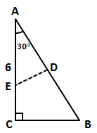

由题意可知，D为AB中点，故DE⊥AB，和又有共同的角，因此与相似。故有。因为，AC=6，则，，，故。

故正确答案为B。

**考点**：几何结论类-三角形相关、几何结论类-相似图形

**来源**：2009年四川省公务员录用考试《行测》题（上半年）第15题

### 第 16 题

过去的一些不文明的执法行为使城管执法形象受到了影响，要想（    ）公众心中的城管执法形象，要想使城管获得合法性和正当性，仅仅一份《文明执法承诺》是远远不够的。

A. 确立

B. 重塑

C. 制造

D. 形成

第 16 题 · 答案与解析

**参考答案（粉笔题库参考内容）**

B

**解析**

此题考查实词的语境搭配和词义辨析。

“确立”指稳固地建立或树立；“重塑”指重新塑造；“制造”是指用人工原料制作成为可供使用的物品；“形成”指通过发展变化而形成为具有某种特点的事物，或者出现某种情形或局面。

本句中开头有“过去的一些不文明”可以看出，城管在公众心目中的形象已经受损，所以这里需要的是“重新塑造”。

故正确答案为B。

**考点**：实词填空、对应关系-前后呼应、词的辨析-词义侧重

**来源**：2009年四川省公务员录用考试《行测》题（上半年）第16题

### 第 17 题

国家扶持动漫产业的决心和力度是（    ）的，动漫产业的发展也是（    ）的，但关键是“政策扶持”不应成为“政策导向”，动漫产业的健康发展最终还要依赖于市场的认可。

A. 可以预见，众所周知

B. 有目共睹，为人称道

C. 前所未有，前景乐观

D. 毋庸置疑，有目共睹

第 17 题 · 答案与解析

**参考答案（粉笔题库参考内容）**

D

**解析**

本题考查成语填空。

“毋庸置疑”是指毫不怀疑，和“有目共睹”放在句中形成了“国家扶持是毋庸置疑的，动漫产业发展也是极其明显的”正确句式。

“可以预见”是指有一定预期的，可以在未来实现的。但本句中没有流露出预期，反而是通过整句话可以看出扶持动漫的政策已经出台，所以“可以预期”并不合适，故A项错误；“有目共睹”指大家的眼睛都能看得见，形容极其明显；“为人称道”指被很多人所称赞，是褒义词，但根据后半句“但......还要依赖于市场认可”可以看出，动漫产业发展还未达到交口称赞的地步，所以B项错误；同样，因为后半句的观望意味，也决定了“前景乐观”并不适合，所以C项错误。

故正确答案为D。

**考点**：对应关系-前后呼应、成语填空

**来源**：2009年四川省公务员录用考试《行测》题（上半年）第17题

### 第 18 题

“盛世和光——敦煌艺术大发展”正在北京中国美术馆展出，这是迄今为止敦煌艺术在京城最大规模的（    ），一批又一批的参观者闻讯而来。

A. 活动

B. 表演

C. 亮相

D. 工程

第 18 题 · 答案与解析

**参考答案（粉笔题库参考内容）**

C

**解析**

此题考查实词的语境搭配。

“活动”作为名词时指为某种目的而行动；“表演”指戏剧、舞蹈等演出、展演；“亮相”比喻公开露面或表演；“工程”指生产制造部门用庞大或较为复杂的设备进行的工作，还比喻需要耗费大量人力精力的工作。

整句话的主语是“敦煌艺术展览”，后半句中主语是“敦煌艺术”，所以用亮相较为合适，“表演”并不适合；“活动”不符合语境，也没有公开露面的意思；展出与“工程”并不适合搭配。

故正确答案为C。

**考点**：实词填空、词的辨析-搭配对象、词的辨析-词义侧重

**来源**：2009年四川省公务员录用考试《行测》题（上半年）第18题

### 第 19 题

波士顿城中的旧书店常常让我（    ）。那里有两家。一家在老教堂的地下室，还有一家旧书店靠近波士顿绿地，规模更大，上下两层。

A. 乐不思蜀

B. 流连忘返

C. 沉溺其中

D. 大开眼界

第 19 题 · 答案与解析

**参考答案（粉笔题库参考内容）**

B

**解析**

本题考查成语的感情色彩。

“乐不思蜀”形容乐而忘返；“沉溺其中”指陷入不良的境地不能自拔，二者均含有贬义。

“大开眼界”指开阔视野，增长见识；“流连忘返”指留恋，舍不得离去。

语句中说“书店”对于“我”，所以含有贬义的A、C两项均排除；D项语气过于夸张，排除。

故正确答案为B。

**考点**：成语填空、词的辨析-感情色彩、词的辨析-程度轻重

**来源**：2009年四川省公务员录用考试《行测》题（上半年）第19题

### 第 20 题

新媒体的迅速成长使中国传媒产业结构发生了很大的变化，中国报业进入（    ）的关键时期。

A. 改革

B. 转型

C. 发展

D. 突围

第 20 题 · 答案与解析

**参考答案（粉笔题库参考内容）**

B

**解析**

改革：现常指改变旧制度、旧事物；转型：多形容结构、形态和观念的转变；发展：指事物由小到大，由简到繁，由低级到高级，由旧物质到新物质的运动变化过程；突围：原指军队突出敌人包围的作战行动，目的是摆脱被动，争取主动，保存力量，以利再战，也可以比喻从困难中摆脱。

句中提及“产业结构发生了很大变化”，与“转型”语义对应，B项更为恰当。

故正确答案为B。

**考点**：实词填空、对应关系-前后呼应、词的辨析-词义侧重

**来源**：2009年四川省公务员录用考试《行测》题（上半年）第20题

### 第 21 题

考试对学生来说是（    ）的事情。

A. 一如既往

B. 平平淡淡

C. 家常便饭

D. 习以为常

第 21 题 · 答案与解析

**参考答案（粉笔题库参考内容）**

D

**解析**

本题考查成语辨析。

句子的意思是考试对报考者来说是很平常的事。

“习以为常”可以很好反映平常的含义，同时在句子中作定语，D项当选。

“一如既往”指完全跟过去一样，不合句意，所以A项排除；“平平淡淡”一般指生活平淡，没有变化，在句中并不合适，所以B项排除；“家常便饭”是名词，后面不能再接“事情”，所以C项排除。

故正确答案为D。

**考点**：成语填空、词的辨析-词义侧重

**来源**：2009年四川省公务员录用考试《行测》题（上半年）第21题

### 第 22 题

机会总会眷顾有所准备的人，当错失良机时，我们往往（    ）。

A. 浑然不觉

B. 茫然若失

C. 不知所措

D. 六神无主

第 22 题 · 答案与解析

**参考答案（粉笔题库参考内容）**

B

**解析**

本题考查成语辨析填空。

“茫然若失”是指神情迷茫，好像失去了什么东西似的。从“机会总是眷顾有准备的人，当错失良机”可知，“我们”在机会来临时没有任何准备，以致失去了机会才感到茫然若失。所以B项“茫然若失”更符合句子的意思。故正确答案选B。

A属于强干扰项，但“浑然不觉”是完全不知道的意思，本题中的“良机”有可能是知道的，但因我们没有准备好而失去，所以不选；“不知所措”是指不知道怎么办才好，形容受窘或发急，陷入困境时的手足无措，本句中并没有陷入困境的意思，所以不选C；“六神无主”是形容人心慌意乱，拿不定主意，和B比较缺少了“失去”的意味，所以不选D。

故正确答案为B。

**考点**：对应关系-前后呼应、成语填空

**来源**：2009年四川省公务员录用考试《行测》题（上半年）第22题

### 第 23 题

举目眺望，河那边的深林被（    ）笼罩着，黄昏降临了。

A. 暮秋

B. 暮景

C. 暮霭

D. 暮气

第 23 题 · 答案与解析

**参考答案（粉笔题库参考内容）**

C

**解析**

本题考查实词辨析。

暮秋：一般指九月时节的秋季；暮景：一般比喻人的晚年时光；暮霭：指黄昏时的云霞和雾气；暮气：一般和“沉沉”搭配使用，指精神气质不佳。

由“笼罩”一词可推知“暮霭”最合适，前两项无法与“笼罩”搭配；“暮气”一般用它的比喻义，即精神不振作和疲沓不求进取的作风，用在此处不合适。

故正确答案为C。

**考点**：实词填空、词的辨析-搭配对象、词的辨析-词义侧重

**来源**：2009年四川省公务员录用考试《行测》题（上半年）第23题

### 第 24 题

《牡丹亭》能够给人强烈的感染，最主要的力量，来自作者对人类追求自由、幸福、理想的执着与讴歌，而非由于剧本辞藻的（    ），更不是才子佳人屡经波折而终能团圆的（    ）情节。

A. 美丽，曲折

B. 丰富，动人

C. 华美，曲折

D. 美丽，感人

第 24 题 · 答案与解析

**参考答案（粉笔题库参考内容）**

C

**解析**

本题考查实词辨析。

第一空，“美丽”一般形容人长相好看；“丰富”则指丰裕富厚，指数量大；“动人”和“感人”为近义词，指打动人心，感动心灵。“曲折”原指道路并不直，在文学作品上比喻文本丰富，是褒义词。在本句中，只有“辞藻”与“华美”是固定搭配，其余三项均无法搭配。

第二空，“曲折”与“屡经波折”相互对应。

故正确答案为C。

**考点**：实词填空、词的辨析-搭配对象

**来源**：2009年四川省公务员录用考试《行测》题（上半年）第24题

### 第 25 题

夏天的大草原美极了，蔚蓝的天空（    ）着一片片白云。

A. 铺展

B. 铺陈

C. 铺设

D. 铺排

第 25 题 · 答案与解析

**参考答案（粉笔题库参考内容）**

A

**解析**

本题考查近义实词辨析。

铺展：铺开并向四周伸展；铺陈：作为动词时表示摆设、布置，还可以指铺叙；铺设：铺（管线、轨道）；铺排：布置、安排。

这里能够形容天空云彩的，只有第一项。

故正确答案为A。

**考点**：实词填空、词的辨析-搭配对象、词的辨析-词义侧重

**来源**：2009年四川省公务员录用考试《行测》题（上半年）第25题

### 第 26 题

下列句子中没有歧义的一项是：

A. 4月2日和3日的下午，学校组织同学们进行了拔河比赛，我们班以绝对的优势取得了第一名。

B. 奶奶已经走了，但那番语重心长的话却久久在我的心头回响。

C. 老师希望这本书能对学生有所帮助。

D. 老师让几个班委会的干部组织好明天的班会活动。

第 26 题 · 答案与解析

**参考答案（粉笔题库参考内容）**

C

**解析**

本题考查病句辨析。

C项语义通顺，没有歧义，当选。

A项是“4月2日一整天和4月3日下午”，还是“2日和3日共两个下午”，存在歧义；B项奶奶是暂时不在“我”身边还是已经去世了，存在歧义；D项“几个”修饰“班委会”还是“班委会的干部”，存在歧义，指代不明。综上所述，排除A、B、D三项。

故正确答案为C。

**来源**：2009年四川省公务员录用考试《行测》题（上半年）第26题

### 第 27 题

下列句子中有语病的一句是：

A. 有报告称：一个0—16岁孩子的抚养总成本是25万元左右。

B. 常香玉拍戏有个习惯，非把动作中的那个最佳，唱腔中的那个最美“抠”出来、“挖”出来不可。

C. 那种传统意义上的知识分子正在让位于在各自的领域里面对、解决专门问题的人。

D. 钱钟书用“管锥”命名自己的著作，谦逊之外别有深意，带有反讽的意味。

第 27 题 · 答案与解析

**参考答案（粉笔题库参考内容）**

A

**解析**

本题考查病句辨析。

A项表意不明，应该是“把一个孩子抚养到16岁的总成本为25万元左右”。

其他句子都语义通顺，没有语病。

故正确答案为A。

**来源**：2009年四川省公务员录用考试《行测》题（上半年）第27题

### 第 28 题

下列各句中，括号中成语使用恰当的一句是：

A. 这个人是（罪不容诛）的，我们还是给他一个改过自新的机会吧。

B. 有些党员干部（心胸狭隘），只要下属提出与自己不合的意见，便给人穿小鞋。

C. 我们一旦被祖国挑选为飞行员，就要（肝胆相照），报效国家。

D. 现在这样到处刺探他人隐私，这是很不道德的，古人不是说过要“（目不窥园）”吗?

第 28 题 · 答案与解析

**参考答案（粉笔题库参考内容）**

B

**解析**

本题考查成语、俗语在语句中的使用搭配。

罪不容诛：罪恶极大，杀了也抵不了所犯的罪恶，A项使用错误；肝胆相照：比喻以真心相见，C项用来形容报效国家，显然不合适；目不窥园：形容专心致志，埋头苦读。D项用于形容窥探别人的隐私，是对成语的误用。

故正确答案为B。

**来源**：2009年四川省公务员录用考试《行测》题（上半年）第28题

### 第 29 题

下列语句中，没有语病的一句是：

A. 阿里路在道路边的碎石堆里偶然发现了几个形状怪异的化石牙齿，非常兴奋，却始终认不出是属于哪种动物的

B. 书的封面上栩栩如生的印着青铜制品，上面整齐的排列着身披铠甲、手持盾牌的秦军战士

C. 一家加工厂偷排未经处理的废水，严重污染了当地的环境，导致鱼虾绝迹，各种水中作物大量减产和绝产

D. 中国实行积极防御战略方针，不搞扩军备战，致力于维护本地区和全世界和平

第 29 题 · 答案与解析

**参考答案（粉笔题库参考内容）**

D

**解析**

本题考查病句辨析。

D句语义通顺，没有语病。

A项“化石牙齿”语序错误，应该为牙齿化石，句末中的“是”缺主语；B项“上面”指代不明，指“封面上面”还是“青铜制品上面”；C项“大量减产和绝产”关联词使用不当，逻辑错误，应改为“大量减产或绝产”，删除“导致鱼虾绝迹”。

故正确答案为D。

**来源**：2009年四川省公务员录用考试《行测》题（上半年）第29题

### 第 30 题

下列句子中，没有歧义的句子是：

A. 他看见河对岸的一个老人正带着他的孩子在植树。

B. 本市组织四个足球队队员客串了一场篮球赛。

C. 出席这次座谈会的有老红军代表、民主党派人士和无党派人士58人。

D. 他是个直性人，把看到的事儿都捅出来了。

第 30 题 · 答案与解析

**参考答案（粉笔题库参考内容）**

D

**解析**

本题考查语句歧义辨析。

D句语义通顺，没有歧义，当选。

A项“他的孩子”有歧义，指的是“他的”还是“一个老人的”，指代不明；B项“四个足球队”还是“四个队员”存在歧义；C项是“老红军代表、民主党派人士和无党派人士”共“58人”还是“无党派人士58人”不明确。综上所述，排除A、B、C三项。

故正确答案为D。

**来源**：2009年四川省公务员录用考试《行测》题（上半年）第30题

### 第 31 题

在当代中国，由于国力的限制和传统思想的影响，妇女受教育的机会和程度都比男性少，而家务和抚育子女主要由妇女来承担，又限制了她们的流动，妇女对这些主要发展资源的占有远远少于男性，这就进一步限制了妇女与男性的平等竞争，拉大了他们之间的距离，造成男女不平等的进一步扩大。

这段文字的中心意思是：

A. 当代中国，妇女面临最大的问题是男女不平等的进一步扩大。

B. 当代中国，妇女面临最大的问题是受教育的机会和程度都比男性少。

C. 当代中国，妇女面临最大的问题是家务和抚育子女限制了她们的流动。

D. 当代中国，妇女面临最大的问题是传统思想的影响。

第 31 题 · 答案与解析

**参考答案（粉笔题库参考内容）**

A

**解析**

据提问可知本题为中心理解题。

文段前面从“受教育的机会少”、“流动受到限制”和“资源占有”几个方面说明了男女不平等进一步扩大的原因。

A项概括全面准确，当选。

B、C、D三项均只是一个方面而并非面临的最大问题，排除。

故正确答案为A。

**考点**：关联词-因果

**来源**：2009年四川省公务员录用考试《行测》题（上半年）第31题

### 第 32 题

出版媒介具有新陈代谢的功能，它不断进行着人员的更替，不断地从外界获得物质和能量，以维持自身的生存和发展，伴随着新陈代谢的过程，出版媒介有衍生、成长、壮大、衰老、死亡或再生的过程，出版媒介在发展过程中，也在继承（遗传）的基础上不断地进行着创新（变异），从而使出版媒介的组织形式、出版形式等都发生了巨大的变化。

这段文字旨在说明：

A. 出版媒介都具有新陈代谢的功能

B. 出版媒介在发展的过程中不断进行着创新

C. 出版媒介具有生命体的特征

D. 出版媒介组织形式、出版物形式等都发生了巨大的变化

第 32 题 · 答案与解析

**参考答案（粉笔题库参考内容）**

C

**解析**

据提问可知，本题为中心理解题。

文段第一句话是说出版媒介具有新陈代谢的功能，第二句话说其具有像生命一样出生、发展、死亡的过程，最后说出版媒介同时也在创新。全段围绕出版媒介与生命体具有相同的特征来展开。

因此正确答案为C项。

本题易误选D，但D项只是涉及一部分内容。本题属于文意推断，仅仅停留在字面上理解文段的选项通通排除。

故正确答案为C。

**考点**：关联词-并列

**来源**：2009年四川省公务员录用考试《行测》题（上半年）第32题

### 第 33 题

近年来，随着IT厂商数量的不断增加，IT市场的竞争日益激烈。对于IT产品，用户不但要选择产品本身，更要选择服务。良好的服务已经成为左右用户购买决策的重要因素。调查数据显示：对于高科技产品如电脑等，用户愿意多花10%的价钱来购买服务好的同质产品。

这段文字表明的观点是：

A. IT产品的售后服务很重要。

B. IT产品服务性很强。

C. IT产品专用型强，技术要求高。

D. 用户愿意多花钱来购买IT产品。

第 33 题 · 答案与解析

**参考答案（粉笔题库参考内容）**

A

**解析**

据提问可知，本题为中心理解题。

文段采用了递进式描述。“更”后面是作者要说明的重点，即要选择服务，后边的调查数据是用来例证观点的。

因此，结合选项应该选择A。

文段说的是重要性，所以B错误；另外可以由“不仅······更······”，排除C、D两项。

故正确答案为A。

**来源**：2009年四川省公务员录用考试《行测》题（上半年）第33题

### 第 34 题

社区商业是城市商业的基础，是满足居民综合消费的重要载体，加快发展社区商业，是提升城市商业现代化和综合竞争力的迫切要求。因此，发展和完善商业社区，对现有社区商业网点进行系统性、科学性和高效性的整合，构建我国现代社区商业网络，是满足社区居民日常生活需求，提高居民生活质量的重要举措。

这段话的主旨是：

A. 构建我国现代社区商业网络，是满足社区居民日常生活需求的需要。

B. 加快发展我国社区商业，是提升城市商业现代化和综合竞争力的迫切要求。

C. 社区商业是满足居民综合消费的重要载体。

D. 社区商业是城市商业的基础。

第 34 题 · 答案与解析

**参考答案（粉笔题库参考内容）**

A

**解析**

据提问可知，本题为中心理解题。

本文段关键点在于“因此”，说明前面的都是原因，所以主旨应当是结果，也就是后半段的重心。

因此，结合选项应该选择A。文段的关键词“商业网络”，只有A项提及。

B、C、D三项对应近文段，均表示原因，所以都排除。

故正确答案为A。

**考点**：关联词-因果

**来源**：2009年四川省公务员录用考试《行测》题（上半年）第34题

### 第 35 题

在世界经济全球化、市场化和信息化成为不可阻挡潮流的今天，对文化阵地尤其是青年文化阵地的争夺，关系到中华民族的兴衰存亡和中国共产党的执政地位。当前，必须从全面建设小康社会的全局和实现中华民族伟大复兴的高度，深刻认识加强青年文化建设的战略意义，牢牢把握先进文化的前进方向和与时俱进的时代特征，坚持马列主义、毛泽东思想、邓小平理论和“三个代表”重要思想统领青年文化建设。

这段文字意在说明：

A. 深刻认识加强青年文化建设的战略意义

B. 青年文化阵地的争夺关系到中国共产党的执政地位

C. 青年文化建设把握先进文化的前进方向

D. 青年文化阵地的争夺关系到中华民族的兴衰存亡

第 35 题 · 答案与解析

**参考答案（粉笔题库参考内容）**

A

**解析**

据提问“意在”可知，本题为中心理解题。

这段话属于因果式。第一句话交代了青年文化的重要性，第二句话是主旨，即深刻认识加强青年文化建设的战略意义。

因此，结合选项应该选择A。

B、D都是“原因”的体现，排除；C不是“青年文化的重要性”得出的结果，排除。

故正确答案为A。

**考点**：分述句特征-引入铺垫

**来源**：2009年四川省公务员录用考试《行测》题（上半年）第35题

### 第 36 题

虽然当今国际事务的诸多领域仍受制于头号超级大国美国，但在联合国改革问题上，由于一国一票和三分之二多数方可获得改革方案通过表决规则，这在客观上又为虽然处在弱势，但占有联合国近四分之一席位的非洲国家表达自己意愿，周旋于大国之间，提供了千载难逢的历史机遇。

这段文字的中心是：

A. 非洲国家占有联合国近四分之一席位。

B. 当今国际事务的诸多领域仍受制于头号超级大国美国。

C. 联合国改革方案需要获得三分之二成员国的赞同才能通过。

D. 联合国的表决规则为非洲在联合国改革问题上争取决策权提供了机遇。

第 36 题 · 答案与解析

**参考答案（粉笔题库参考内容）**

D

**解析**

据提问可知，本题为中心理解题。

文段中转折词是关键点，第二个“但”后面是强调的重点，即“提供了千载难逢的历史机遇”。

D选项是其同义转换，故正确答案选D。

A、B、C项只是文段提到的几个具体内容，而不是要表达的意思，均排除。

故正确答案为D。

**考点**：关联词-转折

**来源**：2009年四川省公务员录用考试《行测》题（上半年）第36题

### 第 37 题

生存固然需要消费，并以消费为前提和基础，但人生在世，非以消费为目的、为根本，活着并不是为了消费和占有。消费主义将消费的工具合理性和生存的目的性关系截然颠倒，将消费为目的，而将生存降格为手段，从而遮蔽了人存在的价值关照，造成了人为消费存在的意义维度的缺失，这实在是可悲的。

这段话可以看出：

A. 消费主义的核心问题在于强调消费和占有。

B. 消费主义的核心问题在于颠倒了消费和生存的根本关系。

C. 消费主义的核心问题在于强调消费工具的合理性。

D. 消费主义的核心问题在于强调消费是人生存和发展的基础。

第 37 题 · 答案与解析

**参考答案（粉笔题库参考内容）**

B

**解析**

据提问可以看出，本题为中心理解题。

文段第一句提出一个观点，即活着不是为了消费和占有；第二句话是中心，即“消费主义将消费的工具合理性和生存的目的性关系截然颠倒”，“从而遮蔽人的价值”。

B项是此句的同义替换，故正确答案选B。

A、C、D都属于理解片面，所以不选。

故正确答案为B。

**考点**：分述句特征-引入铺垫

**来源**：2009年四川省公务员录用考试《行测》题（上半年）第37题

### 第 38 题

科学思想和哲学思想都是由人创造的并为人服务的，以人为本是二者共同的出发点和共同的归宿。正因为科学思想和哲学的主体都永远是人，因而二者都深深地打上了主体的烙印。从它们诞生那天起一直到现在和未来，都既散发着人类智慧的光芒，又闪烁着人性的光辉，都是科学性与人性的统一。主体的同一性决定了科学思想与哲学具有不可分割的密切关系。

这段话力求表明的观点是：

A. 科学思想和哲学都是科学性与人性的统一。

B. 科学思想与哲学的主体都永远是人。

C. 科学思想与哲学的密切关系是由主体的同一性决定的。

D. 科学思想与哲学都是由人创造的并为人服务的。

第 38 题 · 答案与解析

**参考答案（粉笔题库参考内容）**

C

**解析**

据提问知本题属于中心理解题。

这段话首先提出科学思想与哲学有共同的出发点和归宿，然后论述二者为什么具有这样的密切关系，最后提出结论：主体的同一性决定了这一点。这也就是文段表明的观点。

故正确答案为C。

**考点**：分述句特征-引入铺垫

**来源**：2009年四川省公务员录用考试《行测》题（上半年）第38题

### 第 39 题

没有人再怀疑人类已经进入信息时代。在这样史无前例的成就中，新的危机却悄悄萌发了。美国思想家梭罗曾说过：“我们热切地挖掘了大西洋隧道，期望新旧大陆更为密切地接近，实际上传来的最新消息不过是阿德莱亲王打了个哈欠。危险正是在这里。”

这段文字中所说的“危险”是指：

A. 信息太多，传播太快，为造成人们预想不到的危机

B. 信息过剩会降低信息的质量，影响双方密切的接近

C. 信息的快速传播，使人们无法判断某些信息之间的本质区别

D. 剩余信息的快速传播，将可能湮没真正有价值的信息

第 39 题 · 答案与解析

**参考答案（粉笔题库参考内容）**

D

**解析**

首先定位原文，“危险”出现在文段结尾，分析文意可知，人类挖掘了大西洋隧道让信息快速传播，希望获取的是重要信息，但传来的最新消息却是“阿德莱亲王的哈欠”这种无用信息，故“危险”对应的就是无用信息的快速传播可能会影响真正重要信息的获取，对应D项。

A项只是从表面上解释“危险”，并不能准确指出“危机”的含义，排除；B项“影响双方密切的接近”、C项“无法判断信息之间的本质区别”在文段中均没有体现，排除。

故正确答案为D。

**考点**：实词

**来源**：2009年四川省公务员录用考试《行测》题（上半年）第39题

### 第 40 题

上海市高新技术产品出口正在成为外贸领域强有力的助推剂。上海海关公布的最新统计数据显示，今年前三季度，上海市高新技术产品累计出口额达254.9亿美元，比去年同期增长25.8%，占全市各类产品出口总额的38.1%，比全国平均水平高出10.6个百分点。

上海市出口商品的上述变化表明：

A. 上海市已具备与发达国家竞争的实力。

B. 上海市产品出口产品结构进一步优化。

C. 上海市对外贸易处于顺差。

D. 上海市出口商品的质量实现了飞跃。

第 40 题 · 答案与解析

**参考答案（粉笔题库参考内容）**

B

**解析**

据提问知本题属于细节判断题。

重点部分可以简写为：前三季度，累计出口254亿，比去年增长25%，占全市38%，高于全国水平。根据此，只能得出上海市高新技术产品出口额增长迅速。

因此，结合选项应该选择B。

而A、C、D均无法从原文中得出结论，均排除。

故正确答案为B。

**考点**：细节判断题

**来源**：2009年四川省公务员录用考试《行测》题（上半年）第40题

### 第 41 题

考古学家可以重新发掘出我们祖先被遗忘的智慧。例如，纳巴塔人在两千年前占据着险恶的内盖夫沙漠，他们把这一地区很少发生的大暴雨的雨水引到灌溉沟渠与蓄水池中。这一方法被用来重建这一地区的古代农场，这些农场现在也能生产出很高的谷物产量。

文段中的“方法”一词是指：

A. 纳巴塔人占据着险恶的内盖夫沙漠。

B. 纳巴塔人兴建灌溉沟渠和蓄水池。

C. 纳巴塔人用大量暴雨的雨水来灌溉。

D. 重建这一地区的古代农场。

第 41 题 · 答案与解析

**参考答案（粉笔题库参考内容）**

C

**解析**

首先定位原文，“方法”出现在文段的结尾，分析文意可知“他们把这一地区很少发生的大暴雨的雨水引灌到灌溉沟渠与蓄水池中”，强调用雨水来灌溉，对应C项。

A、D两项均与文段强调的“灌溉”无关，排除；

B项强调“兴建灌溉沟渠和蓄水池”，而文段强调方法的重点在于“雨水引灌”，与文意不符，排除。

故正确答案为C。

**考点**：实词

**来源**：2009年四川省公务员录用考试《行测》题（上半年）第41题

### 第 42 题

在微观世界中，中微子一直是一个无所不在而又不可捉摸的过客。中微子产生的途径有很多，如恒星内部的核反应，超新星的爆发，宇宙射线与地球大气层的撞击，以至于地球上岩石等各种物质的衰变等。尽管可能是构成我们所在宇宙中最常见的粒子之一，但由于它穿透力极强，而且几乎不与其它物质发生相互作用，因此它是基本粒子中人类所知最少的一种。

对“中微子”的理解不准确的一项是：

A. 中微子在微观世界无所不在。

B. 恒星内部的核反应是中微子的生产途径之一。

C. 中微子是构成我们所在宇宙中最常见的粒子。

D. 人类对中微子知之甚少。

第 42 题 · 答案与解析

**参考答案（粉笔题库参考内容）**

C

**解析**

本题考查文段中词语的理解。C项对应文中“尽管它可能是构成我们所在宇宙中最常见的粒子之一”一句，文中的限制语“可能”“之一”在选项中都未体现，因此C项错误，当选。

A是文段第一句的同意转换；B对应文段第二句；D则是文段最后内容的体现，均排除。

本题为选非题，故正确答案为C。

**考点**：细节判断题

**来源**：2009年四川省公务员录用考试《行测》题（上半年）第42题

### 第 43 题

文化多样性是客观存在。它涉及以下基本认同：每种文明和文化都是在特定的地理环境和特定的人群中产生和发展的。尊重多样性，就是尊重文化的异质性。文明和文化有发展先后之差别，却无优劣高下的区分，它们都应获得同等的尊重和人类共同的保护。

不符合上述文段文意的是：

A. 文化多样性是客观存在。

B. 文明和文化都有特定的发展背景。

C. 文明和文化有发展先后之差别。

D. 文化才有异质性，文明没有。

第 43 题 · 答案与解析

**参考答案（粉笔题库参考内容）**

D

**解析**

本题考查细节判断。

从文中第二句话可以推出，文明也具有异质性。所以D错误，当选。

A、B、C均是文中的原句，也可以采用排除法，均排除。

本题为选非题，故正确答案为D。

**考点**：细节判断题

**来源**：2009年四川省公务员录用考试《行测》题（上半年）第43题

### 第 44 题

所谓科学家的宗教情结，是指科学家信仰宗教或者具有宗教情怀，对宗教信仰本身充满尊重和敬畏，对宗教信仰的意义和价值持肯定的态度。应当指出的是，有些科学家尽管也对宗教信仰这种人类生活中的重要现象和事物表示尊重和理解，对其意义和价值表示一定程度的肯定，但对宇宙世界却持彻底的理性主义的态度或者实证的态度，不承认超越性的存在。显然，这样的科学家并不能被视为具有宗教情结。

从这段文字可以看出，以下不能视其为具有宗教情结科学家的是：

A. 信仰宗教或者具有宗教情怀的科学家。

B. 对宗教信仰本身充满尊重和敬畏的科学家。

C. 对宗教信仰的意义和价值持肯定态度的科学家。

D. 对宇宙世界却持彻底的理性主义的态度或者实证的态度，不承认超越性存在的科学家。

第 44 题 · 答案与解析

**参考答案（粉笔题库参考内容）**

D

**解析**

据提问知本题考查细节判断。

最后一句“这样的科学家并不能被视为具有宗教情结”中，“这样的”指代上句“有些科学家······但对宇宙世界却持彻底的理性主义的态度或者实证的态度，不承认超越性的存在”，所以它的意思便是，对于宇宙世界持彻底理性主义或实证的态度，不承认超越性存在的科学家便不能视其具有宗教情节。

因此，结合选项应该选择D。

A项彻底矛盾；B、C也都是具有宗教情节的科学家，均排除。

故正确答案为D。

**考点**：细节判断题

**来源**：2009年四川省公务员录用考试《行测》题（上半年）第44题

### 第 45 题

由于技术理性造就了资本主义机器生产体系和管理体系，人不得不屈从于资本主义生产体系和管理体系及其由这一体系所规定的交换原则和利己主义原则，进而把适应市场经济的交换原则作为美德来看待，并由此造就了权威主义的伦理价值观盛行。这种伦理价值观上的矛盾冲突又使得相对主义的伦理价值观得以产生和流行,它反映了在技术理性盛行的条件下，人的个性失落和在价值观上的困惑和矛盾。

这段话的主旨是：

A. 技术理性造就了资本主义机器生产体系和管理体系。

B. 技术理性造成了人的个性失落和伦理价值观的混乱。

C. 技术理性造就了权威主义的伦理价值观盛行。

D. 技术理性把适应市场经济的交换原则作为美德来看待。

第 45 题 · 答案与解析

**参考答案（粉笔题库参考内容）**

B

**解析**

本题为中心理解题。

文段的意思是，技术理性造就了权威主义的伦理价值观盛行，而这种伦理价值观的矛盾冲突反映出了人的个性失落和在价值观上的困惑和矛盾。A、C两项正确，但不是文段的主旨，均排除。

本题值得突破的便是关键词，本题的“伦理价值观”是关键词，在文中多次提到，正确答案只能在B、C中选；再看文段倒数第二句关键词“又使得······”，这里表示加重语气、更进一层。

故正确答案为B。

注意：文段主旨题不仅考查选项的正确与否，更重要的是挖掘出文段的主旨。

**考点**：主题词

**来源**：2009年四川省公务员录用考试《行测》题（上半年）第45题

### 第 46 题

任务导向型领导：是把重点放在完成组织绩效的领导行为，即把任务规定的很明确、组织得条理分明、任务委派得职责分明，并使用职权与奖惩去监督和促使绩效目标的实现。

下列属于任务导向型领导的是：

A. 某高校中层林某在负责组建新系时，挑选了自己的老同学小王，在他看来，虽然小王能力有限，但为人踏实，容易和别的同志搞好团结

B. 某公司领导一贯要求职工要有吃苦精神，为了完成工作任务，经常安排职工加班

C. 某领导很关心自己的下属，经常帮助他们解决工作和生活上的困难

D. 某领导给下属布置工作任务后完成时再验收，平常从不过问下属怎样完成任务和完成了多少

第 46 题 · 答案与解析

**参考答案（粉笔题库参考内容）**

B

**解析**

第一步：找出定义关键词。

“重点放在完成组织绩效”、“使用职权与奖惩”、“监督和促使绩效目标的实现”。
第二步：逐一分析选项。

A项：林某组建新系时，挑选自己的老同学小王属于使用职权，但重点是搞好团结，不是为了完成组织绩效，不符合定义，排除；

B项：领导安排职工加班，是为了完成组织绩效，并利用了职权，一贯要求职工要有吃苦精神也符合“监督和促使绩效目标的实现”，符合定义，当选；

C项：领导帮助下属解决困难属于使用奖惩，但只是关心下属，不是为了完成组织绩效，不符合定义，排除；

D项：领导给下属布置工作任务是为了完成工作绩效，但平时不过问，没有去监督和促使绩效目标的实现，不符合定义，排除。

故正确答案为B。

**考点**：方式目的

**来源**：2009年四川省公务员录用考试《行测》题（上半年）第46题

### 第 47 题

横断科学：是从客观世界的诸多物质结构及其运动形式中，抽出某一特定的共同方面作为研究对象。

下列属于横断科学的是：

A. 控制论

B. 生物医药工程学

C. 计算机科学

D. 航天科学

第 47 题 · 答案与解析

**参考答案（粉笔题库参考内容）**

A

**解析**

第一步：抓住定义中的关键词。

定义中的关键词有“诸多物质结构及其运动形式”、“抽出某一特定的共同方面”。

第二步：逐一判断选项。

B、C、D中都是研究单一领域的具体学科分支，不涉及“抽出某一特定的共同方面”，均排除；

A中控制论可以运用于其他特殊学科中，而且思想是很多学科所共通的，符合定义要件，当选。

故正确答案为A。

**考点**：单定义-其他句式

**来源**：2009年四川省公务员录用考试《行测》题（上半年）第47题

### 第 48 题

城市化：是指乡村人口向都市人口转化，生产方式和生活方式由乡村型向城市型转化的一个历史进程。

下列不属于城市化进程要素的是：

A. 某乡土地实行集约化经营，村民都转为农业工人。

B. 某村村民由于比较富裕都住上了楼房、不少家庭买了汽车。

C. 某乡政府转为街道办事处，农民农转非，未到退休年龄的村民还被安排了工作。

D. 某村村民生活贫乏，晚上无事可做，就早早睡觉。

第 48 题 · 答案与解析

**参考答案（粉笔题库参考内容）**

D

**解析**

第一步：抓住定义中的关键词。

定义中的关键词有“农村人口向都市人口转化”、“生产方式和生活方式向城市型转化”。

第二步：逐一判断选项。

A中土地实行集约化经营和村民转化为农业工人，体现了前后两个定义要件，符合定义，排除；

B中住楼房、买汽车，体现生活方式向城市型转化，符合定义，排除；

C中农民农转非和未到退休年龄的村民还被安排了工作，体现了前后两个定义要件，符合定义，排除；

D中农民生活贫乏、无事可做，没有体现定义要件，当选。

本题为选非题，故正确答案为D。

**考点**：单定义-其他句式

**来源**：2009年四川省公务员录用考试《行测》题（上半年）第48题

### 第 49 题

发散式思维：是指根据已有的信息，从不同的角度不同的思维，从多方面寻求多样性答案的一种展开式思维活动。

下列属于发散式思维的是：

A. 人类失去联想，世界将会怎样

B. 在多种解决方案中，确定一种方案

C. 从多个前提推出一个结论

D. 根据题目给定的条件，解决文字应用题

第 49 题 · 答案与解析

**参考答案（粉笔题库参考内容）**

D

**解析**

第一步：抓住定义中的关键词。

定义中的关键词有“根据已有的信息”、“不同的角度和思维”、“从多方面寻求多样性答案”。

第二步：逐一判断选项。

A中只提供了一个信息“人类失去联想”，提出“世界将会怎样”的问题，并非具体的寻求答案的行为，故A错；

B中多种解决方案是已有的信息，确定了一个方案没有体现不同的思维角度，故B错；

同理，C也错；

D中给定的条件是已有的信息，而文字应用题是一种没有固定答案的题，可以通过多种角度多种思维去考虑，从而得到不同的答案，符合定义要件，当选。

故正确答案为D。

**考点**：方式目的

**来源**：2009年四川省公务员录用考试《行测》题（上半年）第49题

### 第 50 题

经验迁移：是指通过类比，发现两类事物之间的共同性或相似性，从而将解决这一类问题的方法运用到解决另一类问题上去。

下列属于经验迁移的是：

A. 高峰处理家庭纠纷很有经验，当社区某家庭发生纠纷时人们总是找他去调解

B. 周立在校时专业知识学习优秀，毕业后从事本专业工作上手很快

C. 在工作中刘丽总能想出很多办法来解决一个问题

D. 纪伟记忆电话号码用谐音记忆法，记忆文章时也用这种方法

第 50 题 · 答案与解析

**参考答案（粉笔题库参考内容）**

D

**解析**

第一步：抓住定义中的关键词。

定义中的关键词有“两类事物之间的共同性或相似性”、“方法运用到解决另一类问题”。

第二步：逐一判断选项。

A中高峰只解决家庭纠纷这一类问题，不涉及解决其他问题，不符合定义要件，故A错；

B中周立利用专业知识上手本专业工作很快，没有涉及到其他专业工作，不符合定义要件，故B错；

C中刘丽运用不同方法解决同一类问题，不符合定义要件，故C错；

D中纪伟用谐音记忆法来记忆电话号码，同时将该方法运用到记忆文章，符合定义要件，当选。

故正确答案为D。

**考点**：方式目的

**来源**：2009年四川省公务员录用考试《行测》题（上半年）第50题

### 第 51 题

公文是指国家机构及其他社会组织在公务活动中为行使职权、实施管理而制作的具有法定效用和规范体式的文件。

下列不属于公文的是：

A. ××市人民政府关于提请审议《城市综合执法办法》的议案

B. ××市召开消防安全检查会议的通知

C. 国家文物局关于审批第三批国家历史文化名城和加强保护管理的请示

D. 官某与银行签订的购房贷款按揭合同

第 51 题 · 答案与解析

**参考答案（粉笔题库参考内容）**

D

**解析**

第一步：抓住定义中的关键词。

定义中的关键词有“国家机构及其他社会组织”、“行使职权、实施管理”、“具有法定效用和规范体式的文件”

第二步：逐一判断选项。

A中××市人民政府、审议《城市综合执法办法》、议案，对应三个定义要件，符合定义，排除；

B中××市、召开消防安全检查会议、通知，对应三个定义要件，符合定义，排除；

C中国家文物局、审批第三批国家历史文化名城和加强保护管理、请示，对应三个定义要件，符合定义，排除；

D中关某签订合同是个人行为，不是国家机构或社会组织，也不涉及到行使职权、实施管理，不符合定义，当选。

本题为选非题，故正确答案为D。

**考点**：主客体

**来源**：2009年四川省公务员录用考试《行测》题（上半年）第51题

### 第 52 题

行政协调是指协调、调整行政系统与其外部环境之间、行政系统内部纵横向之间的各种关系，使之分工合作、权责清晰、相互配合，有效地实现行政目标和提高整体效能的行为。

下列不属于行政协调的是：

A. 某局召开各处处长会议讨论各处人员的调整

B. 某局做出“工作人员必须遵守的五项禁令”的决定

C. 某区路段三个月红绿灯不亮，该区交委召集电力局、交通局和街道办事处商讨解决办法

D. 某上级机关召集下属两个局研究某一行政管理权力的归属和行使问题

第 52 题 · 答案与解析

**参考答案（粉笔题库参考内容）**

B

**解析**

第一步：抓住定义中的关键词。

定义中的关键词有“协调、调整”、“行政系统与其外部环境之间”、“行政系统内部纵横向之间”。

第二步：逐一判断选项。

A中某局召开各处处长会议讨论各处人员的调整，是该局内部的调整，符合定义要件，排除；

B中某局只做出了决定，并未进行协调和调整，不符合定义要件，当选；

C中区交委召集电力局、交通局和街道办事处商讨解决办法，是区委与其他单位之间进行的协调，符合定义要件，排除；

D中某上级机关与下属两个局研究问题，是该系统内部上下级纵向的协调和调整，符合定义要件，排除。

本题为选非题，故正确答案为B。

**考点**：拆词

**来源**：2009年四川省公务员录用考试《行测》题（上半年）第52题

### 第 53 题

赌博是指以营利为目的，以财物为赌注比输赢，达到非法转移财物所有权的一种行为。

根据以上定义，下列属于赌博的一项是：

A. 甲公司与球迷们商定：若巴西赢球公司赔球迷们100万，若巴西输球则球迷赔公司100万

B. 公安机关悬赏：公民如抓获拐卖儿童的犯罪嫌疑人给赏金5万元

C. 甲乙双方在合同中约定：乙方按期完成工程就奖励100万元，延期完工则每天缴纳4万元的误工费

D. 卖主与买主商定：若这幅字画为赝品，卖主赔10倍价钱

第 53 题 · 答案与解析

**参考答案（粉笔题库参考内容）**

A

**解析**

第一步：抓住定义中的关键词。

定义中的关键词有“以营利为目的”、“以财物为赌注”、“非法转移财物所有权”。

第二步：逐一判断选项。

A中赌球是典型的赌博行为，当选；

B中公安机关悬赏的目的是为了抓获嫌疑人，不以营利为目的，故B错，排除；

C中甲乙双方约定的奖惩规则是以按时完工为目的、不是为了营利，故C错，排除；

D中是卖主对字画真实性的一种保证，不以营利为目的，故D错，排除。

故正确答案为A。

**考点**：拆词

**来源**：2009年四川省公务员录用考试《行测》题（上半年）第53题

### 第 54 题

刑事诉讼中的执行是指人民法院将已发生法律效力的判决和裁定交付执行机关，以实施其确定内容，以及处理诉讼中的诉讼问题而进行的各种活动。根据以上定义，以下符合刑事诉讼中执行的是（    ）。

A. 甲监狱为张某报请减刑二年

B. 乙监狱对李某越狱犯罪提起诉讼

C. 丙监狱接受A市法院判处的一批刑事罪犯入监并对其进行入监教育

D. 丁县法院收缴对罪犯王某的五万元罚金

第 54 题 · 答案与解析

**参考答案（粉笔题库参考内容）**

C

**解析**

第一步：判断题干中的关键词。

主体：人民法院。

方式：将已发生法律效力的判决和裁定交付执行机关。

第二步：逐一分析选项。

A项，主体是监狱，并非人民法院将判决和裁定交付执行机关，不符合定义，排除。

B项，主体是监狱，并非人民法院将判决和裁定交付执行机关，不符合定义，排除。

C项，A市法院将判处的一批刑事罪犯交付执行机关丙监狱，符合定义，当选。

D项，选项没有说明王某是因刑事诉讼被收缴罚金，不符合定义，排除。

故正确答案为C。

**考点**：方式目的

**来源**：2009年四川省公务员录用考试《行测》题（上半年）第54题

### 第 55 题

行政效率是指在行政管理中投入的工作量与所获的行政效果之间的比率，是人们在单位时间内和空间内开展行政活动，获得改造客观世界和主观世界的社会效果。

下列不体现行政效率高低的是：

A. 非典期间，哈尔滨市政府严格控制各种大规模集会，通过互动式的视讯会议来传达消息，安排工作

B. 某港商在某省投资兴办企业，跑审批跑了半年，项目书上盖了上百个公章，仍未跑完

C. 中央制订减轻农民负担的政策，增加农民收入，受到农民普遍欢迎

D. 鼠害危害湘江防洪大堤，但当地有关部门因“目前没有防鼠经费，尚需打报告等审批”，使问题议而不决

第 55 题 · 答案与解析

**参考答案（粉笔题库参考内容）**

C

**解析**

第一步：找出定义关键词。

“在行政管理中”、“投入的工作量与所获得的行政效果之间的比率”、“在单位时间和空间内开展行政活动”、“获得改造客观世界和主观世界的社会效果”。

第二步：逐一分析选项。

A项：哈尔滨市政府通过互动式的视讯会议来传达信息、安排工作，是在行政管理中，并且视讯会议无需面对面，节省时间，投入的工作量更低，效率更高，根据“在行政管理中”、“投入的工作量与所获得的行政效果之间的比率”、“在单位时间和空间内开展行政活动”、“获得改造客观世界和主观世界的社会效果”，选项体现了行政效率高，排除；

B项：某港商在某省投资兴办企业，跑审批跑了半年，项目书上盖了上百个公章，仍未跑完，根据“在行政管理中”、“投入的工作量与所获得的行政效果之间的比率”、“在单位时间和空间内开展行政活动”、“获得改造客观世界和主观世界的社会效果”，选项体现了行政效率低，排除；

C项：中央制定的减轻农民负担的政策，增加了农民收入，受到农民普遍欢迎，只是说明政策最终的影响，但不明确在实施政策过程中效率如何，根据“在行政管理中”、“投入的工作量与所获得的行政效果之间的比率”、“在单位时间和空间内开展行政活动”、“获得改造客观世界和主观世界的社会效果”，选项没有体现行政效率高低，当选；

D项：鼠害危害湘江消沉防洪大堤，但当地有关部门因“目前没有防鼠经费，尚需打报告等审批”，使问题议而不决，根据“在行政管理中”、“投入的工作量与所获得的行政效果之间的比率”、“在单位时间和空间内开展行政活动”、“获得改造客观世界和主观世界的社会效果”，选项体现了行政效率低，排除。

本题为选非题，故正确答案为C。

**考点**：单定义-其他句式

**来源**：2009年四川省公务员录用考试《行测》题（上半年）第55题

### 第 56 题

从所给四个选项中，选择最合适的一个填入问号处，使之呈现一定的规律性：

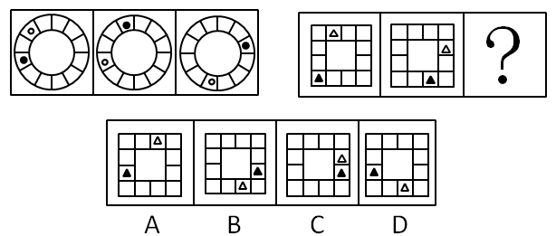

A. A

B. B

C. C

D. D

第 56 题 · 答案与解析

**参考答案（粉笔题库参考内容）**

B

**解析**

元素组成相同，位置不同，考位置。

第一组图形中，黑球每次顺时针平移三格，白球每次逆时针平移两格，两次变换规律相同。第二组图形中，已知第一幅图到第二幅图：黑色三角形逆时针平移两格，白色三角形顺时针平移三格；第二幅图到第三幅图也应按照此规律，则可得到B项中的图形。

故正确答案为B。

**考点**：位置规律-平移

**来源**：2009年四川省公务员录用考试《行测》题（上半年）第56题

### 第 57 题

从所给四个选项中，选择最合适的一个填入问号处，使之呈现一定的规律性：

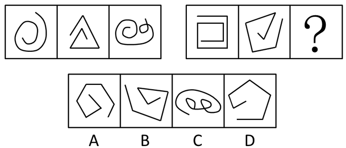

A. A

B. B

C. C

D. D

第 57 题 · 答案与解析

**参考答案（粉笔题库参考内容）**

C

**解析**

看位置，时针方向。

两组图形中，每个图形的线条都是从外向内沿顺时针方向旋转，只有C符合此规律。

故正确答案为C。

**考点**：位置规律-旋转

**来源**：2009年四川省公务员录用考试《行测》题（上半年）第57题

### 第 58 题

从所给四个选项中，选择最合适的一个填入问号处，使之呈现一定的规律性：

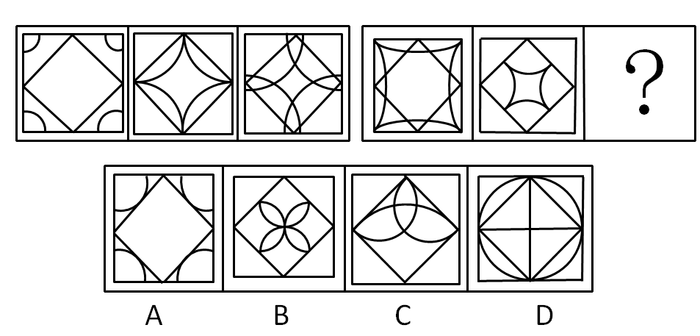

A. A

B. B

C. C

D. D

第 58 题 · 答案与解析

**参考答案（粉笔题库参考内容）**

B

**解析**

元素组成相似，综合考查数量和位置。

观察前后两组图形，曲线的条数不变，且与正方形的交点逐渐由外侧向中心侧移动。

故正确答案为B。

**考点**：数量规律-复合

**来源**：2009年四川省公务员录用考试《行测》题（上半年）第58题

### 第 59 题

从所给四个选项中，选择最合适的一个填入问号处，使之呈现一定的规律性：

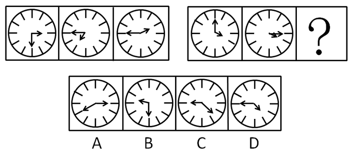

A. A

B. B

C. C

D. D

第 59 题 · 答案与解析

**参考答案（粉笔题库参考内容）**

A

**解析**

特殊考点，夹角计算。

第一组图形中，前两幅图的夹角相加等于第三幅图的夹角；第二组图形中也应遵循此规律，而第二组图形前两幅图的夹角相加等于A图中的夹角。

故正确答案为A。

**考点**：数量规律-角

**来源**：2009年四川省公务员录用考试《行测》题（上半年）第59题

### 第 60 题

从所给四个选项中，选择最合适的一个填入问号处，使之呈现一定的规律性：

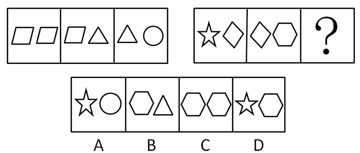

A. A

B. B

C. C

D. D

第 60 题 · 答案与解析

**参考答案（粉笔题库参考内容）**

C

**解析**

元素组成相似，每组图形内部存在元素相似或相同，考查图形内部特征。

第一组图形中，每幅图右边的元素是下一幅图左边的元素，可排除A、D。再观察第一组图形的构成元素，圆形、三角形、四边形的数量分别为1、2、3；第二组图形也应遵循相应的数量关系，则五角星、四边形、六边形的数量分别为1、2、3，可排除B。

故正确答案为C。

**考点**：样式规律-遍历

**来源**：2009年四川省公务员录用考试《行测》题（上半年）第60题

### 第 61 题

从所给四个选项中，选择最合适的一个填入问号处，使之呈现一定的规律性：

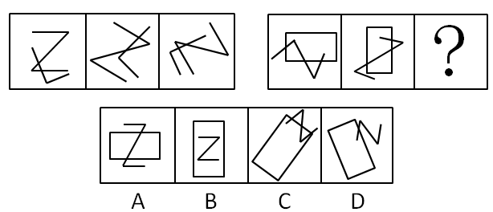

A. A

B. B

C. C

D. D

第 61 题 · 答案与解析

**参考答案（粉笔题库参考内容）**

C

**解析**

第一组图形中，每个图形元素都是相交的，且交点数量相同，都为2；第二组图形也应遵循此规律，即每个图形元素交点数量相同。观察前两个图形的元素是相交的，并且交点数量为3，那么第三个图形的交点数量也应为3，只有C符合。

故正确答案为C。

**考点**：数量规律-点

**来源**：2009年四川省公务员录用考试《行测》题（上半年）第61题

### 第 62 题

从所给四个选项中，选择最合适的一个填入问号处，使之呈现一定的规律性：

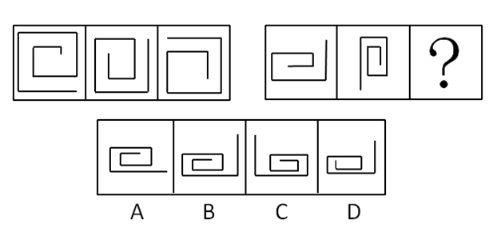

A. A

B. B

C. C

D. D

第 62 题 · 答案与解析

**参考答案（粉笔题库参考内容）**

B

**解析**

图形组成不同，且属性无规律，考虑数量规律。观察发现，图形中的直线存在多出垂直，因此可以考虑直角数量。左边一组图中直角数量为7、6、5，右边一组图中前两个图的直角数量为5、6，因此问号处图形的直角数应当为7，排除A项和D项；进一步观察发现题干每一幅图从内到外都是逆时针方向，C项是顺时针，排除C项。

故正确答案为B。

**考点**：数量规律-角

**来源**：2009年四川省公务员录用考试《行测》题（上半年）第62题

### 第 63 题

从所给四个选项中，选择最合适的一个填入问号处，使之呈现一定的规律性：

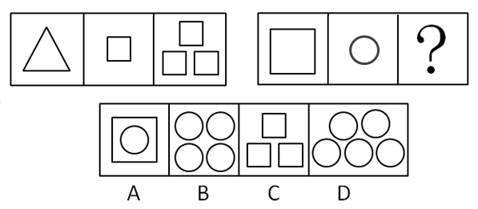

A. A

B. B

C. C

D. D

第 63 题 · 答案与解析

**参考答案（粉笔题库参考内容）**

B

**解析**

观察第一组图形，如下图所示，第二个图形根据第一个图形的形状排列得到了第三个图形；第二组图形也应遵循此规律，而第二组中第二个图形按照一个图形的形状排列得到的图形为B中图形。

故正确答案为B。

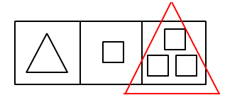

**考点**：样式规律-加减同异

**来源**：2009年四川省公务员录用考试《行测》题（上半年）第63题

### 第 64 题

从所给四个选项中，选择最合适的一个填入问号处，使之呈现一定的规律性：

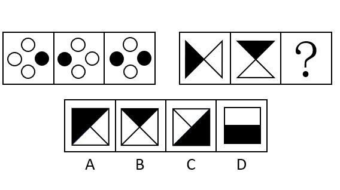

A. A

B. B

C. C

D. D

第 64 题 · 答案与解析

**参考答案（粉笔题库参考内容）**

A

**解析**

元素组成相似，元素叠加。

每组图形中，前两幅图形直接叠加构成第三幅图形。

故正确答案为A。

**考点**：样式规律-加减同异、样式规律-黑白运算

**来源**：2009年四川省公务员录用考试《行测》题（上半年）第64题

### 第 65 题

从所给四个选项中，选择最合适的一个填入问号处，使之呈现一定的规律性：

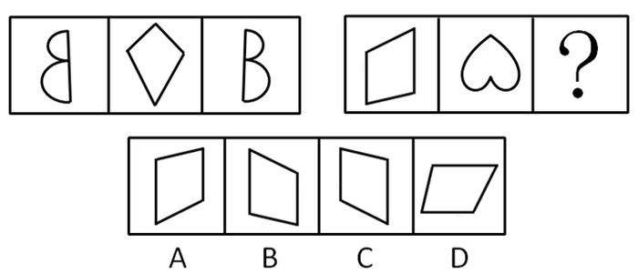

A. A

B. B

C. C

D. D

第 65 题 · 答案与解析

**参考答案（粉笔题库参考内容）**

B

**解析**

第一组图形中，如上图所示，三幅图整体对称；第二组图形也应遵循此规律，B中图形符合条件。

故正确答案为B。

**考点**：属性规律-对称性

**来源**：2009年四川省公务员录用考试《行测》题（上半年）第65题

### 第 66 题

科学研究表明：尿床对孩子的负面影响会随着年龄的增加而加重，而“尿床是小事，长大了就好了”这种错误观念导致了儿童尿床长期得不到治疗，给孩子的成长发育、智力发展和身心健康等方面带来了严重的影响！

由上文可以推出以下哪一个结论：

A. 孩子尿床是普遍现象

B. 孩子尿床是一种疾病

C. 孩子尿床会导致多个严重后果

D. 家长都认为孩子尿床会随着孩子的长大而自行消失

第 66 题 · 答案与解析

**参考答案（粉笔题库参考内容）**

C

**解析**

第一步：抓住题干中的主要信息。

第一句说明，科学研究表明尿床对孩子的负面影响随年龄增加而加重；第二句说明认为“尿床是小事”的错误观念以及这种错误观念导致的严重后果。

第二句：分析题干信息，结合选项得出答案。

A项，尿床是否是普遍现象，题干没有涉及，无法推出，排除；

B项，尿床是否是疾病，题干没有涉及，无法推出，排除；

C项，孩子尿床会导致多个严重后果与题意一致，为正确答案，当选；

D项，题干只说“尿床是小事，长大了就好了”是种错误观念，没有提到是否所有家长都持这一观念，无法推出，排除。

故正确答案为C。

**考点**：日常结论

**来源**：2009年四川省公务员录用考试《行测》题（上半年）第66题

### 第 67 题

春节期间，铁路系统在某两个城市之间增加了临时客车，以作为这些线路客运的补充。原来的车次要乘坐12个小时，临时客车要比原来的车次多乘坐1个小时，但是在刚实施的一段时间内，原车次的乘客拥堵现象仍未得到缓解。

那么最有说服力的原因是：

A. 临时客车的乘坐时间太长

B. 大多数人总喜欢乘坐固定的客车车次

C. 一段时间内人们对新增的临时客车的停车站和运行时间都还不清楚

D. 原车次比临时客车票价便宜的多

第 67 题 · 答案与解析

**参考答案（粉笔题库参考内容）**

C

**解析**

第一步：找出题干矛盾。

铁路系统在某两个城市之间增加了临时客车，但是在刚实施的一段时间内，原车次的乘客拥堵现象仍未得到缓解。

第二步：逐一分析选项。

C项说的是一段时间内人们对新增的临时客车还不够了解，因此临时客车没有发挥预期的作用，无法缓解拥堵现象，解释了论点中的矛盾，当选。

A项中的临时客车乘坐时间太长、B项中提到的人们偏好乘坐固定的客车车次、D项中提到的原车次票价偏低，都说明临时客车不如固定车次的客车好。因此，不管是刚开始实施，还是长期以往，人们都会偏向于乘坐固定车次的客车，无法缓解原车次拥堵现象，均排除。

故正确答案为C。

**考点**：原因解释

**来源**：2009年四川省公务员录用考试《行测》题（上半年）第67题

### 第 68 题

对每只股票的涨跌有各种各样的预测，但时至今日也没有哪个股评家能够准确预测每只股票的涨跌情况。根据以上信息，可以推断的是（    ）。

A. 所有股评都很差

B. 没有准确预报所有股票涨跌的条件

C. 所有股票都神秘莫测，不可捉摸

D. 影响股票涨跌的不确定因素太多，股票预测很难

第 68 题 · 答案与解析

**参考答案（粉笔题库参考内容）**

D

**解析**

日常推理题需要几个原则：保持主题一致；排除无关概念；慎选宏观论断；优选可能论断。特别注意几个容易犯的错误：偷换概念；强加比较；夸大事实；无由猜测。

第二步：逐一分析选项。

A项，没有哪个股评家能够准确预测每只股票的涨跌情况，不代表股评都很差，股票的涨跌本身就是一个复杂的问题，犯了无由猜测的错误，排除。

B项，题干没有提到不能准确预测的原因，只能推出不确定因素太多，犯了无由猜测的错误，排除。

C项，没有股评家能准确预测每只股票，不代表所有股票都神秘莫测，不可捉摸，可能有些股票的规律非常明显，犯了夸大事实的错误，排除。

D项，从题干只能推出影响股票涨跌的不确定因素很多，符合题意，当选。

故正确答案为D。

**考点**：日常结论

**来源**：2009年四川省公务员录用考试《行测》题（上半年）第68题

### 第 69 题

在某次科技发明大赛中，有一种将烟灰弹进去就会发出如肺癌晚期病人的重咳嗽声的烟灰缸获得了创意大奖。比赛结束后，某一厂家买断此创意并进一步将产品推向市场，但销售并不理想。

根据以上信息最能合理而充分地解释销量不佳的原因是：

A. 这种新型烟灰缸的价格比普通烟灰缸贵50元，很多消费者觉得不值。

B. 许多抽烟的人觉得这种烟灰缸可以起到敲警钟的作用。

C. 科技发明大赛后很多厂家都选择了这项创意来开发生产，同时将产品推向市场。

D. 某厂商在同期推出了一种新型的打火机，吸引了很多消费者。

第 69 题 · 答案与解析

**参考答案（粉笔题库参考内容）**

A

**解析**

第一步：找出题干矛盾。

烟灰缸获得了创意大奖，某一厂家买断此创意并进一步将产品推向市场，但销售并不理想。

第二步：逐一分析选项。

提问句要求解释厂家买断烟灰缸的创意，但产品推向市场后销量不佳的原因。

A项说明这款烟灰缸的售价太高，售价高会影响销售量，解释了题干销量不佳的原因，为正确选项，当选；

B项觉得烟灰缸有警示作用，那应该是销量好才对，这与题意不符，排除；

C项错误，题干已说明，该厂家买断了这一创意，不可能出现很多厂家都选择了这项创意来开发产品，排除；

D项，题干没有说明打火机跟烟灰缸之间的关系，从打火机的销量无法推出烟灰缸的销量，D属于无关项，排除。

故正确答案为A。

**考点**：原因解释

**来源**：2009年四川省公务员录用考试《行测》题（上半年）第69题

### 第 70 题

观察成功的企业家，他要么具有很强的专业知识和专业能力，要么是经过长期不懈的拼搏奋斗努力。

某饲料公司文董事长长期拼搏努力，那么：

A. 文董事长成为一个企业家的几率为50%

B. 文董事长不可能成为一个成功企业家

C. 文董事长一定是一个成功的企业家

D. 文董事长可能会成为一个成功企业家

第 70 题 · 答案与解析

**参考答案（粉笔题库参考内容）**

D

**解析**

第一步：翻译题干。利用充分必要条件。

①成功的企业家具有很强的专业知识和专业能力∨长期不懈的拼搏奋斗努力。

②董事长：长期拼搏努力，该句为事实信息。

第二步：由事实信息推导出答案。

文董事长长期拼搏努力，肯定①中的后件，无法推出绝对表达的结论，但可以得出可能性表达的结论，所以B、C两项错误、D项正确。A项谈到的是几率，题干没有给出相关信息，无法推出，排除。

故正确答案为D。

**考点**：常规翻译

**来源**：2009年四川省公务员录用考试《行测》题（上半年）第70题

### 第 71 题

一件盗窃刑事案件中，警方抓获了甲、乙、丙、丁四名犯罪嫌疑人，对他们进行质问，他们是这样说的：

甲：是乙作的案

乙：是丁和我一起作的案

丙：丁是案犯

丁：不是我作的案

四句话只有一句是谎言

如果以上为真，则以下哪项为真：

A. 说假话的是甲，作案的是丙

B. 说假话的是丙，作案的是乙

C. 说假话的是丁，作案的乙和丁

D. 说假话的是乙，作案的是乙

第 71 题 · 答案与解析

**参考答案（粉笔题库参考内容）**

C

**解析**

第一步：找突破口。

本题的突破口在于丙和丁之间的矛盾关系，两人的话必有一真一假。

第二步：看其他的话。

本题只有一句为假，故甲和乙的话均为真话。由甲和乙所说的话可知，案犯是乙和丁。

第三步：判断突破口中两句话的真假。

由案犯是乙和丁可知，丁的话为假。

故正确答案为C。

**考点**：只有一真/一假

**来源**：2009年四川省公务员录用考试《行测》题（上半年）第71题

### 第 72 题

有一位农夫在河流A岸集市上买了一只狗、一只鸡和一袋米。现在要回到河流B岸的家中，河边有一艘小船，小船每次只能载一个人和一件物品，狗、鸡、米三者之间的相互关系为：狗和鸡不能单独在一起，否则狗就要吃鸡；鸡和米不能单独在一起，否则鸡就要吃米；狗和米单独在一起是最安全的，若农夫要保证三件物品都安全的送到B岸，最有可能的是哪一种情况：

A. 先将狗送到B岸，再将鸡带到B岸，并把狗带回A岸，再将米带到B岸，空手回到A岸，将狗带到B岸

B. 先将鸡带到B岸，再将米带到B岸并把鸡带回A岸，再将狗带到B岸并把米带回A岸，再将鸡带到B岸。最后将米带到B岸

C. 先将狗带到B岸，再将鸡带到B岸，并把狗带回A岸，再将米带到B岸，并把鸡带回A岸，再将狗带到B岸，最后将鸡带到B岸

D. 先将鸡带到B岸，再将米带到B岸并把鸡带回A岸，再将狗带到B岸，空手回到A岸将鸡带到B岸

第 72 题 · 答案与解析

**参考答案（粉笔题库参考内容）**

D

**解析**

本题选项是每项均给出可能保证三件物品都安全送到B岸的情况，因此可以采用排除法。

A项和C项都是先将狗带到B岸，分析可知：如果先将狗送到B岸，剩下的是鸡和米，这不符合“鸡和米不能单独在一起”的条件，故A、C两项均排除。

B、D两项都是“先将鸡带到B岸，再将米带到B岸并把鸡带回A岸，再将狗带到B岸”，这时候带到B岸的东西是米和狗，从题干可知，狗和米单独在一起最安全，因此没必要再把米带回A岸，故B项错误，D项正确。

故正确答案为D。

**考点**：排除法

**来源**：2009年四川省公务员录用考试《行测》题（上半年）第72题

### 第 73 题

用公民的力量监督政府的服务，既能树立政府服务形象，提升文明档次。也能让普通老百姓真正领会文明的内涵。

如果上述判断是真，以下哪项判断也是真的：

A. 利用公民的力量监督政府服务，对政府和公民都是有益的

B. 利用公民的力量监督政府服务使政府受害，效果不好

C. 利用公民的力量监督政府服务使公民自己累死自己，效果很差

D. 利用公民的力量监督政府服务难以达到预定的目标，没有效果

第 73 题 · 答案与解析

**参考答案（粉笔题库参考内容）**

A

**解析**

第一步：抓住题干主要信息。

题干说明了用公民的力量监督政府服务对政府和对普通老百姓的好处。

第二步：分析题干信息，结合选项得出答案。

从题干可知，用公民的力量监督政府服务，对政府和老百姓都是有益的，A项正确，当选；

B项“使政府受害”与题意相悖，排除；

C项“使公民自己累死自己”和D项“难以达到预定的目标”，题干都没有涉及，C、D两项均属于无关选项，均排除。

故正确答案为A。

**考点**：日常结论

**来源**：2009年四川省公务员录用考试《行测》题（上半年）第73题

### 第 74 题

历史的进程是后浪推前浪，没有人永远站在风口浪尖上，所以会有拿破仑兵败滑铁卢和许多著名的改革人物从历史的舞台上渐渐沉寂。

从上文内容不能推出的结论是：

A. 没有人能够永远站在风口浪尖上是很正常的。

B. 许多著名改革人物渐渐沉寂也是正常的。

C. 历史的进程会淘汰拿破仑一样的人物。

D. 许多著名人物在改革的舞台上消失属于极不正常的情况。

第 74 题 · 答案与解析

**参考答案（粉笔题库参考内容）**

D

**解析**

日常结论题，根据题干信息逐一分析选项。

A项：根据题干第二句话“没有人能够永远站在风口浪尖上”，可以推出没人能够永远站在风口浪尖上是正常的，排除；

B项：根据题干第三句话“所以会有拿破仑兵败滑铁卢和许多著名的改革人物从历史的舞台上渐渐沉寂”，可以推出许多著名改革人物渐渐沉寂也是正常的，排除；

C项：根据题干的第一句话和第三句话“历史的进程是后浪推前浪”，“所以会有拿破仑兵败滑铁卢和许多著名的改革人物从历史的舞台上渐渐沉寂”，可以推出历史的进程会淘汰拿破仑一样的人物，排除；

D项：根据题干第三句话“所以会有拿破仑兵败滑铁卢和许多著名的改革人物从历史的舞台上渐渐沉寂”，可知著名人物在改革的舞台上消失属于正常情况，与题干表述矛盾，无法推出，当选。

本题为选非题，故正确答案为D。

**考点**：日常结论

**来源**：2009年四川省公务员录用考试《行测》题（上半年）第74题

### 第 75 题

人们常常倾向于在答应了某人一个较小的要求后，再答应他在此基础上的另一个更大一些的要求。相反，如果某人一开始就对别人提出一个较大的要求，那么他遭到拒绝的可能性会大大的增加，之所以出现这种现象，最可能的一个隐含前提是：

A. 将要求分成两次提的人会更受欢迎。

B. 人遇到一来就提大要求的人会很讨厌。

C. 人们觉得提小要求的人比较善良，因此再答应一个要求也无妨。

D. 通常较小的要求是人们比较容易就办到，而且人们倾向于保持自我的前后一致性。

第 75 题 · 答案与解析

**参考答案（粉笔题库参考内容）**

D

**解析**

第一步：找出论点和论据。

论点：人们倾向于在答应了某人一个较小的要求后，再答应他在此基础上的另一个更大一些的要求。如果某人一开始就对别人提出一个较大的要求，那么他遭到拒绝的可能性会大大的增加。

没有论据。

第二步：判断加强方式。

论点提到人们会先答应小要求再答应大要求，并且会拒绝一开始就提出大要求的人，但没有说明小要求和大要求之间的关系，要加强论点中小要求和大要求之间的关系。

第三步：逐一判断选项。

A项中分成两次提要求、B项提大要求的人会遭人厌，跟要求会不会得到答应没有关系，属于无关选项，均排除；

C项不能说明为什么会拒绝一开始就提大要求的人，无法加强论点，排除；

D项分析了人们会答应小要求，以及先答应小要求再答应大要求的原因，加强了论点，当选。

故正确答案为D。

**考点**：必要条件

**来源**：2009年四川省公务员录用考试《行测》题（上半年）第75题

### 第 76 题

劳动者：农民

A. 野兔：草

B. 动物：脊椎动物

C. 爬行动物：哺乳动物

D. 昆虫：鱼类

第 76 题 · 答案与解析

**参考答案（粉笔题库参考内容）**

B

**解析**

第一步：判断题干词语间逻辑关系。

题干中两词构成包容关系，“劳动者”包括“农民”。

第二步：判断选项词语间逻辑关系。

与题干逻辑关系相同的只有B，“动物”包括“脊椎动物”。

A中两词为对应关系，“兔子”吃“草”，进食者与食物的对应；C中两词为并列关系，爬行动物和哺乳动物都是动物的一种；D中两词为并列关系，昆虫和鱼类都是动物群体之一。综上所述，排除ACD三项。

故正确答案为B。

**考点**：逻辑关系-包容关系

**来源**：2009年四川省公务员录用考试《行测》题（上半年）第76题

### 第 77 题

鲁迅：写作

A. 凡高：作画

B. 狗：看家

C. 柴可夫斯基：舞蹈

D. 猫：抓老鼠

第 77 题 · 答案与解析

**参考答案（粉笔题库参考内容）**

A

**解析**

第一步：判断题干词语间第一重逻辑关系，并在选项中进行选择。

题干两词是对应关系，“鲁迅”擅长“写作”，与之逻辑关系相同的有ABD。C中“柴可夫斯基”擅长“音乐”，并非“舞蹈”，属无关，排除。

第二步：答案不唯一时，再判断题干词语间第二重逻辑关系，并在选项中进行选择。

“鲁迅”是人，相同特征的只有A，“凡高”也是人。

故正确答案为A。

**考点**：逻辑关系-对应关系

**来源**：2009年四川省公务员录用考试《行测》题（上半年）第77题

### 第 78 题

三国演义：元末明初

A. 红楼梦：明

B. 水浒传：清

C. 西游记：宋

D. 资治通鉴：宋

第 78 题 · 答案与解析

**参考答案（粉笔题库参考内容）**

D

**解析**

第一步：判断题干词语间逻辑关系。

题干两词为对应关系，“三国演义”写于“元末明初”，作者为罗贯中，为名著和著作时间的对应。

第二步：判断选项词语间逻辑关系。

与题干中逻辑相同的只有D，“资治通鉴”写于“宋”，作者为司马光。

A中“红楼梦”写于清朝，并非“明”，作者为曹雪芹，两词不构成对应关系；

B中“水浒传”写于元末明初，并非“清”，作者为施耐庵，两词不构成对应关系；

C中“西游记”写于明朝，并非“宋”，作者为吴承恩。

故正确答案为D。

**考点**：逻辑关系-对应关系

**来源**：2009年四川省公务员录用考试《行测》题（上半年）第78题

### 第 79 题

飞机：太空

A. 大海：轮船

B. 汽车：陆地

C. 动物园：老虎

D. 太阳：庄稼

第 79 题 · 答案与解析

**参考答案（粉笔题库参考内容）**

B

**解析**

第一步：判断题干词语间逻辑关系。

题干两词为对应关系，“飞机”在“太空”中运动，为交通工具和运动范围的对应。

第二步：判断选项词语间逻辑关系。

与题干中逻辑关系相同的只有B，“汽车”在“陆地”上运动。A中应为“轮船”在“大海”中运动，前后顺序倒置；

C中“老虎”在“动物园”里运动，前后顺序倒置；

D中无明显逻辑关系。综上所述，排除ACD三项。

故正确答案为B。

**考点**：逻辑关系-对应关系

**来源**：2009年四川省公务员录用考试《行测》题（上半年）第79题

### 第 80 题

湖北：武汉

A. 陕西：郑州

B. 广西：桂林

C. 青海：西宁

D. 江西：南宁

第 80 题 · 答案与解析

**参考答案（粉笔题库参考内容）**

C

**解析**

第一步：判断题干词语间逻辑关系。

题干两词为对应关系，“湖北”的省会是“武汉”，为省份与省会的对应。

第二步：判断选项词语间逻辑关系。

与题干逻辑关系相同的只有C，“青海”的省会是“西宁”，当选。

A中“陕西”的省会是“西安”，“郑州”是“河南”的省会，不构成对应关系，排除；

B中“广西”的省会是“南宁”，“桂林”是“广西”的一个城市，并非省会，不构成对应关系，排除；

D中“江西”的省会是“南昌”，并非“南宁”，排除。

故正确答案为C。

**考点**：逻辑关系-对应关系

**来源**：2009年四川省公务员录用考试《行测》题（上半年）第80题

### 第 81 题

柳宗元：文学家

A. 马致远：文学家

B. 司马迁：诗人

C. 吴承恩：小说家

D. 龚自珍：史学家

第 81 题 · 答案与解析

**参考答案（粉笔题库参考内容）**

C

**解析**

第一步：判断题干词语间逻辑关系。

柳宗元是文学家，二者为种属关系。

第二步：判断选项词语间逻辑关系。

A项：马致远是戏曲家，并非文学家，与题干逻辑关系不一致，排除；

B项：司马迁是史学家、文学家，并非诗人，与题干逻辑关系不一致，排除；

C项：吴承恩是小说家，二者为种属关系，与题干逻辑关系一致，当选；

D项：龚自珍是诗人，并非史学家，与题干逻辑关系不一致，排除。

故正确答案为C。

**考点**：逻辑关系-包容关系

**来源**：2009年四川省公务员录用考试《行测》题（上半年）第81题

### 第 82 题

律师：当事人

A. 法官：各种案件

B. 心理咨询师：心理不健康的人

C. 药监人员：生产和销售药品的人

D. 保险代理人：投保者

第 82 题 · 答案与解析

**参考答案（粉笔题库参考内容）**

D

**解析**

第一步：判断题干词语间逻辑关系。

题干两词为对应关系，“律师”服务的对象是“当事人”，职业与服务对象的一一对应。

第二步：判断选项词语间逻辑关系。

与题干逻辑关系相同的只有D，“保险代理人”的服务对象是“投保者”。

A中“法官”处理“各类案件”，并非服务对象，不符合对应关系；

B中“心理不健康的人”不代表有心理疾病，并非“心理医生”的服务对象，不符合对应关系；

C中“药监人员”监督管理“生产和销售药品的人”，并非服务的关系，不符合对应关系。

故正确答案为D。

**考点**：逻辑关系-对应关系

**来源**：2009年四川省公务员录用考试《行测》题（上半年）第82题

### 第 83 题

细胞学说：施莱登

A. 相对论：霍金

B. 方法论：培根

C. 镭的发现：居里夫人

D. 进化论：达尔文

第 83 题 · 答案与解析

**参考答案（粉笔题库参考内容）**

D

**解析**

第一步：判断题干词语间逻辑关系。

题干两词为对应关系，“细胞学说”是“施莱登”的研究成果，是重要成果与创造者之间的对应。

第二步：判断选项词语间逻辑关系。

与题干逻辑关系相同的只有D，“进化论”是“达尔文”的研究成果。

A中“相对论”是爱因斯坦的研究成果，“霍金”是广义相对论的研究者，不符合对应关系，排除；

B中“方法论”是客观存在的，不是某个人创造的，排除；

C中“镭的发现”是“居里夫人”完成的，但不是她创造的，不符合对应关系，排除。

故正确答案为D。

**考点**：逻辑关系-对应关系

**来源**：2009年四川省公务员录用考试《行测》题（上半年）第83题

### 第 84 题

“只要有一个支点，就能使地球移动”：阿基米德

A. “当你处世行事时，正确运用知识意味着有了力量”：卢梭

B. “成功的秘诀，在永不改变既定的目的”：培根

C. “莫等闲，白了少年头，空悲切”：秋瑾

D. “千古奇冤，江南一叶，同室操戈，相煎何急”：周恩来

第 84 题 · 答案与解析

**参考答案（粉笔题库参考内容）**

D

**解析**

第一步：判断题干词语间逻辑关系。

题干两词为对应关系，“只要有一个支点，就能使地球移动”是阿基米德的名言，是名言与提出者的对应。

第二步：判断选项词语间逻辑关系。

与题干逻辑关系相同的只有D，“千古奇冤，江南一叶，同室操戈，相煎何急”是周恩来的名言，是针对皖南事变中叶挺被害一事。

A中“当你处世行事时，正确运用知识意味着了力量”是培根的名言，并非“卢梭”，不构成对应，排除；

B项“成功的秘诀，在永不改变既定的目的”是卢梭的名言，并非出自“培根”，不构成对应，排除；

C项“莫等闲，白了少年头，空悲切”是岳飞的名言，节选自《满江红》，并非出自“秋瑾”，不构成对应，排除。

故正确答案为D。

**考点**：逻辑关系-对应关系

**来源**：2009年四川省公务员录用考试《行测》题（上半年）第84题

### 第 85 题

流行歌手：演员

A. 梳妆台：化妆品

B. 学校实验室试验员：教辅人员

C. 羽毛：鸟类

D. 灯泡：台灯

第 85 题 · 答案与解析

**参考答案（粉笔题库参考内容）**

B

**解析**

第一步：判断题干词语间逻辑关系。

题干两词为并列关系，而且是并列中的反对关系，“流行歌手”和“演员”都是艺人。

第二步：判断选项词语间逻辑关系。

与题干逻辑关系相同的只有B，“学校实验室试验员”和“教辅人员”都是教学工作人员。

A中两词为对应关系，“梳妆台”上放着“化妆品”，不符合题干逻辑，排除；

C中是对应关系，“鸟类”都有“羽毛”，不符合题干逻辑，排除；

D中是包容关系，“灯泡”是“台灯”的组成部分，不符合题干逻辑，排除。

故正确答案为B。

**考点**：逻辑关系-并列关系

**来源**：2009年四川省公务员录用考试《行测》题（上半年）第85题

## 材料 1

**一、根据文字完成各题。**
        2007年黑龙江省全年完成邮电业务总量512.7亿元，比上年增长28.1%。其中，电信业务总量483.5亿元，增长29.4%；邮政业务总量29.2亿元，增长9.8%。年末全省长途光缆线路总长度42567公里；局用交换机总容量1004.9万门。年末固定电话用户1112.2万户，增长2.8%，其中城市837.7万户，增长4%；农村274.5万户，下降0.6%。移动电话用户1449.2万户，增长14.4%。全省电话普及率为67.1%，比上年提高5.6个百分点。国际互联网络用户299万户（包括拨号、专线和宽带接入用户），增长4.9%，其中宽带接入户209.2万户，增长18.8%。

### 第 86 题

2006年黑龙江省电话普及率是：

A. 67.1%

B. 61.5%

C. 54.4%

D. 52.4%

第 86 题 · 答案与解析

**参考答案（粉笔题库参考内容）**

B

**解析**

根据题干“2006年黑龙江省电话普及率是”，定位文字材料“2007年全省电话普及率为67.1%，比上年提高5.6个百分点。”可判定本题为简单加减计算问题。因此2006年黑龙江省电话普及率为67.1%-5.6%=61.5%。

故正确答案为B。

**考点**：文字资料、简单加减计算

**来源**：2009年四川省公务员录用考试《行测》题（上半年）第86题

### 第 87 题

2007黑龙江省实现邮政业务总量比上年增长约多少亿元：

A. 2.61

B. 2.68

C. 112.47

D. 102.47

第 87 题 · 答案与解析

**参考答案（粉笔题库参考内容）**

A

**解析**

根据题干所求“比上年增长约多少亿元”，可判断本题为增长量的计算问题。定位文字材料“邮政业务总量29.2亿元，增长9.8%”，根据公式：增长量可得，2007黑龙江省实现邮政业务总量比上年增长，只有A项符合。

故正确答案为A。

**考点**：增长量计算、文字资料

**来源**：2009年四川省公务员录用考试《行测》题（上半年）第87题

### 第 88 题

2006年末固定电话与移动电话用户共有多少万用户：

A. 2561.40

B. 2454.33

C. 2348.69

D. 2220.85

第 88 题 · 答案与解析

**参考答案（粉笔题库参考内容）**

C

**解析**

根据题干“2006年末固定电话与移动电话用户共······”，而材料给出2007年末固定电话用户和移动电话用户数据，可判定本题为基期和差问题。定位文字材料可得“2007年末固定电话用户1112.2万户，增长2.8%······移动电话用户1449.2万户，增长14.4%”。根据基期量，则2006年末固定电话与移动电话用户为万户，与C项最接近。

故正确答案为C。

**考点**：基期和差、文字资料

**来源**：2009年四川省公务员录用考试《行测》题（上半年）第88题

### 第 89 题

2007年黑龙江省国际互联网络拨号、专线用户比上年减少约多少万户：

A. 15.63

B. 19.14

C. 22.58

D. 28.73

第 89 题 · 答案与解析

**参考答案（粉笔题库参考内容）**

B

**解析**

根据题干“2007年······比上年减少······”，可判断本题为增长量的计算问题。定位文字材料“2007年国际互联网络用户299万户（包括拨号、专线和宽带接入用户），增长4.9%，其中宽带接入户209.2万户，增长18.8%。”根据公式：增长量=现期-基期，则有。根据题干“比上年减少”，故为19万户，与B项最接近。

故正确答案为B。

**考点**：增长量计算、文字资料

**来源**：2009年四川省公务员录用考试《行测》题（上半年）第89题

### 第 90 题

下列对2007年末固定电话用户增长情况说法正确的有：

Ⅰ全省增长量约为30.3万户

Ⅱ城市增长量约为32.2万户

Ⅲ农村增长量约为1.9万户

Ⅳ全省增长量约为34.1万户

A. Ⅰ

B. Ⅰ、Ⅱ

C. Ⅱ、Ⅳ

D. Ⅱ、Ⅲ、Ⅳ

第 90 题 · 答案与解析

**参考答案（粉笔题库参考内容）**

B

**解析**

定位文字材料可知，2007年末固定电话用户1112.2万户，增长2.8%，其中城市837.7万户，增长4%；农村274.5万户，下降0.6%。根据公式：增长量，则有：

I：全省增长量为万，正确，即IV错误；

II：城市增长量为万，正确；

III：根据题意，农村固定电话用户下降了0.6%，所以农村固定电话的增长量为负数，错误。

因此正确的有I、II。

故正确答案为B。

**考点**：文字资料、综合分析

**来源**：2009年四川省公务员录用考试《行测》题（上半年）第90题

## 材料 2

根据以下资料完成各题。

2007年全年四川省企业商品价格指数(以上年同月为100)

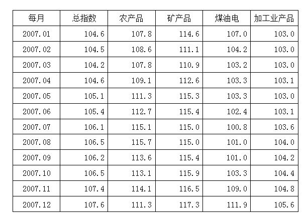

### 第 91 题

2007年农产品价格增长最快的是多少月：

A. 10

B. 9

C. 8

D. 7

第 91 题 · 答案与解析

**参考答案（粉笔题库参考内容）**

D

**解析**

根据题干“2007······增长最快······”，可判定本题为一般增长率问题。定位表格数据，可以找到对应数据。根据公式：可得：

10月增长率：；

9月增长率：；

8月增长率：；

7月增长率：。

观察可知，7月增长率的分子大，分母小，分数大于8月增长率。即7月最快。

故正确答案为D。

**考点**：一般增长率、统计表

**来源**：2009年四川省公务员录用考试《行测》题（上半年）第91题

### 第 92 题

2007年煤油电价较上年同期增长最慢的是多少月：

A. 10

B. 9

C. 8

D. 7

第 92 题 · 答案与解析

**参考答案（粉笔题库参考内容）**

D

**解析**

根据表格直接查找可知，7月指数最低，为100.8。较上年同期增长最慢。

故正确答案为D。

**考点**：直接找数、统计表

**来源**：2009年四川省公务员录用考试《行测》题（上半年）第92题

### 第 93 题

从月看，商品价格呈下降趋势的商品是：

A. 农产品

B. 矿产品

C. 煤油电

D. 加工业产品

第 93 题 · 答案与解析

**参考答案（粉笔题库参考内容）**

C

**解析**

根据表格直接查找可知，煤油电1到9月指数呈下降趋势。

故正确答案为C。

**考点**：直接找数、统计表

**来源**：2009年四川省公务员录用考试《行测》题（上半年）第93题

### 第 94 题

2007年同月企业商品价格总指数与各产品价格指数的最大差值是多少个百分点：

A. 10.1

B. 10.2

C. 11.3

D. 11.8

第 94 题 · 答案与解析

**参考答案（粉笔题库参考内容）**

B

**解析**

根据表格直接查找可知，5月矿产品指数与总指数的差值最大，为115.3-105.1=10.2。

故正确答案为B。

**考点**：简单加减计算、统计表

**来源**：2009年四川省公务员录用考试《行测》题（上半年）第94题

### 第 95 题

2007年矿产品价格指数的最大值与最小值相差多少个百分点：

A. 7.4

B. 6.4

C. 6.2

D. 5.4

第 95 题 · 答案与解析

**参考答案（粉笔题库参考内容）**

B

**解析**

根据表格直接查找可知，最大为12月，最小为3月，有117.3-110.9=6.4。

故正确答案为B。

**考点**：简单加减计算、统计表

**来源**：2009年四川省公务员录用考试《行测》题（上半年）第95题

## 材料 3

根据图表完成各题。

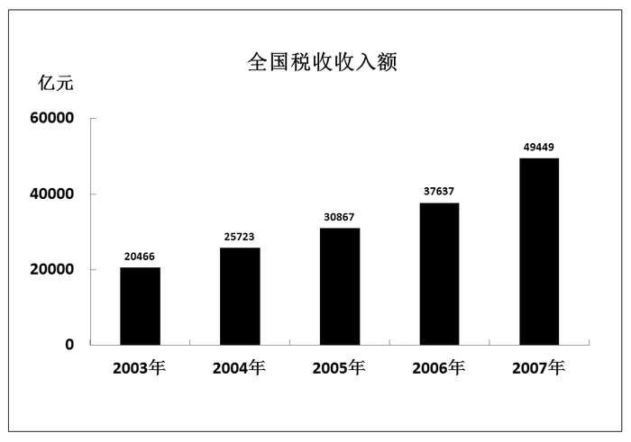

### 第 96 题

2006年税收总额约是2004年的多少倍：

A. 1.65

B. 1.58

C. 1.53

D. 1.46

第 96 题 · 答案与解析

**参考答案（粉笔题库参考内容）**

D

**解析**

根据题干“2006年······是2004年······倍”，结合材料为2007年，可判定本题为基期倍数问题，定位图形材料，2006年税收总额是37637亿元，2004年为25723亿元，则所求倍数为，只有D项符合。

故正确答案为D。

**考点**：基期倍数、统计图

**来源**：2009年四川省公务员录用考试《行测》题（上半年）第96题

### 第 97 题

2007年税收收入比上年增长了约：

A. 37.9%

B. 31.4%

C. 22.4%

D. 20%

第 97 题 · 答案与解析

**参考答案（粉笔题库参考内容）**

B

**解析**

根据题干“2007年······比上年增长······”，结合选项为百分数，可判定本题为一般增长率问题，定位图形材料，2007年税收总额是49449亿元，2006年为37637亿元，根据公式：可知，2007年税收收入比上年增长了，与B项最接近。

故正确答案为B。

**考点**：一般增长率、统计图

**来源**：2009年四川省公务员录用考试《行测》题（上半年）第97题

### 第 98 题

如保持2006年的年增长速度，2008年的税收收入约为：

A. 57990.64

B. 58397.18

C. 60294.55

D. 62701.93

第 98 题 · 答案与解析

**参考答案（粉笔题库参考内容）**

C

**解析**

根据题干“如保持2006年的年增长速度，2008年的税收收入约为”，材料时间为2007年，可判定本题为现期计算问题。定位图形材料，2007年的税收收入为49449亿元，2006年的税收收入为37637亿元，2005年为30867亿元，根据公式：可知，2006年的增长速度为，如保持2006年的年增长速度，即22%，则2008年的税收收入为亿元，与C项最接近。

故正确答案为C。

**考点**：现期计算、统计图

**来源**：2009年四川省公务员录用考试《行测》题（上半年）第98题

### 第 99 题

2003年2007年全国税收总额为多少亿元：

A. 164142

B. 184142

C. 194112

D. 254142

第 99 题 · 答案与解析

**参考答案（粉笔题库参考内容）**

A

**解析**

定位图形材料，2003年~2007年全国税收额分别为：20466、25723、30867、37637和49449亿元。则2003年~2007年全国税收总额为20466+25723+30867+37637+49449。选项后四位均相同，则只需分别计算前两位，即20+25+30+37+49=161，与A项最接近。

故正确答案为A。

**考点**：简单加减计算、统计图

**来源**：2009年四川省公务员录用考试《行测》题（上半年）第99题

### 第 100 题

税收收入年增长速度居第三位的年份，比2003年增长了多少亿元：

A. 5257

B. 10401

C. 17171

D. 28983

第 100 题 · 答案与解析

**参考答案（粉笔题库参考内容）**

C

**解析**

根据题干“······比2003年增长了多少亿元”，可判定本题为增长量计算问题。定位图形材料，2003年~2007年全国税收额分别为：20466、25723、30867、37637和49449亿元。若要知道增长速度居第三位的年份，则需知道每个年份的增长率。根据公式：，则2003年~2007年每年的增长率分别为：、、、，根据直除法，原式可分别转化为：、、、，故可知，即2006年排第三位。则有37637-20466，选项前两项均不相同，根据加减定位法，只需计算前两位，即37-20=17，只有C项符合。

故正确答案为C。

**考点**：增长量计算、统计图

**来源**：2009年四川省公务员录用考试《行测》题（上半年）第100题

