# 2010年四川省公务员录用考试《行测》题（下半年）

<!-- gwy:overview:start -->
> **四川 · 2010 · 行测 · 统考** ｜ 100 题 · 图片 122 处 · 答案随题折叠

| 题型模块 | 题量 | 题号 |
| --- | ---: | ---: |
| 数量关系 | 15 | 1–15 |
| 言语理解与表达 | 35 | 16–50 |
| 判断推理 | 30 | 51–80 |
| 常识判断 | 5 | 81–85 |
| 资料分析 | 15 | 86–100 |
| **合计** | **100** | |

导航：[题型与作答说明](#题型与作答说明) · [题目](#题目) · [材料 1](#材料-1)
<!-- gwy:overview:end -->

> 候选采集稿。参考答案及解析来自粉笔页面，不代表官方答案或真实高分答卷；来源使用许可与原卷对应关系仍需人工核实。

## 题型与作答说明

数量关系

（15题）

本部分包括数字推理与数学运算两种类型的试题。

言语理解与表达

（35题）

根据题目要求，在四个选项中选出一个正确答案。

判断推理

（30题）

本部分包括定义判断、图形推理、逻辑判断与类比推理四种类型的试题。

常识判断

（5题）

根据题目要求，在四个选项中选出一个正确答案。

资料分析

（15题）

针对下列图、表或文字回答问题。你应根据资料提供的信息进行分析、比较、计算、处理。

## 题目

### 第 1 题

3，4，6，9，14，22，35，（    ）

A. 47

B. 49

C. 53

D. 56

第 1 题 · 答案与解析

**参考答案（粉笔题库参考内容）**

D

**解析**

数列无明显特征，观察相邻项关系有：3+4-1=6，4+6-1=9，6+9-1=14，9+14-1=22，14+22-1=35，即第一项+第二项-1=第三项。故题干所求项为：22+35-1=56。

故正确答案为D。

**来源**：2010年四川省公务员录用考试《行测》题（下半年）第1题

### 第 2 题

0，7，26，63，（    ）

A. 124

B. 153

C. 188

D. 196

第 2 题 · 答案与解析

**参考答案（粉笔题库参考内容）**

A

**解析**

观察发现，数列各项均为幂次数附近的数字，考虑幂次修正数列：，，，，故该数列为立方数修正数列，底数是公差为1的等差数列，修正项为-1，所求项为。

故正确答案为A。

**来源**：2010年四川省公务员录用考试《行测》题（下半年）第2题

### 第 3 题

－2，3，－5，8，－12，（    ）

A. 15

B. 17

C. 20

D. 23

第 3 题 · 答案与解析

**参考答案（粉笔题库参考内容）**

B

**解析**

方法一：观察数列，正负号交替出现，考虑提出数值部分，即：

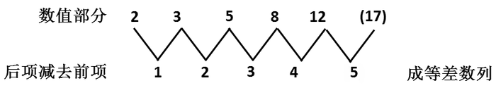

因此原数列所求项应为正数，数值部分为17。

方法二：观察数列，作差无规律，考虑作和，作和后得到新数列：1，-2，3，-4，（    ）。则新数列下一项为5，故原数列所求项为5-（-12）=17。

故正确答案为B。

**来源**：2010年四川省公务员录用考试《行测》题（下半年）第3题

### 第 4 题

1，2，5，12，29，（    ）

A. 59

B. 60

C. 65

D. 70

第 4 题 · 答案与解析

**参考答案（粉笔题库参考内容）**

D

**解析**

观察数列，无明显规律，且作差作和均无规律，考虑递推。圈三数，找规律。观察发现：，，。递推规律为：第一项+第二项x^2=第三项，故所求项为。

故正确答案为D。

**来源**：2010年四川省公务员录用考试《行测》题（下半年）第4题

### 第 5 题

1，2，6，15，40，104，（    ）

A. 233

B. 256

C. 273

D. 296

第 5 题 · 答案与解析

**参考答案（粉笔题库参考内容）**

C

**解析**

方法一：数列无明显特征，优先考虑多级数列。后项减前项得到新数列：1，4，9，25，64，（    ），各项均为幂次数，可转化为1^2，2^2，3^2，5^2，8^2，（    ）。底数为简单递推和数列，即：第一项＋第二项＝第三项，指数均为2，则新数列下一项为(5+8)^2。所求项为104＋169＝273。

方法二：数列各项均为合数，考虑因数分解数列。原数列可分别分解为：1×1，1×2，2×3，3×5，5×8，8×13，（    ）。乘号左侧分别为1，1，2，3，5，8，乘号右侧分别为1，2，3，5，8，13，均为简单递推和数列，则所求项为（5+8）×（8+13）=13×21=273。

故正确答案为C。

**来源**：2010年四川省公务员录用考试《行测》题（下半年）第5题

### 第 6 题

一个自然数（0除外），如果它顺着数和倒过来数都是一样的，则称这个数为“对称数”。例如：2，101，1331是对称数，但220不是对称数。由数字0、1、2、3组成的不超过3位数的对称数个数有多少个：

A. 9

B. 12

C. 18

D. 21

第 6 题 · 答案与解析

**参考答案（粉笔题库参考内容）**

C

**解析**

观察四个选项发现结果数据不大，考虑列举法：

一位数的对称数为：1、2、3，有3个；

两位数的对称数为：11、22、33，有3个；

三位数的对称数其十位数字可以为0、1、2、3共四种情况，百位和个位数字相等，可以为1、2、3共三种情况，即三位数的对称数共有个。

因此共有3+3+12=18个。

故正确答案为C。

**考点**：基础排列组合

**来源**：2010年四川省公务员录用考试《行测》题（下半年）第6题

### 第 7 题

某快速反应部队运送救灾物资到灾区。飞机原计划每分钟飞行12千米，由于灾情危急，飞行速度提高到每分钟15千米，结果比原计划提前30分钟到达灾区，则机场到灾区的距离是多少千米：

A. 1600

B. 1800

C. 2050

D. 2250

第 7 题 · 答案与解析

**参考答案（粉笔题库参考内容）**

B

**解析**

设机场到灾区的距离为S千米，则原计划所需时间为S/12分钟，提速后所需时间为S/15分钟。根据题意：原计划所需时间-提速后所需时间=30分钟，即分钟，解得S=1800。

故正确答案为B。

**考点**：普通行程

**来源**：2010年四川省公务员录用考试《行测》题（下半年）第7题

### 第 8 题

从0、1、4、7、8中选4个数字组成若干个四位数，把其中能被3整除的四位数从小到大排列起来，那么第十个数是：

A. 4017

B. 4071

C. 4107

D. 4170

第 8 题 · 答案与解析

**参考答案（粉笔题库参考内容）**

D

**解析**

从0、1、4、7、8中选4个数字组成若干个四位数，能被3整除的数其各个位数字之和为3的倍数，这组数中只有一组符合条件，即0、1、4、7。首位为1的情况有A_3^3=6个，即从第7个数开始为首位为4的情况，首位为4的四位数从小到大依次如下：4017、4071、4107、4170、4701、4710，可知第十个数为4170。

故正确答案为D。

**考点**：基础排列组合

**来源**：2010年四川省公务员录用考试《行测》题（下半年）第8题

### 第 9 题

有一根长240米的绳子，从某一端开始每隔4米做一个记号，每隔6米也做一个记号，然后将标有记号的地方剪断，则绳子共剪成多少段：

A. 40

B. 60

C. 80

D. 81

第 9 题 · 答案与解析

**参考答案（粉笔题库参考内容）**

C

**解析**

根据楼间植树公式：，每隔4米做一个记号，则第一次记号数；每隔6米做一个记号，则第二次记号数；两次记号重复间隔为4与6的最小公倍数12，即每隔12米的记号被重复做两次，故重复记号数。因此做记号的总数为：第一次记号数＋第二次记号数-重复记号数=59+39-19=79，即绳子被剪成79+1=80段。

故正确答案为C。

**考点**：两集合

**来源**：2010年四川省公务员录用考试《行测》题（下半年）第9题

### 第 10 题

某种细胞开始时有2个，1小时后分裂成4个并死去1个，2小时后分裂成6个并死去1个，3小时后分裂成10个并死去1个······按此规律，6小时后细胞存活的个数是多少个：

A. 63

B. 65

C. 67

D. 71

第 10 题 · 答案与解析

**参考答案（粉笔题库参考内容）**

B

**解析**

观察规律，细胞开始时为2个，1小时后为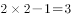个，2小时后为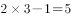个，3小时后为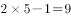个······即下一小时的细胞数等于前一小时的细胞数的2倍减1。因此4小时和5小时后细胞存活的个数分别为：

，，则6小时后细胞存活的个数为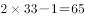个。

故正确答案为B。

**考点**：数列问题

**来源**：2010年四川省公务员录用考试《行测》题（下半年）第10题

### 第 11 题

有9千克、6千克、2千克的糖和15千克、8千克、7千克的面粉各一袋，每千克糖的价格是每千克面粉价格的2倍。某人买了其中5袋，并且买糖和买面粉的价钱一样，则剩下那袋食品重多少千克：

A. 8

B. 7

C. 6

D. 2

第 11 题 · 答案与解析

**参考答案（粉笔题库参考内容）**

D

**解析**

根据题意，每千克糖的价格是每千克面粉价格的2倍，而买糖和买面粉的价钱一样，说明购买的面粉的重量是糖的重量的2倍。3袋面粉15千克、8千克、7千克的总重量为30千克，恰好是9千克、6千克糖的2倍。因此，剩下那袋食品为重2千克的糖。

故正确答案为D。

**考点**：和差倍比问题

**来源**：2010年四川省公务员录用考试《行测》题（下半年）第11题

### 第 12 题

有一列数，第一个数是90，第二个数是80。从第三个数开始，每一个数都是它前面两个数的平均数。则第100个数的整数部分是：

A. 80

B. 83

C. 85

D. 87

第 12 题 · 答案与解析

**参考答案（粉笔题库参考内容）**

B

**解析**

给定数列前面的数字为90、80、85、82.5、83.75、83.125······之后所有的数字整数部分将保持83不变，因此第100个数的整数部分也是83。

故正确答案为B。

注：当出现连续两个数的整数部分相同时，之后每项的整数部分不再变化，这个结论可由平均数的自然特性推出。

**来源**：2010年四川省公务员录用考试《行测》题（下半年）第12题

### 第 13 题

有三个居委会的居民共订600份《华西都市报》，每个居委会至少订199份，最多订201份，则不同的订报方式有多少种：

A. 3

B. 5

C. 6

D. 7

第 13 题 · 答案与解析

**参考答案（粉笔题库参考内容）**

D

**解析**

根据题意，居委会的订报方式有以下两种情况：

（1）三个居委会订报数量相同，均为200份，则有1种订报方式；

（2）三个居委会订报数量不同，分别为199份、200份、201份，则有A_3^3=6种订报方式；

综上，不同的订报方式共有1+6=7种。

故正确答案为D。

**考点**：基础排列组合

**来源**：2010年四川省公务员录用考试《行测》题（下半年）第13题

### 第 14 题

已知数列{a_n}=，则

A. 70

B. 28

C. 20

D. 8

第 14 题 · 答案与解析

**参考答案（粉笔题库参考内容）**

C

**解析**

根据题意可知，，，因此乘积为20。

故正确答案为C。

**考点**：数列问题

**来源**：2010年四川省公务员录用考试《行测》题（下半年）第14题

### 第 15 题

某单位的招聘考试有1000人报名，录取了150人，被录取者比未被录取者的平均成绩高38分，两者总平均分是55分，录取分数线比录取者的平均成绩少6.3分，则录取分数线是多少分：

A. 79.5

B. 81

C. 83

D. 87.3

第 15 题 · 答案与解析

**参考答案（粉笔题库参考内容）**

B

**解析**

设被录取者的平均分数为x分，则未被录取者平均分数为（x-38）分。根据题意，1000人报名考试，录取了150人，则未被录取的有1000-150=850人。

方法一：因为两者总平均分为55分且所有考生的总分数不变，可列式150x+850(x-38)=55×1000，解得x=87.3，则录取分数线为87.3-6.3=81分。

方法二：根据线段法口诀“距离（平均分差）与量（人数）成反比”，可列式为：，解得x=87.3，则录取分数线是87.3-6.3=81分。

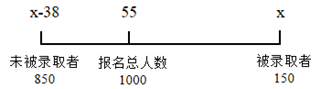

故正确答案为B。

**来源**：2010年四川省公务员录用考试《行测》题（下半年）第15题

### 第 16 题

中国、印度、巴西、南非等发展中国家主动采取了减排措施，为促进哥本哈根会议取得积极成果发挥了积极的（    ）作用。

A. 指导性

B. 战略性

C. 战术性

D. 建设性

第 16 题 · 答案与解析

**参考答案（粉笔题库参考内容）**

D

**解析**

本题考查实词语境最佳选择。

A项“指导性”一般带有强制性意味，如上级指导下级工作，该项排除；

B项“战略”本意是指导战争全局的计划和策略，后泛指为完成某项任务而做的规划和策略，该项排除；

C项“战术”原指指导战斗的原则和方法，包括战斗的基本原则、战斗的方法和战斗的组织实施等具体原则。发展中国家的具体做法对会议进程谈不上战术性意义，该项排除；

D项“建设性”具有推进、促进项目实施的含义，文中发展中国家的做法有助于推进、促进会议取得积极成果，符合题干描述，该项当选。

故正确答案为D。

**考点**：实词填空、对应关系-前后呼应

**来源**：2010年四川省公务员录用考试《行测》题（下半年）第16题

### 第 17 题

当前DNA基础的测试方法使科学家排除了外星球生命形式并非起源于地球的可能性。这（    ）着科学家期望外星球生命能够具有与地球任何已知有机生命完全不同的DNA结构。

A. 预示

B. 标志

C. 意味

D. 暗示

第 17 题 · 答案与解析

**参考答案（粉笔题库参考内容）**

C

**解析**

本题考查实词语境最佳选择。题干是说科学家排除了外星球生命形式并非起源于地球的可能性，表明、证实他们曾经有过某一种想法，后者是前者的动机。

A项“预示”预先显示，指事物在酝酿产生的过程中所显现的短暂而轻微的征象，与语境不符，排除；

B项“标志”是指表明事物特征的记号，与语境不符，排除；

C项“意味”，有表明、包含之意，与原文的语境相符，当选；

D项“暗示”是说用含蓄的言语、示意的举动或制造某种气氛、景象使人领会，与语境不符，排除。

故正确答案为C。

**考点**：实词填空、词的辨析-词义侧重

**来源**：2010年四川省公务员录用考试《行测》题（下半年）第17题

### 第 18 题

为了抵御金融危机，各国政府共同放松信贷、降低利率、发行货币，就是为了加大流动性，满足资本盈利的要求。可是，这无疑是种（    ）的方法。因为，资本在获得利润满足后必然把更大的危机丢给社会。

A. 饮鸩止渴

B. 亡羊补牢

C. 杀鸡取卵

D. 竭泽而渔

第 18 题 · 答案与解析

**参考答案（粉笔题库参考内容）**

A

**解析**

本题考查成语语境最佳选择。

由后文的“必然把更大的危机丢给社会”可知，前面的应对危机的措施是用错误的办法来解决眼前的困难，而不顾以后更严重的后果。

A项“饮鸩止渴”是指用毒酒解渴，比喻只图解决目前的困难，不顾后患，符合语境，当选；

B项“亡羊补牢”比喻失误后及时补救，与题干文意明显不合，排除；

C项“杀鸡取卵”比喻贪图眼前的好处而不顾长远利益，D项“竭泽而渔”比喻取之不留余地，只图眼前利益，不作长远打算，均只是说不顾长远利益，不能体现出“把更大的危机丢给社会”这层含义，排除。

故正确答案为A。

**考点**：对应关系-解释说明、成语填空

**来源**：2010年四川省公务员录用考试《行测》题（下半年）第18题

### 第 19 题

真正的社会主义法治国家，应是以社会为本位，以社会至上，（    ）要建立法治国家，（    ）要形成法治社会。

A. 既 又

B. 一面 一面

C. 既然 那么

D. 不只 更

第 19 题 · 答案与解析

**参考答案（粉笔题库参考内容）**

D

**解析**

本题考查关联词的辨析与填空。

题干前半部分意在强调“社会”的重要性，由此可知“法治国家”与“法治社会”之间应该是递进关系，先引“法治国家”为的是突出“法治社会”。

因此，结合选项应该选择D，因为只有D项表示递进关系的“不只······更”符合题干要求。

A项“既······又”和B项“一面······一面”表示并列关系，C项“既然······那么”表示因果关系，都不符合题干语意，因此排除A、B、C三项。

故正确答案为D。

**考点**：词的辨析-程度轻重

**来源**：2010年四川省公务员录用考试《行测》题（下半年）第19题

### 第 20 题

事实上，尺度如果把握不好，正当的新闻舆论监督也可能转化为不当的新闻审判。为此，我们有必要（    ）新闻媒体的职责与定位，避免新闻对司法活动的过度（    ），从而形成正常的新闻舆论氛围。

A. 厘清 干涉

B. 厘清 干预

C. 理清 干涉

D. 理清 干预

第 20 题 · 答案与解析

**参考答案（粉笔题库参考内容）**

B

**解析**

第一空，搭配“新闻媒体的职责与定位”，“厘清”指澄清、查清楚，其支配对象往往是“关系、原则、任务”等，与“新闻媒体的职责与定位”搭配恰当；“理清”一般用于有条理的事物，如“理清头绪、理清思路”，与“职责与定位”搭配不当，排除C、D两项。

第二空，形容新闻对司法活动采取的行动，A项“干涉”指过问或制止，多指管不应该管的事情；B项“干预”指过问别人的事情，没有强行管制之意，根据文意可知，新闻无法对司法活动强行管制，故B项“干预”符合语境，当选。A项“干涉”与文意不符，排除。

故正确答案为B。

**考点**：实词填空、词的辨析-搭配对象、词的辨析-词义侧重

**来源**：2010年四川省公务员录用考试《行测》题（下半年）第20题

### 第 21 题

在金融危机下，税务人员并不知道每个企业的资金链到底有多（    ），能够承受起多大的（    ）。

A. 脆弱 风吹草动

B. 牢固 大起大落

C. 强韧 风吹草动

D. 稳固 暴风骤雨

第 21 题 · 答案与解析

**参考答案（粉笔题库参考内容）**

A

**解析**

本题可从第二空入手，根据文意可知，括号处表达企业在金融危机下可以承受多大变动之意。B项“大起大落”指大幅度的起与落，D项“暴风骤雨”意为来势急速而猛烈的大风大雨，均与前文“多大的”语义重复，排除B、D两项。

第一空，根据文意可知，文段重在强调在金融危机下企业要承受很多，金融危机对于企业来说是一种考验，在金融危机中更容易发现企业薄弱环节，故括号处词语感情色彩偏消极，A项“脆弱”符合文意，当选；C项“强韧”无法体现出金融危机会使企业暴露出问题之意，排除。

故正确答案为A。

**考点**：对应关系-前后呼应、混搭填空、词的辨析-感情色彩、词的辨析-搭配对象

**来源**：2010年四川省公务员录用考试《行测》题（下半年）第21题

### 第 22 题

只有＿＿＿＿中国历史的人才会知道，自南北朝以来日益兴盛的佛教，特别是经过武则天的＿＿＿＿以后，才真正达到了发展的最高峰。

依次填入画横线部分最恰当的一项是：

A. 熟习 扶持

B. 熟悉 扶持

C. 熟悉 扶植

D. 熟习 扶植

第 22 题 · 答案与解析

**参考答案（粉笔题库参考内容）**

C

**解析**

第一空，搭配“中国历史”，“熟悉”侧重于知道得详细、清楚，与“中国历史”搭配恰当。“熟习”表示了解深刻、掌握熟练，多搭配“技术”“业务”等，与“中国历史”搭配不当，排除A、D两项。

第二空，横线处表达在武则天的势力影响下佛教发展的势头更好。C项“扶植”指扶持培养，比喻以某种手段培养人才或某种势力壮大，填入文段语义恰当，当选。B项“扶持”指帮助、支撑照料，无法体现出武则天的势力影响，排除。

故正确答案为C。

**考点**：实词填空、对应关系-前后呼应、词的辨析-搭配对象

**来源**：2010年四川省公务员录用考试《行测》题（下半年）第22题

### 第 23 题

蝶，是一个（    ）的名字，如昙花，如流星，生命在破茧后的几天里（    ）。但有时生命的消亡并不意味着精神的（    ），就像蝶，它们会成为庄生梦里的化身，会传送梁祝生死不渝的约定。

A. 虚幻 一闪而逝 幻灭

B. 震撼 倏忽而逝 泯灭

C. 感动 转瞬即逝 消灭

D. 惊艳 匆匆而逝 毁灭

第 23 题 · 答案与解析

**参考答案（粉笔题库参考内容）**

B

**解析**

第一空，根据文意可知，蝶与昙花、流星是存在共性的，A项“虚幻”指不真实的，而蝶、昙花、流星都是真实存在的，故与文段不符，排除。

第二空，横线处表达生命在破茧后的几天里快速消失，B、C、D三项语义均可，保留。

第三空，搭配“精神”且与“消亡”构成并列。B项“泯灭”指丧失，“精神泯灭”为常见搭配，语义恰当，当选；C项“消灭”指消失、灭亡，通常搭配具体的事物，如“消灭敌人”“消灭害虫”，而“精神”是抽象的，故与“精神”搭配不当，排除；D项“毁灭”指被虐袭彻底破坏，常用于消极语境，与文段感情色彩不符，排除。

故正确答案为B。

**考点**：对应关系-解释说明、混搭填空、词的辨析-感情色彩、词的辨析-搭配对象

**来源**：2010年四川省公务员录用考试《行测》题（下半年）第23题

### 第 24 题

风暴过后，我们如果发现市场经济最坚定的（    ）在亚洲，也无需惊讶。发生于上个世纪末的亚洲金融危机使得这个大洲（    ），它们已经从这些经历中学到（    ）的重要性，已经学会更加成熟地处理和应对全球化的各种问题。

A. 基础 化险为夷 防患未然

B. 拥趸 因祸得福 未雨绸缪

C. 柱石 反败为胜 有备无患

D. 支柱 转危为安 谋敌未动

第 24 题 · 答案与解析

**参考答案（粉笔题库参考内容）**

B

**解析**

本题考查实词和成语的混搭填空。

本题的突破口在第二个空格，由题干可知，亚洲从金融危机中得到了某种教训，这对它应对全球化的各种问题有很大帮助。B项中，“因祸得福”是说因遭遇灾祸，反而得到了好处，用它来形容亚洲所遇到的情形，最为恰当，保留。

亚洲金融危机本身使得亚洲“化险为夷”“反败为胜”或者“转危为安”，这种说法明显错误，由此可以排除A、C、D三项。

B项“拥趸”来源于粤语，指的是坚定的支持者和拥护者，是英语单词“fans”的意译；“未雨绸缪”比喻提前做好准备或预防，填入空格内，均与文意相符，B项当选。

故正确答案为B。

【文段出处】英国《金融时报》

**考点**：对应关系-前后呼应、混搭填空、词的辨析-搭配对象

**来源**：2010年四川省公务员录用考试《行测》题（下半年）第24题

### 第 25 题

启蒙意味着告别闭塞和蒙昧，走向＿＿＿＿，启蒙的核心在于对理性的运用和＿＿＿＿。启蒙思想家相信宇宙的合理、秩序与可知，并据此对知识、国家、社会以及人伦进行合理而有序的＿＿＿＿。

依次填入画横线部分最恰当的一项是：

A. 文明 赞美 重建

B. 聪明 显现 重塑

C. 光明 向往 重组

D. 开明 张扬 重构

第 25 题 · 答案与解析

**参考答案（粉笔题库参考内容）**

A

**解析**

第一空，根据文段“告别······走向······”可知，横线处词语与“闭塞”和“蒙昧”语义相反，A项“文明”符合文意，保留；B项“聪明”通常与“糊涂”“愚蠢”相对应，且“走向聪明”搭配不当，排除；C项“光明”一般与“黑暗”“昏暗”相对应，D项“开明”与“保守”相对应，均与文意不符，排除。

第二空、第三空，代入验证，“启蒙的核心在于理性的赞美”，语义恰当。“重建”指重新建设，根据文意可知，启蒙思想家根据“理性”，对代表着闭塞和蒙昧的知识、国家、社会以及人伦等进行了重新建设，语义恰当，A项当选。

故正确答案为A。

【词语积累】

重构：指在原来的基础上调整构建。

**考点**：关联关系-并列关系、实词填空、对应关系-前后呼应、词的辨析-搭配对象

**来源**：2010年四川省公务员录用考试《行测》题（下半年）第25题

### 第 26 题

下列语句中，有语病的一项是：

A. 我国企业职工养老保险制度不断完善，各省已全部出台养老保险省级统筹办法

B. “电荒”隐忧的背后不是表现供求关系，而是煤电价格形成机制的反应

C. 地铁网络正在逐渐完善，硬件是达到了世界先进水平，而软件服务与世界先进水平差距太大

D. 我们要号召更多社会人士关注慈善事业，为爱心活动贡献一份力量

第 26 题 · 答案与解析

**参考答案（粉笔题库参考内容）**

B

**解析**

此题考查病句辨析的能力。

B项中“不是······而是······”为反义并列标志，引导的前后两部分应句式结构一致，“表现供求关系”是动宾结构，“煤电价格形成机制的反应”是偏正结构，应改为：“‘电荒’隐忧的背后不是供求关系，而是煤电价格的形成机制”，故存在语病，当选。

其他三项语句表达通顺，句意明确，没有语病。

故正确答案为B。

**来源**：2010年四川省公务员录用考试《行测》题（下半年）第26题

### 第 27 题

下列语句中，有语病的一项是：

A. 科举制度从隋朝确立以来，内容逐步充实丰富，成为中国封建社会最主要的文官选拔制度，对中唐以来的历史影响深远

B. 元朝统一天下以后，把百姓分为蒙古人、色目人、汉人、南人四等，从此对这四等人实行有区别的民族对待和统治政策

C. 由老子、庄子开创的道家学派与儒家学派一样，共同构成中国传统文化和哲学思想体系的两座不可或缺的基石

D. 所谓纪传体方法，即以记人为主体的历史叙述方法，《史记》的作者司马迁用这种方法开创了以往编年体历史体例以外的新天地

第 27 题 · 答案与解析

**参考答案（粉笔题库参考内容）**

C

**解析**

此题考查病句辨析的能力。

C项主语残缺，删去“由”。另外，“一样”一词使用不当，应当改为“一起”，即“道家学派与儒家学派一起共同构成······两座不可或缺的基石”。

其他三项语句表达通顺，句意明确，没有语病。

故正确答案为C。

**来源**：2010年四川省公务员录用考试《行测》题（下半年）第27题

### 第 28 题

下列语句中，没有语病的一项是：

A. 海盗利用赎金在自己的小型船上购买和安装了高速马达和全球定位系统等高性能设备

B. 如果朝鲜问题非得通过军事手段来解决，这无疑将会给整个东北亚地区带来灾难性后果

C. 冷战结束后，国际关系的前景在苏联共产主义大厦倒塌的黄昏里露出了一缕微弱的曙光

D. 中国汽车市场是世界上发展最快的国家之一，问题是现在中国的汽车企业非常分散，不能形成有效的竞争力

第 28 题 · 答案与解析

**参考答案（粉笔题库参考内容）**

B

**解析**

此题考查病句辨析的能力。

B项语句表述正确，没有语病。

A项不合常理，“购买设备”这一行为不应是在自己的小型船上进行的，可删去“购买和”；C项不合逻辑，“曙光”意为破晓时的阳光，与“黄昏”不相符；D项“汽车市场是国家之一”，主宾搭配不当。

故正确答案为B。

**来源**：2010年四川省公务员录用考试《行测》题（下半年）第28题

### 第 29 题

下列语句中，有语病的一项是：

A. 为了遏制官员子女腐败的现象不再发生，中央政府新近出台了一系列的规定

B. 由于往往陷于发展速度与规模的单一追求，一些城市已经破坏了原生态之美

C. 随着京广、京沪高速铁路等即将竣工通车，我国必将很快迎来一个高铁时代

D. 作为全球最畅销的教科书之一，哈耶克的著作《经济学》影响了整整一代人

第 29 题 · 答案与解析

**参考答案（粉笔题库参考内容）**

A

**解析**

本题考查病句辨析的能力。

A项中，前一分句句式杂糅，可改为“为了遏制官员子女腐败现象”或“为使官员子女腐败现象不再发生”。

其他三项语句表达通顺，没有语病。

故正确答案为A。

**来源**：2010年四川省公务员录用考试《行测》题（下半年）第29题

### 第 30 题

下列语句中，有语病的一项是：

A. 据专家们介绍，占地17亩的成都博物馆将与天府广场区域周边建筑风格相融合，具有传统、时尚的成都特色

B. 《中共党建辞典》已经收录了“网络反腐”的词条，这表明我党正积极探索利用网络反腐，监督官员廉洁自律

C. 从第一声啼哭开始，眼泪便成为成长道路上不可或缺的点缀，心灵创伤、肉体疼痛等原因都可能使人落泪

D. 关于给乙肝病毒携带者颁发健康证的问题，国家相关文件从理论和政策两方面作了明确的规定和详细的说明

第 30 题 · 答案与解析

**参考答案（粉笔题库参考内容）**

D

**解析**

此题考查病句辨析的能力。

D项语序不当，应改为“从理论和政策两方面作了详细的说明和明确的规定”。

其他三项语句表达通顺，没有语病。

故正确答案为D。

**来源**：2010年四川省公务员录用考试《行测》题（下半年）第30题

### 第 31 题

下列语句中，成语使用错误的一项是：

A. 专家指出，大盘近期在海外市场连续震荡，使一度处于低迷状态的指数基金雪上加霜

B. 许多老年人都喜欢告诫年轻人，做事情应该虚心听取他人的意见，千万不能善自为谋

C. 这次意大利总理贝卢斯科尼遭袭事件，使得意大利内阁重组的前景再一次成为海市蜃楼

D. 2009年“时尚先生”古力在上个世纪末就名噪一时，成为中、日、韩围棋界中的风云人物

第 31 题 · 答案与解析

**参考答案（粉笔题库参考内容）**

B

**解析**

本题考查辨析成语使用对错的能力。

B项中，“善自为谋”指的是善于替自己打算，也指替自己好好地想办法。B项要表达的意思是老年人劝诫年轻人要虚心听取他人意见，不要自以为是。“善自为谋”与原句表达的意思不一致，使用有误。

A项成语使用正确，“雪上加霜”比喻一再受到灾难，苦上加苦，用在此处符合文意；C项“海市蜃楼”比喻虚幻的事物，用在句子符合语境；D项“名噪一时”是指名气在一个时期内引起轰动，使用正确。

本题为选非题，故正确答案为B。

**来源**：2010年四川省公务员录用考试《行测》题（下半年）第31题

### 第 32 题

下列语句中，没有语病的一项是：

A. 中国人不爱喝牛奶的原因主要是人们的饮食习惯还没有进行相应的改善所致

B. 巴基斯坦、伊拉克地区连日发生多起武装冲突，当地各大医院药品非常奇缺

C. 人们担心，迟早出现的克隆人将从根本上改变人类数百万年的两性生殖方式

D. 翻开经济发展的历史，人们会发现经济衰退往往总是会与经济泡沫同步出现

第 32 题 · 答案与解析

**参考答案（粉笔题库参考内容）**

C

**解析**

本题考查病句辨析的能力。

C项语句表达通顺，没有语病。

A项中，“原因”与“所致”句式杂糅；B项“非常”和“奇”语义重复；D项“往往”与“总是”重复。

故正确答案为C。

**来源**：2010年四川省公务员录用考试《行测》题（下半年）第32题

### 第 33 题

下列语句中，成语使用正确的一项是：

A. 这位老红军战士几十年如一日，坚持奋斗，勇猛精进，为党为人民做了很多艰苦的工作

B. 每当看到这些照片和证书，老张就会面带微笑，深情地回忆起自己煊赫一时的大学时光

C. “没有调查就没有发言权”，新闻记者一定要深入一线，管窥蠡测，绝不能从事虚假报道

D. 每个人都有长处和短处，这就要求领导干部直情径行，使他们能发挥特长，为人民服务

第 33 题 · 答案与解析

**参考答案（粉笔题库参考内容）**

A

**解析**

本题考查辨析成语使用对错的能力。

A项中成语使用正确，“勇猛精进”原为勤奋修行之意，现指勇敢有力地向前进，可用于形容老红军战士；B项“煊赫一时”是指在一段时期内名声威势很盛，多用于贬义；C项“管窥蠡测”比喻对事物的观察和了解很狭窄、片面；D项“直情径行”是说凭着自己的意思径直地去做，比喻想怎么做就怎么做，含贬义。B、C、D三项均与句意不符，排除。

故正确答案为A。

**来源**：2010年四川省公务员录用考试《行测》题（下半年）第33题

### 第 34 题

下列语句中，有歧义的一项是：

A. 中国在世界主要经济体中继续保持最快的发展速度

B. 他冲破了层层阻力，最终踏上了祖国大陆这块日思夜想的土地

C. 工信部称将加快立法为手机实名制提供法律依据

D. 中国相信自己的相关出口措施符合世贸组织的原则和规则

第 34 题 · 答案与解析

**参考答案（粉笔题库参考内容）**

B

**解析**

本题考查歧义辨析的能力。

B选项有歧义，“祖国大陆这块日思夜想的土地”可以理解为这块土地就是祖国大陆，也可以理解为是祖国大陆日思夜想的土地——比如台湾。后半句可以改为：最终踏上了祖国大陆这块令其日思夜想的土地。

其他三项语句表达通顺，句意明确，没有歧义。

故正确答案为B。

**来源**：2010年四川省公务员录用考试《行测》题（下半年）第34题

### 第 35 题

下列语句中，没有语病的一项是：

A. 目前，某些中学的教育出现了一些令人担忧的现象：高一、高二的学生数学特别好，因此对语文缺乏兴趣

B. 新近的一项调查显示，我国高等院校在未来的5到10年左右，毕业生人数在达到历史最高峰后将逐年回落

C. 一个国家科技人才的数量决定了科技实力，体现了综合国力在国际竞争中的地位，是国家兴衰的重要标志

D. 充分认识科技体制和教育体制的交互作用，以及怎样利用这种作用反过来去刺激新的科技创造，极为重要

第 35 题 · 答案与解析

**参考答案（粉笔题库参考内容）**

D

**解析**

本题考查病句辨析的能力。

D项语句表达通顺，没有语病。

A项，“学生数学特别好”与“对语文缺乏兴趣”两者不能构成因果关系，“因此”用在此处有误；B项，“5到10年”已经给出了一个范围，不能与“左右”搭配；C项，犯了“一面对两面”问题，因为后面出现了“国家兴衰”，为两面，所以前面应该是“数量的多少决定了科技实力的强弱、体现了······地位的高低”。

故正确答案为D。

**来源**：2010年四川省公务员录用考试《行测》题（下半年）第35题

### 第 36 题

自2004年6月26日开始，6家环保NGO发起的“26℃空调节能行动”已经起航5年，但在今夏用电高峰期，北京大多数室内空调的温度都在，个别甚至低于20℃。事实上，如何推进环保运动的持续性一直考验着NGO的行动能力。而在偃旗息鼓的背后，更涉及南北气温差异，行动的具体效果引起争议等NGO协调问题。今夏电力仍旧紧张，多家NGO均表示，虽然自身暂时没有相关计划，但如有同行呼吁，他们将一如既往地支持参与。

最适合做这段文字标题的是：

A. 偃旗息鼓的26℃行动

B. NGO行动能力下降

C. 偃旗息鼓的背后

D. 今夏电力紧张使得26℃行动偃旗息鼓

第 36 题 · 答案与解析

**参考答案（粉笔题库参考内容）**

A

**解析**

本题为新闻型标题选择题。

材料首先阐述了“26℃空调节能行动”失败这个事实，后面分析其偃旗息鼓的原因，最后一句话又点出“今年夏天26℃行动仍无法推进”。由此可知，文段重点阐述的就是“26℃空调节能行动”失败了这个事实。

因此，A项符合，当选。

B项说法在文中缺乏依据，这则文段中并没有讲“行动能力下降”，只是讲“考验着NGO的行动能力”；C项说法过于笼统，根本没有体现文段的论述主体“26℃空调节能行动”；D项说法在文段中缺乏依据，文段中并没有说“电力紧张”与“26℃行动偃旗息鼓”之间具有因果关系。

故正确答案为A。

**考点**：标题填入题

**来源**：2010年四川省公务员录用考试《行测》题（下半年）第36题

### 第 37 题

像历史上的任何一次大规模移民一样，搬迁只意味着第一步的迈出。外迁移民需要一个漫长的适应与被吸纳的过程。其中有一些人，因无法适应全新的生活环境，选择回到接近故土的地方，被称为移民的“返流”现象。移民“返流”提出的是复杂的课题，既说明政策上有尚需跟进和完善之处，也表明外迁移民与迁出地之间需要更积极的融合。

对这段文字概括最正确的一项是：

A. 历史证明大规模移民并不可取

B. “返流”的增多，伴生了许多新的社会问题

C. “返流”现象表明移民安置是一项系统工程

D. 移民的“返流”现象不可避免

第 37 题 · 答案与解析

**参考答案（粉笔题库参考内容）**

C

**解析**

本题属于中心理解题。文段是分-总的行文结构。文段首先提出了搬迁只是大规模移民的第一步，接下来又指出移民“返流”现象的存在，最后提出解决“返流”的对策，既需要政策的跟进和完善，也需要外迁移民与迁出地之间进行更积极的融合，可知文段的重点在于最后的对策。结合选项，C项表述最符合文意，当选。

A项，文段论述的重点是“移民返流”问题，该项未涉及文段中心，排除；

B项，文段未涉及“新的社会问题”相关内容，属于无中生有，排除；

D项，文段最后提出了应对“移民返流”的对策，所以该项说返流现象不可避免，与原文相悖，排除。

故正确答案为C。

【文段出处】《部分三峡移民选择返乡生活 因户口关系无医保》

**考点**：分述句特征-引入铺垫

**来源**：2010年四川省公务员录用考试《行测》题（下半年）第37题

### 第 38 题

翻翻旧杂志，便能发现一些有关人性的很有意思的东西。20世纪初的报纸和杂志充斥着有关快速减肥仪、神奇治疗术以及其他种种明显的江湖骗术的广告。一个世纪之后，这类东西仍然在广告——而且响应者如云。这其中是否包含着深刻的人类行为和心理的信息？
在这段文字中，作者想要表达的观点是：

A. 人类社会有着极强的群体心理、社会习惯的延续性

B. 减肥广告、江湖骗术一直伴随着人类自近代以来的社会

C. 现代的人与一个世纪以前的人见识、判断、心智上并无两样

D. 对虚假广告的趋同反映出人类共同的行为和心理惯性

第 38 题 · 答案与解析

**参考答案（粉笔题库参考内容）**

A

**解析**

根据提问方式可知本题为中心理解题。

文段首句引出论题“有关人性”，二三两句讲述行骗广告在“20世纪初”和“一个世纪后”延续不断且不乏响应者的现象，尾句由此引出重点，即引发了对于人类行为和心理信息的思考，暗指这种行为和心理的延续性。

因此，A项符合，当选。

B项，“近代”指的是十九世纪中期至二十世纪的五四运动，而文段表述的是二十世纪至二十一世纪，并且，“减肥广告、江湖骗术”不是文段论述的重点，排除；C项，说法过于绝对，文段中只提到了虚假广告而没有提到其它方面，并不能据此判断“见识、判断、心智毫无两样”，排除；D项，为干扰项，“趋同”和“人类共同的行为和心理惯性”表示在同一时间盲目跟风的做法，而文段作者将20世纪初与一个世纪后的情形作对比，指出人们对虚假广告的反应并没有多大变化，强调的是时间上的比较而非同一时间不同群体的比较，意在指出人类某些心理和行为在时间上的延续性。

故正确答案为A。

**考点**：关联词-因果

**来源**：2010年四川省公务员录用考试《行测》题（下半年）第38题

### 第 39 题

在西方社会里，孩子成年独立了住在家里都得给父母膳食费，这已是西方社会约定俗成的现象。这种社会里，大家承认团体的界限，在团体里的成员得具备一定的资格与条件，资格取消了就得走出这个团体。这在他们不是人情冷暖的问题，而是权利问题。在西方社会里人们争取的是权利，而在我们中国，人们看重的却是相互关系、交情。
在西方，人们组成一定的社会团体最看重的是：

A. 团体成员的界限

B. 团体成员的资格与条件

C. 团体成员的权利

D. 团体成员的关系与交情

第 39 题 · 答案与解析

**参考答案（粉笔题库参考内容）**

B

**解析**

由提问方式可知本题为细节判断题。

材料第二句话提出，在西方社会中，只有具备了一定的资格和条件才能够成为团体里的成员。

因此，B项符合，当选。

A项，表述不明确，“界限”即为后面“团体里的成员得具备一定的资格与条件”，排除；C项，为干扰项，文段中“权利”前有指代词“这”，指代的是前面“人们组成一定的社会团体最看重团体成员的资格与条件”这一问题，换句话来说，西方团体界限这一大问题的根本是权利问题，并非人们组成一定的社会团体最看重的是权力，排除；D项，“关系与交情”是中国人所看重的东西，不适用于西方社会。

故正确答案为B。

**考点**：细节判断题

**来源**：2010年四川省公务员录用考试《行测》题（下半年）第39题

### 第 40 题

国际奥委会主席雅克·罗格在伦敦表示，2012年夏季奥运会的主办城市伦敦不必将超越2008年北京奥运会作为目标，只要“做好伦敦”就可以了。他说：“没有一届奥运会比其他奥运会更好。既没有‘最好的’也没有‘最大的’奥运会，它们只是各具特色而已，每一届奥运会都是独一无二的。资金不是决定奥运会质量的唯一要素，最重要的是在（主办）城市营造的氛围。”
对于2012年伦敦奥运会，下列各项能代表雅克·罗格观点的是：

A. 反对将超越2008年北京奥运会作为2012年伦敦奥运会的目标

B. 对2012年伦敦奥运会能否超越2008年北京奥运会持悲观态度

C. 对2012年伦敦奥运会能否办出自己独一无二的风格特色表示乐观

D. 资金投入和城市气氛的营造将是伦敦奥运会取得成功的重要因素

第 40 题 · 答案与解析

**参考答案（粉笔题库参考内容）**

A

**解析**

由提问方式可知本题为细节判断题。

材料第一句话已经明确指出“2012年夏季奥运会的主办城市伦敦不必将超越2008年北京奥运会作为目标”，接下来又指出每届奥运会的举办，都只是各具特色而已，奥运会举办城市之间不应该互相攀比，奥运会成功与否主要看其主办城市是否能够营造出独一无二的氛围。

因此，结合选项应该选择A。

B、C两项都是错误的，罗格并没有对伦敦举办2012年奥运会持悲观态度，同样也没有表现出乐观心态，只是在客观说明举办奥运会不能攀比，要各具特色；另外，罗格强调了举办奥运会成功与否的最重要因素是在“（主办）城市营造的氛围”，因此，D项中有关资金投入的说法是错误的。

故正确答案为A。

**考点**：细节判断题

**来源**：2010年四川省公务员录用考试《行测》题（下半年）第40题

### 第 41 题

掌握不到足够的讯息而妄断是危险的，不经自己独立思考而盲从他人意见是愚蠢的，可是社会的运转与生活的恒常，有时却不得不依照这种盲从和妄断。举个例子，你生病去医院，那么多医生你会选哪一位，肯定是“专家门诊”或是熟人介绍的“名医”。世界如此复杂，每个配件彼此依赖，我们所有人都不得不依靠别人的专业意见，这种信赖固然是人与人之间的关系，但它更是对一套系统，规则和制度的信任。

这段文字主要的观点是：

A. 提倡独立思考的批判精神，反对盲目听从他人妄断

B. 人们常常不得不为现实生活而盲目听从和依靠别人的意见

C. 信任是建立在一套大家共同认可的系统、规则或制度上的社会信任

D. 信任如同“专家门诊”或熟人的“名医”介绍，是生活中的常态

第 41 题 · 答案与解析

**参考答案（粉笔题库参考内容）**

C

**解析**

本题属于中心理解题。文段首先批判了妄断与盲从的危害，然后用“可是”进行转折，引出社会的运转与生活的恒常有时又必须依照这种盲从和妄断，接下来通过生病去医院这样一个例子加以论证，最后提出观点，即这种信赖实质上是对系统，规则，制度的信任。文段的重点也就是文段最后提出的观点。结合选项，C项是对文段重点的同义转换，当选。

A项，与原文观点矛盾，原文指出“社会的运转与生活的恒常，有时却不得不依照这种盲从和妄断”，且该项没有围绕文段的中心论述，排除；

B项，表述是正确的，但未能把握文段中心，排除；

D项，未把握文段中心，排除。

故正确答案为C。

**考点**：关联词-因果、关联词-转折

**来源**：2019年福建省选调生考试《行政职业能力测验》第41题

### 第 42 题

黑格尔在《美学》里指出：康德所理解的艺术美的内容与形式的统一“只存在于人的主观概念里”。席勒却能“把这种统一看做理念本身，认为它是认识的原则，也是存在的原则”。这就是说，席勒认知到这种统一体不只存在于主观的思维中，也存在于客观的存在中，“通过审美教育，就可以把这种统一体实现于生活”。
对这段文字的理解，最正确的一项是：

A. 黑格尔的《美学》主要讨论的内容是艺术美内容与形式的统一问题

B. 艺术美内容与形式的统一不仅是一种思维存在，而且是一种物质存在

C. 作者认为，席勒的艺术美学观里包含着主观与客观辩证统一的内容

D. 就艺术美内容与形式的统一问题，黑格尔认为席勒比康德的认识更进了一步

第 42 题 · 答案与解析

**参考答案（粉笔题库参考内容）**

D

**解析**

由提问方式可知本题为细节判断题。

A项，黑格尔只是在《美学》中提到了“艺术美的内容与形式的统一”这个问题，不能就此断定这本书的主要内容是与此有关的，排除；

B项，席勒认为“这种统一体不只存在于主观的思维中，也存在于客观的存在中”，“客观存在”并不等同于“物质存在”，偷换概念，排除；

C项，“作者认为”表述不当，材料主要说的是黑格尔在《美学》中关于康德和席勒美学观的看法，并没有体现材料作者的观点，排除；

D项，黑格尔在《美学》里指出，康德理解的艺术美只存在于人的主观概念里，而席勒认为艺术美不仅存在于主观概念里，而且也存在于客观的存在中，说明席勒比康德的认识更进了一步，当选。

故正确答案为D。

**考点**：细节判断题

**来源**：2010年四川省公务员录用考试《行测》题（下半年）第42题

### 第 43 题

正如想象的那样，性格外向的人喜欢“贵一些”的通讯方式，例如打电话和发送即时信息，因为这种方式回复起来一般都比较快，心理学家称之为“同步性”。热情奔放、生性大胆的人也会选择这些方式。性格内向和容易紧张的人则比较喜欢电子邮件，因为这种方式他们比较好把握，知道应该说什么，什么时候应该说。电子邮件是最便宜的一种方式，而且还有一点，电子邮件能让你的交流速度慢5倍。

对于这段文字，下列理解正确的是：

A. “贵一些”的通讯方式是财富、身份、地位的象征，所以为性格外向者所喜欢

B. 性格外向、热情奔放、生性大胆的人通常会拒绝电子邮件的通讯交流方式

C. 因为电子邮件的交流速度要相对慢5倍，适合情感和反应迟缓的性格内向者

D. 电子邮件让交流者有更多的时间思考、酝酿及表达，能让人们更好把握交流

第 43 题 · 答案与解析

**参考答案（粉笔题库参考内容）**

D

**解析**

由提问方式可知本题为细节判断题。

A项，通过第一句话可知性格外向的人喜欢“贵一些”的通讯方式是因为这样的方式回复比较快，而不是因为这种方式是财富的象征，排除；

B项，文段只是说性格外向、热情奔放、生性大胆的人喜欢“贵一些”的通讯方式，由此并不能推出他们会拒绝电子邮件的交流方式，无中生有，排除；

C项，文段最后一句说“电子邮件能让你的交流速度慢5倍”，而不是说“电子邮件的交流速度要相对慢5倍”，偷换概念，排除；

D项，通过文段第三句话“性格内向和容易紧张的人则比较喜欢电子邮件，因为这种方式他们比较好把握，知道应该说什么，什么时候应该说”可知是正确的，当选。

故正确答案为D。

**考点**：细节判断题

**来源**：2010年四川省公务员录用考试《行测》题（下半年）第43题

### 第 44 题

请别忘记，要想真正成为清洁能源领域的胜利者，中国还面临着很多问题。中国依然高度依赖污染最大的矿物燃料——煤。与西方电厂相比，中国大部分电厂能源效率较低，二氧化碳排放量较多。中国培养了大批工程师，但还需要有能够与麻省理工学院、硅谷或通用电气“绿色创想”部门相媲美的研发中心。中国正在忙于构建一个现代化经济体的基础设施，却没有欧洲重视生产质量的传统。
下面列出了中国在发展清洁能源上面临的问题，不符合文意的一项是：

A. 严重依赖矿物燃料煤，清洁能源领域还刚刚起步

B. 忽视生产质量，基础设施差，清洁能源发展前景受限

C. 创新能力弱，缺乏具备核心竞争力的技术研发机构

D. 技术水平低，能源利用效率不高，环境污染严重

第 44 题 · 答案与解析

**参考答案（粉笔题库参考内容）**

B

**解析**

由提问方式可知本题为细节判断题。

B项表述错误。材料最后一句指出我国正在构建一个现代化经济体的基础设施，却没有欧洲重视生产质量的传统，B项中提到的“基础设施差”并未在文段中明确提及。

因此，结合选项应选择B。

A项根据文段前两句话可知其表述正确；C项根据文段“中国培养了大批工程师，但还需要有能够与麻省理工学院、硅谷或通用电气‘绿色创想’部门相媲美的研发中心”可知其表述正确；D项根据文段“中国大部分电厂能源效率较低，二氧化碳排放量较多”可知其正确。

本题为选非题，故正确答案为B。

**考点**：细节判断题

**来源**：2010年四川省公务员录用考试《行测》题（下半年）第44题

### 第 45 题

成长为一名优秀的基层公务员，这是众多普通基层公务员的愿望和梦想。但在实际上，基层公务员的成长只有时间长短和难度大小的区别，而“一步登天”式的捷径并不存在。这就意味着，基层公务员必然要不断地接受挑战，不断地充实自己，才能保持旺盛的生命活力，追求更高的境界。
这段文字主要表明，基层公务员的成长是：

A. 普遍的职业追求

B. 积极的个体行为

C. 动态的持续发展

D. 内在的自我完善

第 45 题 · 答案与解析

**参考答案（粉笔题库参考内容）**

C

**解析**

由提问方式可知本题为中心理解题。

文段首先通过转折强调基层公务员的成长并不存在“一步登天”式的捷径，接下来，“这就意味着”表示总结全文，强调基层公务员必然要不断地接受挑战，不断地充实自己，“必然要不断地······不断地······”体现的就是一个动态的持续发展的过程。

因此，结合选项应该选择C。

其他三项均未在文中体现出来。

故正确答案为C。

**考点**：关联词-转折

**来源**：2010年四川省公务员录用考试《行测》题（下半年）第45题

### 第 46 题

诺贝尔经济学奖获得者克鲁格曼曾经指出：在经历数千年之后，现代社会运用大型计算机，对成千上万的因素进行计算得出未来的天气状况。但是，此种方法的预测精度和预测长度比原始的看云识天气并无显著的改进，特别是在预测极端天气和不稳定天气方面。所以，经济学家——他们预测的对象是本身就会做出预测的人的经济活动，他们的预测有时甚至不如一个经验老道的市场商人。
这段文字的主要内容是：

A. 举例分析经济学家进行经济预测的空白点

B. 形象解释计算机与经济学家预测的相似点

C. 客观揭示经济学家预测不准属于正常现象

D. 慎重提醒人们不要去轻信经济学家的预测

第 46 题 · 答案与解析

**参考答案（粉笔题库参考内容）**

C

**解析**

由提问方式可知本题为中心理解题。

材料前半部分通过转折关系词“但是”强调，大型计算机在天气预报尤其是预测极端天气和不稳定天气方面不准确，这也属于正常情况。接下来通过“所以”总结全文，引出文段重点，即经济学家的预测就如同天气预报，即使不准确也是正常的。C项语意与原文一致，因此当选。

A项，材料中并未提及，排除；B项，文段重在突出经济学家，而非计算机与经济学家预测的对比，排除；D项，文段仅仅是在强调一个客观现象，而非提醒人们不要轻信，排除。

故正确答案为C。

**考点**：关联词-对策

**来源**：2010年四川省公务员录用考试《行测》题（下半年）第46题

### 第 47 题

企业竞争在市场上直接表现为产品和服务的竞争，其中价格竞争只是较低层次的竞争，而成熟的产品和服务竞争更多地表现为“标志”竞争。现代社会的消费者越来越追求产品的文化符号和文化内涵，越来越追求消费过程中的人文关怀和文化感受。有竞争力的企业能够适应和提升消费者的文化理念和生活方式。在形成这样标志的过程中，企业文化具有不可替代的作用。
这段文字主要表现企业文化是：

A. 吸引客户的基础环节

B. 部署市场的核心内容

C. 战略发展的基本前提

D. 形象设计的内在底蕴

第 47 题 · 答案与解析

**参考答案（粉笔题库参考内容）**

D

**解析**

由提问方式可知本题为中心理解题。

文段第一句突出“标志”竞争，接下来又提到现代社会那些有竞争力的企业需要满足消费者的人文需求，最后一句回归正题，形成“标志”的过程中企业文化的作用不可替代。

因此，结合选项应该选择D，因为选项中能对“标志”一词进行同义替换的只有D项中的“形象设计”。

A、B、C三项在文段中未有确切所指，予以排除。

故正确答案为D。

**来源**：2010年四川省公务员录用考试《行测》题（下半年）第47题

### 第 48 题

据报道，浑善达克沙地是内蒙古自治区中部和东部的四大沙地之一，处在华北平原正北方。据调查数据和卫星图片分析，半个世纪以来，浑善达克沙漠化土地增加700多万亩，流动沙地从1960年的26万亩增加到现在的450万亩，平均每年增加10万亩。上世纪90年代后随着经济发展，十年间年增21万亩，扩展速度惊人，比前30年扩展速度增加了一倍还多，目前正以每年1.8公里的速度向南推进，逼近京津。
对这段文字的理解有误的一项是：

A. 人类活动的频繁是导致浑善达克沙地急剧荒漠化的主要原因

B. 迄今为止，浑善达克沙漠化土地面积已增至700多万亩

C. 浑善达克沙地或许是造成京津沙尘暴的影响因素

D. 浑善达克沙地荒漠化严重，形势直逼京津城市

第 48 题 · 答案与解析

**参考答案（粉笔题库参考内容）**

B

**解析**

由提问方式可知本题为细节判断题。

B项表述错误，材料指出“半个世纪以来，浑善达克沙漠化土地增加700多万亩”，意思是沙漠化土地在原有基础上增加了700多万亩，并不是B项所述“增至700多万亩”。

因此，结合选项应该选择B。

A项表述正确，由“上世纪90年代后随着经济发展，十年间年增21万亩，扩展速度惊人，比前30年扩展速度增加了一倍还多”可知，人类频繁的活动对荒漠化有着重要影响；C、D项正确，由材料最后一句话可以得出推论。

本题为选非题，故正确答案为B。

**考点**：细节判断题

**来源**：2010年四川省公务员录用考试《行测》题（下半年）第48题

### 第 49 题

按照《京都议定书》，作为发展中国家，中国没有被要求限制二氧化碳排放量。但是从总量上看，我国碳排放已位居世界第二，到2025年前后，这一数字很可能超过美国居世界第一位。中国目前仍然不受绝对排放量的限制，是因为中国的人均排放量远低于世界平均水平。但是，随着中国的经济增长，中国的人均排放量可能会很快赶上世界平均水平。在最近结束的达沃斯世界经济论坛上，中国遭遇了严峻的气候压力。
下列说法中，最符合这段文字原意的是：

A. 限制二氧化碳排放量将严重影响和阻碍中国经济的发展

B. 中国是发展中国家，所以中国没有被要求限制二氧化碳排放量

C. 目前的碳排放协议为中国经济发展争取了短暂而宝贵的“排放空间”

D. 碳排放位居世界第一将是中国经济发展导致的必然结果

第 49 题 · 答案与解析

**参考答案（粉笔题库参考内容）**

B

**解析**

由提问方式可知本题为细节判断题。

B项表述正确，文段第一句就介绍了“按照《京都议定书》，作为发展中国家，中国没有被要求限制二氧化碳排放量”，与该项表述内容一致。

因此，结合选项应选择B。

文段并没有直接点明经济发展与二氧化碳排放量的相互关系，故A项“限制二氧化碳排放量将严重影响和阻碍中国经济的发展”为无中生有表述，排除；C项表意为现阶段没有限制中国二氧化碳排放会促进中国经济发展，同样为无中生有，排除；D项“必然结果”表述过于绝对，题干中说的是“我国碳排放已位居世界第二，到2025年前后，这一数字很可能超过美国居世界第一位”，排除。

故正确答案为B。

**考点**：细节判断题

**来源**：2010年四川省公务员录用考试《行测》题（下半年）第49题

### 第 50 题

教育心理学家建议那些受孩子们“我觉得无聊”之类的话所累的父母，“无聊”远非某种不可挽回的判决，反而具有很多积极方面。它能激起孩子的创造力，帮助孩子观察、反思、理解、想象和创造。过去我们会发明一些用小石子玩的小游戏，现在一切都被规划好了，而孩子创造的空间越来越小。此外，无聊的时间还可以用来让孩子学会独处，获得更多的自主性。
通过这段文字，下列对“无聊”认识不当的是：

A. “无聊”感源于一切被规定好的生活，使孩子们丧失了创造的空间

B. “无聊”让“我们”在童年时发明了用小石子玩的快乐游戏

C. 父母对孩子“无聊”感的恐惧超过了孩子对“无聊”的恐惧

D. 生活中感受到“无聊”的孩子才能有更独立、自主的完整人格

第 50 题 · 答案与解析

**参考答案（粉笔题库参考内容）**

D

**解析**

由提问方式可知本题为细节判断题。

D项表述与原文不符。材料提到“无聊”的时间可以用来让孩子学会独处，获得更多的自主性，但这并不代表只有感到“无聊”的孩子才能有更独立、自主的完整人格。

因此，结合选项应该选择D。

根据文段“过去我们会发明一些用小石子玩的小游戏，现在一切都被规划好了，而孩子创造的空间越来越小”可知，A、B两项表述正确；C项为干扰项，由“教育心理学家建议那些被孩子们‘我觉得无聊’之类的话所累的父母，‘无聊’远非某种不可挽回的判决”可以看出，父母认为孩子感到“无聊”是极度可怕的，但孩子自身却并不一定如此想，相反，“无聊”还可给孩子带来很多积极方面，因此可以推论父母对孩子“无聊”感的恐惧超过了孩子对“无聊”的恐惧。

本题为选非题，正确答案为D。

**考点**：细节判断题

**来源**：2010年四川省公务员录用考试《行测》题（下半年）第50题

### 第 51 题

定义：
①归纳推理就是以个别知识为前提推出一般性知识结论的推理。
②演绎推理是由普通性的前提推出特殊性结论的推理。
③类比推理就是概括两个或两类对象在某些属性上相同或相似，从而推出它们的另一属性上也相同或相似的推理。
典型例证：
①奥地利医生奥斯布鲁格从父亲经常用手敲击酒桶以确定其中存酒的多少受到启发，发明了叩诊法。
②锐角三角形的面积等于底乘高的一半；直角三角形的面积等于底乘高的一半；钝角三角形的面积等于底乘高的一半。所以，凡三角形的面积都等于底乘高的一半。
③一个三角形，或者是锐角三角形，或者是钝角三角形，或者是直角三角形。这个三角形不是锐角三角形和直角三角形，所以，它是钝角三角形。

以上与定义符合的典型例证数目有：

A. 2个

B. 3个

C. 0个

D. 1个

第 51 题 · 答案与解析

**参考答案（粉笔题库参考内容）**

B

**解析**

第一步：找出每个定义中的关键词。

归纳推理中的关键词包括“个别知识为前提”、“一般性知识结论”。

演绎推理中的关键词包括“普通性的前提”、“特殊性结论”。

类比推理中的关键词包括“两个或两类对象”、“相同或相似”。

第二步：逐一判断题干中的典型例证。

①中将“敲击酒桶”和“诊断”类比，符合关键词“两个或两类对象”和“相同或相似”，因此属于类比推理；②中是从个别知识推出一般性结论，符合关键词“个别知识为前提”和“一般性知识结论”，因此属于归纳推理；③中例证符合关键词“普通性的前提”和“特殊性结论”，因此属于演绎推理。综上，例证①、②和③均与定义符合。

故正确答案为B。

**考点**：特殊问法

**来源**：2010年四川省公务员录用考试《行测》题（下半年）第51题

### 第 52 题

不完全归纳推理就是根据一类事物中的部分对象具有（或不具有）某种属性，从而推出该类事物的全部对象都具有（或不具有）某种属性的推理。

下列事例中，属于不完全归纳推理的是：
①一个贩毒团伙共有六名成员，通过考察了解到这个团伙的每一个人都有前科，于是得出结论：这个贩毒团伙所有人都有前科。
②鲁班将“手被锯齿状叶子的草划破”的事实用于“更快捷省力地伐木”的问题情景，从而创造出了锯子。
③人们发现元素的排列、天体的运行、四季的交替、生物的进化、社会的发展都是有规律的，由此概括出：一切物质的运动形式都是有规律的。
④一法医通过解剖几具溺水而亡的尸体，发现甲、乙、丙溺水死亡内脏有硅藻反应，于是得出结论：凡溺水死亡者，其内脏都有硅藻反应。
⑤麻雀会飞、燕子会飞、鸽子会飞、喜鹊会飞、老鹰会飞、海鸥会飞，因此所有鸟都会飞。

A. ①②③

B. ④⑤

C. ②④⑤

D. ③④⑤

第 52 题 · 答案与解析

**参考答案（粉笔题库参考内容）**

D

**解析**

第一步：找出定义关键词。

关键词为“一类事物”、“部分对象”、“全部对象”。

第二步：逐一判断题干中的事例。

①中对全部对象进行了考察，不符合关键词“部分对象”，因此不属于不完全归纳推理；

②中没有提到对部分对象某种属性的分析、判断过程，不符合定义要求，实际上属于类比推理；

③中元素的排列、天体的运行、四季的交替、生物的进化、社会的发展都属于部分物质的运动形式，符合关键词，因此属于不完全归纳推理；

④中法医选择了溺水死亡者尸体中的几具作为分析对象，找出了其具有的某种共同属性，从而得出了凡溺水死亡者，其内脏都有硅藻反应的结论，符合关键词，属于不完全归纳推理；

⑤麻雀、燕子、鸽子、喜鹊、老鹰、海鸥为部分鸟类，属于一类事物，由它们具有“飞翔”属性推断出鸟类都会飞这一结论，符合定义，属于不完全归纳推理。

综上所述，只有③④⑤属于不完全归纳推理。

故正确答案为D。

**考点**：主客体

**来源**：2010年四川省公务员录用考试《行测》题（下半年）第52题

### 第 53 题

社会流动是指人们在社会结构空间中从一个地位向另一个地位的移动。

下列属于社会流动的是：

①一名在四川工作的国家公务员去西双版纳旅游。

②中央电视台著名节目主持人王志担任云南省丽江市副市长。

③一名蹬三轮车的工人被招进高校攻读硕士研究生。

④一名工人为节省上班途中时间调换到另一单位工作。

⑤张某结婚后迁居另一座城市。

A. ②③④

B. ①②③④

C. ②④⑤

D. ②③⑤

第 53 题 · 答案与解析

**参考答案（粉笔题库参考内容）**

A

**解析**

第一步：抓住定义中的关键词。

关键词包括“社会结构空间”、“地位”。

第二步：逐一判断题干中的事例。

①旅游过程中旅游者的身份仍然是国家公务员，其社会结构空间没有发生变化，因此不属于社会流动；②中王志由节目主持人角色转换为丽江市副市长，由职员变为政府领导，符合关键词，因此属于社会流动；③中三轮车工人由工人变为在校硕士研究生，其身份由工人变为了学生（即知识分子），在社会结构空间上发生了地位变化，符合关键词，因此属于社会流动；④中这名工人调换了工作岗位，其工作性质发生了变化，符合关键词，因此属于社会流动；⑤中张某迁居到另一座城市，只是在地理空间结构上发生了变化，社会地位没有发生变化，因此不属于社会流动。综上，只有②③④符合定义描述属于社会流动。

故正确答案为A。

**考点**：大前提

**来源**：2010年四川省公务员录用考试《行测》题（下半年）第53题

### 第 54 题

角色混淆是指人们对自己所要扮演的角色和角色规范认识不清，从而使扮演该角色的行为与其他角色的要求发生混淆的现象。

下列不属于角色混淆的是：

A. 幼小儿童用对待家人的行动来对待客人，不会说委婉的礼貌语

B. 为父母者未尽到教育好子女的责任而导致未成年子女违法犯罪

C. 某科研所研究员常常在家中与家人谈论科研中的问题

D. 下级在非工作场合，对上级毕恭毕敬

第 54 题 · 答案与解析

**参考答案（粉笔题库参考内容）**

B

**解析**

第一步：抓住定义中的关键词。

关键词包括“角色规范认识不清”、“发生混淆”。

第二步：逐一判断选项。

A项中幼小儿童用对待家人的行动来对待客人，混淆了家庭成员与社会人之间的角色，因此属于角色混淆；

B项中为父母者未尽到教育好子女的责任，即没有充分认识到父母对子女应尽的责任和义务，从而导致未成年子女违法犯罪，属于角色失败，不符合关键词，因此不属于角色混淆；

C项中某科研所研究员常常在家中与家人谈论科研中的问题，混淆了亲情关系和同事关系，因此属于角色混淆；

D项中在非工作场合，平等的社会成员关系演变成上、下级之间的关系，因此属于角色混淆。

本题为选非题，故正确答案为B。

备注：本题容易误选D项。尤其是在我国，很多人认为从某种意义上来说，即便是在非工作场合，上级仍然是下级的领导，只要不发生工作变动、调整，这种领导和被领导关系都是存在的，因此时刻保持对上级的尊重。但上下级关系是在职场的特定称谓，到生活中这种约束或指导关系已不复存在。故D项混淆了工作角色和生活角色。

**考点**：原因结果

**来源**：2010年四川省公务员录用考试《行测》题（下半年）第54题

### 第 55 题

社会问题是指社会中发生的被多数人认为是不合需要或不能容忍的事件或情况，而需要运用社会群体的力量加以解决的问题。下列情况中，成为社会问题的是（    ）。

①甲型流感在今年秋冬季的大面积爆发问题。②城市某社区业主与物管的纠纷问题。③农村的养老问题。④劳动年龄人口的劳动就业问题。⑤城镇、农村的贫困问题。

A. ①②③④⑤

B. ①④⑤

C. ④⑤

D. ①③④⑤

第 55 题 · 答案与解析

**参考答案（粉笔题库参考内容）**

D

**解析**

第一步：判断题干中的关键词。

主体：社会中的多数人。

客体：不合需要或不能容忍而需要运用社会群体的力量加以解决的问题。

第二步，逐一分析选项。

①甲型流感的大面积爆发，直接影响社会多数人的健康，因而属于社会问题。

②城市某社区业主与物管的纠纷问题属于个体之间的冲突，不属于社会上多数人不能容忍的问题，因而不是社会问题。

③农村老龄化日趋严重，老年人口众多，农村的养老问题已成为我国最大的社会问题之一，因此是社会问题。

④就业问题是世界各国政府共同面临的难题，由于我国有着世界最多的需就业人口，因此这一问题又显得更为突出，劳动年龄人口的劳动就业问题属于社会问题。

⑤中国目前贫困人口较多（约7000万），贫困会带来抢劫、盗窃等违法犯罪行为，导致社会不安定，影响国家的长治久安，因而城镇、农村的贫困问题属于社会问题。

①③④⑤均属于社会问题，即D项应选。

第三步：再次标注答案

故正确答案为D。

**考点**：主客体

**来源**：2010年四川省公务员录用考试《行测》题（下半年）第55题

### 第 56 题

共同加害行为是指二人以上共同故意或者共同过失致人损害，或者虽无共同故意、共同过失，但其侵害行为直接结合发生同一损害后果的，致使他人人身或财产受损的行为。

下列属于共同加害行为的是：

A. 甲、乙两人与丙有积怨，甲怂恿乙去打丙，乙没有听从，后来，乙在路上遇见丙并与之发生争执，将丙打伤

B. 甲、乙两家居住在同一栋楼房中，两家都有在阳台上养花的习惯，一日大风突起，甲、乙两家花盆均被吹落，一个花盆砸伤行人丙，但不能确定是谁家的花盆将丙砸伤

C. 公路上，甲车因刹车失灵撞向乙车，致乘坐乙车的丙受伤

D. 甲因与乙不合，对外谎称乙有贪污受贿行为，丙听到此事后不知真假，到处传播，造成乙名誉受损

第 56 题 · 答案与解析

**参考答案（粉笔题库参考内容）**

D

**解析**

第一步：抓住定义中的关键词。

关键词包括“二人以上”、“共同故意或者共同过失”、“同一损害后果”。

第二步：逐一判断选项。

A项中甲怂恿乙去打丙，乙并没有答应，乙与丙发生争执并将其打伤属于个人主观行为，不符合关键词“共同故意或者共同过失”，因此不属于共同加害行为；

B项中只有一个花盆砸伤行人丙，从而甲、乙两家并不存在共同过失，其行为并未造成同一损害后果，因此不属于共同加害行为；

C项中当事人只有两人，甲车车主和乘坐乙车的丙，甲的行为造成丙受伤，不符合关键词“二人以上”，因此不属于共同加害行为；

D项中丙起到了散布甲的言论的作用，虽然他并没有与甲同谋，甲也没有授意其去散布，但二者的行为结合后造成了乙名誉受损，符合共同加害行为的定义，因此属于共同加害行为。

故正确答案为D。

**考点**：单定义-其他句式

**来源**：2010年四川省公务员录用考试《行测》题（下半年）第56题

### 第 57 题

反报是指一国对他国不礼貌、不友好或不公正但不违法的行为以同样的或类似的行为予以回报。

下列属于反报行为的是：

A. 甲国因故宣布乙国驻甲国使馆的一名外交人员为“不受欢迎的人”后，乙国也宣布了甲国驻乙国使馆中的一名外交人员为“不受欢迎的人”。甲、乙两个国家都是1961年《维也纳外交关系公约》的成员国

B. 中国甲公司向美国乙公司出口一批运动鞋，德国丙公司指控该批货物侵犯了其在美国登记注册的专利权，货物遭美国海关扣押

C. 甲国是一个香蕉生产大国，其蕉农长期将产品出口乙国。现乙国颁布法令，禁止甲国的香蕉进口。甲国在要求乙国撤销该禁令未果后，宣布对乙国出口到甲国的化工产品加征300%的进口关税。甲、乙两国间没有涉及香蕉化工产品贸易或一般贸易规则的双边或多边条约

D. 甲国军舰近年来屡有侵犯乙国周边岛屿的行为，乙国决定如果甲国军舰再有上述行为就命令本国军队予以回击

第 57 题 · 答案与解析

**参考答案（粉笔题库参考内容）**

C

**解析**

第一步：找出定义关键词。

关键词包括“一国对他国”、“不礼貌、不友好或不公正但不违法”、“同样的或类似的行为”。

第二步：逐一判断选项。

A中两国的行为违反《维也纳外交关系公约》（国际公约）不符合关键词“不违法”，不属于反报行为，排除；

B中的行为主体不是国家，不符合关键词“一国对他国”，因此不属于反报行为，排除；

C中乙国是用类似的行为予以回报，做法符合定义“同样的或类似的行为”，属于反报行为，当选；

D中乙国的行为属于自卫，因此不属于反报行为，排除。

故正确答案为C。

**考点**：方式目的

**来源**：2010年四川省公务员录用考试《行测》题（下半年）第57题

### 第 58 题

人格权是指公民和法人作为民事权利主体所享有的人格尊严不受侵犯的一种民事权利。

下列属于侵犯人格权的是：

A. 影迷甲在商场偶遇自己崇拜的影星乙，惊喜之余举起相机拍照。乙制止，甲仍坚持。乙被激怒，在众目睽睽之下将手中的饮料泼向甲

B. 甲多次违反工作纪律，被领导点名批评。甲自觉无颜见人便服药自杀，未遂，但造成身体伤害

C. 某公司的产品掺入了对人体有害的物质，被媒体点名曝光

D. 某单位职工甲向纪委反映该单位领导乙包二奶和生活奢侈、糜烂的情况

第 58 题 · 答案与解析

**参考答案（粉笔题库参考内容）**

A

**解析**

第一步：抓住定义中的关键词。

关键词包括“公民和法人”、“人格尊严”、“民事权利”。

第二步：逐一判断选项。

A中乙作为公众人物，其在非公开露面时，有权拒绝拍照，甲坚持拍照的行为侵犯了乙的肖像权，但乙为制止甲当众将饮料泼向甲，侵犯了甲的人格尊严权。肖像权和人格尊严权均属于人格权，因此属于侵犯人格权；

B中甲因违反工作纪律，被领导点名批评并不属于侵犯其“人格尊严”，在正常的上司对下属的管理范围内，因此不属于侵犯人格权；

C中该公司的行为侵犯的是消费者的生命健康权，因此不属于侵犯人格权；

D中职工甲向纪委反映该单位领导乙的腐败行为，并没有涉及到“人格尊严”，属于正常举报行为，因此不属于侵犯人格权。

故正确答案为A。

**考点**：单定义-其他句式

**来源**：2010年四川省公务员录用考试《行测》题（下半年）第58题

### 第 59 题

登临权又称临检权，是指各国军舰或经授权的政府船舶在公海上遇到外国船舶（军舰等享有豁免权的除外）有从事公约所列违反国际法的行为嫌疑时，有可以靠近和登上该船进行检查的权利。被登临的船舶只能是军舰和专用于政府非商业性服务的船舶以外的船舶。

下列情况中，可以行使登临权的是：

A. 停靠在乙国的某国船只“科特号”对乙国的港口造成了严重污染，在拒绝赔偿后，驶离乙国港口，乙国的海事船对其进行拦截，不准离开

B. 在公海上行驶的甲国军舰怀疑某外国商船“来福号”涉嫌贩卖毒品，便强行靠近并登船进行检查

C. 丙国军舰“克罗将军号”在公海中航行时，发现远处一艘名为“斯芬克斯号”的商船悬挂丙国国旗。当“克罗将军号”驶近该船时，换挂丁国国旗，便靠近、登船检查

D. 乙国怀疑在公海上行驶的甲国军舰违法贩运麻醉药品，便命令本国军舰追赶

第 59 题 · 答案与解析

**参考答案（粉笔题库参考内容）**

C

**解析**

第一步：找出定义关键词。

本题关键词包括“公海”、“从事公约所列违反国际法的行为嫌疑”、“军舰和专用于政府非商业性服务的船舶以外的船舶”。

第二步：逐一判断选项。

A中事件发生在乙国港口附近，没有进入公海水域，不符合关键词“公海”，因此不能行使登临权，排除；

B中“来福号”涉嫌贩毒的行为不符合关键词“从事公约所列违反国际法的行为嫌疑”，所以甲国军舰不可以对其行使登临权，排除；

C中的“斯芬克斯号”应被视为无国籍船舶，符合关键词，丙国军舰有权行使登临权，当选；

D中登临权适用范围不包括登临他国军舰和专用于政府非商业性服务的船舶，从而乙国无权登临甲国军舰，因此不能行使登临权，排除。

故正确答案为C。

备注：本题需要特别强调一下不选B的理由。登临权中，对公海上的外国船舶有合理根据认为其为符合《联合国海洋法公约》所列的不法情况包括：海盗、贩奴、非法广播、船舶无国籍。B项中“来福号”涉嫌贩毒的行为不属于上述不法情况，所以甲国军舰不可以对其行使登临权。此题出题不太严谨，题干中并没有交代清楚《联合国海洋法公约》所列的不法情况包括哪些，望考生注意。

**考点**：大前提

**来源**：2010年四川省公务员录用考试《行测》题（下半年）第59题

### 第 60 题

社会分化是指原来承担多种功能的某一社会单位变为承担单一功能的多个单位，以及该社会单位由地位相同变为地位相异的现象。在这里，所谓社会单位既指社会个体、社会群体，也指社会机构。

下列不属于社会分化的是：

A. 大学生毕业后有的从事科学研究工作，有的从事行政工作，有的进入经济领域

B. 同时参加工作的同事，后来有的当了局长，有的下岗失业

C. 李某与焦某结婚三年后离婚，后与万某结婚，经济条件有所改善

D. 中国传统社会重农抑商，现代社会农民在经济、政治等方面处于劣势地位

第 60 题 · 答案与解析

**参考答案（粉笔题库参考内容）**

C

**解析**

第一步：抓住定义中的关键词。

本题关键词包括“承担多种功能的某一社会单位变为承担单一功能的多个单位”、“由地位相同变为地位相异”。

第二步：逐一判断选项。

A项中大学生从原来承担多种功能的学校变为承担科研、行政、经济等单一功能的多个单位，是典型的社会分化，排除；

B项中由原来在同一家单位工作的同事分化为局长和下岗人员，属于社会分化，排除；

C项中夫妻间的关系变更没有社会功能的变化，且社会地位并没有由相同变为相异，不符合关键词，因此不属于社会分化，当选；

D项同样是社会的劳动者，由于传统发展重点不同，导致农民和其他劳动者在经济、政治等方面的不同地位，属于社会分化，排除。

本题为选非题，故正确答案为C。

**考点**：单定义-其他句式

**来源**：2010年四川省公务员录用考试《行测》题（下半年）第60题

### 第 61 题

请从所给的四个选项中，选择最合适的一个填入问号处，使之呈现一定的规律性：

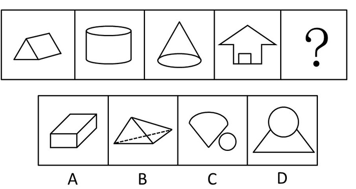

A. A

B. B

C. C

D. D

第 61 题 · 答案与解析

**参考答案（粉笔题库参考内容）**

D

**解析**

元素组成凌乱，考虑图形间位置关系。

数面后观察图形位置，前面4个图形都由2个封闭空间组成，并且相交。只有D选项符合该规律。

故正确答案为D。

**考点**：数量规律-面、特殊规律-图形间关系

**来源**：2010年四川省公务员录用考试《行测》题（下半年）第61题

### 第 62 题

请从所给的四个选项中，选择最合适的一个填入问号处，使之呈现一定的规律性：

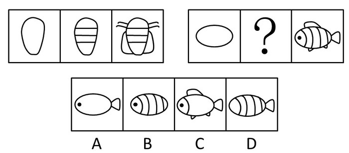

A. A

B. B

C. C

D. D

第 62 题 · 答案与解析

**参考答案（粉笔题库参考内容）**

B

**解析**

元素叠加，第一组给出的3个图形的规律是：第1个为框架，第2个为增加中间填充，第3个为增加外面的附属。在第二组中，符合该规律的是B项。

故正确答案为B。

**考点**：数量规律-素

**来源**：2010年四川省公务员录用考试《行测》题（下半年）第62题

### 第 63 题

请从所给的四个选项中，选择最合适的一个填入问号处，使之呈现一定的规律性：

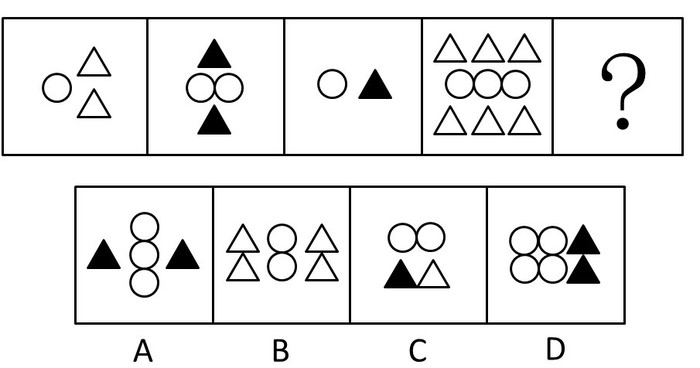

A. A

B. B

C. C

D. D

第 63 题 · 答案与解析

**参考答案（粉笔题库参考内容）**

B

**解析**

元素的换算。观察前4个图形并对其包含元素数数。每一个图形内，如果是空心三角形，那么该图形中空心三角形数量是圆的数量两倍；如果是实心三角形，则该图形中实心三角形数量等于圆的数量。也可以理解成一个实心三角形=两个空心三角形，则每一个图形都满足空心三角形数量是圆的2倍。

故正确答案为B。

**考点**：数量规律-素

**来源**：2010年四川省公务员录用考试《行测》题（下半年）第63题

### 第 64 题

请从所给的四个选项中，选择最合适的一个填入问号处，使之呈现一定的规律性：

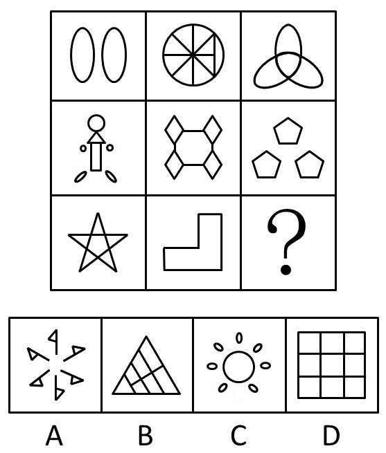

A. A

B. B

C. C

D. D

第 64 题 · 答案与解析

**参考答案（粉笔题库参考内容）**

C

**解析**

元素组成凌乱，考数数。

观察每一列的三个图形，第一列封闭空间数依次为2，7，6，和为15；第二列封闭空间数依次为9，5，1，和为15。按照此规律，第三列封闭空间数的和也应该为15，C项符合。

故正确答案为C。

**考点**：数量规律-面

**来源**：2010年四川省公务员录用考试《行测》题（下半年）第64题

### 第 65 题

请从所给的四个选项中，选择最合适的一个填入问号处，使之呈现一定的规律性：

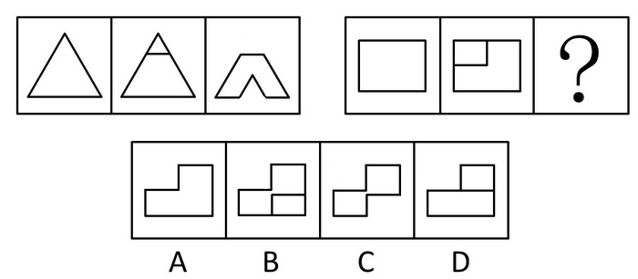

A. A

B. B

C. C

D. D

第 65 题 · 答案与解析

**参考答案（粉笔题库参考内容）**

C

**解析**

元素的相减规律，第1组图中，第2个图是将第1个图切割为一大一小两个部分，并且第3个图比第1个图缺少的是两个第2个图的小面积部分。第2组图也符合这个规律。

故正确答案为C。

**考点**：样式规律-加减同异

**来源**：2010年四川省公务员录用考试《行测》题（下半年）第65题

### 第 66 题

一次面试，某组第一个考生回答第一题时引用古诗道：“有诗云‘横看成岭侧成峰’。”此时大多数考官微微颔首，表示赞扬。接着第二个考生回答同一题时，也说：“有诗云‘横看成岭侧成峰’。”考官开始疑惑。一天面试下来，该组20名考生，有11名考生回答第一题开篇就是这句古诗。不仅如此，回答的其他很多内容、用语及动作都非常相似，甚至相同。经调查，这11名考生都参加了同一个面试培训班。11名考生都觉得自己回答得很不错，可是最后得分却并不理想。

最能对上述结果作出合理解释的是：

A. 考官对面试培训班的考生没有好感

B. 考官面对的是20名考生，而考生仅对自己的回答情况进行评判

C. 考官普遍认为引用古诗或者名言的考生夸夸其谈，所说并非所愿，缺乏真实性和说服力

D. 参加面试培训班可能无助于提高面试成绩，甚至可能影响考生正常发挥

第 66 题 · 答案与解析

**参考答案（粉笔题库参考内容）**

B

**解析**

第一步：找出题干矛盾。

面试时，11名考生都觉得自己回答得很不错，可是最后得分却并不理想。

第二步：逐一分析选项。

A项：考官是因为这11名考生答案相似给了较低的分数，与面试培训班无关，不能解释题干矛盾，排除；

B项：考生和考官所处角度不同，这11名考生不知道其他考生和自己的答案相似，而在考官看来，他们答案相似，自然分数不高，可以解释题干矛盾，当选；

C项：考官是因为这11名考生答案相似给了较低的分数，与引用古诗或者名言无关，不能解释题干矛盾，排除；

D项：考官是因为这11名考生答案相似给了较低的分数，与面试培训班无关，不能解释题干矛盾，排除。

故正确答案为B。

**考点**：原因解释

**来源**：2010年四川省公务员录用考试《行测》题（下半年）第66题

### 第 67 题

甲、乙、丙三人是同学，在一次考试成绩公布后，甲说：“我在前十名，乙是最后一名，丙的名次不理想。”乙说：“我的成绩和名次都很稳定，且我的排名紧挨在丙后面，甲的名次有所下降。”丙说：“甲的成绩比我好，乙的成绩比我好。”三人中，最多只有一个人说了假话。

由此可知：

A. 甲说假话

B. 乙说假话

C. 丙说假话

D. 没有人说假话

第 67 题 · 答案与解析

**参考答案（粉笔题库参考内容）**

C

**解析**

第一步：找突破口。

本题突破口为乙说“我的排名紧挨在丙后面”和丙说“乙的成绩比我好”两人的话不可同真，但可同假，因此必有一假。又知本题最多只有一句为假，因此两人的话必有一真和一假。

第二步：看其余。

本题最多只有一句为假，故甲的话为真话。由甲所说的话可知，乙是最后一名。

第三步：判断突破口中两句话的真假。

由乙是最后一名可知，丙的话为假，从而乙的话为真。

故正确答案为C。

**考点**：真假推理-其他

**来源**：2010年四川省公务员录用考试《行测》题（下半年）第67题

### 第 68 题

某大型律师事务所招聘工作人员，最不可能被招聘上的是没有通过我国司法考试，或者完全没有办理过法律事务实践经验的人。在可能被招聘的人中，懂外语或硕士以上学历的人被聘用的可能性将大大增加。

如果上述断定是真的，则下列人员中最有可能被招聘上的是：

A. 杨某，在我国一知名政法大学获得法学博士学位，一直从事法学研究工作

B. 周某，物理学专业本科毕业，自学法律且刚通过了司法考试，给当律师的叔叔做了半年律师助理

C. 刘某，通过我国司法考试，以律师身份执业多年，精通英语，不久前因以不正当手段承揽业务被罚款3千元

D. 李某，在美国一著名大学获得法学博士学位，在美国某州获得律师从业资格且从业半年，现决定回中国定居

第 68 题 · 答案与解析

**参考答案（粉笔题库参考内容）**

C

**解析**

日常推理题，根据题干信息逐一分析选项。

A中杨某完全没有办理过法律事务实践经验，是最不可能被招聘上的人，排除；

B中周某符合录用条件的我国司法考试和有实践经验，保留；

C中刘某满足录取条件的我国司法考试和有实践经验，并且懂外语，而不正当获利题干没有提及故不影响，保留；

D中李某没有通过我国司法考试，是最不可能被招聘上的人，排除；

比较BC，C在B的基础之上还懂外语，所以被聘用的可能性大大增加。

故正确答案为C。

**考点**：日常结论

**来源**：2010年四川省公务员录用考试《行测》题（下半年）第68题

### 第 69 题

在智利环境恶劣的北部沙漠地区的卡玛罗纳斯谷，人们发现了世界上一些最为古老的木乃伊，即Chinchorro人的木乃伊。木乃伊毛发分析结果显示，砷含量都很高。砷这种金属元素在卡玛罗纳斯谷以及周围火山坡较为常见，砷被季节性融雪水冲入河流，而河流正是生活在下游的人的水源。这种致命毒素毒死了一直生活在沿岸几百年来的Chinchorro人，Chinchorro人并未意识到他们一直在摄入这种无味并且看不见的有毒物质，他们患有皮肤癌、肺结核、膀胱癌、肾癌，并遭受因长期暴露在砷环境下导致的其他严重健康问题。

由此可以推出（    ）。

A. 人体对砷这种有毒元素是不需要的

B. Chinchorro人砷中毒是慢性的

C. Chinchorro人存在严重健康问题的原因是饮用了含有砷的水

D. 由于当时交通条件不好，Chinchorro人不能走得更远，找到更好的居住地

第 69 题 · 答案与解析

**参考答案（粉笔题库参考内容）**

B

**解析**

第一步：分析文段（找到突破口）。

抓住每句话中的主要信息。

第一句说明发现Chinchorro人的木乃伊；第二句说明Chinchorro人的木乃伊的砷含量都很高；第三句说明砷被季节性融雪水冲入下游的人的水源河流；第四句说明Chinchorro人并未意识到他们一直在摄入这种无味并且看不见的有毒物质。

第二步：分析选项（逐一分析选项）。

A项中砷元素确实有毒，但题干并未指出人体一点都不需要，排除；

B项中由“Chinchorro人并未意识到他们一直在摄入这种无味并且看不见的有毒物质”可知，他们摄入砷后并不会立即中毒发作，若Chinchorro人喝了含有砷的河水后立即出现中毒的症状，他们便会发现是由于摄入了某些有毒物质，从而可以推出Chinchorro人砷中毒是慢性的，当选；

C项根据题干最后一句话，长期暴露在砷环境下会导致健康问题，可知导致健康问题的原因不止喝了含有砷的水，还有可能是别的原因，得不出存在健康问题的原因就是喝了含有砷的水，排除；

D中题干并未提到，属于无关选项，排除。

故正确答案为B。

**考点**：日常结论

**来源**：2010年四川省公务员录用考试《行测》题（下半年）第69题

### 第 70 题

老王在A市有两套住房，一套自己居住，另一套闲置。老张是老王的朋友，一直居住在B市，现由于工作原因，需要在A市长期租住。老张希望租老王闲置的那套房子，老王说：“我女儿两个月后大学毕业，如果她毕业后不回A市工作生活，我就把房子出租给你。”

下列选项中，哪些为真，可以证明老王没有说真话：
①老王的女儿毕业后留在C市工作生活，老王拒绝把房子租给老张
②老王的女儿毕业后回到A市工作生活，老王把房子租给老张
③老王的女儿毕业后回到A市工作生活，老王拒绝把房子租给老张

A. ①

B. ①②

C. ②③

D. ①②③

第 70 题 · 答案与解析

**参考答案（粉笔题库参考内容）**

A

**解析**

第一步：翻译题干。

 “如果她毕业后不回A市工作生活，我就把房子出租给你”翻译为：老王的女儿毕业后不回A市工作生活→老王把房子租给老张。

题干问“哪些为真，可以证明老王没有说真话”，即题干关系为假时，能推出哪些选项，也就是选其矛盾命题：老王的女儿毕业后不回A市工作生活且－老王把房子租给老张为真。

第二步：逐一分析选项。

①老王的女儿毕业后不回A市工作生活且－老王把房子租给老张，就是题干的矛盾命题，可以推出；

②③中老王的女儿毕业后回A市是对推出的矛盾命题老王的女儿毕业后不回A市工作生活且－老王把房子租给老张的否前，不能得到确定性的结论，排除。

故正确答案为A。

备注：本题需特别注意矛盾关系：A→B与A且－B的矛盾，望考生加深理解。

**考点**：常规翻译

**来源**：2010年四川省公务员录用考试《行测》题（下半年）第70题

### 第 71 题

屏蔽器：电磁波

A. 夜视镜：红外线

B. 验钞机：声波

C. 遥控器：光波

D. 太阳光：紫外线

第 71 题 · 答案与解析

**参考答案（粉笔题库参考内容）**

A

**解析**

第一步：判断题干词语间逻辑关系。

题干两词是对应关系，且是作用与被作用的对应关系，即屏蔽器的作用对象是电磁波。

第二步：判断选项词语间逻辑关系。

A与题干为相同逻辑关系，即夜视镜的作用对象是红外线；

B无明显逻辑关系；

C中“遥控器”和“光波”间没有作用与被作用的对应关系；

D为包含关系。

故正确答案为A。

**考点**：逻辑关系-对应关系

**来源**：2010年四川省公务员录用考试《行测》题（下半年）第71题

### 第 72 题

忠诚：隶属

A. 强制：敌对

B. 同事：上下级

C. 反感：斗争

D. 朋友：和睦

第 72 题 · 答案与解析

**参考答案（粉笔题库参考内容）**

C

**解析**

第一步：判断题干词语间逻辑关系。

题干两词是因果关系，且是前者是因，后者是果。

第二步：判断选项词语间逻辑关系。

A无明显逻辑关系；

B为包容关系，即同事包含上下级；

C与题干为相同逻辑关系；

D为属性关系。

故正确答案为C。

**考点**：逻辑关系-对应关系

**来源**：2010年四川省公务员录用考试《行测》题（下半年）第72题

### 第 73 题

见多识广：高瞻远瞩

A. 兔死狗烹：鸟尽弓藏

B. 空穴来风：无中生有

C. 誓死不二：威武不屈

D. 旁敲侧击：胡言乱语

第 73 题 · 答案与解析

**参考答案（粉笔题库参考内容）**

D

**解析**

第一步：判断题干词语间逻辑关系。

“见多识广”和“高瞻远瞩”前者形容人经历多，后者形容人视野高，语义上无明显关系，而“见多”和“识广”为并列关系，“高瞻”和“远瞩”也是并列关系。

第二步：判断选项词语间逻辑关系。

A项：“兔死狗烹”指兔子死了，猎狗就被人烹食，比喻给统治者效劳的人事成后被抛弃或杀掉，“鸟尽弓藏”指鸟没有了，弓也就藏起来不用了，比喻事情成功之后，把曾经出过力的人一脚踢开，二者为近义关系，且“兔死”和“狗烹”是因果关系，“鸟尽”和“弓藏”也是因果关系，与题干逻辑关系不一致，排除；

B项：“空穴来风”指有了洞穴才进风，比喻消息和谣言的传播不是完全没有原因的，“无中生有”指的是把没有的说成有，二者为反义关系，且“空穴”和“来风”不是并列关系，“无中”和“生有”也不是并列关系，与题干逻辑关系不一致，排除；

C项：“誓死不二”指立下志愿，至死也不变心，形容意志坚定专一，“威武不屈”指强暴的压力不能使之屈服，表示坚贞顽强，“誓死”和“不二”不是并列关系，“威武”和“不屈”也不是并列关系，与题干逻辑关系不一致，排除；

D项：“旁敲侧击”指在旁边从侧面敲打，比喻说话、写文章不从正面直接点明，而是从侧面曲折地加以讽刺或抨击，“胡言乱语”指没有根据，不符实际的瞎说。二者无明显语义关系，且“旁敲”和“侧击”是并列关系，“胡言”和“乱语”是并列关系，与题干逻辑关系一致，当选。

故正确答案为D。

**考点**：拆分思维、语法关系

**来源**：2010年四川省公务员录用考试《行测》题（下半年）第73题

### 第 74 题

神采奕奕：豁达大度

A. 兢兢业业：眉飞色舞

B. 炯炯有神：赤胆忠心

C. 漫不经心：恬不知耻

D. 心猿意马：忐忑不安

第 74 题 · 答案与解析

**参考答案（粉笔题库参考内容）**

B

**解析**

第一步：判断题干词语间逻辑关系。

题干两个词属于对应关系，“神采奕奕”和“豁达大度”分别是形容人的外在精神面貌和形容人的内在品质间的对应关系。

第二步：判断选项词语间逻辑关系。

A项，“兢兢业业”意思为形容做事谨慎、勤恳。“眉飞色舞”意思为形容人得意兴奋的样子。前者形容人的做事态度，后者形容人的外在精神面貌，与题干逻辑关系不一致，排除；

B项，“炯炯有神”意思为形容人的眼睛发亮，很有精神。“赤胆忠心”意思为形容十分忠诚。前者形容人的外在精神面貌，后者形容人的内在品质，与题干逻辑关系一致，当选；

C项，“漫不经心”意思为随随便便，不放在心上。“恬不知耻”意思为做了坏事满不在乎，一点儿也不感到羞耻。前者形容人的行为方式，后者形容人的品质，与题干逻辑关系不一致，排除；

D项，“心猿意马”意思为心意好像猴子跳、马奔跑一样控制不住。形容心里东想西想，安静不下来。“忐忑不安”意思为心神极为不安。前者和后者都是形容人的内心状态的，与题干逻辑关系不一致，排除。

故正确答案为B。

**考点**：逻辑关系-对应关系

**来源**：2010年四川省公务员录用考试《行测》题（下半年）第74题

### 第 75 题

哈维：血液循环说

A. 人类从类人猿进化而来：达尔文

B. 伽利略：脉冲星发出脉冲

C. 康德：太阳系构造及星际运动规律

D. 毛泽东：抗日战争是持久战，最后胜利是中国的

第 75 题 · 答案与解析

**参考答案（粉笔题库参考内容）**

D

**解析**

第一步：判断题干词语间逻辑关系。

哈维是英国科学家、医生、生理学家、胚胎学家，创立了血液循环学说。题干两词是对应关系，且是人物和其贡献的对应关系，人物在前，贡献在后。

第二步：判断选项词语间逻辑关系。

A项：“人类从类人猿进化而来”确实是达尔文提出的，但选项中为贡献在前，人物在后，与题干逻辑关系不一致，排除；

B项：“脉冲星发出脉冲”是1967年由英国天文学家休伊什的学生贝尔发现的，与题干逻辑关系不一致，排除；

C项：康德是德国哲学家、天文学家，是星云说的创立者之一，是德国古典哲学的创始人，他的主要贡献是在哲学方面，与题干逻辑关系不一致，排除；

D项：毛泽东的《论持久战》一文提出了“抗日战争是持久战，最后胜利是中国的”这一著名论点，与题干逻辑关系一致，当选。

故正确答案为D。

**考点**：逻辑关系-对应关系

**来源**：2010年四川省公务员录用考试《行测》题（下半年）第75题

### 第 76 题

司机：驾驶室：踩油门

A. 教师：讲台：育人

B. 医生：医院：开刀

C. 演员：舞台：艺术

D. 农民：田地：播种

第 76 题 · 答案与解析

**参考答案（粉笔题库参考内容）**

D

**解析**

第一步：判断题干词语间逻辑关系。

司机在驾驶室里踩油门。司机和驾驶室是一一对应关系，司机只能在驾驶室里踩油门，司机和踩油门是主谓宾关系。

第二步：判断选项词语间逻辑关系。

A项：教师在讲台上育人。教师和讲台是对应关系，教师和育人是主谓宾关系，但是教师和讲台不是一一对应，教师也可以在别处育人，不一定在讲台上，例如网络教育，与题干逻辑关系不一致，排除；

B项：医生在医院开刀。医生和医院是对应关系，医生和开刀是主谓宾关系，但是开刀的地方更准确的应该是手术室，这样才能与题干的驾驶室相对应，与题干逻辑关系不一致，排除；

C项：演员在舞台上表演艺术。演员和艺术不是主谓宾关系，与题干逻辑关系不一致，排除；

D项：农民在田地里播种。农民和田地是一一对应关系，农民只能在田地里播种，农民和播种是主谓宾关系，与题干逻辑关系一致，当选。

故正确答案为D。

**考点**：语法关系、逻辑关系-对应关系

**来源**：2010年四川省公务员录用考试《行测》题（下半年）第76题

### 第 77 题

（    ） 对于 人类学 相当于 论证假说 对于 （    ）

A. 网络世界——社会学

B. 社会变迁——伦理学

C. 图腾与禁忌——逻辑学

D. 创造力——行为学

第 77 题 · 答案与解析

**参考答案（粉笔题库参考内容）**

C

**解析**

第一步：将选项逐一代入，判断各选项前后部分的逻辑关系。

A项中前面部分是包容关系，后面部分是无明显逻辑关系；

B项中前面部分是包容关系，后面部分是无明显逻辑关系；

C项中前面部分是包容关系，后面部分是包容关系；

D项中前面部分是包容关系，后面部分是无明显逻辑关系。

第二步：逐一分析选项，逻辑关系相同即为答案。

根据第一步可知，逻辑关系完全相同的是C项。

故正确答案为C。

**考点**：逻辑关系-包容关系

**来源**：2010年四川省公务员录用考试《行测》题（下半年）第77题

### 第 78 题

（    ） 对于 味同嚼蜡 相当于 深藏若虚 对于 （    ）

A. 脍炙人口——盛气凌人

B. 意味深长——锋芒毕露

C. 百读不厌——狐假虎威

D. 丰富多彩——大象无形

第 78 题 · 答案与解析

**参考答案（粉笔题库参考内容）**

B

**解析**

逐一代入选项

A项中“脍炙人口”和“味同嚼蜡”是反义关系，而“深藏若虚”与“盛气凌人”无明显逻辑关系，排除；

B项中“意味深长”和“味同嚼蜡”是反义关系，而“深藏若虚”与“锋芒毕露”也是反义关系，前后逻辑关系一致，当选；

C项中“百读不厌”和“味同嚼蜡”是反义关系，而“深藏若虚”与“狐假虎威”无明显逻辑关系，排除；

D项中“丰富多彩”和“味同嚼蜡”是反义关系，而“深藏若虚”与“大象无形”无明显逻辑关系，排除。

故正确答案为B。

**考点**：语义关系-反义关系

**来源**：2010年四川省公务员录用考试《行测》题（下半年）第78题

### 第 79 题

（    ） 对于 罗马尼亚 相当于 卢森堡 对于 （    ）

A. 匈牙利——法国

B. 保加利亚——瑞士

C. 捷克——比利时

D. 乌克兰——荷兰

第 79 题 · 答案与解析

**参考答案（粉笔题库参考内容）**

A

**解析**

逐一代入选项。

A项中前面部分是两国家接壤的对应关系，后面部分是两国家接壤的对应关系，前后逻辑关系一致，当选；

B项中前面部分是两国家接壤的对应关系，后面部分是两国家不接壤的对应关系，前后逻辑关系不一致，排除；

C项中前面部分是两国家不接壤的对应关系，后面部分是两国家接壤的对应关系，前后逻辑关系不一致，排除；

D项中前面部分是两国家接壤的对应关系，后面部分是两国家不接壤的对应关系，前后逻辑关系不一致，排除。

故正确答案为A。

**考点**：逻辑关系-对应关系

**来源**：2010年四川省公务员录用考试《行测》题（下半年）第79题

### 第 80 题

（    ） 对于 使用工具 相当于 群居 对于 （    ）

A. 无赖——创造欲

B. 制定计划——克服困难

C. 制造工具——惧怕

D. 爱情——选择行动

第 80 题 · 答案与解析

**参考答案（粉笔题库参考内容）**

C

**解析**

逐一代入选项。

A项中前面部分无明显逻辑关系，后面部分无明显逻辑关系，排除；

B项中前面部分无明显逻辑关系，后面部分无明显逻辑关系，排除；

C项中前面部分因为要使用工具，所以制造工具，二者是因果关系，后面部分因为惧怕，所以群居，二者是因果关系，前后逻辑关系一致，当选；

D项中前面部分无明显逻辑关系，后面部分无明显逻辑关系，排除。

故正确答案为C。

**考点**：逻辑关系-对应关系

**来源**：2010年四川省公务员录用考试《行测》题（下半年）第80题

### 第 81 题

世界上最长的运河京杭大运河沟通了（  ）大水系。

A. 黄河、长江两

B. 海河、黄河、长江三

C. 黄河、淮河、长江、钱塘江四

D. 海河、黄河、淮河、长江、钱塘江五

第 81 题 · 答案与解析

**参考答案（粉笔题库参考内容）**

D

**解析**

大运河北起北京（涿郡），南到杭州（余杭），途经北京、天津两市及河北、山东、江苏、浙江四省，贯通海河、黄河、淮河、长江、钱塘江五大水系，全长约1794公里。

故正确答案为 D。

**本题相关知识点：**

京杭大运河开凿到现在已有2500多年的历史，它是世界上里程最长、工程最大、最古老的运河之一，与长城并称为中国古代的两项伟大工程。

**考点**：中国地理

**来源**：2010年四川省公务员录用考试《行测》题（下半年）第81题

### 第 82 题

下列标志性建筑中，不属于世博会会场展馆的是：

A. 法国巴黎埃菲尔铁塔

B. 比利时布鲁塞尔原子球博物馆

C. 意大利比萨城比萨斜塔

D. 美国西雅图太空针塔

第 82 题 · 答案与解析

**参考答案（粉笔题库参考内容）**

C

**解析**

本题考查世界文化常识，结合选项具体分析。

A项正确，埃菲尔铁塔起建于1887年，竣工于1889年。1889年正值法国大革命100周年，法国政府决定打算建造一座象征法国革命和巴黎的纪念碑（即埃菲尔铁塔），同时在巴黎举办大规模的世界博览会，会场展馆就设在埃菲尔铁塔里。

B项正确，原子球博物馆是比利时现代化的标志性建筑，它是1958年为举办万国博览会而专门设计建造的，同时也是布鲁塞尔的三大著名景点之一。

C项错误，比萨斜塔是意大利比萨城大教堂的独立式钟楼，始建于1173年，1372年完工，塔身倾斜向东南。比萨斜塔未曾用于作为世博会会场展馆。

D项正确，太空针塔是为1962年在西雅图举行的世界博览会所设计的。

本题为选非题，故正确答案为C。

本题相关知识点：

埃菲尔铁塔是巴黎的标志之一，被法国人爱称为“铁娘子”。它和纽约的帝国大厦、东京铁塔同被誉为西方三大著名建筑。

**来源**：2010年四川省公务员录用考试《行测》题（下半年）第82题

### 第 83 题

2009年11月25日至12月6日，小王在加拿大旅游，发现当地不少男士佩戴白丝带，这表示：

A. 反对对妇女的暴力

B. 对恐怖主义者的抗议和对受害者的哀悼

C. 勇于承担对家庭的责任

D. 坚持对婚姻的忠诚

第 83 题 · 答案与解析

**参考答案（粉笔题库参考内容）**

A

**解析**

本题考查世界文化常识。每年11月25日到12月6日加拿大的男士都佩戴上白丝带，被称为“白丝带运动”。这是男士反对“男性对女性施暴”运动的别称。白丝带，作为这个运动的标志，象征着男人对男人的暴力不再宽恕，不再沉默。白丝带运动的起因是1989年12月6日，一个对妇女运动和杰出女同学心怀不满的暴徒，枪杀了14个年轻的工科女大学生。悲剧发生后，一些男士组织起来，成立了“白丝带”“男人：为了改变”等团体，致力于消除对妇女的暴力。

故正确答案为A。

**考点**：文化常识

**来源**：2010年四川省公务员录用考试《行测》题（下半年）第83题

### 第 84 题

抗生素主要是针对（  ）的。

A. 感冒

B. 发烧

C. 传染病

D. 细菌感染

第 84 题 · 答案与解析

**参考答案（粉笔题库参考内容）**

D

**解析**

抗生素是能抵抗致病微生物的药物，是抗菌消炎药中最大的一类。抗生素是由细菌、真菌或其他微生物在生活过程中所产生的物质，具有抑制或杀灭细菌、真菌、螺旋体、支原体、衣原体等致病微生物的作用，用于治疗各种细菌感染或其他致病微生物。

故正确答案为D。

**本题相关知识点：**

抗生素杀菌作用主要有4种机制：抑制细菌细胞壁的合成、与细胞膜相互作用、干扰蛋白质的合成以及抑制核酸的转录和复制抑制。

注意抗生素不等于消炎药，多数人误以为抗生素可以治疗一切炎症。实际上抗生素仅适用于由细菌引起的炎症，而对由病毒引起的炎症无效。日常生活中经常发生的局部软组织的淤血、红肿、疼痛、过敏反应引起的接触性皮炎、药物性皮炎以及病毒引起的炎症等，都不宜使用抗生素来进行治疗。

另外，抗生素仅适用于由细菌和部分其他微生物引起的炎症，对病毒性感冒、麻疹、腮腺炎、伤风、流感等患者给予抗生素治疗有害无益。抗生素只对细菌性感冒有用。

**考点**：生物常识

**来源**：2010年四川省公务员录用考试《行测》题（下半年）第84题

### 第 85 题

下列图案中，不属于国际志愿者组织及大型活动志愿者标志图案的是：

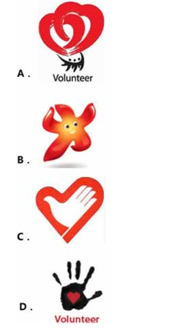

A. A

B. B

C. C

D. D

第 85 题 · 答案与解析

**参考答案（粉笔题库参考内容）**

B

**解析**

A项正确，该图案是北京2008年奥运会志愿者标志。该标志中心心相扣的心形，象征志愿者与运动员、奥林匹克大家庭和所有宾客心连着心、用心服务、奉献爱心，为奥林匹克运动增添光彩；

B项错误，该图案是广州2010年亚洲残疾人运动会吉祥物“芬芬”，是一朵绽放的木棉花，象征残奥运动和残疾人事业不断进取。只有B项不属于国际志愿者组织及大型活动志愿者标志图案；

C项正确，该图案是中国志愿者协会标志。标志的整体构图为心的造型，又是英文“志愿者”的第一个字母“V”。图案中央是手的造型，也是鸽子的造型，标志寓意为中国志愿者向社会上所有需要帮助的人们奉献一片爱心，伸出友爱之手，表达“爱心献社会，真情暖人心”和“团结互助、共创和谐”的主题；

D项正确，该图案是纽约视力康复中心志愿者标志。标志的含义为“手中有爱——给予之爱”。

本题为选非题，故正确答案为B。

解答本题时，如果不知道图案的具体涵义，也可从图案本身承载的文化涵义来推测答案，A、C、D三项的图案都带有心形，是志愿组织及其活动的推崇价值，而B项图案朝气、阳光，更像是运动项目的标志。

**考点**：文化常识

**来源**：2010年四川省公务员录用考试《行测》题（下半年）第85题

## 材料 1

2009年1~11月份，城镇固定资产投资168634亿元，同比增长32.1%，比上年同期加快5.3个百分点，比1~10月回落1.0个百分点。其中，国有及国有控股投资73535亿元，增长37.8%；房地产开发投资31271亿元，增长17.8%。

        从项目隶属关系看，2009年1~11月份，中央项目投资15277亿元，同比增长16.4%；地方项目投资153357亿元，增长33.9%。在注册类型中，1~11月份，内资企业投资155132亿元，同比增长35.6%；港澳台商投资5696亿元，增长1.5%；外商投资6865亿元，下降0.1%。

        分产业看，1~11月份，第一产业投资增长51.5%，第二产业投资增长26.1%，第三产业投资增长36.6%。在行业中，1~11月份，煤炭开采及洗选业投资2614亿元，同比增长33.6%；电力、热力的生产与供应业投资9442亿元，增长20.2%；石油和天然气开采业投资2075亿元，下降6.5%；铁路运输业投资4646亿元，增长80.7%。

        从施工和新开工项目情况看，2009年1~11月份，累计施工项目429470个，同比增加100493个；施工项目计划总投资393087亿元，同比增长36.3%；新开工项目317012个，同比增加88236个；新开工项目计划总投资136922亿元，同比增长76.6%。

        从到位资金情况看，2009年1~11月份，到位资金189487亿元，同比增长39.2%。其中，国家预算内资金增长69.8%，国内贷款增长46.4%，自筹资金增长32.2%，利用外资下降15.2%。

### 第 86 题

与2008年同期相比，2009年1~11月国有及国有控股投资和房地产开发投资占城镇固定资产投资的比重约：

A. 减少了0.15%

B. 增加了0.15%

C. 减少了0.45%

D. 增加了0.45%

第 86 题 · 答案与解析

**参考答案（粉笔题库参考内容）**

C

**解析**

根据题干“与2008年同期相比，2009年······比重约”判定此题为两期比重问题。定位文字材料第一段“2009年1~11月份，城镇固定资产投资168634亿元，同比增长32.1%······其中，国有及国有控股投资73535亿元，增长37.8%；房地产开发投资31271亿元，增长17.8%”。2009年1~11月国有及国有控股投资和房地产开发投资占城镇固定资产投资的比重为，2008年同期1~11月国有及国有控股投资和房地产开发投资占城镇固定资产投资的比重为，62.6%-62.15%=0.45%，即与2008年同期相比，2009年1~11月国有及国有控股投资和房地产开发投资占城镇固定资产投资的比重约减少了0.45%。

故正确答案为C。

**考点**：两期比重、文字资料

**来源**：2010年四川省公务员录用考试《行测》题（下半年）第86题

### 第 87 题

从企业类型来看，2009年1~11月内资企业投资和外商投资总额与2008年同期相比，约增加了：

A. 30.67%

B. 33.58%

C. 34.42%

D. 36.79%

第 87 题 · 答案与解析

**参考答案（粉笔题库参考内容）**

B

**解析**

根据题干“从企业类型来看，2009年······和······与2008年同期相比，约增加了”判定此题为混合增长率问题。定位文字材料第二段“2009年1~11月份······内资企业投资155132亿元，同比增长35.6%······外商投资6865亿元，下降0.1%”。设2009年1~11月内资企业投资和外商投资总额与2008年相比的增长率为x，根据线段法距离与量成反比，可知，整理得，解得，与B项最接近。

故正确答案为B。

**考点**：文字资料、混合增长率

**来源**：2010年四川省公务员录用考试《行测》题（下半年）第87题

### 第 88 题

从产业来看，2009年1~11月，在已给行业中属于第二产业的行业投资比2008年同期约增加了多少亿元？

A. 1900

B. 2000

C. 2100

D. 2200

第 88 题 · 答案与解析

**参考答案（粉笔题库参考内容）**

C

**解析**

根据题干“从产业来看，2009年······2008年同期约增加了多少亿元”，判定此题为增长量计算问题。第二产业指对初级产品进行再加工，在我国包括工业和建筑业，定位材料第三段“1~11月份，煤炭开采及洗选业投资2614亿元，同比增长33.6%；电力、热力的生产与供应业投资9442亿元，增长20.2%；石油和天然气开采业投资2075亿元，下降6.5%”，根据公式：增长量，可知煤炭开采及洗选业的投资额增长量=2614/(3+1)= 2614/4≈ 654亿元；电力、热力的生产与供应业的投资额增长量亿元；石油和天然气开采业的投资额下降量亿元。2009年1~11月，在已给行业中属于第二产业的行业投资比2008年同期约增加了654+1574-148=2080亿元，与C项最接近。

故正确答案为C。

**考点**：增长量计算、文字资料

**来源**：2010年四川省公务员录用考试《行测》题（下半年）第88题

### 第 89 题

2008年1~11月，施工项目计划总投资比新开工项目计划总投资约多多少亿元？

A. 77352

B. 10871

C. 190845

D. 210866

第 89 题 · 答案与解析

**参考答案（粉笔题库参考内容）**

D

**解析**

根据题干“2008年1~11月······比······约多多少亿元”且材料时间是2009年，判定此题为基期和差问题。定位文字材料第四段“从施工和新开工项目情况看，2009年1~11月······施工项目计划总投资393087亿元，同比增长36.3%······新开工项目计划总投资136922亿元，同比增长76.6%”。根据公式：，可知2008年1~11月，施工项目计划总投资比新开工项目计划总投资多亿元，与D项最接近。

故正确答案为D。

**考点**：基期和差、文字资料

**来源**：2010年四川省公务员录用考试《行测》题（下半年）第89题

### 第 90 题

根据上述资料，下面论述推断正确的是：

A. 2007年1~11月城镇固定资产投资100655亿元

B. 2008年1~10月城镇固定资产投资91655亿元

C. 2008年1~11月地方投资是中央投资的8.73倍

D. 相比2008年1~11月，2009年同期铁路运输业投资增加了2067亿元

第 90 题 · 答案与解析

**参考答案（粉笔题库参考内容）**

C

**解析**

A项：定位材料第一段“2009年1~11月份，城镇固定资产投资168634亿元，同比增长32.1%，比上年同期加快5.3个百分点”，可知2008年城镇固定资产投资的增长率=32.1%-5.3%=26.8%，代入间隔增长率公式≈67.5%，则2007年1~11月城镇固定资产投资亿元，错误；

B项：定位材料第一段“2009年1~11月份，城镇固定资产投资168634亿元，同比增长32.1%”，可以求出的是2008年1~11月城镇固定资产投资，而1~10月无法计算，时间陷阱，错误；

C项：定位材料第二段“2009年1~11月份，中央项目投资15277亿元，同比增长16.4%；地方项目投资153357亿元，增长33.9%”，可知2008年1~11月地方投资与中央投资的比值≈8.7，正确；

D项：定位材料第三段“铁路运输业投资4646亿元，增长80.7%”，则2009年同期铁路运输业投资的增长量≈2075亿元，错误。

故正确答案为C。

**考点**：文字资料、综合分析

**来源**：2010年四川省公务员录用考试《行测》题（下半年）第90题

## 材料 2

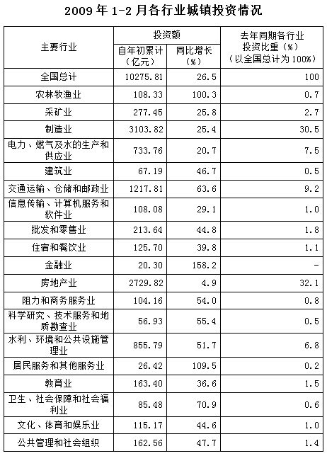

### 第 91 题

2008年1-2月，房地产业城镇投资额比制造业多多少亿元：

A. 104.36

B. 118.25

C. 127.17

D. 148.29

第 91 题 · 答案与解析

**参考答案（粉笔题库参考内容）**

C

**解析**

由题干“2008年1-2月，房地产业城镇投资额比制造业多多少亿元”，结合材料时间为2009年1-2月，可判定本题为基期和差问题。定位表格材料可知，2009年1-2月，房地产业城镇投资额为2729.82亿元，同比增长4.9%，制造业城镇投资额为3103.82亿元，同比增长25.4%，因此2008年1-2月房地产业城镇投资额比制造业多亿元，与C项最接近。

故正确答案为C。

注：因为选项差距非常小，而数据又比较大，所以本题需要精算。

**考点**：基期和差、统计表

**来源**：2010年四川省公务员录用考试《行测》题（下半年）第91题

### 第 92 题

相比2008年同期，2009年1-2月金融业城镇投资比重约增加了：

A. 50%

B. 78.1%

C. 100%

D. 131.7%

第 92 题 · 答案与解析

**参考答案（粉笔题库参考内容）**

C

**解析**

由题干“相比2008年同期，2009年1-2月······比重约增加了”，可判定本题为两期比重计算问题，2009年1-2月金融业城镇投资比重为，2008年同期为，则2009年比2008年约增加，即增长了100%。

故正确答案为C。

注：若按照比重增长量计算，选项没有对应答案，因此按照比重增长率计算。

**考点**：两期比重、统计表

**来源**：2010年四川省公务员录用考试《行测》题（下半年）第92题

### 第 93 题

若保持各自的增长速度不变，金融业的全国城镇投资额超过教育业的时间可能在多少年之后：

A. 3

B. 4

C. 5

D. 6

第 93 题 · 答案与解析

**参考答案（粉笔题库参考内容）**

B

**解析**

设x年后，金融业的投资额超过教育业，则可得如下：

 ，可得；，则，可得x>3，所以x=4即可满足条件。

故正确答案为B。

**考点**：现期计算、统计表

**来源**：2010年四川省公务员录用考试《行测》题（下半年）第93题

### 第 94 题

2008年1-2月各行业城镇投资额与2009年1-2月各行业城镇投资比重均排名前四的行业有多少个：

A. 1

B. 2

C. 3

D. 4

第 94 题 · 答案与解析

**参考答案（粉笔题库参考内容）**

C

**解析**

题干问“2008年1-2月各行业城镇投资额与2009年1-2月各行业城镇投资比重均排名前四的行业有多少个”，定位表格，可以直接找到2008年1-2月各行业城镇投资额比重排名前四的行业为房地产业（32.1%），制造业（30.5%），交通运输、仓储和邮政业（9.2%），电力、燃气及水的生产和供应业（7.5%）；2009年1-2月各行业城镇投资额排名前四的行业与比重排名相同，分别是房地产业，制造业，交通运输、仓储和邮政业，水利、环境和公共设施管理业。发现均在前四的行业有：房地产业，制造业，交通运输、仓储和邮政业。

故正确答案为C。

**考点**：直接找数、统计表

**来源**：2010年四川省公务员录用考试《行测》题（下半年）第94题

### 第 95 题

从上述资料中，不能推出的结论是：

A. 若保持增长速度不变，则2010年1-2月全国各行业城镇投资额相比2008年同期增加4875.72亿元

B. 相比去年同期，2009年1-2月全国大部分行业的城镇投资比重都有所增加

C. 2008年1-2月建筑业城镇投资额为45.8亿元

D. 制造业的全国城镇投资额在2008年1-2月，2009年1-2月，2010年1-2月中均是各行业中最多的

第 95 题 · 答案与解析

**参考答案（粉笔题库参考内容）**

D

**解析**

A项：定位表格，2009年1-2月全国城镇投资额为10275.81亿元，同比增长26.5%。根据公式：，则2010年1-2月，全国城镇投资额为；根据公式：，则2008年1-2月，全国城镇投资额为。那么2010年1-2月全国各行业城镇投资额相比2008年同期增加亿元。与选项中的4875.72比较接近，说法正确。

B项：若某个行业2009年1-2月投资额在全国城镇投资额的比重有所增加，则需要满足部分增长率（a）大于总体增长率（b）。定位表格，发现满足部分增长率大于总体增长率26.5%的有15个行业，即有15个行业比重上升，表格中一共有19个行业，所占比重明显超过50%，说明2009年1-2月全国大部分行业的城镇投资比重都有所增加，说法正确。

C项：定位表格，2009年1-2月建筑业投资额为67.19亿元，同比增长46.7%。根据公式：，可得2008年1-2月，建筑业投资额为亿元，与选项中的45.8比较接近，说法正确。

D项：定位表格，2009年1-2月制造业投资额为3103.82亿元，同比增长25.4%。根据公式：，可得2008年1-2月制造业投资额为亿元；定位表格，2009年1-2月房地产投资额为2729.82亿元，同比增长4.9%，根据公式：，2008年1-2月房地产投资额为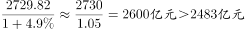，显然2008年1-2月制造业投资额不是最大的，说法错误。

本题为选非题，故正确答案为D。

**考点**：统计表、综合分析

**来源**：2010年四川省公务员录用考试《行测》题（下半年）第95题

## 材料 3

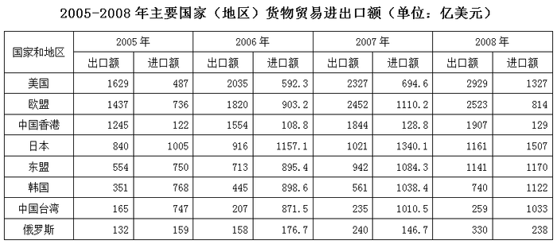

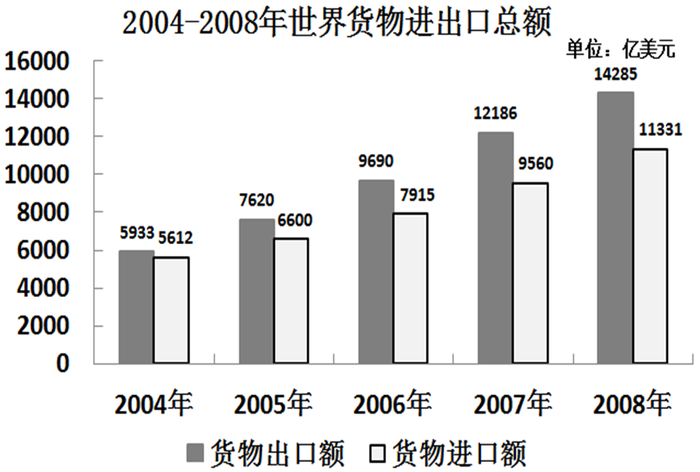

### 第 96 题

世界货物贸易进出口总额差距最大的年度，在下列选项中，货物进口额增长速度（与上年比）排名第二的是：

A. 日本

B. 东盟

C. 韩国

D. 中国台湾

第 96 题 · 答案与解析

**参考答案（粉笔题库参考内容）**

C

**解析**

由题干问“······增长速度（与上年比）排名第二的是”，可判定本题为一般增长率计算问题。首先找到世界货物贸易进出口总额差距最大的年度。定位柱状图，找到世界货物贸易进出口总额差距最大的年份，即找柱子的高度差最大的年份，明显2008年是最大的。根据增长率公式：，可得A项日本：=10%+；B项东盟：=7%^+；C项韩国：=8%^+；D项中国台湾：=2%+。因此增长率排名第二的是韩国。

故正确答案为C。

**考点**：一般增长率、综合资料

**来源**：2010年四川省公务员录用考试《行测》题（下半年）第96题

### 第 97 题

按2005—2008年主要国家（地区）货物出口额平均增长速度，预计2010年相应出口总额将达到约多少亿美元：

A. 13197

B. 13892

C. 15163

D. 15837

第 97 题 · 答案与解析

**参考答案（粉笔题库参考内容）**

D

**解析**

2005—2008年主要国家（地区）货物出口额分别如下：

2005年：；

2008年：+1200+1000+300=11000；

根据年均增长率公式：，2005—2008年年份差为3，则，取值验证：

若r=10%，；

若r=20%，，略小于1.73，故2005-2008年主要国家（地区）货物出口额平均增长速度略大于20%。则题目所求约为11000×1.2×1.2=15840，D项最接近。

故正确答案为D。

**考点**：现期计算、综合资料

**来源**：2010年四川省公务员录用考试《行测》题（下半年）第97题

### 第 98 题

2008年主要国家（地区）货物出口额之和占世界货物出口总额的比重是2005年的多少倍：

A. 0.83

B. 0.88

C. 0.92

D. 1.07

第 98 题 · 答案与解析

**参考答案（粉笔题库参考内容）**

C

**解析**

由题干问“2008年······是2005年的多少倍”，可判定本题为现期倍数问题。由上题可知，2008年主要国家（地区）货物出口总额之和约为10990亿美元，2005年主要国家（地区）货物出口总额之和约为6353亿美元。定位柱状图，发现2008年世界货物出口总额为14285亿美元，2005年世界货物出口总额为7620亿美元。可得2008年主要国家（地区）货物出口总额之和占世界货物出口总额比重为10990/14285。2005年主要国家（地区）货物出口总额之和占世界货物出口总额比重为6353/7620，则所求倍数，与C项最接近。

故正确答案为C。

**考点**：现期倍数、综合资料

**来源**：2010年四川省公务员录用考试《行测》题（下半年）第98题

### 第 99 题

2005—2008年世界货物进出口总额的年度增长速度从小到大的变化顺序是：

A. 2005年—2006年—2007年—2008年

B. 2007年—2008年—2006年—2005年

C. 2008年—2005年—2007年—2006年

D. 2006年—2007年—2008年—2005年

第 99 题 · 答案与解析

**参考答案（粉笔题库参考内容）**

C

**解析**

根据题干“······增长速度从小到大的顺序”，可判定本题是一般增长率比较问题。定位表2，把2004-2008年的世界货物进口额和出口额相加，结果分别为11545、14220、17605、21746、25616亿美元。根据公式：可得，2005年增长率为；2006年增长率为；2007年增长率为，2008年增长率为。发现2007年和2008年的数据大小关系比较明显，2007年增长率的分子大分母小，分数值一定大，2007年增长率大于2008年增长率。观察选项，只有C项符合。

故正确答案为C。

**考点**：一般增长率、综合资料

**来源**：2010年四川省公务员录用考试《行测》题（下半年）第99题

### 第 100 题

从以上图表中可以推出的是：

A. 2006年货物进口额排名第六的国家在2007年货物进口额排名第五

B. 世界货物进出口额差距最大的年度是2005年

C. 按2008年世界货物进出口总额的增长速度，预计2009年世界货物进出口总额是31175亿美元

D. 2007-2008年货物出口额增长速度逐年降低的主要是亚洲国家（地区）

第 100 题 · 答案与解析

**参考答案（粉笔题库参考内容）**

D

**解析**

A项：定位统计表，直接找数排序，可得2006年美国排名为第六，2007年排名仍为第六，说法错误，排除；

B项：定位统计图，根据柱子之间的高度差，判断出来世界货物进出口额差距最大的年度是2008年（14285-11331=2954亿美元），选项说世界货物进出口额差距最大的年度是2005年，说法错误，排除；

C项：定位统计图，2008年世界货物进出口总额为14285+11331=25616亿美元，2007年世界货物进出口总额为12186+9560=21746亿美元，根据公式，可得2008年世界货物进出口总额的增长速度为。按2008年世界货物进出口总额的增长速度，根据公式，则2009年世界货物进出口总额为亿美元，说法错误，排除；

D项：定位统计表，表中的国家（地区）不是亚洲的是美国、欧盟和俄罗斯。根据公式：可得2007年美国出口额的增长率为，2008年的增长率为，2008年>2007年，并非逐年降低；2006年欧盟出口额的增长率，2007年的增长率为，2007年>2006年，并非逐年降低；2006年俄罗斯出口额的增长率，2007年的增长率为，2007年>2006年，并非逐年降低。而亚洲国家（地区）中，中国香港和中国台湾2006-2008年出口额的增长量逐年降低，而基期逐年变大，即增速逐年降低。因此增长速度逐年降低的主要是亚洲国家（地区），说法正确，当选。

故正确答案为D。

**考点**：综合分析、综合资料

**来源**：2010年四川省公务员录用考试《行测》题（下半年）第100题

