# 2013年四川公务员录用考试《行测》题（下半年）

<!-- gwy:overview:start -->
> **四川 · 2013 · 行测 · 统考** ｜ 120 题 · 图片 101 处 · 答案随题折叠

| 题型模块 | 题量 | 题号 |
| --- | ---: | ---: |
| 常识判断 | 20 | 1–20 |
| 言语理解与表达 | 30 | 21–50 |
| 数量关系 | 15 | 51–65 |
| 判断推理 | 35 | 66–100 |
| 资料分析 | 20 | 101–120 |
| **合计** | **120** | |

导航：[题型与作答说明](#题型与作答说明) · [题目](#题目) · [材料 1](#材料-1)
<!-- gwy:overview:end -->

> 候选采集稿。参考答案及解析来自粉笔页面，不代表官方答案或真实高分答卷；来源使用许可与原卷对应关系仍需人工核实。

## 题型与作答说明

常识判断

（20题）

根据题目要求，在每个选项中选出一个正确答案。

言语理解与表达

（30题）

根据题目要求，在每个选项中选出一个正确答案。

数量关系

（15题）

在这部分试题中，每道题中呈现一段表述数字关系的文字，要求你迅速、准确地计算出答案。

判断推理

（35题）

本部分包括图形推理、定义判断、类比推理与逻辑判断四种类型的试题。

资料分析

（20题）

所给出的图、表、文字或综合性资料均有若干个问题要你回答。你应根据资料提供的信息进行分析、比较、计算和判断处理。

## 题目

### 第 1 题

关于我国宪法规定的人事产生方式，下列说法不正确的是：

A. 国家副主席由全国人大常委会选举

B. 国务院总理由全国人民代表大会决定

C. 最高人民法院院长由全国人民代表大会选举

D. 最高人民检察院副检察长由全国人大常委会任免

第 1 题 · 答案与解析

**参考答案（粉笔题库参考内容）**

A

**解析**

A项错误，中华人民共和国国家主席、副主席直接受命于最高国家权力机关，都由全国人民代表大会选举产生。故A项国家副主席由全国人大常委会选举产生错误。

B、C、D三项正确。

本题为选非题，故正确答案为A。

**考点**：政治建设

**来源**：2013年四川公务员录用考试《行测》题（下半年）第1题

### 第 2 题

我国目前仍是城乡发展不平衡的发展中国家，农业基础依然薄弱，农民增收的长效机制尚未真正建立起来，解决好“三农”问题任重道远，解决“三农”问题的根本途径是：

A. 工业反哺农业

B. 建设社会主义新农村

C. 城乡发展一体化

D. 建立农民增收的长效机制

第 2 题 · 答案与解析

**参考答案（粉笔题库参考内容）**

C

**解析**

十八大报告指出，解决好农业农村农民问题是全党工作的重中之重，要坚持走中国特色农业现代化道路，并要把推动城乡发展一体化作为解决“三农”问题的根本途径。报告指出，要加大统筹城乡发展力度，增强农村发展活力，逐步缩小城乡差距，促进城乡共同繁荣。加快完善城乡发展一体化体制机制，着力在城乡规划、基础设施、公共服务等方面推进一体化，促进城乡要素平等交换和公共资源均衡配置，形成以工促农、以城带乡、工农互惠、城乡一体的新型工农、城乡关系。

2020年10月29日，中国共产党第十九届中央委员会第五次全体会议通过的《中共中央关于制定国民经济和社会发展第十四个五年规划和二〇三五年远景目标的建议》指出：“坚持把解决好‘三农’问题作为全党工作重中之重，走中国特色社会主义乡村振兴道路，全面实施乡村振兴战略，强化以工补农、以城带乡，推动形成工农互促、城乡互补、协调发展、共同繁荣的新型工农城乡关系，加快农业农村现代化。”

故正确答案为C。

**来源**：2013年四川公务员录用考试《行测》题（下半年）第2题

### 第 3 题

以下关于低碳发展叙述正确的是：

A. 历史上的全球累计碳排放主要是由发展中国家造成的

B. “十二五”期间我国要实现单位国内生产总值耗能减低25%

C. 我国首个获得财政部和环保部批准的综合性排放权交易机构是南京排放权交易所

D. 到2020年我国碳排放降低的目标是：单位国内生产总值的二氧化碳排放量比2005年下降40%~45%

第 3 题 · 答案与解析

**参考答案（粉笔题库参考内容）**

D

**解析**

A项错误，历史上主要是由现在的西方发达国家在发展过程中，随着工业革命的开展，煤炭的大量使用而造成的；

B项错误，“十二五”期间我国要实现单位国内生产总值能耗降低16%；

C项错误，我国首个获得财政部和环保部批准的综合性排放权交易机构是天津排放权交易所；

D项正确，全国人大常委会作出了决议，到2020年我国单位国内生产总值二氧化碳排放比2005年下降40%-45%。

故正确答案为D。

**来源**：2013年四川公务员录用考试《行测》题（下半年）第3题

### 第 4 题

2012年7月，《党政机关公文格式》国家标准正式实施。根据该标准，下列有关公文格式说法不正确的是：

A. 成文日期中的数字用大写汉字将年、月、日标全

B. 信函格式和纪要格式都是特定的、常用的正式公文格式

C. 命令（令）格式的发文机关标志由发文机关全称加“命令”或“令”组成

D. 在公文的正文中，结构层次序数依次可以用“一”、“（一）”、“1.”“（1）”

第 4 题 · 答案与解析

**参考答案（粉笔题库参考内容）**

A

**解析**

A项错误，2012年版《党政机关工作条例》规定，成文日期中的数字应为阿拉伯数字，而非大写汉字。标准格式如：2013年7月8日。

B、C、D三项正确。

本题为选非题，故正确答案为A。

**来源**：2013年四川公务员录用考试《行测》题（下半年）第4题

### 第 5 题

某珠宝店聘请的保安盗窃了该店价值300多万元的首饰，经调查发现，该保安因故意犯罪被刑事处罚，而且所属的保安公司没有保安服务许可证，该保安公司的负责人最可能构成：

A. 非法经营罪

B. 盗窃罪

C. 破坏生产经营罪

D. 重大责任事故罪

第 5 题 · 答案与解析

**参考答案（粉笔题库参考内容）**

A

**解析**

根据《刑法》第二百二十五条规定，违反国家规定，有下列非法经营行为之一，扰乱市场秩序，情节严重的，处五年以下有期徒刑或者拘役，并处或者单处违法所得一倍以上五倍以下罚金；情节特别严重的，处五年以上有期徒刑，并处违法所得一倍以上五倍以下罚金或者没收财产：（一）未经许可经营法律、行政法规规定的专营、专卖物品或者其他限制买卖的物品的；（二）买卖进出口许可证、进出口原产地证明以及其他法律、行政法规规定的经营许可证或者批准文件的；（三）未经国家有关主管部门批准非法经营证券、期货、保险业务的，或者非法从事资金支付结算业务的；（四）其他严重扰乱市场秩序的非法经营行为。

本题中保安公司并没有取得相应资格的保安服务许可证，所以该保安公司的负责人的行为符合非法经营罪的犯罪构成。

故正确答案为A。

**考点**：刑法

**来源**：2013年四川公务员录用考试《行测》题（下半年）第5题

### 第 6 题

世界上的一切物体都是由大量分子组成的。下列现象中能说明分子在不停息运动的是：

A. 秋风瑟瑟，桂香袭人

B. 沙尘暴起，飞沙漫天

C. 晚风轻拂，炊烟袅袅

D. 狂风怒吼，波翻浪涌

第 6 题 · 答案与解析

**参考答案（粉笔题库参考内容）**

A

**解析**

A项正确，桂香袭人说明分子在运动，分子是看不见的，其他三个选项沙尘、炊烟、波浪都是看的到的，不可能是分子运动。

故正确答案为A。

**考点**：物理常识

**来源**：2013年四川公务员录用考试《行测》题（下半年）第6题

### 第 7 题

如果一国出现国际收支逆差，该国外汇供不应求，则该国本币对外汇的汇率变动将表现为：

A. 不变

B. 上涨（本币贬值）

C. 下滑（本币升值）

D. 无法确定

第 7 题 · 答案与解析

**参考答案（粉笔题库参考内容）**

B

**解析**

如果一国出现国际收支逆差，该国外汇供不应求，外币升值，而本币贬值。本币兑外汇的汇率将上涨。本题考查国际收支差额对汇率的影响。

故正确答案为B。

**考点**：市场经济

**来源**：2013年四川公务员录用考试《行测》题（下半年）第7题

### 第 8 题

海洋动力资源是一类零耗竭，可再生的能源。下列不属于海洋动力资源的是：

A. 海底天然气

B. 潮汐能

C. 海洋温差能

D. 海流能

第 8 题 · 答案与解析

**参考答案（粉笔题库参考内容）**

A

**解析**

海洋动力资源主要指海水运动过程中产生的潮汐能、波浪能、海流能及海水因温差和盐度差而引起的温差能与盐差能等。

A项错误，不是；

B、C、D三项正确，都属于海洋动力资源。

本题为选非题，故正确答案为A。

**考点**：化学常识

**来源**：2013年四川公务员录用考试《行测》题（下半年）第8题

### 第 9 题

“使老有所终，壮有所用，幼有所长，鳏寡孤独废疾者，皆有所养。”是古代哪个流派的观点：

A. 道家

B. 法家

C. 儒家

D. 墨家

第 9 题 · 答案与解析

**参考答案（粉笔题库参考内容）**

C

**解析**

“使老有所终，壮有所用，幼有所长，鳏寡孤独废疾者，皆有所养”出自《礼记•礼运篇》的《礼运大同篇》，《礼记》是中国儒家经典著作之一，故属于儒家的观点。

故正确答案为C。

**考点**：文学常识

**来源**：2013年四川公务员录用考试《行测》题（下半年）第9题

### 第 10 题

下列哪一战役不是我国历史上以少胜多的战役：

A. 官渡之战

B. 桂陵之战

C. 淝水之战

D. 赤壁之战

第 10 题 · 答案与解析

**参考答案（粉笔题库参考内容）**

B

**解析**

A项正确，官渡之战，是东汉末年“三大战役”之一，也是中国历史上著名的以弱胜强的战役之一。建安五年（200年），曹操军与袁绍军相持于官渡（今河南中牟东北），在此展开战略决战。曹操奇袭袁军在乌巢的粮仓，继而击溃袁军主力。此战奠定了曹操统一中国北方的基础。

B项错误，桂陵之战，发生于公元前354年，是战国时期齐国援助赵国击败魏国的一次著名战役，创造了中国军事史上著名的“围魏救赵”战法，对后世有着深远影响。因双方人数相当，故不属于以少胜多的战役。

C项正确，淝水之战，东晋太元八年（383年)，东晋在淝水（今安徽）击败前秦军进攻的著名的战略决战。淝水之战为中国历史上著名的以少胜多的战例。

D项正确，赤壁之战，是指三国形成时期，孙权、刘备联军于建安十三年（208年）在长江赤壁（今湖北省赤壁市西北）一带大破曹操大军，奠定三国鼎立基础的以少胜多,以弱胜强的著名战役。

本题为选非题，故正确答案为B。

**考点**：中国历史

**来源**：2013年四川公务员录用考试《行测》题（下半年）第10题

### 第 11 题

青眼，表示对人器重或喜爱；白眼，表示轻视或憎恶。魏晋时期的“竹林七贤”中能为青白眼。见礼俗之士，以白眼对之，见名人雅士乃见青眼者是：

A. 嵇康

B. 阮籍

C. 向秀

D. 刘伶

第 11 题 · 答案与解析

**参考答案（粉笔题库参考内容）**

B

**解析**

阮籍是魏晋时的一位著名诗人。传说，阮籍能作“青白眼”：两眼正视，露出虹膜，则为“青眼”，以看他尊敬的人；两眼斜视，露出眼白，则为“白眼”，以看他不喜欢的人。《晋书·阮籍传》：“籍又能为青白眼。见礼俗之士，以白眼对之。常言‘礼岂为我设耶？’时有丧母，嵇喜来吊，阮作白眼，喜不怿而去；喜弟康闻之，乃备酒挟琴造焉，阮大悦，遂见。”

故正确答案为B。

**考点**：文化常识

**来源**：2013年四川公务员录用考试《行测》题（下半年）第11题

### 第 12 题

下列音乐作品与作者对应不正确的是：

A. 《黄河大合唱》——冼星海

B. 《义勇军进行曲》——聂耳

C. 《命运交响曲》——贝多芬

D. 《仲夏夜之梦》——柴可夫斯基

第 12 题 · 答案与解析

**参考答案（粉笔题库参考内容）**

D

**解析**

《仲夏夜之梦》是门德尔松为莎士比亚的同名喜剧《仲夏夜之梦》写作的音乐作品，不是柴可夫斯基。

A、B、C三项正确，D项错误。

本题为选非题，故正确答案为D。

**考点**：文化常识

**来源**：2013年四川公务员录用考试《行测》题（下半年）第12题

### 第 13 题

下列对应不正确的是：

A. 翁去八百载，醉乡犹在，山行六七里，亭影不孤——爱晚亭

B. 风声、雨声、读书声，声声入耳；家事、国事、天下事，事事关心——东林书院

C. 只有几文钱，你也求，他也求，给谁为好；不做半点事，朝又拜，夕又拜，叫我为难——财神

D. 踏《莽原》，刈《野草》，《热风》《奔流》，一生《呐喊》；痛《毁灭》，叹《而已》，《十月》《噩耗》，万众《彷徨》——鲁迅

第 13 题 · 答案与解析

**参考答案（粉笔题库参考内容）**

A

**解析**

A项错误，“翁去八百载，醉乡犹在；山行六七里，亭影不孤”这是对欧阳修《醉翁亭记》的引用而写的一幅对联。亭指的是安徽滁州的醉翁亭，翁指的是欧阳修。对联的大意：欧阳修被贬官离开八百里，这并不影响他喝酒且喝醉；原本说走了六七里就有一个醉翁亭，但是现在走上六七里山路就不再只有一个醉翁亭了。这是后人在欧阳修死后写给欧阳修的，总的赞扬欧阳修身在江湖，心忧朝堂的高尚情操。同时也表明他被后人所缅怀，他并不孤单。

B项正确，此联为明东林党领袖顾宪成所撰；

C项正确，借财神之口，告诫那些求钱者莫白费心机，想靠求财神发财，而要靠辛勤劳动创业致富；

D项正确，非常明显，用鲁迅先生的作品串成一副对联，对应无误。

本题为选非题，故正确答案为A。

**考点**：文学常识

**来源**：2013年四川公务员录用考试《行测》题（下半年）第13题

### 第 14 题

下列作品中与《马可·波罗游记》属于同一时期的作品是：

A. 《真腊风土记》

B. 《老残游记》

C. 《徐霞客游记》

D. 《梦溪笔谈》

第 14 题 · 答案与解析

**参考答案（粉笔题库参考内容）**

A

**解析**

马可·波罗（Marco Polo）\[1254年9月15日~1324年1月8日\]，世界著名旅行家和商人。《马可·波罗游记》作于元代，同时代的只有《真腊风土记》。

A项正确，《真腊风土记》是元代周达观所著；

B项错误，是清代末年刘鹗所著；

C项错误，是明代徐霞客所著；

D项错误，是北宋沈括所著。

故正确答案为A。

**考点**：文学常识

**来源**：2013年四川公务员录用考试《行测》题（下半年）第14题

### 第 15 题

中国的弦拨乐器历史悠久，种类形质繁多，是极富特色的一种乐器，远在三千年前的周代就已经产生。

下列民族乐器中属于弦拨乐器的是：

A. 周埙

B. 三弦

C. 马头琴

D. 二胡

第 15 题 · 答案与解析

**参考答案（粉笔题库参考内容）**

B

**解析**

弦拨乐器严格来说就是弹拨乐器，是用手指或拨子拨弦，及用琴竹击弦而发音的乐器总称。

A项错误，周埙属于吹奏乐器；

C、D项错误，C项马头琴与D项二胡属于弓弦乐器。

故正确答案为B。

**考点**：文化常识

**来源**：2013年四川公务员录用考试《行测》题（下半年）第15题

### 第 16 题

下列对“惊蛰”这一节气的描述最准确的是：

A. 标志着冬天的结束，春天开始

B. 降雨量充沛，利于谷物生长

C. 天气晴朗，气温较高，春天已接近尾声

D. 温度逐渐升高，渐渐有了春雷，冬眠动物复苏

第 16 题 · 答案与解析

**参考答案（粉笔题库参考内容）**

D

**解析**

“惊蛰”是24节气中的第3个节气。每年3月5日或6日，太阳到达黄经345度时为“惊蛰”。惊蛰的意思是天气回暖，春雷始鸣，惊醒蛰伏于地下冬眠的昆虫。

A项错误，描述的是立春节气；

B项错误，描述的是谷雨节气；

C项错误，描述的是清明谷雨期间。

故正确答案为D。

**考点**：文化常识

**来源**：2013年四川公务员录用考试《行测》题（下半年）第16题

### 第 17 题

下列能够用于电器设备起火的灭火工具是：
①泡沫灭火器 ②干粉灭火器 ③二氧化碳灭火器 ④水枪

A. ①②

B. ①③

C. ②④

D. ②③

第 17 题 · 答案与解析

**参考答案（粉笔题库参考内容）**

D

**解析**

泡沫灭火器不适用于电器火灾、档案馆或图书室有重要资料文献的火灾、油料类火灾。现在已经少用泡沫灭火器了，一般单位里配的都是干粉灭火器或二氧化碳灭火器。而水不是绝缘体，也不能用于电器设备的灭火。

故正确答案为D。

**考点**：生活常识

**来源**：2013年四川公务员录用考试《行测》题（下半年）第17题

### 第 18 题

下列有关天文方面表述不正确的是：

A. 火星是太阳系八大行星之一，其外表成橘红色是因为地表被赤铁矿覆盖

B. 黑洞理论和大爆炸理论是由英国物理学家、宇宙学家斯蒂芬·威廉·霍金创立的

C. 《授时历》是中国古代最优秀的历法，它的回归年的长度和现行公历所采用的数值几乎相同

D. 国际公认以通过格林尼治的经线为本初子午线，定位为经度180度，也就是世界“时区”的起点

第 18 题 · 答案与解析

**参考答案（粉笔题库参考内容）**

D

**解析**

D项错误，本初子午线是0度。本初子午线是地球上的零度经线，它是为了确定地球经度和全球时刻而采用的标准参考子午线，它不像纬线有自然起点——赤道；

A、B、C三项正确。

本题为选非题，故正确答案为D。

**考点**：科技理论与成就

**来源**：2013年四川公务员录用考试《行测》题（下半年）第18题

### 第 19 题

关于超级计算机，下列说法不正确的是：

A. 我国是继美国之后第二大高性能计算机研制生产国

B. 我国的“天河二号”是目前世界上运算速度最快的计算机

C. 现有的超级计算机运算速度大都可以达到每秒一兆（万亿）次以上

D. 超级计算机的特点表现为高速度和大容量，配有多种外部和外围设备及丰富的软件系统

第 19 题 · 答案与解析

**参考答案（粉笔题库参考内容）**

A

**解析**

超级计算机主要特点表现为高速度和大容量，配有多种外部和外围设备及丰富的、高功能的软件系统，现有的超级计算机运算速度大都可以达到每秒一兆（万亿，非百万）次以上，是计算机中功能最强、运算速度最快、存储容量最大的一类计算机，多用于国家高科技领域和尖端技术研究，是一个国家科研实力的体现，它对国家安全，经济和社会发展具有举足轻重的意义，是国家科技发展水平和综合国力的重要标志。

我国是继美国和日本之后第三大高性能计算机研制生产国，A项错误；B、C、D项正确。

本题为选非题，故正确答案为A。

【注】2016年6月20日下午，TOP500组织在法兰克福世界超算大会（ISC）上，“神威·太湖之光”超级计算机系统登顶榜单之首，成为世界上首台运算速度超过十亿亿次的超级计算机。神威·太湖之光”自2018年起已经不是计算能力最快的超算。

**考点**：科技理论与成就

**来源**：2013年四川公务员录用考试《行测》题（下半年）第19题

### 第 20 题

下列关于维生素C的说法正确的是：

A. 维生素C不容易被热、光和氧破坏

B. 维生素C是常用的脂溶性维生素之一

C. 长期服用大量维生素C可引起腹泻、恶心、呕吐、胃痉挛

D. 人体受外伤后，伤口会自行愈合，因为人体可以产生维生素C

第 20 题 · 答案与解析

**参考答案（粉笔题库参考内容）**

C

**解析**

A项错误，维生素C加热后易受到破坏；

B项错误，维生素C是常见的水溶性维生素之一；

C项正确，维生素C过量服用可引起不良反应：每日服1~4g，可引起腹泻、皮疹、胃酸增多、胃液反流，每日用量超过5g时，可导致溶血，重者可致命。孕妇服用大剂量时，可能产生婴儿坏血病；

D项错误，人体自身是不能产生维生素C的。

故正确答案为C。

**考点**：生物常识

**来源**：2013年四川公务员录用考试《行测》题（下半年）第20题

### 第 21 题

少年儿童好奇心强，但对是非的判断能力弱，他们很难对消极不良的作品进行理性＿＿＿＿，因而正确的＿＿＿＿很重要。

A. 区分 引领

B. 分析 说服

C. 筛选 训练

D. 鉴别 教育

第 21 题 · 答案与解析

**参考答案（粉笔题库参考内容）**

A

**解析**

第一空，根据“少年儿童对是非的判断能力弱”可知，横线处所填词语要体现儿童难以分辨消极不良作品之意。A项“区分”指划分、区别，D项“鉴别”指辨别真假好坏，均符合文意，保留。B项“分析”指把一件事物、一种现象、一个概念分成较简单的组成部分，找出这些部分的本质属性和彼此之间的关系，侧重解剖事物的内在关系，与文段语境不符，排除；C项“筛选”泛指通过淘汰的方法挑选，文段没有体现通过淘汰的方式进行挑选之意，排除。

第二空，前文说少年儿童分辨不良作品的能力不足，因此需要正向引导。A项“引领”指引导、带领，符合文意，当选。D项“教育”指按一定的要求培养人的工作，并未体现出对少年分不清是非这一问题的引导性，不符合文意，排除。

故正确答案为A。

**考点**：关联关系-因果关系、实词填空、对应关系-前后呼应

**来源**：2013年四川公务员录用考试《行测》题（下半年）第21题

### 第 22 题

如果政府的主导和介入过强，就容易＿＿＿＿甚至打破政府与社会组织的职责边界，甚至出现政府＿＿＿＿＿＿的现象，挤占社会组织自主发展的空间。

依次填入画横线部分最恰当的一项是：

A. 淡化 颐指气使

B. 模糊 越俎代庖

C. 筛选 鸠占鹊巢

D. 迷失 独断专行

第 22 题 · 答案与解析

**参考答案（粉笔题库参考内容）**

B

**解析**

先看第一个空，可从动宾搭配是否匹配入手，宾语为“边界”，观察四个选项，可见C项的“筛选”和D项的“迷失”均存在搭配不当的问题，可直接排除。

再看第二个空，“颐指气使”指有权势的人傲慢的神态，主语通常为人，且词意与文意不符，可排除；“越俎代庖”指处理超过自己职责范围的事，与第二空后边的“挤占空间”含义匹配。

故正确答案为B。

【出处】本题来源为人民日报2013年3月《提高枢纽型社会组织的管理和服务力》。

**考点**：对应关系-前后呼应、混搭填空、词的辨析-搭配对象

**来源**：2013年四川公务员录用考试《行测》题（下半年）第22题

### 第 23 题

当有来自同龄人的压力时，个人往往会有上进的动力，向比自己更优秀的目标靠近，但是，过度的同辈压力可能使人攀比，也会给社会带来急功近利，浮躁、拜金等不良风气。处理同辈压力的关键是要懂得＿＿＿＿＿＿，要学会放下一些东西。

A. 知难行易

B. 张弛有度

C. 适可而止

D. 量力而行

第 23 题 · 答案与解析

**参考答案（粉笔题库参考内容）**

C

**解析**

此题考查成语的应用能力。

“知难行易”指懂得事情的道理难，而实施却比较容易，“张弛有度”通常用来形容一个人比较会生活，兼顾严肃活泼，“适可而止”比喻做事恰到好处，“量力而行”多指在符合自己能力的范围内做事。在了解成语含义的基础上，结合文意“要学会放下一些东西”，可知文段是强调在面对同辈压力这个问题时应该“适可而止”懂得在适当的程度停止，恰到好处地放下一些东西。

故正确答案为C。

【出处】本题来源为《92.9%受访者言自己有同辈压力》。

**考点**：对应关系-前后呼应、成语填空

**来源**：2013年四川公务员录用考试《行测》题（下半年）第23题

### 第 24 题

近来，微博上流行一句“是中国人就转”的口号，这是用一面澎湃激昂的民族情怀大旗，迎风一展，遮住大众的眼睛。眼花缭乱间，既剥夺民众独立思考的能力，又＿＿＿＿他人的自由意志。爱国主义是其廉价外衣，使人跟风盲从是其内在属性。看似强大逻辑的背后，实则是批判的缺失与思想的＿＿＿＿。

A. 威胁 单薄

B. 要挟 浅薄

C. 裹挟 贫瘠

D. 挟持 苦闷

第 24 题 · 答案与解析

**参考答案（粉笔题库参考内容）**

C

**解析**

第一空可从动宾搭配入手，宾语为“自由意志”，观察选项，可见“威胁”“要挟”“挟持”均不能与“意志”搭配，可排除；“裹挟”指把人卷进去，迫使其采取某种明确的态度，含义与原文相符。

再检验第二个空的“贫瘠”，符合文意。

故正确答案为C。

**考点**：关联关系-并列关系、实词填空、词的辨析-搭配对象

**来源**：2013年四川公务员录用考试《行测》题（下半年）第24题

### 第 25 题

竞争环境的变化不断产生威胁，也不断产生机会，任何企业对此都必须时刻关注，才能＿＿＿＿＿＿，任何对竞争环境变化的＿＿＿＿，都会给企业造成严重甚至致命的打击。依次填入画横线部分最恰当的一项是：

A. 趋利避害 疏忽

B. 高枕无忧 漠视

C. 脚踏实地 迟钝

D. 未雨绸缪 抵触

第 25 题 · 答案与解析

**参考答案（粉笔题库参考内容）**

A

**解析**

本题为实词与成语相结合的逻辑填空题。

根据第一个空，可优先排除C项的“脚踏实地”，此成语比喻做事踏实、实事求是，与文意严重不符，可排除；“趋利避害”指趋向有利的一面，避开有害的一面，结合原文的“威胁”与“机会”，可知符合文意；“高枕无忧”比喻平安无事，不用担忧，也比喻放松警惕，不符合文中“威胁”与“机会”并存的局面，不符合文意，可排除；“未雨绸缪”比喻事先做好准备工作，预防不必要的事发生，机遇与挑战并存的局面下，挑战是并不能凭借预防就可以避免的，不符合文意，可排除。

再结合第二个空，检验“疏忽”，可知亦与文意相符。

故正确答案为A。

**考点**：对应关系-前后呼应、混搭填空

**来源**：2013年四川公务员录用考试《行测》题（下半年）第25题

### 第 26 题

越来越多的公共议题，需要大家＿＿＿＿＿＿，和衷共济。没有人可以置身事外，＿＿＿＿＿＿。尤其是近期受到广泛关注的环境问题，尤需每个人的担当。

依次填入画横线部分最恰当的一项是：

A. 同甘共苦 明哲保身

B. 休戚与共 隔岸观火

C. 荣辱与共 袖手旁观

D. 守望相助 独善其身

第 26 题 · 答案与解析

**参考答案（粉笔题库参考内容）**

D

**解析**

先从第一个空入手，可知需要我们填入的成语，需要与其后出现的“和衷共济”组成并列关系，“和衷共济”比喻上下团结，共同克服困难，纵观选项，只有D项的“守望相助”符合文意，“休戚与共”形容关系密切，利害相同，“荣辱与共”两者共同分享荣耀和承担耻辱，“同甘共苦”比喻有福一起享，有困难一起承担，此三项均不符合文意，可排除。

再检验第二空，结合空前的“没有人可以置身事外”可知，“独善其身”符合文意。

故正确答案为D。

**考点**：关联关系-并列关系、对应关系-前后呼应、成语填空

**来源**：2013年四川公务员录用考试《行测》题（下半年）第26题

### 第 27 题

悬空寺，悬挂在北岳恒山金龙峡西侧翠屏峰的半崖峭壁间，上＿＿＿＿危崖，下＿＿＿＿深谷。不仅外观奇特壮观，建筑构造也颇具特色，以“奇、悬、巧”三绝而＿＿＿＿＿＿。

A. 载 临 闻名于世

B. 背 探 引人瞩目

C. 负 瞰 闻名遐迩

D. 顶 跨 绝冠天下

第 27 题 · 答案与解析

**参考答案（粉笔题库参考内容）**

A

**解析**

本题可从第二空入手，根据“悬挂在······峭壁间”可知，文段重在说明悬空寺的位置。A项“临”指在高处朝向低处，填入文段语意合适；B项“探”指访问、看望，C项“瞰”指望，二者均强调看，无法体现出位置，排除；D项“跨”指横跨在两边，文段中并未体现悬空寺横跨在两边，排除。

第一空，代入验证，“上载悬崖”能够体现出悬空寺处于悬崖和深谷中间的位置，语意合适。

第三空，代入验证，“闻名于世”指全世界都知道，形容悬空寺的“三绝”语意合适。

故正确答案为A。

**考点**：对应关系-前后呼应、混搭填空

**来源**：2013年四川公务员录用考试《行测》题（下半年）第27题

### 第 28 题

湿地的生命力是可以被一点一滴看见的。我最先看见的是湿地上的青蛙，它＿＿＿＿＿＿地弹跳，让寂静的湿地有了动感；青蛙落脚的地方，黑颈鹤＿＿＿＿＿＿，动作像骄傲的体操运动员那样自由、舒展；接下来，三三两两的羊像无声的云从村子里飘过来，它们身后是牦牛家族，带着高海拔的困倦与＿＿＿＿；再后来，高原上真正的主角——放牧者出现了，他们被牦牛这些群众演员簇拥着，压轴出场。

依次填入画横线部分最恰当的一项是：

A. 猝不及防 腾空跃起 慵懒

B. 始料不及 悠然自得 疲惫

C. 出其不意 翩翩起舞 懒惰

D. 突如其来 昂首阔步 疲倦

第 28 题 · 答案与解析

**参考答案（粉笔题库参考内容）**

A

**解析**

从第二、三两个空较易入手，先看第二空，从形容黑颈鹤的“动作像骄傲的体操运动员那样自由、舒展”可排除形容自由清闲，心情舒畅的“悠然自得”和形容精神振奋，意气昂扬的“昂首阔步”，因此可排除B、D两项。

再看第三空，形容羊群像“云”飘过来，可知文段意境悠美，恬静，与C项的“懒惰”不符；A项的“慵懒”与空前的“困倦”相匹配。

故正确答案为A。

**考点**：对应关系-前后呼应、混搭填空

**来源**：2013年四川公务员录用考试《行测》题（下半年）第28题

### 第 29 题

在很久以前，人类就＿＿＿＿有一天能呼风唤雨，＿＿＿＿风雨雷电，并在战争中加以利用。随着科技进步，小范围的人工干预天气已经能够做到，但是大范围地影响气候，甚至人工制造飓风显然是＿＿＿＿＿＿。

依次填入画横线部分最恰当的一项是：

A. 幻想 掌控 天方夜谭

B. 期盼 支配 鞭长莫及

C. 想象 号令 好高骛远

D. 梦想 干预 痴人说梦

第 29 题 · 答案与解析

**参考答案（粉笔题库参考内容）**

A

**解析**

先从较易入手的第二空切入，通过空后“并在战争中加以利用”的表述，可知对“风雨雷电”的作用，绝不仅仅是“干预”的程度，D项语义过轻，可排除。

再看第三空的成语，“天方夜谭”比喻虚诞夸饰的议论，荒诞不经的说法或形容事情不可能成功，与文意匹配；“鞭长莫及”比喻距离太远而无能为力，词意中距离太远在文意中无从体现，可排除；“好高骛远”比喻不切实际地追求过高过远的目标，贬义词，文段只是客观描述，并无明显感情色彩，可排除C项。

故正确答案为A。

**考点**：关联关系-并列关系、关联关系-转折关系、混搭填空

**来源**：2013年四川公务员录用考试《行测》题（下半年）第29题

### 第 30 题

牡丹没有花谢花败之时，要么烁于枝头，要么归于泥土，它＿＿＿＿萎顿和衰老，由青春而死亡，由美丽而＿＿＿＿。它虽美却不＿＿＿＿生命，即使告别，也要最后留给人一次惊心动魄的体味。

A. 超越 消失 吝啬

B. 跨越 消逝 吝惜

C. 穿越 消亡 怜惜

D. 跨过 消遁 在意

第 30 题 · 答案与解析

**参考答案（粉笔题库参考内容）**

B

**解析**

从第一空的“没有花谢花败之时”可知牡丹没有“萎顿和衰老”之态，B项“跨越”、D项“跨过”均有此意，A项“超越”指超过，不符合文意，排除；C项“穿越”虽有“跨过”之意，但一般与“时空”搭配，用于此处不当，排除。

第二空，由“由青春而死亡”可知，横线处表示牡丹经历美丽而后消失的结果，B项的“消逝”指慢慢逝去,不再存在，符合文意，当选；D项的“消遁”有消失之意，多用于消极语境，不符合文意，排除。

第三空“要最后留给人一次惊心动魄的体味”，可确定牡丹对自己生命毫无“吝惜”之意，而非“不在意”。

故正确答案为B。

**考点**：关联关系-并列关系、实词填空、对应关系-前后呼应、词的辨析-搭配对象

**来源**：2013年四川公务员录用考试《行测》题（下半年）第30题

### 第 31 题

文艺必须有批评，批评如果不对了，就得用批评来抗议，这才能够来抗议，这才能够使文艺和批评一同前进。如果一律掩住嘴，算是文坛已经干净，那所得的结果倒是要相反的。

“那所得的结果倒是要相反的”意思是说：

A. 文坛不再干净

B. 不再用批评来抗争

C. 文艺不必有批评

D. 文艺和批评一同倒退

第 31 题 · 答案与解析

**参考答案（粉笔题库参考内容）**

D

**解析**

本题为词语理解题。

定位原文，可知此句话出现在文段的最后一句，“结果倒是要相反的”，即与上文出现的结果是相反的，观察上文，可知上文提到的结果是“文艺和批评一同前进”，与其相反，就指的是“文艺和批评一同倒退”。对应D项。

A项，“文坛不再干净”是对“一律掩住嘴”这一假设条件的描述，而非结果，排除；

B项，并未提及“文艺”，排除；

C项，“不必有”并非“所得的结果”，排除。

故正确答案为D。

**考点**：句子

**来源**：2013年四川公务员录用考试《行测》题（下半年）第31题

### 第 32 题

根据技术发展周期理论，一项新技术在经历萌芽期、过热期、幻想破灭期之后将迎来复苏期和成熟期，换言之，让人眼花缭乱的“乱云飞渡”时代已经过去，云计算技术正在走向复苏期和成熟期，可谓“化云为雨正当时”。“＿＿＿＿＿＿＿＿＿＿”，浸淫在云计算产业中的高管们对行业春天的来临已有实实在在的感觉。

填入画横线部分最恰当的一项是：

A. 小荷才露尖尖角

B. 春江水暖鸭先知

C. 千呼万唤始出来

D. 随风潜入夜，润物细无声

第 32 题 · 答案与解析

**参考答案（粉笔题库参考内容）**

B

**解析**

本题为语句填空题。

空格在末尾，由后面的分句“浸淫在云计算产业中的高管们对行业春天的来临已有实实在在的感觉”可知，此行业的高管们已经提前感知到了行业春天的来临，观察选项，有“提前感知”之意的是B项。

A项，“小荷才露尖尖角”比喻刚刚开始展露自己的才华；C项，“千呼万唤始出来”指大众都很期待看到的某种东西终于出现了；D项，“随风潜入夜，润物细无声”比喻潜移默化地影响，均无“提前感知”之意，排除。

故本题答案为B。

**考点**：横线在结尾

**来源**：2013年四川公务员录用考试《行测》题（下半年）第32题

### 第 33 题

国家、民族由个人组成，阶层、集团、组织也是由个人组成的。个人是集团的分子，但这并不是说个体只能组成集体，才能成为中国梦的主体，而是每一个个体自身就是中国梦的主体。我们通过集体体现出共同意识，我们更通过自身体现出个体意识。人民是各种人的集合。每个人都有独特的个性，都有自己的追求，都有自己的理想。

这段文字意在说明：

A. 每个个体都有独特的追求

B. 中国梦包含了各种个体追求

C. 中国梦只有通过个体才能体现

D. 个体意识是通过集体体现出来的

第 33 题 · 答案与解析

**参考答案（粉笔题库参考内容）**

B

**解析**

本题为中心理解题。

文段行文脉络为分总分，第二句话通过“但”表明作者的意图：个体就是中国梦的主体，个人梦、个人追求也是中国梦。最后一句话在解释说明这一观点。

因此，结合选项应该选B项，因为对比重点句与选项，可知B项符合文意。

A项没有体现出讨论的主体中国梦和个体的关系，可排除；C、D两项偏离文意，可排除。

故正确答案为B。

**考点**：关联词-转折

**来源**：2013年四川公务员录用考试《行测》题（下半年）第33题

### 第 34 题

如今一些人对幸福的迷茫和困惑，很大程度上缘于我们对传统美德的放逐和糟践。事实上，现代文化中诸多负面性的文化元素需要传统文化中的积极元素去引领和超拔，乡土中国延续下来的温情友善、古道热肠、重情守义以及温良恭俭让等传统美德对当今时代的幸福焦虑症和饥渴症无疑是很好的苦口良药。

这段文字意在说明：

A. 医治时代病要依靠传统文化

B. 传统美德是医治时代病的良药

C. 放弃传统美德导致对幸福的迷惑

D. 传统美德可医治幸福焦虑症和饥渴症

第 34 题 · 答案与解析

**参考答案（粉笔题库参考内容）**

D

**解析**

本题为中心理解题。

通读全文，可知表示转折关系的“事实上”之后为文段的重点句，整篇文段讨论的主题是传统美德和幸福的关系，只有C、D两项符合主体一致原则；

进一步对比，可知C项为重点句之前内容，非重点，可排除。

故正确答案为D。

**考点**：关联词-转折

**来源**：2013年四川公务员录用考试《行测》题（下半年）第34题

### 第 35 题

对于那些被私人或企业承包的旅游点门票过高的问题，首先要查一下政府的授权是否合法，当初确定的条件是否合理，对非法的承包应该立即撤销，或修订条件，承包的基本条件应该包括对门票价格的限制。对少数确定需要大量资金投入，或在承包期内无利可图的旅游点，政府应该保证投资，并予公开，不容许通过提高票价的手段转嫁给游客。

根据上文，在应对被承包的旅游点门票过高的问题上，下列哪项不是政府应采取的措施：

A. 进行合法授权

B. 确定合理条件

C. 保证资金投入

D. 实行公开招标

第 35 题 · 答案与解析

**参考答案（粉笔题库参考内容）**

D

**解析**

本题为细节判断题。

A项，对应“首先要查一下政府的授权是否合法”，B项对应“当初确定的条件是否合理”，C项对应“对少数确定需要大量资金投入”，均符合文意。

D选项无中生有，当选。

本题为选非题，故正确答案为D。

**考点**：细节判断题

**来源**：2013年四川公务员录用考试《行测》题（下半年）第35题

### 第 36 题

随着城市化和现代化进程的展开，公共空间正在成为人们的主要生活领域，这些空间既包括有形的，如地铁、公交等，也包括无形的，如网络论坛、微博等。公共空间既要容纳个人权利的行使，也需要维持基本的公序良俗。若将个人权利推向极致，难免有损公共利益；过于强调公共空间的秩序，也可能压抑个人权利。如何处理好个人权利和公共空间之间的关系，是一个值得人们深思的问题。

这段文字意在强调：

A. 应周密考虑与有效设计，协调个人权利与公共空间秩序的关系

B. 在公共空间中，个人权利的行使应该让位于维护公共空间秩序

C. 保障个人权利与维护公共空间秩序之间存在着难以调和的矛盾

D. 随着公共空间的日益扩大，维护基本的公序良俗已成为当务之急

第 36 题 · 答案与解析

**参考答案（粉笔题库参考内容）**

A

**解析**

本题为中心理解题。

首句描述了现状，引出公共空间这一话题，接着指出公共空间既要容纳个人权利，也要维持公序良俗。继而提出问题，权利和秩序，若是只注重其中一方面，会产生不好的影响。最后提出观点，即“如何处理好个人权利和公共空间之间的关系”值得深思，对应A项。

B项与文意相悖，原文明确表示“公共空间要容纳个人权利的行使”，排除；

C项“难以调和的矛盾”无中生有，过于夸大，排除；

D项，只提及了“公序良俗”，表述片面，排除。

故正确答案为A。

**考点**：关联词-对策

**来源**：2013年四川公务员录用考试《行测》题（下半年）第36题

### 第 37 题

有人尖刻地嘲讽你，你马上尖酸地回敬他；有人毫无理由地看不起你，你马上轻蔑地鄙视他；有人在你面前大肆炫耀，你马上加倍证明你更厉害；有人对你冷漠，你马上对他冷淡疏远。看，你讨厌的那些人，轻易就把你变成了你自己最讨厌的那种样子。这才是“敌人”对你最大的伤害。

这段文字提示的道理是：

A. 争执会使人迷失本性，要和平相处

B. 不要人云亦云而要坚持自己的主见

C. 睚眦必报的人令人讨厌，要放弃仇恨

D. 不要因对手的低劣而把自己也变得低劣

第 37 题 · 答案与解析

**参考答案（粉笔题库参考内容）**

D

**解析**

本题为中心理解题。

文段结构为分总式，结尾“看，你讨厌的那些人，轻易就把你变成了你自己最讨厌的那种样子。这才是‘敌人’对你最大的伤害”揭示道理。

因此，结合选项应该选D。

对比选项，A、B、C三项均非揭示道理中的内容，且为无关干扰项，可排除。

故正确答案为D。

**考点**：关联词-因果

**来源**：2013年四川公务员录用考试《行测》题（下半年）第37题

### 第 38 题

如果你问到，“母亲和妻子同时落水，你先救谁”。中国男人会很纠结，因为怎么做都不对，而美国男人会很干脆地回答“先救另一半”。为什么会这样呢？对比一下中西文化，就不难理解了。西方文化鼓励独立和个人价值，尤其是成年个体要建立自己新的生活，在这一过程中，母亲的参与和影响力会主动降低，理性的美国人会选择对今后生活重要的人。而对中国人而言，不管是出于伦理或是情感，母亲早已是“自我”中根深蒂固的一部分。即使长大成人了，对母亲的情感联结，也早已渗透到个人的认知与行为中。

下列说法与这段文字相符的是：

A. 中国男人都是感性的，比理性的西方男人要依恋母亲

B. 不同的文化造成母亲在中西方男人心中情感地位存在差异

C. 因成长经历不同，母亲在中西方男人心中的地位有很大差距

D. 西方男人爱妻子胜过爱母亲，因为他们更追求独立和个人价值

第 38 题 · 答案与解析

**参考答案（粉笔题库参考内容）**

B

**解析**

本题为细节判断题。

文中明确表述了对“母亲和妻子同时落水，你先救谁”这一问题，之所以会造成中西方男人不同的选择是基于中西文化的差异。因此，结合选项应该选B。

A项曲解文意，这不仅与感性有关，也并不能单纯归结为更依恋母亲，而是由于中方文化的影响使母亲在中国男人的心中地位很重要；C项的成长经历问题，为无关干扰项，文段并未提及，可排除；D项曲解文意，西方男人选择营救妻子并不表示爱妻子胜过爱母亲，而是理性选择了在自己以后生活中更重要的人。

故正确答案为B。

**考点**：细节判断题

**来源**：2013年四川公务员录用考试《行测》题（下半年）第38题

### 第 39 题

①经调查，失读症在西方人中比较多见，而在中国人极其少见

②让思考者先学习汉语，再将语言材料用英文和汉字分两边认读，丧失的英文阅读能力竟然得到了部分恢复

③失读症指人因大脑局部受到损伤而丧失文字阅读能力

④根据文字认知的特点，西方发明了一种奇特的失读症治疗法

⑤所以使用汉字的人因局部脑损伤而导致失读的可能性也就大大减少了

⑥其原因就在于汉字的认知是左右脑并用，而非只有左脑在单独发挥作用

将以上6个句子重新排列，语序正确的是：

A. ①②⑥③⑤④

B. ②③⑤④⑥①

C. ③①⑥⑤④②

D. ④②⑥③①⑤

第 39 题 · 答案与解析

**参考答案（粉笔题库参考内容）**

C

**解析**

观察选项，对比首句。①说失读症在调查中的具体表现；②是在谈失读症患者怎么样治疗恢复；③是对失读症下了个定义；④是说发明了失读症的疗法。根据逻辑顺序，应先引出“失读症”这一概念，再围绕其进行介绍，故③适合作首句，锁定C项。

验证C项。文段先用③对失读症下定义，接下来①用调查数据得出西方失读症人数多于中国的结论。⑥中的“其”指代①中结论，并对①进行解释说明；⑥中的“左脑单独”与⑤中的“局部脑损”符合话题衔接原则。④②针对失读症在分析的基础上给出对策。整个文段逻辑关系成立。

故正确答案为C。

**考点**：确定首句-首句特征

**来源**：2013年四川公务员录用考试《行测》题（下半年）第39题

### 第 40 题

①到了今天，海藻房主要集中分布于威海下属的荣成市

②胶东地区多产山石和海藻，夏季多雨潮湿，冬季多雪寒冷

③海藻房的确切产生时间尚无法考证

④这种产生于胶东地区的特色民居，曾广泛分布在烟台、威海、青岛地区

⑤在这种地理环境和气候条件下，当地居民以厚石砌屋墙，用晒干的海藻盖屋顶，创造出了独特的海藻房民居

⑥元明清三代，山东沿海的海防建设日趋巩固，海藻房迎来了建设高峰期

将以上6个句子重新排列，语序正确的是：

A. ③⑥④①②⑤

B. ②⑥⑤④①③

C. ③④⑥①②⑤

D. ②⑤⑥④①③

第 40 题 · 答案与解析

**参考答案（粉笔题库参考内容）**

D

**解析**

本题为语句排序题。观察选项，先看首句，②句说胶东地区产海藻，③句具体介绍关于海藻房的产生时间，故对比②③两句可知，应该先说有海藻这一概念，后说海藻房，所以②句应在③句前面作首句，排除 A、C 两项。再看⑤句和⑥句，⑤句说到“创造出了独特的海藻房民居”，⑥句提到“海藻房迎来了建设高峰期”，根据事情发展的先后顺序，⑤句应该在⑥句前面，排除B项。

故正确答案为D。

**考点**：确定顺序

**来源**：2013年四川公务员录用考试《行测》题（下半年）第40题

### 第 41 题

市场学上有个跟随者战略，就是企业不做任何创新性的尝试，而是等到别人把产品、技术、市场都做出来以后，自己拷贝这些东西或者是加以改进，从而占领市场。这虽然促进了竞争，但是由于跟随者不承担开拓技术、产品、市场的成本以及试错的风险，因此比创新者更具有竞争优势。如果跟随者是某种资源、渠道的垄断者的话，就足以置创新者于死地，从而最终扼杀了竞争，并抑制了创新精神。

这段文字意在强调：

A. 创新精神是企业精神的核心

B. 跟随者战略在商场中的价值

C. 资源和渠道的垄断状态亟待打破

D. 建立和完善创新保护机制的重要性

第 41 题 · 答案与解析

**参考答案（粉笔题库参考内容）**

D

**解析**

本题为中心理解题。

文段行文脉络为背景描述—出现问题—问题带来的后果，隐含主旨题需要在定位重点的基础上适度引申，不难看出，作者描述这一问题，并点出可能存在的危害，意在呼吁建立和完善创新保护机制的重要性，只有如此，才能避免抑制创新精神。

因此，结合选项应该选D。

A项为无关选项，可排除；B项转折前，非重点；C项非重点。

故正确答案为D。

**考点**：关联词-因果

**来源**：2013年四川公务员录用考试《行测》题（下半年）第41题

### 第 42 题

中国骑兵的历史始于春秋战国时期，赵武灵王提倡的“胡服骑射”是骑兵日趋重要的反映，但当时骑兵非常辛苦，只能依靠双腿的力量夹紧驰骋颠簸的马匹以保持自身的平衡。西汉中期，西南边陲的滇国骑兵就已普遍使用一种特殊的马镫。它使人们上马和骑乘时有了一个很好的着力点。马鞍前沿两侧各系有一根下垂至马腹前侧的绳子，绳端结成圆圈状，骑马者双脚的大拇指各伸入一圈，蹬向马腹前方，这种绳圈式马镫的图像时常出现在滇国的青铜器上。3世纪左右，一种更为方便简洁的上马搭足用的铁马镫在中华大地上出现，长沙金盆岭西晋墓骑马陶俑的单马镫正是再现了这段历史。这些陶俑的马镫仅出现在左侧，而且乘马者的脚也没有踏在镫里，表明这个马镫是供上马时蹬踏之用。

下列说法与这段文字相符的是：

A. 马镫晚于骑兵而出现

B. 最早的马镫是青铜材质的

C. 西晋时的铁马镫只在马的右侧

D. 西汉骑兵使用只供上马的马镫

第 42 题 · 答案与解析

**参考答案（粉笔题库参考内容）**

A

**解析**

本题为细节判断题。

考虑到文段较长，可从选项入手，然后把选项中出现的内容定位原文逐一检验。

因此，结合选项应该选A，因为A项在文段第二句话中可得知。

B项无中生有，原文仅说“这种绳圈式马镫的图像时常出现在滇国的青铜器上”；C项曲解文意，原文为“这些陶俑的马镫仅出现在左侧”；D项仅表述了部分，为不完整项，原文是“它使人们上马和骑乘时有了一个很好的着力点”。

故正确答案为A。

**考点**：细节判断题

**来源**：2013年四川公务员录用考试《行测》题（下半年）第42题

### 第 43 题

在英国，曾有一演讲爱好者问丘吉尔：“欲问阁下，作两分钟演讲，要多少时间准备？”丘吉尔答：“半个月。”又问：“五分钟演讲呢？”答：“一星期。”问：“一小时呢？”答：“无需准备。”丘吉尔幽默的回答，是一种调侃吗？是，其实也不是，无独有偶，在中国，林语堂也曾经开玩笑地比喻到：“绅士的演讲应该像女士的裙子，越短越迷人。”

这段文字说明的道理不包括：

A. 台上一分钟，台下十年功

B. 演讲要做到言简意赅绝非易事

C. 幽默在中西方都是评价演讲的标准之一

D. 演讲要既简约又精彩，短而美才会迷人

第 43 题 · 答案与解析

**参考答案（粉笔题库参考内容）**

C

**解析**

本题为故事寓言类的隐含主旨题。

通过讲述丘吉尔的例子、引述林语堂的话，不难看出，作者意在表达演讲要力求简约，且要想达到这个目标，绝非易事，需要台下付出加倍的努力。

因此，结合选项应该选C项，因为只有C项无中生有，两位名人的回答方式是幽默的，但并未体现“幽默在中西方都是评价演讲的标准之一”这一层面的含义。

对比选项可知A、B、D三项意思均可匹配文段。

本题为选非题，故正确答案为C。

**考点**：关联词-并列

**来源**：2013年四川公务员录用考试《行测》题（下半年）第43题

### 第 44 题

科学的目标是探寻自然界的规律，试错是探索的重要途径之一。在科学探索的历程中，有着许多为人熟知或不为人熟知的试错细节。例如如果没有爱因斯坦为反对量子力学而抛出“EPR佯谬”，人们不会接二连三地进行实验，进而揭开量子纠缠的面纱，开辟量子力学研究的新领域。面对未知的世界，我们不可能总是迈出正确的脚步。发现并剔除一种错误的可能，就是离真理更进一步。从这个角度看，人类探索未知的历程也是踩着错误向上攀登的历程。

这段文字意在说明：

A. 过于迷信理论权威会阻碍科学的进步

B. 科学研究中的错误对科学研究具有价值

C. 科学研究是纠正错误，趋近真理的过程

D. 人类探索自然界的历程中难免会遇到挫折

第 44 题 · 答案与解析

**参考答案（粉笔题库参考内容）**

B

**解析**

本题为中心理解题。

行文结构为客观事实表述—举例子—得出结论，B项的主体为科学研究中的错误，通读全文，不难看出，整个文段都是在谈科学研究中的错误这一主体。

因此，结合选项应该选B项。

A项为无关项，文段中并无提及，可排除；C项为强力干扰项，C项的主体为科学研究，犯了主体不一致的错误，可排除；D项偷换概念，“挫折”并不等同于“试错”，而且D项的表述非重点，文段不仅仅是要表明“错误”的存在，而是探究错误存在也是有价值的。

故正确答案为B。

**考点**：关联词-因果

**来源**：2013年四川公务员录用考试《行测》题（下半年）第44题

### 第 45 题

当下中国文学描写宫斗、职斗、婚斗、家斗的作品比较流行，这些作品中包含了不少对日常生活权术和心机的描写。这样的写作有可能削弱文学对社会的积极影响。文学有必要与正义结盟，形成诗性正义，以提升生活。作者想表达的主要观点是（    ）。

A. 当下文学作品的社会影响力有下降的趋势

B. 流行作品未必是好作品，这需要时间去检验

C. 文学不应过度渲染权术机诈，否则有可能泯灭正义

D. 生活中没那么多权术机诈，文学创作应该贴近生活，不能闭门造车

第 45 题 · 答案与解析

**参考答案（粉笔题库参考内容）**

C

**解析**

本题为中心理解题。文段行文结构简单，尾句为重点句，“正义”为关键词，结合选项C项符合题意，为正确答案。

A项，原文说有可能削弱对社会的积极影响，而非单纯的影响力下降，该项曲解文意，应排除。

B项，原文并未涉及该项内容，应排除。

D项，原文并未涉及该项内容，应排除。

故正确答案为C。

**考点**：关联词-对策

**来源**：2013年四川公务员录用考试《行测》题（下半年）第45题

### 第 46 题

残缺家庭是指家庭中配偶一方因离婚、死亡、出走、分居等原因使家庭成员不全的家庭。在现代西方国家，离婚率较高，造成残缺家庭数量增多。以美国为例，20世纪70年代以来，每两对登记结婚的夫妇中就有一对离婚，单亲家庭数量增加75%以上。离婚后，由于男子的再婚机会多于女子，单亲家庭大多以妇女为户主，这种单亲家庭约占美国家庭的19%。在西方其他国家，离婚率也是造成单亲家庭的主要原因。中国由于长期受封建节操观的影响，多为寡居家庭，因离婚产生的残缺家庭较少，但现在情况也有所改变。

下列说法与这段文字相符的是：

A. 美国的离婚率一度高达75%

B. 美国离婚妇女的再婚率高于中国

C. 在中国，离婚造成的单亲家庭数量有所上升

D. 在美国，以妇女为户主的家庭占家庭总数的19%

第 46 题 · 答案与解析

**参考答案（粉笔题库参考内容）**

C

**解析**

本题为细节判断题，可首先从选项入手，把选项中涉及的内容定位原文检验。

因此，结合选项应该选C项，因为C项可由文段的最后一句话得出，符合文意。

A项概念偷换，原文为“单亲家庭数量增加75%以上”，而非离婚率达到75%，可排除；B项无中生有，原文并未提及，可排除；D项曲解文意，原文只说离婚家庭以妇女为户主的占19%，而非全美如此，可排除。

故正确答案为C。

**考点**：细节判断题

**来源**：2013年四川公务员录用考试《行测》题（下半年）第46题

### 第 47 题

美国法理学家博登海默说：“正义有着一张普洛透斯似的脸，变幻无常、随时可呈不同形状并具有极不相同的面貌。”在他看来，正义具有不确定性，不同的裁判者、不同的情境下正义会以不同面目示人。其实不然，正义绝对不会变幻莫测，不可琢磨，他不是裁判者随心所欲的个人情绪宣泄，它一定体现了人性中的真善美，不会挑战人类的良知、美德、慈爱等正义的情感。我们不能苛求所有法官对同一事实形成完全相同的观点，但执法者追求正义，惩恶扬善的目标不能偏离。

对这段文字理解错误的是：

A. 执法过程中应存异求同，避免各抒己见、莫衷一是

B. 对同一事物的看法可以不同，但正义的标准是确定的

C. 法官不能用“普洛透斯似的脸”来混淆是非，颠倒善恶

D. 法官裁判应合乎基本准则和目标，不可背离正义和公平

第 47 题 · 答案与解析

**参考答案（粉笔题库参考内容）**

A

**解析**

本题为细节判断题。

根据最后一句话，可较易得知B、D两项均符合文意；A、C两项较难辨别，重点分析一下两者，C项可由文段的“其实不然”这一表示转折关系的短语中得知，作者对“普洛透斯似的脸”持反对态度，即作者认为，评判标准不能是不确定性的，应该有统一的执法追求，可知C项符合文意。只有A项的前后表述矛盾，前半句说存异求同，后半句又说避免各抒己见，可知A项理解错误。

本题为选非题，故正确答案为A。

**考点**：细节判断题

**来源**：2013年四川公务员录用考试《行测》题（下半年）第47题

### 第 48 题

近来，某省对“中国式过马路”现象实行了严管重罚，虽取得一定成效，但也出现多起被罚者抵触甚至打骂交警的事件。不仅如此，由于路权分配、法治素养等根本问题没有解决，加上没有足够的警力，当“运动式”执法过后，“中国式过马路”现象便卷土重来。

这段文字意在说明：

A. “中国式过马路”现象成因复杂，一时难以根治

B. 光靠严管重罚不可能从根本上解决“中国式过马路”问题

C. 只有变“运动式”的执法为常规执法，才能杜绝“中国式过马路”现象

D. 要根治“中国式过马路”现象，取得良好的执法效果，应进行综合治理

第 48 题 · 答案与解析

**参考答案（粉笔题库参考内容）**

D

**解析**

文段首先指出严管“中国式过马路”引起抵触甚至打骂交警事件，即提出“中国式过马路”这一现存问题，接着通过“由于”分析问题产生的原因，故文段行文脉络为提出问题—分析问题，故应该针对问题产生的原因提对策，应该解决路权分配、法治素养、警力不足等多方面问题，即综合治理，对应D项。

A项，“难以根治”属于问题表述，非重点，排除；B项，仅仅提出严管重罚的方式不行，相比于D项不明确，排除；C项，只强调了“执法”的必要性，表述片面，无法真正解决“中国式过马路”的问题，排除。

故正确答案为D。

**考点**：关联词-并列

**来源**：2013年四川公务员录用考试《行测》题（下半年）第48题

### 第 49 题

海德格尔说人应该“诗意地栖居在大地上”，对我们来说，这也许太空泛了。我们先要做的事是去注意身边的一片落叶，且不要去拒绝落叶给我们心灵带来的清、静和悲凉。金钱能买到很多东西，但买不到生命深处的诗情。如果典当了固有的诗意体验，生命还剩下多少本真？对这段文字理解错误的是：（    ）。

A. 生命的本真是诗意的，要从一草一木中体验生命的价值，获得心灵的慰藉

B. 诗意不仅蕴含安宁、浪漫，也包括苍凉、悲怆，人类的生命何尝不是如此

C. 不要让物欲充塞了灵魂，否则精神和情感会变得日益麻木贫瘠、苍白乏味

D. 有了激情浪漫，多愁善感的诗人的气质和情怀，才能做到“诗意地”生活

第 49 题 · 答案与解析

**参考答案（粉笔题库参考内容）**

D

**解析**

A项，由句尾可得出，文段的意思是说生命的本真就是诗意，要从一片落叶去感知，故A项的说法符合文意。

B项，通过文段“我们先要做的事是去注意身边的一片落叶，且不要去拒绝落叶给我们心灵带来的清、静和悲凉”可知B项的说法符合文意。

C项，通过文段“金钱能买到很多东西，但买不到生命深处的诗情”可知C项符合文意。

D项，为无中生有，文段并没有提到只有拥有诗人的情怀才能做到诗意的生活，故理解错误的为D项。

本题为选非题，故正确答案为D。

【文段出处】王清铭：《剪得秋光入卷来》

**考点**：细节判断题

**来源**：2013年四川公务员录用考试《行测》题（下半年）第49题

### 第 50 题

人类在进化过程中，逐步继承了危险的包袱，形成对侵略的嗜好和媚上仇外的习性，这对人类的生存是很不利的。但是我们也学会了同情别人、热爱子孙后代、渴望从历史中汲取教训——这些是我们得以生存和繁荣的有力武器。人类本性中的哪一方占上风尚无定论，尤其是当我们的眼光、理解力和思想境界只局限于地球时，就更没有定论了。然而，宇宙的无穷奥秘，还要靠我们去发掘，从宇宙空间观看地球就无所谓国界了。假如地球是一个脆弱的蓝色发光体，在群星的辉映下变成一个不显眼的光点，那么种族主义、宗教主义和大国沙文主义就难以维持了。

这段文字意在说明：

A. 恶的本性会阻碍人类的发展

B. 宇宙视野能使我们心胸开阔

C. 向外太空扩张使人的本性不再重要

D. 回顾历史有助于人类获得更广阔的视野

第 50 题 · 答案与解析

**参考答案（粉笔题库参考内容）**

B

**解析**

本题为中心理解题。

文段前半段讲述人性有善恶两面，通过“然而”后的转折作者阐述了宇宙探索会开阔我们的眼界，缩小人性中的恶。

因此，结合选项应该选B。

A项为非重点部分的描述，可排除；C项偷换概念，向宇宙的探索会使人们心胸开阔，并不等同于本性不重要；D项为非重点，可排除。

故正确答案为B。

**考点**：关联词-转折

**来源**：2013年四川公务员录用考试《行测》题（下半年）第50题

### 第 51 题

规定如下运算法则：X△Y=X－Y÷2。根据该运算法则，（7△10）△4的值为：

A. 3

B. 2

C. 1

D. 0

第 51 题 · 答案与解析

**参考答案（粉笔题库参考内容）**

D

**解析**

题目属于运算拓展问题。根据运算规则，先计算括号内的（)，代入新定义的运算公式则为：7-10÷2=2；则题目转化为，原式=2-4÷2=0。

故正确答案为D。

**来源**：2013年四川公务员录用考试《行测》题（下半年）第51题

### 第 52 题

某单位引进4名技术型人才后，非技术型人才在职工中的比重从50%下降到43.75%，问该单位在引进人才之前有多少名职工：

A. 28

B. 32

C. 36

D. 44

第 52 题 · 答案与解析

**参考答案（粉笔题库参考内容）**

A

**解析**

由题意可知，原技术人才与非技术人才的比例为1:1；技术人才增加4名之后，比例转变为9:7。由于非技术人员的数量并没有变化，原来的比例我们可以设为7:7。技术人员增加了两份，增加了4名，则一份为2名，则在引进人才之前共有人。

故正确答案为A。

**考点**：和差倍比问题

**来源**：2013年四川公务员录用考试《行测》题（下半年）第52题

### 第 53 题

一个棱长为6的正方体木块，若在其任一面挖出一个棱长为2×3×4的长方体空间，则剩下的部分的体积是挖出的长方体体积的多少倍？

A. 5

B. 6

C. 8

D. 9

第 53 题 · 答案与解析

**参考答案（粉笔题库参考内容）**

C

**解析**

原正方体体积与挖出长方体体积之比为，因此被挖出1份的体积后，原正方体的体积还剩8份。则剩下部分的体积是挖出长方体体积的8倍。

故正确答案为C。

**考点**：几何公式类-平面图形

**来源**：2013年四川公务员录用考试《行测》题（下半年）第53题

### 第 54 题

一艘货船，第一次顺流航行420千米，逆流航行80千米，共用11小时，第二次用同样的时间，顺流航行了240千米，逆流航行了140千米。求水流速度是多少千米/小时？

A. 12

B. 16

C. 20

D. 24

第 54 题 · 答案与解析

**参考答案（粉笔题库参考内容）**

C

**解析**

题目属于流水行船问题。两次航行的时间相同，同时减去相同的路程则所用的时间也相同。同时减去二者重复计算的部分：顺流航行240千米，逆流航行80千米，则第一次顺流航行了180千米，第二次逆流航行了60千米。二者所用时间相同，那么顺流与逆流的速度比为3:1，，与逆流速度相同。第一次顺流航行420千米的时间也即为逆流航行140千米的时间，因此第一次航行即为一共逆流航行220千米，用时11小时，则逆流的速度为20千米/小时，水速与逆流速度相同，也为20千米/小时。

故正确答案为C。

**考点**：流水行船

**来源**：2013年四川公务员录用考试《行测》题（下半年）第54题

### 第 55 题

某报刊以每本2元价格发行，可发行10万份，若该报刊单价每提高0.2元，发行量将减少5000份，则该报刊可能的最大销售收入为多少万元：

A. 24

B. 23.5

C. 23

D. 22.5

第 55 题 · 答案与解析

**参考答案（粉笔题库参考内容）**

D

**解析**

题目属于极值求解问题，主要考查一元二次方程求最值。假设提高了x次，每提高一次单价提高0.2元，发行量减少0.5万份。因此其。当x=5时所得值最大，销售收入最多，为22.5万元。

故正确答案为D。

**考点**：函数最值问题、经济利润问题

**来源**：2013年四川公务员录用考试《行测》题（下半年）第55题

### 第 56 题

假期里，王老师有一个紧急通知要通知到50位同学，假如每通知一位同学需要1分钟，同学接电话后也可以互相通知，要使所有同学都要接到通知至少需要几分钟：

A. 5

B. 6

C. 7

D. 8

第 56 题 · 答案与解析

**参考答案（粉笔题库参考内容）**

B

**解析**

王老师接到通知后，第一分钟由他1人通知，1分钟后即王老师和这位同学共2人接到通知；第二分钟就由2名接到通知的人共同通知，共4人接到通知；第三分钟则由4人通知，共计8人接到通知。以此类推，第四分钟有16人，第五分钟有32人，第六分钟有64人接到通知，超过班级总数，因此至少需要六分钟才能使所有的同学接到通知。

故正确答案为B。

**考点**：数列问题

**来源**：2013年四川公务员录用考试《行测》题（下半年）第56题

### 第 57 题

某篮球队12个人的球衣号码是从4到15的自然数，如从中任意选出3个人参加三对三篮球赛，则选出的人中至少有两人的球衣号码是相邻自然数的概率为多少：

A. 1/2

B. 2/5

C. 5/11

D. 24/55

第 57 题 · 答案与解析

**参考答案（粉笔题库参考内容）**

C

**解析**

此题属于概率问题，正面思考较为复杂，需逆向思考。题目要求求出至少两人球衣号码是相邻数的概率是多少，则其反面即为3个数字都不相邻的概率是多少。不相邻问题需要用到插空法，选出3个数字后还剩9个，可以产生10个空隙，选3个空插进去即有。总的情况数为12个选3个，有。古典型概率，其概率为。则题干中所要求至少2个相邻的概率为。

故正确答案为C。

**考点**：不相邻问题、给情况求概率

**来源**：2013年四川公务员录用考试《行测》题（下半年）第57题

### 第 58 题

某单位志愿者团队在重阳节购买了一批牛奶，到“夕阳红”敬老院慰问孤寡老人，如果给每个老人分5盒，则剩下38盒；如果每个老人分6盒，则最后一个老人不足5盒，但至少分得1盒，问该敬老院至少有多少名老人：

A. 39

B. 40

C. 41

D. 43

第 58 题 · 答案与解析

**参考答案（粉笔题库参考内容）**

B

**解析**

此题属于盈亏问题。若每个老人分6盒，则最后一个老人不足5盒，即最后一个老人分得了1-4盒，少了2-5盒。则敬老院至少有。

故正确答案为B。

**考点**：和差倍比问题

**来源**：2013年四川公务员录用考试《行测》题（下半年）第58题

### 第 59 题

某企业将利润提成作为奖金发放，利润低于或等于10万元时按5%提成；低于或等于20万元时，高于10万元的部分按7.5%提成；高于20万元时，高于20万元的部分按10%提成。问当利润为40万元时，应发放奖金多少万元？

A. 2.5

B. 2.75

C. 3

D. 3.25

第 59 题 · 答案与解析

**参考答案（粉笔题库参考内容）**

D

**解析**

题目属于经济利润问题。

低于或等于10万元部分的提成为：万元；

高于10万元且低于或等于20万元部分的提成为：万元；

高于20万元部分的提成为万元。

因此总提成为0.5+0.75+2=3.25万元。

故正确答案为D。

**考点**：分段计算问题

**来源**：2013年四川公务员录用考试《行测》题（下半年）第59题

### 第 60 题

建筑公司安排100名工人去修某条路，工作2天后抽调走30名工人，又工作了5天后再抽调20名工人，总共用时12天修完。若整条路希望在10天内修完，且中途不得增减人手，则要安排多少名工人？

A. 80

B. 90

C. 100

D. 120

第 60 题 · 答案与解析

**参考答案（粉笔题库参考内容）**

A

**解析**

题目属于工程问题，使用设“1”法较为简单。设每名工人每天的工作效率为1，则这条公路的工作总量为：。后改为10天内完成，且中途不得增减人手，则每天的工作量应为，则需要80名工人。

故正确答案为A。

**考点**：给效率比例型

**来源**：2013年四川公务员录用考试《行测》题（下半年）第60题

### 第 61 题

甲与乙同时从A地出发匀速跑向B地，跑完全程分别用3小时和4小时。下午4点时，甲正好位于乙与B地之间的中点上，问两人是下午什么时候出发的？

A. 1点24分

B. 1点30分

C. 1点36分

D. 1点42分

第 61 题 · 答案与解析

**参考答案（粉笔题库参考内容）**

C

**解析**

此题属于行程问题。假设全程为12，则甲乙的速度分别为4、3。设下午4点时，甲距离B地为x，则乙距离甲为x。这时甲走的路程即为12-x，乙走的路程为12-2x。二人所用时间相同，则，解得x=2.4，则甲乙已经出发了。因此下午出发的时间即为1点36分。

故正确答案为C。

**考点**：普通行程

**来源**：2013年四川公务员录用考试《行测》题（下半年）第61题

### 第 62 题

以一个矩形任意两条边为直径画圆，将该矩形分成的区域数有几种不同的可能性？

A. 1

B. 2

C. 3

D. 4

第 62 题 · 答案与解析

**参考答案（粉笔题库参考内容）**

D

**解析**

以任意两条边为直径画圆，可以分为两种画法，相对边和相邻边。

当以相对边画圆时，如果相邻边之比小于1:2，则以短边画圆可以划分成3个区域，以长边画圆可以划分成7个区域；如果相邻边之比等于1:2，则以短边画圆可以化分成3个区域，以长边画圆可以划分成7个区域；如果相邻边之比大于1:2，则以短边画圆可以化分成3个区域，以长边画圆可以划分成5个区域（相邻边相等时，可以划分成4个区域）。

当以相邻边画圆时，如果相邻边之比小于1:2，则可将矩形划分成5个区域；如果相邻边之比等于1:2，则可将矩形划分成5个区域；如果相邻边之比大于1:2，则可将矩形划分成4个区域。

因此可以将矩形划分成3、4、5、7个区域，共四种不同的可能性。

故正确答案为D。

**考点**：几何其他题型

**来源**：2013年四川公务员录用考试《行测》题（下半年）第62题

### 第 63 题

甲乙两个服装厂生产同一种服装，甲厂每月生产成衣900套，生产上衣和裤子所用的时间比是2比1，乙厂每月生产成衣1200套，生产上衣和裤子所用的时间比是3比2，若两厂分工合作，按最佳生产方案计，两厂每月共可生产成衣多少套：

A. 2173

B. 2193

C. 2213

D. 2233

第 63 题 · 答案与解析

**参考答案（粉笔题库参考内容）**

D

**解析**

方法一：题目属于统筹工效型问题。甲生产上衣和裤子所用的时间比为2:1，则生产上衣和裤子的效率比为1:2；乙生产上衣和裤子所用的时间比为3:2，则乙生产上衣和裤子的效率比为2:3。

根据相对效率比得知，甲适合做裤子，乙适合做上衣。甲每月可做裤子：件，乙每月可做上衣：件。上衣的生产较慢，因此乙全月来做上衣，可做2000件，甲做2000条裤子则用了天。全月30天，还剩天。剩下的这些天甲必须要生产全套衣服才能达到效率最大化，则可以做套。因此一共可以生产成衣2000+233=2233套。

方法二：甲厂每月生产成衣900套，如果全部时间来做上衣可做1350套，全部做裤子可做2700套；同理，乙全部时间来做上衣可做2000套，全部做裤子可做3000套。

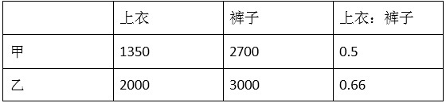

统筹问题看相对效率，同样做一条裤子的时间，甲可以做0.5件上衣，乙可以做0.66件上衣，则乙做上衣的效率比较高，所以让甲主要做裤子，乙主要做上衣，而因为裤子跟上衣要配套，所以甲需要分配一些时间来做上衣，假设时间为X，则，解得，则两厂每月共可生产成衣套。

故正确答案为D。

**考点**：工程问题-其他、统筹规划问题

**来源**：2013年四川公务员录用考试《行测》题（下半年）第63题

### 第 64 题

一个读书小组共有赵、钱、孙、李、周、吴6位书友，现有6本书，书名分别是A、B、C、D、E、F，他们每人至少读过其中的一本书，已知赵、钱、孙、李、周分别读过其中的2、2、4、3、5本书。而书A、B、C、D、E分别被小组中的1、4、2、2、2位书友读过，问吴一定读过的书是哪本？

A. 书A

B. 书B

C. 书F

D. 无法确定

第 64 题 · 答案与解析

**参考答案（粉笔题库参考内容）**

C

**解析**

赵钱孙李周五人共读了2+2+4+3+5=16本书。已知六人当中每人至少读过一本书，则六人至少读了16+1=17本书。ABCDE五本书共被读了1+4+2+2+2= 11次，因此书F至少被读过6次，则吴一定也读过书F。

故正确答案为C。

**考点**：和差倍比问题

**来源**：2013年四川公务员录用考试《行测》题（下半年）第64题

### 第 65 题

某次智力测验的形式为选择题，规定答对一题得20分，不作答的题不扣分，而在答错的题中，第一道答错的题扣10分，此后每一道答错的题的扣分都比上一道答错的题多10分，小张在测验中拿到了一份100道试题的试卷，总共获得1270分，问他至少有几道题未作答：

A. 0

B. 5

C. 7

D. 9

第 65 题 · 答案与解析

**参考答案（粉笔题库参考内容）**

B

**解析**

此题属于盈亏问题。假设小张全部做对能够获得2000分，实际上获得了1270分，少了730分。设小张没答的为x道，答错的为y道，根据等差数列求和公式得出，，化为最简形式为146=4x+y²+5y。要使x取值最小，则y要取值最大，当y=9时，x=5为最小值。因此小张至少有5道题没做。

故正确答案为B。

**考点**：和差倍比问题

**来源**：2013年四川公务员录用考试《行测》题（下半年）第65题

### 第 66 题

请从所给的四个选项中，选择最合适的一个填入问号处，使之呈现一定的规律：

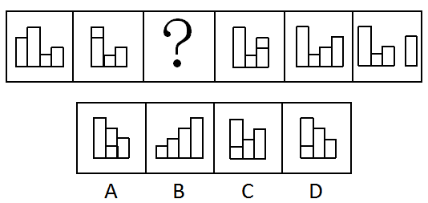

A. A

B. B

C. C

D. D

第 66 题 · 答案与解析

**参考答案（粉笔题库参考内容）**

A

**解析**

元素组成相同，考查位置移动。

本题考查不同柱状图的移动，最左边柱状向右移动一个位置，一直移动到最右侧后，最左侧的柱状继续向右移动。以此类推，第一个图形最左侧移动到问号处应该在最短的圆柱处。

故正确答案为A。

**考点**：位置规律-平移

**来源**：2013年四川公务员录用考试《行测》题（下半年）第66题

### 第 67 题

请从所给的四个选项中，选择最合适的一个填入问号处，使之呈现一定的规律：

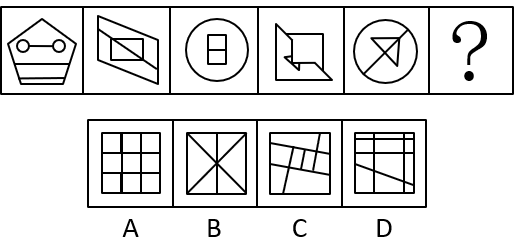

A. A

B. B

C. C

D. D

第 67 题 · 答案与解析

**参考答案（粉笔题库参考内容）**

C

**解析**

元素组成不同，且无明显属性规律，考虑数量规律。题干图形分割明显，考虑面数量，分别为5、4、3、4、4，无规律，考虑细化。观察发现，题干图形中都有2个完全一样的最小面，所以？处也要选个有2个完全一样的最小面的图形，只有C项符合。

故正确答案为C。

**考点**：数量规律-面

**来源**：2013年四川公务员录用考试《行测》题（下半年）第67题

### 第 68 题

请从所给的四个选项中，选择最合适的一个填入问号处，使之呈现一定的规律：

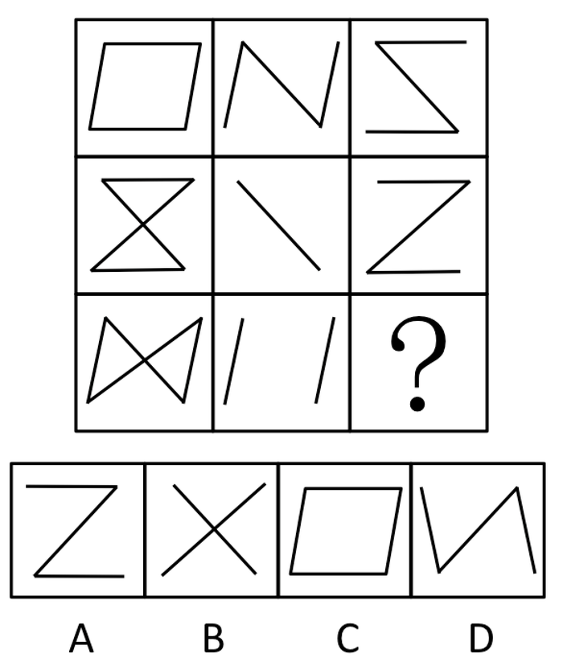

A. A

B. B

C. C

D. D

第 68 题 · 答案与解析

**参考答案（粉笔题库参考内容）**

B

**解析**

元素组成相似，以行为单位，元素叠加。经过观察发现，每一行前两个图形去同存异可得到第三个图形，第三行也依此规律，得到图形B。

故正确答案为B。

**考点**：样式规律-加减同异

**来源**：2013年四川公务员录用考试《行测》题（下半年）第68题

### 第 69 题

请从所给的四个选项中，选择最合适的一个填入问号处，使之呈现一定的规律：

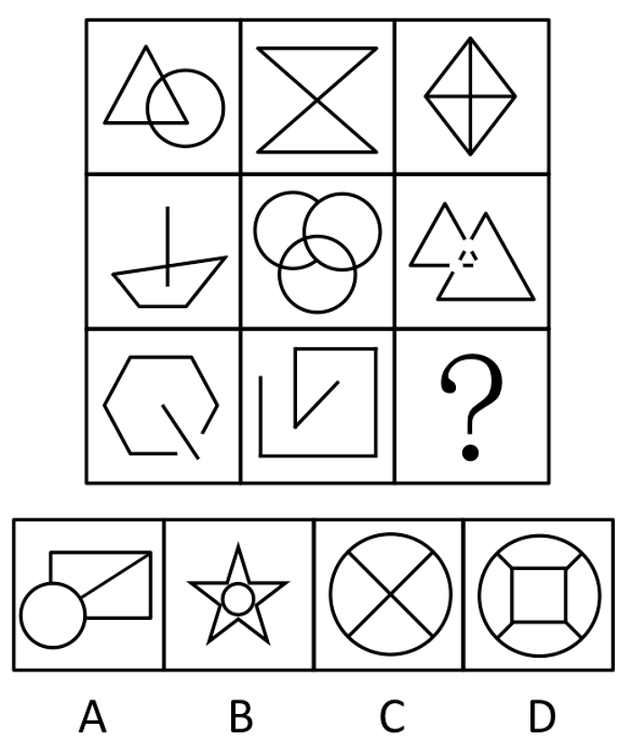

A. A

B. B

C. C

D. D

第 69 题 · 答案与解析

**参考答案（粉笔题库参考内容）**

C

**解析**

元素组成凌乱，先考虑属性，无法成立，考虑数量-数点。经过验证，每个图形满足的规律是都有五个交点。A、B、C、D四个选项的交点分别为6、10、5、8。

故正确答案为C。

**考点**：数量规律-点

**来源**：2013年四川公务员录用考试《行测》题（下半年）第69题

### 第 70 题

左边给定的是纸盒的外表面，下面哪一项能由它折叠而成：

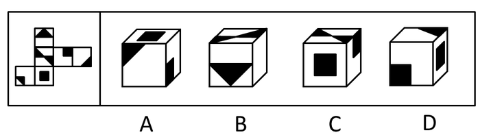

A. A

B. B

C. C

D. D

第 70 题 · 答案与解析

**参考答案（粉笔题库参考内容）**

A

**解析**

折纸盒问题。通过展开图可知A项中三个相邻面，位置关系正确，A项是正确的；B项正面和顶面相对位置不符，其相邻边右侧应该连接阴影的顶点；C项右侧的黑块位置与正面的相对关系不符合；D项正面与三角黑色阴影相对关系不符。

故正确答案为A。

**考点**：空间类-空间重构-六面体

**来源**：2013年四川公务员录用考试《行测》题（下半年）第70题

### 第 71 题

新闻评论，是指媒体带着鲜明的针对性和引导性，对当前重大问题和典型新闻事件发布的议论评说，是媒体上社论、评论员文章、短篇、编者按、专栏评论、述评等的总称。

根据上述定义，下列属于新闻评论的是：

A. 某报纸对近期不断涌现的各类道德模范的事迹，进行了集中的专题报道

B. 某网站对一新闻事件进行报道后，网友们纷纷在其后跟帖，对此进行评论

C. 某电视台在开播一部电视剧前，不断在其他节目间隙穿插主创对此剧的评论

D. 中国载人航天再次取得了成功后，许多报纸都发表评论，抒发民族自豪之情

第 71 题 · 答案与解析

**参考答案（粉笔题库参考内容）**

D

**解析**

第一步:查找关键词。

新闻评论定义的核心关键词是：主体为媒体，特点是鲜明的针对性和引导性，客体是重大问题和典型新闻事件，本质是种评论。

第二步：逐一分析选项。

A项对模范事迹的专题报道，本质是报道，不是评论，排除；

B项发表评论的主体为网友，不是媒体，排除；

C项针对对象不是重大问题和典型的新闻事件，且本质是广告宣传，不是评论，排除；

D项各个条件都满足，当选。

故正确答案为D。

**考点**：单定义-其他句式

**来源**：2013年四川公务员录用考试《行测》题（下半年）第71题

### 第 72 题

意境，是指抒情作品中呈现的情景交融、虚实相生的形象系统，及其所诱发和开拓的审美想象空间，是文学形象的高级形态之一。

根据上述定义，下列属于意境的是：

A. 莫愁前路无知己，天下谁人不识君

B. 仰天大笑出门去，我辈岂是蓬蒿人

C. 两情若是久长时，又岂在朝朝暮暮

D. 前不见古人，后不见来者。念天地之悠悠，独怆然而涕下

第 72 题 · 答案与解析

**参考答案（粉笔题库参考内容）**

D

**解析**

第一步：关键词查找。

意境的关键词：虚实相生、情景交融。

第二步：逐一分析选项。

A、B、C三项都是情，没有在景中烘托情绪，故都没有体现出虚实相生；

D项《登幽州台歌》是唐代诗人陈子昂的作品。这是一首吊古伤今的生命悲歌，从中可以看出诗人孤独遗世、独立苍茫的落寞情怀。此诗通过描写登楼远眺，凭今吊古所引起的无限感慨，抒发了诗人抑郁已久的悲愤之情。

故正确答案为D。

**考点**：单定义-其他句式

**来源**：2013年四川公务员录用考试《行测》题（下半年）第72题

### 第 73 题

中水主要是来自建筑物（办公楼，教学楼，居民住宅区等）的排水以及设备间接冷却水，经过处理后，水质低于干净的给水（自来水），但可以用于建筑施工、冲厕、绿化、浇灌、喷洒路面、清洗车辆等。

根据上述定义，下列对中水理解正确的是：

A. 中水是低质用水

B. 中水不能饮用，但可以用来洗澡

C. 工业污水经过处理后可以成为中水

D. 中水是非饮用水，没有特别的水质指标

第 73 题 · 答案与解析

**参考答案（粉笔题库参考内容）**

A

**解析**

A项，“水质低于干净的给水（自来水）”，说明中水的质量比自来水低，确实是低质水，符合题意，当选；

B项，根据其用途（建筑施工，冲厕等）判断中水确实不能饮用，但可用来洗澡题干信息并未提到，不符合定义，排除；

C项，工业污水题干中未提及，无中生有，不符合定义，排除；

D项，中水是不是饮用水，有没有具体指标，题干没有体现，不符合定义，排除。

故正确答案为A。

**考点**：单定义-其他句式

**来源**：2013年四川公务员录用考试《行测》题（下半年）第73题

### 第 74 题

情商是与智商相对应的概念，主要是指人在情绪、情感、意志、耐受挫折等方面的品质。

根据上述定义，下列不属于情商的是：

A. 李莉事事能设身处地的理解别人的情绪和感受

B. 杨颖在高中学校期间成绩突出，考取了某名牌大学

C. 王华通过自我鞭策始终保持对学习和工作的高度热忱

D. 赵舒在待人接物方面能克制自己，与同事友好相处

第 74 题 · 答案与解析

**参考答案（粉笔题库参考内容）**

B

**解析**

第一步：关键词查找。

情商的关键词是：情绪、情感与智商相对应。

第二步：逐一分析选项。

A项是设身处地，C项是高度热忱，D项是克制自己，三项都是体现在情绪情感方面的水平，都是有关情商的论述；

B项更多体现的是智商。

本题为选非题，故正确答案为B。

**考点**：单定义-其他句式

**来源**：2013年四川公务员录用考试《行测》题（下半年）第74题

### 第 75 题

社会排斥是把某些社会群体排斥在社会主流之外的一种机制。针对弱势群体的社会排斥，是指社会主流群体在社会意识和政策法规等不同层面上对边缘化的弱势群体进行排斥。

根据上述定义，以下情况不属于社会排斥的是：

A. 某公司拒绝聘用乙肝病毒携带者

B. 在有些国家，女性和男性同工不同酬

C. 美国在20世纪60年代以前对黑人的歧视

D. 在某些企业，级别不同的工作人员制服不同

第 75 题 · 答案与解析

**参考答案（粉笔题库参考内容）**

D

**解析**

第一步：关键词查找。

社会排斥的关键词是：主体为社会主流群体，客体为弱势群体，方式为排斥。

第二步：逐一分析选项。

A项对乙肝携带者，B项对女性，C项对黑人，都符合关键词；

D项根据级别不同设定服装，并不是排斥，没有把某一群体排斥到主流之外，且对象不是弱势群体，不是社会排斥，不符合关键词。

本题为选非题，故正确答案为D。

**考点**：单定义-其他句式

**来源**：2013年四川公务员录用考试《行测》题（下半年）第75题

### 第 76 题

网站流量是指网站的访问量、其常用的统计指标包括网站的独立用户数量、总用户数量（含重复访问者）、网页浏览数量、每个用户的页面浏览数量、用户在网站的平均停留时间等。

根据上述定义，下列不能直接用来提高网站流量的是：

A. 丰富网页的展示内容

B. 提高网民信息甄别能力

C. 增加与相关网站的链接

D. 在其他媒体上发布网站广告

第 76 题 · 答案与解析

**参考答案（粉笔题库参考内容）**

B

**解析**

网民信息甄别并不能使用户数量、网页浏览数量、每个用户的页面浏览数量、用户在网站的平均停留时间等提高或者增加，即不能使网站流量直接提高。而A项可以增加用户的浏览时间；C、D项可以增加用户跳转，是一种网站分流，都可以使网页访问量或者流量直接提高。

本题为选非题，故正确答案为B。

**考点**：单定义-其他句式

**来源**：2013年四川公务员录用考试《行测》题（下半年）第76题

### 第 77 题

我国公务员法规定，国家实行公务员交流制度。公务员可以在公务员队伍内部交流，也可以与国有企业、事业单位、人民团体和群众团体中从事公务的人员交流。

根据上述定义，下列不属于公务员交流的是：

A. 公务员小王到某外资企业任职

B. 公务员小张从综合处调入财务处工作

C. 公务员小李从中央机关到某市去挂职锻炼

D. 公务员小赵从政府某局到某地红十字会任职

第 77 题 · 答案与解析

**参考答案（粉笔题库参考内容）**

A

**解析**

第一步：关键词查找。

公务员交流的范围是：国家单位、国有企业、事业单位、人民团体和群众团体，外资企业不在此范围内。

第二步:逐一分析选项。

A项小王到某外资企业任职不符合题意。

本题为选非题，故正确答案为A。

**考点**：单定义-其他句式

**来源**：2013年四川公务员录用考试《行测》题（下半年）第77题

### 第 78 题

高温津贴是针对高温条件下从事经济建设和企业生产经营活动的职工发放的特殊工资性补偿。

根据上述定义，下列属于高温津贴的是：

A. 某建筑工地在最高气温超过36℃时给每个工人午餐多加一份饮料

B. 某研究院给前往沙漠地区进行地质考察的研究员每人每天补贴50元

C. 某钢铁公司炼钢车间炉前工人的工资标准比配料岗位工人每月每人多100元

D. 北京某建筑公司规定每年6～8月实行夏时制，每天比冬季多工作1小时，每天每人多发20元

第 78 题 · 答案与解析

**参考答案（粉笔题库参考内容）**

C

**解析**

第一步：关键词查找。

高温津贴定义的核心成分是：条件是在高温条件下，方式是工资性补贴。

第二步：逐一分析选项。

A项多加一份饮料不符合工资性补贴，排除；

B项不符合高温条件下，排除；

C项车炉前符合高温，多100元符合工资性补贴，符合条件，当选；

D项夏时制不是高温，而是代表工作时间延长，不符合，排除。

故正确答案为C。

**考点**：大前提

**来源**：2013年四川公务员录用考试《行测》题（下半年）第78题

### 第 79 题

反向形成，是指对内心难以接受的观念或情感以相反的态度、行为表现出来。

根据上述定义，下列属于反向形成的是：

A. 王贤不小心打碎了一个碗，奶奶说：“没事没事，岁岁平安。”

B. 刘佳和外婆的感情很好，当接到外婆去世的消息，刘佳根本就不信

C. 齐蓝对家人都将注意力放在妹妹身上很不满，但在妈妈面前表现得非常照顾妹妹

D. 李丰是个保险推销员，因为经常遭到拒绝而感到非常挫败，有一天他收留了一只断了一条腿的小狗

第 79 题 · 答案与解析

**参考答案（粉笔题库参考内容）**

C

**解析**

第一步：关键词查找。

反向形成的关键词是：内心与行为的表现相反。

第二步：逐一分析选项。

A项和D项没有体现内心的难以接受和行为表现的矛盾，排除；

B项没有表现出相反的态度，而是与内心感受相同的态度，排除；

C项齐蓝对妹妹不满，心理是难以对妹妹好的，但是却在爸妈面前以相反的态度表现，符合定义，当选。

故正确答案为C。

**考点**：单定义-其他句式

**来源**：2013年四川公务员录用考试《行测》题（下半年）第79题

### 第 80 题

社会上对于人才的态度会出现这样一种马太效应：社会对已经出名（得到社会承认）的人才，给予越来越多，而对于不出名的人才，则连应该给予的也不给予。

根据上述定义，下列不属于马太效应的是：

A. 某高校聘请一位在商界很成功的企业家担任学院的荣誉教授

B. 有些科学家没有成名以前，论文无处发表，成果无人承认，甚至生活无所着落

C. 某演员在获得了影帝头衔后还积极努力工作，终于在几年之后又获得了另一重要奖项

D. 莫言得到诺贝尔文学奖后，其作品受到追捧，很多读者表示想购买作为收藏，社会各界都向其表示祝贺，甚至有人想送他房产

第 80 题 · 答案与解析

**参考答案（粉笔题库参考内容）**

C

**解析**

第一步：关键词查找。

马太效应强调的是两个极端，指强者愈强、弱者愈弱的现象。

第二步：逐一分析选项。

A项和D项体现已经成名的人才拥有越来越多，符合；

B项体现没有名气的人才本应拥有的也没有得到，符合；

C项没有体现因为已经出名而拥有越来越多，而是强调个人的努力，不符合马太效应。

本题为选非题，故正确答案为C。

**考点**：单定义-其他句式

**来源**：2013年四川公务员录用考试《行测》题（下半年）第80题

### 第 81 题

教室 对于 （    ） 相当于 （    ） 对于 生产

A. 黑板：机器

B. 学生：作品

C. 教师：工人

D. 上课：厂房

第 81 题 · 答案与解析

**参考答案（粉笔题库参考内容）**

D

**解析**

逐一代入选项。

A项，教室与黑板是包含关系，机器与生产是工具与功能对应，不符合；

B项，学生在教室里学习，作品与生产不满足其对应关系，不符合；

C项，教师在教室里授课，工人在工厂里生产，工人对应工厂才行，不符合；

D项，“上课”说明的是“教室”的功能，而“生产”刚好说的是“厂房”的功能，符合。

故正确答案为D。

**考点**：逻辑关系-对应关系

**来源**：2013年四川公务员录用考试《行测》题（下半年）第81题

### 第 82 题

自行车 对于 （    ） 相当于 （    ） 对于 电风扇

A. 轮胎：电流

B. 摩托车：蒲扇

C. 旅程：消暑

D. 交通工具：家具

第 82 题 · 答案与解析

**参考答案（粉笔题库参考内容）**

B

**解析**

逐一代入选项。

A项，轮胎是自行车的组成部分，二者为组成关系，电流是电风扇的动力，二者为对应关系，前后逻辑关系不一致，排除；

B项，自行车和摩托车都是交通工具的一种，二者为并列关系；蒲扇和电风扇都是纳凉工具的一种，二者为并列关系，前后逻辑关系一致，当选；

C项，自行车可以是旅程中使用的工具，电风扇可以是消暑使用的工具，但二者顺序相反，前后逻辑关系不一致，排除；

D项，自行车是一种交通工具，二者为种属关系；电风扇是家电，而不是家具，前后逻辑关系不一致，排除。

故正确答案为B。

**考点**：逻辑关系-并列关系

**来源**：2013年四川公务员录用考试《行测》题（下半年）第82题

### 第 83 题

水泥：房屋

A. 布料：衣服

B. 沙子：沙漠

C. 木材：钢筋

D. 打印机：电脑

第 83 题 · 答案与解析

**参考答案（粉笔题库参考内容）**

A

**解析**

第一步：判断题干词语间的逻辑关系。

题干词语之间是材料与成品的对应关系，前者是后者的原材料，且前者需要加工才能组成后者。

第二步：判断选项词语间的逻辑关系。

A项：布料是衣服的原材料，且前者需要加工才能组成后者，与题干逻辑关系一致，当选；

B项：沙子是沙漠的主要成分，与题干逻辑关系不一致，排除；

C项：木材和钢筋是并列关系，与题干逻辑关系不一致，排除；

D项：二者之间没有必然对应关系，与题干逻辑关系不一致，排除。

故正确答案为A。

**考点**：逻辑关系-对应关系

**来源**：2013年四川公务员录用考试《行测》题（下半年）第83题

### 第 84 题

高尔夫球：棒球（    ）。

A. 排球：足球

B. 台球：铅球

C. 乒乓球：网球

D. 篮球：水球

第 84 题 · 答案与解析

**参考答案（粉笔题库参考内容）**

C

**解析**

第一步：判断题干词语间逻辑关系。

题干两个词的关系是并列关系，二者同属于球类，都需要使用工具，且使用的工具同属于棒类。

第二步：判断选项词语间逻辑关系。

A项，排球不需要使用工具，足球不需要使用工具。不符合题意，排除；

B项，台球用杆，铅球不需要工具。不符合题意，排除；

C项，乒乓球用拍，网球也用拍，使用工具同类。符合题意，当选；

D项，篮球不需要使用工具，水球也不需要使用工具。不符合题意，排除。

第三步：再次标注答案。

故正确答案为C。

**考点**：逻辑关系-并列关系

**来源**：2013年四川公务员录用考试《行测》题（下半年）第84题

### 第 85 题

寓言：哲理

A. 日记：笔记

B. 邮箱：信件

C. 成语：典故

D. 通讯：报道

第 85 题 · 答案与解析

**参考答案（粉笔题库参考内容）**

C

**解析**

第一步：判断题干词语间逻辑关系。

寓言故事中蕴含哲理，二者构成对应关系。

第二步：判断选项词语间逻辑关系。

A项：日记是笔记的一种，二者构成种属关系，与题干逻辑关系不一致，排除；

B项：信件投到邮箱里，与题干逻辑关系不一致，排除；

C项：成语中蕴含典故，与题干逻辑关系一致，当选；

D项：通讯是报道的一种形式，与题干逻辑关系不一致，排除。

故正确答案为C。

**考点**：逻辑关系-对应关系

**来源**：2013年四川公务员录用考试《行测》题（下半年）第85题

### 第 86 题

男人：运动员

A. 军人：警察

B. 商人：父亲

C. 学生：大学生

D. 女人：礼仪小姐

第 86 题 · 答案与解析

**参考答案（粉笔题库参考内容）**

B

**解析**

第一步：确定题干中词语间的关系。

男人与运动员之间是交叉关系。有的男人是运动员，有的运动员是男人。

第二步：逐一分析选项。

A项，军人和警察是并列关系；

B项，商人和父亲满足交叉关系；

C项，学生和大学生是包含关系；

D项，女人和礼仪小姐是包含关系。

故正确答案为B。

**考点**：逻辑关系-交叉关系

**来源**：2013年四川公务员录用考试《行测》题（下半年）第86题

### 第 87 题

殚精竭虑：鞠躬尽瘁

A. 绞尽脑汁：有心无力

B. 卧薪尝胆：含辛茹苦

C. 博闻强识：孤陋寡闻

D. 见微知著：一叶知秋

第 87 题 · 答案与解析

**参考答案（粉笔题库参考内容）**

D

**解析**

第一步：确定词语间的关系。

同义词关系。殚精竭虑，殚：竭尽；虑：思虑。形容耗尽精力，费尽心思(褒义词)。鞠躬尽瘁，鞠躬：弯着身子，引申为恭敬谨慎的样子。瘁：劳累。尽瘁：竭尽心力。形容恭敬谨慎，竭尽心力（褒义词）。题干词语均为褒义词，且意思相近。

第二步：逐一分析选项。

A项，绞尽脑汁：形容苦思积虑，费尽脑筋，想尽办法。费尽心思去思考一件事情。有心无力：指有愿望和打算，但没有力量付诸实现；

B项，卧薪尝胆：形容人刻苦自励，发愤图强。含辛茹苦：形容备受艰难，忍受痛苦；

C项，博闻强识：形容知识丰富，记忆力强。孤陋寡闻：形容人学识少，见识浅，用作贬义词；

D项，见微知著：意指看到微小的苗头，就知道可能会发生显著的变化。一叶知秋：指看见一片落叶，就知道秋天将临。比喻发现一点预兆就知道事物将来的发展趋向。二者是同义词。

故正确答案为D。

**考点**：语义关系-近义关系

**来源**：2013年四川公务员录用考试《行测》题（下半年）第87题

### 第 88 题

熊猫：爬行动物

A. 肺结核：传染病

B. 酒杯：玻璃器皿

C. 鲸：哺乳动物

D. 五粮液：葡萄酒

第 88 题 · 答案与解析

**参考答案（粉笔题库参考内容）**

D

**解析**

第一步：判断题干词语间逻辑关系。

熊猫不是爬行动物，是哺乳动物。

第二步：判断选项词语间逻辑关系。

A项，肺结核是传染病；

B项，酒杯可以是玻璃器皿；

C项，鲸是哺乳动物；

D项，五粮液不是葡萄酒，符合题意。

故正确答案为D。

**考点**：逻辑关系-包容关系

**来源**：2013年四川公务员录用考试《行测》题（下半年）第88题

### 第 89 题

程序：会议：主持人

A. 规则：比赛：裁判

B. 指导：交流：领导

C. 方案：工作：情况

D. 平台：活动：专家

第 89 题 · 答案与解析

**参考答案（粉笔题库参考内容）**

A

**解析**

第一步：确定词语间的关系。

题干三词之间的关系：主持人按照程序主持会议。

第二步：逐一分析选项。

A项，裁判根据规则进行比赛；

B项，领导与指导是主谓关系，不符合题干的依据规则；

C项，情况与题干主持人不对应；

D项，专家与平台无法与题干对应。

故正确答案为A。

**考点**：逻辑关系-对应关系

**来源**：2013年四川公务员录用考试《行测》题（下半年）第89题

### 第 90 题

矛盾：冲突：战争

A. 接触：交流：融合

B. 细微：低下：渺小

C. 吵架：争执：斗殴

D. 无端：无故：无理

第 90 题 · 答案与解析

**参考答案（粉笔题库参考内容）**

A

**解析**

第一步：确定词语间的关系。

“矛盾：冲突：战争”三者之间是递进关系，并且前者不断激化为后者，先有矛盾才会有冲突，冲突激化爆发战争。

第二步：逐一分析选项。

A项，接触促进交流，交流促进融合，与题干关系一致；

B项，细微低下含义不同，不符合递进关系；

C项，争执的意思是各抒己见互不相让。吵架的意思是剧烈争吵。吵架比争执程度深；

D项，三个词语是并列关系，没有递进意思。

故正确答案为A。

**考点**：逻辑关系-对应关系

**来源**：2013年四川公务员录用考试《行测》题（下半年）第90题

### 第 91 题

某市居民用电的价格一直偏低，该市准备实行居民用电阶梯调价方案，即当电量消耗高于当地平均水平一定幅度后按“二档”、“三档”等加价收费，有关人士认为该办法将对节约用电产生重大的促进作用。

以下哪项如果为真，最能支持上述人士的观点：

A. 该市居民用电量平均水平远高于其他城市

B. 该市用电中高耗能企业占据了大部分用电份额

C. 有居民抱怨阶梯电价中“一档”基数用电过少

D. 居民用电中的浪费用电主要是电价偏低造成的

第 91 题 · 答案与解析

**参考答案（粉笔题库参考内容）**

D

**解析**

第一步：分析题干，找到论点论据。

单纯论点：阶梯加价收费调价方案将对节约用电产生重大的促进作用。

第二步:逐一分析选项。

A项，用电量平均水平与其他城市相比，与题目无关，题目中的均价是本市的均价；

B项，高耗能企业，与题目论证的居民用电主体不符，跑题，为无关项；

C项，居民抱怨“一档”基数用电过少，与其促进节约用电无关；

D项，说明浪费用电是电价偏低造成的，那么如果加价收费，就会促进这部分居民节约用电，直接加强论点。

故正确答案为D。

**考点**：补充论据

**来源**：2013年四川公务员录用考试《行测》题（下半年）第91题

### 第 92 题

有研究资料表明，颈椎病患者往往缺钙。而大量实例表明，通过食用钙片，可改善人体内缺钙的状况。因此有人认为，可以通过食用钙片来治疗颈椎病。

以下哪项最可能是上述观点依赖的假设：

A. 在食用钙片的过程中不会产生副作用

B. 具体服用钙片的量与颈椎病患者的年龄有关

C. 颈椎病患者体内钙的缺乏量不会因为其他原因而有太大变化

D. 钙的缺乏是导致颈椎病的原因，而不是颈椎病引起的结果

第 92 题 · 答案与解析

**参考答案（粉笔题库参考内容）**

D

**解析**

第一步：分析题干，找到论点论据。

论点：食用钙片来治疗颈椎病。

论据：颈椎病患者往往缺钙，而食用钙片可改善人体内缺钙的状况。

第二步：逐一分析选项。

A项，食用钙片的过程中不会产生副作用，题干讨论的是食用钙片能否治疗颈椎病，话题不一致，为无关项，排除；

B项，食用量与年龄的关系与论点无关，为无关项；

C项，患者体内钙的缺乏量是否稳定也与论证无关，为无关项；

D项，“钙的缺乏是导致颈椎病的原因，而不是颈椎病引起的结果”为必要假设，即保证是因为缺钙导致的颈椎病。如果因为颈椎病导致的缺钙，那么通过补钙来治疗颈椎病就是本末倒置。所以D项是正确的。

故正确答案为D。

**考点**：必要条件

**来源**：2013年四川公务员录用考试《行测》题（下半年）第92题

### 第 93 题

某学院教师近两年发表的学术论文，其作者半数以上近两年也曾给本科生上过课，这些论文总数的60%为该院12名教授所写。事实上，有的教授一人在近两年就发表了多篇学术论文。

由此可以推出，近两年：

A. 12名教授都给本科生上过课

B. 12名教授中大多数都给本科生上过课

C. 12名教授中可能没人给本科生上过课

D. 给本科生上过课的教师中的大多数都在这12名教授当中

第 93 题 · 答案与解析

**参考答案（粉笔题库参考内容）**

C

**解析**

集合概念类推导。

第一步：翻译题干，找到确定信息。

题干所有信息都是不确定的：有教师发表学术论文；发表论文的作者半数以上给本科生上过课；论文的60%为该院12名教授所写；有的教授发表了多篇论文。

第二步：根据上述推导，结合选项判别。

根据从弱原则，C项“可能”二字，使得C项与原题干中所有已知条件不矛盾，即可能存在；

A、B、D三个选项表达过于绝对，从文段中我们无法推出其必然成立。

故正确答案为C。

**考点**：日常结论

**来源**：2013年四川公务员录用考试《行测》题（下半年）第93题

### 第 94 题

曾经有一个流行的看法，认为菠菜的含铁量极高。但是最近有检测表明，实际上菠菜的含铁量并没有那么高。可以断定，当这一检测结果一旦为大众所知晓，菠菜的销量将大幅度减少。

以下哪项如果为真，最能支持上述断定：

A. 前后矛盾的信息将使得人们无所适从

B. 含铁量的多少是菠菜营养成分的重要指标之一

C. 有相当一部分人对富含铁元素的事物有特殊的爱好

D. 许多人喜爱吃菠菜仅仅是因为听说菠菜的含铁量极高

第 94 题 · 答案与解析

**参考答案（粉笔题库参考内容）**

D

**解析**

第一步：分析题干，找到论点论据。

论点：当菠菜含铁量被大众知晓，菠菜的销量将减少。

论据：菠菜的含铁量并没有人们以为的那么高。

第二步：逐一分析选项。

D项，“许多人喜爱吃菠菜仅仅是因为听说菠菜的含铁量极高”在含铁量与菠菜的销量之间搭设桥梁，最能支持断定；

A项，其实有一定的支持作用，但A项力度比D项小的多；

B项，有一定的迷惑性，但营养成分与人们选择间没有必然联系，虽然有加强作用，但是力度不如D项；

C项，与题干论述的含铁量与销量间的关系太弱。

故正确答案为D。

**考点**：搭桥

**来源**：2013年四川公务员录用考试《行测》题（下半年）第94题

### 第 95 题

小明，小强和小虎去中国古动物馆参观，在恐龙展区他们就看到了一个高大的恐龙骨骸。小强说：“它不是角龙，是甲龙。”小虎说：“它不是甲龙，是角龙。”小明不能确定到底是什么龙，但是他说：“它不是剑龙，也不是甲龙。”看完标识牌，发现三个人的猜测中只有一人的两个判断都对，一人的判断是一对一错，还有一人全错了。

根据以上陈述，可以得出他们看到的恐龙骨骸属于哪种恐龙：

A. 角龙

B. 甲龙

C. 剑龙

D. 无法确定

第 95 题 · 答案与解析

**参考答案（粉笔题库参考内容）**

B

**解析**

第一步：分析题干条件。

（1）小强：-角龙，甲龙；

（2）小虎：-甲龙，角龙；

（3）小明：-剑龙，-甲龙；

（4）一人的两个判断都对，一人的判断一对一错，一人全错了。

第二步：根据题干条件进行推理。

题干信息不明确，考虑采用代入法解题。

代入A项：如果是角龙，则小强的两句全错，小虎的两句全对，小明的两句全对，与条件（4）矛盾，排除；

代入B项：如果是甲龙，则小强的两句全对，小虎的两句全错，小明的两句一对一错，符合条件，当选；

代入C项：如果是剑龙，则小强的两句一对一错，小虎的两句一对一错，小明的两句一对一错，与条件（4）矛盾，排除；

代入D项：根据上述分析，可以确定是甲龙，排除。

故正确答案为B。

**考点**：框架题

**来源**：2013年四川公务员录用考试《行测》题（下半年）第95题

### 第 96 题

为了加强公司的知识产权保护，某饮品生产公司打算和其员工签署一项协议，协议规定员工在离开该公司后的两年内不得从事饮品行业的工作，公司为此补贴每位员工2万元。该公司研发部门的8名员工均拒绝签署该项协议。他们认为，公司的这项规定将使他们失去离职后两年内重新就业的机会。

以下哪项是上述8位员工观点的基本假设：

A. 上述8位员工离职后需要立即就业

B. 上述8位员工在离职后的两年内只能从事饮品行业的工作

C. 研发部门的员工薪金超过公司员工的平均水平，补贴2万元对他们来说不公平

D. 研发部门的员工均可以自主研发饮品新配方，他们离职后到新公司任职时可以开发新配方

第 96 题 · 答案与解析

**参考答案（粉笔题库参考内容）**

B

**解析**

第一步：找到论点论据。

论点：这项规定使他们失去离职后两年内重新就业的机会。

论据：协议规定员工在离开该公司后的两年内不得从事饮品行业的工作。

本题论点和论据讨论的都是协议规定和员工离职再就业之间的关系，话题一致，且提问方式为前提，加强优先考虑必要条件。

第二步：逐一分析选项。

A项：上述8位员工离职后需要立即就业，论点说的是这项规定使他们失去离职后两年内重新就业的机会，话题不一致，无法加强，排除；

B项：上述8位员工在离职后的两年内只能从事饮品行业的工作，如果这些员工可以从事别的类型的工作，那么就不会失去就业机会，因此该项是题干结论能够成立的必要条件，可以加强，当选；

C项：研发部门的员工薪金超过公司员工的平均水平，补贴2万元不公平，论点说的是这项规定使他们失去离职后两年内重新就业的机会，话题不一致，无法加强，排除；

D项：这些员工到新公司任职时可以开发新配方，而论点说的是这项规定使他们失去离职后两年内重新就业的机会，话题不一致，无法加强，排除。

故正确答案为B。

**考点**：必要条件

**来源**：2013年四川公务员录用考试《行测》题（下半年）第96题

### 第 97 题

一个动物保护组织正在设法改变人们对乌鸦的偏见。该组织认为乌鸦之所以受到人们的厌恶是因为其黑色的外表，他们指出，通过基因改造，可以让乌鸦披上洁白的外衣。

以下哪项如果为真，最能质疑该组织的看法：

A. 基因改造后，“乌鸦”就不再是乌鸦了

B. 乌鸦可以消灭害虫，它其实是人类的朋友

C. 有人认为乌鸦食腐肉是令人厌恶的原因之一

D. 黑百灵是一种通体黑色的小型鸣禽，它深受人们的喜爱

第 97 题 · 答案与解析

**参考答案（粉笔题库参考内容）**

D

**解析**

第一步：分析题干，找到论点论据。

论点：乌鸦之所以受到人们的厌恶是因为其黑色的外表。

论据：无。

第二步：逐一分析选项。

A、B两项，是无关项，排除；

C项，“乌鸦食腐肉是令人厌恶的原因之一”，属于他因削弱，保留；

D项，黑百灵也是通体黑色，但深受喜爱。证明黑色不是人们厌恶的原因，削弱题干论点，保留。

比较C、D两项，削弱论点力度大于他因削弱。

故正确答案为D。

**考点**：削弱论点

**来源**：2013年四川公务员录用考试《行测》题（下半年）第97题

### 第 98 题

由于邮费不断上涨，某杂志计划通过把其每年出版的期刊数量减半来最大化其利润，而文章的质量、每年发表的文章数量以及年订阅价格都保持不变。市场研究表明，如果该计划得以实施，订阅者和广告商都不会受到损失，但也有人认为该计划的实施会导致该杂志的利润下降。

以下哪项如果为真，最能支持这些人的观点？

A. 该杂志的生产成本在未来仍保持不变

B. 大多数在该杂志上购买广告篇幅的广告商会在每期杂志上花费和以前一样多的资金

C. 在新的邮费条件下，邮寄一期计划中的杂志耗费的成本比邮寄一期目前的杂志高出约1/3

D. 该杂志的订阅者中大多数更关心目前文章的质量可能下降，而较少关心杂志中文章数量的减少

第 98 题 · 答案与解析

**参考答案（粉笔题库参考内容）**

B

**解析**

第一步：分析题干，找到论点论据。

论点：计划的实施会导致该杂志的利润下降。

论据：通过把其每年出版的期刊数量减半来减少邮费的支付。

第二步：逐一分析选项。

A项，成本保持不变，不能推出利润下降，无关；

B项，“广告商会在每期杂志上花费和以前一样多的资金”的结果就是随着期刊的减半，如果每期广告商的花费不变，那么其实也就等于广告商的投入减半。这样杂志的利润下降是一定的，有力地支持了这些人的观点；

C项，不能支持，因为就算邮费新标准高出1/3，由于期刊数量减半，还是达到了节约邮费的目的；

D项，是说不会因为改期数而影响消费群体，也不能说明利润会下降。

故正确答案为B。

**考点**：补充论据

**来源**：2013年四川公务员录用考试《行测》题（下半年）第98题

## 材料 1

根据下面陈述，回答99～100题：

某政府机构为了提高工作效率，计划召开一个连续4天的工作会议，集中讨论，审批分别涉及交通、能源、社会保障、文化、信息技术、教育、环境保护等方面的7个申请项目。会议议程规定：

①每天讨论的申请项目不超过3个；

②文化申请项目必须安排在第二天讨论；

③交通和信息技术项目必须安排在同一天；

④文化项目的讨论安排在能源项目之后，但是在社会保障项目之前；

⑤社会保障项目的讨论安排在交通项目之前，但是在教育项目之后。

### 第 99 题

若第二天讨论一个申请项目，则以下哪项可能在第一天讨论：

A. 交通

B. 能源

C. 社会保障

D. 文化

第 99 题 · 答案与解析

**参考答案（粉笔题库参考内容）**

B

**解析**

第一步：分析题干条件。

（1）每天讨论的申请项目不超过3个；

（2）文化申请项目必须安排在第二天讨论；

（3）交通和信息技术项目必须安排在同一天；

（4）文化项目的讨论安排在能源项目之后，但是在社会保障项目之前；

（5）社会保障项目的讨论安排在交通项目之前，但是在教育项目之后；

（6）第二天讨论一个申请项目。

第二步：根据题干条件进行推理。

根据条件（2）和条件（6）可知，第二天只讨论文化申请项目，根据条件（4）文化项目的讨论安排在能源项目之后，可知能源项目一定在第一天，B项符合。

故正确答案为B。

**来源**：2013年四川公务员录用考试《行测》题（下半年）第99题

### 第 100 题

若社会保障和信息技术申请项目安排在第四天进行讨论，则下列哪两个申请项目可以安排在第三天？

A. 交通和文化

B. 交通和环境保护

C. 能源和文化

D. 教育和环境保护

第 100 题 · 答案与解析

**参考答案（粉笔题库参考内容）**

D

**解析**

第一步：分析题干条件。

（1）每天讨论的申请项目不超过3个；

（2）文化申请项目必须安排在第二天讨论；

（3）交通和信息技术项目必须安排在同一天；

（4）文化项目的讨论安排在能源项目之后，但是在社会保障项目之前；

（5）社会保障项目的讨论安排在交通项目之前，但是在教育项目之后；

（6）社会保障和信息技术申请项目安排在第四天进行讨论。

第二步：根据题干条件进行推理。

根据条件（2）可知文化申请项目必须安排在第二天讨论，不能安排在第三天，排除A、C两项。根据条件（6）可知信息技术项目安排在第四天讨论，结合条件（3）交通和信息技术项目必须安排在同一天，可知交通也安排在第四天，不安排在第三天，排除B项，只有D项符合。

故正确答案为D。

**来源**：2013年四川公务员录用考试《行测》题（下半年）第100题

## 材料 2

一、根据以下资料，回答101～105题。

        2013年1～2月，全国公共财政收入（由中央财政收入与地方财政收入组成）22426亿元，比去年同期增加1508亿元。其中，中央财政收入10779亿元，同比增长1.6%。而受股市成交额增加的影响，1～2月证券交易印花税达到81亿元，同比增长72%。

        2013年1～2月，我国实现城市维护建设税634亿元，同比增长8.5％；营业税3349亿元，同比增加414亿元，增长14.1％，主要是房地产市场成交额增加带动房地产营业税相应增加；房地产企业所得税479亿元，增长31.4％。

        2013年1～2月，属于地方税种的土地增值税实现收入515亿元，同比增长42.1％；契税487亿元，同比增长31.6％；城镇土地使用税233亿元，同比增长2％；耕地占用税175亿元，同比增长7％。

### 第 101 题

如证券交易印花税按交易额的千分之一计算，则2012年1～2月证券交易额约为：

A. 47亿元

B. 58亿元

C. 4.7万亿元

D. 5.8万亿元

第 101 题 · 答案与解析

**参考答案（粉笔题库参考内容）**

C

**解析**

首先观察选项，选项差距较大，可使用截位法直接求解。2013年月印花税为81亿元，同比增长72%，保留两位有效数字，则2012年亿元。税为交易额的千分之一，则2012年的交易额为4.7万亿元。

故正确答案为C。

**考点**：基期计算、文字资料

**来源**：2013年四川公务员录用考试《行测》题（下半年）第101题

### 第 102 题

下列税种在2013年1～2月税收中同比净增加额最大的是：

A. 土地增值税

B. 契税

C. 城市维护建设税

D. 房地产企业所得税

第 102 题 · 答案与解析

**参考答案（粉笔题库参考内容）**

A

**解析**

比较值的大小，需要计算的值较多。

四个税种同比增加额分别为：

亿元；

亿元；

亿元；

亿元。

同比净增加额最大的是土地增值税为154.5亿元。

故正确答案为A。

**考点**：增长量比较、文字资料

**来源**：2013年四川公务员录用考试《行测》题（下半年）第102题

### 第 103 题

2013年1～2月全国公共财政收入中，地方财政收入所占比重约为：

A. 39.7%

B. 48.1%

C. 51.9%

D. 60.3%

第 103 题 · 答案与解析

**参考答案（粉笔题库参考内容）**

C

**解析**

全国公共财政收入由中央财政收入与地方财政收入共同构成，中央财政收入所占的比重为：小于，且接近，因此地方财政收入所占的比重应大于，且接近，查看选项C项符合。

故正确答案为C。

**考点**：文字资料、现期比重

**来源**：2013年四川公务员录用考试《行测》题（下半年）第103题

### 第 104 题

根据中央和地方预算草案的安排，2013年全国公共财政预计收入126630亿元，问2013年3～12月平均每月要完成约多少亿元的公共财政收入：

A. 8684

B. 10420

C. 10553

D. 12663

第 104 题 · 答案与解析

**参考答案（粉笔题库参考内容）**

B

**解析**

全年全国公共财政收入为126630亿元，月为22426亿元，因此剩下10个月中平均每月要完成亿元。

故正确答案为B。

**考点**：文字资料、现期平均数

**来源**：2013年四川公务员录用考试《行测》题（下半年）第104题

### 第 105 题

关于各项财政收入，下列说法与资料相符的是：

A. 2013年1～2月全国公共财政收入同比增长一成多

B. 2013年1～2月房地产企业所得税同比增加了150亿元以上

C. 文中最后一段提到的4个地税税种收入越低，同比增速越慢

D. 2013年1～2月地方财政收入及其增长速度都超过了中央财政收入

第 105 题 · 答案与解析

**参考答案（粉笔题库参考内容）**

D

**解析**

A项：2013年月全国公共财政收入同比增长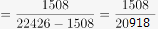，远未达到去年的十分之一，因此同比增长一成多错误；

B项：2013年1-2月房地产企业所得税同比增加亿元，小于150亿元，因此B项错误；

C项：城镇土地使用税233亿元，同比增长2%，耕地占用税175亿元，同比增长7%。并不是收入越低，增速越慢，排除；

D项：财政收入：中央10779亿元，地方11647亿元，地方大于中央；增长速度：中央财政增长率1.6%，全国公共财政收入增长率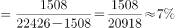，根据混合增长率，地方财政收入增长率大于7%，故地方增长率大于中央增长率。

故正确答案为D。

**考点**：文字资料、综合分析

**来源**：2013年四川公务员录用考试《行测》题（下半年）第105题

## 材料 3

二、根据以下资料，回答106～110题。

        2012年，Z省W市实现文化及其相关产业增加值比上年增长9.6%。在文化产品制造业中，文化印刷、文化用品制造和工艺美术品制造三大主导行业，2012年分别实现增加值21.82亿元、11.57亿元、6.62亿元。

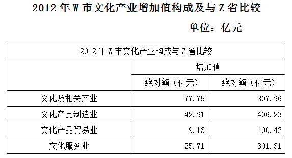

### 第 106 题

与全省结构相比，W市文化产品制造业增加值占文化及其相关产业增加值的比重比全省水平：

A. 高4.9个百分点

B. 低4.9个百分点

C. 高10.6个百分点

D. 低10.6个百分点

第 106 题 · 答案与解析

**参考答案（粉笔题库参考内容）**

A

**解析**

从表格中可以得出，W市文化产品制造业增加值占文化及相关产业增加值的比重；Z省文化产品制造业增加值占文化及其相关产业增加值的比重。因此W市文化产品制造业增加值所占比重要比Z省高54.9-50=4.9个百分点。

故正确答案为A。

**考点**：现期比重、综合资料

**来源**：2013年四川公务员录用考试《行测》题（下半年）第106题

### 第 107 题

在文化产品制造业、贸易业和文化服务业三大产业中，W市有几个产业在2012年的增加值超过Z省的一成？

A. 0

B. 1

C. 2

D. 3

第 107 题 · 答案与解析

**参考答案（粉笔题库参考内容）**

B

**解析**

W市文化产品制造业、贸易业和文化服务业的增加值分别为42.91亿元、9.13亿元和25.71亿元；Z省文化产品制造业、贸易业和文化服务业增加值的一成分别为40.623亿元、10.042亿元和30.131亿元。仅文化产品制造业1个产业超过了Z省的一成。

故正确答案为B。

**考点**：直接找数、综合资料

**来源**：2013年四川公务员录用考试《行测》题（下半年）第107题

### 第 108 题

2012年W市文化产品制造业中，文化印刷、文化用品制造和工艺美术品制造三大主导行业之外的行业增加值占该市文化及其相关产业增加值的比重约为：

A. 2%

B. 4%

C. 7%

D. 12%

第 108 题 · 答案与解析

**参考答案（粉笔题库参考内容）**

B

**解析**

文化产品制造业中，三大主导行业之外的行业增加值=42.91-21.82-11.57-6.62=2.9亿元，其所占该市文化及相关产业增加值的比重为：。

故正确答案为B。

**考点**：现期比重、综合资料

**来源**：2013年四川公务员录用考试《行测》题（下半年）第108题

### 第 109 题

2011年，W市实现文化及其相关产业增加值约为多少亿元？

A. 69

B. 71

C. 73

D. 78

第 109 题 · 答案与解析

**参考答案（粉笔题库参考内容）**

B

**解析**

根据材料可知，2011年W市实现文化及相关产业增加值亿元，与B项最为接近。

故正确答案为B。

**考点**：基期计算、综合资料

**来源**：2013年四川公务员录用考试《行测》题（下半年）第109题

### 第 110 题

关于Z省和W市文化及其相关产业增加值，能够从资料中推出的是：

A. 2012年Z省和W市文化服务业增加值都低于另两个产业

B. 2012年Z省平均每月实现文化产品贸易业增加值超过10亿元

C. 2012年W市文化印刷业增加值超过工艺美术品制造业增加值的3倍

D. 如保持2012年增速，W市文化及其相关产业增加值将在2014年超过100亿元

第 110 题 · 答案与解析

**参考答案（粉笔题库参考内容）**

C

**解析**

A项：2012年Z省和W市文化服务业增加值中文化服务业是高于文化产品贸易业的，错误；

B项：2012年Z省平均每月实现文化产品贸易业增加值亿元，错误；

C项：2012年W市文化印刷业增加值是工艺美术业制造业增加值的倍，超过3倍，正确；

D项：若保持2012年增速，2014年W市文化及相关产业增加值将增长为亿，将不会超过100亿，错误。

故正确答案为C。

**考点**：综合分析、综合资料

**来源**：2013年四川公务员录用考试《行测》题（下半年）第110题

## 材料 4

三、根据以下资料，回答111～115题。

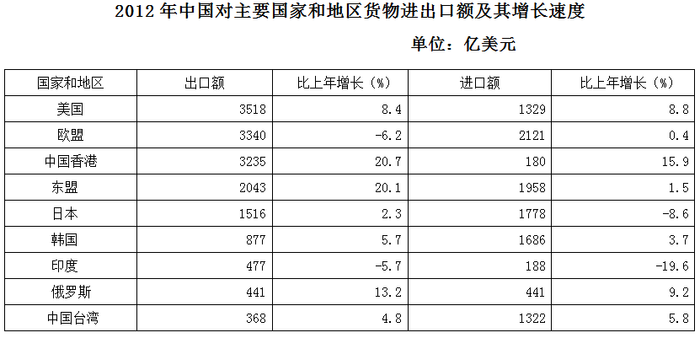

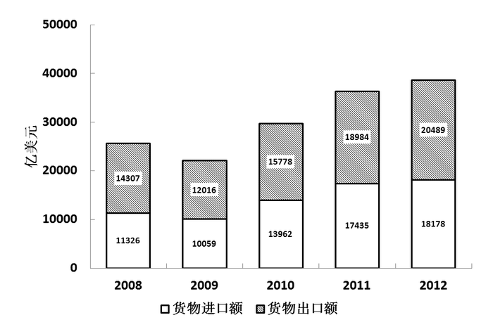

### 第 111 题

2012年，中国对中国香港以及中国台湾货物出口额之和占货物出口总额的比重约为：

A. 29%

B. 8%

C. 18%

D. 28%

第 111 题 · 答案与解析

**参考答案（粉笔题库参考内容）**

C

**解析**

由表格可得，2012年中国对香港和台湾的货物出口额之和=3235+368=3603亿美元，由柱状图可得，2012年货物出口总额为20489亿元。则对香港和台湾的出口额之和占出口总额的比重。因选项差距较小，分母截三位求解，原式≈3603÷20500≈18%。

故正确答案为C。

**考点**：现期比重、综合资料

**来源**：2013年四川公务员录用考试《行测》题（下半年）第111题

### 第 112 题

2012年中国对主要国家和地区进出口额贸易顺差额最大的是：

A. 中国香港

B. 东盟

C. 美国

D. 欧盟

第 112 题 · 答案与解析

**参考答案（粉笔题库参考内容）**

A

**解析**

A项：对中国香港进出口贸易顺差额=3235-180=3055亿元；

B项：对东盟进出口贸易顺差额=2043-1958=85亿元；

C项：对美国进出口贸易顺差额=3518-1329=2189亿元；

D项：对欧盟进出口贸易顺差额=3340-2121=1219亿元。贸易顺差额最大的为中国香港。

故正确答案为A。

**考点**：简单加减计算、综合资料

**来源**：2013年四川公务员录用考试《行测》题（下半年）第112题

### 第 113 题

与2008年相比，2012年中国货物进出口总额增长率约为：

A. 31%

B. 42%

C. 51%

D. 62%

第 113 题 · 答案与解析

**参考答案（粉笔题库参考内容）**

C

**解析**

由柱状图可得，2012年中国货物进出口总额为：20489+18178=38667亿元，2008年中国货物进出口总额为：14307+11326=25633亿元。故与2008年相比，2012年中国货物进出口总额增长率。选项差异较大，保留两位有效数字计算，则，与C项最为接近。

故正确答案为C。

**考点**：一般增长率、综合资料

**来源**：2013年四川公务员录用考试《行测》题（下半年）第113题

### 第 114 题

2008～2012年，中国货物进口额占当年货物进出口总额比重最大的是：

A. 2008年

B. 2009年

C. 2010年

D. 2011年

第 114 题 · 答案与解析

**参考答案（粉笔题库参考内容）**

D

**解析**

通过柱状图数据可知，每年出口额均大于进口额，因此要求进口额所占比重最大，则进口额比出口额的差值就要相对要小，如果相差为0，则比重各占一半，为最大比重。估算可得2008年差值约为3000亿美元，2009年差值约为2000亿美元，2010年差值约为1800亿美元，2011年差值约为1500亿美元。2011年进出口额差值最小，且基数最大，因此2011年进口额比重最大。

故正确答案为D。

**考点**：现期比重、综合资料

**来源**：2013年四川公务员录用考试《行测》题（下半年）第114题

### 第 115 题

关于中国进出口贸易状况，能够从资料中推出的是：

A. 2011年中国对日本货物进出口贸易为逆差

B. 2008～2012年间，中国货物出口总额逐年上升

C. 2012年中国对印度货物进出口贸易总额同比上升

D. 2008～2012年中，中国货物进口总额同比增长率最大的是2012年

第 115 题 · 答案与解析

**参考答案（粉笔题库参考内容）**

A

**解析**

A项：2012年，对日本的出口额为1516亿美元，同比去年增加2.3%，因此去年对日本的出口额小于1516亿美元；对日本的进口额为1778亿美元，同比去年下降8.6%，因此去年对日本的进口额大于1778亿美元。进口额大于出口额，故A项2011年中国对日本货物进出口贸易为逆差，正确；

B项：通过观察柱状图，中国货物出口额在2009年出现下滑，故B项中国货物出口额逐年上升，错误；

C项：2012年中国对印度货物进出口贸易总额，由图表数据可知呈现下降趋势，故同比上升说法错误；

D项：中，中国货物进口总额同比增长率最大的明显为2010年，故D项错误。

故正确答案为A。

**考点**：综合分析、综合资料

**来源**：2013年四川公务员录用考试《行测》题（下半年）第115题

## 材料 5

四、根据以下资料，回答116～120题。

        2011年，全国电厂发电设备装机容量105576万千瓦，同比增长9.25%；其中，水电23051万千瓦，同比增长6.69%，占总发电设备装机容量的比重为21.83%；火电76546万千瓦，同比增长7.86%，占总发电设备装机容量的比重为72.5%；核电1257万千瓦，同比增长16.15%，占总发电设备装机容量的比重为1.19%；风电4505万千瓦，同比增长52.33%，占总发电设备装机容量的比重为4.27%。

        2011年，全国全口径发电量47217亿千瓦时，比上年增长11.68%。其中水电发电量占全部发电量的14.03%，比2010年同期降低2.21个百分点；火电发电量占全部发电量的82.54%，比2010年同期提高1.73个百分点；核电、并网风电发电量占全部发电量的比重分别为1.85%和1.55%，比2010年同期分别提高了0.08个百分点和0.38个百分点。

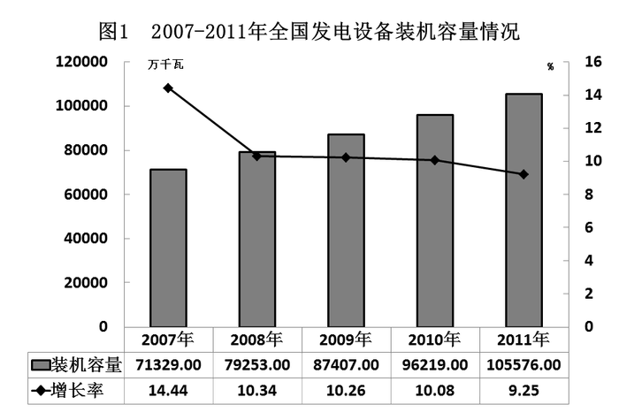

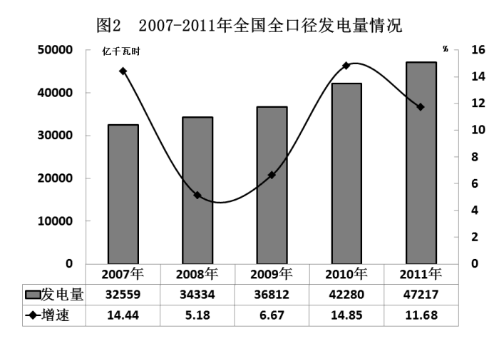

### 第 116 题

2008～2011年，我国平均每单位发电设备装机容量的发电量比上年高的年份有几个：

A. 1

B. 2

C. 3

D. 4

第 116 题 · 答案与解析

**参考答案（粉笔题库参考内容）**

B

**解析**

根据题干“2008-2011年，我国平均每······比上年高的年份有几个”，可判定本题为两期平均数比较问题。定位图1、图2可知2008-2011年全国发电设备装机容量及发全口径电量同比增速。平均每单位发电设备装机容量的发电量，根据两期平均数比较结论：当分子增长率（a）＞分母增长率（b）时，平均数上升。比较可知，满足a＞b的有：2010年（14.85%＞10.08%），2011年（11.68%＞9.25%），共2年。

故正确答案为B。

**考点**：两期平均数比较、综合资料

**来源**：2013年四川公务员录用考试《行测》题（下半年）第116题

### 第 117 题

与2010年相比，2011年全国电厂发电设备装机容量增量最大的是：

A. 水电

B. 火电

C. 核电

D. 风电

第 117 题 · 答案与解析

**参考答案（粉笔题库参考内容）**

B

**解析**

2011年全国电厂发电设备水电增量；

2011年全国电厂发电设备火电增量；

2011年全国电厂发电设备核电增量；

2011年全国电厂发电设备风电增量。

列式后进行对比，根据大大则大，火电增长量要大于水电增长量，风电增长量要大于核电增长量，排除A项、C项。2011年全国电厂发电设备火电增量万千瓦；2011年全国电厂发电设备风电增量万千瓦。

因此2011年全国电厂发电设备装机容量增量最大的为火电。

故正确答案为B。

**考点**：增长量比较、综合资料

**来源**：2013年四川公务员录用考试《行测》题（下半年）第117题

### 第 118 题

2007～2011年间，全国全口径发电量同比增量最高的一年中，发电设备装机容量约比上年增长了多少亿千瓦：

A. 0.78

B. 0.82

C. 0.88

D. 0.94

第 118 题 · 答案与解析

**参考答案（粉笔题库参考内容）**

C

**解析**

全国全口径发电量同比增量：

2007年为；

2008年为34334-32559=1775；

2009年为36812-34334=2478；

2010年为42280-36812=5468；

2011年为47217-42280=4937。

因此全口径发电量同比增量最高的一年为2010年，其发电设备装机容量约比上年增长了96219-87407=8812万千瓦亿千瓦。

故正确答案为C。

**考点**：增长量计算、综合资料

**来源**：2013年四川公务员录用考试《行测》题（下半年）第118题

### 第 119 题

与2010年相比，2011年全国的水电发电量约：

A. 上升6.5%

B. 上升11.7%

C. 下降2.2%

D. 下降3.5%

第 119 题 · 答案与解析

**参考答案（粉笔题库参考内容）**

D

**解析**

由题干“与2010年相比，2011年······”，结合选项是上升/下降+百分数，可判定本题为一般增长率计算问题。定位材料第二段，“2011年，全国全口径发电量47217亿千瓦时，比上年增长11.68%。其中水电发电量占全部发电量的14.03%，比2010年同期降低2.21个百分点”；定位图2，2010年全国全口径发电量42280亿千瓦时。根据部分量=总体量×比重，可得2011年全国年水电发电量=47217×14.03%，2010年全国水电发电量=42280 ×（14.03%+2.21%)。又增长率，故2011年同比2010年增长率，即下降3.6%，与D项最接近。

故正确答案为D。

**考点**：一般增长率、综合资料

**来源**：2013年四川公务员录用考试《行测》题（下半年）第119题

### 第 120 题

关于我国发电状况，下列说法与资料相符的是：

A. 2011年我国水电每单位装机容量的发电量低于火电

B. 2007～2009年间，我国平均每天发电量高于100亿千瓦时

C. 2011年我国核电发电量同比增长率低于全口径发电量增长率

D. 2007～2011年，我国发电装机容量和发电量同比增长均超过10%的年份只有1年

第 120 题 · 答案与解析

**参考答案（粉笔题库参考内容）**

A

**解析**

A项：2011年我国水电每单位装机容量的发电量；2011年我国火电每单位装机容量的发电量。因此，2011年我国水电每单位的装机容量的发电量低于火电，当选；

B项：2007年-2009年，我国平均每天发电量，故高于100错误，排除；

C项：核电、并网风电发电量占全部发电量的比重分别为1.85%和1.55%，比2010年同期分别提高了0.08个百分点和0.38个百分点。根据两期比重结论，2011年核电比重上升，增长率大于2011年全国全口径发电量的增长率。故说法错误，排除；

D项：2007年与2010年我国发电装机容量和发电量同比增长均超过10%，因此仅有一年说法错误，排除。

故正确答案为A。

**考点**：综合分析、综合资料

**来源**：2013年四川公务员录用考试《行测》题（下半年）第120题

