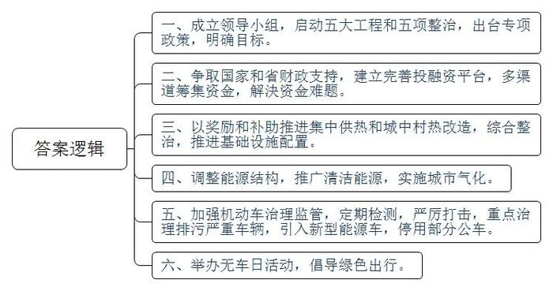
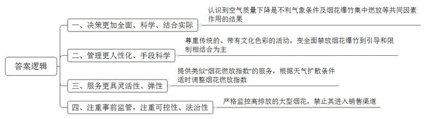
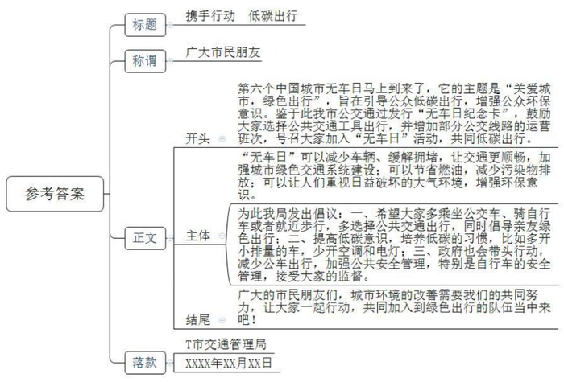
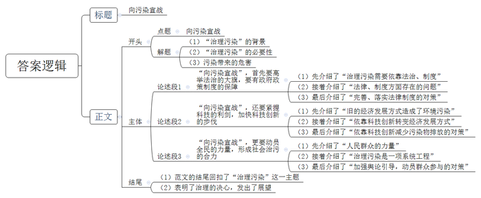

# 2014年山西省、四川省公考《申论》题

<!-- gwy:overview:start -->
> **四川 · 2014 · 申论 · 统考** ｜ 4 题 · 图片 4 处 · 答案随题折叠

导航：[题目](#题目) · [材料 1](#材料-1)
<!-- gwy:overview:end -->

> 候选采集稿。参考答案及解析来自粉笔页面，不代表官方答案或真实高分答卷；来源使用许可与原卷对应关系仍需人工核实。

## 给定材料

### 材料 1

T市是全国老工业城市，长期以来基础设施建设滞后、能源结构单一、环保历史欠账较多，以煤为主的能源结构是T市成为煤烟型污染城市的重要因素。每当冬季采暖期来临，100多个城中村“家家生火、户户冒烟”，已成为制约T市冬季空气质量改善的瓶颈。

为彻底解决这一问题，T市于2012年成立了以市长为组长的全面改善城市环境质量领导小组，并随即启动了“五大工程”（集中供热全覆盖、城市气化工程、城中村整村拆除改造、污染企业搬迁、水污染治理）和“五项整治”（工业污染治理、扬尘污染控制、机动车排气污染防治、商品交易市场和饮食服务行业环境综合整治、垃圾和秸秆焚烧污染控制），财政总投入将超过千亿元。同其他城市一样，T市同样面临着资金短缺的难题，如何解决好这一问题，已成为T市环境质量改善能否实现“一年初见成效、两年明显改善、三年大见成效、四年全面实现”目标的关键。T市一方面积极争取国家和省财政的支持，另一方面多渠道筹措资金，成立T市环保节能投资公司，努力破解环境治理资金难题，建立和完善全面推进城市环境质量改善投融资平台。据业内人士透露，当年该公司已完成融资6亿元。

### 材料 2

2012年10月中旬，T市政府常务会议通过了《关于全面推进城市环境质量改善的若干政策规定》，对集中供热、城中村供热改造、污染企业关停等7种情况予以重奖，补助奖励资金超过12亿元。

根据这一政策，对按期进行采暖锅炉清洁能源供热改造的，将按照供热改造面积进行相应的建设费用补助；对按期完成20万吨以上燃煤锅炉脱硫除尘设施升级改造的，也会予以奖励。在城中村供热改造过程中，对当年10月底前完成整村拆除任务的，每拔掉一根烟囱（拆除一座院落）奖励1万元。这些措施极大地调动了各级政府、企业的积极性。

T市2012年建设的瑞光热电一期等7个热源项目中的3个热源厂已接近尾声，新增供热能力将达2400万平方米，新建热电站175座，是上一年的3倍，供热扩网面积突破2000万平方米。2013年，17个城中村整村拆除面积完成300万平方米，22个城中村供热改造面积完成870万平方米，拔掉城中村黑烟囱1.8万根，同时拆除市区分散燃煤锅炉508台，154台常年运行的燃煤锅炉也完成了清洁能源替代。据测算，这些目标任务完成后，市区内城中村冬季土小锅炉燃煤量削减了50%。

T市M区集中供热涉及17幢楼1700余户居民、供热面积9.6万平方米，需拆除1700台燃煤小锅炉。针对居民多为低收入群体、生活困难的实际情况，M区按照每户居民补贴2000元的标准，安排300万元财政资金，用于当地的二、三次管网建设。此外，把集中供热改造与环境综合整治结合起来，投入400余万元，同步推进建筑整饬、院落硬化、绿化等基础设施配置工作。

“20多年了，因为没有暖气，一到冬天，只能靠蜂窝煤炉取暖，你看，楼道里现在还堆满了往年剩下的蜂窝煤。每年冬天，家里又呛又脏，也不暖和，半夜要起来添火，还得担心煤气中毒。现在可好了，终于能加入集中供热了，以后不必再为取暖犯愁了。”居民们喜上眉梢。其实，受益的不止满洲坟小区，还有老军营小区等13个“困难小区”以及22个“城中村”的居民。

为避免城中村土小锅炉点火给大气环境造成污染，2013年T市环保部门在对22个城中村实施供热改造的基础上，还为57个城中村约两万多台土小锅炉、1400多台分散式燃煤采暖锅炉用户，免费发放点火型煤30万块、点火剂80万袋，总投资超过100多万元。同时，T市还成立了149个清洁点火服务队，免费为锅炉用户进行点火，受到市民欢迎。参加完T市司炉人员免费培训后，尖草坪区的高先生深有感触：“以前都用废机油、旧衣服、废棉纱等生炉子，认为这是点火的好东西。参加完培训才明白，用这些东西点火，会造成严重的污染。”

T市环保部门负责人表示，通过实施城市气化、集中供热和城中村热改造，T市每年可削减煤炭消耗600万吨，减少二氧化硫排放2.8万吨、烟尘3.2万吨，特别是冬季采暖燃煤用量可减少33%，二氧化硫、烟尘排放可分别减少42%和46%。

为根治冬季燃煤污染空气的顽症，2012年T市规定，新建住宅小区必须有热源（即暖气供热点），凡没有热源的，土地、环保部门不予审批，不能开工建设；老旧住宅也将统一标准和有关政策，没有采取集中供热的必须纳入城市供热改造范围。与此同时，全市还将大力调整能源结构，积极推广天然气、煤层气、液化石油气、焦炉煤气等清洁能源，扩大使用范围，提高城市清洁能源的使用比重。凡是清洁能源覆盖的区域，必须关停、取缔燃煤锅炉。

### 材料 3

“虽然大家都知道机动车尾气有污染，但是污染有多重，很多人没有概念。T市的PM10有两成多来自机动车尾气，而PM2.5有三成多来自机动车尾气。”T市机动车与排气污染防治检测中心孙主任介绍。

据T市污染物减排数据显示，2011年T市机动车尾气排放氮氧化物31214吨，碳氢化合物19195吨，一氧化碳160014吨，总颗粒物3787吨。以每节火车皮载重60吨计算，仅2011年全市机动车排出的总颗粒物，就能装63节车皮。机动车排放的氮氧化物、细微颗粒物、硫化物是造成酸雨、雾霾等自然气象甚至灾害的重要原因。

为了整治机动车尾气排放，市委、市政府加大治理监管，采取一系列措施加快治理步伐。2008年3月，T市建立了机动车环保定期检测制度，并于当年修订了《T市机动车污染防治办法》；2011年和2012年，市政府购置了1200辆清洁能源公交车；2012年8月，全市开展严厉打击机动车“冒黑烟”现象。

对于黄标车，2011年Τ市启动了限行工作，2012年开始分步实施黄标车限行措施。其中，对中、重型黄标车和大中型载客黄标车实施限行，全年累计查处违规黄标车2269辆，2012年全市淘汰了黄标车33338辆。尽管如此，Τ市每个工作日机动车增加量仍在350辆左右，而全市黄标车仍有4万多辆，机动车污染防治形势仍然严峻。

2013年，Τ市对2003年以前运营的8637辆黄标车进行强制报废；对1422辆连续5年以上未参加年检的车辆限期检验，逾期强制注销；对2013年年底达到报废期限的10082辆车进行强制报废。到2015年年底，Τ市将全部淘汰黄标柴油通勤车、土方车和载货车辆。对于公交车、出租车、环卫车，Τ市拟加快气化（使用液化气）改造，全部淘汰183台柴油公交车。

同时，Τ市将严厉查处黄标车闯限行和柴油车“冒黑烟”等违法行为。每周两次上路查处“冒黑烟”车辆，对在路面行驶的“冒黑烟”车辆，由环保部门下发限期治理通知书，对逾期未整改的车辆，列入年审黑名单，环保部门和公安部门不予办理年度环检、安检手续。对于外地入境车辆，严禁没有环保标志的车辆进入Τ市，外地牌照黄标车辆不得进入市区行驶。

2013年1月14日，Τ市人民政府办公厅发出了《关于积极应对空气严重污染日的通知》，采取了包括停用机关单位30%公车在内的9条强制措施应对雾霾。经过Τ市政府批准，Τ市公安交通管理局将对停用的公务车辆违规上路进行纠正和查处。

据市交管局介绍，这些停用的公务车辆都是先由市属机关事业单位报到市机关事务管理局，然后再由机关事务管理局进行收集统计，抄送到Τ市交管局，之后他们将把停用的车辆牌码录入监控设备数据库，再由电子眼进行抓拍。如果这些车辆在重污染日上路就会被电子眼拍下来，后面就会有相应的督促和检查措施，比如交管部门会及时通报相关单位并予以曝光，在路面上执勤的民警如果发现违规上路的公务车，也将会对他进行警告和纠正。

据记者了解，14日一天时间，依托数据库录入的信息，T市公安交通管理局一共在市区道路上抓拍到了65辆本应该停用的公务车辆，其中最早一次抓拍记录时间是早晨6点29分。

据统计，在采取了综合整治行动之后，2012年在T市市区煤炭消费总量下降了602万吨，冬季采暖燃煤总量下降了35%，采暖期排放的二氧化碳和烟尘分别下降了33%和37%。采暖期空气污染初步得到遏制。截止2012年12月10日，市区二级以上优良天气达到312天，比上年同期增加11天；大气主要污染物二氧化硫浓度均值比上年同期比下降14.1%；综合污染指数比上年同期下降了5.7%；全市市区空气质量有望达到国家二级标准的目标。T市全面改善城市环境质量“一年初见成效”的目标基本实现，2013年T市将继续推进综合改善城市环境质量工作。

### 材料 4

2013年2月18日，据环境保护部介绍，74个实施空气质量新标准的城市，春节期间（2月9日至15日）平均达标天数比例仅54.7%，超标天数占比45.3%。PM2.5平均超标率为42.7%，最大日均值达426微克/立方米，最大超标4.7倍，74个城市中，空气质量属轻度污染的23.1%，中度污染占10.5%，重度污染占8.8%，严重污染占2.9%。天津、石家庄和T市除夕夜（22时至次日2时）PM2.5的浓度较高，分别为577微克/立方米、527微克/立方米和520微克/立方米。

环保部有关负责人说，春节期间，污染物浓度变化既与烟花爆竹集中燃放有关，也与大气扩散条件密切相关，不利气象条件及烟花爆竹燃放的共同作用，是造成部分空气质量下降的主要原因。

T市公众与环境研究中心马主任表示，在烟花燃放的问题上，确实要控制它的污染，但完全禁放并不是很好的选择，他说，从2012年春节开始，T市第一次有了公开的PM2.5实时浓度的数据。在去年除夕夜，由于碰到扩散不利的气象条件，PM2.5浓度急剧上升，达到一个相当高的程度，因此燃放烟花确实存在污染。但从另外一个方面来讲，燃放烟花毕竟是一个传统的、带有一定文化色彩的活动，且烟花的燃放已经被限制在一个比较短的时段里，它所造成的影响在一年中实际上是有限的，与那些一年365天都在排放的污染相比，并不是减排的重点，所以春节期间的烟花燃放还是应该以引导和限制相结合为主。

“我建议有关部门可以提供一个类似‘烟花燃放指数’的服务，这一做法北京等大城市已经实施”马主任解释说，就是按照天气条件，比如在天气扩散条件有利的情况下，“烟花燃放指数”高一些，比如今年春节，扩散条件就非常好，这种情况下，怎么燃放污染物都不会积累到很高的浓度。如果像去年的情况，扩散条件不利，“烟花燃放指数”就应该低一些。如果是严重的雾霾天气，“烟花燃放指数”就应该非常低，只能允许孩子们放一些小花炮之类的，绝对不能燃放大型的烟花。

“另外一方面，政府应该对一些高排放的大型烟花进行严格监控，不让这些大型的烟花进入销售渠道。”马主任认为，在这个环节，政府是可控的，也是有法规的。他说，这些大型烟花不仅有空气的污染，还有噪音污染，甚至存在对健康的威胁，应该加以制止。

2013年1月29日，新浪网发起了“春节少放炮，文明过大年”的微话题讨论。网友们对于春节是否燃放烟花爆竹发表了自己的看法，新浪微博仅一天的时间，讨论量就达到了800万。多数网友均赞成在春节期间少放或不放烟花，并纷纷表示从自己做起，从身边做起。

### 材料 5

9月22日是“世界无车日”，这一活动的前身是“欧洲无车日”，由欧盟委员会及欧盟的9个成员国于2000年2月确定。这是欧盟首次介入旨在改善城市空气质量、减少城市交通压力和改变城市交通观念的环保活动。

2012年9月22日，是第六个中国城市无车日。2012年我国无车日的主题是“关爱城市，绿色出行”。全国151个城市采取多种方式，引导公众低碳出行，增强公众环保意识。T市公交通行发行“无车日纪念卡”，鼓励人们选择公共交通工具出行，公交公司为此还增加部分公交线路的运营班次。记者随机登上一辆公交车，司机董师傅说，路上的私家车明显少了，平时一趟要跑一个小时，今天只需要一半的时间。

薛先生当天在东大街一家宾馆举行婚礼。前两天得知自己的婚礼日正好是无车日后，他随即就给亲朋好友专门发短信，希望大家尽量不要开车前来。果然，当天的大多数嘉宾都绿色出行，乘坐地铁、公交车或者出租车，大家普遍感觉，当天的车辆少了，交通很顺畅。

住房和城乡建设部某规划师说，连续举办6年的无车日活动，提高了公众低碳出行的环保意识，也让加强绿色交通系统建设成为了不少地方政府的核心价值之一。他还说：根据我们的测算，如果我国机动车停驶一天，能节省燃油上亿升，减少污染物排放可达到14万吨，这也是无车日最直接最明显的效果。

但是也有不同的声音，“少我一个不算少。一天不开车，对环保起不了什么作用，总不能把要办的事给耽搁了，还是少搞些形式主义的东西为好。”

张先生从事交通管理工作，他说：“搞无车日活动，公车应该带头。可我注意到，无车日当天，公车并没有减少的迹象，仍然和往常一样。再说了，鼓励人们骑自行车出行，但一不注意就容易丢失也是个问题，相对而言，汽车丢失的情况远少于自行车。”

倡导无车日，号召人们乘坐公交车、骑自行车或者就近步行，首先是人们对自身生活方式的一种反思。市民王先生说：“大家为了出行方便和提高办事效率而买车，但反倒加重了城市交通压力。常听到车主抱怨堵车严重，影响自己的时间，但他们忘记了自己也是造成堵车、影响城市交通的一员。”

倡导开展无车日的某环保专家认为，“无车日能引起人们重视日益破坏的大气环境就达到目的了。思想上有这根弦，对于个人来说，哪天都可以是无车日，只要那天开车对你来说不是必须的；对于炫富族来说，也不一定非要开着大排量的汽车轰足了油门上街，因为你跟其他人呼吸着同样的空气；倡导低碳生活也不仅限于无车，少用一会儿空调、少开一会儿电灯，都是卓有成效的节能减排措施。”

### 材料 6

2013年11月，我国大部分地区出现大范围雾霾天气，南京、上海以及浙江多地甚至发出橙红色预警。4日南京发布污染红色预警，中小学及幼儿园停课；5日，江浙地区污染过程已持续4天；同日，上海发布橙色预警，据卫生部门介绍，由于雾霾天气直接导致呼吸系统疾病发生率上升，上海市患呼吸道疾病人数比平时增加三成左右，随之而来的直接反应就是口罩和空气净化器的热销，以及旅游人数的锐减。

2014年3月5日，国务院总理李克强在政府工作报告中表示：“我们要像对贫困宣战一样，坚决向污染宣战。”3月27日，李克强总理主持召开国务院常务会议，研究确定今年政府的重点工作。会议决定，在重点地区要有针对性的采取措施，加强对大气、水、土壤等突出污染问题的治理，集中力量打攻坚战，让人民群众看到希望。

在谈到治理污染需要多长时间时，全国政协常委、人口资源环境委员会副主任秦大河说：“如果我说我们要三十年，老百姓会感到很失望；如果我说只要三五年，那是不符合实际的。”

附录：

①PM2.5是指大气中直径小于或等于2.5微米的颗粒物，也称为可入肺颗粒物。PM2.5粗细还不到头发丝的三十分之一，能携带大量有毒有害物质，通过支气管进入人体的肺部，甚至融入到血液之中，引发呼吸系统疾病、心血管疾病，造成肺癌变疾病增加，成为危险身体健康的隐形杀手。

②据《中国科学学报》2013年4月2日报道，3月31日发布的《2010年全球疾病负担评估》称，2010年。PM2.5形式的室外空气污染居全球20个首要至死风险因子第九位，在中国则排第四，位列“饮食结构不合理”“高血压”和“吸烟”之后。该报告由50个国家、303个机构、488名研究人员共同完成，发表于国际权威医学杂志《柳叶刀》。专家组艾伦•科因教授说：“在发展中的亚洲地区，空气污染日益成为肺癌的重要致病因子。2010年，中国20%的肺癌由此引起，虽然亚洲儿童急性下呼吸道感染呈下降态势，但空气污染仍导致此方面的重大负担。”

③《经济日报》2012年12月31日报道，环境保护部日前正式发布《2012年中国机动车污染防治年报》，公布2011年全国机动车污染排放状况。《年报》显示，仅占汽车保有量16.5%的“黄标车”却排放了63.7%的氮氧化物、86.6%的细颗粒物、55.9%的一氧化碳和60.4%的碳氢化合物，而占保有量53.7%的国Ⅲ及以上标准汽车，其排放量还不到排放总量的25.0%。

## 题目

### 第 1 题

**根据给定资料，概括归纳T市治理空气污染的主要做法。（20分）**

关联材料：材料 1、材料 2、材料 3、材料 4、材料 5、材料 6

作答要求：

要求：全面、准确、简洁。不超过200字。

第 1 题 · 答案与解析

**参考答案（粉笔题库参考内容）**

一、成立领导小组，启动五大工程和五项整治，出台专项政策，明确目标。

二、争取国家和省财政支持，建立完善投融资平台，多渠道筹集资金，解决资金难题。

三、以奖励和补助推进集中供热和城中村热改造，综合整治，推进基础设施配置。

四、调整能源结构，推广清洁能源，实施城市气化。

五、加强机动车治理监管，定期检测，严厉打击，重点治理排污严重车辆，引入新型能源车，停用部分公车。

六、举办无车日活动，倡导绿色出行。

**解析**

**参考答案说明：**本参考答案思路上从“成立领导小组”“争取国家和省财政支持”“奖励和补助推进集中供热改造”“调整能源结构”“加强机动车治理监管”“举办无车日活动”等六方面入手，进行相关做法的展开。此外，各条的要点之间是并列关系，内容之间不存在重复、交叉。

**考点**：概括措施类

**来源**：2014年山西省、四川省公考《申论》题

### 第 2 题

**“给定资料**4**”提到了“烟花燃放指数”这一做法。请结合资料内容，分析指出有关部门这一做法在工作思路或管理理念上体现出哪些新的变化。（15分）**

关联材料：材料 4

作答要求：

要求：观点明确、分析深入、条理清楚。不超过250字。

第 2 题 · 答案与解析

**参考答案（粉笔题库参考内容）**

一、决策更加全面、科学、结合实际。认识到空气质量下降是不利气象条件及烟花爆竹集中燃放等共同因素作用的结果。

二、管理更人性化、手段科学。尊重传统的、带有文化色彩的活动，变全面禁放烟花爆竹到引导和限制相结合为主。

三、服务更具灵活性、弹性。提供类似“烟花燃放指数”的服务，根据天气扩散条件适时调整烟花燃放指数。

四、注重事前监管，注重可控性、法治性。严格监控高排放的大型烟花，禁止其进入销售渠道。

**解析**

**参考答案说明**：答案从“决策更加全面、科学、结合实际”“管理更人性化、手段科学”“服务更具灵活性、弹性”“注重事前监管，注重可控性、法治性”这四个方面进行了分条撰写。各条要点之间在内容上是并列关系，没有交叉。并且撰写每条要点时，都提炼出了概括性强的总结词并前置。

**考点**：综合题

**来源**：2014年山西省、四川省公考《申论》题

### 第 3 题

**“给定资料**5**”提到T市开展“城市无车日”活动，请参考给定资料，以该市交通运输部门的名义，围绕宣传“无车日”活动，给广大市民写一封公开信。（25分）**

关联材料：材料 5

作答要求：

要求：

（1）切合题意，具有针对性；

（2）观点明确，内容充实，层次清楚；

（3）格式规范，表达简洁流畅，不超过600字。

第 3 题 · 答案与解析

**参考答案（粉笔题库参考内容）**

携手行动 低碳出行

广大市民朋友：

第六个中国城市无车日马上到来了，它的主题是“关爱城市，绿色出行”，旨在引导公众低碳出行，增强公众环保意识。鉴于此我市公交通过发行“无车日纪念卡”，鼓励大家选择公共交通工具出行，并增加部分公交线路的运营班次，号召大家加入“无车日”活动，共同低碳出行。

“无车日”可以减少车辆、缓解拥堵，让交通更顺畅，加强城市绿色交通系统建设；可以节省燃油，减少污染物排放；可以让人们重视日益破坏的大气环境，增强环保意识。

为此我局发出倡议：一、希望大家多乘坐公交车、骑自行车或者就近步行，多选择公共交通出行，同时倡导亲友绿色出行；二、提高低碳意识，培养低碳的习惯，比如多开小排量的车，少开空调和电灯；三、政府也会带头行动，减少公车出行，加强公共安全管理，特别是自行车的安全管理，接受大家的监督。

广大的市民朋友们，城市环境的改善需要我们的共同努力，让大家一起行动，共同加入到绿色出行的队伍当中来吧！

T市交通管理局

XXXX年XX月XX日

**解析**

**参考答案说明：**（1）格式方面，本参考答案写到了“标题”“称谓”“正文”“落款”四部分。（2）正文部分，从内容来看，围绕着开展“无车日”这一主题，本参考答案的开头先写到了“无车日”活动举办的的背景、目的；主体部分从“无车日活动意义”“无车日活动的具体做法”两方面给出了具体阐述。形式上，本参考答案做到了分段、分条撰写，整体上条理较为清晰。（3）本参考答案能够结合“公开信”特点，在语言表达上做到了简洁、流畅。

**考点**：宣传类

**来源**：2014年山西省、四川省公考《申论》题

### 第 4 题

**请针对“给定资料**6**”划线部分文字进行思考，结合对全部给定资料的理解，以“让人民群众看到希望”为话题，围绕“大气、水、土壤等突出污染问题的治理”写一篇议论文。（40分）**

关联材料：材料 1、材料 2、材料 3、材料 4、材料 5、材料 6

作答要求：

要求：

（1）自拟标题，联系实际；

（2）观点鲜明，论述全面、深入，逻辑结构严谨；

（3）表达简洁，字迹清楚，总字数1000-1200字。

第 4 题 · 答案与解析

**参考答案（粉笔题库参考内容）**

**向污染宣战**

30年前，我们向贫困宣战，吹响了改革开放的号角。30年后，我们解决了温饱问题，人民生活水平大幅提高，小康社会指日可待。但当我们从贫困的枷锁中挣脱出来，准备迎接美好的生活时，猛然发现，天已不再蓝，水也不再清，甚至食品也无法得到安全的保障。

一味追求GDP，牺牲环境换来狂飙突进式的经济增长，在数据狂欢的背后，留给我们的是大自然亮起的红灯。没有良好的生态环境，经济发展将毫无价值，粗放短视的发展模式，民族复兴更是无从谈起。“向污染宣战”，李克强总理的话，再次吹响了号角，这一战，是背水一战。这一战，要让人民看到希望，要让天地换新颜。

**“向污染宣战”，首先要高举法治的大旗，要有政府政策制度的保障。**“法令行则国治，法令弛则国乱”。保护生态环境必须依靠制度、依靠法治。我国虽然从上个世纪80年代就颁布了环境保护的相关法律，但长期以来，环保守法成本高、违法成本低的现状，给了各方以环境换利益的制度漏洞，是造成环境污染积重难返的深层原因。2015年1月1日，号称“史上最严”的新环保法颁布施行，对污染的处罚力度大大加强，政府职责定位也进一步明确，为污染治理提供了坚实的制度保障。而能否顶住压力，保证法之必行、违法必究，则是决定这场战役成败的关键。

**“向污染宣战”，还要紧握科技的利剑，加快科技创新的步伐。**“科技是第一生产力”，粗放的经济发展方式是造成环境污染的罪魁祸首，而转变方式，治理污染，强化科技支撑必不可少。举例而言，大气污染中近60%的有害颗粒物来源于机动车尾气、燃煤和工业排污。因此，如何减少污染物排放，让行政强制措施催生的短暂“APEC蓝”真正成为永久的“中国蓝”，根本上还是要通过科技创新。提高燃煤利用率，发展新能源汽车，开发替代能源等等，都将是环境治理的新课题。

**“向污染宣战”，更要动员全民的力量，形成社会治污的合力。**人民的力量是伟大的，它可以用小车推出一场革命战争的胜利，也可以用双手打赢一场环境保卫战。我国环境治理任务十分艰巨，单靠政府严控，难以达到理想效果。污染治理是“水陆空”三位一体的系统工程，不应是环保部门对环境污染的“单打独斗”，而应是全民参与的“人民战争”，人人喊打。要加强舆论引导，在全社会形成“全民参与环境治理、群防群治污染”的氛围，让每个人不再袖手旁观、拭目以待，而是身体力行，投入到这场战役中去。

“落霞与孤鹜齐飞，秋水共长天一色”，人与自然和谐相处的美景，不能停留在我们的记忆里，更不能停留在子孙后代的书本里。“向污染宣战”，是人性之恶的自我救赎，更是无法推卸的历史使命。我们相信，战胜了贫困的中国人民，也必将打赢污染治理这一场战役，让希望不只是希望。

**文章分析**

**向污染宣战**

【**标题的优点：**首先，范文的标题“向污染宣战”突出了“治理污染”这一主题。其次，形式上采用了拟人的修辞手法，使得标题更加形象生动，有吸引力。】

（1）30年前，我们向贫困宣战，吹响了改革开放的号角。30年后，我们解决了温饱问题，人民生活水平大幅提高，小康社会指日可待。但当我们从贫困的枷锁中挣脱出来，准备迎接美好的生活时，猛然发现，（2）天已不再蓝，水也不再清，甚至食品也无法得到安全的保障。

（3）一味追求GDP，牺牲环境换来狂飙突进式的经济增长，在数据狂欢的背后，留给我们的是大自然亮起的红灯。没有良好的生态环境，经济发展将毫无价值，粗放短视的发展模式，民族复兴更是无从谈起。“向污染宣战”，李克强总理的话，再次吹响了号角，这一战，是背水一战。这一战，要让人民看到希望，要让天地换新颜。

【**开头的优点：**★内容方面：范文的开头是紧扣题目给定的“治理污染”这一主题展开的。首先，**开头点出了主题，做到了主题明确**。其次，**对“**治理污染**”这一主题进行了分析阐述，指出了（****1****）“治理污染”的背景；（****2****）“治理污染”的必要性；（****3****）污染带来的危害。**注意以上三个方面的阐述在逻辑上有先后顺序：先写“治理污染的背景”，再写“治理污染的必要性、紧迫性”，最后提出文章的核心主旨。★文字表达方面：长短句配合使用，使语言表达有节奏感。】

**“****向污染宣战****”****，首先要高举法治的大旗，要有政府政策制度的保障。**“法令行则国治，法令弛则国乱”。（1）保护生态环境必须依靠制度、依靠法治。我国虽然从上个世纪80年代就颁布了环境保护的相关法律，但长期以来，（2）环保守法成本高、违法成本低的现状，给了各方以环境换利益的制度漏洞，是造成环境污染积重难返的深层原因。2015年1月1日，号称“史上最严”的新环保法颁布施行，（3）对污染的处罚力度大大加强，政府职责定位也进一步明确，为污染治理提供了坚实的制度保障。而能否顶住压力，保证法之必行、违法必究，则是决定这场战役成败的关键。

【**论述段****1****的优点：**★观点句：范文的观点句是紧扣“治理污染”这一文章主题提出的。形式上，它在段首处直接写出，位置突出，容易发现。内容上，关键词突出，内容要点明确，可以明显看出它是从“法治、政策制度”入手，指出了“治理污染的对策”。★论述内容：（1）先介绍了“治理污染需要依靠法治、制度”；（2）接着介绍了“法律、制度方面存在的问题”；（3）最后介绍了“完善、落实法律制度的对策”。注意：以上三个方面的内容都是紧扣“‘向污染宣战’，首先要高举法治的大旗，要有政府政策制度的保障”这个观点句进行分析论述的，论述的针对性强，内容层次丰富。最后，在论述方法和论据的选取上做到了讲道理、举例子相结合，做到了丰富多样。】

**“****向污染宣战****”****，还要紧握科技的利剑，加快科技创新的步伐。**“科技是第一生产力”，（1）粗放的经济发展方式是造成环境污染的罪魁祸首，而（2）转变方式，治理污染，强化科技支撑必不可少。举例而言，大气污染中近60%的有害颗粒物来源于机动车尾气、燃煤和工业排污。因此，如何（3）减少污染物排放，让行政强制措施催生的短暂“APEC蓝”真正成为永久的“中国蓝”，根本上还是要通过科技创新。提高燃煤利用率，发展新能源汽车，开发替代能源等等，都将是环境治理的新课题。

【**论述段****2****的优点：**★观点句：范文的观点句是紧扣“治理污染”这一文章主题提出的。形式上，它在段首处直接写出，位置突出，容易发现。内容上，关键词突出，内容要点明确，可以明显看出它是从“科技创新”入手，指出了“治理污染的对策”。★论述内容：（1）先介绍了“旧的经济发展方式造成了环境污染”；（2）接着介绍了“依靠科技创新转变经济发展方式”；（3）最后介绍了“依靠科技创新减少污染物排放的对策”。注意：以上三个方面的内容都是紧扣“‘向污染宣战’，还要紧握科技的利剑，加快科技创新的步伐”这个观点句进行分析论述的，论述的针对性强，内容层次丰富。最后，在论述方法和论据的选取上做到了讲道理、举例子相结合，做到了丰富多样。】

**“****向污染宣战****”****，更要动员全民的力量，形成社会治污的合力。**（1）人民的力量是伟大的，它可以用小车推出一场革命战争的胜利，也可以用双手打赢一场环境保卫战。我国环境治理任务十分艰巨，单靠政府严控，难以达到理想效果。（2）污染治理是“水陆空”三位一体的系统工程，不应是环保部门对环境污染的“单打独斗”，而应是全民参与的“人民战争”，人人喊打。（3）要加强舆论引导，在全社会形成“全民参与环境治理、群防群治污染”的氛围，让每个人不再袖手旁观、拭目以待，而是身体力行，投入到这场战役中去。

【**论述段****3****的优点：**★观点句：范文的观点句是紧扣“治理污染”这一文章主题提出的。形式上，它在段首处直接写出，位置突出，容易发现。内容上，关键词突出，内容要点明确，可以明显看出它是从“动员群众、社会力量”入手，指出了“治理污染的对策”。★论述内容：（1）先介绍了“人民群众的力量”；（2）接着介绍了“治理污染是一项系统工程”；（3）最后介绍了“加强舆论引导，动员群众参与的对策”。注意：以上三个方面的内容都是紧扣“‘向污染宣战’，更要动员全民的力量，形成社会治污的合力”这个观点句进行分析论述的，论述的针对性强，内容层次丰富。最后，在论述方法和论据的选取上以说理为主，做到了分析透彻，鞭辟入里。】

【**论述段之间的关系**：★内容的内在逻辑：范文的论述段之间是依照“并列”的逻辑展开的。论述段1先写了“要高举法治的大旗，要有政府政策制度的保障”，论述段2再写了“要紧握科技的利剑，加快科技创新的步伐”，论述段3接着写了“要动员全民的力量，形成社会治污的合力”。★段与段的外在衔接：论述段2的段首处的过渡句“向污染宣战，还要紧握科技的利剑，加快科技创新的步伐”，起到了承接论述段1、引出了论述段2的作用。论述段3的段首处的过渡句“向污染宣战，更要动员全民的力量，形成社会治污的合力”，起到了承接论述段2、引出了论述段3的作用。】

“落霞与孤鹜齐飞，秋水共长天一色”，人与自然和谐相处的美景，不能停留在我们的记忆里，更不能停留在子孙后代的书本里。（1）“向污染宣战”，是人性之恶的自我救赎，更是无法推卸的历史使命。（2）我们相信，战胜了贫困的中国人民，也必将打赢污染治理这一场战役，让希望不只是希望。

【**结尾的优点**：（1）范文的结尾回扣了“治理污染”这一主题。（2）表明了治理的决心，发出了展望。】

**解析状态：unknown（来源未提供）**

**考点**：文章写作题

**来源**：2014年山西省、四川省公考《申论》题

