# 2014年四川省公务员录用考试《行测》题（下半年）

<!-- gwy:overview:start -->
> **四川 · 2014 · 行测 · 统考** ｜ 100 题 · 图片 16 处 · 答案随题折叠

| 题型模块 | 题量 | 题号 |
| --- | ---: | ---: |
| 常识判断 | 15 | 1–15 |
| 言语理解与表达 | 30 | 16–45 |
| 数量关系 | 10 | 46–55 |
| 判断推理 | 30 | 56–85 |
| 资料分析 | 15 | 86–100 |
| **合计** | **100** | |

导航：[题型与作答说明](#题型与作答说明) · [题目](#题目) · [材料 1](#材料-1)
<!-- gwy:overview:end -->

> 候选采集稿。参考答案及解析来自粉笔页面，不代表官方答案或真实高分答卷；来源使用许可与原卷对应关系仍需人工核实。

## 题型与作答说明

常识判断

（15题）

根据题目要求，在四个选项中选出一个最恰当的答案。

言语理解与表达

（30题）

本部分包括表达与理解两方面的内容。请根据题目要求，在四个选项中选出一个最恰当的答案。

数量关系

（10题）

在这部分试题中，每道题呈现一段表述数字关系的文字，要求你迅速、准确地计算出答案。

判断推理

（30题）

本部分包括图形推理、定义判断、类比推理与逻辑判断四种类型的试题。

资料分析

（15题）

所给出的图、表、文字或综合性资料均有若干个问题要你回答。你应根据资料提供的信息进行分析、比较、计算和判断处理。

## 题目

### 第 1 题

完善公共服务体系，推进基本公共服务均等化，是“十二五”时期保障和改善民生的重要任务。下列属于推进基本公共服务均等化举措的是：

A. 加强农民培训的财政投入，加速培育出一批农村实用人才带头人、农业科技示范户和农民企业家

B. 将小镇和农村地区收取的城市建设维护税优先用于农村人居环境公共设施建设和完善

C. 坚持预防为主、以农村为重点、强化政府责任和投入，完善国民健康政策，鼓励社会参与，努力建设覆盖城乡居民的公共卫生服务体系

D. 根据城镇化过程中乡村人口减少的趋势，优化村镇布局，促进村镇适度集聚

第 1 题 · 答案与解析

**参考答案（粉笔题库参考内容）**

C

**解析**

《国家基本公共服务体系“十二五”规划》指出：“基本公共服务均等化，指全体公民都能公平可及地获得大致均等的基本公共服务，其核心是机会均等，而不是简单的平均化和无差异化。”同时指出：“根据‘十二五’规划纲要，为突出体现‘学有所教、劳有所得、病有所医、老有所养、住有所居’的要求，本规划的范围确定为公共教育 、劳动就业服务、社会保障、基本社会服务、医疗卫生、人口计生、住房保障、公共文化等领域的基本公共服务。 ”B项中“优先用于”与均等化宗旨相违背，A项和D项中内容不属于基本公共服务范畴。因此，只有C项属于推进基本公共服务均等化的举措（“覆盖城乡”体现均等化，且公共卫生属于基本公共服务范畴）。

故正确答案为C。

**考点**：社会建设、重要文件

**来源**：2014年四川省公务员录用考试《行测》题（下半年）第1题

### 第 2 题

关于法律援助，下列说法不正确的是：

A. 需要援助者应向法律援助机构提交书面申请

B. 法律援助的形式为诉讼法律服务，不包括非诉讼法律服务

C. 法院对受援对象减免案件受理费及其他诉讼费

D. 以经济困难者、残疾人、弱者或经人民法院指定的特殊人群为对象

第 2 题 · 答案与解析

**参考答案（粉笔题库参考内容）**

B

**解析**

中国法律援助有以下特征：（1）法律援助是国家的责任、政府的行为，由政府设立援助机构实施。它体现了国家和政府对公民应尽的义务。（2）法律援助是法律化、制度化的行为，是国家社会保障制度中的重要组成部分。（3）受援对象为经济困难者、残疾者、弱者，或者经人民法院指定的特殊对象。（4）法律援助机构对受援对象减免法律服务费，法院对受援对象减、免案件受理费及其他诉讼费用。（5）法律援助的形式，既包括诉讼法律服务，也包括非诉讼法律服务。主要采取以下形式：刑事辩护和刑事代理；民事、行政诉讼代理；非诉讼法律事务代理；公证证明。（6）公民申请法律援助应当采用书面形式，以书面形式提出申请确有困难的，可以口头申请。由分析可看出，A、C、D三项说法均正确，B项说法错误。

本题为选非题，故正确答案为B。

**考点**：其他法律法规

**来源**：2014年四川省公务员录用考试《行测》题（下半年）第2题

### 第 3 题

我国刑法给犯罪嫌疑人定罪的一项基本原则是“罪刑法定”。对法律没有规定的侵犯公共利益的行为，应该：

A. 不定罪

B. 依照习惯定罪

C. 依照法律定罪

D. 依照以往判例定罪

第 3 题 · 答案与解析

**参考答案（粉笔题库参考内容）**

A

**解析**

A项正确，“罪刑法定”原则即法无明文规定不为罪，法无明文规定不处罚，所以对这种刑法没有规定的行为不处罚。

B、C、D三项错误。

故正确答案为A。

**考点**：刑法

**来源**：2014年四川省公务员录用考试《行测》题（下半年）第3题

### 第 4 题

下列与抗日战争相关的事件，按发生时间先后排列的是：

A. 重庆大轰炸 南京大屠杀 湘西会战 鄂西会战

B. 九一八事变 七七事变 百团大战 湘西会战

C. 七七事变 重庆大轰炸 湘西会战 百团大战

D. 重庆大轰炸 七七事变 鄂西会战 湘西会战

第 4 题 · 答案与解析

**参考答案（粉笔题库参考内容）**

B

**解析**

重庆大轰炸的时间为1938年2月18日至1943年8月23日；南京大屠杀的时间为1937年12月13日；湘西会战的时间为1945年；鄂西会战的时间为1943年夏季；九一八事变的时间为1931年9月18日；七七事变的时间为1937年7月7日；百团大战的时间为1940年。按时间顺序排，可知A、C、D三项错误，B项正确。

故正确答案为B。

**考点**：中国历史

**来源**：2014年四川省公务员录用考试《行测》题（下半年）第4题

### 第 5 题

与“东风不与周郎便，铜雀春深锁二乔”提及的战争发生年代最接近的是:

A. 长平之战

B. 牧野之战

C. 淝水之战

D. 官渡之战

第 5 题 · 答案与解析

**参考答案（粉笔题库参考内容）**

D

**解析**

D项正确，题干中的诗句来自杜牧的《赤壁》“折戟沉沙铁未销，自将磨洗认前朝。东风不与周郎便，铜雀春深锁二乔。”杜牧在《赤壁》中借物兴感，评论赤壁之战胜负的诗句是东风不与周郎便，铜雀春深锁二乔。长平之战，发生在战国时期；牧野之战是中国商周之际；淝水之战，发生于公元后383年，是东晋时期；官渡之战，是东汉末年“三大战役”之一，也是中国历史上著名的以少胜多的战役之一。

A、B、C三项错误。

故正确答案为D。

**考点**：中国历史

**来源**：2014年四川省公务员录用考试《行测》题（下半年）第5题

### 第 6 题

“吾爱吾师，吾更爱真理”中的“吾”和“吾师”分别指谁？

A. 吾指亚里士多德，吾师指柏拉图

B. 吾指莫泊桑，吾师指福楼拜

C. 吾指庄子，吾师指老子

D. 吾指颜回，吾师指孔子

第 6 题 · 答案与解析

**参考答案（粉笔题库参考内容）**

A

**解析**

古希腊著名学者亚里士多德在追求真理的过程中，非常勇敢，坚决地批评老师的错误和缺点，被人指责背叛了老师柏拉图。亚里士多德对指责他背叛老师的人，回敬了“吾爱吾师，吾更爱真理”这句话。A项正确，B、C、D三项错误。

故正确答案为A。

**来源**：2014年四川省公务员录用考试《行测》题（下半年）第6题

### 第 7 题

下列各句与“塞翁失马，焉知非福”蕴含哲理相同的是：

A. 尺有所短，寸有所长

B. 乐极生悲，否极泰来

C. 千里之行，始于足下

D. 动中有静，静中有动

第 7 题 · 答案与解析

**参考答案（粉笔题库参考内容）**

B

**解析**

“塞翁失马，焉知非福”说的是在一定的条件下，矛盾双方会相互转化。四个选项中只有“乐极生悲，否极泰来”体现了这一观点；A、C、D三项错误，B项正确。

故正确答案为B。

**考点**：唯物辩证法

**来源**：2014年四川省公务员录用考试《行测》题（下半年）第7题

### 第 8 题

明清两代每两三年在京城举行一次考试，参加考试的是各省举人及国子监监生。这一考试是：

A. 乡试

B. 院试

C. 殿试

D. 会试

第 8 题 · 答案与解析

**参考答案（粉笔题库参考内容）**

D

**解析**

科举制分为四级：院试、乡试、会试、殿试。院试所有人都可参加，考中者称为秀才，可参加乡试；乡试被称为大比之年，考试通过为举人，可参加会试；举人和国子监的监生可以参加会试，会试一般每三年在京城举行一次，考中的取得贡士资格；会试考中的可以参加殿试，由皇帝亲自做主，考中的取得进士资格。A、B、C三项错误，D项正确。

故正确答案为D。

**考点**：中国历史

**来源**：2014年四川省公务员录用考试《行测》题（下半年）第8题

### 第 9 题

下列说法错误的是：

A. 黄梅戏是流行于湖北黄梅的地方戏曲

B. 我国第一部新歌剧是《白毛女》

C. “信天游”流行于陕北一带

D. 京剧已经有200多年历史

第 9 题 · 答案与解析

**参考答案（粉笔题库参考内容）**

A

**解析**

A项错误，黄梅戏是安徽省的主要地方戏曲剧种。黄梅戏是演绎、传播中国传统文化的重要手段。分布地以安庆为中心，遍及中国；B、C、D三项正确。

本题为选非题，故正确答案为A。

**考点**：文化常识

**来源**：2014年四川省公务员录用考试《行测》题（下半年）第9题

### 第 10 题

下列诗句描述的情境，发生在冬季的是：

A. 小荷才露尖尖角，早有蜻蜓立上头

B. 月落乌啼霜满天，江枫渔火对愁眠

C. 无可奈何花落去，似曾相识燕归来

D. 忽如一夜春风来，千树万树梨花开

第 10 题 · 答案与解析

**参考答案（粉笔题库参考内容）**

D

**解析**

A项错误，“小荷才露尖尖角，早有蜻蜓立上头”出自宋朝杨万里的《小池》，描写的是初夏；B项错误，“月落乌啼霜满天，江枫渔火对愁眠”描写的是秋天；C项错误，“无可奈何花落去，似曾相识燕归来”出自北宋词人晏殊的《浣溪沙》，描写的是春夏之交；D项正确，“忽如一夜春风来，千树万树梨花开”描写的是冬季，是唐代岑参的咏雪送人之作。

故正确答案为D。

**考点**：文学常识

**来源**：2014年四川省公务员录用考试《行测》题（下半年）第10题

### 第 11 题

以下有关世界地理表述正确的是：

A. 欧洲和亚洲之间以苏伊士运河为界

B. 澳大利亚是独自占有一个大陆的国家

C. 泰晤士河是瑞士的主要河流

D. 世界上含盐度最高的海是波罗的海

第 11 题 · 答案与解析

**参考答案（粉笔题库参考内容）**

B

**解析**

A项错误，欧洲和亚洲之间以乌拉尔山、乌拉尔河、里海、高加索山脉、黑海、土耳其海峡为分界线；B项正确，澳大利亚是世界土地面积第六大的国家，是世界上唯一一个独占整个大陆的国家,也是大洋洲最大的国家；C项错误，泰晤士河是英国的“母亲河”；D项错误，世界上含盐度最高的海是红海。

故正确答案为B。

**考点**：世界地理

**来源**：2014年四川省公务员录用考试《行测》题（下半年）第11题

### 第 12 题

近年来，我国多座城市遭到暴雨袭击。这些灾害性天气现象与“雨岛效应”有关。“雨岛效应”集中出现在汛期和暴雨之时，易形成大面积积水，甚至形成城市区域性内涝。下列关于“雨岛效应”的成因说法错误的是：

A. 城市热量的超常排放使市区内上升气流加强，有利于云的形成

B. 城市空气中含有较多的凝结核，吸湿性凝结核增多容易成云致雨

C. 城市高楼大厦林立摩擦阻碍作用使云层移速减慢，延长下雨时间

D. 城市绿地和水体增加了空气湿度，有利于低云层在市区上空增多

第 12 题 · 答案与解析

**参考答案（粉笔题库参考内容）**

D

**解析**

城市雨岛形成的条件有：（1）在大气环流较弱，有利于在城区产生降水的大尺度天气形势下，由于城市热岛环流所产生的局地气流的辐合上升，有利于对流雨的发展；（2）城市下垫面粗糙度大，对移动滞缓的降雨系统有阻障效应，使其移速更为缓慢，延长城区降雨时间；（3）城市空气中凝结核多，其化学组成成分不同，粒径大小不一，当有较多核（如硝酸盐类）存在时，有促进暖云降水作用。上述种种因素的影响，会“诱导”暴雨最大强度的落点位于市区及其下风方向形成雨岛。城市绿地面积和水域面积对于农村来说面积较小，D项错误；A、B、C三项正确。

本题为选非题，故正确答案为D。

**考点**：其他

**来源**：2014年四川省公务员录用考试《行测》题（下半年）第12题

### 第 13 题

以下有关动物的说法不正确的是：

A. 珊瑚礁是一种由软体动物组成的动物群

B. 孵化小海龟时的温度决定了它们的性别

C. 现存最原始的哺乳动物鸭嘴兽仅分布于澳大利亚

D. 青蛙和乌龟的体温会随环境的变化而变化

第 13 题 · 答案与解析

**参考答案（粉笔题库参考内容）**

A

**解析**

A项错误，珊瑚礁是石珊瑚目的动物形成的一种结构，在深海和浅海中均有珊瑚礁存在，它们是成千上万的由碳酸钙组成的珊瑚虫的骨骼在数百年至数千年的生长过程中形成的，并不是一种由软体动物组成的动物群；B、C、D三项正确。

本题为选非题，故正确答案为A。

**考点**：生物常识

**来源**：2014年四川省公务员录用考试《行测》题（下半年）第13题

### 第 14 题

下列关于医学常识的说法，错误的是：

A. 站立服药时食道呈现自然垂直状态，有利于药物下行到胃内，便于尽快吸收

B. 服热性药时应配食热性食物，服凉性药时应配食凉性食物，否则影响药效

C. 给伤口消毒用酒精并非纯度越高越好

D. 给病人输氧时，输纯氧效果最好

第 14 题 · 答案与解析

**参考答案（粉笔题库参考内容）**

D

**解析**

D项错误，对于有缺氧症状的人，呼吸纯氧确实起到了治疗作用，如当人出现头昏、眩晕、胸闷、气喘等状况时，可以吸氧以补足氧气。但是，并非所有病人输纯氧都能达到良好效果。人需要一定浓度的二氧化碳来刺激呼吸中枢，若氧气浓度过高，二氧化碳浓度过低，氧气会对呼吸中枢产生抑制作用，引起呼吸衰竭。空气中氮约占78%，氮作为惰性稀释剂，能够调节氧在血液中的溶解度，并和二氧化碳一起控制着氧参与的全部生化反应的速率。这正是大气中氧气、氮气和二氧化碳等各成分含量稳定的巨大意义，所以给病人输氧并不是越纯越好。A、B、C三项正确。

本题为选非题，故正确答案为D。

**考点**：生活常识

**来源**：2014年四川省公务员录用考试《行测》题（下半年）第14题

### 第 15 题

关于奥林匹克运动会，下列说法正确的是：

A. 国际奥委会的总部设在美国纽约

B. 首位夺得奥运会柔道女子冠军的是中国选手

C. 2016年奥运会将在日本东京举办

D. 第一届现代奥运会是在英国伦敦举行的

第 15 题 · 答案与解析

**参考答案（粉笔题库参考内容）**

B

**解析**

A项错误，国际奥委会的总部设在瑞士洛桑；B项正确，首位夺得奥运会柔道女子冠军的是中国选手庄晓岩（在1992年巴塞罗那奥运会获得的）；C项错误，2020年奥运会举办城市才是日本东京；D项错误，第一届现代奥运会是在希腊雅典举行的。

故正确答案为B。

**考点**：生活常识

**来源**：2014年四川省公务员录用考试《行测》题（下半年）第15题

### 第 16 题

如果你的生活中没有伟大、高贵的人和有智慧的人怎么办？请不要变得麻木，不要\_\_\_\_\_\_\_\_\_，不要放弃向生活学习的机会。因为至少在你的周围还有树，特别是大树，它会教会你许多东西。一棵大树，就是你的亲人和老师，而且也可以毫不夸张地说，它就是伟大、高贵和有智慧的人。

填入画横线处最恰当的一项是：

A. 自以为是

B. 茫然失措

C. 随波逐流

D. 自暴自弃

第 16 题 · 答案与解析

**参考答案（粉笔题库参考内容）**

C

**解析**

根据文段“不要变得麻木，不要······，不要放弃向生活学习的机会”可知横线处应该填一个与变得麻木、放弃学习并列的成分。

A项“自以为是”指总以为自己是对的，这与文段的语意明显偏离，排除；

B项“茫然失措”指心中迷惑，不知怎么办才好，本身有麻木之意，对应的正是“不要变得麻木”，排除；

C项“随波逐流”比喻没有坚定的立场，缺乏判断是非的能力，只能随着别人走，能够作为并列成分填入且符合题干语意，当选；

D项“自暴自弃”指自己瞧不起自己，甘于落后或堕落，本身有放弃学习之意，对应的正是“不要放弃向生活学习”，排除。

故正确答案为C。

**考点**：关联关系-并列关系、对应关系-前后呼应、成语填空

**来源**：2014年四川省公务员录用考试《行测》题（下半年）第16题

### 第 17 题

中国制造业超越美国指日可待，中国GDP超越美国也将在这一代中国人的有生之年变为现实。这两个超越凝聚了几代中国人的奋斗，当然意义巨大，但过分陶醉，就会变自信为自大，进而\_\_\_\_\_\_\_。毕竟，物质产出只是硬实力，历史上，船坚炮利的国家甚多，基业常青的却少有，\_\_\_\_\_\_更多在“软”而不在“硬”。

填入横线处恰当的一项是：

A. 妄自尊大 关键

B. 忘乎所以 秘密

C. 目中无人 原因

D. 趾高气扬 秘诀

第 17 题 · 答案与解析

**参考答案（粉笔题库参考内容）**

B

**解析**

第一空与前文的“自大”形成递进关系，B项“忘乎所以”指“由于过度兴奋或骄傲自满而忘记了言行应该把握的分寸”，正好对应前文的“过分陶醉”。第二空更多强调国家基业常青的核心要义所在。

A项，“妄自尊大”指人狂妄地夸大自己，即自大，无法与上文“自大”形成递进关系，排除；

C项，“目中无人”指眼里没有别人，形容骄傲自大，看不起人。文段并没有涉及到他人，排除；

D项，“趾高气扬”是形容骄傲自满，得意忘形的样子。该词作形容词的情况较多，且与前文所提“过分陶醉”带来的后果关系不大，排除。

故正确答案为B。

**考点**：对应关系-前后呼应、混搭填空、词的辨析-程度轻重

**来源**：2014年四川省公务员录用考试《行测》题（下半年）第17题

### 第 18 题

条纹，作为最简洁而又生机勃勃的视觉设计语言，自石器时代起便被广泛运用。彩色条纹依旧不断\_\_\_\_\_\_\_\_\_于当今时装界，新锐设计师们拒绝了浮华，但同样\_\_\_\_\_\_\_\_\_着高调。

A. 流行 维持

B. 活跃 蕴含

C. 风靡 保持

D. 时兴 延续

第 18 题 · 答案与解析

**参考答案（粉笔题库参考内容）**

C

**解析**

本题第二空为突破口，“拒绝了浮华”与“······着高调”结构对应，语意相反。A项“维持”与秩序、生活、现状搭配，另外有保护、维护之意，两种意思都不符合语境，排除；B项“蕴含”着的应当是内敛的，而高调是外显的，二者不能搭配使用，排除。

再观察第一空，文段开头“条纹······自石器时代起便被广泛运用”表明“条纹”一直都很流行。C项“风靡”形容事物很风行，可体现流行之意，符合文意，且“风靡时装界”为固定搭配，当选；D项“时兴”指一时间十分流行，与“不断”矛盾，且“时兴”一词过于口语化，与整个文段的语体风格不太匹配，排除。

故正确答案为C。

**考点**：关联关系-转折关系、实词填空、对应关系-前后呼应、词的辨析-搭配对象

**来源**：2014年四川省公务员录用考试《行测》题（下半年）第18题

### 第 19 题

“凑够一群人就可以走了，和红绿灯无关”，略带自嘲和无奈的“中国式过马路”， \_\_\_\_\_\_\_\_\_着集体漠视规则的人们，\_\_\_\_\_\_\_\_\_了城市交通管理的软肋。

依次填入画横线部分最恰当的一项是：

A. 调侃 戳中

B. 讥讽 击中

C. 嘲弄 戳痛

D. 挖苦 打中

第 19 题 · 答案与解析

**参考答案（粉笔题库参考内容）**

A

**解析**

第一空，“讥讽”和“挖苦”都强调用尖酸、刻薄的语言指责别人。文段引号中的话并无尖酸、刻薄之意，故排除B、D两项；A项“调侃”和C项“嘲弄”的区别在于，“调侃”强调用“诙谐的语言”调笑或嘲弄，文段引号内的话符合这一特征，故A项较为合适。

第二空，所填动词搭配的名词是“软肋”，“戳中软肋”是较为常见的固定搭配。

故正确答案为A。

**考点**：实词填空、词的辨析-搭配对象、词的辨析-程度轻重

**来源**：2014年四川省公务员录用考试《行测》题（下半年）第19题

### 第 20 题

石油峰值论认为，石油产量会达到最高点，之后不可避免地开始下降。石油峰值几乎是确定的事，但仍然存在两个问题：它究竟何时出现？世界是否能够及时研发出替代能源？\_\_\_\_\_\_\_\_\_的观察家并不相信石油峰值会在2020年前出现，但一些石油公司承认他们此前夸大了地下的石油储量。因此，这更引起人们的\_\_\_\_\_\_\_\_\_：我们可能已经过了这个峰值。

A. 激进 争议

B. 理智 恐慌

C. 乐观 担忧

D. 冷静 怀疑

第 20 题 · 答案与解析

**参考答案（粉笔题库参考内容）**

C

**解析**

第一空，文段首句提出石油峰值论，其观点是石油产量会达到最高点，之后不可避免地开始下降。可观察家不相信石油峰值会在2020年前出现，换句话说即为2020年前，石油产量不会达到最高点，因此这一估计显然是乐观的，而不是激进、理智或冷静的。排除A、B、D三项，对应C项。

第二空，以“担忧”做验证。冒号表示解释说明，“我们可能已经过了这个峰值”，意为“之后不可避免地开始下降”，我们对于这一情况应该“担忧”，符合语境。

故正确答案为C。

**考点**：关联关系-因果关系、关联关系-转折关系、实词填空、对应关系-前后呼应、词的辨析-搭配对象

**来源**：2014年四川省公务员录用考试《行测》题（下半年）第20题

### 第 21 题

目前，美国和西方各国深陷2008年以来的世界经济萧条中，复苏＿＿＿＿；另一方面，中国、印度等金砖国家又呈现出经济增速下行的征兆。在此世界经济格局下，重温哈耶克与凯恩斯之间有关货币、利息、信用、资本形成和商业周期发生机理的大论战，重新＿＿＿＿人类进入现代社会后经济危机发生的深层原因和复苏机理，不但具有经济学说史上的理论意义，也显然有着极强的、切实的巨大的当下意义。

填入横线处恰当的一项是：

A. 步履维艰 认识

B. 遥遥无期 反思

C. 进退维谷 探讨

D. 旷日持久 审视

第 21 题 · 答案与解析

**参考答案（粉笔题库参考内容）**

A

**解析**

A项，文段第一空是指美国和西方国家在经济萧条的背景下，复苏之路非常困难。“步履维艰”是指行走困难，行动不便或指创业经营艰辛，其艰辛之意，正好对应文段复苏之难。第二空所填动词宾语为原因和机理，“认识”有认清之意，符合文意，当选；

B项，可以通过第二空排除。“反思”是指从对过去事情的思考中总结经验教训。一般而言对象都是一些错误。文段对象是原因和机理，不符合文意，排除；

C项，“进退维谷”是形容处境艰难，进退两难。而文段探讨的是复苏之难，并非存在进退之意，排除；

D项，“旷日持久”是指耗费时日。文段探讨的是艰难程度，并非时间长短。且该词含贬义，而文段第一空应用中性词，排除。

故正确答案为A。

**考点**：对应关系-前后呼应、混搭填空、词的辨析-搭配对象

**来源**：2014年四川省公务员录用考试《行测》题（下半年）第21题

### 第 22 题

一年以来，欧美国家示威、罢工活动＿＿＿＿＿＿，暴力事件频发，社会乱象＿＿＿＿＿＿，显示出在经济持续不景气的背景下西方发达国家内部矛盾激化，社会危机加剧。

依次填入画横线处最恰当的一项是：

A. 此消彼长 惊心动魄

B. 此起彼伏 层出不穷

C. 愈演愈烈 屡见不鲜

D. 如火如荼 变本加厉

第 22 题 · 答案与解析

**参考答案（粉笔题库参考内容）**

B

**解析**

此题考查成语的基本含义与感情色彩。

第一空所在语句与“暴力事件频发”并列，所填成语应表达“频发”的含义，根据语义可排除A项“此消彼长”。“如火如荼”形容气势旺盛或气氛热烈，为褒义词，与文段的感情色彩不符，故排除D项。

第二空，“屡见不鲜”指经常看到，不觉得新鲜。“层出不穷”指连续不断的出现，没有穷尽。相比而言与“频发”语义对应更密切的应为“层出不穷”，故排除C项。

故正确答案为B。

**考点**：关联关系-并列关系、成语填空、词的辨析-感情色彩

**来源**：2014年四川省公务员录用考试《行测》题（下半年）第22题

### 第 23 题

黄土高原的形成和青藏高原的隆升，\_\_\_\_\_了侵蚀和风化的速度，使得高原周围的低洼地区\_\_\_\_了大量卵石、沙子和更细的颗粒。每当大风骤起，西部地区便\_\_\_\_飞沙走石、尘土弥漫的景象。

依次填入画横线部分最恰当的一项是：

A. 提升 沉淀 产生

B. 加快 堆积 形成

C. 提高 聚集 呈现

D. 加剧 散落 造成

第 23 题 · 答案与解析

**参考答案（粉笔题库参考内容）**

B

**解析**

此题考查实词搭配。第一空与“速度”搭配，“加剧”指使程度变得更为严重，不能搭配，排除D项。

第二空，A项“沉淀”是化学术语，指溶液中难溶解的固体物质从溶液中析出，不能形容大量卵石、沙子、颗粒等，且“沉淀”有凝聚、积累之意，但通常搭配抽象事物，比如说沉淀情感，故搭配不当，排除A项。由横线处与文段“低洼地区”对应可知，“堆积”语意更为合适，排除C项。

接下来验证B项，“加快”了侵蚀和风化的速度，搭配恰当；“形成”飞沙走石、尘土弥漫的景象，语意也通顺。

故正确答案为B。

**考点**：关联关系-因果关系、实词填空、词的辨析-搭配对象

**来源**：2014年四川省公务员录用考试《行测》题（下半年）第23题

### 第 24 题

赵景深在《文心剪影》里说：“他（叶圣陶）的复信措辞谦抑，字迹圆满丰满，正显出他那\_\_\_\_\_\_\_\_\_而又诚实的心。”正如当年他主编《小说月报》曾精心培育了一大批后来成为新文学史上的著名作家时那样。他那\_\_\_\_\_\_\_\_\_的精神和工作态度，给予年轻一代的教育、鼓舞的力量是无法\_\_\_\_\_\_\_\_\_的。

依次填入画横线部分最恰当的一项是：

A. 谦和 公而忘私 估量

B. 谦卑 兢兢业业 估价

C. 率真 孜孜以求 想象

D. 正直 大公无私 衡量

第 24 题 · 答案与解析

**参考答案（粉笔题库参考内容）**

A

**解析**

第一空根据“正显出”，可知前后对应，横线处词语对应前文“复信措辞谦抑”，A项“谦和”、B项“谦卑”均可。C项“率真”、D项“正直”体现不出“谦抑”的意思，排除。

第二空搭配“精神”，A项“公而忘私”、B项“兢兢业业”均可。

第三空搭配“力量”，A项“估量”指估计衡量，搭配合理；B项“估价”指估算价格，与“力量”搭配不当，排除。

故正确答案为A。

**考点**：对应关系-前后呼应、混搭填空、词的辨析-搭配对象

**来源**：2014年四川省公务员录用考试《行测》题（下半年）第24题

### 第 25 题

2012年8月，美国“好奇号”火星车在火星表面着陆，这是人类迄今在其他星球登陆的最精密的移动科学实验室。“好奇号”将测量火星岩石和泥土中不同化学元素的丰富度，\_\_\_\_\_\_\_\_\_火星表面的辐射环境及其对未来登陆火星宇航员的危害，\_\_\_\_\_\_\_\_\_火星是否具有适宜生命存在的环境，\_\_\_\_\_\_\_\_\_行星变化的线索。

A. 评价 找寻 跟踪

B. 判断 考察 挖掘

C. 测算 探究 注意

D. 评估 探索 寻找

第 25 题 · 答案与解析

**参考答案（粉笔题库参考内容）**

D

**解析**

第一空，根据横线后的“及”可知，横线所填词语要与“环境”和“危害”搭配，A项“评价”指评估人、事、物的优劣、善恶美丑、或合不合理等，D项“评估”指评价估量，均与“环境”“危害”搭配恰当，符合文意，保留。B项“判断”常搭配(如品质、行为或人的)程度、力量、价值或性格，C项“测算”指推测计算，均与“环境”搭配不当，排除。

第二空，根据文段内容可知，横线所填词语与“环境”搭配，体现出要进一步确认是否具有生存环境之意。D项“探索”指深入搜寻，符合文意，且与“环境”搭配恰当，保留。A项“找寻”释义为寻找，或故意挑剔，使人难堪，与“环境”搭配不当，排除。

第三空，代入验证，“寻找”填入文段体现出对火星进行勘察，进一步了解，与文意相符，当选。

故正确答案为D。

**考点**：实词填空、对应关系-前后呼应、词的辨析-搭配对象

**来源**：2014年四川省公务员录用考试《行测》题（下半年）第25题

### 第 26 题

层层关卡，没有堵住问题洋奶粉流向市场，这暴露出我国食品安全监管的缺位和割裂。专家认为，食品安全生产和监督都容不得一丁点的侥幸心理。企业、监管部门都应该有“守门”意识，出了问题捂着、掖着，只会带来市场信任和政府公信力的丧失。

这段文字中的“守门”主要是指企业和监管部门应把好什么关：

A. 品牌关

B. 国门关

C. 良心关

D. 质量关

第 26 题 · 答案与解析

**参考答案（粉笔题库参考内容）**

D

**解析**

词语理解必须基于文段内容。文段表达的中心意思是我国食品安全监管的缺位和割裂导致有质量问题的洋奶粉流向市场。对这一问题的解决方式为各部门应加强“守门”意识，意即把好“质量关”。“品牌关”“国门关”文段中都未提及，故排除A、B两项；“良心关”表述过于主观，与文段语义不符，故排除C项。

故正确答案为D。

**考点**：实词

**来源**：2014年四川省公务员录用考试《行测》题（下半年）第26题

### 第 27 题

台湾某著名音乐人士近日用“喂鸡”比喻当下音乐市场中唱片公司的做法，他说：“原本一群鸡要喂鸡饲料才会长大。突然有家唱片公司喂碎报纸，发现有些鸡长得不错，于是其他唱片公司模仿，所有鸡就开始吃碎报纸，以后你喂鸡饲料，它们反而吃不惯了。”

这位音乐人所说的主要意思是：

A. 廉价低劣的音乐只能使听众享受低端的快乐

B. 低劣的音乐作品培养不出具有高品位的听众

C. 音乐市场良莠不齐，消费者应擦亮眼睛，学会选择

D. 唱片公司群起推销低劣的音乐，降低了听众的审美水平

第 27 题 · 答案与解析

**参考答案（粉笔题库参考内容）**

D

**解析**

阅读文段可知，文段以“喂鸡”为隐喻，“鸡”指音乐听众，“鸡饲料”指有品质、有营养，即高品质的音乐作品，“碎报纸”指滥竽充数、低端劣质的音乐作品。本应该喂食“鸡饲料”才能长大，变成喂食“碎报纸”也长得不错，纷纷模仿，最后导致“鸡饲料”反而吃不习惯了，反映的就是唱片公司推销低劣音乐作品，导致听众审美水平的降低，特别是D项中“群起”一词体现出“其他公司纷纷模仿”的状态，为文段中心的最佳同义表述，当选。A、B两项偏离了文段重要主体——唱片公司，排除；文段也不是从消费者角度出发强调消费者该如何选择，而是重点介绍当今唱片市场的不良现象，C项偏离语意重点，排除。

故正确答案为D。

**考点**：关联词-因果

**来源**：2014年四川省公务员录用考试《行测》题（下半年）第27题

### 第 28 题

在使用繁体字的香港和台湾，如今越来越多年轻人的生活方式正日渐西方化；而大陆青少年接触港台的电脑游戏、流行歌曲等现代时尚元素，看到的也多是繁体字，但并未得到传统文化的熏陶。与此相反，不少天天使用简体字的人，照样深得传统文化的熏陶。如果分别阅读用简体字和繁体字书写的同一篇古文、同一首唐诗，文字形式对读者解读作品文化意蕴的影响微乎其微。传统文化也可以以电影、电视等多种方式植根民间思想观念与生活方式当中，不一定要借助繁体字作为媒介。

这段文字意在说明：

A. 简体字不会削弱传统文化的意蕴

B. 简体字代替繁体字确实利大弊小

C. 传承传统文化未必需要借助繁体字

D. 应将传统文化融入现代时尚元素中

第 28 题 · 答案与解析

**参考答案（粉笔题库参考内容）**

C

**解析**

文段首先介绍港台使用繁体字和大陆青少年接触繁体字并未获得其积极影响，紧接着把使用简体字和繁体字进行对比，最后总结传统文化并不一定要借助繁体字作为媒介。文段的主题词实际是“繁体字”而并非“简体字”，排除A、B两项；C项是文段最后一句主旨句的同义替换，当选；D项缺少文段核心话题“繁体字”，且该对策无中生有，排除。

故正确答案为C。

**考点**：主题词、关联词-对策

**来源**：2014年四川省公务员录用考试《行测》题（下半年）第28题

### 第 29 题

2008年冬天，美国有超过三分之一的商业蜂箱出现了蜂群崩溃症候群。某些蜂群中的所有工蜂突然消失或死亡，导致蜂窝中只剩下孤独的蜂王。这种综合症已经传到了欧洲许多国家，如法国、比利时、意大利、葡萄牙和西班牙等。如果没有这些蜜蜂，许多与人类生活密切相关的作物也将无法存在，如大豆、棉花、杏、葡萄、苹果、向日葵等。全球几乎三分之一的食物都与蜜蜂的行为有关。如果它们灭绝，随之而来的将是食物紧缺、饥饿、暴力和骚乱等严重社会问题。

下列无法从原文推出的是：

A. 蜂王比工蜂对蜂群崩溃症候群有更强的抵抗力

B. 美国的蜂群崩溃症候群早于欧洲

C. 蜂群崩溃症候群会导致严重的社会问题

D. 缺乏食物是工蜂消失的主要原因

第 29 题 · 答案与解析

**参考答案（粉笔题库参考内容）**

D

**解析**

细节判断题须将选项与文段内容一一对应。D项“缺乏食物”这一原因在原文中无从体现。A项可从“某些蜂群中的所有工蜂突然消失或死亡，导致蜂窝中只剩下孤独的蜂王”一句中得出；B项可从“这种综合症已经传到了欧洲许多国家”得出美国比欧洲出现的早；C项可从“如果它们灭绝，随之而来······社会问题”这一假设句中推出。

本题为选非题，故正确答案为D。

**考点**：细节判断题

**来源**：2014年四川省公务员录用考试《行测》题（下半年）第29题

### 第 30 题

在中国，中秋节是仅次于春节的重要节日，这是因为人们在农耕文化发展过程中，认识到季节的重要性，故很早就有春天祭日、秋天祭月的习俗。古人发现 “月到中秋分外明”，所以在公元 1 世纪后从祭月、拜月发展到赏月，但未固定在哪一天。8世纪后中秋节成型，八月十五在秋季正中，故称中秋。此时正是桂花飘香之际，人们面对人间桂，联想月中桂，于是在赏月、拜月之外又添了赏桂的习俗。最迟在9世纪，吃月饼的中秋习俗已经出现。

这段文字意在说明：

A. 中秋节有哪些习俗

B. 中秋节的形成过程

C. 古人重视中秋节的原因

D. 农耕文化对中秋习俗的影响

第 30 题 · 答案与解析

**参考答案（粉笔题库参考内容）**

A

**解析**

文段开始以中秋节作为切入口，之后通过“故”“所以”“于是”等词引导结论，指出中秋节的不同习俗，指出这些习俗的发展过程，由此可见文段的主题词应当是“中秋节习俗”，对应A项。

B项：是迷惑选项，中秋节本身非重点，文段并非强调中秋节的形成过程，而是中秋节的习俗，如果想选B，答案应改为“中秋节习俗的形成过程”，排除。

C、D两项并非文段强调的重点，排除。

故正确答案为A。

**考点**：关联词-并列

**来源**：2014年四川省公务员录用考试《行测》题（下半年）第30题

### 第 31 题

超级火山的爆发强度将超过人类历史上任何一次火山爆发。研究人员相信，当岩浆升到地壳中后又无法突破时，就有可能爆发超级火山。压力下产生这种结果，可能意味着当岩浆最终爆发冲出时，某广阔区域内的某一点将被完全毁灭。世界末日论认为，这种事件将喷发出数百万吨重的残骸，并向大气中释放大量有毒气体，让整个世界陷入所谓的“核冬天”。最糟糕的是，它可能将部分地区的生命，甚至整个地球的生命都消灭干净。

这段文字主要揭示的是：

A. 超级火山造成的危害

B. 超级火山爆发的原因

C. 地球生命面临的威胁

D. 世界末日论的基本观点

第 31 题 · 答案与解析

**参考答案（粉笔题库参考内容）**

A

**解析**

首先判断整个文段紧紧围绕主题词“超级火山”展开，故可以直接排除 C、D 两项。文段开始虽然介绍了超级火山爆发的原因，但更为重要的，也是着墨更多的部分在于揭示超级火山可能造成的危害。

故正确答案为A。

**考点**：主题词、分述句特征-其他

**来源**：2014年四川省公务员录用考试《行测》题（下半年）第31题

### 第 32 题

在人类寻求安定的社会秩序的过程中，法律始终只是一种实现路径，并不是所有的社会关系都能依靠法律有效调整，也并不是所有的立法都能解决现实中的复杂问题。轻视立法固然不可取，但把眼界过于集中在立法的书面活动上，动辄呼吁加强规则制定，也未必是一种追求法治的理性态度。

根据这段文字，作者批判的是什么观点或态度：

A. 重立法而轻执法

B. 重法治而轻道德

C. 社会问题应当通过立法解决

D. 完善的法律体系是法治的前提

第 32 题 · 答案与解析

**参考答案（粉笔题库参考内容）**

C

**解析**

文段提到“法律始终只是······，并不是······，也并不是······”说明立法并不能解决所有现实问题。根据后文“动辄呼吁加强规则制定，也未必是······”可见作者反对的是凡事都诉诸立法解决问题。

A项，文段并没有提到执法情况，“轻执法”属无中生有，排除；B项，文段并没有提到道德情况，“轻道德”属无中生有，排除；C项，即作者所批判的凡事都诉诸立法解决，与题干论述一致，当选；D项，文段并非侧重法律体系是否完善健全，偏离文段主旨，排除。

故正确答案为C。

**考点**：关联词-转折

**来源**：2014年四川省公务员录用考试《行测》题（下半年）第32题

### 第 33 题

我们常说：无知者无畏。这是一种贬义的说法。但是，有时候，正是由于不知道面临着怎样的境况，我们才会无畏地去面对生活，也相信自己能够克服任何困难。但是，一旦我们清楚地看到了自己的处境，我们反而会被自己的心灵限制住，而无法成功战胜那些本来可以克服的困难。任何时候，都不要被自己内心的恐惧震慑，这才是我们成功的开始。

下列说法与这段文字不相符的是：

A. 无知者未必无畏

B. 恐惧来自我们的内心

C. 清楚自己的处境不一定是好事

D. 战胜内心恐惧才可能取得成功

第 33 题 · 答案与解析

**参考答案（粉笔题库参考内容）**

A

**解析**

细节判断题须将选项中的细节与文段一一对应，亦需要对文段整体内容进行把握。

A项说法错误，这一文段为“无知者无畏”这一贬义说法正名，重点论述了“无知者无畏”有其积极合理的一面，因此A项意思是“不知道就可能会害怕”，表述与文段中心思想相反，与文意不符，当选；

B项说法正确，由“我们反而会被自己的心灵限制住”“任何时候，都不要被自己内心的恐惧震慑”可知，恐惧来自我们的内心，排除；

C项说法正确，可由“一旦我们清楚地看到了自己的处境，我们反而会被自己的心灵限制住，而无法成功战胜那些本来可以克服的困难”一句推出，排除；

D项说法正确，由“任何时候，都不要被自己内心的恐惧震慑，这才是我们成功的开始”一句可知，排除。

本题为选非题，故正确答案为A。

**考点**：细节判断题

**来源**：2014年四川省公务员录用考试《行测》题（下半年）第33题

### 第 34 题

有关发展的早期文献几乎都认定，发展中国家由于贫穷无力建立社会保障制度。这一论断，在很大程度上成为众多发展中国家在普及社会医疗保险方面无所作为的理由。时至今日，在绝大多数发展中国家，占人口大多数的非正规就业者及其家庭成员一般都被排斥在保险计划之外。然而事实证明，即使是最穷的国家，也能通过对本国人口中的脆弱群体提供公共支持而创造出丰富多样的社会保障形式来。

这段文字的主旨是:

A. 社会保障制度与经济社会发展阶段有关

B. 发展中国家的社会保障制度很不健全

C. 弱势群体应是发展中国家社会保障制度关注的重点

D. 贫穷不能成为发展中国家对社会保障无所作为的理由

第 34 题 · 答案与解析

**参考答案（粉笔题库参考内容）**

D

**解析**

前面的内容都是在描述很多发展中国家对于社会保障制度的建设很不力。最后一句话“然而”表转折，转折之后是重点，即为文段主旨句。

A项：对应转折之前的内容，并非文段重点，排除。

B项：对应转折之前的内容，仅仅描述存在的这种现象，排除。

C项：“弱势群体应是重点”文段未提及，无中生有，排除。

D项：贫穷不是理由，即是对文段最后一句的同义转换，当选。

故正确答案为D。

**考点**：关联词-转折

**来源**：2014年四川省公务员录用考试《行测》题（下半年）第34题

### 第 35 题

研究人员利用微小海洋生物的化石来重建自最后一个冰河时代结束至今的全球气温。数据显示，地球在数千年中持续降温，然后在20世纪出现前所未有的逆转。这进一步表明现代的全球变暖并非自然形成，而是二氧化碳排放不断增加的结果。海洋化石数据显示，1900年至1910年是过去11300年以来最冷的十年之一，比其他95%的年份都要冷。不过该研究指出，100年后的2000年至2010年是最暖和的十年之一。全球气温记录只能追溯到1880年，2000年至2010年是此间气温最高的十年。

下列表述与原文不相符的是：

A. 二氧化碳排放需积累到一定程度才会导致温室效应

B. 利用化石重建的全球气温时间跨度远超已有的气温记录

C. 工业革命后的相当一段时间内，二氧化碳排放增多，全球气温仍持续走低

D. 研究人员重建的2000年至2010年气温与全球气温记录有出入

第 35 题 · 答案与解析

**参考答案（粉笔题库参考内容）**

D

**解析**

D项，文段中提到重建气温和记录气温中2000年至2010年都是温度最高的十年，因此没有出入，与文段不相符，当选；

A项由原文中“地球在数千年中持续降温，然后在20世纪出现前所未有的逆转。这进一步表明现代的全球变暖并非自然形成，而是二氧化碳排放不断增加的结果”可以得出，可知二氧化碳排放必须积累到一定程度，才能使温度升高，故A项与文意相符，排除；

B项由文段“研究人员利用微小海洋生物的化石来重建自最后一个冰河时代结束至今的全球气温”以及“全球气温记录只能追溯到1880年，2000年至2010年是此间气温最高的十年。”可知B项符合文意，排除；

C项，由文中“数据显示，地球在数千年中持续降温，然后在20世纪出现前所未有的逆转”，可知C项亦符合文意，排除。

本题为选非题，故正确答案为D。

**考点**：细节判断题

**来源**：2014年四川省公务员录用考试《行测》题（下半年）第35题

### 第 36 题

中国国家药物管理部门规定，药品的化学名和通用名由国家药典和药品管理部门制定，但商品名由厂家制定。正是这后一项规定，给许多药品的改名和多名创造了条件。在我国，近几年具有多种名称的常用药品有200多种，其中有4个药名的占20%，5个药名的占25%，6个药名的占25%，7个药名的占15%，还有15%的药有10个以上的名称，有的药有20多个名称，最多的有40多个名称。所有这些具有多种名称的药都是名符其实的“换汤不换药”，基本内容不变，只是包装或个别成分改变，疗效则完全一致。

这段文字意在说明：

A. 药品的商品名可由厂家自行决定

B. 一药多名的现象在我国非常普遍

C. 我国的常用药品都具有多种商品名

D. 具有多种名称的药，其疗效完全一致

第 36 题 · 答案与解析

**参考答案（粉笔题库参考内容）**

B

**解析**

文段先指出“国家药物管理部门规定······药品的商品名由厂家制定”，这一规定直接导致了现在药品改名现象十分普遍，接着以数据作举例论证，论证前面的这一核心观点，最后一句指出具有多种名称的药品“换汤不换药”，即实质内容不变，换包装但疗效一致，实则也是在说明同一种药效的药，药名却五花八门。所以能够看出文段意在强调药品改名现象十分普遍这一问题，对应B项。

A项：只是药物管理部门规定内容，不是文段重点，排除；

C项：表述过于绝对化，排除；

D项：为文段最后一句的内容，并非整个文段强调的重点，文段实际上是借最后一句来说明现在有很多药效一样的药却有很多不同的名称，借此来强调一药多名的问题，排除。

故正确答案为B。

**考点**：分述句特征-数据资料

**来源**：2014年四川省公务员录用考试《行测》题（下半年）第36题

### 第 37 题

私募的“钱途”在于退出。私募基金有一个好退路，才能安分守己。眼下，中国本土有130亿私募等待退出。一般情况下，IPO（公开募股）是私募退出的最佳选择。由于上市退出回报率最高，私募自然会将IPO奉为神灵。从政府角度，可以通过适当降低上市标准，改审核制为注册制等方式降低IPO门槛，还可以通过大力培育和发展产权交易市场，实现私募资金的退出。

这段文字旨在说明:

A. 政府应完善私募基金的退出机制

B. 私募基金的退出是当前亟待解决的问题

C. IPO（公开募股）是私募退出的首要选择

D. 大力培育和发展产权交易市场是私募退出的途径

第 37 题 · 答案与解析

**参考答案（粉笔题库参考内容）**

A

**解析**

文段首先指出私募的“钱途”在于退出，中国本土有私募基金等待退出，接着指出IPO是私募退出的最佳选择，后文从政府的角度提出对策，故文段重在强调对策，对应A项。

B项为文段中问题的表述，文段已经针对问题提出了对策，非重点，排除；C项“IPO”非重点，文段重点强调政府对于私募基金退出的作用，排除；D项仅是对策中的一部分，表述片面，排除。

故正确答案为A。

**考点**：关联词-因果、关联词-对策

**来源**：2014年四川省公务员录用考试《行测》题（下半年）第37题

### 第 38 题

钱钟书绝对不敢以大师自居。他从不侧身大师之列。他不开宗立派，不传授弟子。《谈艺录》和《管锥编》是他的读书心得，供会心的读者阅读欣赏。他偶尔听到入耳的称许，会惊喜又惊奇。

这段文字以“钱钟书绝对不敢以大师自居”起笔，旨在说明钱钟书:

A. 孤芳自赏

B. 不拘小节

C. 特立独行

D. 标新立异

第 38 题 · 答案与解析

**参考答案（粉笔题库参考内容）**

C

**解析**

首先辨析选项中成语的基本含义。A项错误，“孤芳自赏”意指自认为是独放的香花而自我欣赏，比喻自命清高。语义偏贬，与文段中对钱钟书先生的褒扬之意不符，故排除；B项错误，“不拘小节”意为不为生活中的小事情所约束；现多指不注意生活中的小事情，文段中并未提及小事，“不开宗立派”“不传授弟子”都不可称之为小事，故亦可排除；C项正确，“特立独行”指立身行事不同于常人，总是显得很独特；泛指与众不同，亦形容人志向高洁，不同流俗，词义为褒扬。文段中提到钱钟书先生学术造诣很高却不以大师自居，低调行事，恰好体现其与他人的不同之处及其高洁的品格，与文意相符；D项错误，“标新立异”指提出新颖奇特的见解、主张，借以显示与众不同。文段中钱钟书先生并未提出新的观点，也并不是为了显示自己的与众不同，故排除。

故正确答案为C。

**考点**：句子

**来源**：2014年四川省公务员录用考试《行测》题（下半年）第38题

### 第 39 题

一位搏击高手参加比赛，自负地以为一定可以夺得冠军，却不料在决赛中遇到一个实力相当的对手。搏击高手发觉，自己竟然找不到对方的破绽。他觉得很羞耻，愤愤不平地回去找到师父，央求师父找出对手的破绽。师父笑而不语，在地上画了一道线，要他在不擦掉这条线的前提下，设法让这条线变短。搏击高手苦思不解，请教师父。师父在原先那条线的旁边，又画了一道更长的线，师父说：“\_\_\_\_\_\_\_\_\_\_\_\_\_\_\_\_\_\_\_\_\_。”

填入画横线部分最恰当的一句是：

A. 短兵相接，智者为王

B. 狭路相逢，勇者必胜

C. 知己知彼，百战不殆

D. 勤学苦练，敌弱我强

第 39 题 · 答案与解析

**参考答案（粉笔题库参考内容）**

D

**解析**

此填入语句位于文段结尾，实为对文段所表达道理的概括总结。文段以画线长短隐喻搏击高手与对手的实力对比。在不擦掉这条线的前提下，让这条线变短的方法，只能是再画一条更长的线；其引申的内涵即为只有通过勤学苦练，提高自身实力，才能够比对方更强，即以更强的实力对比出对手的弱小。D项表述与文段中心相符，当选。A项强调“智慧”，B项强调“勇敢”，C项强调“了解对方”，都与文意无关，排除。

故正确答案为D。

**考点**：横线在结尾

**来源**：2014年四川省公务员录用考试《行测》题（下半年）第39题

### 第 40 题

在当前社会，人与人之间的激烈竞争在所难免，但不少人因为得失心较重，做事时不惜违反公德伦理和规则秩序，最后不仅很难占到便宜，有时反而会害了自己。随着制度越来越健全，太重得失而逾规的行为只能是搬起石头砸自己的脚。比如，运动员们每日辛苦训练就是为了在比赛中获得奖牌。当他们盼望已久的比赛来临时，有些运动员会特别紧张，甚至有意无意地去做一些违规的事情。

这段文字意在说明：

A. 不能因为太重得失而做违规的事

B. 健全的比赛规则有助于公平竞争

C. 保持良好心态才可能取得好成绩

D. 运动员应该树立正确的竞争观念

第 40 题 · 答案与解析

**参考答案（粉笔题库参考内容）**

A

**解析**

第一句话作为铺垫，引出得失心较重这一现象，第二句话是总句，说得失心太重反而会搬起石头砸自己的脚，第三句话“比如”是举例子。

A项对应文段主旨句，即不要得失心太重，当选；B项文段并非强调比赛规则健全的重要性，排除；C项保持良好的心态取得好成绩仅仅是作为例子成分，非文段重点，排除；D项以运动员作为例子进行论证，不是强调的重点，排除。

故正确答案为A。

**考点**：分述句特征-举例子

**来源**：2014年四川省公务员录用考试《行测》题（下半年）第40题

### 第 41 题

生物多样性是生态系统稳定性的基本保障，这是充满生命的地球的基本特征，也是人类赖以生存的无价之宝。但是，人类活动正在以惊人的速度减少生物多样性。20世纪以来，平均每天有一个物种灭绝，而进入90年代，科学家们估计每天灭绝140个物种，因而全世界有10%的高等植物和3/4的鸟类的生存受到威胁，全球270种龟类爬行动物中的42%、150种灵长目中的2/3濒临灭绝。

这段文字意在强调（    ）。

A. 多样的地球生物的种类正呈锐减趋势

B. 生物多样性是人类赖以生存的基础

C. 人类活动对地球生态系统产生严重影响

D. 如何保护地球生物多样性

第 41 题 · 答案与解析

**参考答案（粉笔题库参考内容）**

C

**解析**

本题属于中心理解题。文段首先指出生物多样性的重要作用；第二句通过“但是”进行转折，指出人类活动对生物多样性的影响，是文段的中心句；最后列举了一些数字来证明人类活动对生物多样性的影响。所以文段的中心句是第二句。结合选项，C项是文段中心句的同义转换，当选。

A项，未体现出人类的影响，概括不全面，故排除；

B项，表述的是转折之前的内容，非文段重点，故排除；

D项，文段只说明人类活动对生物多样性、对生态系统的影响，未涉及解决问题的对策，无法从文中得出，故排除。

故正确答案为C。

【文段出处】《生物多样性：地球的生命之网》

**考点**：关联词-转折

**来源**：2014年四川省公务员录用考试《行测》题（下半年）第41题

### 第 42 题

\_\_\_\_\_\_\_\_\_\_\_\_\_\_\_\_\_\_\_\_。比如工业化的历史，就包含了很多内容，首先是现代生产发展所引起的物质财富的快速增长，由此，我们当然对工业化持积极的态度。但另一方面，从生态环境角度看，随着工业化的推进，大量资源被消耗，很多地方被污染，生态破坏对人类造成的危害会长期存在。这样，工业化在不同时间段内呈现两种形象，短时间内我们享受了生活，但从长时段来看，我们可能牺牲了未来。

填入画横线部分最恰当的一句是：

A. 我们用多重的时间来理解和评判历史，就会出现与过去不同的认识

B. 历史是分层的，长时段的历史决定了其他时段历史的变化

C. 当我们利用线性的时间将历史事件串联在一起时，就呈现出一种因果关系

D. 我们研究历史时难免会有局限性，经常受时间因素的影响

第 42 题 · 答案与解析

**参考答案（粉笔题库参考内容）**

A

**解析**

横线处所填语句为整个文段的总起句，文段给出内容均为对空格所填语句的具体阐述。文段首先论述了工业化有积极的一面，然后转折之后说工业化的发展可能会带来危害，尾句用“这样”指代总结前文，指出从不同的时间段出发看待同一问题，会得出不同的认识，对应A项。

B项：文段未论述长时段的历史会决定其他时段历史的变化，故与文意不符，排除。

C项：“当我们利用线性的时间将历史事件串联在一起时，就呈现出一种因果关系”中因果关系在后文无从体现，排除。

D项：文段着重强调从不同的角度看待历史会有不同的结论，并未提及是受“时间因素”影响，与后文核心话题衔接不一致，排除。

故正确答案为A。

**考点**：横线在开头

**来源**：2014年四川省公务员录用考试《行测》题（下半年）第42题

### 第 43 题

常常被感动而充满激情的人是有福的。我或许属于其中之一。故我想，感动是由于我深爱着世上一切美好的事物，甚至比别人更留意也更钟情于它们。而这些美好的事物也仿佛是我的朋友和亲人，也同样爱着、留意着、钟情着我。每一次小小的感动都会洗净我灵魂中某个小小的斑点和污渍，每一次深深的感动都有可能斩断我性情中某一段深深的劣根。日复一日，年复一年，感动使我的内心变得清洁、明亮、丰富而又宽敞，使我在面对每一轮崭新的日出时都能赢得一个全新的自我。

这段文字主要告诉我们：

A. 人应该有不断完善自我的意识

B. 充满爱的人才有可能获得幸福

C. 提升人格境界需要持之以恒

D. 人应该对美好事物充满感情

第 43 题 · 答案与解析

**参考答案（粉笔题库参考内容）**

D

**解析**

文段开篇表明常常被感动的人有福，接着阐述自己因深爱世上美好事物而常被感动，且这些美好事物也钟情于自己，随后说明感动能洗净灵魂污渍、斩断性情劣根，最后强调感动使内心变得更好。故文段重点讨论人应该对美好事物充满感情，这样会带来诸多积极影响，对应D项。

A项，“不断完善自我”无中生有，排除；

B项，“充满爱的人才有可能获得幸福”表述不准确，文段强调对美好事物充满感情带来的积极改变，而非仅关于获得幸福，排除；

C项，“持之以恒”并非文段重点，文段重点是对美好事物充满感情，排除。

故正确答案为D。

**考点**：分述句特征-其他

**来源**：2014年四川省公务员录用考试《行测》题（下半年）第43题

### 第 44 题

①“国家战略”一词，最早出自美国

②最近几年，由于国家领导人以及社会各界的倡导，全民阅读问题已经引起广泛的重视

③中国学术界对“国家战略”一词尚无统一定义

④我国先后提出知识产权国家战略，能源问题国家战略等，但遗憾的是一直没有把全民阅读作为国家战略

⑤其任务是依据国际国内情况，综合运用政治、军事、经济、科技、文化等国家力量，筹划指导国家建设与发展、维护国家安全，达成国家目标

⑥一般认为，它是指导国家各个领域的总方略

将以上6个句子重新排列，语序正确的是：

A. ①⑥⑤③④②

B. ①③⑥⑤④②

C. ③⑥①⑤②④

D. ③①⑥⑤④②

第 44 题 · 答案与解析

**参考答案（粉笔题库参考内容）**

B

**解析**

对比选项，确定首句。①句介绍“国家战略”一词的起源；③句论述我国学术界对该词汇没有统一界定。按照行文逻辑，应先交代词语来源，再阐述国内定义情况，因此①句更适合作为首句，排除C、D两项。

观察A、B两项，区别在于③句与⑥⑤两句的先后顺序。③句提出国内暂无统一定义，后文应紧跟通用定义展开说明。⑥句以“一般认为”引出“国家战略”通用内涵，⑤句“其任务”承接⑥句的“它”，对定义展开细化说明，③⑥⑤三句话题衔接紧密，可构成捆绑，对应B项。A项将③句放在⑥⑤之后，先完整解释概念再说无统一界定，逻辑割裂，无法衔接，排除A项。

故正确答案为B。

**考点**：确定捆绑、确定顺序

**来源**：2014年四川省公务员录用考试《行测》题（下半年）第44题

### 第 45 题

①大自然是个有机整体

②只要其中一个要素发生变化，就会引起其他要素的相应变化

③地理环境各个要素之间存在着相互联系、相互影响、相互渗透、相互制约的依存关系

④一个环节紧扣着另一个环节，一个过程向另一个过程转化

⑤并直接或间接地影响到人类的生存和发展

⑥最后必然会导致整个地理环境由量变发展到质变

将以上6个句子重新排列，语序正确的是：

A. ③①②④⑤⑥

B. ①②④⑥⑤③

C. ①③②④⑥⑤

D. ③①②⑥⑤④

第 45 题 · 答案与解析

**参考答案（粉笔题库参考内容）**

C

**解析**

首先，从选项判断首句。①、③两句对比，①句的主体词是大自然，并强调其为有机整体；③句强调环境各要素之间的依存关系，恰好是对有机整体的进一步解释说明。因此可以判断①为首句，且①、③两句关系密切，成为一个集团。然后，继续以“要素”这一共同信息，判断出③与②这一集团。最后，⑥和⑤以“并”这一关联词连接“导致”和“影响”两个引导结果的尾句常见词，可判断这一集团位于段尾。

故正确答案为C。

**考点**：确定尾句、确定顺序

**来源**：2014年四川省公务员录用考试《行测》题（下半年）第45题

### 第 46 题

商店促销某种商品，一次购买不超过10件，每件5元；超过10件，超过部分每件3元。甲、乙两人分别购买此种商品，甲比乙多付19元，则甲、乙共买了多少件：

A. 22

B. 21

C. 20

D. 19

第 46 题 · 答案与解析

**参考答案（粉笔题库参考内容）**

B

**解析**

此类题型应该分类讨论：

一、若甲、乙两人购买商品的件数均少于10件，则甲比乙多付的钱应该是5的倍数，不符合题意。

二、若甲、乙两人购买商品的件数均多于或等于10件，则甲比乙多付的钱应该是3的倍数，不符合题意。

三、若甲购买商品的件数多于10件，乙购买商品的件数少于10件时，由于甲比乙多付19元，可知乙只能为8件，甲只能为13件时才符合题意。

因此甲、乙共购买13+8=21件。

故正确答案为B。

**考点**：分段计算问题

**来源**：2014年四川省公务员录用考试《行测》题（下半年）第46题

### 第 47 题

将7个大小相同的桔子分给4个小朋友，要求每个小朋友至少得到1个桔子，一共有几种分配方法：

A. 14

B. 18

C. 20

D. 22

第 47 题 · 答案与解析

**参考答案（粉笔题库参考内容）**

C

**解析**

此题为同素分堆问题，可利用插板法快速求解。要将7个相同的桔子分给4个人，且每人至少一个，只需在7个桔子中的6个空隙中插入三个隔板。又隔板和隔板之间没有顺序之分，故有C_6^3=20种分配方法。

故正确答案为C。

**考点**：同素分堆问题

**来源**：2014年四川省公务员录用考试《行测》题（下半年）第47题

### 第 48 题

用篱笆围成一个面积为625平方米的正方形菜园，现用总长度为100米的篱笆将菜园分隔成面积相同的小菜园，问最多能分成多少个小菜园：

A. 9

B. 12

C. 5

D. 8

第 48 题 · 答案与解析

**参考答案（粉笔题库参考内容）**

A

**解析**

由题干条件“正方形菜园的面积为625平方米”可知，正方形菜园的边长为25米。要使分隔成的小菜园数量最多且面积相同，则应让篱笆分割的线条尽可能与菜园边长相等。100米的篱笆可分割成4条25米的短篱笆，分别横、竖平均分割在正方形菜园上，可分割成3×3=9个小菜园。

如图所示：

故正确答案为A。

**考点**：几何公式类-平面图形

**来源**：2014年四川省公务员录用考试《行测》题（下半年）第48题

### 第 49 题

某办公室5人中有2人精通德语。如从中任意选出3人，其中恰有1人精通德语的概率是多少：

A. 0.5

B. 0.6

C. 0.7

D. 0.75

第 49 题 · 答案与解析

**参考答案（粉笔题库参考内容）**

B

**解析**

从办公室5人中任意选出3人，则共有C_5^3种组合方式；而选出的3人中恰有1人精通德语，则应从2个精通德语的人中选出1个，从剩下的3人中选出2个，则有C_2^1×C_3^2种组合方式。故选出的3人中，恰有1人精通德语的概率为：(C_2^1 × C_3^2)/C_5^3 = 0.6。

故正确答案为B。

**考点**：给情况求概率

**来源**：2014年四川省公务员录用考试《行测》题（下半年）第49题

### 第 50 题

如图ABCD是一个梯形，E是AD的中点，直线CE把梯形分成甲、乙两部分，其面积之比是15∶7。问上底AB与下底CD的长度之比是：

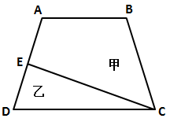

A. 5∶7

B. 6∶7

C. 4∶7

D. 3∶7

第 50 题 · 答案与解析

**参考答案（粉笔题库参考内容）**

C

**解析**

如图所示，连接AC，因为E为AD中点，所以△ACE与△CED等底同高面积相等。设△CDE面积为7，故△ACE的面积也为7，则△ABC的面积为8，△ACD的面积为14。在△ABC与△ACD中，二者的高相等，则其底边AB、CD长度与其面积成正比，即8∶14=4∶7。

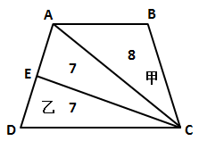

故正确答案为C。

**考点**：几何公式类-平面图形、几何结论类-三角形相关

**来源**：2014年四川省公务员录用考试《行测》题（下半年）第50题

### 第 51 题

两个半径不同的圆柱形玻璃杯内盛有一定量的水，甲杯的水位比乙杯高5厘米。甲杯底部沉没着一个石块，当石块被取出并放进乙杯沉没后，乙杯的水位上升了5厘米，并且比这时甲的水位还高10厘米，则可得知甲杯与乙杯底面积之比为：

A. 3∶2

B. 1∶2

C. 2∶3

D. 3∶5

第 51 题 · 答案与解析

**参考答案（粉笔题库参考内容）**

B

**解析**

石块未取出前，甲杯的水位比乙杯高5厘米；当石块被取出放进乙杯后，乙杯的水位上升了5厘米，而此时乙杯的水位比甲高10厘米。可知整个过程甲杯的水位下降了10厘米。甲杯下降的10厘米高度的体积，与乙杯上涨的5厘米高度的体积，均为石块的体积，故其底面积之比应为二者体积上涨高度的反比，为5∶10，即1∶2。

故正确答案为B。

**考点**：几何公式类-立体图形

**来源**：2014年四川省公务员录用考试《行测》题（下半年）第51题

### 第 52 题

A、B、C、D四个工程队修建一条马路，A、B合作可用8天完成，A、C或B、D合作可用7天完成，问C、D合作能比A、B合作提前多少天完成：

A. 16/9

B. 15/8

C. 7/4

D. 2

第 52 题 · 答案与解析

**参考答案（粉笔题库参考内容）**

A

**解析**

赋值总工程量为7与8的最小公倍数56，则A与B的工作效率之和为7，A与C的工作效率之和为8，B与D的工作效率之和为8，四个工程队的工作效率总和为16。通过列式可表示为：A+B=7；A+C=8；B+D=8；A+B+C+D=16。则C与D的效率之和为（A＋B＋C＋D）-（A＋B）＝16－7＝9，则C、D合作需要56/9 天。故C、D合作能比A、B合作提前8－56/9＝16/9天完成。

故正确答案为A。

**考点**：给完工时间型

**来源**：2014年四川省公务员录用考试《行测》题（下半年）第52题

### 第 53 题

一辆车从甲地开往乙地，如果提速20%，可以比原定时间提前1小时到达，如果以原速行驶120千米后，再将速度提高25%，则可提前40分钟到达。问甲乙两地相距多少千米：

A. 300

B. 270

C. 250

D. 240

第 53 题 · 答案与解析

**参考答案（粉笔题库参考内容）**

B

**解析**

第一种情况：如果提速20%，可以比原定时间提前1小时到达。可知，提速前后速度之比为5∶6，当路程相同时，时间与速度成反比，则时间之比为6∶5。刚好提前1小时，即原计划6个小时到达；第二种情况：如果以原速行驶120千米后，再将速度提高25%，则可提前40分钟到达。提高速度后，速度之比为4∶5，则在提速后所走的路程内，时间之比为5∶4，节省了1份等于40分钟，则原计划5×40分钟=200分钟=10/3小时到达。故前120千米用时8/3小时，则全程路程=120÷8/3×6=270千米。

故正确答案为B。

**考点**：普通行程

**来源**：2014年四川省公务员录用考试《行测》题（下半年）第53题

### 第 54 题

张先生在某个闰年中的生日是某个月的第四个也是最后一个星期五，他生日的前一个和后一个月正好也只有4个星期五。问当年的六一儿童节是星期几：

A. 星期一

B. 星期三

C. 星期五

D. 星期日

第 54 题 · 答案与解析

**参考答案（粉笔题库参考内容）**

A

**解析**

根据题意可知连续三个月只有12个星期五。若连续三个月达到91天，必然有91/7=13周，即有13个星期五，因此这连续三个月天数小于91天，所以只可能是2、3、4月(29+31+30=90天)。又因为90÷7 = 12余6，而前12周一定有12个星期五，所以后面6天一定不含星期五，即后面6天只能是星期六、星期日、星期一······星期四。综上所述得第90天是4月30日星期四，5月1日星期五，由此推断出6月1日为星期一。

故正确答案为A。

**考点**：周期余数问题、星期日期问题

**来源**：2014年四川省公务员录用考试《行测》题（下半年）第54题

### 第 55 题

公司举办的内部业务知识竞赛有若干人参加，所有参赛者获得的名次之和为300，且所有人没有并列名次。其中，销售部门、售后服务部门和技术部门参赛者获得的名次平均数分别为11.3、10.4和9.2，问其他部门获得的名次最高为多少：

A. 16

B. 18

C. 20

D. 21

第 55 题 · 答案与解析

**参考答案（粉笔题库参考内容）**

C

**解析**

设参加比赛的人数为x，则根据条件“所有参赛者获得的名次之和为300”可得x(x + 1) ÷ 2 = 300，解得x=24。因“三个部门的人数均为整数”且小于24，则销售部门的人数只能为10人，售后服务部门和技术部门均有5人。则其他部门获得的名次之和为：300 - 11.3 × 10 - 10.4 × 5−9.2 × 5 = 89；人数还剩：24-10-5-5=4人。要让其他部门的其中一人名次最高，则应让其他人尽可能的低，其他3人最低可为24、23、22，则名次最高可为：89-24-23-22=20。

故正确答案为C。

**考点**：构造数列

**来源**：2014年四川省公务员录用考试《行测》题（下半年）第55题

### 第 56 题

从所给的四个选项中，选择最合适的一个填入问号处，使之呈现一定的规律性：

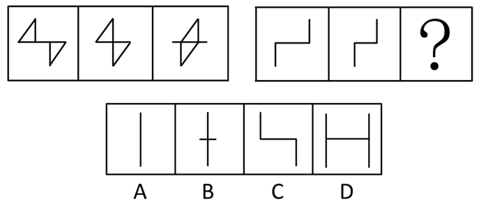

A. A

B. B

C. C

D. D

第 56 题 · 答案与解析

**参考答案（粉笔题库参考内容）**

B

**解析**

观察第一组图形中三个小图形的关系发现，第一个小图形的两个小三角形往中间平移得到第二个小图形，第二个小图形的两个三角形往中间平移得到了第三个小图形，且图形两端均多出了一点线段。则右图中第二个图形两条线段也应当向中间平移且平移后如左图一样两端应多出一点线段，只有B项符合此规律。

故正确答案为B。

**考点**：位置规律-平移

**来源**：2014年四川省公务员录用考试《行测》题（下半年）第56题

### 第 57 题

从所给的四个选项中，选择最合适的一个填入问号处，使之呈现一定的规律性：

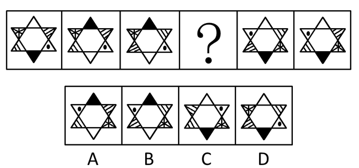

A. A

B. B

C. C

D. D

第 57 题 · 答案与解析

**参考答案（粉笔题库参考内容）**

B

**解析**

图形元素组成相同，优先考虑位置规律。观察发现，图1和图2中对角的两个三角形发生了互换，其他不变；图2和图3，图5和图6依然是对角的两个三角形发生了互换，其他不变；那么由此可知，图3和图4，图4和图5也应该是对角的两个三角形发生了互换，其他不变，排除A、C两项。继续观察发现，两个小三角形按照顺时针顺序进行互换，排除D项。

故正确答案为B。

**考点**：位置规律-平移

**来源**：2014年四川省公务员录用考试《行测》题（下半年）第57题

### 第 58 题

从所给的四个选项中，选择最合适的一个填入问号处，使之呈现一定的规律性：

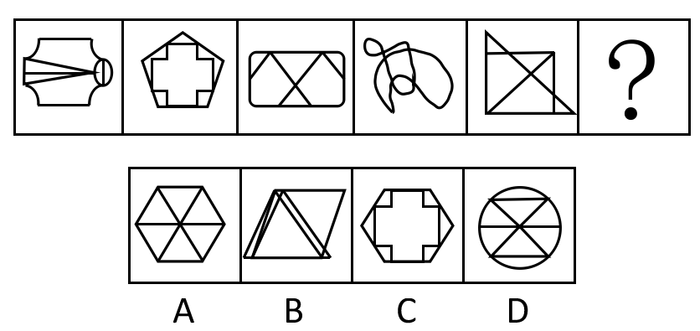

A. A

B. B

C. C

D. D

第 58 题 · 答案与解析

**参考答案（粉笔题库参考内容）**

A

**解析**

元素组成不同，且无明显属性规律，考虑数量规律。观察发现，题干图形均出现明显封闭区域，考虑面数量。题干图形的面数量均为6，故？处图形的面数量应为6，只有A项符合。

故正确答案为A。

**考点**：数量规律-面

**来源**：2014年四川省公务员录用考试《行测》题（下半年）第58题

### 第 59 题

从所给的四个选项中，选择最合适的一个填入问号处，使之呈现一定的规律性：

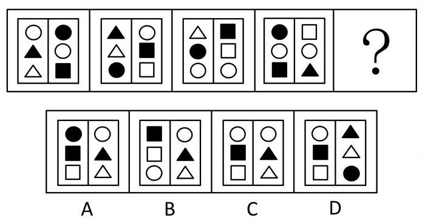

A. A

B. B

C. C

D. D

第 59 题 · 答案与解析

**参考答案（粉笔题库参考内容）**

C

**解析**

元素组成基本相同，优先考虑位置规律。观察发现，图形中每个元素都按照下图中“S型”的规律依次向上平移一个单位，且开头的小元素消失了，而在最后添加了一个新的小元素。分析选项可知，只有C项符合规律。

故正确答案为C。

**考点**：位置规律-平移

**来源**：2014年四川省公务员录用考试《行测》题（下半年）第59题

### 第 60 题

左边给定的是纸盒的外表面，下面哪一项能由它折叠而成？

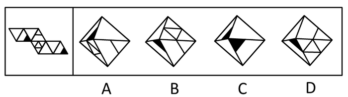

A. A

B. B

C. C

D. D

第 60 题 · 答案与解析

**参考答案（粉笔题库参考内容）**

A

**解析**

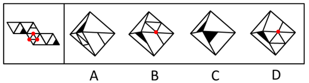

如图所示，图中的小三角形的三个顶点都没有与其他面内的单一直线连接，B、D两项当中的小三角形其中一个顶点都与其他面内的单一直线连接，与展开图不符，排除；已知图中两个黑色三角形顶点不能相连，排除C项，只有A项符合。

故正确答案为A。

**来源**：2014年四川省公务员录用考试《行测》题（下半年）第60题

### 第 61 题

以下哪一个图形是由左边的四个图形不经旋转、翻转直接拼接而成的？

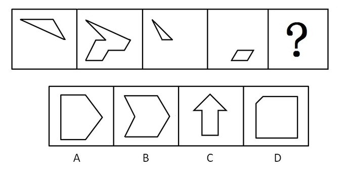

A. A

B. B

C. C

D. D

第 61 题 · 答案与解析

**参考答案（粉笔题库参考内容）**

B

**解析**

图一拼在图二的右上方，图三拼在图二的左上方，图四拼在图二的右下方，会得到B项的图形，因此，B项正确。

故正确答案为B。

**来源**：2014年四川省公务员录用考试《行测》题（下半年）第61题

### 第 62 题

环境保护的经济政策是指运用税收、信贷、财政补贴、收费等各种有效经济手段引导和促进环境保护的政策。根据上述定义，下列不属于环境保护的经济政策是：

A. 某环保设备制造园规定了允许进入园区的企业注册资金的最低额度

B. 某省通过交通税费的征收和管理，发展有益于环境保护的交通方式

C. 某国鼓励和支持各类金融机构增加对资源综合利用企业的信贷投入

D. 某企业由于污染未达标，而被环保部门取消了当年申请环保专项资金的资格

第 62 题 · 答案与解析

**参考答案（粉笔题库参考内容）**

A

**解析**

第一步：找出定义关键词。

关键词为“运用税收、信贷、财政补贴、收费等各种有效经济手段”、“引导和促进环境保护”。

第二步：逐一分析选项。

A项：该项中只是规定了允许进入园区的企业注册资金的最低额度，不符合“运用税收、信贷、财政补贴、收费等各种有效经济手段”，也没有体现出“引导和促进环境保护”，不符合定义，当选；

B项：属于运用税收手段引导和促进环境保护，符合定义，排除；

C项：属于运用信贷手段引导和促进环境保护，符合定义，排除；

D项：属于运用政府补贴手段引导和促进环境保护，符合定义，排除。

本题为选非题，故正确答案为A。

**考点**：方式目的

**来源**：2014年四川省公务员录用考试《行测》题（下半年）第62题

### 第 63 题

有意想象是指事先预定目的的想象，可分为再造想象和创造想象。前者指根据别人的描述或图样，在头脑中形成新形象的过程；后者指不根据现成的描述，而在大脑中独立地产生新形象的过程。

根据上述定义，下列属于创造想象的是：

A. 老刘故地重游时脑海里浮现了一些往事

B. 公安人员根据受害人的描述画出犯罪嫌疑人的肖像

C. 人们在听评书《三国演义》时仿佛身临其境来到了古战场

D. 小明在他创作的科幻小说中描绘了未来人类在月球上的生活图景

第 63 题 · 答案与解析

**参考答案（粉笔题库参考内容）**

D

**解析**

第一步：关键词查找。

本题关键词有：（1）不根据现成的描述；（2）在大脑中独立产生新形象。

第二步：逐一分析选项。

A项中的老刘故地重游、B项中根据受害人的描述画肖像、C项听评书想象古战场都是属于现成的描述，不符合定义，均排除；D项符合独立产生新形象的过程，当选。

故正确答案为D。

**考点**：常规问法

**来源**：2014年四川省公务员录用考试《行测》题（下半年）第63题

### 第 64 题

系谱是指根据各类生物间的进化历程和亲缘关系的远近而编制的生物变化系统。根据上述定义，下列属于系谱的是：

A. 有一种观点认为，人类起源于非洲，并逐步迁徙到世界各地

B. 李氏家族的家谱中详细记录了家族五百年来的发展和变迁

C. 在自然界中，人类与各种动物相互依存，一旦失去平衡，灾难就会接踵而至

D. 鱼类进化到两栖类，从中分化出哺乳类和鸟类，哺乳类中的一支发展成为高等智慧动物

第 64 题 · 答案与解析

**参考答案（粉笔题库参考内容）**

D

**解析**

第一步：关键词查找。本题关键词为：（1）生物间的进化历程；（2）亲缘关系；（3）生物变化系统。

第二步：逐一分析选项。A项的观点并没有体现出生物间的进化过程，迁徙不能算是一种生物间进化过程，排除；B项中的族谱只是记录一个家族的人和事，也没有体现出生物间的进化过程，因此，不符合定义，排除；C项，说的是人和动物间的依存关系，非亲缘关系，不符合定义，排除；D项，从鱼演化到两栖动物，然后分化成哺乳动物和鸟类，哺乳类的一支发展为高等智慧动物，符合定义，当选。

故正确答案为D。

**考点**：单定义-其他句式

**来源**：2014年四川省公务员录用考试《行测》题（下半年）第64题

### 第 65 题

延伸产品是指顾客购买产品时，附带获得的各种利益的总和，包括产品说明书、保证、安装、维修、送货、技术培训等。

根据上述定义，下列涉及延伸产品的是：

A. 某电器经销商承诺，顾客购买本店任何电器，都能享受九折优惠

B. 某品牌服饰店进行促销活动，购买本店服饰满300元减100元

C. 某汽车经销商为吸引顾客，承诺本店售出的汽车可享受三年质保

D. 某游戏公司在推出一款游戏后，又及时推出了升级版以满足用户需求

第 65 题 · 答案与解析

**参考答案（粉笔题库参考内容）**

C

**解析**

第一步：关键词查找。本题关键词为：购买产品时附带获得的各种利益总和。

第二步：逐一分析选项。A、B两项属于促销活动，不符合定义，可排除；D项属于新推出的升级产品，不是附带获得的利益，不符合定义，可排除；C项的质保属于维修范畴，是附带的利益，符合定义。

故正确答案为C。

**考点**：单定义-其他句式

**来源**：2014年四川省公务员录用考试《行测》题（下半年）第65题

### 第 66 题

利他惩罚是指人们不惜牺牲自己的利益去惩罚违反社会准则的人。第三方惩罚是利他惩罚的一种，第三方虽然没有受到违规行为的直接损害，却愿意付出代价来惩罚违反社会准则的人。

根据上述定义，下列属于第三方惩罚的是：

A. 得道多助，失道寡助

B. 人若犯我，我必犯人

C. 以牙还牙，以眼还眼

D. 路见不平，拔刀相助

第 66 题 · 答案与解析

**参考答案（粉笔题库参考内容）**

D

**解析**

第一步：关键词查找。

第三方惩罚的定义条件包括：“第三方没有受到违规行为的直接损害”“愿意付出代价”“惩罚违反社会准则的人”。

第二步：逐一分析选项。

A项，主体为当事人自身，而不是第三方，且不存在违反社会准则之说，不符合定义，排除；

B、C两项，主体为当事人自身，而不是第三方，不符合定义，均排除；

D项，主体为事件的第三方，没有受到直接损害且愿意付出代价帮助别人以惩罚违反社会准则的人，符合定义，当选。

故正确答案为D。

**考点**：常规问法

**来源**：2014年四川省公务员录用考试《行测》题（下半年）第66题

### 第 67 题

大众传播是指专业化的媒介组织通过一定的传播媒介，在接受国家管理下，对受众进行大规模的信息传播活动。根据上述定义，下列不属于大众传播的是：

A. 某报刊登了某传染病的最新传播情况

B. 某电台开通了法制热线，接受听众的咨询

C. 某市政府网站开办市民专栏，就民生问题回答市民的提问

D. 某新闻频道对国家领导人的外事活动进行了直播

第 67 题 · 答案与解析

**参考答案（粉笔题库参考内容）**

C

**解析**

第一步：关键词查找。本题关键词为：（1）专业化的媒介组织；（2）通过一定媒介；（3）“接受国家管理”。

第二步：逐一分析选项。A、B、D三项中的报刊、电台、新闻频道都属于是专业化的媒介组织进行的传播活动，符合定义；C项，某市政府网站不属于专业化的媒介组织，因此，不符合定义，当选。

本题为选非题，故正确答案为C。

**考点**：主客体

**来源**：2014年四川省公务员录用考试《行测》题（下半年）第67题

### 第 68 题

二难推理是由两个假言判断和一个选言判断作前提构成的推理。假言判断是断定一个事物情况的存在（称为前件）是另一个事物情况存在（称为后件）的条件判断。选言判断是断定在几种可能情况下，至少有一种情况存在的判断。二难推理是通过运用选言判断来肯定或否定假言判断，从而来肯定或否定假言判断的后件或前件存在或不存在的一种推理形式。

根据上述定义，下列不属于二难推理的是：

A. 如果刺激老虎，它是要吃人的；如果不刺激它，它也是要吃人的；或是刺激它，或是不刺激它，所以老虎总是要吃人的

B. 如果张三是杀人犯，那么他有作案时间；如果张三是杀人犯，那么他有作案动机；张三或者没有作案时间，或者没有作案动机，所以他不是杀人犯

C. 如果今天下午下大雨，那么操场就要积水；如果操场积水，那么球赛就要延期；所以，如果今天球赛不延期，那么今天下午没有下大雨

D. 如果打人的行为触犯了法律，那么要受到法律处罚；如果打人的行为没有触犯法律，也要受到社会舆论的谴责；打人的行为或是触犯了法律，或者没有触犯法律，所以或是要受到法律处罚，或者要受到社会舆论的谴责

第 68 题 · 答案与解析

**参考答案（粉笔题库参考内容）**

C

**解析**

第一步：关键词查找。

本题关键词为：（1）两个假言判断；（2）一个选言判断；（3）运用选言判断来肯定或否定假言判断。

第二步：逐一分析选项。

A、B、D三项都是两个“如果”（假言判断）加一个“或者”（选言判断）来肯定或否定假言判断的，符合定义；C项是通过两个“如果”（假言判断）来得到另一个假言判断，不符合定义。

本题为选非题，故正确答案为C。

**考点**：主客体

**来源**：2014年四川省公务员录用考试《行测》题（下半年）第68题

### 第 69 题

政府向社会组织购买服务，是通行于国际社会的一种新型的公共服务供给方式，其具体做法是政府引入市场机制，把直接向社会公众提供的一部分公共服务和社会管理事项，按照一定的方式与程序，交由具备条件的社会组织承担，并根据服务数量和质量向社会组织支付费用。

根据上述定义，下列属于政府向社会组织购买服务做法的是：

A. 某市交管部门为方便市民出行，租用电信公司的短信平台定期给市民发送提醒短信

B. 某街道面向辖区招募志愿者，以协助当地司法机关承担社区内服刑人员的社区矫正服务工作

C. 国家为保护农民利益和种粮积极性，委托中储粮总公司作为托市收购政策的执行主体，组织国有粮库对稻农实行敞开收购

D. 某市教委建立特级教师在线回答中小学生学习问题的公益网站受到了学生和家长的好评，一家教育机构出资帮助扩大这个网站的规模，以帮助更多的学生

第 69 题 · 答案与解析

**参考答案（粉笔题库参考内容）**

A

**解析**

第一步：关键词查找。本题关键词：（1）政府引入市场机制；（2）把公共服务和社会事项交由社会组织承担；（3）根据情况支付费用。第二步：逐一分析选项。A项是政府通过向电信公司付费的方式为市民做事，符合定义的三个关键信息；B项，某街道招募志愿者，不符合关键词（3）；C项，委托不属于购买，不符合关键词（3）；D项，一家教育机构出资，不属于政府购买，不符合关键词（1）。

故正确答案为A。

**考点**：方式目的

**来源**：2014年四川省公务员录用考试《行测》题（下半年）第69题

### 第 70 题

涵化是指不同文化的群体间发生持续的接触，从而导致原有文化发生变迁的现象。

根据上述定义，下列不属于涵化的是：

A. 在20世纪，牛仔裤成为了风靡世界的时尚穿着

B. 历史上英国曾将其法治文化和政治体系推行到自己的殖民地

C. 近年来，越来越多的外国人对中国文化感兴趣，纷纷来中国学习汉语

D. 由于英国曾长期受罗马帝国的统治及罗马天主教的影响，英语词汇中出现了大量拉丁语词

第 70 题 · 答案与解析

**参考答案（粉笔题库参考内容）**

C

**解析**

第一步：找出定义关键词。

（1）不同文化接触；（2）原有文化变迁。

第二步：逐一分析选项。

A项：牛仔裤风靡世界，体现了“不同文化的群体间发生持续的接触”，曾经不穿牛仔裤的地区会发生“原有文化变迁”，符合定义，排除；

B项：英国将其法治文化和政治体系推行到自己的殖民地，体现了“不同文化的群体间发生持续的接触”，殖民地的文化需要接受统治者文化的渗透，导致殖民地的“原有文化发生变迁”，符合定义，排除；

C项：外国人来中国学习汉语，体现了“不同文化的群体间发生持续的接触”，但是并没有体现“原有文化发生变迁”，不符合定义，当选；

D项：英国受罗马帝国的统治及罗马天主教的影响，体现了“不同文化的群体间发生持续的接触”，英语词汇中出现大量拉丁语词，体现了“原有文化发生变迁”，符合定义，排除。

本题为选非题，故正确答案为C。

**考点**：原因结果

**来源**：2014年四川省公务员录用考试《行测》题（下半年）第70题

### 第 71 题

行政诉讼是指公民、法人或其他组织认为行政机关或法律、法规授权的组织的行政行为侵犯其合法权益时，依法向人民法院起诉，人民法院通过对被诉行政行为的合法性进行审查，从而解决特定范围内行政争议活动。行政诉讼第三人，指同提起诉讼的行政行为有利害关系，因而参加到他人正在进行的行政诉讼中的公民、法人和其他组织。根据上述定义，下列对行政诉讼第三人的判断正确的是（    ）。

A. 甲为了躲避乙而将丙碰伤，丙将甲告上法庭，则乙为行政诉讼第三人

B. 某交警队因违法行政而成为被告，则该交警队队长为行政诉讼第三人

C. 某饭店对卫生局的处罚决定不服提起诉讼，则饭店老板为行政诉讼第三人

D. 甲将乙打伤，但甲对公安局的处罚决定不服提起诉讼，则乙为行政诉讼第三人

第 71 题 · 答案与解析

**参考答案（粉笔题库参考内容）**

D

**解析**

第一步：找出定义关键词。

客体：行政机关或法律、法规授权的组织的行政行为；原因：同提起诉讼的行政行为有利害关系，因而参加到他人正在进行的行政诉讼。

第二步：逐一分析选项。

A项，被告人甲的行为不属于行政机关或法律、法规授权的组织的行政行为，不符合定义，排除；

B项，交警队的队长为交警队的实际负责人，是诉讼的直接参与人，而并非因有利害关系而参与，不符合定义，排除；

C项，饭店老板为饭店的法人，是诉讼的原告，而非有利害关系而参与，不符合定义，排除；

D项，乙同提起诉讼的公安局的行政行为有利害关系，因而参与到甲提起的行政诉讼之中，符合定义，当选。

故正确答案为D。

**考点**：常规问法

**来源**：2014年四川省公务员录用考试《行测》题（下半年）第71题

### 第 72 题

报警：救援

A. 毕业：就业

B. 违章：罚款

C. 手术：住院

D. 消费：生产

第 72 题 · 答案与解析

**参考答案（粉笔题库参考内容）**

B

**解析**

第一步：判断题干词语间逻辑关系。

报警之后被救援，两者构成时间先后的对应关系，且报警和救援的主体不一致。

第二步：判断选项词语间逻辑关系。

A项，毕业之后就业，两者构成时间先后的对应关系，但两者主体一致，与题干逻辑关系不一致，排除；

B项，违章之后被罚款，两者构成时间先后的对应关系，且违章和罚款的主体不一致，与题干逻辑关系一致，当选；

C项，手术和住院之间没有明显时间先后的对应关系，与题干逻辑关系不一致，排除；

D项，消费在生产之后，与题干逻辑关系不一致，排除。

故正确答案为B。

**考点**：逻辑关系-对应关系

**来源**：2014年四川省公务员录用考试《行测》题（下半年）第72题

### 第 73 题

经济特区：珠海

A. 乐器：陶笛

B. 南沙群岛：黄岩岛

C. 飞禽：蝙蝠

D. 海军：航空母舰

第 73 题 · 答案与解析

**参考答案（粉笔题库参考内容）**

A

**解析**

第一步：判断题干词语间逻辑关系。

题干两词是种属关系，珠海是经济特区中的一个。

第二步：判断选项词语间逻辑关系。

A项，陶笛是乐器的一种，与题干逻辑关系一致，当选；

B项，黄岩岛属于中沙群岛众多岛屿中的一个，而不是南沙群岛，与题干逻辑关系不一致，排除；

C项，飞禽是飞行的鸟类，蝙蝠属于哺乳动物而不是飞禽，与题干逻辑关系不一致，排除；

D项，航空母舰是运输工具，属于海军运输工具中的一种，与题干逻辑关系不一致，排除。

故正确答案为A。

**考点**：逻辑关系-包容关系

**来源**：2014年四川省公务员录用考试《行测》题（下半年）第73题

### 第 74 题

展览：铭记：历史

A. 晚会：庆祝：节日

B. 处分：告知：结果

C. 广告：推广：口碑

D. 研究：阅读：文献

第 74 题 · 答案与解析

**参考答案（粉笔题库参考内容）**

A

**解析**

第一步：判断题干词语间逻辑关系。

“铭记”和“历史”是动宾关系，且铭记历史是展览的功能。

第二步：判断选项词语间逻辑关系。

A项，“庆祝”和“节日”是动宾关系，且庆祝节日是晚会的功能，与题干逻辑关系一致，当选；

B项，“告知”和“结果”是动宾关系，但告知结果不是处分的功能，与题干逻辑关系不一致，排除；

C项，“推广”和“口碑”不是动宾关系，两者搭配不当，与题干逻辑关系不一致，排除；

D项，“阅读”和“文献”是动宾关系，但阅读文献不是研究的功能，与题干逻辑关系不一致，排除。

故正确答案为A。

**考点**：逻辑关系-对应关系

**来源**：2014年四川省公务员录用考试《行测》题（下半年）第74题

### 第 75 题

杂货店：百货公司：电子商城

A. 玉石：宝石：水晶

B. 快餐店：餐馆：酒店

C. 钢笔：铅笔：圆珠笔

D. 白炽灯：节能灯：LED灯

第 75 题 · 答案与解析

**参考答案（粉笔题库参考内容）**

D

**解析**

第一步：判断题干词语间逻辑关系。

杂货店、百货公司、电子商城是并列关系，三者功能相同，都是用来销售物品、提供服务的。而从时间上来看，杂货店出现的年代最为久远，百货公司次之，电子商城最近，是随着科技的发展而兴起的。

第二步：判断选项词语间逻辑关系。

A项：玉石与水晶分别是不同的宝石，与宝石为种属关系，与题干逻辑关系不一致，排除；

B项：快餐店是一种餐馆，二者为种属关系，酒店可以不提供餐饮，功能也不一致，与题干逻辑关系不一致，排除；

C项：钢笔、铅笔、圆珠笔是并列关系，三者功能相同，都是用于写字的，但铅笔出现的年代最早，与题干逻辑关系不一致，排除；

D项：白炽灯、节能灯、LED灯是并列关系，三者功能相同，都是用于照明的，且随着科技的发展出现的年代越来越近，与题干逻辑关系一致，当选。

故正确答案为D。

**考点**：逻辑关系-并列关系

**来源**：2014年四川省公务员录用考试《行测》题（下半年）第75题

### 第 76 题

他人：镜子：明得失

A. 历史：教训：知兴替

B. 法律：准绳：辨是非

C. 国法：家规：惩罚

D. 公仆：清廉：克己奉公

第 76 题 · 答案与解析

**参考答案（粉笔题库参考内容）**

B

**解析**

第一步：判断题干词语间逻辑关系。

以“他人”为“镜子”可以“明得失”，这里用“他人”比喻“镜子”，两者为比喻象征关系；“明得失”是以“他人”为“镜子”的功能，二者为功能对应的关系。

第二步：判断选项词语间逻辑关系。

A项：“历史”和“教训”之间不存在比喻象征关系，与题干逻辑关系不一致，排除；

B项：以“法律”为“准绳”可以“辨是非”，这里用“法律”比喻“准绳”，两者为比喻象征关系；“辨是非”是以“法律”为“准绳”的功能，二者为功能对应的关系，与题干逻辑关系一致，当选；

C项：“国法”和“家规”是惩罚的两种依据，二者为并列关系，与题干逻辑关系不一致，排除；

D项：“清廉”和“克己奉公”都是公仆的属性，二者为属性对应关系，与题干逻辑关系不一致，排除。

故正确答案为B。

**考点**：逻辑关系-对应关系

**来源**：2014年四川省公务员录用考试《行测》题（下半年）第76题

### 第 77 题

在人们的印象中，生物燃料是一种可再生的绿色能源。而最新公布的研究成果颠覆了人们的这一传统印象，研究人员发现，生物燃料可能因其未完全燃烧而转化为乙醛，进而污染空气，这种污染会导致M国每年1000人早亡。因此，有M国医疗机构人员认为现阶段应该暂缓推广生物燃料，限制其使用。

以下哪项如果为真，会对医疗机构人员的观点提出最有力的质疑？

A. 现阶段M国科学家已研制出使生物燃料充分燃烧的新技术

B. 石油等传统燃料已经得到技术改善，由燃烧所带来的污染大幅降低

C. 目前M国正在使用的其他燃料的污染每年会导致超过3000人早亡

D. 科学家预计，随着研究工作的推进，5年后新型生物燃料将不会再产生乙醛

第 77 题 · 答案与解析

**参考答案（粉笔题库参考内容）**

A

**解析**

第一步：找到论点和论据。

论点：现阶段应该暂缓推广生物燃料，限制其使用。

论据：生物燃料可能因其未完全燃烧而转化为乙醛，进而污染空气，导致M国每年1000人早亡。

第二步：逐一分析选项。

A项，“已研制出使生物燃料充分燃烧的新技术”，说明生物燃料不会污染空气，不会导致人员早亡，削弱论据，保留；

B项，传统燃料如何与题干的生物燃料无关，属于无关选项，排除；

C项，只能证明生物燃料比正在使用的其他燃料危害小，但是否要推广不明确，排除；

D项，“5年后不会产生乙醛”不能对现阶段会产生乙醛进行削弱，将来不能削弱现在，属于无关选项，排除。

故正确答案为A。

**考点**：削弱论据

**来源**：2014年四川省公务员录用考试《行测》题（下半年）第77题

### 第 78 题

某单位要选拔人才下乡挂职。符合条件的人有甲、乙、丙、丁、戊、己，人事部门、组织部门和办公室分别提出了自己的要求：

人事部门：丙、丁两人中只能去一人；

组织部门：若丁不去，则戊也不能去；

办公室：甲、丙和己三人必须留下一个。

由此可以推出，能够同时满足三个部门要求的派出方案是：

A. 乙、丙、丁、戊

B. 乙、丙、戊

C. 甲、乙、丙、己

D. 甲、乙、丙

第 78 题 · 答案与解析

**参考答案（粉笔题库参考内容）**

D

**解析**

排列组合题型首选排除法。

A项，根据“丙、丁两人中只能去一人”，排除；B项，“若丁不去，则戊也不能去”即非丁→非戊＝戊→丁，排除；C项，“甲、丙和己三人必须留下一个”，排除；D项，符合题意，当选。

故正确答案为D。

**考点**：排除法

**来源**：2014年四川省公务员录用考试《行测》题（下半年）第78题

### 第 79 题

某校学生家长：现在学生学习压力太大，每天做作业要到晚上十点多，都没有童年快乐了！

该校老师：学校本身没给孩子们太多压力，布置的作业很少，是家长给孩子们报的补习班太多，导致各种作业做完就很晚了。孩子们没有时间玩，所以没有快乐的童年。

以下哪项如果为真，最能质疑该校老师的解释？

A. 该校学生作业与其他学校相比确实不多

B. 学校老师觉得作业布置很少，但学生仍然觉得很多

C. 老师虽没有布置多少书面作业，但作业的要求使得学生必须报班补习

D. 学生压力大是普遍的社会问题，不是该校老师减少作业就能解决的

第 79 题 · 答案与解析

**参考答案（粉笔题库参考内容）**

C

**解析**

第一步：找到论点和论据。

论点：学校本身没给孩子们太多压力，布置的作业很少，是家长给孩子们报的补习班太多，导致各种作业做完就很晚了。孩子们没有时间玩，所以没有快乐的童年。

论据：无。

第二步：逐一分析选项。

A项，作业确实不多，支持老师的解释，不符合题意，排除；

B项，老师觉得作业少，学生觉得作业多，没办法明确看出作业到底是多还是少，属于表意不明确，不符合题意，排除；

C项，作业要求使得学生必须报班，是在强调家长的报班行为是由老师的作业所引起的，即学生的压力还是来自老师，是对题干的削弱，符合题意，当选；

D项，无关选项，不符合题意，排除。

故正确答案为C。

**考点**：削弱论点

**来源**：2014年四川省公务员录用考试《行测》题（下半年）第79题

### 第 80 题

根据某国卫生部门统计数据，贫困家庭儿童的肥胖率要比富裕家庭儿童高出近一倍，根据该国政府2012年12月公布的数据，全国11岁的贫困家庭儿童当中，有超过24.3%的人有体重超标问题，而富裕家庭的同龄儿童肥胖率只有13.7%，因此专家认为：越是贫穷的家庭，越有可能出现儿童体重超标的现象。

以下哪项如果为真，最能支持上述结论？

A. 贫困家庭一般选择到廉价超市买食材

B. 贫困家庭日常食用的多是价格低廉但热量高的食品

C. 贫困家庭儿童与富裕家庭儿童喜欢的体育运动项目不同

D. 贫困家庭的儿童与富裕家庭的儿童往往在不同的学校就读

第 80 题 · 答案与解析

**参考答案（粉笔题库参考内容）**

B

**解析**

“因此专家认为”引出论点：越是贫穷的家庭，越有可能出现儿童体重超标的现象；

论据：贫困家庭儿童的肥胖率要比富裕家庭儿童高的统计数据。

A项，没有表明廉价食材和肥胖的关系，表意不明确，不能加强，排除；

B项，解释了贫困家庭儿童肥胖的原因是“食用的多是价格低廉但热量高的食品”，可以加强，当选；

C、D两项，C项提到喜欢的体育运动项目不同，D项提到就读学校不同，都与肥胖没有直接关系，而且在提出家庭贫困与否之外，还有“他因”的嫌疑，无法加强，排除。

故正确答案为B。

**考点**：补充论据

**来源**：2014年四川省公务员录用考试《行测》题（下半年）第80题

### 第 81 题

弗朗西斯·H·劳舍尔博士在1993年通过实验展示了音乐和学习之间的联系。欣赏音乐可以提高智商，从而促进学习，这种现象叫作莫扎特现象。

以下哪项如果为真，能够削弱上述观点：

A. 音乐对人的品格的影响比对智商的影响更大

B. 研究音乐的专家并不比其他领域的专家智商更高

C. 学习音乐所需要的毅力是在任何学习中都需要的性格特征

D. 听莫扎特作品后智商表现出的短暂提高没有持续到实验结束

第 81 题 · 答案与解析

**参考答案（粉笔题库参考内容）**

D

**解析**

第一步：找出论点和论据。

论点：欣赏音乐可以提高智商，从而促进学习。

论据：弗朗西斯·H·劳舍尔博士在1993年通过实验展示了音乐和学习之间的联系。

第二步：判断削弱方式。

如果要削弱题干论点，则需要对论据进行质疑。

第三步：逐一分析选项。

A选项：音乐对人的品格的影响比对智商的影响更大，并没有说明欣赏音乐和提高智商之间的关系，没有削弱论点，排除；

B选项：研究音乐的专家并不比其他领域的专家智商更高，并没有说明欣赏音乐和提高智商之间的关系，没有削弱论点，排除；

C选项：学习音乐所需要的毅力是在任何学习中都需要的性格特征，并没有说明欣赏音乐和提高智商之间的关系，没有削弱论点，排除；

D选项：听莫扎特作品后智商表现出的短暂提高没有持续到实验结束，说明了智商只是短暂提高，并没有持续到实验结束，所以并没有提高智商，削弱了论点，当选。

故正确答案为D。

**考点**：削弱-实验类、削弱论点

**来源**：2014年四川省公务员录用考试《行测》题（下半年）第81题

### 第 82 题

一项对3.7万名年龄在49-75岁之间的某国男性进行的跟踪调查发现，10年中，这些男性里有近2000人得过中风；那些经常食用巧克力的受调查者与少量食用甚至不食用巧克力的人相比，患中风的风险要低不少，研究人员推测，经常食用巧克力可降低中风风险。

以下哪项如果为真，最能支持上述研究人员的推测？

A. 研究发现，经常食用巧克力可调节低血糖患者体内的血糖含量

B. 研究人员对女性的类似调查结果与上述研究基本一致

C. 巧克力中含有黄酮类化合物，而它具有预防中风的功效

D. 在此项调查中，得过中风的男性患者中部分人有经常食用巧克力的习惯

第 82 题 · 答案与解析

**参考答案（粉笔题库参考内容）**

C

**解析**

第一步：找出论点和论据。

论点：经常食用巧克力可降低中风风险。

论据：对某国男性食用巧克力与中风之间关系的调查数据。

第二步：逐一分析选项。

A项：血糖含量与题干论点中风无关，无关项，排除；

B项：对女性的调查属于补充新的论据，能够加强，保留；

C项：解释了巧克力可以降低中风风险的原因，能够加强，保留；

D项：得中风的人常吃巧克力，无法证明巧克力是否可以预防中风，无关项，排除。

比较B、C两项，B项是举例，C项是解释原因，C项加强力度比B项大。

故正确答案为C。

**考点**：补充论据

**来源**：2014年四川省公务员录用考试《行测》题（下半年）第82题

### 第 83 题

研究表明，适当休息可以提高工作效率。当完成一项复杂艰巨的任务时，人们可以适当休息一下，做点简单的其他事情，之后继续工作，这可以让工作业绩提高40%。一家公司老总将这一理论应用于公司，增加了员工休息时间，但生产业绩却没有上升，反而明显下降。

以下哪项如果为真，最能解释上述矛盾现象？

A. 公司的有些部门并没有严格执行老总的休息计划

B. 一些员工在休息的时候想工作，工作的时候想休息

C. 近段时间公司的销售业绩不佳，没有出现明显的增长

D. 公司生产都是流水线作业，员工做的都是单一机械动作

第 83 题 · 答案与解析

**参考答案（粉笔题库参考内容）**

D

**解析**

此题属于原因解释类题目，需要解释的现象为：一家公司老总将适当休息可提高工作业绩的理论应用于公司，增加了员工的休息时间，但生产业绩却没有上升，反而明显下降。

A项：公司的有些部门并没有严格执行老总的休息计划，可以解释效果没有预期的好，但解释不了业绩为什么反而下降了，排除。

B项：一些员工在休息的时候想工作，工作的时候想休息，可以解释效果没有预期的好，但解释不了业绩为什么反而下降了，排除。

C项：公司的销售业绩不佳，并没有说明增加休息时间和降低工作效率之间的关系，没有解释题干中的矛盾现象，排除。

D项：由于员工做的都是单一机械动作，所以不满足该结论适用的前提条件，即当完成一项复杂而艰巨的任务时这个理论是适用的，而单一重复工作一旦停下来就会影响工作效率，导致业绩下降，很好地解释了题干中的矛盾现象，当选。

故正确答案为D。

**考点**：原因解释

**来源**：2014年四川省公务员录用考试《行测》题（下半年）第83题

### 第 84 题

近50年来，某市户籍人口的平均寿命提高了38岁，达到了82岁，居全国最高水平。与此同时，该市恶性肿瘤的总体发病率与死亡率也逐年上升，目前已相当于欧美等发达国家和地区的2/3～3/4，在世界范围内处于中等水平，在全国则处于较高的水平。

由此可以推出：

A. 该市恶性肿瘤的总体发病率和死亡率虽逐年上升，但此类疾病并不是造成目前该市人口死亡的主要原因

B. 目前该市对于恶性肿瘤的治疗水平是全国最高的

C. 如果50年前导致该市人口死亡的主要疾病发病率目前没有降低，那么对这些疾病的治疗水平在50年间一定有提高

D. 该市恶性肿瘤的总体发病率和死亡率其实比欧美等发达国家和地区低

第 84 题 · 答案与解析

**参考答案（粉笔题库参考内容）**

D

**解析**

通读文段，逐一分析选项。

A项：恶性肿瘤不是死亡的主要原因，这个“主要”是个程度性的敏感词，从文段中无法推知恶性肿瘤是否是造成该市人口死亡的主要原因，排除；

B项：题干只是说“该市恶性肿瘤的总体发病率和死亡率”在全国处于较高的水平，并没有提及该市对恶性肿瘤的治疗水平是否是全国最高的，无中生有，排除；

C项：选项讨论的是导致该市人口死亡的主要疾病发病率和其治疗水平的关系，与题干主题不一致，无中生有，排除；

D项：由“该市恶性肿瘤的总体发病率和死亡率也逐年上升，目前已相当于欧美等发达国家和地区的2/3～3/4”可知，该市恶性肿瘤的总体发病率和死亡率其实比欧美等发达国家和地区低，可以推出，当选。

故正确答案为D。

**考点**：日常结论

**来源**：2014年四川省公务员录用考试《行测》题（下半年）第84题

### 第 85 题

某开发区发展委员会召开环境工作专题圆桌会议，参加会议的有委员会主任和副主任，以及委员会所属的开发区环保局、工业局和农业局的局长和副局长。他们八个人均匀地坐在一张会议圆桌旁，只有一个同部门的正职和副职的座位被分隔开了。并且：①委员会副主任对面的人是坐在环保局局长左边的一位局长；②工业局副局长左边的人是坐在农业局局长对面的一位副局长；③农业局局长右边的人是一位副局长，这位副局长坐在委员会主任左边第二个位置上的副局长的对面。则座位一定被隔开的是：

A. 环保局的局长和副局长

B. 工业局的局长和副局长

C. 农业局的局长和副局长

D. 委员会的主任和副主任

第 85 题 · 答案与解析

**参考答案（粉笔题库参考内容）**

B

**解析**

根据信息最大化原则，因为题干条件②③均提到了农业局局长，所以此题应该先排农业局局长，如下图a所示，可以首先把农业局局长排在1号座位，题干条件②提到了农业局局长，已知“工业局副局长左边的人是坐在农业局局长对面的一位副局长”，因此农业局局长对面的5号位是一位副局长，且这位副局长在工业局副局长的左边，故工业局副局长在4号位；

题干条件③又提到了农业局局长，已知“农业局局长右边的人是一位副局长” ，因此8号位是一位副局长，又已知“这位副局长坐在委员会主任左边第二个位置上的副局长的对面”，如下图a所示，8号位副局长坐在4号位工业局副局长的对面，而4号位工业局副局长坐在委员会主任左边第二个位置上，所以委员会主任坐在2号位；

根据条件①可知“委员会副主任对面的人是坐在环保局局长左边的一位局长”，如下图a所示，现在只剩下3、6、7这三个空位，既然环保局局长左边要坐一位局长，所以环保局局长只能坐在6号位，另一位局长坐在7号位，即委员会副主任坐在3号位。

由下图b可知，最后座位被隔开的是工业局的局长和副局长。

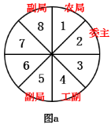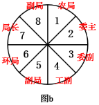

故正确答案为B。

**考点**：从最大信息开始推

**来源**：2014年四川省公务员录用考试《行测》题（下半年）第85题

## 材料 1

2012年，某市参加生育保险人数达51.52万人，占应参保人数的比重由上年的85.4%上升到90.9%。该市参加基本养老保险人数69.80万人，比上年增长9.6%，其中女性30.59万人，比上年增长7.5%，占到参加基本养老保险总人数的44.1%；参加基本医疗保险人数为102.12万人，比上年增长6.8%，其中女性28.38万人，比上年增长29.6%，占到参加基本医疗保险人数的27.8%；参加失业保险人数为74万人，比上年增长1.4%，其中女性33.3万人，比上年增长1.4%，占到参加失业保险总人数的45.0%，且女性参加失业保险增加人数占到参加失业保险增加总人数的45%；参加工伤保险人数46.43万人，比上年增长16.9%，其中女性15.3万人，比上年增长58.7%，占到参加工伤保险总人数的32.91%，且女性参加工伤保险增加人数占到参加工伤保险增加总人数的84.1%。

### 第 86 题

2012年该市应参加生育保险的人数约为多少万人：

A. 60.3

B. 65.4

C. 51.5

D. 56.7

第 86 题 · 答案与解析

**参考答案（粉笔题库参考内容）**

D

**解析**

根据题干“2012年该市应参加生育保险的人数约为多少万人”，结合文字材料给出参加生育保险的人数和其占应参保人数的比重，可判定本题为现期比重问题。定位文字材料第一句可得：2012年，某市参加生育保险人数为51.52万人，占应参保人数的比重为90.9%。由整体 = 部分/比重，可得：2012年该市应参加生育保险的人数=

51.52/90.9%≈51.52/0.9≈57.2万人，与D选项最接近。

故正确答案为D。

**考点**：文字资料、现期比重

**来源**：2014年四川省公务员录用考试《行测》题（下半年）第86题

### 第 87 题

在除生育保险之外的4类保险中，2012年该市女性参保人数占总体比重明显高于上年的有几个：

A. 1

B. 2

C. 3

D. 4

第 87 题 · 答案与解析

**参考答案（粉笔题库参考内容）**

B

**解析**

根据题干“······2012年······占······比重明显高于上年·····”，可判定本题为两期比重问题。定位文字材料第二句可得：2012年，该市参加基本养老保险人数增长率为9.6%，其中女性参保人数增长率为7.5%；参加基本医疗保险人数增长率为6.8%，其中女性参保人数增长率为29.6%；参加失业保险人数增长率为1.4%，其中女性参保人数增长率为1.4%；参加工伤保险人数增长率为16.9%，其中女性参保人数增长率为58.7%。由女性参保人数占总体比重= 女性参保人数/总体参保人数，可知：女性参保人数的增长率=a，总体参保人数的增长率=b。根据两期比重比较结论，当a＞b时，比重上升；当a＜b时，比重下降。

基本养老保险：女性增长率(7.5%)&lt; 整体增长率(9.6%)，比重下降；

基本医疗保险：女性增长率(29.6%)> 整体增长率(6.8%)，比重上升；

失业保险：女性增长率(1.4%)= 整体增长率(1.4%)，比重不变；

工伤保险：女性增长率(58.7%)> 整体增长率(16.9%)，比重上升。

对比可知，基本医疗保险和工伤保险两类保险符合题目要求。

故正确答案为B。

**考点**：两期比重、文字资料

**来源**：2014年四川省公务员录用考试《行测》题（下半年）第87题

### 第 88 题

2012年参加基本医疗保险的男性人数约是参加工伤保险的男性人数的多少倍：

A. 1.9

B. 1.6

C. 2.4

D. 2.1

第 88 题 · 答案与解析

**参考答案（粉笔题库参考内容）**

C

**解析**

根据题干“······是······的多少倍”，可判定本题为现期倍数问题。定位文字材料第二句可得：参加基本医疗保险人数为102.12万人，参加基本医疗保险的女性人数为28.38万人；参加工伤保险人数为46.43万人，参加工伤保险的女性人数为15.3万人。故2012年参加基本医疗保险的男性人数约是参加工伤保险的男性人数的倍数=参加基本医疗保险的男性人数/参加工伤保险的男性人数= (参加基本医疗保险的总人数 − 参加基本医疗保险的女性人数)/(参加工伤保险的总人数 − 参加工伤保险的女性人数)

=(102.12-28.38)/(46.43-15.3)=73.74/31.13≈74/31≈2.4，即2012年参加基本医疗保险的男性人数约是参加工伤保险的男性人数的2.4倍。

故正确答案为C。

**考点**：文字资料、现期倍数

**来源**：2014年四川省公务员录用考试《行测》题（下半年）第88题

### 第 89 题

将各种社会保险按该市2012年参保人数同比增速从高到低排列正确的是：

A. 工伤保险—失业保险—基本医疗保险

B. 基本医疗保险—基本养老保险—失业保险

C. 基本养老保险—基本医疗保险—失业保险

D. 基本医疗保险—工伤保险—基本养老保险

第 89 题 · 答案与解析

**参考答案（粉笔题库参考内容）**

C

**解析**

定位文字材料第二句可得：该市参加基本养老保险人数的增长率为9.6%，参加基本医疗保险人数的增长率为6.8%，参加失业保险人数的增长率为1.4%，参加工伤保险人数的增长率为16.9%。

A项：失业保险（1.4%）＜基本医疗保险（6.8%），错误；

B项：基本医疗保险（6.8%）＜基本养老保险（9.6%），错误；

C项，基本养老保险(9.6%)>基本医疗保险(6.8%)>失业保险(1.4%)，正确；

D项：基本医疗保险（6.8%）＜工伤保险（16.9%），错误。

故正确答案为C。

**考点**：排序类、文字资料

**来源**：2014年四川省公务员录用考试《行测》题（下半年）第89题

### 第 90 题

以下关于该市2012年社会保险参保情况的描述，能够从资料中推出的是：

A. 参加失业保险的男性人数与上年持平

B. 女性参加工伤保险的人数比上年增加了7万多人

C. 基本养老保险的参保人数比上年增加了9万多人

D. 基本医疗保险参保者中女性的比重低于工伤保险

第 90 题 · 答案与解析

**参考答案（粉笔题库参考内容）**

D

**解析**

A项：定位文字材料可得：参加失业保险总体人数增长率1.4%，女性参保人数增长率为1.4%。由参加失业保险总体人数=女性参保人数+男性参保人数，根据混合增长率结论，混合后的增长率居中，故当一部分混合之前量的增长率和混合之后量的增长率相等时，另一部分混合之前量的增长率也等于这一增长率，即参加失业保险的男性人数的增长率也为1.4%，故参加失业保险的男性人数增多，错误；

B项：定位文字材料可得：参加工伤保险女性人数15.3万人，增长58.7%。故r = 58% ≈ 1/1.7，即n=1.7。由增长量=现期量/(1+n)，可得：女性参加工伤保险的人数比上年增加量 = 15.3/(1+1.7) ≈ 15.3/2.7 ≈ 5^+ ≠ 7^+，错误；

C项：定位文字材料可得：参加基本养老保险人数为69.80万人，增长9.6%。故r = 9.6% ≈ 1/10.5，即n=10.5。由增长量=现期量/(1+n)，可得：基本养老保险的参保人数比上年的增加量= 69.8/(1 + 10.5) = 69.8/11.5 ≈ 6 ≠ 9，错误；

D项：定位文字材料可得：女性参加基本医疗保险人数占参加基本医疗保险人数的27.8%，女性参加工伤保险人数占参加工伤保险人数的32.91%。故基本医疗保险女性比重小于工伤保险女性比重，正确。

故正确答案为D。

**考点**：文字资料、综合分析

**来源**：2014年四川省公务员录用考试《行测》题（下半年）第90题

## 材料 2

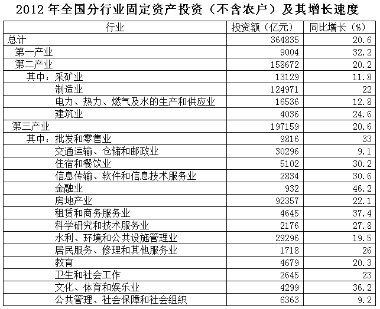

### 第 91 题

2012年全国固定资产投资额（不含农户）约比上年同期增长多少万亿元？

A. 4

B. 5

C. 6

D. 7

第 91 题 · 答案与解析

**参考答案（粉笔题库参考内容）**

C

**解析**

查阅表格可知，全国固定资产投资额为364835亿元，约36.5万亿元，同比增长率为20.6%，代入公式，36.5/(1+20.6%) × 20.6% ≈36.5/(1+1/5) × 1/5 = 6.1亿元，与C项最接近。

故正确答案为C。

**考点**：增长量计算、统计表

**来源**：2014年四川省公务员录用考试《行测》题（下半年）第91题

### 第 92 题

在三类产业中，2012年固定资产投资额在全国固定资产投资总额（不含农户）中的占比明显高于上年的是：

A. 第一产业

B. 第二产业

C. 第一产业和第三产业

D. 第二产业和第三产业

第 92 题 · 答案与解析

**参考答案（粉笔题库参考内容）**

A

**解析**

判断比重增长情况，分子部分的增长率大于分母的增长率，则分数（比重）变大。各产业增长率如下：第一产业（32.2%）＞整体增长率（20.6%），所以第一产业比重高于上年；第二产业（20.2%）＜整体增长率（20.6%），所以第二产业比重低于上年；第三产业（20.6%）=整体增长率（20.6%），所以第三产业比重与上年对比，没变。因此，比重高于上年的只有第一产业。

故正确答案为A。

**考点**：两期比重、统计表

**来源**：2014年四川省公务员录用考试《行测》题（下半年）第92题

### 第 93 题

2012年第二产业固定资产投资额最高和最低的行业，其固定资产投资额同比增速相差几个百分点？

A. 1.0

B. 2.6

C. 9.2

D. 12.8

第 93 题 · 答案与解析

**参考答案（粉笔题库参考内容）**

B

**解析**

查阅表格，可知第二产业固定资产投资额最高行业为制造业，增长率为22.0%，最低为建筑业，增长率为24.6%。它们相差24.6-22.0=2.6个百分点。

故正确答案为B。

**考点**：简单加减计算、统计表

**来源**：2014年四川省公务员录用考试《行测》题（下半年）第93题

### 第 94 题

在第三产业的14个行业中，2012年固定资产投资额同比增长超过1000亿元的有几个？

A. 8

B. 9

C. 6

D. 7

第 94 题 · 答案与解析

**参考答案（粉笔题库参考内容）**

D

**解析**

求增长量，代入公式：增长量 = 现期量/(1 + 增长率) × 增长率。这道题需要计算的数据非常多，需要注意运用分小互化、估算等各种方法排除选项。批发和零售业：9816/(1+33%)×33%≈9816/(4/3)×1/3= 9816/4 ＞ 1000亿元；交通运输、仓储和邮政业：30296/((1+9.1%)/9.1%) ≈30296/12 ＞ 1000亿元，对比容易得出，房地产业、水利、环境和公共设施管理业的增长量超过1000亿元。文化、体育和娱乐业：4299/(1 + 36.2%) × 36.2% ＞4299/4 ＞ 1000亿元，同时可推出租赁和商务服务业的增长量超过1000亿元。住宿和餐饮业：5102/(1+30.2%) × 30.2%≈5102/13×3＞1000亿元。一共有7个行业增长量超过1000亿元，故选D项。其他被排除的行业，代入“(投资额 − 1000) × 增长率 ＜ 1000”验证，即可排除。

故正确答案为D。

**考点**：增长量计算、统计表

**来源**：2014年四川省公务员录用考试《行测》题（下半年）第94题

### 第 95 题

关于2012年固定资产投资状况，能够从上述资料中推出的是：

A. 第三产业中有5个行业的固定资产投资额超过整个第一产业

B. 第三产业中固定资产投资额最低的行业同比增速为最高

C. 采矿业固定资产投资额超过整个第二产业的一成

D. 第三产业中固定资产投资额同比增速最低的行业，其投资额占全产业的3%左右

第 95 题 · 答案与解析

**参考答案（粉笔题库参考内容）**

B

**解析**

A项错误，查找表格即可知道，“批发和零售业”“交通运输、仓储和邮政业”“房地产业”“水利、环境和公共设施管理业”，一共4个行业固定资产投资额超过第一产业；B项正确，查找表格可知，第三产业中金融业的投资额（932亿元）最低，增长率（46.2%）最高；C项错误，采矿业投资额为13129亿元，扩大10倍，得131290&lt;158672（第二产业总量）；D项错误，第三产业中增速最低的行业为交通运输、仓储和邮政业，固定资产投资额为30296亿元，计算得：30296/197159≈3/20=15%。

故正确答案为B。

**考点**：统计表、综合分析

**来源**：2014年四川省公务员录用考试《行测》题（下半年）第95题

## 材料 3

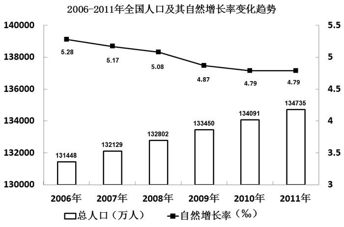

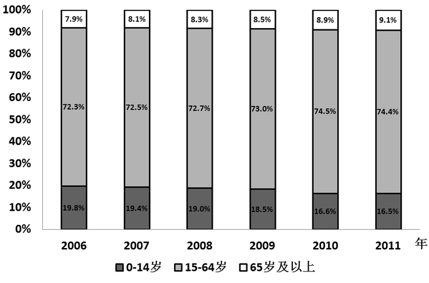

### 第 96 题

以下哪一年的人口增长量高于上年水平？

A. 2008年

B. 2009年

C. 2010年

D. 2011年

第 96 题 · 答案与解析

**参考答案（粉笔题库参考内容）**

D

**解析**

根据题干“······增长量高于上年水平”，可判定本题为增长量比较问题。定位图形材料1可得：2006年总人口为131448万人，2007年总人口为132129万人，2008年总人口为132802万人，2009年总人口为133450万人，2010年总人口为134091万人，2011年总人口为134735万人。由增长量=现期量-基期量，可得：

2007年人口增长量 = 132129 − 131448 ≈ 132130 − 131450 = 680万人；

2008年人口增长量 = 132802 − 132129 ≈ 132800 − 132130 = 670万人；

2009年人口增长量=133450−132802≈133450−132800=650万人；

2010年人口增长量 = 134091 − 133450 ≈ 134090 − 133450 = 640万人；

2011年人口增长量 = 134735 − 134091 ≈ 134740 − 134090 = 650万人。

比较可得，2011年人口增长量高于上年水平。

【秒杀法】定位图形材料1可得：2010年人口自然增长率和2011年人口自然增长率均为4.79‰，2009年总人口为133450万人，2010年总人口为134091万人。

由增长量 = 基期量 × 增长率，可知：当增长率相等时，基期量大的增长量大。故由2009年总人口（133450万人）＜2010年总人口（134091万人），可得：2010年人口增长量＜2011年人口在增长量，即2011年人口增长量高于上年。

故正确答案为D。

**考点**：增长量比较、统计图

**来源**：2014年四川省公务员录用考试《行测》题（下半年）第96题

### 第 97 题

与2006年相比，2011年我国的人口自然增长率下降了多少个百分点？

A. 0.049

B. 0.059

C. 0.49

D. 0.59

第 97 题 · 答案与解析

**参考答案（粉笔题库参考内容）**

A

**解析**

定位图形材料1可得： 2006年的自然增长率为5.28‰，2011年的自然增长率为4.79‰。故2011年人口自然增长率-2006年人口自然增长率=4.79‰–5.28‰=-0.49‰=-0.049%，即与2006年相比，2011年我国的人口自然增长率下降了0.049个百分点。

故正确答案为A。

**考点**：简单加减计算、统计图

**来源**：2014年四川省公务员录用考试《行测》题（下半年）第97题

### 第 98 题

若2011年末我国15~59岁的人口比重为69.8%，则60~64岁人口约有多少万人：

A. 4235

B. 4934

C. 5264

D. 6198

第 98 题 · 答案与解析

**参考答案（粉笔题库参考内容）**

D

**解析**

根据题干“2011年末我国15~59岁的人口比重为······，则60~64岁人口约有······万人”，结合图形材料给出总人数和各年龄段人口的比重，可判定本题为现期比重问题。定位图形材料1可知：2011年总人口数为134735万人；定位图形材料2可得：2011年15~64岁人口比重为74.4%。结合题干给出15~59岁人口比重为69.8%，则60~64岁人口比重为74.4%-69.8%=4.6%。由部分=总体×比重，可得：2011年60~64岁人口数为2011年总人口数×60~64岁人口比重=134735×4.6%≈135000×5%=6750万人，与D项最接近。

故正确答案为D。

**考点**：现期比重、统计图

**来源**：2014年四川省公务员录用考试《行测》题（下半年）第98题

### 第 99 题

2011年末我国65岁及以上人口约比2010年末多多少万人?

A. 124

B. 249

C. 327

D. 467

第 99 题 · 答案与解析

**参考答案（粉笔题库参考内容）**

C

**解析**

根据题干“2011年末······比2010年末多······万人”，可判定本题为增长量计算问题。定位图形材料1可得：2010年总人口为134091万人，2011年总人口为134735万人；定位图形材料2可得：2010年65岁及以上人口占比为8.9%，2011年65岁及以上人口占比为9.1%。由部分=总体×比重，及2011年我国人口增长量=现期量-基期量，可得：

2011年末我国65岁及以上人口比2010年增加的人数

\=2011年我国65岁以上人口数-2010年我国65岁以上人口数=

2011年总人口数 × 2011年65岁及以上人口占比−2010年总人口数×2010年65岁及以上人口占比= 134735×9.1%-134091×8.9% =134735×(9%+0.1%)−134091×(9%−0.1%)= (134735-134091)×9% + (134735+134091)×0.1%≈ 600×9% + 269000×0.1% ≈ 54+269 = 323万人，与C项最接近。

故正确答案为C。

**考点**：增长量计算、统计图

**来源**：2014年四川省公务员录用考试《行测》题（下半年）第99题

### 第 100 题

能够从上述资料中推出的是：

A. 2011年我国人口总量比2006年增长了3%以上

B. 2006年到2011年间，我国0~14岁人口比重逐年下降

C. 2005年我国人口总量低于13亿

D. 我国15~64岁人口数同比增量最高的年份是2011年

第 100 题 · 答案与解析

**参考答案（粉笔题库参考内容）**

B

**解析**

A项：定位图形材料1可得：2006年总人口为131448万人，2011年总人口为134735万人。由增长率= (现期量−基期量)/基期量可得：与2006年相比，2011年我国人口总量增长率= (134735 − 131448)/131448 ＜ 3287/130000 ≈ 2.5%

，错误；

B项：定位图形材料2可得：我国0~14岁人口比重，2006年为19.8%，2007年为19.4%，2008年为19.0%，2009年为18.5%，2010年为16.6%，2011年为16.5%。故2006年到2011年间，我国0~14岁人口比重逐年下降，正确；

C项：定位图形材料1可得：2006年总人口为131448万人，增长率为5.28‰。由基期量=现期量/(1+r)，可得：2005年我国人口总量= 131448/(1+5.28‰) ≈ 131448/1.00528 ＞ 131448/1.01 = 130000^+万人 = 13^+亿人，即2005年我国人口总量超过13亿人，错误；

D项：定位图形材料1、2可得，2011年15~64岁人口数同比增量为134735×74.4%= −134091 × 74.5%≈100243 − 99898\=345万人；2010年15~64岁人口数同比增量为134091×74.5%-133450×73%≈99898-97419=2479万人，2479万人>345万人，则我国15~64岁人口数同比增量最高的年份不是2011年，错误。

故正确答案为B。

**考点**：统计图、综合分析

**来源**：2014年四川省公务员录用考试《行测》题（下半年）第100题

