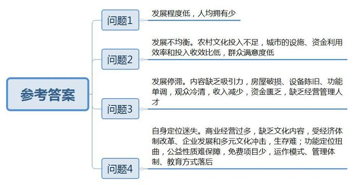
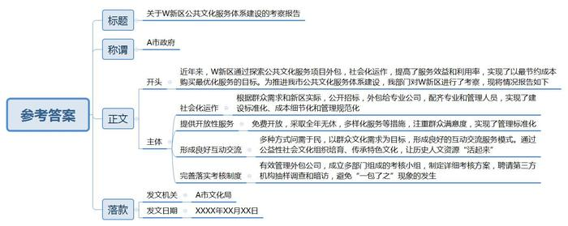
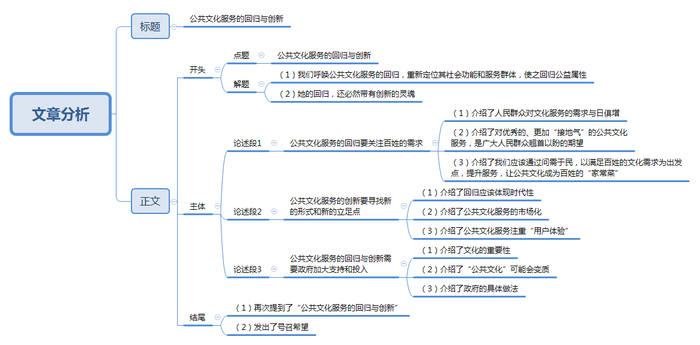

# 2015年公务员多省联考《申论》题（四川上半年卷）

<!-- gwy:overview:start -->
> **四川 · 2015 · 申论 · 上半年** ｜ 3 题 · 图片 3 处 · 答案随题折叠

导航：[题目](#题目) · [材料 1](#材料-1)
<!-- gwy:overview:end -->

> 候选采集稿。参考答案及解析来自粉笔页面，不代表官方答案或真实高分答卷；来源使用许可与原卷对应关系仍需人工核实。

## 给定材料

### 材料 1

近日，中办、国办下发《关于加快构建现代公共文化服务体系的意见》（以下简称《意见》）强调，要按照全面建成小康社会的总体要求，构建体现时代发展趋势、适应社会主义初级阶段基本国情和市场经济要求，符合文化发展规律、具有中国特色的现代公共文化服务体系，为实现中华民族伟大复兴的“中国梦”提供强大精神动力和文化支撑。

《意见》及附件《国家基本公共文化服务指导标准（2015-2020）》还要求给群众提供“对路子”的公共文化服务：一方面，要为文化场馆的社会功能、服务群体等重新明确定位，使之回归公益属性，并为文化场馆的建设、维护和运行提供充足的政策和资金支持。另一方面，要以明确的考核机制，倒逼相关部门将文化场馆不仅要建好，更要利用好，提升服务品质，提高可利用率，增强其魅力。与此同时，也要大力引导、鼓励老百姓走进文化场馆，在全社会营造全民阅读、全民学习之风，以净化弥漫在整个社会中的功利主义和实用主义。

文化部公共文化司某负责人表示，在2014年，全国财政一般公共预算中，文化体育与传媒支出达2753亿元，比2011年增加了860亿元。对公共文化体系建设给予了重点支持。今后，国家还要进一步加大投入力度，对公共服务体系建设给予重点支持，财政预算中的其中一部分将用于采购公共文化产品。其中，推广低票价或者直接购买版权服务民众等形式，将成为文化部的公共文化重点工作任务之一。

### 材料 2

随着奥运会、世博会、世园会、亚运会等一系列重大文化体育活动在我国举办，一大批地标级精品场馆纷纷涌现。鸟巢、水立方等奥运场馆在世界享有盛誉，S市世博会中国馆所改造成的中华艺术宫、天津文化中心等已经逐步投入使用。中国国学中心、国家美术馆、中国工艺美术馆等国家级重点文化工程集中落户于北京奥林匹克公园，众多新兴文化场馆已经达到国际一流水准。与此同时，工人文化宫、文化馆、少年宫等传统公益性质的文化场所也不断增加。据某权威网站发布的信息显示，截至2013年底，全国县级以上文化馆、群众艺术馆数量有三千多个，文化站超过四万个，村（社区）文化室25万个。再以博物馆为例，目前我国拥有博物馆4165家，在过去10年时间里增长一倍。

尽管我国文化馆、博物馆等公共文化设施总数不断增加，但相对于发达国家而言，我国公共文化设施总体发展程度仍然较低。据了解，英国伦敦市有400多个大小剧院、音乐厅及现场音乐表演场地，每10万人拥有1.4个剧场，每10平方公里拥有1.3个剧场，每年大型剧场的入场人次达1240万；拥有近600个图书馆，395家公共图书馆，平均每10万人拥有5家公共图书馆，人均藏书量5本；拥有22座国家级博物馆，200余座非国家级别的博物馆，每10平方公里有1.1座博物馆，即每个社区附近都会有博物馆。而我国平均40万人才拥有一座博物馆。

事实上，贫困地区一直是我国公共文化服务体系均衡发展的难点，这些地区财力薄弱，文化事业投入十分有限。以广西来宾市为例，2003年至2008年，在农村文化方面的投入比重不到文化投入的10%；2008年以前，该市甚至没有市级群众艺术馆、图书馆、博物馆、影剧院，大部分县级图书馆、文化馆达不到部颁三级标准。

虽然农村如此，然而在某些大中城市则是另一番景象。某市社科院曾对本市2209名市民的公共文化服务体系参与度和满意度调查显示，尽管近年来政府对公共文化服务体系的建设投入了大量人力、财力、物力，但部分公共文化设施、公共文化活动、文化惠民项目的利用率和参与度较低，设施、资金等资源的利用效率和投入收效比亟待提高。其中，针对博物馆、美术馆、科技馆、纪念馆和陈列馆的调查数据显示，24.4%的受访者一年中从未去过这5类场所，61.6%的人平均每年去1～5次。而市民对文化馆的年均光顾次数则更低，93.7%的人平均每年到馆5次以下；其中，58.6%的人没去过文化馆，35.1%的人每年到馆次数为1 ～5次。针对公众满意度的调查结果显示，对基层文化场所和文化馆的服务表示满意和基本满意的市民，分别只有34.2%和40.8%。

### 材料 3

公共文化服务场馆的利用率偏低，是文化事业发展中的“老大难”。特别是一些传统的公益性质文化场馆，因为缺少有吸引力的“内容”而门庭冷落，造成巨大浪费。

H市总工会A工人文化宫高主任说：“我刚来文化宫那会儿，这儿真的是火啊！”1983年，他从部队复员后，就一直在这里工作，亲眼目睹了文化宫由盛而衰，从辉煌到冷清的全过程。“那时，文化宫人来人往，电影晚场场场爆满，光是帮我们卖票、检票、维持秩序的长期固定义务员就有五六个。现在，电影院每天的上座率不到10%，有时候工作人员甚至比观众还多。”他道出了大家的普遍感受。

“那时在文化宫，能看电影、溜冰、跳舞、唱歌、参加运动，从早到晚都是人山人海，我们职工除了睡觉几乎都在里面值班，假期就更谈不上休息了。”回忆起十几年前的工人文化宫，57岁的老职工谭梦林仍充满激情。

“我有20多年没去过文化宫了。”生于20世纪60年代的白女士说，“很怀念以前在文化宫看电影、唱卡拉OK、参加培训的日子。现在可供选择的文化活动丰富多样，而文化宫的活动设施和活动内容却相对比较陈旧。”

毫无疑问，房屋破损、设备折旧、功能单调似乎成了大家对文化宫现状的普遍印象。“跟各种新兴商业文化场所相比，文化宫仿佛仍停留在50多年前，收入当然也就大不如前了。”H市总工会B工人文化宫金主任说。“观众冷清，再加上文化经营管理人才也极其缺乏，有些文化宫已有名存实亡之虞。”一位不愿意透露姓名的文化宫工作人员说。

“虽然日渐没落，但谁也不知道怎么改变。资产不是我们的，我们也没这权利，那也只好就这么闲置着。”金主任说，虽然文化宫地处城市最繁华的商业街区，面积也有85亩之多，但他们甚至连出租都没搞过；后来也曾想要重新建设，但一直苦于没钱而无法实施。

H市总工会C工人文化宫，位于该市最繁华的商贸经济圈的中心，这栋8层的建筑被淹没在周围的高楼和广告牌中。遒劲有力的“工人之家”四个毛笔字，是该市第一任市长刘伯承元帅亲自题写的。如今，文化宫一层南面租给了麦当劳、新标识等企业做商业经营，北面租给游戏厅；二层和三层租给张生记酒店；六至八层为H市总工会办公室；可供文化宫实际使用的楼层只有四层和五层。在文化宫有限的使用空间内，只能提供很少的文化娱乐活动。四层开设了台球室，吸引了一些年轻人，但由于价格不便宜，通常顾客都很少；五层的健身中心设施陈旧，灯光昏暗，光顾者更是寥若晨星。

一层的电玩游戏厅有不少年轻人进出，但被问及是否知道工人文化宫的作用时，他们显得一脸茫然。“现在的文化宫毫无‘文化’可言！”家住文化宫附近的王刚说，“以前凭着工会会员证就可以在文化宫参加各种免费文化娱乐，现在什么都没有了。”“文化宫里没工人，文化宫里没文化。这是职工们当前反映比较大的问题。”H市总工会宣教部部长朱和顺分析说，“工人文化宫的迷失，是因为其在市场经济中对自身定位的矛盾与摇摆。一方面文化宫受到了经济体制改革、企业发展和多元文化的冲击；另一方面工人文化宫原本是总工会财政全额拨款，但是后来逐渐改成了差额拨款，再后来就成了自行收支、自负盈亏。为了生存，一些工人文化宫不得不出租场地和举办培训班。”

### 材料 4

星期天早上6点多，北京房山区的李艳梅就让儿子张岩赶快起床，尽早到北京市少年宫办理英语辅导班注册缴费手续。李艳梅告诉记者：“早起的鸟儿才能抢到食，报名那天，要不是去得早，恐怕就抢不到名额了。”“名额抢完了，当天我们外语俱乐部所有英语班都报满了，要是报名的话，就得等我们今年开秋季班的时候，记着要早点来，不然又抢不到了。”少年宫外语俱乐部一位英语教师告诉记者，今年报名首日，近万人将伸缩门挤成了“麻花”。对此，有学者说：少年宫学科类辅导班招生如此火爆，显然是对其功能定位的严重扭曲。

资料显示，国内现存最早的少年宫是成立于1949年4月的大连市少年宫。新中国成立后的第一家少年宫，是由宋庆龄女士亲手创办的中福会少年宫，建立于1953年6月1日。那个时期的少年宫，陪伴了几代青少年，为新中国的人才培养打下了良好基础。上世纪50年代，杭州青少年宫美术兴趣小组成员何水法和沈曙，每到周末都会一起去学画，素描、风景、水粉、水彩样样不落。后来他们一个成了著名的国画家，一个则做了画院院长。同时期的美术学员中还有潘公凯，他后来成了中央美术学院院长。

不过，与社会发展一样，很多地方的少年宫搬了地方，盖了新楼，甚至换了名字，各项设施也与时俱进。和大部分的少年宫一样，20世纪80年代初，杭州少年宫也不再叫少年宫，而是改为“杭州市青少年活动中心”。跟随名字一同改变的是“成长乐园”变成更严肃的“第二课堂”。杭州市青少年活动中心主任黄建明说，少年宫从校内教育追到了校外教育，他是最好的见证人。随着时代变迁，少年宫的地位开始尴尬，原则上的公益性质难以保障，高额的开支使得少年宫在公益和市场之间徘徊，免费也在逐步向收费转变。黄建明坦言，不变肯定没有发展，“少年宫必须跟着时代脉搏前进，在运作模式、管理体制、教育方式上做出改变。”

### 材料 5

在S市市民文化节活动现场，古朴的砖红色建筑里，从顶楼到底楼人头攒动，白领社团在这个由张爱玲故居改建而成的活动中心里卖力表演；放牛班的春天合唱团，让农民工子弟爱上音乐，带着自信放声歌唱；S市首个由政府支持、社会力量承办的艺术品跳蚤市场也顺利开市，50余个摊位中，吉他、素描、面具、艺术铁壶等琳琅满目；在A社区文化活动中心举办的学生艺术作品展上，17岁的万婕大方叫卖起了自己做的“地球皂” ……据统计，S市市民文化节开幕当天共举办各类文化活动1651场，就近参加文化活动的市民达100万人次。

“S市从来不缺文化活动及各类文化节，但从没有一个节日能像市民文化节一样包含如此多的活动类别且如此‘接地气’。”有市民如此评价。“给百姓更多出彩的机会，也为市民享受文化艺术活动打造‘零门槛’。市民文化节这个平台是给市民大众的。我们的报名点、初赛都设在老百姓家门口，就是希望更多市民都能有所参与。”社区文化馆负责人萧女士说。此前，石门二路街道社区文化中心的社区活动虽多，但更偏重于老人和儿童，该中心韩主任并不满足。“我们所在的社区，白领上班族特别多，因此我们也应该重视为白领们提供更多适合他们的文化活动项目，尽可能满足每一个居民的需要。”

### 材料 6

手机阅读、数字报纸、杂志、移动电视、触摸媒体……新兴媒体正越来越多地出现在当下生活中，并日益侵入生活的各个层面，也为新时期的公共文化服务找到了新的立足点。

2014年，Q市城阳北曲西社区的居民迟秋菊和刘世云没想到，她们作为居民代表委托社区专职管理员在“文化超市，欢乐城阳”网站上订制的柳腔剧订单，居然在一周后就得以兑现，这出自个儿免费点单点来的大戏，让众人初尝了“说了算”的“当家”的惊喜；泡惯了图书馆和书店的袁琳琳没想到，借阅图书再无须再卡着下班前的时间点，24小时自助图书馆和书店的相继开张，为和她一样的爱书人保留了一盏彻夜明亮的灯火……

黄岛区的小伙儿王维涛没想到，一场面向所有市民、完全无门槛的才艺选秀活动在最基层的社区迅速推广开来。这场报名人数超过2万人、原创节目数量超过3000个、观看人数已逾20万人次的大规模海选，将普通市民推到了舞台的中心。凭借吹笛子的小嗜好，王维涛竟能自荐登上过去想都不敢想的大舞台，深入到基层的“五王”（指歌王、舞王、琴王、戏王、秀王）才艺达人海选，让他真正过了把“明星瘾”。

实际上，这个名为“文化超市”的舞台是一个“陈列”了综艺演出、图书、戏剧、电影、艺术培训等丰富文化产品的特殊网站，它为包括39万外来人口在内的80万城阳居民建立起不可思议的自主“舞台”：使用者只须登录并选择所需的产品内容，不出两周就能收获兑现；而借助“超市”的舞台，更多拥有才艺的民间达人也自荐登台亮相，上传自编自演的节目，丰富供居民自选的产品内容。在网站的留言板上，无论文化产品的消费者还是制造者，个人意愿得到满足的市民个个难掩惊喜。在市民纷纷走到台前，高调分享贴心服务带来的生活中美好的小幸福的幕后，是逐年加大投入力度并已被纳入财政预算的文化服务专项资金的辅助。

### 材料 7

2014年，某市“新兴城区现代公共文化服务社会化的标准化建设”项目被文化部列入2014年国家文化创新工程。其中，W新区近年来探索公共文化服务项目外包，实行社会化运作的方式，提高了服务效益和利用率，引起了社会的高度关注。试点表明，W新区购买公共文化服务基本实现了以最节约成本购买最优化服务的预期目标，公共文化服务体系建设呈现出蓬勃发展、整体推进、重点突破的良好态势。

从“购买文艺演出”到“定制大型晚会”再到“新区图书馆服务外包”，新区的公共文化服务逐步走出一条具有特色的社会化运作之路。根据群众的需求和新区实际情况，W新区购买公共文化服务确定“买什么？向谁买？怎么买？”。通过公开招标，区政府将新区图书馆的建设、管理、运行和服务外包给专业公司，由该公司严格按照相关要求，配备好各艺术门类专业人员和管理人员，实现了建设标准化、成本细节化和管理规范化。新区图书馆自建馆以来，对市民免费开放，全年无休，通过图书馆24小时还书箱以及图书馆数字资源无地域限制、无时间约束的开放性服务，保证了对读者的服务全天候不间断。在图书馆购置新书方面，读者成为选书和购书的主人，读者满意度成为新区图书馆公共文化服务的出发点和落脚点，可以说，坚持“图书馆服务与社区服务相结合”“市民服务与企业服务相结合”“实体服务与网络服务相结合”“普遍化服务与个性化服务相结合”，W新区图书馆实现了管理标准化。

新区文化馆在为街道、社区、企业等提供基本的公共文化服务的同时，采取调查问卷、座谈会等多种方式问需于民，将群众的文化需求定位为文化馆的工作目标，同时与基层形成良好的互动交流的服务模式。文化馆还注重将富有新区地域特色的文化传承纳入各类公益性社会文化组织的培育和建设，从而让新区丰富、优秀的历史人文资源“活起来”。

“政府是公共服务的提供者，不一定是生产者；是规则的制定者和执行的监管者，不一定是直接操作者。政府向社会组织购买公共服务，是对公共服务体制的破冰尝试，也是‘服务型政府’与‘小政府’两种方向融合的必然结果。”新区相关领导说。据介绍，新区成立了有财政、审计、纪委、市文化行政部门组成的考核小组，对外包公司的业务进行考核。考核小组制定了外包服务质量考核表，满分为100分，从队伍建设、公共服务、管理规章、群众满意度等方面进行考评。考核评分不得低于80分，对得分80分以下的服务外包公司提出整改要求，如整改不力则终止服务合同。同时，政府还聘请了第三方机构对两馆的服务人群、服务单位进行抽样调查和暗访。通过把监管落实为可见可控的考核制度对服务外包进行监管，可以避免“一包了之”。正如该区某领导说：“我们不做运动员，只做裁判。”

## 题目

### 第 1 题

根据给定资料，概括目前我国公益性质文化场馆面临的困难。（20分）

关联材料：材料 1、材料 2、材料 3、材料 4、材料 5、材料 6、材料 7

作答要求：

要求：

（1）概括全面，条理清楚；

（2）语言简洁，书写工整；

（3）不超过200字。

第 1 题 · 答案与解析

**参考答案（粉笔题库参考内容）**

一、发展程度低。人均拥有少。

二、发展不均衡。农村文化投入不足，城市的设施、资金利用效率和投入收效比低，群众满意度低。

三、发展停滞。内容缺乏吸引力，房屋破损、设备陈旧、功能单调，观众冷清，收入减少，资金匮乏，缺乏经营管理人才。

四、自身定位迷失。商业经营过多，缺乏文化内容，受经济体制改革、企业发展和多元文化冲击，生存难；功能定位扭曲，公益性质难保障，免费项目少，运作模式、管理体制、教育方式落后。

**参考答案说明：**答案从“发展程度低”“发展不均衡”“发展停滞”“自身定位迷失”等不同的方面进行了分条撰写，且对每条要点提炼出了总括词并前置。每条要点之间内容上没有交叉。

**解析状态：unknown（来源未提供）**

### 第 2 题

假设你是四川省A市文化主管部门的一名工作人员，陪同部门领导前往资料7中的W新区，就该地区的公共文化服务体系建设进行了考察，请以该部门的名义，针对资料7撰写一份提交A市市政府的考察报告。（30分）

关联材料：材料 7

作答要求：

要求：

（1）定位准确，格式正确；

（2）思路清晰，分析深入；

（3）语言流畅，书写工整；

（4）不超过500字。

第 2 题 · 答案与解析

**参考答案（粉笔题库参考内容）**

关于W新区公共文化服务体系建设的考察报告

A市政府：

近年来，W新区通过探索公共文化服务项目外包，社会化运作，提高了服务效益和利用率，实现了以最节约成本购买最优化服务的目标。为推进我市公共文化服务体系建设，我部门对W新区进行了考察，现将情况报告如下：

一是社会化运作。根据群众需求和新区实际，公开招标，外包给专业公司，配齐专业和管理人员，实现了建设标准化、成本细节化和管理规范化。

二是提供开放性服务。免费开放，采取全年无休，多样化服务等措施，注重群众满意度，实现了管理标准化。

三是形成良好互动交流。多种方式问需于民，以群众文化需求为目标，形成良好的互动交流服务模式。通过公益性社会文化组织培育、传承特色文化，让历史人文资源“活起来”。

最后完善落实考核制度。有效管理外包公司，成立多部门组成的考核小组，制定详细考核方案，聘请第三方机构抽样调查和暗访，避免“一包了之”现象的发生。

A市文化局

XXXX年XX月XX日

**参考答案说明：**（1）本题主要写到了格式和正文两部分。其中正文的开头主要写到了W新区公共文化服务体系建设总得对策和成绩，正文的主体主要从“社会化运作”“开放性服务”“互动交流”“考核制度”四个方面写到了W新区公共文化服务体系建设的主要做法。（2）形式上对四个对策进行了分段处理，做到了条理清晰。

**解析状态：unknown（来源未提供）**

### 第 3 题

针对给定资料，结合社会生活实际，以“公共文化服务的回归与创新”为题目，写一篇议论文。（50分）

关联材料：材料 1、材料 2、材料 3、材料 4、材料 5、材料 6、材料 7

作答要求：

要求：

（1）观点鲜明，内容充实，论述深刻；

（2）思路清晰，结构严谨，语言流畅；

（3）字迹清楚，书写工整，限800～1000字。

第 3 题 · 答案与解析

**参考答案（粉笔题库参考内容）**

**公共文化服务的回归与创新**

在物质极大丰富和财富广泛积累后，文化却没有得到相应的充盈，反而在功利主义的面前节节败退，而今竟无像样的公共文化服务表现形式。我们呼唤公共文化服务的回归，重新定位其社会功能和服务群体，使之回归公益属性。同时，她的回归，还必然带有创新的灵魂。

闲暇时候，想去参加一些“有品位”的娱乐，却无奈发现，偌大的所谓“文化”市场，品种单一、内涵浅陋不说，看到更多的只是利润和货币。因此，不由得怀念起那时的免费电影，那时火爆的少年宫、文化宫……终于，我们觉悟到，一个人不能没有文化慰籍，一个民族不能没有人心的文化栖息地。

**公共文化服务的回归要关注百姓的需求。**精神文明需求往往是人民群众的高层次需求。在中国步入中等收入国家行列、人民生活逐渐进入小康之后，人民群众对文化服务的需求与日俱增，同时也对文化内涵的发展进行了“集体反思”。优秀的、更加“接地气”的公共文化服务，是广大人民群众翘首以盼的期望。我们应该通过问需于民，以满足百姓的文化需求为出发点，提升服务，让公共文化成为百姓的“家常菜”。

**公共文化服务的创新要寻找新的形式和新的立足点。**公共文化服务的回归不是照搬历史，她的回归应该体现时代性。应客观理智地看待公共文化服务的市场化运作，承认市场参与文化资源分配方式的高效性，区分好公共文化服务提供的事业性和市场性，提高政府购买公共文化服务的有效性。公共文化服务的提供，还应依据人民群众喜好、习惯的发展，注重“用户体验”，大胆、正确引用使用新媒体，以群众更喜欢的形式、更愿接受的方式提供给大家，吸引广大群众热情参与。

**公共文化服务的回归与创新需要政府加大支持和投入。**本质上讲，一个国家、一个民族的文化体现着其文明的程度，体现其治理的程度。优秀的文化传承有利于调和矛盾，祛除功利心，是社会运行的“润滑剂”。同时，某些文化传承公益性质明显，往往难以有效转化成“利润”，市场化之后则有可能“变味”。因此，政府有责任和义务搭建平台、增加投入、出台政策、创新管理，运用社会化的手段，为社会提供优秀的公共文化服务。

公共文化服务其回归也好，创新也罢，都离不开“文化人”的共同努力，离不开全员的积极参与。要以建设者的心态和姿态看待文化服务的发展和创新，与其在角落里独自回忆和咀嚼“乡愁”，暗自神伤，不如真正撑起“公共文化服务为人民”的旗帜，创造出更加令人民群众喜闻乐见的文化表现形式，为社会进步、人民幸福作出自己的贡献，为中国的人才培养打下基础，为中国梦的实现提供强大的力量。

**文章分析**

**公共文化服务的回归与创新**

【**标题的优点：**严格按照题目的要求，以“公共文化服务的回归与创新”为标题。】

在物质极大丰富和财富广泛积累后，文化却没有得到相应的充盈，反而在功利主义的面前节节败退，而今竟无像样的公共文化服务表现形式。我们呼唤公共文化服务的回归，重新定位其社会功能和服务群体，使之回归公益属性。同时，她的回归，还必然带有创新的灵魂。

【**开头的优点：**★内容方面：范文的开头是紧扣“公共文化服务的回归与创新”这一主题展开的**。首先，开头第一句话指出了当前公共文化服务的问题。其次，对“**公共文化服务的回归与创新**”这一主题进行了分析阐述，指出了**（1）我们呼唤公共文化服务的回归，重新定位其社会功能和服务群体，使之回归公益属性；（2）她的回归，还必然带有创新的灵魂。★文字表达方面：长短句配合使用，使语言表达有节奏感。】

闲暇时候，想去参加一些“有品位”的娱乐，却无奈发现，偌大的所谓“文化”市场，品种单一、内涵浅陋不说，看到更多的只是利润和货币。因此，不由得怀念起那时的免费电影，那时火爆的少年宫、文化宫……终于，我们觉悟到，一个人不能没有文化慰籍，一个民族不能没有人心的文化栖息地。

【**过渡段的优点：**范文过渡段通过举例分析了目前“**公共文化服务**”的特点、问题等**方面的内容**，凸显了“**公共文化服务**”的重要性。】

公共文化服务的回归要关注百姓的需求。精神文明需求往往是人民群众的高层次需求。在中国步入中等收入国家行列、人民生活逐渐进入小康之后，人民群众对文化服务的需求与日俱增，同时也对文化内涵的发展进行了“集体反思”。优秀的、更加“接地气”的公共文化服务，是广大人民群众翘首以盼的期望。我们应该通过问需于民，以满足百姓的文化需求为出发点，提升服务，让公共文化成为百姓的“家常菜”。

【**论述段****1****的优点：**★观点句：范文的观点句是紧扣“公共文化服务的回归与创新”这一文章主题提出的。形式上，它在段首处直接写出，位置突出，容易发现。内容上，关键词突出，内容要点明确，可以明显看出它是从“关注百姓的需求”等入手，指出了“公共文化服务回归”的对策。★论述内容：（1）介绍了人民群众对文化服务的需求与日俱增；（2）介绍了优秀的、更加“接地气”的公共文化服务，是广大人民群众翘首以盼的期望；（3）介绍了我们应该通过问需于民，以满足百姓的文化需求为出发点，提升服务，让公共文化成为百姓的“家常菜”；注意：以上三个方面的内容都是紧扣“公共文化服务的回归要关注百姓的需求”这个观点句进行分析论述的，论述的针对性强，内容层次丰富。并且这三个方面的论述是有内在逻辑顺序的，先讲“充分性”，再讲“必要性”，然后给出对策。最后，在论述方法和论据的选取上采用了讲道理、打比方相结合的方式，做到了丰富多样。】

公共文化服务的创新要寻找新的形式和新的立足点。公共文化服务的回归不是照搬历史，她的回归应该体现时代性。应客观理智地看待公共文化服务的市场化运作，承认市场参与文化资源分配方式的高效性，区分好公共文化服务提供的事业性和市场性，提高政府购买公共文化服务的有效性。公共文化服务的提供，还应依据人民群众喜好、习惯的发展，注重“用户体验”，大胆、正确引用使用新媒体，以群众更喜欢的形式、更愿接受的方式提供给大家，吸引广大群众热情参与。

【**论述段****2****的优点：**★观点句：范文的观点句是紧扣“公共文化服务的回归与创新”这一文章主题提出的。形式上，它在段首处直接写出，位置突出，容易发现。内容上，关键词突出，内容要点明确，可以明显看出它是从“新的形式和新的立足点”等入手，指出了“公共文化服务创新”的对策。★论述内容：（1）介绍了回归应该体现时代性；（2）介绍了公共文化服务的市场化；（3）介绍了公共文化服务注重“用户体验”；注意：以上三个方面的内容都是紧扣“公共文化服务的创新要寻找新的形式和新的立足点”这个观点句进行分析论述的，论述的针对性强，内容层次丰富。并且这三个方面的论述是有内在逻辑顺序的，前两方面是讲“外在环境”，再讲“内在要求”。最后，在论述方法和论据的选取上采用了讲道理的方式，论述有力。】

公共文化服务的回归与创新需要政府加大支持和投入。本质上讲，一个国家、一个民族的文化体现着其文明的程度，体现其治理的程度。优秀的文化传承有利于调和矛盾，祛除功利心，是社会运行的“润滑剂”。同时，某些文化传承公益性质明显，往往难以有效转化成“利润”，市场化之后则有可能“变味”。因此，政府有责任和义务搭建平台、增加投入、出台政策、创新管理，运用社会化的手段，为社会提供优秀的公共文化服务。

【**论述段****3****的优点：**★观点句：范文的观点句是紧扣“公共文化服务的回归与创新”这一文章主题提出的。形式上，它在段首处直接写出，位置突出，容易发现。内容上，关键词突出，内容要点明确，可以明显看出它是从“政府加大支持和投入”等入手，指出了“公共文化服务回归与创新”的对策。★论述内容：（1）介绍了文化的重要性；（2）介绍了“公共文化”可能会变质；（3）介绍了政府的具体做法；注意：以上三个方面的内容都是紧扣“公共文化服务的回归与创新需要政府加大支持和投入”这个观点句进行分析论述的，论述的针对性强，内容层次丰富。并且这三个方面的论述是有内在逻辑顺序的，前两方面是讲“原因”，再讲“对策”。最后，在论述方法和论据的选取上采用了讲道理、打比方相结合的方式，论述有力。】

公共文化服务其回归也好，创新也罢，都离不开“文化人”的共同努力，离不开全员的积极参与。要以建设者的心态和姿态看待文化服务的发展和创新，与其在角落里独自回忆和咀嚼“乡愁”，暗自神伤，不如真正撑起“公共文化服务为人民”的旗帜，创造出更加令人民群众喜闻乐见的文化表现形式，为社会进步、人民幸福作出自己的贡献，为中国的人才培养打下基础，为中国梦的实现提供强大的力量。

【**结尾的优点**：范文的结尾回扣了“公共文化服务的回归与创新”这一主题。（1）再次提到了“公共文化服务的回归与创新”；（2）发出了号召希望。】

**解析状态：unknown（来源未提供）**

