# 2015年3月四川省选调优秀大学生到基层工作考试行政职业能力测验试卷（精选）

<!-- gwy:overview:start -->
> **四川 · 2015 · 行测 · 选调** ｜ 93 题 · 图片 57 处 · 答案随题折叠

| 题型模块 | 题量 | 题号 |
| --- | ---: | ---: |
| 常识判断 | 15 | 1–15 |
| 言语理解与表达 | 28 | 16–43 |
| 数量关系 | 10 | 44–53 |
| 判断推理 | 30 | 54–83 |
| 资料分析 | 10 | 84–93 |
| **合计** | **93** | |

导航：[题型与作答说明](#题型与作答说明) · [题目](#题目) · [材料 1](#材料-1)
<!-- gwy:overview:end -->

> 候选采集稿。参考答案及解析来自粉笔页面，不代表官方答案或真实高分答卷；来源使用许可与原卷对应关系仍需人工核实。

## 题型与作答说明

常识判断

（15题）

根据题目要求，在四个选项中选出一个最恰当的答案。

言语理解与表达

（28题）

本部分包括表达与理解两方面的内容。请根据题目要求，在四个选项中选出一个最恰当的答案。

数量关系

（10题）

在这部分试题中，每道题呈现一段表述数字关系的文字，要求你迅速、准确地计算出答案。

判断推理

（30题）

本部分包括图形推理、定义判断、类比推理与逻辑判断四种类型的试题，在四个选项中选出一个最恰当的答案。

资料分析

（10题）

所给出的图、表、文字或综合性资料均有若干个问题要你回答。你应根据资料提供的信息进行分析、比较、计算和判断处理。

## 题目

### 第 1 题

2014年12月习近平总书记在江苏调研时，首次提出“协调推进全面建成小康社会、全面深化改革、全面推进依法治国、全面从严治党”的“四个全面”。下列说法中不正确的是：

A. 全面建成小康社会的具体内涵包括经济持续健康发展，人民民主不断扩大，文化软实力显著增强，人民生活水平全面提高，资源节约型、环境友好型社会建设取得重大进展等

B. 全面深化改革的总目标是完善和发展中国特色社会主义制度，推进国家治理体系和治理能力现代化

C. 中国共产党第十八届中央委员会第三次全体会议通过了《中共中央关于全面推进依法治国若干重大问题的决定》，对全面推进依法治国做出全面的战略部署

D. 习近平总书记在党的群众路线教育实践活动总结大会上，进一步提出全面推进从严治党的要求，并对全面推进从严治党进行了部署

第 1 题 · 答案与解析

**参考答案（粉笔题库参考内容）**

C

**解析**

本题考查政治常识。

A项正确，十八大报告中指出，全面建成小康社会的具体内涵包括经济持续健康发展，人民民主不断扩大，文化软实力显著增强，人民生活水平全面提高，资源节约型、环境友好型社会建设取得重大进展等。

B项正确，党的十八届三中全会指出，全面深化改革的总目标，是完善和发展中国特色社会主义制度，推进国家治理体系和治理能力现代化。

C项错误，中国共产党第十八届中央委员会第四次全体会议审议通过了《中共中央关于全面推进依法治国若干重大问题的决定》，对全面推进依法治国做出了全面的战略部署。中国共产党第十八届中央委员会第三次全体会议通过的是《中共中央关于全面深化改革若干重大问题的决定》。

D项正确，2014年10月8日，习近平总书记在党的群众路线教育实践活动总结大会讲话中首提“全面推进从严治党”，并对全面推进从严治党进行了部署，提出了“从严治党”的八点要求。

本题为选非题，故正确答案为C。

**考点**：新思想总论、重要文件

**来源**：2015年3月四川省选调优秀大学生到基层工作考试行政职业能力测验试卷（精选）第1题

### 第 2 题

下列关于我国国情的说法中错误的是：

A. 发展是硬道理，是解决一切问题的基础和关键

B. 实现现代化，根本要靠发展，发展必须保证增长速度不断提高

C. 我国是世界上最大的发展中国家，仍处于并将长期处于社会主义初级阶段

D. 我国经济发展进入新常态，正处于爬坡过坎的关口，体制机制弊端和结构性矛盾是“拦路虎”

第 2 题 · 答案与解析

**参考答案（粉笔题库参考内容）**

B

**解析**

本题考查国情常识，主要涉及2015年政府工作报告相关内容。

A项正确，2015年政府工作报告指出，发展是硬道理，是解决一切问题的基础和关键；

B项错误，2015年政府工作报告指出，实现现代化，根本要靠发展，发展必须有合理的增长速度。并不是增长速度不断提高；

C项正确，2015年政府工作报告指出，我国是世界上最大的发展中国家，仍处于并将长期处于社会主义初级阶段；

D项正确，2015年政府工作报告指出，我国经济发展进入新常态，正处在爬坡过坎的关口，体制机制弊端和结构性矛盾是“拦路虎”。

本题为选非题，故正确答案为B。

**考点**：中国地理

**来源**：2015年3月四川省选调优秀大学生到基层工作考试行政职业能力测验试卷（精选）第2题

### 第 3 题

下列关于全国人民代表大会的说法中错误的是：

A. 全国人民代表大会代表每届任期五年

B. 修改宪法的权力专属于全国人民代表大会

C. 全国人民代表大会代表的发言和表决不受法律追究

D. 全国人民代表大会可以改变或撤销全国人民代表大会常务委员会不适当的决定

第 3 题 · 答案与解析

**参考答案（粉笔题库参考内容）**

C

**解析**

本题考查宪法常识。

A项正确，《宪法》第六十条第一款规定：“全国人民代表大会每届任期五年。”

B项正确，《宪法》第六十二条规定：“全国人民代表大会行使下列职权：（一）修改宪法······”其他机构没有权力修改宪法。

C项错误，《宪法》第七十五条规定：“全国人民代表大会代表在全国人民代表大会各种会议上的发言和表决，不受法律追究。”并不是全部发言和表决都不受法律追究，只有在全国人大会议上的发言和表决才不受法律追究。

D项正确，《宪法》第六十二条规定：“全国人民代表大会行使下列职权：······（十二）改变或者撤销全国人民代表大会常务委员会不适当的决定······”

本题为选非题，故正确答案为C。

**考点**：宪法

**来源**：2015年3月四川省选调优秀大学生到基层工作考试行政职业能力测验试卷（精选）第3题

### 第 4 题

下列说法中，正确的是：

A. 国务院是我国最高权力机关

B. 四川省高级人民法院是四川省人民政府的职能部门

C. 根据我国法律规定，父母和子女可以相互继承遗产

D. 拥有我国国籍的自然人，在年满十八周岁后成为我国公民

第 4 题 · 答案与解析

**参考答案（粉笔题库参考内容）**

C

**解析**

本题考查法律常识。

A项错误，《宪法》第五十七条规定：“中华人民共和国全国人民代表大会是最高国家权力机关。它的常设机关是全国人民代表大会常务委员会。”《宪法》第八十五条规定：“中华人民共和国国务院，即中央人民政府，是最高国家权力机关的执行机关，是最高国家行政机关。”

B项错误，《宪法》第一百二十八条规定：“中华人民共和国人民法院是国家的审判机关。”所以四川省高级人民法院属于审判机关，不是四川省人民政府的职能部门。

C项正确，《婚姻法》第二十四条第二款规定：“父母和子女有相互继承遗产的权利。”

D项错误，《宪法》第三十三条第一款规定：“凡具有中华人民共和国国籍的人都是中华人民共和国公民。”只要拥有我国国籍就是我国公民，不需要年满十八周岁。

故正确答案为C。

**考点**：宪法

**来源**：2015年3月四川省选调优秀大学生到基层工作考试行政职业能力测验试卷（精选）第4题

### 第 5 题

若地面是一个无限大的水平面，且不考虑空气阻力，甲球以子弹的速度水平抛出，与此同时，乙球自由下落。则以下说法中正确的是：

A. 如果甲、乙两球的初始高度都相同，甲球落地应晚于乙球

B. 在超过三秒的时间后，如果甲球先落地，则甲球的重量大于乙球

C. 如果两球落地的时间不同，但都小于一秒时，乙球的初始位置一定比甲球低

D. 无论两球的初始高度是否相同，在空中的同一瞬间，它们垂直下落的速度都相同

第 5 题 · 答案与解析

**参考答案（粉笔题库参考内容）**

D

**解析**

本题考查物理常识。研究甲乙两球的运动，需对甲乙两球进行受力分析。根据题意，甲乙两球都只受重力，方向垂直向下。甲球在水平方向上，做匀速运动，速度为子弹的速度。甲乙两球在竖直方向上，做匀加速运动，初始速度V_0=0，加速度为重力加速度g，垂直速度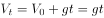（t为下落时间)，下落高度与时间的关系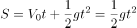。

A项错误，甲乙两球的初始高度相同即下落高度S相同，两球在竖直方向上同时做自由落体运动，根据S=1/2gt^2得到，甲乙两球的落地时间t也相同。

B项错误，由S=1/2gt^2可知，本题中甲乙两球下落时间只与初始高度有关，与球的重量无关，两球同时运动，甲球先落地，说明甲球的初始高度低于乙球。

C项错误，本题中甲乙两球下落时间只与初始高度有关，两球落地时间不同，说明初始高度不同，谁先落地，谁的初始位置就低.选项中未说明是甲先落地还是乙先落地，所以不能证明乙球的初始位置一定比甲球低。

D项正确，两球在竖直方向上同时做自由落体运动，垂直速度均为V_t=gt，只与时间有关系，所以在空中同一瞬间，两球垂直下落的速度是相同的。

故正确答案为D。

**考点**：物理常识

**来源**：2015年3月四川省选调优秀大学生到基层工作考试行政职业能力测验试卷（精选）第5题

### 第 6 题

下列说法中，不正确的是：

A. 向保温瓶灌开水时，不应灌得过满，这样保温效果会更好

B. 使用燃气炉灶烧水或炒菜，锅底压住火头可使锅升温快

C. 锅铲等炊具的柄用木料或塑料制成，是因为木料及塑料是热的不良导体

D. 炒菜主要是利用热传导方式传热，煮饭、烧水主要是利用对流方式传热

第 6 题 · 答案与解析

**参考答案（粉笔题库参考内容）**

B

**解析**

本题考查生活常识。

A项正确，往保温瓶灌开水时，要在瓶口留存一层空气，因为空气是热的不良导体，能更好地防止热量散失，保温效果会更好，所以不应灌得过满；

B项错误，燃气炉灶的火焰从内到外依次为焰心、内焰、外焰，其中外焰与空气充分接触，燃烧充分，温度最高。所以锅底放在火焰的外焰可以使锅快速升温，而不是压住火头；

C项正确，我们用来做饭、炒菜的锅都是用利于传导热的金属制成的，目的就是让热量尽快地传给待加热的食物，但为了防止烫手，我们选用木头、塑料、皮革等属于热的不良导体来制作这些炊具的手柄；

D项正确，热传导是指热量从系统的一部分传到另一部分或由一个系统传到另一系统的现象，是固体中热传递的主要方式。炒菜是通过铁锅与食物之间的热传导传热。对流是指液体或气体中较热部分和较冷部分之间通过循环流动使温度趋于均匀的过程，是液体和气体中热传递的特有方式，煮饭和烧水主要是利用水的对流传热。

本题为选非题，故正确答案为B。

**考点**：生活常识

**来源**：2015年3月四川省选调优秀大学生到基层工作考试行政职业能力测验试卷（精选）第6题

### 第 7 题

宽松货币政策的直接效果是：

A. 增加财政收入

B. 增加居民收入

C. 增加银行收入

D. 加大市场货币流动性

第 7 题 · 答案与解析

**参考答案（粉笔题库参考内容）**

D

**解析**

本题考查经济常识。货币政策是指中央银行通过各种工具调节货币供应量，影响利息率及经济中的信贷供应程度来间接影响总需求，以达到总需求与总供给趋于理想的均衡的一系列措施。宽松的货币政策就是增加市场上的货币供应量。

A项错误，财政收入的增加一般是通过调整财政政策来实现的；

B项错误，宽松的货币政策只能间接促进居民增收；

C项错误，银行的主要收入来源是贷款与存款的利率差，宽松的货币政策会间接对银行收入产生影响，但是未必是增加银行收入，要具体情况具体分析；

D项正确，货币供应量增加，带来的直接效果就是市场货币的流动性加大。

故正确答案为D。

**考点**：宏观经济与调控政策

**来源**：2015年3月四川省选调优秀大学生到基层工作考试行政职业能力测验试卷（精选）第7题

### 第 8 题

下列各项中，属于虚拟经济的是：

A. 通信业

B. 农业

C. 建筑业

D. 收藏业

第 8 题 · 答案与解析

**参考答案（粉笔题库参考内容）**

D

**解析**

本题考查经济常识。虚拟经济是一种以市场心理预期为主要定价方式，以虚拟资本交易为载体，脱离了实体经济的具体投入产出活动过程，以虚拟资本短期市场波动造成的价差收益为利润来源的经济活动，主要包括金融业、房地产业、体育经济、博彩业、收藏业等。实体经济是指物质的、精神的产品和服务的生产、流通等经济活动，包括农业、工业、交通通信业、商业服务业、建筑业、文化产业等物质生产和服务部门，也包括教育、文化、知识、信息、艺术、体育等精神产品的生产和服务部门等。

A项错误，通信业属于实体经济；

B项错误，农业属于实体经济；

C项错误，建筑业属于实体经济；

D项正确，收藏业属于虚拟经济。

故正确答案为D。

**考点**：宏观经济与调控政策

**来源**：2015年3月四川省选调优秀大学生到基层工作考试行政职业能力测验试卷（精选）第8题

### 第 9 题

下列中不属于我国经济特区的是：

A. 厦门

B. 威海

C. 深圳

D. 海南岛

第 9 题 · 答案与解析

**参考答案（粉笔题库参考内容）**

B

**解析**

本题考查地理国情。1979年7月，中共中央、国务院同意在广东省的深圳、珠海、汕头三市和福建省的厦门市试办出口特区。1980年5月，中共中央和国务院决定将深圳、珠海、汕头和厦门这四个出口特区改称为经济特区。1988年4月，设立海南经济特区。2010年5月，中央新疆工作会议上中央正式批准霍尔果斯、喀什设立经济特区。截至目前中国大陆地区共有7个经济特区，分别是深圳经济特区、珠海经济特区、厦门经济特区、汕头经济特区、海南经济特区、喀什经济特区、霍尔果斯经济特区。

A项正确，厦门经济特区于1980年10月批准设立，面积2.5平方公里。1984年2月，邓小平同志视察厦门后，厦门特区范围扩大到全岛，面积131平方公里；

B项错误，2011年威海南海新区被确定为重点建设的三大海洋经济新区之一，但是威海目前还不是我国的经济特区；

C项正确，深圳市经济特区于1980年8月正式成立，是我国最早设立的经济特区；

D项正确，海南经济特区成立于1988年4月，是我国唯一的省级经济特区。

本题为选非题，故正确答案为B。

**考点**：中国地理

**来源**：2015年3月四川省选调优秀大学生到基层工作考试行政职业能力测验试卷（精选）第9题

### 第 10 题

2015年我国政府工作报告中提到的“三证合一”中的“三证”不包括：

A. 税务登记证

B. 工商营业执照

C. 卫生许可证

D. 组织机构代码证

第 10 题 · 答案与解析

**参考答案（粉笔题库参考内容）**

C

**解析**

本题考查政治常识。“三证合一”，就是将企业依次申请的工商营业执照、组织机构代码证和税务登记证三证合为一证，提高市场准入效率。

可知，ABD项正确，C项错误。

本题为选非题，故正确答案为C。

【备注】内容现在已经过时。从2016年10月1日起，我国已经正式实施“五证合一、一照一码”，即在全面实施工商营业执照、组织机构代码证、税务登记证“三证合一”登记制度改革的基础上，再整合社会保险登记证和统计登记证，实现“五证合一、一照一码”。

**考点**：重要文件

**来源**：2015年3月四川省选调优秀大学生到基层工作考试行政职业能力测验试卷（精选）第10题

### 第 11 题

下列关于艺术知识的说法中，不正确的是：

A. 钢琴是一种打击乐器

B. 《向日葵》是荷兰画家梵·高的绘画杰作

C. 文学以语言塑造形象，反映社会生活

D. “马踏飞燕”是我国东汉青铜雕塑中的瑰宝

第 11 题 · 答案与解析

**参考答案（粉笔题库参考内容）**

A

**解析**

本题考查文化常识。

A项错误，钢琴是一种键盘乐器，有“乐器之王”的美称。打击乐器是一种以打、摇动、摩擦、刮等方式产生效果的乐器族群。比如在中国的戏剧中的磬、鼓、锣、钹，或者在说书时使用的快板、响板等,以及西洋乐器中的小军鼓、大军鼓、钹、木琴等；

B项正确，《向日葵》是荷兰印象派画家梵·高的代表作，该画用简练的笔法表现出植物形貌，充满了律动感及生命力；

C项正确，文学是指用语言塑造形象以反映社会生活，表达作者思想感情的艺术，现代通常把它分为小说、诗歌、戏剧、散文四种体裁；

D项正确，“马踏飞燕”为东汉青铜器，1969年出土于甘肃省武威市雷台汉墓，一直被视为中国古代高超铸造业的象征，是我国东汉青铜雕塑中的瑰宝。

本题为选非题，故正确答案为A。

**考点**：文化常识

**来源**：2015年3月四川省选调优秀大学生到基层工作考试行政职业能力测验试卷（精选）第11题

### 第 12 题

中国茶主要分为绿茶、红茶、白茶、黄茶、青茶、黑茶六大系。下列中对茶的分类正确的是：

A. 西湖龙井——绿茶

B. 大红袍——红茶

C. 君山银针——白茶

D. 铁观音——黄茶

第 12 题 · 答案与解析

**参考答案（粉笔题库参考内容）**

A

**解析**

本题考查人文常识。中国茶根据制作方法和茶多酚氧化(发酵)程度的不同，可分为六大类：绿茶(不发酵)、红茶(全发酵)、白茶(轻微发酵)、黄茶(轻发酵)、青茶(半发酵)、黑茶(后发酵)。

A项正确，绿茶基本特征是：叶绿汤清，清香、醇美、鲜爽。知名绿茶有西湖龙井、洞庭碧螺春、黄山毛峰、六安瓜片等；

B项错误，红茶基本特征是：香高、色艳、味浓，叶红汤红，滋味浓厚甘醇。知名红茶有祁红、滇红、正山小种等。大红袍属于青茶；

C项错误，白茶基本特征是：色白隐绿，汤色黄白，滋味鲜醇，清香甘美。知名白茶有白毫银针、白牡丹等。君山银针属于黄茶；

D项错误，黄茶基本特征是：叶黄汤黄、金黄明亮，甘香醇爽。知名黄茶有君山银针、北港毛尖、莫干黄芽等。铁观音属于青茶。

故正确答案为A。

**考点**：文化常识

**来源**：2015年3月四川省选调优秀大学生到基层工作考试行政职业能力测验试卷（精选）第12题

### 第 13 题

“兼听则明，偏信则暗”这一句古代名言出自：

A. 《史记》

B. 《论语》

C. 《荀子》

D. 《资治通鉴》

第 13 题 · 答案与解析

**参考答案（粉笔题库参考内容）**

D

**解析**

本题考查文学常识。“兼听则明，偏信则暗”意思是听取多方面的意见，才能明辨是非；听信单方面的话，就分不清是非。出自《资治通鉴·唐太宗贞观二年》：“上（唐太宗）问魏徵曰：‘人主何为而明，何为而暗？’对曰：‘兼听则明，偏信则暗。’”

可知，A、B、C三项错误，D项正确。

故正确答案为D。

**考点**：文学常识

**来源**：2015年3月四川省选调优秀大学生到基层工作考试行政职业能力测验试卷（精选）第13题

### 第 14 题

中国哲学史上有著名的“北宋五子”。下列人物中不属于“北宋五子”的是：

A. 程颢

B. 张载

C. 朱熹

D. 周敦颐

第 14 题 · 答案与解析

**参考答案（粉笔题库参考内容）**

C

**解析**

本题考查文化常识。北宋五子是指周敦颐、邵雍、张载、程颢、程颐。他们对北宋哲学思想的发展起了重要作用。

A项正确，程颢与程颐为同胞兄弟，世称“二程”。他们二人为北宋理学的奠基者，建立了系统的以精神性的“理”为核心的学说体系。他们共同的学术成就影响颇大，因其为洛阳人，世人称其为“洛学”。

B项正确，张载发展了“气一元论”的思想，是中国古代朴素唯物主义哲学思想史上杰出的代表。

C项错误，朱熹是南宋理学家，他是“二程”的三传弟子李侗的学生，与二程合称“程朱学派”。不属于北宋五子。

D项正确，周敦颐为宋代理学的开山鼻祖，其学说混合了道家无为思想和儒家中庸思想，代表作有《太极图说》《通书》等。

本题为选非题，故正确答案为C。

**考点**：文化常识

**来源**：2015年3月四川省选调优秀大学生到基层工作考试行政职业能力测验试卷（精选）第14题

### 第 15 题

下列说法中，错误的一项是：

A. 深夜两点是肝脏的排毒时间

B. 胃属于五脏六腑中的“脏”

C. 运动的最佳时间是下午四点

D. 两眉间的位置称为“印堂”

第 15 题 · 答案与解析

**参考答案（粉笔题库参考内容）**

B

**解析**

本题考查生物常识。

A项正确，中医理论认为，肝脏的排毒时间为凌晨一点到三点；

B项错误，“五脏六腑”是人体内脏器官的统称。“五脏”是对人体内心、肝、脾、肺、肾五个器官的合称；“六腑”是对胃、大肠、小肠、三焦、膀胱、胆六个器官的合称。胃属于五脏六腑中的“腑”；

C项正确，中医理论认为，运动的最佳时间是下午四点。因为经过大半天的日常工作，人体的肌肉韧带已得到了充分的活动，心率血压趋于平稳，可以进行较为剧烈的有氧运动，如跑步、打球、游泳、器械健身等；

D项正确，我国中医通常把两眉间的位置称为“印堂”，这是中医理论中重要的穴位。

本题为选非题，故正确答案为B。

**考点**：生物常识

**来源**：2015年3月四川省选调优秀大学生到基层工作考试行政职业能力测验试卷（精选）第15题

### 第 16 题

做官先做人，为政先修德。领导干部如果忘记做人之本，＿＿＿＿从政之基，不仅会毁了自己，更会＿＿＿＿党和人民的事业。对此，不可不时刻自重、自省、自警、自励。

A. 抛弃 贻害

B. 废弃 危害

C. 遗弃 破坏

D. 放弃 损坏

第 16 题 · 答案与解析

**参考答案（粉笔题库参考内容）**

A

**解析**

第一空，与“从政之基”搭配，A项“抛弃”指扔掉不要，丢弃，与“从政之基”搭配恰当，保留；B项“废弃”指抛弃不用，多指抛弃没有利用价值的东西，与“从政之基”搭配不当，排除；C项“遗弃”指不顾情感、忠诚或义务的约束而抛弃，多指家庭成员中负有赡养、扶养义务的一方不履行其应尽的义务的违法行为，与“从政之基”搭配不当，排除；D项“放弃”指丢掉，不坚持，与“从政之基”搭配恰当，保留。

第二空，与“事业”搭配，A项“贻害”指使受损害，用于横线处表示使党和人民的事业受损害，搭配恰当，当选；D项“损坏”指由于各种原因造成的物件残破，与“事业”搭配不当，排除。

故正确答案为A。

【文段出处】《做官先做人 为政先修德》

**考点**：实词填空、词的辨析-搭配对象

**来源**：2015年3月四川省选调优秀大学生到基层工作考试行政职业能力测验试卷（精选）第16题

### 第 17 题

世界永远充满着龌龊与清洁的＿＿＿＿，而清清世界、朗朗乾坤不仅是中国人的社会＿＿＿＿，也是一种审美追求。

A. 角逐 理想

B. 追逐 梦想

C. 角逐 梦想

D. 追逐 理想

第 17 题 · 答案与解析

**参考答案（粉笔题库参考内容）**

A

**解析**

第一空，横线处需表达“龌龊”与“清洁”的关系，两者之间为相反相对关系，故横线处应表达出竞争、较量之意，“角逐”泛指竞争或竞赛，符合文意，保留；“追逐”指迅速积极地追寻逃跑的东西，与文意不符，排除B、D两项。

第二空，横线处与“追求”并列，A项“理想”是对未来事物的美好想象和希望，是短期或长期的一个奋斗目标，与“追求”语意相近，当选；C项“梦想”是内心一个可望而不可及的梦，清清世界、朗朗乾坤是经过努力可以达到的，不符合文意，排除。

故正确答案为A。

【文段出处】《一丸冷月的韵味》

**考点**：关联关系-并列关系、实词填空

**来源**：2015年3月四川省选调优秀大学生到基层工作考试行政职业能力测验试卷（精选）第17题

### 第 18 题

千万年来，狗一直是人类最忠诚的朋友。但无论如何，爱狗与吃狗，这是且只是一个＿＿＿＿之争，不该是＿＿＿＿之争。这里不存在道德水准的高下，不能有丝毫强制。

A. 制度 文化

B. 文化 制度

C. 风尚 观念

D. 观念 风尚

第 18 题 · 答案与解析

**参考答案（粉笔题库参考内容）**

B

**解析**

第一空，对应“不存在道德水准的高下，不能有丝毫强制”，A项“制度”指要求大家共同遵守的规章或准则，具有强制性，排除；B项“文化”指地区人类的生活要素形态的统称，不存在道德水准的高下也没有强制性，符合文意，保留；C项“风尚”指在一定社会时期中社会上流行的风气和习惯，不存在道德水准的高下也没有强制性，符合文意，保留；D项“观念”指思想意识，客观事物在人脑里留下的概括形象，因为具有主观性，会用一定的道德水准去评价，排除。

第二空，由“是且只是······不该是”与第一空构成反义并列，前后语义相反，即存在道德水准的高下，具有强制性。B项“制度”既存在用道德标准评价也具有强制性，当选；C项“观念”并无强制性，排除。

故正确答案为B。

【文段出处】《我和狗狗有个约定：养者莫抛弃，食者不虐杀》

**考点**：关联关系-并列关系、实词填空、对应关系-前后呼应

**来源**：2015年3月四川省选调优秀大学生到基层工作考试行政职业能力测验试卷（精选）第18题

### 第 19 题

我们的古代先贤早就发现了饮食搭配的＿＿＿＿，并用＿＿＿＿＿＿＿＿的诗句勾画出了黄金原则。比如“五畜适为益，过则害非浅”，是说动物性食物不能吃得太多，过量就会危害健康。

A. 奥秘 生动活泼

B. 奥秘 言简意赅

C. 奥妙 生动活泼

D. 奥妙 言简意赅

第 19 题 · 答案与解析

**参考答案（粉笔题库参考内容）**

D

**解析**

第一空，与“饮食搭配”搭配，并对应后文所举例子，说明“饮食搭配”的作用，“奥秘”指深奥的尚未被认识的秘密，饮食搭配并非深奥的秘密，搭配不当，排除A、B两项；“奥妙”指深奥微妙，微妙即体现出“饮食搭配”的作用，符合文意，保留。

第二空，对应例子部分内容，“五畜适为益，过则害非浅”言简意赅的总结了“动物性食物不能吃得太多，过量就会危害健康”，而并非生动活泼的语言，排除C项。

故正确答案为D。

【文段出处】《中国人怎么吃：古人教我们搭配饮食》

**考点**：对应关系-解释说明、混搭填空、词的辨析-搭配对象

**来源**：2015年3月四川省选调优秀大学生到基层工作考试行政职业能力测验试卷（精选）第19题

### 第 20 题

“何堪最长夜，俱作独眠人”，古人早就＿＿＿＿地觉察到了“昼短夜长”的现象。他们认为，冬至是死而复生的关键点，因此，冬至绝事、安身静体便是模拟死亡，以待回归。这是古老农事信仰的＿＿＿＿。

A. 敏感 展现

B. 敏锐 体现

C. 细致 反应

D. 细腻 反映

第 20 题 · 答案与解析

**参考答案（粉笔题库参考内容）**

B

**解析**

第一空，横线处搭配“觉察”，体现古人对“昼短夜长”这一自然现象的感知能力。A项“敏感”指感觉敏锐、反应迅速，B项“敏锐”指知觉精细而灵敏，均符合文意，保留。C项“细致”指办事精细周密或事物细密精致，D项“细腻”指细致光滑，一般形容描写、表演等，均与“觉察”搭配不当，排除。

第二空，横线处搭配“信仰”，且文段强调冬至绝事、安身静体是古老农事信仰的表现。B项“体现”指某种性质或现象通过某一事物具体表现出来，符合文意，当选。A项“展现”指明显地表现出，通常搭配“景象”“风采”等，与“信仰”搭配不当，排除。

故正确答案为B。

【文段出处】《老节令的余韵》

**考点**：实词填空、对应关系-前后呼应、词的辨析-搭配对象

**来源**：2015年3月四川省选调优秀大学生到基层工作考试行政职业能力测验试卷（精选）第20题

### 第 21 题

动漫创作需要有更＿＿＿＿的眼界，不仅要盯着孩子眼中的世界，更要看看成年人在想什么、做什么。好莱坞的动画片往往＿＿＿＿了游戏、电影和音乐等许多相关文化领域的热点。

A. 广阔 荟萃

B. 开阔 融合

C. 深刻 贯穿

D. 深广 汇集

第 21 题 · 答案与解析

**参考答案（粉笔题库参考内容）**

B

**解析**

第一空，搭配“眼界”，且对应后文“不仅要······更要”，表达出宽阔之意，A项“广阔”指广大宽阔，与“眼界”搭配恰当，符合文意，保留；B项“开阔”指宽广，符合文意，保留。C项“深刻”指透彻、深入，与“眼界”搭配不当，排除；D项“深广”指胸怀宽阔或内容、意义等深刻广大，与“眼界”搭配不当，排除。

第二空，对应横线后“许多相关文化领域的热点”，形容“动画片”中包含了多个方面，A项“荟萃”通常指杰出的人物或精美的东西会集、聚集，搭配不当，排除。B项“融合”指融成一体，符合文意，当选。

故正确答案为B。

【文段出处】《国际动漫名家寄语漫:精致是技术指标 更是表达方式》

**考点**：实词填空、词的辨析-搭配对象

**来源**：2015年3月四川省选调优秀大学生到基层工作考试行政职业能力测验试卷（精选）第21题

### 第 22 题

如何将一项草根赛事办出声势、办出影响？“谁是球王”给出的答案是：合理调配各种资源，有名将助阵而不＿＿＿＿＿＿＿＿，让体育爱好者真正成为赛场主角。纵观整个赛事的运作过程，乒乓名将甘愿为草根选手做陪衬的务实心态的确是＿＿＿＿＿＿＿＿、堪称楷模。

A. 鸠占鹊巢 可圈可点

B. 喧宾夺主 可圈可点

C. 鸠占鹊巢 可歌可泣

D. 喧宾夺主 可歌可泣

第 22 题 · 答案与解析

**参考答案（粉笔题库参考内容）**

B

**解析**

第一空，横线后“让体育爱好者真正成为赛场主角”为横线处解释说明，“鸠占鹊巢”比喻抢占别人的住屋或占据别人的位置，用于此处程度过重，排除A、C项；“喧宾夺主”比喻外来的或次要的事物占据了原有的或主要的事物的位置，用于此处表示名将助阵而不要占据了体育爱好者成为赛场主角的主要地位，符合文意；

第二空，形容“务实心态”，与“堪称楷模”并列，B项“可圈可点”形容表现好，值得肯定或赞扬，符合文意，当选；D项“可歌可泣”形容英勇悲壮的感人事迹，不能形容务实心态，排除。

故正确答案为B。

【文段出处】《国际动漫名家寄语漫:精致是技术指标 更是表达方式》

**考点**：关联关系-并列关系、成语填空、词的辨析-程度轻重

**来源**：2015年3月四川省选调优秀大学生到基层工作考试行政职业能力测验试卷（精选）第22题

### 第 23 题

21世纪，我国高校在适应当代社会转型的过程中，面对着一个＿＿＿＿＿＿＿＿的开放的世界，同时面临的问题、困难和挑战更是异乎寻常。历史赐予的难得机遇，使我国高校的改革发展不仅赶上了新一轮世界高校改革的潮流，而且已经形成这个潮流中最＿＿＿＿＿＿＿＿的景观。

A. 波谲云诡 宏伟壮丽

B. 今非昔比 鬼斧神工

C. 历久弥新 光彩夺目

D. 日新月异 波澜壮阔

第 23 题 · 答案与解析

**参考答案（粉笔题库参考内容）**

D

**解析**

第一空，形容“开放的世界”，A项“波谲云诡”形容事物变幻莫测，搭配恰当，保留；B项“今非昔比”指现在不是过去能比得上的，多指形势、自然面貌等发生了巨大的变化，与“开放的世界”搭配不当，排除；C项“历久弥新”指经历长久的时间而更加鲜活，更加有活力，与“开放的世界”搭配不当，排除；D项“日新月异”指发展或进步迅速，不断出现新事物、新气象，符合文意，保留。

第二空，形容“景观”，搭配“潮流”，A项“宏伟壮丽”形容景象、建筑雄伟，与“潮流”搭配不当，排除；D项“波澜壮阔”原形容水面辽阔，现比喻声势雄壮或规模宏大，与“潮流”搭配恰当，当选。

故正确答案为D。

【文段出处】《大学之道:求索与实践》

**考点**：成语填空、词的辨析-搭配对象

**来源**：2015年3月四川省选调优秀大学生到基层工作考试行政职业能力测验试卷（精选）第23题

### 第 24 题

＿＿＿＿＿＿＿＿的语言文字，＿＿＿＿＿＿＿＿的文化典籍，嘉惠世界的科技工艺，精彩纷呈的文学艺术，充满智慧的哲学宗教，完备深刻的道德伦理，共同构成了中国文化的基本内容。

A. 独树一帜 汗牛充栋

B. 独具特色 浩如烟海

C. 独具一格 不可胜数

D. 独出心裁 不计其数

第 24 题 · 答案与解析

**参考答案（粉笔题库参考内容）**

B

**解析**

第一空，搭配“语言文字”，A项“独树一帜”比喻与众不同，自成一家，与“语言文字”搭配不当，排除；B项“独具特色”指具有自己的特色，与“语言文字”搭配恰当；C项“独具一格”指单独有一种特别的风格、格调，与“语言文字”搭配恰当；D项“独出心裁”原指诗文的构思有独特之处，后泛指想出的办法或做工与众不同，与“语言文字”搭配不当，排除；

第二空，形容“文化典籍”，B项“浩如烟海”形容文献、资料、书籍等多得无法计算；C项“不可胜数”形容数量极多，此处用来形容“文化典籍”，浩如烟海更符合文意，当选。

故正确答案为B。

【文段出处】《文化的艺术——加强中国文化对外传播交流的现实背景和策略》

**考点**：成语填空、词的辨析-搭配对象

**来源**：2015年3月四川省选调优秀大学生到基层工作考试行政职业能力测验试卷（精选）第24题

### 第 25 题

虽然做选择与以某种方式对待快乐＿＿＿＿，但选择并不意味着要全然放弃快乐。在快乐问题上，亚里士多德显然＿＿＿＿多数人的意见，即“快乐是一种善”，抱着尊重的态度。

A. 相似 基于

B. 有关 基于

C. 有关 对于

D. 相似 对于

第 25 题 · 答案与解析

**参考答案（粉笔题库参考内容）**

C

**解析**

第一空，横线处形容“选择”与“以某种方式对待快乐”之间的关系，且由“但”与后文构成转折关系，由此可知，横线处应填入表示有关之意，“相似”程度过重，排除A、D两项；

第二空，横线处表示对于多数人的意见，亚里士多德是持尊重态度的，C项符合文意，当选；B项，“基于”为由于、根据之意，与文意不符，排除。

故正确答案为C。

【文段出处】《伦理学中的幸福问题——以亚里士多德为中心》

**考点**：实词填空、词的辨析-程度轻重

**来源**：2015年3月四川省选调优秀大学生到基层工作考试行政职业能力测验试卷（精选）第25题

### 第 26 题

深入基层、深入实际、深入群众，在改革发展的主战场、维护稳定的第一线、服务群众的最前沿去经受考验，才能不断＿＿＿＿意志、＿＿＿＿品质、＿＿＿＿作风、积累经验，不断丰富和充实自己，做到学用结合，从群众中来，到群众中去，不断提高应对艰苦复杂环境的能力和服务经济社会发展的本领。

A. 磨炼 锤炼 砥砺

B. 历练 锤炼 强化

C. 历练 锻炼 砥砺

D. 磨炼 锻炼 强化

第 26 题 · 答案与解析

**参考答案（粉笔题库参考内容）**

A

**解析**

第一空，与“意志”搭配，“磨炼”指在艰难困苦的环境中锻炼，磨炼意志为固定搭配；“历练”指经历世事，与意志搭配不当，排除B、C两项；

第二空，与“品质”搭配，A项，“锤炼”指锻炼、磨炼；D项，“锻炼”指锻造冶炼，均与“品质”搭配恰当；

第三空，与“作风”搭配，A项，“砥砺”指磨练，用于此处表示在最前沿磨练作风，搭配恰当，当选；D项“强化”指增强，加强，与“作风”搭配不当，排除。

故正确答案为A。

【文段出处】《\[滇云新谈\]经得起磨砺》

**考点**：实词填空、词的辨析-搭配对象

**来源**：2015年3月四川省选调优秀大学生到基层工作考试行政职业能力测验试卷（精选）第26题

### 第 27 题

中国的胶原蛋白、胶原肽研发应用正处在发展的关键期，目前科学研究＿＿＿＿ 、消费需求＿＿＿＿、投资热情＿＿＿＿，特别需要各界的关注、支持和爱护，使之能够尽早发展成熟，造福国民。

A. 活跃 旺盛 高涨

B. 丰富 高涨 旺盛

C. 积极 活跃 蓬勃

D. 超前 巨大 热烈

第 27 题 · 答案与解析

**参考答案（粉笔题库参考内容）**

A

**解析**

可从第三空入手，横线处搭配“热情”，选项中的四个词语中，A项“热情高涨”为固定搭配，“旺盛”“蓬勃”“热烈”均不能搭配“热情”；

验证第一、二空，“研究活跃”“需求旺盛”均搭配恰当。

故正确答案为A。

【文段出处】《科学实证还胶原蛋白（肽）市场健康》

**考点**：实词填空、词的辨析-搭配对象

**来源**：2015年3月四川省选调优秀大学生到基层工作考试行政职业能力测验试卷（精选）第27题

### 第 28 题

家庭承包经营使土地的使用权和所有权分离，确定了家庭在农业生产中的主体地位。农民的利益与土地产出直接＿＿＿＿，极大地调动了农民的生产积极性，促进了农村经济高速发展。在这种改革形式中，土地所有权仍然＿＿＿＿集体，土地按人口或劳动力分配给农民耕种，农民由此取得土地的承包经营权，成为集体经济组织内部一个相对独立的经营主体。

A. 相关 归于

B. 挂钩 属于

C. 统一 属于

D. 匹配 归于

第 28 题 · 答案与解析

**参考答案（粉笔题库参考内容）**

B

**解析**

从第二空入手，横线处表示土地所有权还是归集体所有，并未发生变化，“属于”指归于某一方面，为某一方面所有，符合文意； “归于”指属于，但多指抽象事物，搭配不当，排除A、D两项；

第一空，横线处需体现出“农民利益”与“土地产出”的联系， B项“挂钩”比喻建立某种联系，符合文意，当选；C项“统一”指使成一体，没有差别，与文意不符，排除。

故正确答案为B。

【文段出处】《当前中国农民面临的四大突出问题及对策研究》

**考点**：实词填空、词的辨析-搭配对象

**来源**：2015年3月四川省选调优秀大学生到基层工作考试行政职业能力测验试卷（精选）第28题

### 第 29 题

农业项目投入大、回收低、周期长、见效慢、比较效益低，合作社自身积累用于再生产和延长产业链条方面的投入显得＿＿＿＿＿＿＿＿。

A. 尺短寸长

B. 相形见绌

C. 捉襟见肘

D. 乏善可陈

第 29 题 · 答案与解析

**参考答案（粉笔题库参考内容）**

C

**解析**

横线处与“投入”搭配，根据文意可知，农业项目投入大，而合作社自身积累用于再生产和延长产业链条方面的投入不足，故横线处应体现处“不足”之意，对应C项，“捉襟见肘”比喻顾此失彼，穷于应付，当选；A项“尺短寸长”比喻人或物各有长处，也各有短处；B项“相形见绌”指和同类的事物相比较显出不足；D项“乏善可陈”比喻一件事物没有什么优点可说。A、B、D三项语意均与文意不符，排除。

故正确答案为C。

**考点**：对应关系-前后呼应、成语填空

**来源**：2015年3月四川省选调优秀大学生到基层工作考试行政职业能力测验试卷（精选）第29题

### 第 30 题

相传，达·芬奇每4小时睡15～20分钟，余下大把的时间从事创作，而且能保持充沛的精力。不少＿＿＿＿这种睡眠法的人都希望通过它来缩短睡眠的总体时间，但心理学家认为这没有什么科学依据。

A. 迷信

B. 青睐

C. 崇尚

D. 膜拜

第 30 题 · 答案与解析

**参考答案（粉笔题库参考内容）**

A

**解析**

横线处与“睡眠法”搭配，由文意可知，达·芬奇每4小时睡15～20分钟的睡眠法是没有科学根据的，故横线处应体现出没有依据之意。A项“迷信”指盲目的相信，不理解的相信，对应睡眠法没有科学根据，符合文意，当选；B项“青睐”指喜爱或重视；C项“崇尚”指尊崇、提倡；D项“膜拜”表示极端恭敬或畏服的行礼方式。B、C、D三项均无法体现出没有依据之意，排除。

故正确答案为A。

【文段出处】《学会科学熬夜》

**考点**：实词填空、对应关系-前后呼应

**来源**：2015年3月四川省选调优秀大学生到基层工作考试行政职业能力测验试卷（精选）第30题

### 第 31 题

下面漫画最恰当的标题是：

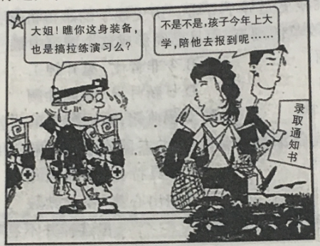

A. 李代桃僵

B. 越俎代庖

C. 娇生惯养

D. 倾巢出动

第 31 题 · 答案与解析

**参考答案（粉笔题库参考内容）**

C

**解析**

图片描述内容为：一位母亲陪儿子去大学报到，孩子的行李全部背到母亲的身上，一位拉练演习的军人误认为她满身的行李也是在拉练演习，漫画意在讽刺现在家长在孩子成长路上全权包办的现象，过分溺爱孩子，即对孩子娇生惯养，对应C项；

A项“李代桃僵”比喻互相顶替或代人受过，图片中母亲只是去陪孩子报到，并非代其受过，与图片描述信息不符，排除；

B项“越俎代庖”比喻超出自己业务范围去处理别人所管的事，与图片描述信息不符，排除；

D项“倾巢出动”指全部出动，图片中只有母亲一人送孩子报到，与图片描述信息不符，排除。

故正确答案为C。

**考点**：标题填入题

**来源**：2015年3月四川省选调优秀大学生到基层工作考试行政职业能力测验试卷（精选）第31题

### 第 32 题

如果我们有智慧，我们就知道，“有”不过是当人类懂得很少的时候的一种能力。对于经历简单、所见所闻很少的先人来说，他们根本上是从一无所知中开始建立自己的意识，开始建立自己对世界的认知。当人类看到的历史越多，当人类懂的东西越多，当人类经历的东西越多，人类就越会明白，一切以“有”为念的东西都是短暂的，一切的拥有都是短暂的，没有人可以在“有”之念下永恒拥有任何东西，永恒拥有的只有“无”。

从这段话可以推知，错误的一项是：

A. “无”才是一种永恒的“有”

B. “有”的观念根源于人的无知

C. 作者推崇无中生有的观点

D. 作者反对“有”的人生追求

第 32 题 · 答案与解析

**参考答案（粉笔题库参考内容）**

C

**解析**

A项根据“一切以‘有’为念的东西都是短暂的，一切的拥有都是短暂的，没有人可以在‘有’之念下永恒拥有任何东西，永恒拥有的只有‘无’”可知，“无”才是一种永恒的“有”，选项表述正确，排除；

B项，根据“对于经历简单、所见所闻很少的先人来说，他们根本上是从一无所知中开始建立自己的意识，开始建立自己对世界的认知”可知，选项表述正确，排除；

C项，无中生有，文段并未提及作者推崇在“无”中去拥有的观点；

D项，由“一切以‘有’为念的东西都是短暂的，一切的拥有都是短暂的，没有人可以在‘有’之念下永恒拥有任何东西”可知，作者反对“有”的人生追求，选项表述正确，排除。

本题为选非题，故正确答案为C。

**考点**：细节判断题

**来源**：2015年3月四川省选调优秀大学生到基层工作考试行政职业能力测验试卷（精选）第32题

### 第 33 题

出生性别比是新生婴儿中每100个活产女婴所对应的活产男婴数量（出生性别比=男婴出生数/同期女婴出生数×100)，其正常值范围是103～107，男婴略占上风。1990年、2000年和2010年三次全国人口普查显示，男女出生性别比分别为111.27、116.86和121.21。自2005年以来，中国男女出生性别比一直在120左右的高水平徘徊。由于各年龄男性的死亡水平都略高于女性，大量的社会底层男性难以找到合适的配偶，而针对女性的婚姻买卖、性侵害事件则时有发生。

这段文字意在强调：

A. 出生性别比失衡对婚姻家庭秩序形成冲击

B. 出生性别比失衡已经成为中国的人口顽疾

C. 剩男、剩女现象与出生性别比的失衡有关

D. 女性的缺乏已造成婚龄期的男女比例失调

第 33 题 · 答案与解析

**参考答案（粉笔题库参考内容）**

A

**解析**

文段首先介绍出生性别比的概念，然后以1990年、2000年、2010年的人口普查为例，介绍女性逐渐多于男性，尾句首先介绍男性死亡率高于女性这一现状，随后引出结论，即社会底层男性难找配偶等社会问题随之发生，故文段重在强调出生性别比失衡对婚姻家庭等的危害，对应A项；

B项，“人口顽疾”表述不明确，并未点名出生性别比失衡带来的具体问题，排除；

C项，“剩女现象”无中生有，文中仅指出大量男性难以找到配偶，排除；

D项，根据文意可知，中国男少女多，而非缺少女性，选项表示内容与文意相悖，排除。

故正确答案为A。

【文段出处】《如何医治性别比例失衡的顽疾》

**考点**：关联词-因果、分述句特征-数据资料

**来源**：2015年3月四川省选调优秀大学生到基层工作考试行政职业能力测验试卷（精选）第33题

### 第 34 题

每天的环境监测数字都提醒着我们空气的糟糕，可能往哪里迁移呢？宜居的地方，缺少发展机会；充满着发展机会的城市，却越来越不宜居。即使开上了宝马，住上了别墅，却没有了干净的水可以喝，没有了清洁的空气可以呼吸，幸福感就这样渐渐降低。我们不仅正面临着“一边开宝马一边喝污水”的悲惨式发展，也面临着“一边住别墅一边被污染”的环境危机。当然，我们不能完全归咎于环保部门，但环保部门的确应该有所作为。

从这段话可以推知，作者的感情主要是：

A. 愤懑

B. 焦虑

C. 无奈

D. 担忧

第 34 题 · 答案与解析

**参考答案（粉笔题库参考内容）**

B

**解析**

文段开篇引出往哪里迁移的问题，并说明并没有合适的迁移之地，而后介绍生活条件好了，但环境差了，我们正面临着一种尬尴的局面，尾句说明虽不能把所有的责任归为环保部门，但环保部分应该有所作为，整个文段主要介绍目前我们所处的尴尬局面，故文段中作者的感情主要为“焦虑”。

A项“愤懑”指愤慨、气愤，文段并未体现出气愤之意，排除；

C项“无奈”表示没有办法了，无计可施，根据尾句“环保部门的确应该有所作为”可知，希望仍在，并非没有办法，排除；

D项“担忧”多指为未发生的事发愁，文中侧重介绍目前已有的境况，排除。

故正确答案为B。

【文段出处】《不能让污染继续吞噬国民的幸福感》

**考点**：分述句特征-引入铺垫

**来源**：2015年3月四川省选调优秀大学生到基层工作考试行政职业能力测验试卷（精选）第34题

### 第 35 题

索马里海盗可以切断全球经济的运输命脉，埃博拉病毒能够穿透全球卫生防疫体系威胁人类安全，华尔街的蝴蝶扇一扇翅膀全球股市都会为之而动，今天的世界，正处于一个由单极向多极过渡的新时期，比以往任何时候都更需要强调共治的重要性。一个国家安全而其他国家不安全，这样的和平不会长久；发展成果自己独享，发展包袱甩给别人，这样的发展不可持续；凡事奉行赢者通吃，以自家意志主导世界，这样的治理不得人心。

从这段文字可以推知，作者赞同的是：

A. 唯宽可以容人，唯厚可以载物

B. 穷则独善其身，达则兼济天下

C. 天时不如地利，地利不如人和

D. 众力无敌天下，众智无畏圣人

第 35 题 · 答案与解析

**参考答案（粉笔题库参考内容）**

D

**解析**

文段开篇介绍目前世界上的威胁影响面会极为广泛，而后通过“需要”引出对策，即“共治”，也就是需要团结协作，后文通过三个反面论证说明，不团结协作是存在问题的，故文段重在说明团结协作的重要性，对应D项，“众力无敌天下，众智无畏圣人”，众力、众智强调团结的力量和共治；

A项“唯宽可以容人，唯厚可以载物”强调宽容和包容，排除；B项“穷则独善其身，达则兼济天下”指不得志的时候就要管好自己的道德修养，得志的时候就要努力让百姓都能得到好处；C项“天时不如地利，地利不如人和”强调成功路上需要的条件。A、B、C三均未体现出团结、共治之意，排除。

故正确答案为D。

【文段出处】《张砥：人类更团结才能抵挡天灾人祸》

**考点**：关联词-对策、分述句特征-多角度论述、分述句特征-引入铺垫

**来源**：2015年3月四川省选调优秀大学生到基层工作考试行政职业能力测验试卷（精选）第35题

### 第 36 题

与白丁相比，有知识的人具有更高的平台，也具有更高的视野，比如分析问题、解决问题的能力，比如获得财富的资源优势，比如获得创新的基础保障······退一步讲，即便知识没有给自己带来预期中的财富，没有达到理想中的成功，但其对个人思维的改造、禀赋的优化，都具有不可替代的作用。若是自抱自怨，在目标与现实之中迷失了方向，即便是学历再高，知识再多，也可能难以逃脱“知识无力”的困惑，并处于“何以成功”的迷茫之中。

对这段文字的理解，错误的一项是：

A. 知识赋予人的属于综合性因素

B. 知识的多少会影响成功的结果

C. “知识无力”是人的认识错位

D. “知识改变命运”并非真理

第 36 题 · 答案与解析

**参考答案（粉笔题库参考内容）**

D

**解析**

A项，根据“有知识的人具有更高的平台，也具有更高的视野，比如分析问题、解决问题的能力，比如获得财富的资源优势，比如获得创新的基础保障”可知，知识带给人的影响是综合性的，符合文意，排除；

B项，根据“与白丁相比，有知识的人具有更高的平台，也具有更高的视野”可知，知识的多少会影响成功的结果，符合文意，排除；

C项，根据“若是自抱自怨，在目标与现实之中迷失了方向，即便是学历再高，知识再多，也可能难以逃脱‘知识无力’的困惑”可知，“知识无力”是在目标与现实之中迷失了方向，是人的认识错位，符合文意，排除；

D项，文段重点阐述知识对人命运的影响，根据文意，“即便知识没有给自己带来预期中的财富，没有达到理想中的成功”也不能否定“知识改变命运”，选项与文意相悖，当选。

本题为选非题，故正确答案为D。

【文段出处】扬子晚报《27岁准博导是对“知识无力”的反证》

**考点**：细节判断题

**来源**：2015年3月四川省选调优秀大学生到基层工作考试行政职业能力测验试卷（精选）第36题

### 第 37 题

媒体融合成为传媒行业的政策选择与战略取向，意义深远。新媒体不只是冲击了传统媒体，更是在改变世界，在改变社会关系、社会结构与社会运动方式，在改变媒体与使用者的关系，在改变公众的信息消费偏好、信息消费行为和消费体验评价标准。传统媒体今天的转型，已不能只是一般转型、一般创新，而必须是颠覆式创新，媒体融合亦然。仅仅想在传统媒体基础上利用新媒体工具，而传统部分仍一如既往，并不能有效增强传统媒体的适应能力与竞争力。

这段文字表明，“媒体融合”的改变应该是：

A. 现实环境

B. 核心挑战

C. 变革方式

D. 传播取向

第 37 题 · 答案与解析

**参考答案（粉笔题库参考内容）**

C

**解析**

文段开篇指出媒体融合是传媒行业的政策选择与战略取向，接着介绍新媒体带来的多方面改变，随后强调传统媒体转型必须是颠覆式创新，媒体融合也是如此，尾句进行反面论证，故文段重点围绕媒体融合应该如何改变展开，对应C项。

A项“现实环境”对应新媒体带来的改变，并非媒体融合的改变方向，排除；

B项“核心挑战”和D“传播取向”文段并未提及，均无中生有，排除。

故正确答案为C。

【文段出处】《颠覆式创新驱动媒体融合》

**考点**：关联词-对策

**来源**：2015年3月四川省选调优秀大学生到基层工作考试行政职业能力测验试卷（精选）第37题

### 第 38 题

优秀的少儿图书是少年儿童启蒙、成长的良师益友。但是，孩子们会主动选择让他们快乐的书，却无法判断书中传达的观念是否正确。因此，好的少儿图书要能在轻松愉快的文字和图画中，在有趣的故事情节中，带给孩子知识的积累和能力的提升，给他们积极向上的正能量——从而为他们建立起与自己、与自然、与社会的关系打下扎实的基础。

从这段文字可以推知，错误的一项是：

A. 少儿出版物的把关与遴选对孩子们而言非常重要

B. 少儿图书能启发和塑造孩子观察世界的思维方式

C. 优秀的少儿图书要保持知识结构体系的递进发展

D. 少儿图书对孩子的成长而言具有不可替代的功能

第 38 题 · 答案与解析

**参考答案（粉笔题库参考内容）**

B

**解析**

A项，根据“孩子们会主动选择让他们快乐的书，却无法判断书中传达的观念是否正确”可知，少儿出版物的把关与遴选对孩子们而言非常重要，选项表述正确，排除；

B项，无中生有，文段并没有关于“启发和塑造孩子观察世界的思维方式”的描述，当选；

C项，根据“好的少儿图书要能在轻松愉快的文字和图画中······从而为他们建立起与自己、与自然、与社会的关系打下扎实的基础”可知，优秀的少儿图书要保持知识结构体系的递进发展，从而建立起与自己、与自然、与社会的关系，选项表述正确，排除；

D项，由“好的少儿图书要能在轻松愉快的文字和图画中，在有趣的故事情节中，带给孩子知识的积累和能力的提升，给他们积极向上的正能量”可知，少儿图书对孩子成长而言具有不可替代的功能，选项表述正确，排除。

本题为选非题，故正确答案为B。

【文段出处】《对话七位专家学者：坚守少儿出版的精神高地》

**考点**：细节判断题

**来源**：2015年3月四川省选调优秀大学生到基层工作考试行政职业能力测验试卷（精选）第38题

### 第 39 题

原创性的科学研究，本来就是一种“言人所未言，见人所未见”的创造性活动，如果没有科学家的独辟蹊径、标新立异，如何于未知处发现宝藏？这种学术个性，包括独立的学术思想与技术体系，往往会产生突破传统的思维和基于实际研究的异想天开。诚然，学术个性的形成往往源于科学家的教育背景、国家文化、生活经验和科研经历，很难遵循某种方式刻意培养。但可以肯定的是，尊重差异、鼓励质疑的科研风气，一定会让更多能够创新的学术个性“冒出来”。

对这段文字的理解，正确的一项是:

A. 共性与个性碰撞才能激荡出科学的火花

B. 只有大胆的假设才可能孕育科学的灵光

C. 学术个性的形成根植于卓越的科研团队

D. 科学的灵感源于对研究对象的本质理解

第 39 题 · 答案与解析

**参考答案（粉笔题库参考内容）**

B

**解析**

B项，根据“如果没有科学家的独辟蹊径、标新立异，如何于未知处发现宝藏？”及“但可以肯定的是，尊重差异、鼓励质疑的科研风气，一定会让更多能够创新的学术个性‘冒出来’”可知，选项表述正确；

A项“共性”、C项“科研团队”、D项“科学的灵感”均为无中生有，文段并未提及，排除。

故正确答案为B。

【文段出处】《科学家的学术个性（科技杂谈）》

**考点**：细节判断题

**来源**：2015年3月四川省选调优秀大学生到基层工作考试行政职业能力测验试卷（精选）第39题

### 第 40 题

人体免疫系统内有一种自然杀伤细胞，专门负责识别、攻击和消灭癌细胞及其他异常细胞，以保护人体健康。在抗击炎症时，T细胞等其他免疫细胞会大量增加，由此表现出异常情况，可能被自然杀伤细胞攻击。研究发现，自然杀伤细胞之所以不会对其他健康的免疫细胞造成误伤，是因为健康的T细胞能够检测到免疫信使物质1型干扰素。它就像一件隐形斗篷，可让自然杀伤细胞“看不见”T细胞。如果T细胞缺乏1型干扰素的“存储地”，就会被捕获并杀伤。

从这段文字可以推知，错误的一项是：

A. 人体免疫系统中的免疫机制也存在着某些风险

B. 缺乏1型干扰素的T细胞会遭受到致命的攻击

C. 自然杀伤细胞攻击T细胞会削弱整个免疫系统

D. 其他免疫细胞不会被自然杀伤细胞捕获和误伤

第 40 题 · 答案与解析

**参考答案（粉笔题库参考内容）**

D

**解析**

A项，根据“在抗击炎症时，T细胞等其他免疫细胞会大量增加，由此表现出异常情况，可能被自然杀伤细胞攻击”可知，免疫细胞可能会被自然杀伤细胞攻击，因此也存在某些风险，表述正确，排除；

B项，根据“如果T细胞缺乏1型干扰素的‘存储地’，就会被捕获并杀伤”可知，表述正确，排除；

C项，根据“自然杀伤细胞之所以不会对其他健康的免疫细胞造成误伤，是因为健康的T细胞能够检测到免疫信使物质1型干扰素”可知，T细胞对“整个免疫系统”有保护作用，如果T细胞被攻击，整个免疫系统会受到影响，表述正确，排除；

D项，根据“自然杀伤细胞之所以不会对其他健康的免疫细胞造成误伤，是因为健康的T细胞能够检测到免疫信使物质1型干扰素”可知，自然杀伤细胞不会误伤的是“其他健康的免疫细胞”，而不是该项中的“其他免疫细胞”，范围扩大，当选。

本题为选非题，故本题答案为D。

【文段出处】《免疫细胞有个“隐形斗篷”》

**考点**：细节判断题

**来源**：2015年3月四川省选调优秀大学生到基层工作考试行政职业能力测验试卷（精选）第40题

### 第 41 题

西方文化是宗教文化，以神为中心，一切都按照上帝的意志行事。礼则是把抽象的道德转换到操作层面的不二法门，惟有经由礼，道德才能落实到人的身上，进而推动社会的进步。在中国人看来，人有文化自觉，通过礼自别于禽兽。因此，中国人在童蒙教育阶段即教以礼，不学礼，无以立。更为重要的是，中国幅员辽阔，南北四方发展不平衡，各地风俗更是歧异，经过两千多年的经营，彼此说话可以听不懂，年节习俗可以互议，但在礼的层面上却能彼此认同，这是中国特有的文化现象。

从这段文字可以推知，错误的一项是：

A. 礼是人生的第一要义

B. 礼是修身的主要路径

C. 礼是民族凝聚的核心

D. 礼是世界文明的渊源

第 41 题 · 答案与解析

**参考答案（粉笔题库参考内容）**

D

**解析**

A项，根据“中国人在童蒙教育阶段即教以礼，不学礼，无以立”可知，礼应在启蒙阶段教起，则礼是人生的第一要义，符合文意，排除；

B项，根据“惟有经由礼，道德才能落实到人的身上，进而推动社会的进步”可知，表述正确，排除；

C项，根据“中国幅员辽阔，南北四方发展不平衡，各地风俗更是歧异，经过两千多年的经营，彼此说话可以听不懂，年节习俗可以互议，但在礼的层面上却能彼此认同”可知，礼是民族凝聚的核心，符合文意，排除；

D项，“世界文明的渊源”文中并未提及，无中生有，当选。

本题为选非题，故正确答案为D。

【文段出处】《重拾中华之“礼”的当代价值》

**考点**：细节判断题

**来源**：2015年3月四川省选调优秀大学生到基层工作考试行政职业能力测验试卷（精选）第41题

### 第 42 题

2014年是第一次世界大战爆发100周年。第一次世界大战规模是空前的，而一战结束后20年又爆发了规模更大的第二次世界大战。战争是人类历史上的频发现象，我们渴望和平，但对发生新的战争必须有充分准备。二战结束直到今天，世界上发生了许多局部战争和地区冲突。当今世界，爆发战争的危险依然存在，霸权主义和强权政治在国际舞台上仍然十分活跃，我们要谨防霸权主义者和那些受霸权主义者怂恿的国家轻启战端。

对这段文字的理解，正确的一项是：

A. 居安思危，有备无患

B. 天下兴亡，匹夫有责

C. 知己知彼，百战百胜

D. 存亡之道，不可不察

第 42 题 · 答案与解析

**参考答案（粉笔题库参考内容）**

A

**解析**

文段通过第一次世界大战和第二次世界大战的爆发引出必须有面对新战争的准备，而后说明目前世界上依然存在冲突，最后引出对策“我们要谨防霸权主义者和那些受霸权主义者怂恿的国家轻启战端”，A项“居安思危，有备无患”即要有防范意识，当选。

B项，“天下兴亡，匹夫有责”指面对国家兴亡，人人都应负起责任，C项，“知己知彼，百战百胜”重点强调要了解对方，D项，“存亡之道，不可不察”重点强调面对战争，要周密地观察、分析、研究，与文意不符，排除。

故正确答案为A。

【文段出处】《第一次世界大战爆发的原因》

**考点**：细节判断题

**来源**：2015年3月四川省选调优秀大学生到基层工作考试行政职业能力测验试卷（精选）第42题

### 第 43 题

人的一生中只有5%是精彩的，也只有5%是痛苦的，其余90%都是平淡的。人们往往被5%的精彩诱惑着，忍受着5%的痛苦，然后在90%的平淡中走完一生。

对这段文字的理解，正确的一项是：

A. “精彩”与“痛苦”其实是结伴而行的

B. 放弃“精彩”才会走向最真实的人生

C. 对精彩的追求最终会让人们走向痛苦

D. 再精彩的经历也只是平淡人生的点缀

第 43 题 · 答案与解析

**参考答案（粉笔题库参考内容）**

D

**解析**

文段通过介绍精彩生活、痛苦生活和平淡生活在人生中所占比例的不同，强调人生大部分的生活都是平淡的，而精彩和痛苦只是人生的点缀，对应D项。

A项，“结伴而行”指同时存在，文中并未提及是否同时存在，排除；

B项，“放弃‘精彩’”文中并未提及，无中生有，排除；

C项，根据“人们往往被5%的精彩诱惑着，忍受着5%的痛苦”可知，文段并未就“精彩”与“痛苦”排列前后顺序，排除。

故正确答案为D。

【文段出处】《人生箴言》

**考点**：细节判断题

**来源**：2015年3月四川省选调优秀大学生到基层工作考试行政职业能力测验试卷（精选）第43题

### 第 44 题

有两种蚊香，长短一样，第一种4小时燃完，第二种3小时燃完。如果同时点燃两种蚊香，要使一种蚊香的剩余长度是另一种蚊香剩余长度的3倍，则需要同时点燃蚊香后多少小时？

A. 8/3

B. 12/5

C. 16/7

D. 2

第 44 题 · 答案与解析

**参考答案（粉笔题库参考内容）**

A

**解析**

赋值蚊香长度为12厘米，第一种蚊香4小时燃完，每小时燃烧12÷4=3厘米，第二种3小时燃完，每小时燃烧12÷3=4厘米。必然是燃得慢的蚊香剩余长度长，设同时点燃蚊香x小时后剩余长度是另一种蚊香的3倍，列方程得：12-3x=3×（12-4x），解得x=8/3。

故正确答案为A。

**考点**：给完工时间型

**来源**：2015年3月四川省选调优秀大学生到基层工作考试行政职业能力测验试卷（精选）第44题

### 第 45 题

如果一个等差数列共有25项，和为3700，而且它的每一项都是自然数，那么这个等差数列的第13项的值是多少？

A. 74

B. 8

C. 148

D. 160

第 45 题 · 答案与解析

**参考答案（粉笔题库参考内容）**

C

**解析**

根据等差数列求和公式：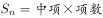。已知项数25，所以中项为a_13。则，解得a_13=148。即第13项的值为148。

故正确答案为C。

**考点**：数列问题

**来源**：2015年3月四川省选调优秀大学生到基层工作考试行政职业能力测验试卷（精选）第45题

### 第 46 题

某人驾车以每小时60千米的速度行驶一段路程后，再以每小时40千米的速度原路返回。请问他在上述往返行程中的平均时速是多少？

A. 45

B. 46

C. 48

D. 50

第 46 题 · 答案与解析

**参考答案（粉笔题库参考内容）**

C

**解析**

路程相同，平均时速为等距离平均速度。根据公式，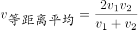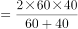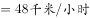。

故正确答案为C。

**考点**：平均速度

**来源**：2015年3月四川省选调优秀大学生到基层工作考试行政职业能力测验试卷（精选）第46题

### 第 47 题

一小朋友将单词“village”的字母顺序写错了，那么这个小朋友写出的这个错误单词有多少种可能？

A. 2519

B. 2520

C. 5039

D. 5040

第 47 题 · 答案与解析

**参考答案（粉笔题库参考内容）**

A

**解析**

共有7个英文字母，进行全排列，为种，由于有两个一样的字母l，所以单词能够写出的所有顺序种类为种。去掉正确的一种情况，写出错误单词的可能性有2520-1=2519种。

故正确答案为A。

**考点**：基础排列组合

**来源**：2015年3月四川省选调优秀大学生到基层工作考试行政职业能力测验试卷（精选）第47题

### 第 48 题

吴先生开车从甲地去乙地开会，去时每小时行80千米。会议结束后，他急着返回处理其他事务，返回时每小时行100千米，吴先生往返开车共用了4.5小时，那么甲、乙两地的距离是多少千米？

A. 180

B. 200

C. 220

D. 240

第 48 题 · 答案与解析

**参考答案（粉笔题库参考内容）**

B

**解析**

方法一：设甲、乙两地的距离为S，根据开车往返共用了4.5小时可列方程：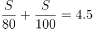，解得S=200千米。

方法二：往返路程相等，根据等距离平均速度公式可得：=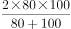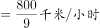。往返共用4.5小时，即，解得S=200千米。

故正确答案为B。

**考点**：平均速度

**来源**：2015年3月四川省选调优秀大学生到基层工作考试行政职业能力测验试卷（精选）第48题

### 第 49 题

现需手工装订12300册书籍，该装订任务由甲、乙两个小组共同完成，当甲小组完成所分配装订任务的2/3时，乙小组完成了3000册，此时两小组还未完成的任务数相同，那么甲小组分配的装订任务是多少册？

A. 7800

B. 6975

C. 5325

D. 4500

第 49 题 · 答案与解析

**参考答案（粉笔题库参考内容）**

B

**解析**

设甲所分配任务为3x册，当甲完成任务的2/3，即2x册时，此时甲未完成3x-2x=x册。两小组未完成任务数相同，乙未完成也为x册，又已知乙完成了3000册。总量为12300册，因此3x+3000+x=12300，解得x=2325。甲小组分配任务为3x=2325×3=6975册。

故正确答案为B。

**考点**：和差倍比问题

**来源**：2015年3月四川省选调优秀大学生到基层工作考试行政职业能力测验试卷（精选）第49题

### 第 50 题

—农技人员现有208千克含盐量为40%的盐水，若要配备含盐量为32%的盐水312千克，那么需加入的盐和水的比例为多少？

A. 4：25

B. 25：4

C. 4：21

D. 21：4

第 50 题 · 答案与解析

**参考答案（粉笔题库参考内容）**

C

**解析**

设加入x千克的盐，根据公式溶质=溶液×浓度，由题意列方程得，208×40%+x=312×32%，解得x=16.64千克。加入的水为：312-208-16.64=87.36千克。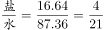。

故正确答案为C。

**来源**：2015年3月四川省选调优秀大学生到基层工作考试行政职业能力测验试卷（精选）第50题

### 第 51 题

技术人员在苗圃里种植了A、B、C三种花卉，并定期要给三种花卉浇水，A花每5天浇水一次，B花每4天浇水一次，C花每6天浇水一次。技术人员在某日给三种花同时浇了水作为第一次浇水，那么下一次需同时给三种花卉浇水是A花卉的第几次浇水？

A. 11

B. 12

C. 13

D. 14

第 51 题 · 答案与解析

**参考答案（粉笔题库参考内容）**

C

**解析**

三种花的浇水周期分别为5、4、6，则下一次同时给三种花卉浇水经过的天数为这三个周期的最小公倍数，即60天。第一次浇水后的60天还需要给A花卉浇水60÷5=12次。所以应该是A花卉的第1+12=13次浇水。

故正确答案为C。

**考点**：周期相遇问题

**来源**：2015年3月四川省选调优秀大学生到基层工作考试行政职业能力测验试卷（精选）第51题

### 第 52 题

甲、乙两辆汽车分别从A、B两地同时出发，相向而行终点分别为B、A。甲车每小时行60千米，乙车每小时行50千米，甲车比乙车早1小时到达中点。那么甲车行驶完全程需要多少小时？

A. 5

B. 6

C. 10

D. 11

第 52 题 · 答案与解析

**参考答案（粉笔题库参考内容）**

C

**解析**

方法一：设甲行驶到中点所花时间为x，则60x=50×（x+1），解得x=5。全程即为中点的两倍距离，速度相同，距离与时间成正比。全程需要时间为2x=10小时。

方法二：甲乙都走到中点，距离相同，时间与速度成反比。甲时间：乙时间=乙速度：甲速度=50：60=5：6。设到中点甲所花时间为5t，则乙所花时间为6t，已知甲早1小时到，即6t-5t=1小时，t=1小时，则5t=5小时。甲到中点为5小时，甲全程需要5×2=10小时。

故正确答案为C。

**考点**：普通行程

**来源**：2015年3月四川省选调优秀大学生到基层工作考试行政职业能力测验试卷（精选）第52题

### 第 53 题

如下图，在平行四边形ABCD中，已知三角形ABP、BPC的面积分别是73和100，那么三角形BPD的面积是多少？

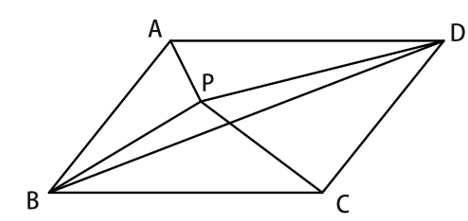

A. 27

B. 36.5

C. 50

D. 无法确定

第 53 题 · 答案与解析

**参考答案（粉笔题库参考内容）**

A

**解析**

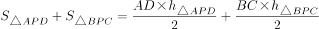，因为ABCD为平行四边形，所以AD=BC，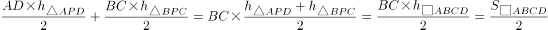。即△APD与△BPC的面积之和为□ABCD的一半。

因为BD是对角线，所以△ABD的面积是□ABCD的一半。即，整理等式得：，已知三角形ABP、BPC的面积分别是73和100。所以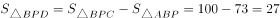。

故正确答案为A。

**考点**：几何公式类-平面图形

**来源**：2015年3月四川省选调优秀大学生到基层工作考试行政职业能力测验试卷（精选）第53题

### 第 54 题

从所给的四个选项中，选择最合适的一个填入问号处，使之呈现一定的规律性：

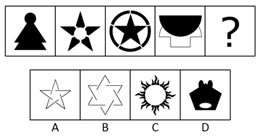

A. A

B. B

C. C

D. D

第 54 题 · 答案与解析

**参考答案（粉笔题库参考内容）**

D

**解析**

元素组成不同，优先考虑属性规律。观察发现，题干图形均为轴对称图形，故？处也应选择一个轴对称图形，只有D项符合。

故正确答案为D。

**考点**：属性规律-对称性

**来源**：2015年3月四川省选调优秀大学生到基层工作考试行政职业能力测验试卷（精选）第54题

### 第 55 题

把下面的六个图形分为两类，使每一类图形都有各自的共同特征或规律，分类正确的一项是：

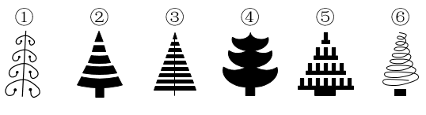

A. ①⑤⑥ ②③④

B. ①②⑤ ③④⑥

C. ①③④ ②⑤⑥

D. ①④⑤ ②③⑥

第 55 题 · 答案与解析

**参考答案（粉笔题库参考内容）**

C

**解析**

元素组成不同，无明显属性规律，考虑数量规律。出现粗线条图形，优先考虑数部分，观察发现，图①③④均有1个部分为一组，图②⑤⑥均有多个部分为一组，对应C项。

故正确答案为C。

**考点**：数量规律-素

**来源**：2015年3月四川省选调优秀大学生到基层工作考试行政职业能力测验试卷（精选）第55题

### 第 56 题

从所给的四个选项中，选择最合适的一个填入问号处，使之呈现一定的规律性：

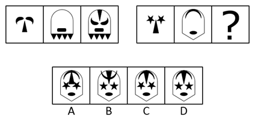

A. A

B. B

C. C

D. D

第 56 题 · 答案与解析

**参考答案（粉笔题库参考内容）**

D

**解析**

元素组成相似，优先考虑样式规律。观察发现，第一组图中，第一个图上下翻转后与第二个图相加，得到第三个图；第二组图应用规律，第一个图上下翻转后，与第二个图相加，得到D项图形。

故正确答案为D。

**考点**：样式规律-加减同异

**来源**：2015年3月四川省选调优秀大学生到基层工作考试行政职业能力测验试卷（精选）第56题

### 第 57 题

从所给的四个选项中，选择最合适的一个填入问号处，使之呈现一定的规律性:

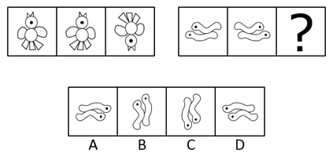

A. A

B. B

C. C

D. D

第 57 题 · 答案与解析

**参考答案（粉笔题库参考内容）**

A

**解析**

元素组成相同，优先考虑位置规律。观察发现，第一组图中，第一个图左右翻转得到第二个图，第二个图上下翻转得到第三个图。第二组图应用规律，第二个图上下翻转得到A项图形。

故正确答案为A。

**考点**：位置规律-翻转

**来源**：2015年3月四川省选调优秀大学生到基层工作考试行政职业能力测验试卷（精选）第57题

### 第 58 题

从所给的四个选项中，选择最合适的一个填入问号处，使之呈现一定的规律性：

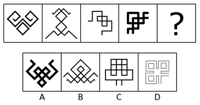

A. A

B. B

C. C

D. D

第 58 题 · 答案与解析

**参考答案（粉笔题库参考内容）**

B

**解析**

元素组成不同，且属性规律无答案，考虑数量规律。观察发现，题干图形均出现明显白色区域，优先考虑数面，面的数量依次为1、2、3、4、？，故？应选择一个面数量为5的图形，只有B项符合。

故正确答案为B。

**考点**：数量规律-面

**来源**：2015年3月四川省选调优秀大学生到基层工作考试行政职业能力测验试卷（精选）第58题

### 第 59 题

从所给的四个选项中，选择最合适的一个填入问号处，使之呈现一定的规律性：

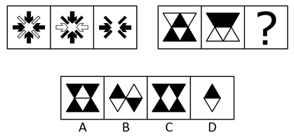

A. A

B. B

C. C

D. D

第 59 题 · 答案与解析

**参考答案（粉笔题库参考内容）**

C

**解析**

元素组成相似，优先考虑样式规律。题干每组图形外部轮廓相同，内部黑白颜色不同，优先考虑黑白运算。观察第一组图发现，图形运算规律为：黑+黑=空白，白+白=空白，黑+白=黑，白+黑=黑。第二组图运用上述规律，只有C项符合。

故正确答案为C。

**考点**：样式规律-黑白运算

**来源**：2015年3月四川省选调优秀大学生到基层工作考试行政职业能力测验试卷（精选）第59题

### 第 60 题

从所给的四个选项中，选择最合适的一个填入问号处，使之呈现一定的规律性：

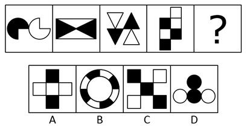

A. A

B. B

C. C

D. D

第 60 题 · 答案与解析

**参考答案（粉笔题库参考内容）**

D

**解析**

元素组成不同，且无明显属性规律，考虑数量规律。观察发现，题干图形均满足黑色区域的面积之和与白色封闭区域的面积之和相等，只有D项符合这一规律。

故正确答案为D。

**考点**：数量规律-面、黑白块类

**来源**：2015年3月四川省选调优秀大学生到基层工作考试行政职业能力测验试卷（精选）第60题

### 第 61 题

从所给的四个选项中，选择最合适的一个填入问号处，使之呈现一定的规律性：

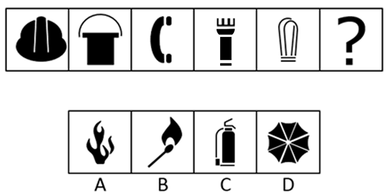

A. A

B. B

C. C

D. D

第 61 题 · 答案与解析

**参考答案（粉笔题库参考内容）**

C

**解析**

元素组成不同，且无明显属性规律，考虑数量规律。出现粗线条图形，优先考虑数部分，观察发现，组成图形的部分数依次为1、2、3、4、5、？。故？处应选择一个部分数为6的图形，只有C项符合。

故正确答案为C。

**考点**：数量规律-素

**来源**：2015年3月四川省选调优秀大学生到基层工作考试行政职业能力测验试卷（精选）第61题

### 第 62 题

下图左边给定的是纸盒的外表面，右边哪一项能由它折叠而成：

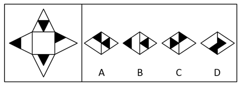

A. A

B. B

C. C

D. D

第 62 题 · 答案与解析

**参考答案（粉笔题库参考内容）**

A

**解析**

将展开图标上序号如下图，逐一进行分析。

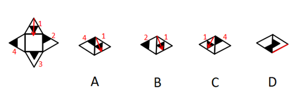

A项：如上图所示，选项右边的面中黑色三角形的顶点与四面体的底面相交，所以只能是面1，左边的面中黑色三角形的顶点与四面体的顶点重合，所以只能是面4，将面1从四面体顶点向底边画箭头，面1的左侧是面4，展开图中，也将面1从四面体顶点向底边画箭头，面1的左侧也是面4，题干与选项一致，正确，当选；

B项：如上图所示，选项右边的面中黑色三角形的顶点与四面体的底面相交，所以只能是面1，左边的面中黑色三角形的边与四面体的底边重合，且空白区域为白色梯形，所以只能是面2，将面1从四面体顶点向底边画箭头，面1的左侧是面2，而展开图中，也将面1从四面体顶点向底边画箭头，面1的左侧是面4，题干与选项不一致，错误，排除；

C项：如上图所示，选项右边的面中白色梯形的长底边与四面体的底边重合，所以只能是面4，左边的面中黑色三角形的顶点与四面体的底面相交，所以只能是面1，将面1从四面体顶点向底边画箭头，面1的右侧是面4，而展开图中，也将面1从四面体顶点向底边画箭头，面1的右侧是面2，题干与选项不一致，错误，排除；

D项：如上图所示，选项右边的面中白色的区域与四面体的底边重合，展开图中没有对应的面，错误，排除。

故正确答案为A。

**来源**：2015年3月四川省选调优秀大学生到基层工作考试行政职业能力测验试卷（精选）第62题

### 第 63 题

从所给的四个选项中，选择最合适的一个填入问号处，使之呈现一定的规律性：

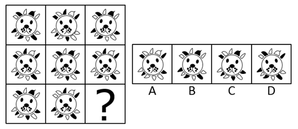

A. A

B. B

C. C

D. D

第 63 题 · 答案与解析

**参考答案（粉笔题库参考内容）**

C

**解析**

元素组成相同，优先考虑位置规律。九宫格优先横着看，第一行图中，圆圈内的图形依次进行左右翻转，圆圈外的黑色区域依次顺时针移动一格；经验证，第二行也满足此规律；第三行应用规律，？处圆圈内的图形应通过第二幅图左右翻转得到，所以应选择右边有三点胡子，左边有4点胡子的图形，排除A、D两项；圆圈外的黑色区域依次顺时针移动一格，只有C项满足此规律。

故正确答案为C。

**考点**：位置规律-综合

**来源**：2015年3月四川省选调优秀大学生到基层工作考试行政职业能力测验试卷（精选）第63题

### 第 64 题

共情是指能体验他人的精神世界的一种能力。它涉及进入对方个人的精神领域并能理解这个精神世界，体验其内心感受，领悟其思想、观念和情感，而不管是否对对方有物质上的帮助或感情上的抚慰。

据此定义，以下属于共情反应的是：

A. 朋友夫妻吵架后对小赵哭诉，小赵火冒三丈，为朋友打抱不平去找其丈夫理论，并劝朋友和丈夫离婚

B. 小李为填志愿与父母激烈冲突，张老师和小李一起分析各种选择的利弊，他欣然回家再和父母商量

C. 某学生患病，因家庭贫闲，李老师动员全班同学捐款，轮流到医院看护

D. 两学生打架，林老师将他们带到办公室进行严厉批评，要求在全班检讨

第 64 题 · 答案与解析

**参考答案（粉笔题库参考内容）**

A

**解析**

第一步：找出定义关键词。

“能体验他人的精神世界的一种能力”，“进入对方个人的精神领域并能理解这个精神世界”，“体验其内心感受，领悟其思想、观念和情感”。

第二步：逐一分析选项。

A项：朋友对小赵哭诉后，小赵火冒三丈，小赵的愤怒说明其能够理解朋友的精神世界，体验其内心感受，符合“进入对方个人的精神领域并能理解这个精神世界”，符合定义，当选；

B项：张老师和小李一起分析各种选择的利弊，只是在客观分析填志愿的利弊，不涉及对小李精神世界的理解，不符合定义，排除；

C项：全班同学捐款并且轮流看护，属于物质上的帮助，不涉及对精神世界的理解，不符合定义，排除；

D项：林老师批评打架的学生，说明林老师没有“进入对方个人的精神领域并能理解这个精神世界”，不符合定义，排除。

故正确答案为A。

**考点**：单定义-其他句式

**来源**：2015年3月四川省选调优秀大学生到基层工作考试行政职业能力测验试卷（精选）第64题

### 第 65 题

非物质文化遗产是依附于人本身而存在，以声音、形象和技艺为表现手段，并以心口相传作为文化链而得以延续的宝贵财富。

据此定义，下列中不属于非物质文化遗产的是：

A. 绵竹年画

B. 梓潼皇柏林

C. 羌族刺绣

D. 川北大木偶戏

第 65 题 · 答案与解析

**参考答案（粉笔题库参考内容）**

B

**解析**

第一步：找出定义关键词。

“依附于人本身而存在”、“以声音、形象和技艺为表现手段”、“以心口相传为延续手段”。

第二步：逐一分析选项。

A项：绵竹年画是通过人的技艺而表现、传承的传统艺术，符合定义，排除；

B项：梓潼皇柏林属于自然景观，不符合“依附于人本身而存在”，不符合定义，当选；

C项：羌族刺绣是通过人的技艺而表现、传承的传统艺术，符合定义，排除；

D项：川北大木偶戏是通过人的技艺而表现、传承的传统艺术，符合定义，排除。

本题为选非题，故正确答案为B。

**考点**：方式目的

**来源**：2015年3月四川省选调优秀大学生到基层工作考试行政职业能力测验试卷（精选）第65题

### 第 66 题

行政补偿是行政主体基于社会公共利益的需要，在管理国家和社会公共事务的过程中，因合法的行政行为给公民、法人或其他社会组织的合法权益造成了损失，以公平原则并通过正当程序对其进行补偿的制度。

下列行为中不属于行政补偿的是：

A. 行人李某在警察追捕逃犯时被误伤，政府给予他一定的补偿

B. 王某的宅基地被国家征用，政府补偿其几万元

C. 某大型水利工程拆迁几万住户，政府在其他地方给每户补偿一套房子

D. 某城建执法大队在拆除违章建筑时损坏了张某的房屋，执法大队私下对张某进行了补偿

第 66 题 · 答案与解析

**参考答案（粉笔题库参考内容）**

D

**解析**

第一步：找出定义关键词。

“行政主体的合法行为”，“给公民、法人或其他社会组织的合法权益造成了损失”，“以公平原则通过正当程序对其进行补偿”。

第二步：逐一分析选项。

A项：警察追捕逃犯符合“行政主体的合法行为”，行人李某被误伤，符合“给公民的合法权益造成了损失”，政府给予一定补偿符合“以公平原则通过正当程序对其进行补偿”，符合定义，排除；

B项：王某的宅基地被国家征用，符合“行政主体的合法行为给公民、法人或其他社会组织的合法权益造成了损失”，政府补偿其几万元，符合“以公平原则通过正当程序对其进行补偿”，符合定义，排除；

C项：建设大型水利工程“行政主体的合法行为”，几万住户房屋被拆迁，符合“给公民的合法权益造成了损失”，政府在其他地方给每户补偿一套房子，符合“以公平原则通过正当程序对其进行补偿”，符合定义，排除；

D项：城建执法大队拆除违建损坏了张某的房屋，符合“行政主体的合法行为给公民、法人或其他社会组织的合法权益造成了损失”，但是执法大队私下对张某进行补偿不符合“以公平原则通过正当程序对其进行补偿”，不符合定义，当选。

本题为选非题，故正确答案为D。

**考点**：方式目的

**来源**：2015年3月四川省选调优秀大学生到基层工作考试行政职业能力测验试卷（精选）第66题

### 第 67 题

受贿罪指的是国家工作人员利用职务上的便利索取他人财物或者非法收受他人财物，为他人谋取利益的行为。

根据上述定义，下列中属于受贿罪的是：

A. 无业人员李某冒充省高级人民法院院长，以帮王某女儿安排工作为条件，向其收取五千元现金

B. 王某是市政府副秘书长，书法很好。有一次某饭店请王某题写店名，王某要求对方付一千元他才肯写

C. 刘某是法院法官，有一次上班路上见人行窃，他抓住了小偷。小偷给了他一包“中华”烟，刘某就把小偷放走了

D. 张某是省政府工作人员，主管政府工程招标事务。有一次招标会后，某建筑公司送来一万元现金，请求让自己中标。该建筑公司的条件在所有参与竞标的公司中属于较好的两家之一。张某就做了个顺水人情，收下钱后宣布这家公司中标

第 67 题 · 答案与解析

**参考答案（粉笔题库参考内容）**

D

**解析**

第一步：找出定义关键词。

“国家工作人员”、“利用职务便利”、“索取他人财物或者非法收受财物”、“为他人谋取利益”。

第二步：逐一分析选项。

A项：李某是无业人员，不符合“国家工作人员”，不符合定义，排除；

B项：王某因为书法写得好，题写店名时索要报酬，不符合“利用职务便利”，不符合定义，排除；

C项：刘某上班路上放走小偷，不符合“利用职务便利”，不符合定义，排除；

D项：张某是国家工作人员，主管招标，收取某公司的现金后宣布这家公司中标，符合“利用职务便利非法收受财物”、“为他人谋取利益”，符合定义，当选。

故正确答案为D。

**考点**：方式目的

**来源**：2015年3月四川省选调优秀大学生到基层工作考试行政职业能力测验试卷（精选）第67题

### 第 68 题

相对反义词是反义词的一种，两个项之间可以加入其他项，或可在程度上区分。区分相对反义词的方法：肯定A必然否定B，否定A不一定肯定B。下列中属于相对反义词的一组是：

A. 完整——残缺

B. 真——假

C. 怀疑——相信

D. 轻蔑——敬重

第 68 题 · 答案与解析

**参考答案（粉笔题库参考内容）**

D

**解析**

第一步：找出定义关键词。

“肯定A必然否定B”、“否定A不一定肯定B”。

第二步：逐一分析选项。

A项：“完整”必然是不“残缺”，但是不“完整”一定是“残缺”，不符合定义，排除；

B项：“真”必然是不“假”，但是不“真”一定是“假”，不符合定义，排除；

C项：“怀疑”必然是不“相信”，但是不“怀疑”一定是“相信”，不符合定义，排除；

D项：“轻蔑”必然是不“敬重”，但是不“轻蔑”不一定是“敬重”，还有多种对人的态度，如“爱戴”“厌恶”等，符合定义，当选。

故正确答案为D。

**考点**：单定义-其他句式

**来源**：2015年3月四川省选调优秀大学生到基层工作考试行政职业能力测验试卷（精选）第68题

### 第 69 题

外来物种入侵是指物种从其自然分布区通过有意或无意的人类活动而被引入其他区域，在当地的自然或半自然生态系统中形成了自我再生能力，并给当地的生态系统或景观造成明显损害或影响。

下列事件中，属于外来物种入侵的是：

A. 院外的竹子生长进入了院内，给院内环境造成了影响

B. 在自家小院鱼池中放养的水萌芦繁殖得很快，一些鱼因缺氧而死

C. 从国外引入的八哥在野外自然繁衍，已经在北京形成了自然种群

D. 二战期间，棕树蛇被一艘军用货船带至关岛，这种栖息在树上的爬行动物专门捕食鸟类，偷袭鸟巢，吞噬鸟蛋，致使当地一些鸟类绝种

第 69 题 · 答案与解析

**参考答案（粉笔题库参考内容）**

D

**解析**

第一步：找出定义关键词。

“物种从其自然分布区通过人类活动被引入其他区域”、“给当地生态系统或景观造成明显损害或影响”。

第二步：逐一分析选项。

A项：院子外的竹子生长进入院内，不符合“通过人类活动被引入其他区域”，不符合定义，排除；

B项：在自家小院鱼池中放养水葫芦，未体现生长区域的改变，不符合“物种从其自然分布区被引入其他区域”，不符合定义，排除；

C项：国外八哥被引入后，形成了自然种群，未体现对当地生态环境的破坏，不符合“给当地生态系统或景观造成明显损害或影响”，不符合定义，排除；

D项：棕树蛇被一艘军用货船带至关岛，符合“物种从其自然分布区通过人类活动被引入其他区域”，导致当地一些鸟类的绝种，符合“给当地生态系统或景观造成明显损害或影响”，符合定义，当选。

故正确答案为D。

**考点**：方式目的

**来源**：2015年3月四川省选调优秀大学生到基层工作考试行政职业能力测验试卷（精选）第69题

### 第 70 题

组织中的公民行为是在组织正式的薪酬体系中尚未得到明确的或直接的确认，但就整体而言有益于组织整体运转成效的行为总和。

下列事件中，属于组织中的公民行为的是：

A. 节约公司资源，提高工作效率

B. 扶危济困，帮助一切需要帮助的人

C. 员工参与社会公益活动，提升公司形象

D. 董事长罢免总经理，废止后者推行的“新政”

第 70 题 · 答案与解析

**参考答案（粉笔题库参考内容）**

C

**解析**

第一步：找出定义关键词。

“组织中”，“在正式的薪酬体系中尚未得到明确的或直接的确认”，“有益于组织整体运转成效”。

第二步：逐一分析选项。

A项：节约公司资源和提高工作效率，属于合理的工作要求，应该在正式的薪酬体系中得到确认，不符合“在正式的薪酬体系中尚未得到明确的或直接的确认”，不符合定义，排除；

B项：扶危济困、帮助一切需要帮助的人，该行为与组织无关，不符合“组织中”，不符合定义，排除；

C项：参加社会公益活动，不属于工作要求，符合“在正式的薪酬体系中尚未得到明确的或直接的确认”，提升公司形象，说明该行为对公司有益，符合“有益于组织整体运转成效”，符合定义，当选；

D项：董事长废止总经理推行的“新政”，属于公司制度的变化，应该在正式的薪酬体系中得到确认，不符合“在正式的薪酬体系中尚未得到明确的或直接的确认”，不符合定义，排除。

故正确答案为C。

**考点**：单定义-其他句式

**来源**：2015年3月四川省选调优秀大学生到基层工作考试行政职业能力测验试卷（精选）第70题

### 第 71 题

指标：调整

A. 未来：展望

B. 理想：实现

C. 会议：推迟

D. 实力：增强

第 71 题 · 答案与解析

**参考答案（粉笔题库参考内容）**

C

**解析**

第一步：判断题干词语间逻辑关系。

调整指标，二者为动宾结构，且指标是一种可以被实际测量的标准。

第二步：判断选项词语间逻辑关系。

A项：展望未来，二者为动宾结构，但未来是相对于现在而言的未来时间，是抽象的，与题干逻辑关系不一致，排除；

B项：实现理想，二者为动宾结构，但理想是指一种追求，是抽象的，与题干逻辑关系不一致，排除；

C项：推迟会议，二者为动宾结构，且会议是指一种实际的活动，与题干逻辑关系一致，当选；

D项：增强实力，二者为动宾结构，但实力是指一种能力和影响力，是抽象的，与题干逻辑关系不一致，排除。

故正确答案为C。

**考点**：语法关系

**来源**：2015年3月四川省选调优秀大学生到基层工作考试行政职业能力测验试卷（精选）第71题

### 第 72 题

飞机：失事：黑匣子

A. 植物：枯萎：缺水

B. 房屋：倒塌：地震

C. 轮船：倾斜：导航仪

D. 汽车：事故：行车记录仪

第 72 题 · 答案与解析

**参考答案（粉笔题库参考内容）**

D

**解析**

第一步：判断题干词语间逻辑关系。

黑匣子记录飞机失事，且黑匣子是飞机的组成部分。

第二步：判断选项词语间逻辑关系。

A项：缺水会导致植物枯萎，三者是因果关系，与题干逻辑关系不一致，排除；

B项：地震会导致房屋倒塌，三者是因果关系，与题干逻辑关系不一致，排除；

C项：导航仪是轮船的组成部分，但不是记录轮船倾斜，与题干逻辑关系不一致，排除；

D项：行车记录仪记录汽车事故，且行车记录仪是汽车的组成部分，与题干逻辑关系一致，当选。

故正确答案为D。

**考点**：逻辑关系-包容关系、逻辑关系-对应关系

**来源**：2015年3月四川省选调优秀大学生到基层工作考试行政职业能力测验试卷（精选）第72题

### 第 73 题

发明：专利：保护

A. 制定：政策：执行

B. 选择：就业：机会

C. 攀登：山峰：地图

D. 开车：出行：路况

第 73 题 · 答案与解析

**参考答案（粉笔题库参考内容）**

A

**解析**

第一步：判断题干词语间逻辑关系。

保护发明的专利，发明可以用来修饰专利的，保护专利，二者是动宾结构。

第二步：判断选项词语间逻辑关系。

A项：执行制定的政策，制定可以用来修饰政策，执行政策，二者是动宾结构，与题干逻辑关系一致，当选；

B项：选择就业的机会，但词语的顺序反了，与题干逻辑关系不一致，排除；

C项：攀登山峰需要使用地图，不是动宾结构，与题干逻辑关系不一致，排除；

D项：开车出行需要查看路况，不是动宾结构，与题干逻辑关系不一致，排除。

故正确答案为A。

**考点**：语法关系

**来源**：2015年3月四川省选调优秀大学生到基层工作考试行政职业能力测验试卷（精选）第73题

### 第 74 题

卧薪尝胆：勾践

A. 如嚼鸡肋：杨彪

B. 洛阳纸贵：孔融

C. 乐不思蜀：刘禅

D. 破釜沉舟：刘邦

第 74 题 · 答案与解析

**参考答案（粉笔题库参考内容）**

C

**解析**

第一步：判断题干词语间逻辑关系。

卧薪尝胆的主人公是勾践，二者是成语典故与主人公的对应关系。

第二步：判断选项词语间逻辑关系。

A项：如嚼鸡肋的主人公是曹操与杨修，而非杨彪，与题干逻辑关系不一致，排除；

B项：洛阳纸贵的主人公是左思，而非孔融，与题干逻辑关系不一致，排除；

C项：乐不思蜀的主人公是刘禅，二者是成语典故与主人公的对应关系，与题干逻辑关系一致，当选；

D项：破釜沉舟的主人公是项羽，而非刘邦，与题干逻辑关系不一致，排除。

故正确答案为C。

**考点**：逻辑关系-对应关系

**来源**：2015年3月四川省选调优秀大学生到基层工作考试行政职业能力测验试卷（精选）第74题

### 第 75 题

提案 对于（  ）相当于（  ）对于 作品

A. 决议 原型

B. 政策 素材

C. 会议 人物

D. 代表 事件

第 75 题 · 答案与解析

**参考答案（粉笔题库参考内容）**

B

**解析**

逐一代入选项。

A项：根据提案做出决议，二者是依据的对应关系，根据原型完成作品，二者也是依据的对应关系，前后逻辑关系一致，保留；

B项：根据提案出台政策，二者是依据的对应关系，根据素材完成作品，二者也是依据的对应关系，前后逻辑关系一致，保留；

C项：会议是提出提案的一个场合，二者是场合对应关系，人物是作品的组成要素，二者是组成关系，前后逻辑关系不一致，排除；

D项：代表是议案提出的主体，二者是主体的对应关系，作品可以反映事件，二者是对应关系，前后逻辑关系不一致，排除；

比较A、B两项，A项中，提案变成决议只需针对是否通过做出表决，而原型变成作品往往需要经过加工；B项中，提案变成政策往往需要经过优化，素材变成作品往往需要经过加工，B项前后逻辑关系更为一致，当选。

故正确答案为B。

**考点**：逻辑关系-对应关系

**来源**：2015年3月四川省选调优秀大学生到基层工作考试行政职业能力测验试卷（精选）第75题

### 第 76 题

绣球 对于（  ）相当于（  ）对于 橄榄枝

A. 玫瑰花 莲花

B. 擂台 和平

C. 康乃馨 鸽子

D. 合欢 万年青

第 76 题 · 答案与解析

**参考答案（粉笔题库参考内容）**

A

**解析**

逐一代入选项。

A项：绣球与玫瑰花都可以象征爱情，二者是并列关系，莲花也称荷花，“荷”与“和”谐音，与橄榄枝都可以象征和平，二者是并列关系，前后逻辑关系一致，当选；

B项：擂台可以是抛绣球的场合，二者是对应关系，橄榄枝象征和平，二者是比喻象征关系，前后逻辑关系不一致，排除；

C项：绣球可以象征爱情，康乃馨则象征亲情，绣球和康乃馨没有必然的逻辑关系，而鸽子与橄榄枝都可以象征和平，前后逻辑关系不一致，排除；

D项：绣球与合欢都可以象征美满，万年青象征健康长寿，而橄榄枝象征和平，前后逻辑关系不一致，排除。

故正确答案为A。

**考点**：逻辑关系-并列关系

**来源**：2015年3月四川省选调优秀大学生到基层工作考试行政职业能力测验试卷（精选）第76题

### 第 77 题

(    ) 对于 野兽 相当于（    ）对于 家庭

A. 珍稀 儿童

B. 凶猛 温馨

C. 狮子 宠物

D. 驯兽师 父母

第 77 题 · 答案与解析

**参考答案（粉笔题库参考内容）**

B

**解析**

逐一代入选项。

A项：珍稀的野兽，二者是偏正结构，儿童可以是家庭的组成成员，二者是组成关系，前后逻辑关系不一致，排除；

B项：凶猛的野兽，二者是偏正结构，温馨的家庭，二者也是偏正结构，前后逻辑关系一致，当选；

C项：狮子是野兽的一种，二者是种属关系，宠物可以是家庭的组成成员，二者是组成关系，前后逻辑关系不一致，排除；

D项：驯兽师的工作对象是野兽，二者是工作对象的对应关系，父母是家庭的组成成员，二者是组成关系，前后逻辑关系不一致，排除。

故正确答案为B。

**考点**：语法关系

**来源**：2015年3月四川省选调优秀大学生到基层工作考试行政职业能力测验试卷（精选）第77题

### 第 78 题

如果“兔子不吃窝边草”为真，那么下列哪个判断必然为真？

A. 不是兔子就要吃窝边草

B. 窝边草一定是兔子吃的

C. 只有兔子才不吃窝边草

D. 若窝边草被吃了，肯定不是兔子吃的

第 78 题 · 答案与解析

**参考答案（粉笔题库参考内容）**

D

**解析**

第一步：翻译题干。

兔子→-吃窝边草。

第二步：逐一分析选项。

A项：翻译为-兔子→吃窝边草，是对题干条件的否前，否前无必然性结论，排除；

B项：翻译为吃窝边草→兔子，是对题干条件的否后，否后必否前，可以推出-兔子，而非兔子，排除；

C项：翻译为-吃窝边草→兔子，是对题干条件的肯后，肯后无必然性结论，排除；

D项：翻译为吃窝边草→-兔子，是对题干条件的否后，否后必否前，可以推出-兔子，当选。

故正确答案为D。

**考点**：常规翻译

**来源**：2015年3月四川省选调优秀大学生到基层工作考试行政职业能力测验试卷（精选）第78题

### 第 79 题

—位教师在教学《两条小溪的对话》时，让学生分角色表演。有一位学生问：“老师，我能不用书中的原话吗？”老师和蔼地问：“为什么呢？”“因为书中的原话太长，我背不下来。拿着书表演，又不太好。”孩子说出了原因。“你的意见很好，就用自己的话来表演吧。”老师高兴地抚摸了一下孩子的头。果然，这个孩子表演得非常出色。

以下哪项不是作者想要表达的意思？

A. 教师要充分尊重学生的意见

B. 课堂上，教师与学生是完全平等的关系

C. 发挥学生学习的主动性，可以达到事半功倍的效果

D. 民主平等的课堂氛围，有利于激发学生的学习积极性

第 79 题 · 答案与解析

**参考答案（粉笔题库参考内容）**

B

**解析**

日常结论题，根据题干信息逐一分析选项。

A项：题干中老师肯定了孩子的想法，结果孩子的表演很出色，说明教师要充分尊重学生的意见，可以推出，排除；

B项：题干中并没有体现老师与学生之间的关系完全平等，完全的表述过于绝对，无法推出，当选；

C项：题干中学生主动要求用自己的话来进行表演时，老师肯定其想法，是一种发挥学生学习的主动性的表现，学生表演得非常出色，说明可以达到事半功倍的效果，可以推出，排除；

D项：老师尊重学生意见，是一种平等的表现，学生表演得非常出色，说明有利于激发学生的学习积极性，可以推出，排除。

本题为选非题，故正确答案为B。

**考点**：日常结论

**来源**：2015年3月四川省选调优秀大学生到基层工作考试行政职业能力测验试卷（精选）第79题

### 第 80 题

我国某地为了防治空气污染，在其地方性法规中规定：饮食服务业经营者必须采取措施防治油烟污染，排放的油烟污染不得超过规定的排放标准。居民住宅楼的底层不再安排产生油烟污染的饮食服务业经营场所；不得将居民住宅楼中的住宅用作产生油烟污染的饮食服务业经营场所。

上述规定是以下列哪项为前提的？

A. 饮食服务业产生的油烟污染对空气质量影响很大

B. 饮食服务业只要不超过规定的排放标准就可营业

C. 饮食服务业对空气质量的影响大于汽车尾气等污染源

D. 饮食服务业产生的油烟污染对居民住宅的影响要超过其他场所

第 80 题 · 答案与解析

**参考答案（粉笔题库参考内容）**

A

**解析**

第一步：找出论点和论据。

论点：我国某地为了防治空气污染，在其地方性法规中针对饮食服务业的油烟污染出台了一系列的规定。

论据：无。

第二步：逐一分析选项。

A项：只有饮食服务业产生的油烟污染对空气质量影响很大，防治空气污染才必须要采取措施防治油烟污染，是论点成立的必要条件，当选；

B项：饮食服务业是否可以营业，与论点讨论的如何防治空气污染无关，属于无关选项，排除；

C项：饮食服务业对空气质量的影响大于汽车尾气等污染源，但是不明确影响有多大，属于不明确选项，排除；

D项：饮食服务业产生的油烟污染对居民住宅有影响，与论点讨论的如何防治空气污染无关，属于无关选项，排除。

故正确答案为A。

**考点**：必要条件

**来源**：2015年3月四川省选调优秀大学生到基层工作考试行政职业能力测验试卷（精选）第80题

### 第 81 题

在环境保护与经济发展相互的关系上，各国抛弃了或一味追求“经济优先”或过分强调“环境优先”的片面做法，而是将二者有机地结合起来，既对危害环境的行为给予制裁，又要兼顾环境侵害的价值性，使保护环境与发展经济相协调，以求取最大的综合利益。

从以上论述中，最能推出下列哪个结论？

A. 各国的环保理念经历了一个由片面到综合的过程

B. “经济优先”或“环境优先”都在世界上有较大的市场

C. 环境侵害并非一无是处，它对人类发展具有一定的价值性

D. 环境保护与经济发展的关系，还需要进一步研究才能确定如何妥当处理

第 81 题 · 答案与解析

**参考答案（粉笔题库参考内容）**

C

**解析**

日常结论题，根据题干信息逐一分析选项。

A项：题干讨论的是环境保护与经济发展的关系，而非环保一个方面，属于偷换概念，排除；

B项：题干并没有体现“经济优先”或“环境优先”的市场是否较大，属于无中生有，排除；

C项：根据题干“又要兼顾环境侵害的价值性”可知，环境侵害具有一定的价值性，可以推出，当选；

D项：题干已经表明“将二者有机地结合起来”，与题干表述相悖，排除。

故正确答案为C。

**考点**：日常结论

**来源**：2015年3月四川省选调优秀大学生到基层工作考试行政职业能力测验试卷（精选）第81题

### 第 82 题

某芭蕾舞练习室有4个女孩和2个男孩，他们的年龄各不相同，最大的10岁，最小的4岁。最大的男孩比最小的女孩大4岁，最大的女孩比最小的男孩也大4岁。

由此可以推出的是：

A. 最大的孩子为男孩

B. 最大的男孩8岁

C. 最小的孩子为男孩

D. 最小的女孩6岁

第 82 题 · 答案与解析

**参考答案（粉笔题库参考内容）**

B

**解析**

第一步：分析题干。

①女孩有4人、男孩有2人，年龄均不相同；

②最大的男孩比最小的女孩大4岁；

③最大的女孩比最小的男孩大4岁；

④最大的10岁，最小的4岁。

第二步：逐一分析选项。

A项：假设最大的孩子为男孩，根据②④可知：最大的男孩是10岁，最小的女孩是6岁，根据①可知：最大的女孩是9岁，根据③可知：最小的男孩是5岁，故最小的是5岁，与④矛盾，排除；

B项：假设最大的男孩为8岁，根据②可知：最小的女孩是4岁，符合④中最小的为4岁，那么最大的女孩应为10岁，根据③可知：最小的男孩是6岁，另外两个女孩可以在9、7、5岁中选择，满足所有条件，当选；

C项：假设最小的孩子为男孩，根据④可知：最小的男孩4岁，根据③可知：最大的女孩8岁，根据④可知：最大的男孩应为10岁，根据②可知：最小的女孩为6岁，则另外两个女孩年龄应都为7岁，与①矛盾，排除；

D项：假设最小的女孩6岁，根据②可知：最大的男孩是10岁，根据④可知：最小的男孩应为4岁，根据③可知：最大的女孩应为8岁，则另外两个女孩年龄应都为7岁，与①矛盾，排除。

故正确答案为B。

**考点**：代入法

**来源**：2015年3月四川省选调优秀大学生到基层工作考试行政职业能力测验试卷（精选）第82题

### 第 83 题

某保密资料被盗，警方发现如下线索：①甲、乙、丙三人中至少有一人是罪犯；②乙、丙要么都是罪犯，要么都不是罪犯；③盗窃发生时，丙正在咖啡店喝咖啡。

由此可以推出的是：

A. 丙是罪犯

B. 乙、丙是罪犯

C. 甲、乙是罪犯

D. 甲是罪犯

第 83 题 · 答案与解析

**参考答案（粉笔题库参考内容）**

D

**解析**

由③盗窃发生时，丙正在咖啡店喝咖啡，可知：丙不是罪犯；结合②乙、丙要么都是罪犯，要么都不是罪犯，可知：乙、丙均不是罪犯；结合①甲、乙、丙三人中至少有一人是罪犯，可知：只有甲是罪犯，对应D项。

故正确答案为D。

**考点**：从确定信息开始推

**来源**：2015年3月四川省选调优秀大学生到基层工作考试行政职业能力测验试卷（精选）第83题

## 材料 1

2010年年底登录过手机淘宝的用户数仅有1000万户。2013年年底，手机淘宝的用户数突破4亿户。2012年在手机淘宝的用户中，产生过购物行为的用户有5700万户，每小时通过手机淘宝卖出的商品超过22万件；平均每天有928万人在手机淘宝上搜索商品；每天还有超过466万人在手机淘宝上查询物流信息；每天有159.5万人在手机淘宝上收藏商品和店铺，382万人在使用手机淘宝上的购物车功能。还有更多用户则是把手机淘宝当成“碎片化”时间中的生活消遣，或是在上下班空闲时间进行商品查询，或是在逛街购物时进行比价。

        2012年11月11日，手机淘宝创造了日支付宝交易金额的年度峰值——9.4亿元，当日的独立访问量达到6485万次。2013年11月11日，手机淘宝支付宝交易额53.3亿元，独立访问用户量1.27亿户。分析认为，我国移动电子商务发展如此迅速的原因主要有手机上网用户数量攀升、廉价智能手机及平板电脑的大量普及、上网速度更快、无线宽带资费下调等。同时，传统电商沉淀也为移动电子商务的发展奠定了基础。

        2012年，一线城市中北京、上海、广州、深圳访问过手机淘宝的用户平均增长率为146%；贵阳、长沙、成都、重庆等二线城市手机淘宝访问用户的平均增长率为167%；延安、常德、张家界、岳阳等三线、四线城市的用户平均增长率高达180%和203%，成为手机“淘宝”新增用户的主要来源，其中濮阳和铜仁市成为三、四线城市中用户同比增幅最大的城市，增长率分别达到281%和286%。

### 第 84 题

从2010年到2013年，手机淘宝用户增加：

A. 30倍

B. 39倍

C. 40倍

D. 41倍

第 84 题 · 答案与解析

**参考答案（粉笔题库参考内容）**

B

**解析**

根据题干“手机淘宝用户增加”，结合选项为倍数，可判定本题为一般增长率问题。定位材料第一段可得：2010年年底手机淘宝用户数1000万户，2013年年底手机淘宝的用户数突破4亿户。故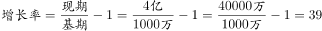。

故正确答案为B。

**考点**：一般增长率、文字资料

**来源**：2015年3月四川省选调优秀大学生到基层工作考试行政职业能力测验试卷（精选）第84题

### 第 85 题

从资料来看，2012年手机淘宝各项功能中，每天使用人数最少的是:

A. 搜索商品

B. 收藏商品和店铺

C. 查询物流信息

D. 使用购物车

第 85 题 · 答案与解析

**参考答案（粉笔题库参考内容）**

B

**解析**

定位材料第一段，2012年搜索商品每天928万人，收藏商品和店铺159.5万人，查询物流信息466万人，使用购物车382万人。使用人数最少的为收藏商品和店铺。

故正确答案为B。

**考点**：排序类、文字资料

**来源**：2015年3月四川省选调优秀大学生到基层工作考试行政职业能力测验试卷（精选）第85题

### 第 86 题

2013年11月11日，手机淘宝独立访问用户人均支付宝交易额比去年同期增加约:

A. 14.19元

B. 20.52元

C. 27.64元

D. 42.13元

第 86 题 · 答案与解析

**参考答案（粉笔题库参考内容）**

C

**解析**

根据题干“人均支付宝交易额比去年同期增加”，结合选项有具体单位，可判定本题为平均数增长量问题。定位材料第二段可得：2012年11月11日，手机淘宝支付宝交易金额9.4亿元，独立访问量6485万次。2013年11月11日，手机淘宝支付宝交易额53.3亿元，独立访问用户量1.27亿户。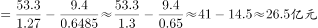，与C项最为接近。

故正确答案为C。

**考点**：平均数的增长量、文字资料

**来源**：2015年3月四川省选调优秀大学生到基层工作考试行政职业能力测验试卷（精选）第86题

### 第 87 题

2012年，手机淘宝用户增长最快的城市是：

A. 铜仁市

B. 岳阳市

C. 濮阳市

D. 常德市

第 87 题 · 答案与解析

**参考答案（粉笔题库参考内容）**

A

**解析**

定位材料第三段，可得：2012年，濮阳市、铜仁市为三四线城市中手机淘宝用户增长最快的城市，其中濮阳市为281%，铜仁市为286%，岳阳市和常德市为三四线城市。所以手机淘宝用户增长最快的城市是铜仁市。

故正确答案为A。

**考点**：排序类、文字资料

**来源**：2015年3月四川省选调优秀大学生到基层工作考试行政职业能力测验试卷（精选）第87题

### 第 88 题

下列关于手机淘宝的说法正确的是：

A. 越来越多的大龄网民加入到手机淘宝

B. 手机淘宝只是人们“碎片化”时间中的生活消遣

C. 平均每天有382万人在手机淘宝搜索商品

D. 传统的电子商务为手机淘宝的发展奠定了基础

第 88 题 · 答案与解析

**参考答案（粉笔题库参考内容）**

D

**解析**

A项：材料未涉及，错误；

B项：定位材料第一段，可得：“更多用户则是把手机淘宝当成‘碎片化’时间中的生活消遣”，说明还有很多人并不只是把手机淘宝当成“碎片化”时间中的生活消遣，错误；

C项：定位材料第一段，可得：“平均每天有928万人在手机淘宝上搜索商品”，并且本选项未说明具体年份，无法得出，错误；

D项：定位材料第二段，可得：“传统电商沉淀也为移动电子商务的发展奠定了基础。”而根据材料第二段的语义，手机淘宝属于移动电子商务的内容之一，正确。

故正确答案为D。

**考点**：文字资料、综合分析

**来源**：2015年3月四川省选调优秀大学生到基层工作考试行政职业能力测验试卷（精选）第88题

## 材料 2

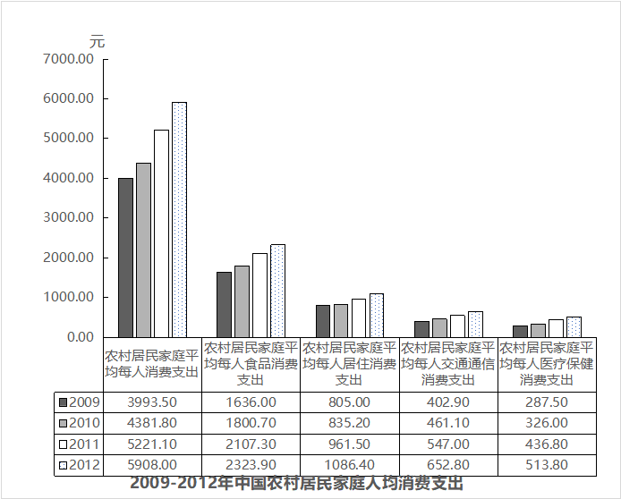

### 第 89 题

2009～2012年，中国农村居民家庭人均消费支出年均增加约：

A. 478.63元

B. 638.17元

C. 957.25元

D. 1914.50元

第 89 题 · 答案与解析

**参考答案（粉笔题库参考内容）**

B

**解析**

根据题干“年均增加约”，结合选项有具体单位，判定本题为年均增长量问题。定位统计图，可得：2012年中国农村居民家庭人均消费支出为5908.00元，2009年中国农村居民家庭人均消费支出为3993.50元，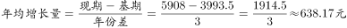。

故正确答案为B。

**考点**：年均增长量、统计图

**来源**：2015年3月四川省选调优秀大学生到基层工作考试行政职业能力测验试卷（精选）第89题

### 第 90 题

2010～2012年，同比增长最快的是：

A. 2012年交通通信消费支出

B. 2011年医疗保健消费支出

C. 2011年交通通信消费支出

D. 2011年居住消费支出

第 90 题 · 答案与解析

**参考答案（粉笔题库参考内容）**

B

**解析**

根据题干“同比增长最快”，判定为一般增长率题型。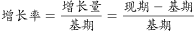，分别计算四个选项：

A项：2012年交通通信消费支出为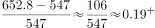；

B项：2011年医疗保健消费支出为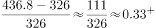；

C项：2011年交通通信消费支出为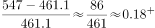；

D项：2011年居住消费支出为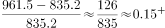。

同比增长最快的是2011年医疗保健消费支出。故正确答案为B。

**考点**：一般增长率、统计图

**来源**：2015年3月四川省选调优秀大学生到基层工作考试行政职业能力测验试卷（精选）第90题

### 第 91 题

2012年中国农村居民家庭人均消费支出所占比重最大的是：

A. 居住支出

B. 食品支出

C. 交通通信支出

D. 医疗保健支出

第 91 题 · 答案与解析

**参考答案（粉笔题库参考内容）**

B

**解析**

根据题干“比重最大的”，判定本题为现期比重问题。定位统计图，可得：2012年中国农村居民家庭人均消费支出中，居住支出为1086.40元，食品支出为2323.9元，交通通信支出为652.8元，医疗保健支出为513.80元。其中食品支出最大，因为总体值相同，所以其所占比重最大。

故正确答案为B。

**考点**：现期比重、统计图

**来源**：2015年3月四川省选调优秀大学生到基层工作考试行政职业能力测验试卷（精选）第91题

### 第 92 题

2009～2012年，中国农村居民家庭居住消费支出占消费支出的平均比重是：

A. 24.01%

B. 18.91%

C. 12.39%

D. 4.73%

第 92 题 · 答案与解析

**参考答案（粉笔题库参考内容）**

B

**解析**

根据题干“平均比重是”，可以判定本题为比重问题。定位统计图，可得：2009～2012年，中国农村居民家庭人均居住消费支出合计为805+835.2+961.5+1086.4=3688.1元，中国农村居民家庭人均消费支出合计为3993.5+4381.8+5221.1+5908=19504.4元。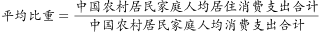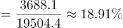。

故正确答案为B。

**考点**：现期比重、统计图

**来源**：2015年3月四川省选调优秀大学生到基层工作考试行政职业能力测验试卷（精选）第92题

### 第 93 题

下列说法错误的是：

A. 2009～2012年，中国农村居民家庭人均消费支出增长最快的是2011年

B. 2009～2012年，中国农村居民家庭恩格尔系数呈下降的趋势

C. 2009～2012年，中国农村居民家庭人均消费支出年均增加最多的是食品支出

D. 2009～2013年，中国农村居民家庭人均食品消费支出的增长率呈上升趋势

第 93 题 · 答案与解析

**参考答案（粉笔题库参考内容）**

D

**解析**

A项：定位统计图，增长最快即比较增长率的大小，。2009-2012年的增长率分别为：2012年：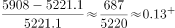，2011年：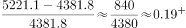，2010年：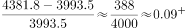。其中最快的为2011年，正确；

B项：恩格尔系数即食物支出占家庭支出比例，定位统计图，分别计算食品支出/家庭支出，2009年为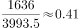，2010年为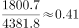，2011年为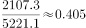，2012年为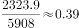，可以看到恩格尔系数呈下降趋势，正确；

C项：年份差相同，年均增加最多即增长量最多。定位统计图，分别计算各项2009-2012年的增长量，食品支出为2323.9-1636=687.9元，居住支出为1086.4-805=281.4元，交通通信支出为652.8-402.9=249.9元，医疗保健支出为226.3元。其中食品支出最大，即食品支出年均增加最多，正确；

D项：，定位统计图，2009～2013年中国农村居民家庭人均食品消费支出增长率分别为：2010年：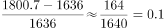，2011年：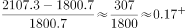，2012年：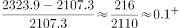，2013年未知。增长率先上升后下降，不呈上升趋势，错误。

本题为选非题,故正确答案为D。

**考点**：统计图、综合分析

**来源**：2015年3月四川省选调优秀大学生到基层工作考试行政职业能力测验试卷（精选）第93题

