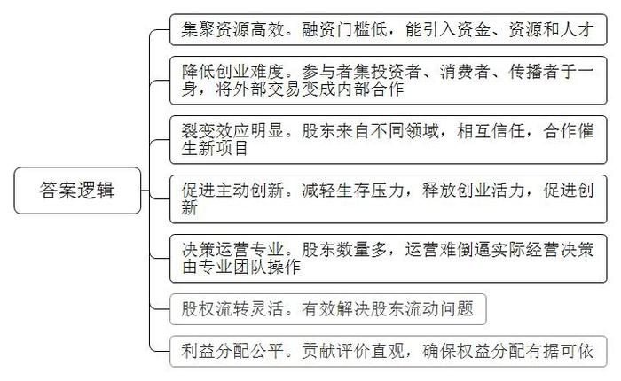
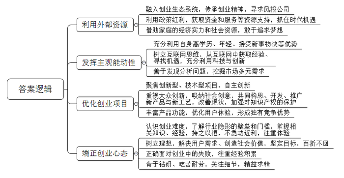

# 2016年公务员多省联考《申论》题（四川上半年卷）

<!-- gwy:overview:start -->
> **四川 · 2016 · 申论 · 上半年** ｜ 3 题 · 图片 3 处 · 答案随题折叠

导航：[题目](#题目) · [材料 1](#材料-1)
<!-- gwy:overview:end -->

> 候选采集稿。参考答案及解析来自粉笔页面，不代表官方答案或真实高分答卷；来源使用许可与原卷对应关系仍需人工核实。

## 给定材料

### 材料 1

在北京西北部一栋办公楼冷飕飕的地下室里，一群想要成为企业家的人正聚集在计算机屏幕前，注视着他们最新的项目雏形。而在几千米之外，在一个豪华的地下演讲厅里，30多名经理和创业者也在讨论有关新产品和新公司的创意。这两群人都验证着中国社会对创业热潮日益增长的兴趣。英语在线教学服务创始人王某表示：“初创是令人迷恋的新事物。”“中国的创业精神呈现一种上升趋势。顶级风投公司正在寻找年轻的创业者——整套生态系统逐步形成。”

据不完全统计，从2013年5月至今中央层面已经出台至少22份相关文件促进创业创新。各地方政府也纷纷出台政策，简政放权，从财税、金融、保障服务、政策激励等方面支持创新型企业特别是创新型小微企业发展，使各种创新资源向企业集聚，让更多金融产品和服务对接创新需求，用创新的翅膀使中国企业飞向新高度。2015年10月19日，在全国大众创业万众创新活动周启动仪式上，李克强总理被现场热烈气氛所感染而登台发表即席演讲，称“要为创新创业者站台”。李克强总理指出，大企业员工和草根创业者通过创新创业都可以成为更多财富的创造者和拥有者。这既是收入分配结构调整的重要内容，也促进了社会公平正义。双创为所有人提供了公平竞争的机会，让有能力的人通过自身奋斗获得上升通道。

### 材料 2

近年来，创业一词已经成为大众关注的热点，在众多创业团队里，“90后”群体以其高学历、年轻、接受新事物快而成为一股不可忽视的重要力量。前不久，某网站邀请了几位“90后”创业者，分享自己的创业心得。1992年出生的小尹已经开了三家公司。为了弄明白“为什么KTV的歌单十年不变”这个问题，小尹跑遍了N市所有的KTV。他发现，KTV的点歌系统更新周期较长，而且每一次更新，硬件和软件都要付钱，点歌系统的硬件公司缺少互联网思维，创新动力不足。在小尹看来，社交、娱乐才是这个时代年轻人的刚需。KTV不再只是一个唱歌的场所，而是一个聚集了年轻人社交、娱乐、聚会等多种需求的地方。凭着这个想法，他创立了KTV团购APP“一起唱”，把整个N市的KTV硬件系统作了更新。现在，用“一起唱”的用户，只要提前列出歌单，并同步到APP，进入包房后摇一摇手机，歌单便自动导入了点歌盒子。除此之外，用这款软件还可约别人来唱歌，还可以把KTV现场旋律进行混音，然后传到云端，分享到社交网站，甚至可以在包房里和朋友一起看世界杯。小尹说，从物质转到服务、娱乐，是他们这一代人创业和上―代的不同，这类创业不需要太高成本，往往一个想法，一份风险投资就可以做起来。“90后”正在用一种更新、更年轻的方式去与这个世界相处，创业的可选空间变大了。

这一观点得到了很多人的认同。与“90后”相比，“80后”们从父母那里得到的传承不多，且多有负担，除了养活自己，通常还需考虑如何让父母过得更好。而很多“90后”的父母有很强的经济能力和社会人脉，不依靠被养，还能帮到子女。“90后”没有后顾之忧，中国第一次出现了“可以干自己想干的事情”的一代人，这代人喷薄而出的创新力，会帮助中国进入一个极具创新力的年代。

也有分析人士认为，很多“90后”在创业心态上有了改变，他们不像做企业，更像做项目，对于成功的渴望不是很强烈，有时甚至只把这当做一种体验。

某互联网金融公司创始人、CEO小孙觉得，在传统社会，行业与社会规则已经形成，年轻人往往要学习社会中的既成经验，才能进入正轨。在这种系统里，年轻往往成为一种劣势。而在现代社会，互联网已经渗透到社会生活的各个部分，与互联网同生共长的年轻人成为互联网原住民，他们可以直接从互联网获取经验、寻找机遇，而对于年长者，年龄反而成了迁移转型的一种包袱。所以在传统部落中，年长者往往是部落中最有权威的人，而互联网社会中，则会涌现扎克伯格等一系列的创新者。现代社会不是经验的时代，而是技术与创新的时代。

### 材料 3

在某大学生创业大赛现场，5名女孩准备筹集40万元资金，到武汉近郊去承包50亩地，种植有机蔬菜。在台上陈述的女孩充满激情和自信，台下观众也不时报以阵阵掌声。当评委问道：“你们种过蔬菜吗？”“你们创业资金从哪里来？”“农民凭什么把土地转包给你们？”“你们种出来的有机蔬菜准备卖给谁？”等问题时，她们的回答却难以令人满意。如今，创业已经成为青年人口中的高频词语，对大学生而言，创业正在变得“简单”，曾经的理想似乎也触手可及。

机械专业硕士小杨，进入杭州一家民营企业从事技术工作不满半年。因为没有期待中的高薪，没有理想中的激情，他开始琢磨创业。此后，他每天都在与人交谈，项目、资金、人脉、经验等问题弄得他头疼，深感创业之艰的他放弃了创业梦。

某投资基金首席合伙人阎先生拥有20多年投资经历，曾位列《福布斯》中国年度最佳创业投资人榜首。他参与投资的企业包括完美世界、环球雅思、凡客、分众传媒、百度、阿里巴巴、巨人网络等著名企业。在阎先生看来，当创业成了一种“时尚”和“运动”时，多数人都急功近利地把创业当成了投机行为。他说，“从时下来看，创业的动机大多是源自对财富和名声的渴望。”

某著名网站策略营销总监范女士认为，赚钱是创业的应有之意，但更多成功的创业者却是从想要赚钱开始，“继而”解决用户需求，是在解决用户需求、创造社会价值这条道路上不断自我追问、探寻并最终走向成功之地的；如果仅仅停留在“为了赚钱”上是赚不到钱的。星巴克CEO舒尔茨曾说：“为钱创业是肤浅的，应为梦想所驱动。”在创业路上有太多诱惑，也有太多艰险，只有怀揣理想的人才能够抵抗诱惑，才能够不惧艰险，朝着自己的目标前行，百折而不回。诺贝尔奖得主菲尔普斯在《大繁荣》中指出：大多数创新并非是亨利•福特类型的孤独的梦想家带来的，而是由千百万普通人共同推动，他们有自由的权利去构思、开发和推广新产品与新工艺，或对现状进行改进。正是这种大众参与的创新带来了普通民众的繁荣兴盛——物质条件的改善加上广义的“美好生活”，大众创新带来国家繁荣。

某公司创始人卢先生在接受记者采访时说，目前创业氛围很好，但创业却也成为一种时尚，仿佛不去创业就是落伍了。创业项目的选择，部分属于异想天开型的，部分属于复制型的。而现实需要创新型、技术型的项目，那些通过移动互联网，把原有商业模式去中间化，搞流量，然后再找商业模式，这样的创新都是伪创新。仅怀着一腔热血，就幻想着自己只要去创业就能成为下一个马云，而对创业的概念，对行业隐形的壁垒和门槛却知之甚少。这是许多大学生创业伊始的真实写照。在国内的互联网创业环境中，有一个非常不好的特性就是抄袭成风。很多创业者经常因为有一个好的创意，但是却因为没有好的原创保护制度来保护，导致被其他一些公司抄袭过去，这些公司凭借着更雄厚的资本实力，迅速把原创者打败并挤出市场。

领英中国区总裁在日前的一次公开演讲中，用自身经验阐述了关于创业的两个公理：第一，创业成功是一个小概率的事件，每一个成功故事背后更多是失败；第二，创业没有失败者。即使是创业项目失败，作为创业者而言，过程中积累的经验将促进个人成长，即可定义为成功者。他认为，创业是没有失败者的历程。

ZUK联合创始人陈先生同样表达了对年轻人创业的观点。陈先生说：“创业是一件很复杂的事情，其实做好每一件事情就是创业。”

### 材料 4

深圳的创业者乔峤想要做一款智能耳机，他发现，60%的人都会在跑步过程中听歌，并用手机APP记录运动数据。如果有产品能同时解决跑步人群运动数据记录和听歌的需求，又能通过音乐来实现运动激励，会有很好的市场前景。乔峤对记者说，他想针对每个人的身体特征，设计和提供有效的音乐服务产品，做到每一个硬件设备都是针对个人定制的。

可是，光有好点子还不行。初始创业的乔峤，面临既缺资金、又缺人才的尴尬，他尝试着用股权众筹的方式来实现自己的创业梦想。在众筹网上，他发布了自己的股权众筹商业计划书，以出让公司10%股份的方式，融资187万元，最低投资额1万元。最终，吸引了16名投资者参与。乔峤告诉记者，这些投资者为他引入了互联网、音乐、体育领域的强大资源，其中，几个最志同道合的投资人干脆直接加入了创业团队。

### 材料 5

在北京大学东门外一处不起眼的楼里，有一处名曰“一八九八咖啡馆”的休闲场所。它成立于2013年10月，虽然看起来很简朴，但成立以来，它每天都在吸引着大批“咖粉”流连忘返，且不少是业界大佬。它究竟有何魅力？

董事长杨勇认为，“在传统的创业中，第一步要找投资人，这就很难，能拿到钱更不容易。第二步，找完投资人之后，要把产品卖出去，也挺难的，所以每步都是一个坎。为什么那么多创业公司都死掉，为什么那么多中小企业发展不了？就是因为每一个坎都不容易走过去。众筹就把这个模式改变了，每个人都是投资人，每个人都是消费者，每个人也是传播者，这种方式的改变，你就发现，做公司容易了。所以某种意义上消费者就是投资者和生产者。”

杨勇说：“传统的创业特别辛苦，就是因为你老要求人，或者叫做外部交易，今天要找一个银行的人，去求管银行的人，给他什么好处帮我办个事情，这叫外部交易。现在众筹是什么呢？你缺什么就让谁来当股东，你把你未来要求的人全部变成股东了，把原来外部的交易变成内部的合作了，内部合作就非常容易。”

“200人聚在一起就有很大的能量。实际上，它真正意义在后面的裂变，每一个项目做完之后，会带出一堆项目出来，原因就是通过众筹找了200个非常靠谱的人，这些人再有非常多的合作机会，所以基本上一个项目出来会带一堆项目。一八九八咖啡馆实现众筹之后，项目太多了，很大原因就是因为找了一群可以相互信任，相互背书，又都不错的人，而这些人本身又是跨界又是组合，非常容易谈成生意，所以这个裂变的过程，力量会特别巨大。”

浏览股东花名册，200位发起人涵盖了北京大学近30年来不同届别、不同院系、不同专业的毕业生，皆为各领域中的知名人士、企业家、高层管理者。这些联合创始人所在的行业涉及金融、移动互联网、新能源、新媒体、教育、法律，高科技等多个领域。杨勇表示，“通过众筹，聚集众多资源。每天跟像打了鸡血一样，所以创业的生存问题解决了。”“这200位股东，可能我把他们伺候好了，每月就会有一两百万收入，这就挺好，公司就能存续下来。而创新是怎么来的？创新就是因为大家能够很轻松地做自己的事情了，就会主动去创新，每天为了生存去创业的时候，你就不可能去创新。”

### 材料 6

“如果你真的想做一件事，全世界都会帮助你”，时下正风靡的众筹让这句话以更直接的方式照进现实。2014年初，在华南理工大学就读的刘永杰和3个小伙伴萌生了开一间咖啡馆的创业想法。这时，众筹模式走入了他们的视野，众筹咖啡馆“比逗BEPOTATO”的计划也就被列入了日程。

为了考察众筹在校园的可行性，2014年4月，创业团队在华工和华农的校园进行了300份以上的问卷调查，高达70％的参与众筹意愿给予了团队正式启动的信心。随后，他们以这两所学校的学生为目标群体进行股东招募。他们的众筹计划是：众筹股东每股1000元，每位最少需出资1000元，最多5000元，享有1至5股的分红权。经过一个多月的招募，他们共有170多位众筹股东和70多万元的启动资金。筹得了资金后，下一步就是选址。经过一段时间的考察，他们在五山地铁站附近租了一间临街的铺位。170多位众筹股东都竭力宣传这间咖啡馆，不仅自己来消费，也拉朋友来消费，开业两个月以来，咖啡馆的生意也越来越好。

在咖啡馆最显眼的地方，整个墙面挂满了印有比逗LOGO的马克杯，仔细一看，这些马克杯上都刻着名字和编号。王海向记者介绍，每一个马克杯代表咖啡馆的一位众筹股东。由于股东数量庞大，不少众筹咖啡馆最后变成了“看上去很美”而实际运营却举步维艰，落得散伙的下场。为了避免这种情况发生，比逗建立了自己的董事会，由核心运营团队、校园股东、社会股东等7人构成，虽然每个众筹股东都拥有建议权，但最终的决策权是在专业的核心运营团队手中。“尽管有摩擦，但大家都奉行‘专业的事给专业的人做’的原则，合作很顺利。”刘永杰说。

为解决学生股东“毕业”带来的流动问题，“比逗BEPOTATO”设置了学生股东毕业的股权流转计划。对于第一批学生股东，两年之后按贡献度排名，挑选一部分成为永久股东，其余在毕业时需将股份流转给附近高校在校生。对于之后加入的股东，均需要在毕业时将股份流转给合适的在校大学生。

利用校园优势，比逗将咖啡馆主题定位为“创业交流”。除了承接许多校园社团活动以外，他们还承办广东天使会等线下交流活动。通过举办类似的创业交流活动，店铺也获得了更多的创业资源，一些更富有经验的专业团队还能够给予他们诸如薪酬制度设计的指导。一些兴趣小组也自发找到了比逗，如锤子科技、海星会、微博读书会等等，都在比逗举办了线下活动。

“比逗”还在进行面向所有众筹股东的APP研发，主要目的是加强股东之间的交流、提高股东活跃度等。王海举例说，可以将股东对店铺的贡献设置成一个一个的任务，例如来店消费或发布一篇推介文章就能获得“经验值+1”，带朋友来消费就能够获得更多经验值。王海还举例说，店铺中要增加一幅壁画，以此设置一个任务，那么股东就可以通过APP来领取这个任务，在股东中找队友一起执行，完成后就获得相应的奖励。通过这样的任务完成获得的奖励积分，就可以更直观地看到每个股东对咖啡馆的贡献值，今后的分红、股权流转等就有据可依。

### 材料 7

乔治·马洛里是英国探险家，他曾就读于温切斯特公学和剑桥大学，曾是英国著名公学查特豪斯的教师。马洛里18岁的时候就喜欢上了登山，在那个被称为“阿尔卑斯登山的黄金年代”的日子里，年轻的马洛里并不是欧洲大陆最优秀的攀登者。然而，他对山有着巨大的兴趣，1921年到1924年，乔治·马洛里参加了人类前三次征服珠穆朗玛峰的尝试。

当马洛里随着登山队第一次来到珠峰脚下，第一眼见到他心中的女神时，他将她描述为“梦境中最狂野的造物，是那样巨大、美丽，而又可怕！这一次他们到达了海拔6985米的地方，由于缺乏地形知识，全队处于极端疲惫的状态，他们没有向更高的地方前进，但是他们终于找到通向顶峰的路。除此之外，这次攀登让他们在“阿尔卑斯攀登方式”之外，找到了更适合于8000米山峰的“金字塔攀登方式”。

马洛里第二次攀登珠峰时．到达了8300米之处，离顶峰只有500米之遥。这一次的最大的收获是发现了氧气的确切效用，并确立了高山氧气设备的基本模式——气瓶、气管、面罩，后世的人们只增加了一个调节器。

1924年6月，马洛里辞去了剑桥大学讲师职务，第三次来到珠峰的脚下，那一年他已38岁，有幸福祥和的家庭，有深爱着他的美丽妻子，有三个可爱的孩子和稳定的工作。当《纽约时报》的随队记者在追问他“你为什么要攀登珠峰”时，马洛里说，“因为山在那里！”。不久，当他和伙伴欧文再次向峰顶冲击时，他们永远留在了那里……

从某种意义上说，每个真正创业的人在他的生命中都有一座高山，而生命不息，创业不止，正是绝大多数创业者的常态。

## 题目

### 第 1 题

**根据给定材料4、5、6，概括众筹的特点。（20分）**

关联材料：材料 4、材料 5、材料 6

作答要求：

要求：

（1）概括准确，内容全面，表述清晰，语言简洁；

（2）不超过200字。

第 1 题 · 答案与解析

**参考答案（粉笔题库参考内容）**

1.集聚资源高效。融资门槛低，能引入资金、资源和人才。

2.降低创业难度。参与者集投资者、消费者、传播者于一身，将外部交易变成内部合作。

3.裂变效应明显。股东来自不同领域，相互信任，合作催生新项目。

4.促进主动创新。减轻生存压力，释放创业活力，促进创新。

5.决策运营专业。股东数量多，运营难倒逼实际经营决策由专业团队操作。

6.股权流转灵活。有效解决股东流动问题。

7.利益分配公平。贡献评价直观，确保权益分配有据可依。

**解析**

**参考答案说明：**本参考答案从“集聚资源高效”“降低创业难度”“裂变效应明显”“促进主动创新”“决策运营专业”“股权流转灵活”“利益分配公平”等不同的话题进行了分条撰写。各条答案要点之间在内容上相互并列，没有交叉。

**考点**：特点类

**来源**：2016年公务员多省联考《申论》题（四川上半年卷）

### 第 2 题

**请根据给定资料1、2、3，就大学生如何提高创业成功率提出建议。（30分）**

关联材料：材料 1、材料 2、材料 3

作答要求：

要求：

（1）观点明确，建议可行；

（2）语言简洁，有逻辑性；

（3）不超过500字。

第 2 题 · 答案与解析

**参考答案（粉笔题库参考内容）**

一、利用外部资源。1.融入创业生态系统，传承创业精神，寻求风投公司；2.利用政策红利，获取资金和服务等资源支持，抓住时代机遇；3.借助家庭的经济实力和社会资源，敢于追求梦想。

二、发挥主观能动性。1.充分利用自身高学历、年轻、接受新事物快等优势；2.树立互联网思维，从互联网中获取经验、寻找机遇，充分利用科技与创新；3.善于发现分析问题，挖掘市场多元需求。

三、优化创业项目。1.聚焦创新型、技术型项目，自主创新；2.重视大众创新，吸纳社会创意，共同构思、开发、推广新产品与新工艺，改善现状，加强对知识产权的保护；3.丰富产品功能，优化用户体验，形成独有竞争优势。

四、端正创业心态。1.认识创业难度，了解行业隐形的壁垒和门槛，掌握相关知识、经验，持之以恒，不急功近利，注重体验；2.树立理想，解决用户需求、创造社会价值，坚定目标，百折不回；3.正确面对创业中的失败，注重经验积累；4.肯于钻研、吃苦耐劳，关注细节，精益求精。

**解析**

**参考答案说明：**本参考答案从“利用外部资源”“发挥主观能动性”“优化创业项目”“端正创业心态”等不同的话题进行了分条撰写。各条答案要点之间在内容上相互并列，没有交叉。

**考点**：提出对策类

**来源**：2016年公务员多省联考《申论》题（四川上半年卷）

### 第 3 题

**给定资料3中提到“为钱创业是肤浅的，应为梦想所驱动。”请你根据对这句话的理解，结合所给材料，联系生活实际，自选角度，自拟题目，写一篇议论文。（50分）**

关联材料：材料 1、材料 2、材料 3、材料 4、材料 5、材料 6、材料 7

作答要求：

要求：

（1）观点明确，内容充实，认识深刻；

（2）思路清晰，结构严谨，语言流畅；

（3）字迹清楚，书写工整，限800-1000字。

第 3 题 · 答案与解析

**参考答案（粉笔题库参考内容）**

**为创业插上梦想的翅膀**

这是一个科技迅猛发展的时代，这是一个全社会都在创业创新大潮中的时代。身处创业浪潮之中，很多人都想做时代的弄潮儿。可是，有人说创业是为了钱。这个看法是肤浅的，**创业应该为梦想所驱动**！这个梦想要与社会相连，解决用户需求，创造社会价值。唯有此，创业才能被他人所认同，被市场所肯定，从而飞得更高，飞得更远。

创业是令人迷恋的新事物，受到了各界人士的青睐。目前我国的创业精神不断上升，各级政府也纷纷出台政策，给创业提供良好环境。人们尤其是年轻人，应该抓住机遇、坚持梦想，积极投身于创业之中，在创业中实现梦想。

**创业为梦想所驱动，有助于创造机会，实现创业者的自我价值。**很多时候，人们对金钱和名声的渴望，使创业的指向复制他人创意，最终导致创业失败；有的人面对创业困难，因为没有梦想的支撑，甚至在起跑线上就选择了放弃。新时代下，我们年轻人知识丰富、学习能力强，经济负担轻，充满创业活力。应让创业突破现实的羁绊，插上梦想的翅膀去创业，实现个人价值的同时推动我国经济发展。同时，也只有梦想，才能让创业者超越个人利益，关注百姓生活，让广大人民过上美好生活，以实现个人价值。

**为梦想而创业，还有助于满足社会需求，推动行业的发展进步。**曾经，我国传统行业存在产业结构单一，商业模式落后，难以满足人们多样化需求的问题。如今，通过创业，可以创新商业模式，更好的关注用户体验，进而促进产业结构升级。同时，新时代的创业者还更加关注社会价值、承担社会责任，关心自然环境等。如社会创业家以社会需求和创造社会价值为梦想，用超乎一般的执着和理念，塑造了一个个创业奇迹。不仅创造了财富，更为促进社会公平贡献了力量。可见，创业者只有将个人的梦想与人民、社会的梦想结合起来，才能汇聚成一个伟大的梦想。

**创业没有梦想不行，只有梦想也不够，它还需要行动、落实。**创业者首先要摆正心态，树立正确的创业观。要理性的看待问题，注重创业过程，持之以恒；其次要做好准备，学习市场、销售、法律政策等相关知识，积累创业经验，提升风险防范意识和自我保护能力；最后要真抓实干，合理选择创业项目、找准创业方法，可借鉴众筹的经验获得资金、人脉等的资源，降低创业难度，促使创业成功。

今天，创业的梦想，也不再是个人的梦想，而是千千万万人民的梦想，国家的梦想，世界的梦想。让我们为创业插上梦想的翅膀，脚踏实地，把梦想变为现实！

**文章分析**

**为创业插上梦想的翅膀**

【**标题的优点**：首先，范文的标题“为创业插上梦想的翅膀”突出了“创业应为梦想所驱动”这一主题。其次，语言表达简洁明了。】

（1）这是一个<u>科技迅猛发展的时代，</u>这是一个全社会都<u>在创业创新大潮中的时代</u>。身处创业浪潮之中，很多人都想做时代的弄潮儿。可是，有人说创业是为了钱。这个看法是肤浅的，**创业应该为梦想所驱动**！（2）<u>这个梦想要与社会相连，解决用户需求，创造社会价值</u>。唯有此，（3）<u>创业才能被他人所认同，被市场所肯定</u>，从而飞得更高，飞得更远。

【**开头的优点：**★内容方面：范文的开头是紧扣题目给定的“为钱创业是肤浅的，应为梦想所驱动”这句话展开的。首先，开头点出主题，做到了主题明确。其次，对“创业应为梦想所驱动”这一主题进行了分析阐述，指出了（1）创业创新的时代背景。（2）为梦想创业的具体做法。（3）为梦想创业的意义。★文字表达方面：使用了长短句配合使用，使语言表达有节奏感。】

创业是令人迷恋的新事物，受到了各界人士的青睐。<u>目前我国的创业精神不断上升，各级政府也纷纷出台政策，给创业提供良好环境</u>。人们尤其是年轻人，应该抓住机遇、坚持梦想，积极投身于创业之中，在创业中实现梦想。

【**过渡段的优点：**范文过渡段分析了“创业应为梦想所驱动”的良好环境和意义等方面的内容，此外，还要注意过渡段末尾的“年轻人，应该抓住机遇、坚持梦想”是用来引起下文的过渡句。】

**创业为梦想所驱动，有助于创造机会，实现创业者的自我价值。**很多时候，（1）<u>人们对金钱和名声的渴望</u>，<u>使创业的指向复制他人创意</u>，最终导致创业失败；有的人面对创业困难，因为<u>没有梦想的支撑</u>，<u>甚至在起跑线上就选择了放弃</u>。新时代下，（2）我们<u>年轻人知识丰富</u>、<u>学习能力强</u>，<u>经济负担轻</u>，<u>充满创业活力</u>。应让创业突破现实的羁绊，插上梦想的翅膀去创业，（3）<u>实现个人价值的同时推动我国经济发展</u>。同时，也只有梦想，<u>才能让创业者超越个人利益</u>，<u>关注百姓生活</u>，<u>让广大人民过上美好生活，以实现个人价值</u>。

【**论述段1的优点：**★观点句：范文的观点句是紧扣“创业应为梦想所驱动”这一文章主题提出的。形式上，它在段首处直接写出，位置突出，容易发现。内容上，关键词突出，内容要点明确，可以明显看出它是从“自我价值”入手，指出了“创业为梦想所驱动，有助于创造机会”。★论述内容：（1）介绍了创业过程中存在的问题；（2）介绍了年轻人创业的优势；（3）介绍了为梦想创业的意义。注意：以上几个方面的内容都是紧扣“创业为梦想所驱动，有助于创造机会，实现创业者的自我价值”这个观点句进行分析论述的，论述的针对性强，内容层次丰富。最后，在论述方法和论据的选取上做到了讲道理、举例子相结合，做到了丰富多样。】

**为梦想而创业，还有助于满足社会需求，推动行业的发展进步。**曾经，（1）<u>我国传统行业存在产业结构单一，商业模式落后，难以满足人们多样化需求的问题</u>。如今，（2）通过创业，<u>可以创新商业模式</u>，<u>更好的关注用户体验，进而促进产业结构升级</u>。同时，（3）新时代的创业者还更加<u>关注社会价值</u>、<u>承担社会责任</u>，<u>关心自然环境等</u>。如社会创业家以社会需求和创造社会价值为梦想，用超乎一般的执着和理念，塑造了一个个创业奇迹。<u>不仅创造了财富，更为促进社会公平贡献了力量</u>。可见，创业者只有将个人的梦想与人民、社会的梦想结合起来，才能汇聚成一个伟大的梦想。

【**论述段2的优点：**★观点句：范文的观点句是紧扣“创业应为梦想所驱动”这一文章主题提出的。形式上，它在段首处直接写出，位置突出，容易发现。内容上，关键词突出，内容要点明确，可以明显看出它是从“社会发展”入手，指出了“创业为梦想所驱动，还有助于满足社会需求，推动行业的发展进步”。★论述内容：（1）介绍了传统行业难以满足需求的问题；（2）介绍了创业可推动行业发展，产业结构转型；（3）介绍了创业可推动社会进步。注意：以上几个方面的内容都是紧扣“创业为梦想所驱动，还有助于满足社会需求，推动行业的发展进步”这个观点句进行分析论述的，论述的针对性强，内容层次丰富。最后，在论述方法和论据的选取上做到了讲道理、举例子相结合，做到了丰富多样。】

**创业没有梦想不行，只有梦想也不够，它还需要行动、落实。**（1）创业者首先<u>要摆正心态，树立正确的创业观</u>。要<u>理性的看待问题</u>，<u>注重创业过程，持之以恒</u>；（2）其次要做好准备，<u>学习市场、销售、法律政策等相关知识</u>，<u>积累创业经验</u>，<u>提升风险防范意识和自我保护能力</u>；（3）最后<u>要真抓实干</u>，合理选择创业项目、<u>找准创业方法</u>，<u>可借鉴众筹的经验获得资金、人脉等的资源</u>，降低创业难度，促使创业成功。

【**论述段3的优点：**★观点句：范文的观点句是紧扣“创业应为梦想所驱动”这一文章主题提出的。形式上，它在段首处直接写出，位置突出，容易发现。内容上，关键词突出，内容要点明确，可以明显看出它是从“对策”入手，指出了“创业只有梦想也不够，它还需要行动、落实”。★论述内容：（1）介绍了创业要摆正心态；（2）介绍了创业要做好准备；（3）介绍了创业要真抓实干。注意：以上几个方面的内容都是紧扣“创业没有梦想不行，只有梦想也不够，它还需要行动、落实”这个观点句进行分析论述的，论述的针对性强，内容层次丰富。最后，在论述方法和论据的选取上做到了讲道理、举例子相结合，做到了丰富多样。】

【**论述段之间的关系**：★内容的内在逻辑：范文的论述段之间有2层逻辑。第一层，整体上是从“意义”到“对策”的逻辑展开的。第二层，其中观点1和观点2又是从“意义”出发，论述段1先写了“创业为梦想所驱动，有助于创造机会，实现创业者的自我价值”，论述段2再写了“创业为梦想所驱动，还有助于满足社会需求，推动行业的发展进步”。★段与段的外在衔接：论述段3的段首处的过渡句“创业没有梦想不行，只有梦想也不够”，起到了承接论述段1、2，引出了论述段3的作用。】

今天，（1）<u>创业的梦想</u>，也不再是个人的梦想，而是千千万万人民的梦想，国家的梦想，世界的梦想。（2）<u>让我们为创业插上梦想的翅膀，脚踏实地，把梦想变为现实</u>！

【**结尾的优点**：范文的结尾回扣了“创业应为梦想所驱动”这一主题。（1）再次提到了“创业应为梦想所驱动”；（2）发出了号召希望。】

**解析状态：unknown（来源未提供）**

**考点**：文章写作题

**来源**：2016年公务员多省联考《申论》题（四川上半年卷）

