# 2016年423联考《行测》题（四川卷）

> 候选采集稿。参考答案及解析来自粉笔页面，不代表官方答案或真实高分答卷；来源使用许可与原卷对应关系仍需人工核实。

## 题型与作答说明

常识判断

（10题）

根据题目要求，在四个选项中选出一个最恰当的答案。

言语理解与表达

（35题）

本部分包括表达与理解两方面的内容。请根据题目要求，在四个选项中选出一个最恰当的答案。

数量关系

（10题）

在这部分试题中，每道题呈现一段表述数字关系的文字，要求你迅速，准确的计算出答案。

判断推理

（30题）

本部分包含图形推理、定义判断、类比推理和逻辑判断四个部分，根据题目的表述选择最佳选项

资料分析

（15题）

所给出的图、表、文字或综合性资料均有若干个问题需要你回答。你应根据资料提供的信息进行分析、比较、计算和判断处理。

## 给定材料

### 材料 dom-material-e2f33a2b466caee0

### 材料 dom-material-968a5d63b4bb80b0

### 材料 dom-material-6289dfcdca25eaa5

2015年2月，我国快递业务量完成8.2亿件，同比增长18.7%；业务收入完成136.0亿元，同比增长22.5%。消费者对快递业务进行的申诉中，有效申诉（确定企业责任的）占总申诉量的97.6%，为消费者挽回经济损失229.8万元。

2015年2月，全国每百万件快递业务中，有效申诉量为23.4件，对企业1的每百万件有效申诉量为75.13件，环比增长48.0%，对企业2的每百万件有效申诉量为32.56件，环比增长55.0%，对企业3的每百万件有效申诉量为31.86件，环比增长140.0%，对企业4的每百万件有效申诉量为17.81件，环比增长36.0%。

## 题目

### 第 1 题

下列关于党的重要思想，按提出时间先后顺序排列正确的是：

①社会主义市场经济理论 ②“三个代表”重要思想

③社会主义本质理论 ④构建社会主义和谐社会理念

A. ①②③④

B. ①②④③

C. ③①②④

D. ③②①④

### 第 2 题

下列对诗词中的物理现象描述**错误**的是：

A. 坐地日行八万里，巡天遥看一千河——地球的公转

B. 两岸青山相对出，孤帆一片日边来——运动的相对性

C. 八月秋高风怒号，卷我屋上三重茅——空气振动发声

D. 飞流直下三千尺，疑是银河落九天——势能转化为动能

### 第 3 题

下列关于微波的说法正确的是：

A. 微波的频率比一般无线电波的频率低

B. 含水量多少对微波加热效果没有影响

C. 微波会被玻璃、塑料和瓷器等物体反射

D. 微波通信容量大、质量好、传输距离远

### 第 4 题

下图所示的是哪种典型地貌？

A. 喀斯特地貌

B. 冰川地貌

C. 丹霞地貌

D. 风蚀地貌

### 第 5 题

假如某国出现比较严重的经济衰退，该国当局却不能运用货币政策进行调节。这个国家可能是：

A. 德国

B. 美国

C. 英国

D. 新加坡

### 第 6 题

关于药品，下列说法错误的是：

A. 大部分药品属于处方药，如注射剂、毒麻药品等

B. 非处方药不需要凭执业医师处方即可自行购买和使用

C. 处方药不可擅自使用、停用或增减剂量，否则可能引起严重后果

D. 药品说明书用以指导医生和患者选择、使用药品，但不具法律意义

### 第 7 题

关于水稻，下列说法错误的是：

A. 是一年生的禾本科植物

B. 大多为自花授粉并结出种子

C. 中国、印度、日本都是主产国

D. 淀粉含量是早、中、晚品种的分类标准

### 第 8 题

下列**不属于**夫妻共同财产的是：

A. 婚前房屋在婚后所得的租金

B. 夫妻关系存续期间，军人的复员费和自主择业费

C. 赠与合同中确定只归一方的财产

D. 婚姻存续期间虽未实际取得，但明确可以取得的知识产权收益

### 第 9 题

关于当代文学，下列说法错误的是：

A. 《白鹿原》曾获得“茅盾文学奖”

B. 《平凡的世界》是史铁生的作品

C. 余华是先锋文学的代表人物之一

D. 电影《大红灯笼高高挂》由苏童的小说改编

### 第 10 题

洲际导弹通常指射程大于8000公里的远程弹道式导弹。目前，中国研制的洲际弹道导弹主要是什么系列的？

A. “东风”系列

B. “长征”系列

C. “红旗”系列

D. “天宫”系列

### 第 11 题

中国互联网发展的过程中，“鼓励原创”的版权意识与互联网的免费共享精神，一直在        中牵绊着发展。当众多网友对网络“免费午餐”津津乐道时，损害的却是创造者的创作热情以及出版业的长远发展。

填入画横线部分最恰当的一项是：

A. 逆境

B. 竞争

C. 矛盾

D. 挑战

### 第 12 题

科普影评的作者应寻找科学与电影的交汇点，将科普和艺术            ，启迪思想。他们将前沿领域研究成果，结合电影转化为更轻松易懂的文字，面向更多读者。

填入画横线部分最恰当的一项是：

A. 融会贯通

B. 合二为一

C. 珠联璧合

D. 相提并论

### 第 13 题

古人行文简略，优秀的作品常常“字不虚设”，阅读者决定不予深究的地方，有可能正是作者用心良苦之所在。因此我们阅读时不宜有所偏，应该像作家写作这些文章时那样“      ”。

填入划横线部分最恰当的一项是：

A. 孜孜不倦

B. 精益求精

C. 字斟句酌

D. 心无旁骛

### 第 14 题

人类的寿命与基因有关，体内有多个基因            着你的生命长短。研究表明，那些在恶劣环境下控制机体防御功能的基因，能够显著地改善多种生物的健康状况并且延长其寿命。了解这些基因的运作            ，或许可以帮助我们找到消除老年疾病、延长人类生命的秘诀。

依次填入画横线部分最恰当的一项是：

A. 操控 规律

B. 支配 原理

C. 决定 机制

D. 主宰 流程

### 第 15 题

对互联网企业来讲，从用户那里收集到的信息主要包括消费习惯、行为特征、个人数据等。企业可以通过收集这些信息去开展大数据分析，进一步挖掘用户的潜在消费能力和更          的价值，从而为用户提供更具        的服务。

依次填入划横线部分最恰当的一项是：

A. 市场化 独创性

B. 多元化 针对性

C. 智能化 实用性

D. 规模化 多样性

### 第 16 题

宜居带是指一颗恒星周围的一定距离范围，在这一范围内水可以以液态形式存在。由于液态水被科学家认为是生命生存\_\_\_\_\_\_\_\_\_的元素，因此如果一颗行星恰好落在这一范围内，那么它就被认为有更大的\_\_\_\_\_\_\_\_拥有生命或至少拥有生命可以生存的环境。

依次填入画横线部分最恰当的一项是：

A. 缺一不可 范围

B. 举足轻重 条件

C. 至关重要 优势

D. 必不可少 机会

### 第 17 题

日前，被称为“法国大展”的“名馆名家名作”纪念中法建交50周年特展在国家博物馆展出。这是一次重量级的展览，10幅名作都是从法国各大国立博物馆\_\_\_\_\_\_\_\_的精品之作，\_\_\_\_\_\_\_了法国从文艺复兴到当代的艺术精华。

依次填入画横线部分最恰当的一项是：

A. 精挑细选 再现

B. 沙里淘金 展现

C. 百里挑一 融合

D. 优中选优 浓缩

### 第 18 题

在人类文明史上，古埃及人和两河流域的苏美尔人，都曾创造过古老的文字。然而，随着时间的流逝，这些文字早已消亡。时至今日，\_\_\_\_\_\_\_\_\_\_的古老文字，唯有中国人创立的汉字。作为伟大的汉文化的载体和媒介，汉字依然\_\_\_\_\_\_\_，堪称当今世界上最有生命力的文字之一。

依次填入画横线部分最恰当的一项是：

A. 硕果仅存 长盛不衰

B. 凤毛麟角 源远流长

C. 出类拔萃 博大精深

D. 鹤立鸡群 方兴未艾

### 第 19 题

暗物质是最大的谜团之一，不过一旦天文学家接受其存在，很多其他宇宙难题便可     。例如，暗物质似乎能解释为何银河系的盘状结构边缘存在如此大的扭曲。虽然围绕银河系运行的星系会对银河系产生扰动，但如果没有暗物质的放大作用，它们微弱的引力效应对银河系也是      。

依次填入划横线部分最恰当的一项是：

A. 举一反三 望尘莫及

B. 迎刃而解 鞭长莫及

C. 拨云见日 爱莫能助

D. 昭然若揭 无能为力

### 第 20 题

天池经历了漫长的无名时期，后来伴随着天池传说的兴起，天池也开始       。谈到天池传说，还有一个缘由：人们面对神奇的山水之境时，总爱把神灵的光环罩在山水的头上，使山水之景与神灵之气       ，即所谓“山不在高，有仙则名”。

依次填入划横线部分最恰当的一项是：

A. 声名鹊起 相得益彰

B. 门庭若市 相映成趣

C. 脱颖而出 相濡以沫

D. 广为人知 相视莫逆

### 第 21 题

在这个时代，人与人之间虽然在空间和情感上越来越\_\_\_\_\_\_，但是每个人的利益却又\_\_\_\_\_\_\_\_地与他人的利益和行为紧密地联系在一起。这促成人们主动参与公共事务，呼吁公共利益。

依次填入画横线部分最恰当的一项是：

A. 冷漠 无孔不入

B. 疏离 前所未有

C. 隔绝 迫不得已

D. 封闭 始料未及

### 第 22 题

经济全球化促使世界主要国家实力对比关系发生深刻变化，出现强与弱、盛与衰的实力转换，国际角色与位序的           ，最终会导致国际社会中的权力分配结构产生调整。同时，彼此间的机制化、制度化、常态化的             与相互协调已经成为处理国家间关系、解决国家间经济利益矛盾的主要方式。

依次填入划横线部分最恰当的一项是：

A. 善变 对话

B. 演变 商榷

C. 嬗变 磋商

D. 变迁 协商

### 第 23 题

在西班牙，“慢食”一直是在人们头脑中                的饮食观念。与“慢食”一脉相承的是西班牙人“慢生活”的态度：大厦电梯里面没有关门按键，大家都是等待电梯门缓缓关上；和午餐相伴的还有午睡，尤其在西班牙南部最为炎热的地方，小店业主都会在14点到17点之间关门，那是他们               的午休时段。

依次填入画横线部分最恰当的一项是：

A. 嗤之以鼻 板上钉钉

B. 坚不可摧 不可更改

C. 积重难返 翘首以待

D. 根深蒂固 雷打不动

### 第 24 题

法治和礼治发生在两种不同的社会         中。这里所谓的礼治也许就是通常所谓的人治，但是礼治一词不会像人治一词那样容易引起         ，以致有人觉得社会秩序是可以由个人好恶来维持的了。

依次填入划横线部分最恰当的一项是：

A. 形态 歧义

B. 模式 偏差

C. 情态 误解

D. 形势 干扰

### 第 25 题

当企业的业务都实现计算机化后，那些从事计算机业务的企业却遭遇了       。如果需要计算机化的业务流程没有增加，顾客对性能没有特别需求，他们就无法继续      自己的产品。所以，所有与计算机相关的企业，都必须为已经得到满足的顾客们，提供一个购买他们更新技术的       。

依次填入画横线部分最恰当的一项是：

A. 瓶颈 销售 理由

B. 阻碍 生产 方法

C. 困境 改进 渠道

D. 障碍 推广 优惠

### 第 26 题

“本质性诗人”大致有两种出路：其一是像陶渊明那样从急流中退出，在山水间\_\_\_\_\_\_\_\_自己的灵魂。尽管现实中并不存在桃花源，但\_\_\_\_\_\_\_\_在内心一隅还是可能的。其二是原地不动，像屈原那样与污浊的世界对抗。这注定了他与世界的\_\_\_\_\_\_\_是持续的、难以调和的。

依次填入画横线部分最恰当的一项是：

A. 寻找 退隐 冲突

B. 放逐 蜷缩 矛盾

C. 抚慰 潜藏 距离

D. 寄托 固守 隔阂

### 第 27 题

从长期看来，人民币国际化并逐步发展成为储备货币                  。一方面，中国经济基本面长期向好的             没有变；另一方面，人民币的币值一直比较稳定，稳中有升，这些都为有强烈“保值增值”需求的各国央行提供了储备人民币的强大         。

依次填入画横线部分最恰当的一项是：

A. 势如破竹 态势 动机

B. 势不可挡 趋势 动力

C. 势在必行 势态 信心

D. 势如累卵 形势 信念

### 第 28 题

现代传媒尤其是电子传媒有着比传统纸质传媒更宽广的尺度，            更多批判的意识和更多的异端。无数专家、学者在电子传媒会客厅中针对各种社会现象接受访谈，发表意见，甚至不乏              的声音。分析之深、论证之严密、言论之犀利，传统媒体均无法                  。

依次填入画横线部分最恰当的一项是：

A. 鼓励 特立独行 相提并论

B. 滋生 针锋相对 同日而语

C. 允许 振聋发聩 一目了然

D. 容纳 惊世骇俗 望其项背

### 第 29 题

汪曾祺曾说语言不是外部的东西，它是和内在的思想同时存在、不可剥离的。在他看来写小说就是写语言，语文课学的是语言，但语言不是空壳，而是要承载各种各样的思想、哲学、伦理、道德的。怎么做人，如何对待父母兄弟姐妹，如何对待朋友，如何对待民族、国家和自己的劳动等，这些在语文课里是与语言并存的。从这个意义来讲，语文教育必须吸收和继承传统文化，而诗歌无疑是传统文化的集大成者。

这段文字意在说明：

A. 诗歌中包含丰富的思想、伦理和道德元素

B. 脱离内在思想的语文教育是空洞无物的

C. 必须重视诗歌在语文教育中的作用

D. 语文教育需要和思想品德教育同步进行

### 第 30 题

秦汉四百年间，政治与文化相互推动，形成互补机制，其效应是：统一被认为是合理的、正常的，分裂则被认为是违理的、反常的。秦汉文化造成的这一定势，深刻地影响了此后两千年的中国历史。国家统一，使多元文化整合的速度与力度加强；而整合后的一统文化，具有强大的凝聚力和向心力，又反过来推动政治一统。

这段文字意在强调：

A. 政治与文化存在紧密联系

B. 秦汉文化对于后世影响深远

C. 中国文化具有强大的向心力

D. 国家统一的前提是文化的一统整合

### 第 31 题

当前，对于大部分消费者来说，智能化家居产品既熟悉又陌生，很多人的概念还停留在电动窗帘或别墅防盗系统。从技术层面来说，一键控制、远程遥控、感应人体、自动开启这些电影里才出现的产品如今并非“高科技”，但由于价格昂贵等原因，智能家居并未普及。

根据这段文字，以下说法正确的是：

A. 智能化已成为家居业未来的发展方向

B. 目前技术上实现智能家居已无屏障

C. 普及智能家居必须降低生产成本

D. 智能家居的概念模糊影响其普及程度

### 第 32 题

由于冰河期消失、气候转暖，中石器时代的绘画由洞窟转移到露天岩壁。随着人们狩猎工具的进步，对大自然征服力的增强，动物形象在绘画中逐渐减少并失去原始的野性，而人类活动开始成为绘画描绘的主要对象。岩画主要分布在北欧和西班牙的拉文特地区。它们以人类狩猎为主要情节，以表现人物、动物的运动和速度为特点，把运动中的形象表现成剪影效果或带状样式，以拉长的四肢和夸张的动作强调动势，表现狩猎场面中的紧张和活力。构图具有浓厚的情节性和生活气息，但忽略细节刻画，用色单纯。

根据这段文字，关于中石器时代的岩画，以下说法正确的是：

A. 风格细腻而精致

B. 多表现动物野性

C. 再现了人类生活

D. 色彩鲜艳、丰富

### 第 33 题

英国科学家宣称，已找到了一种替代全球定位系统（GPS）的方法，而无需借助任何空间技术。研究发现，激光能够限制并冷却放置于真空条件下的原子，将温度降至绝对零度以上的百万分之一度。在这样的温度下，原子对地球的磁性和重力领域的变化极度敏感。研究者利用这些成果，可以在一台小型装置上限制原子，研究它们的波动，从而定位其运动，并准确查明它们的所在位置。此时，其踪迹定位工作会交由一个仅有1米长的装置来完成，关键在于如何把它打造成微缩装置，以便将其安装在智能手机之中。

这段文字主要介绍的是：

A. 智能手机应用程序的革新

B. 激光在科技创新中的新用途

C. 新定位系统在前沿领域的应用

D. 利用原子进行定位的原理

### 第 34 题

①最早的单质碘便是法国人从海藻中发现的，海藻也是最早的碘生产原料

②我国大部分地区都缺碘，碘不足可能会引起甲状腺肿病和地方性克汀病

③近年来，随着人们对食品纯天然的追求，海藻碘盐越来越受到欢迎

④碘在自然界中比较稀少，但是海洋中的藻类却有较高的含碘量

⑤碘是人体必需的微量元素之一，有“智力元素”之称

⑥因此从1995年起，我国开始实施食盐强制加碘

将以上六个句子重新排列，语序正确的是：（ ）

A. ②⑤⑥③①④

B. ③①④⑤②⑥

C. ④③①⑤⑥②

D. ⑤②⑥④①③

### 第 35 题

①弹性分析方法是众多分析方法中研究产业吸纳能力的基本方法

②由此可以看出，文化创意产业弹性系数最大，对就业的吸纳能力最强，这和北京市不断调整经济结构、充分利用文化资源优势以及对文化创意产业的重视程度相关

③北京文化创意产业开辟了大量的就业空间，为各层次的人群和专业人士提供了就业平台

④自2006年以来，北京文化创意产业、第一产业、第二产业、第三产业的平均就业弹性分别为0.59、-0.08、-0.36、0.39

⑤所谓就业弹性，是指描述经济增长与就业增长之间关系的指标，即在某一时期内经济增长1%所带来的就业增长的比率，它与经济结构和劳动力成本等因素相关

⑥为了进一步确定文化创意产业对北京就业的吸纳空间，研究者采用弹性分析方法进行了研究

将以上六个句子重新排列，语序正确的是：

A. ①⑤④②⑥③

B. ③⑥①⑤④②

C. ①⑥⑤④②③

D. ③⑤④⑥①②

### 第 36 题

有了社会契约，人们失去的是其自然的自由，以及他们愿意拿什么就拿什么的绝对的权利；通过社会契约，他们得到的是文明的自由以及对自己所拥有的财物的法定权。在权衡利弊的时候，如果要避免出现错误，我们必须清楚地辨明什么是自然的自由以及什么是文明的自由——自然的自由只受到个人实际力量的控制，而文明的自由却受到公众意志的限制。步入文明社会，人类获得了道德自由，仅这一点就使人类成了自身的主宰。

根据上述文字，下列说法正确的是：

A. 社会契约规定了自然的自由和文明的自由各自的界限

B. 社会契约强调的是有约束而非完全的自由

C. 人们只有服从社会契约才能获得文明的自由

D. 社会契约赋予人们文明的自由、限制自然的自由

### 第 37 题

现代化学与炼金（炼丹）的相同点是从分子层面创造新事物，至于创造新元素其实是核物理学家的任务，由他们拿一些回旋加速机把新元素轰出来然后再填到元素周期表中作为化学家的胜利果实。古典炼金术实际上已经有了元素、原子这样的理念，但并不具备理性思维，例如中世纪的欧洲人认为，轻、重、干、湿是基本的物理性质，干而轻的是火，干而重的是土，湿而轻的是气，湿而重的是水，因此，任何物质均是由水、火、土、气这四种基本元素按不同比例合成的结果，这与目前可知世界的观念显然不同，而同时期其他文明中对物质本质的认识同样也是介于神秘与理性之间。

接下来最可能讲的是：

A. 现代化学理性思维的起点

B. 物理学家如何创造新元素

C. 古典炼金术对欧洲文明的影响

D. 可知世界中关于元素的各种观念

### 第 38 题

人的自尊可以划分为有条件的自尊和无条件的自尊。前者是通过达到一些预设的标准来获得的自尊，自我价值感有赖于这些标准的实现，而非自我的本真需要，比如认为拥有美貌才有价值感。有条件自尊者往往并不了解自己的需要，其衡量自尊的标准是内化得来的。如果父母的爱是有条件的，对自己欲求的行为进行奖励，对不欲求的行为进行惩罚，这就把行为标准强加给了儿童，儿童会不自觉地把这种标准当作自己的人生追求。有条件的自尊往往通过强烈的自我意识表现出来，这样的人总是通过他人的眼光来看待自己。

与这段文字的意思相符的一项是：

A. 人的本真需求是有条件自尊的来源

B. 父母的过分溺爱会损害孩子的自尊

C. 有条件自尊者往往过于在意外界的评价

D. 父母给孩子制定行为标准对其成长不利

### 第 39 题

可见光通信技术的原理非常简单，光亮代表1，光灭代表0，亮灭的组合就携带了信息。不过，由于可见光的频率远远高于无线网络通信信号，其传播的直线性很强，稍有阻挡就会导致通信中断。考虑到技术发展趋势和产品实用性，可见光通信不大会替代无线网络而在家庭中得到广泛应用，但这并不是说这种技术没有实用价值。这种技术在广播式的公共通信中有着令人兴奋的应用前景。运用可见光通信技术，发光二极管信号灯可告诉司机前方直行有拥堵现象，建议右转走另外的道路。

从这段文字我们可以推出：

A. 可见光通信技术的使用将使得城市真正变成智能之城

B. 目前可见光通信的核心技术已有了巨大突破

C. 可见光通信技术将在公共通信中大放异彩

D. 可见光通信技术将使得家庭网络发生翻天覆地的变化

### 第 40 题

诗歌的面貌并不完全取决于作者人品的高下，而是与作者的学力素养、心灵的敏感程度有更为直接的关系。换句话说，                                                               。典型的例子就是晋代的潘岳，他虽然有“拜路尘”的卑劣行径，但其《闲居赋》一文却展现了一份清雅独绝的隐逸情怀。

填入画横线部分最恰当的一项是：

A. 一个品格并不高尚的人同样有可能创作出动人的诗篇

B. 人格是否高尚并不是决定作品质量高下的唯一要素

C. 一些杰作的作者反而更擅长掩饰自己的真实品格

D. “知人知面不知心”的情况在创作领域尤为常见

### 第 41 题

大数据是指规模极其巨大，以致很难通过一般软件工具加以获取、管理、处理并整理成为有用资讯的海量数据。其具有大量、高速、多样和价值密度低四个特点，被认为是人类新世纪的“新财富”，价值“堪比石油”，发达国家纷纷将开发利用大数据作为夺取新一轮制高点的重要目标，就是个明证。

这段文字意在说明：

A. 大数据在处理上还存在技术难度

B. 大数据背后隐藏着巨大的价值

C. 发达国家在开发利用大数据上已经先行一步

D. 开发利用大数据已成为国家竞争的一个热点

### 第 42 题

中微子是一种基本粒子，在宏观的宇宙起源及演化中扮演着极为重要的角色。由于没有质量并且不带电荷，和其他物质的相互作用极其微弱，这使得中微子的运动轨迹不会发生改变。那些来自遥远宇宙、来自黑洞边缘或者来自宇宙线发源地的中微子，可以告诉人类那些“源”在哪里，甚至可以让我们一探黑洞的究竟。

最适合做本段文字标题的是：

A. 令人惊喜的存在

B. 特立独行的中微子

C. 中微子：宇宙的使者

D. 触不可及：“隐形”的中微子

### 第 43 题

从政治经济到日常生活，从全球化到地区的复兴，从实用技术到话语表达所面对的诸多难题乃至危机，都与空间这一因素密切相关。这是以地震海啸灾难、边界武装冲突、房地产业崩盘、道路拥堵以及空间竞争日趋激烈等多种形式表现出来的。

这段文字意在说明：

A. 经济全球化带来很多空间危机

B. 自然和人为空间危机日趋突出

C. 如今空间变得越来越为重要

D. 人口增多带来很多空间问题

### 第 44 题

海洋是陆域通过流域的自然延伸，在海洋开发活动中，海洋捕捞、海上运输、海洋矿产开发和海水养殖等生产环节是在海域和流域共同完成；而海盐业和海水利用等则完全是在陆域上完成所有生产环节。此外，现代科学技术发展在推动海洋科技进步、海洋产业发展的同时，海洋高新技术的发展以及新产品的出现，也促进了流域科技进步和相关产业的发展，海陆产品通过这种技术延伸得到互动发展。

这段文字意在说明：

A. 海洋经济与流域经济空间布局的依赖性

B. 现代科技的发展推动了海陆经济的进步

C. 海洋经济与流域经济在产业上相互交错

D. 现代科技的发展促进了海陆经济的交汇

### 第 45 题

沉积物基准是指特定化学物质在沉淀物中不对底栖生物或上覆水体质量产生危害的实际允许浓度，它既是对水质基准的完善，也是评价沉积物污染和生态风险的基础，是进行湖泊生态环境质量评价的基本要素。国外对沉积物基准的研究始于20世纪80年代，但还未形成完善和统一的沉积物基准体系。由于沉积物中污染物的迁移、转化、生物累积过程及界面过程的复杂性，目前仍缺乏关键的研究手段。国内已有不少科学家做了大量有益的探索，但研究仍然比较零散，还没有国家主管部门颁布湖泊沉积物基准规范。

这段文字意在说明：

A. 亟需弥补现有沉积物基准体系不足

B. 沉积物基准非常重要但研究未成体系

C. 沉积物基准为湖泊水环境重要研究内容

D. 沉积物基准的相关研究已经有较多进展

### 第 46 题

A工程队的效率是B工程队的2倍，某工程交给两队共同完成需要6天。如果两队的工作效率均提高一倍，且B队中途休息了1天，问要保证工程按原来的时间完成，A队中途最多可以休息几天？

A. 4

B. 3

C. 2

D. 1

### 第 47 题

某企业原有职工110人，其中技术人员是非技术人员的10倍，今年招聘后，两类人员的人数之比未变，且现有职工中技术人员比非技术人员多153人。问今年新招非技术人员多少名？

A. 7

B. 8

C. 9

D. 10

### 第 48 题

某地居民用水价格分二级阶梯，户年用水量在0~180（含）吨的水价5元/吨；180吨以上的水价7元/吨。户内人口在5人以上的，每多1人，阶梯水量标准增加30吨。老张家5人，老李家6人，去年用水量都是210吨。问老李家的人均水费比老张家少多少元？

A. 12

B. 35

C. 47

D. 60

### 第 49 题

某种商品原价25元，每半天可销售20个。现知道每降价1元，销量即增加5个。某日上午将该商品打八折，下午在上午价格的基础上再打八折出售，问其全天销售额为多少元？

A. 1760

B. 1940

C. 2160

D. 2560

### 第 50 题

某高校艺术学院分音乐系和美术系两个系别，已知学院男生人数占总人数的30%，且音乐系男女生人数之比为1：3，美术系男女生人数之比为2：3，问音乐系和美术系的总人数之比为多少？

A. 5：2

B. 5：1

C. 3：1

D. 2：1

### 第 51 题

木匠加工2张桌子和4张凳子共需要10个小时，加工4张桌子和8张椅子需要22个小时。问如果他加工桌子、凳子和椅子各10张，共需要多少小时？

A. 47.5

B. 50

C. 52.5

D. 55

### 第 52 题

2014年父亲、母亲的年龄之和是年龄之差的23倍，年龄之差是儿子年龄的，5年后母亲和儿子的年龄都是平方数。问2014年父亲的年龄是多少？（年龄都按整数计算）

A. 36岁

B. 40岁

C. 44岁

D. 48岁

### 第 53 题

某餐厅设有可坐12人和可坐10人两种规格的餐桌共28张，最多可容纳332人同时就餐，问该餐厅有几张10人桌？

A. 2

B. 4

C. 6

D. 8

### 第 54 题

一环形跑道上画了100个标记点，已知相邻任意两个标记点之间的跑道距离相等。某人在环形跑道上跑了半圈，问他最多能经过几个标记点？

A. 49

B. 51

C. 50

D. 100

### 第 55 题

如下图，正方形ABCD边长为10厘米，一只小蚂蚁E从A点出发匀速移动，沿边AB，BC，CD前往D点。问哪个图形能反映三角形AED的面积与时间的关系？

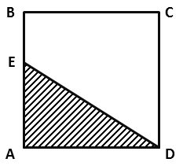

A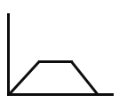B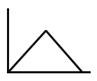

CD

A. A

B. B

C. C

D. D

### 第 56 题

从所给四个选项中，选择最合适的一个填入问号处，使之呈现一定的规律性：

A. A

B. B

C. C

D. D

### 第 57 题

把下面的六个图形分为两类，使每一类图形都有各自的共同特征或规律，分类正确的一项是：

A. ①②③，④⑤⑥

B. ①④⑤，②③⑥

C. ①④⑥，②③⑤

D. ①③⑤，②④⑥

### 第 58 题

把下面的六个图形分为两类，使每一类图形都有各自的共同特征和规律，分类正确的一项是：

A. ①②⑥，③④⑤

B. ①③⑤，②④⑥

C. ①③④，②⑤⑥

D. ①④⑥，②③⑤

### 第 59 题

从所给四个选项中，选择最合适的一个填入问号处，使之呈现一定的规律性：

A. A

B. B

C. C

D. D

### 第 60 题

从所给四个选项中，选择最合适的一个填入问号处，使之符合所给的题干所示：

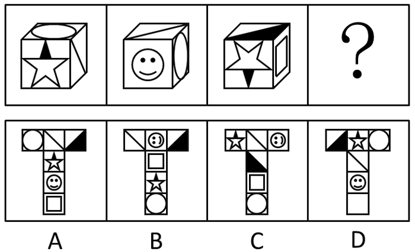

A. A

B. B

C. C

D. D

### 第 61 题

把下面的六个图形分为两类，使每一类图形都有各自的共同特征和规律，分类正确的一项是：

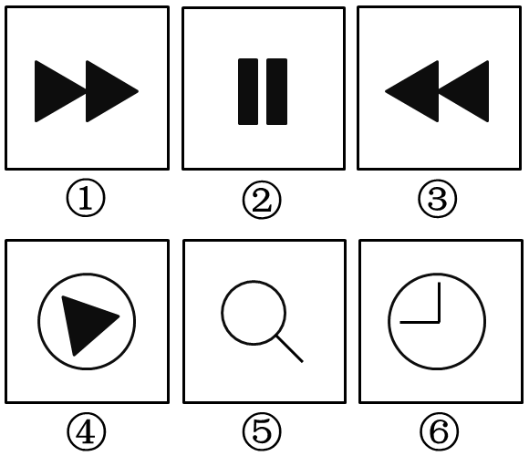

A. ①②⑥，③④⑤

B. ①③④，②⑤⑥

C. ①⑤⑥，②③④

D. ①③⑤，②④⑥

### 第 62 题

黄连：苦涩

A. 班级：团结

B. 钻石：坚硬

C. 花朵：鲜红

D. 城市：繁华

### 第 63 题

报刊：新闻

A. 土地：玉米

B. 法院：法律

C. 出版社：书籍

D. 唱片：歌曲

### 第 64 题

沟通：手机：金属

A. 招聘：面试：简介

B. 物流：运输：公路

C. 卫星：科技：科学家

D. 露营：帐篷：帆布

### 第 65 题

（　）　对于　熟练　相当于　敏捷　对于　（　）

A. 娴熟　灵敏

B. 操作　迅捷

C. 熟悉　迅速

D. 谙熟　灵动

### 第 66 题

出行：雾霾：口罩

A. 休息：沙发：电视

B. 超车：公路：路标

C. 勘探：野外：地图

D. 娱乐：海滨：游泳

### 第 67 题

（ ）对于 美丽 相当于 春风满面 对于 （ ）

A. 楚楚动人 愉快

B. 笑靥如花 兴奋

C. 眉开眼笑 高兴

D. 心地善良 滋润

### 第 68 题

麻雀：动物：生物链

A. 豆浆：早餐：豆制品

B. 开水：纸杯：便利品

C. 发卡：首饰：妆扮品

D. 钢笔：电脑：办公品

### 第 69 题

不规则需求是指某些物品或者服务的市场需求在不同季节，或一周不同日子，甚至一天不同时间上下波动很大的一种需求状况。

根据上述定义，下列哪项属于不规则需求？

A. 早晚高峰期出租车供不应求

B. 某品牌牙刷分为软、硬、中三种以面向不同消费者

C. 某电商店庆打折，活动当天点击量剧增

D. 某博物馆引进一批梵高画作巡展，游客蜂拥而至

### 第 70 题

初级群体指的是由面对面互动所形成的、具有亲密的人际关系和浓厚的感情色彩的社会群体；次级群体指的是其成员为了某种特定的目标集合在一起，通过明确的规章制度结成正规关系的社会群体。

根据上述定义，下列涉及次级群体的是：

A. 亲友团来到比赛现场为小李助威

B. 小赵要到大城市上学了，山里的乡亲们都到村口为他送行

C. 小王考上了研究生，公司的同事一起为他庆贺

D. 20年之后，小张儿时的玩伴建立了一个微信群

### 第 71 题

诱发运动是指由于一个物体的运动使其相邻的一个静止物体产生运动的错觉现象。

根据上述定义，下列属于诱发运动的是：

A. 在黑板前点燃一支蜡烛，并注视着烛光会看到烛光在运动

B. 多张图片按一定空间间隔与时间距离相继呈现形成电影

C. 注视瀑布的某一处，再看周围的树木，会觉得树木在向上飞升

D. 当我们注视夜空时，会看到月亮在动，而云是静止的

### 第 72 题

红叶子理论认为，一个人职业的成功不在于红叶子数目的多少，而在于他是否具备一片特别硕大的红叶子，这片特别硕大的红叶子不是与生俱来的，需要根据个人优势不断努力才能获得。

根据上述定义，下列哪项能用红叶子理论解释？

A. 小刘虽然偶尔迟到，但对工作尽职尽责、富有团队精神

B. 小张本科学习数学专业，但是他觉得数学专业比较枯燥，所以他选择攻读经济学硕士

C. 小李的销售能力和财务水平一般，但对市场特别敏感，他努力发展这方面优势，最后成了一名企业家

D. 小文是英语系学生，但口语不太好，她辅修了国际法方面的课程，最后成了一名出色的律师

### 第 73 题

企业从银行或海外取得外汇借款后并不是直接使用外汇资金，而是将外汇结汇给银行，取得人民币资金加以使用，这种现象称之为贷款替代。

根据上述定义，下列哪项属于贷款替代？

A. 人民币升值后，一些企业纷纷减少人民币负债，增加外汇负债，然后再用人民币进行投资

B. 国内经济过热，商业银行对人民币贷款的发放从紧。某贸易公司出于财务考虑转向外资银行贷款，获得外币资金

C. 王明觉得人民币利率高于美元，因此他申请美元贷款，然后将外汇结汇给银行，从而获得人民币资金

D. 小宇出国旅游前去银行兑换了一些外币，到国外后他使用信用卡结算，回国后用人民币还款

### 第 74 题

运动参与是指主动参与体育活动的态度和行为表现。经常参与体育活动的人，可以培养和发展对运动的兴趣和爱好。养成体育锻炼的习惯，使体育活动成为生活中的重要组成部分。作为学校领域的运动参与，要求学生具有积极参与体育活动的态度和行为，掌握科学健身的知识和方法，养成坚持体育锻炼的习惯。

根据上述定义，下列属于运动参与的是：

A. 小强体质较弱，为了增强体魄，他开始参与体育运动

B. 为了培养孩子的兴趣，小生的父亲经常带他去游泳

C. 小张酷爱网球比赛，会经常观看各种各样的网球比赛

D. 小李热爱跑步，只要有时间，他就会参加马拉松比赛

### 第 75 题

“气候难民”指的是生存因气候变暖等特殊气候因素而受到威胁的人们，这是一个逐渐扩大的族群。某基金会发表的一份报告称，在未来40年，全球约5到6亿人都面临着沦为“气候难民”的危险。

下列描述中被迫迁移的人们，不属于“气候难民”的是：

A. 卡特里娜飓风使得墨西哥海岸的众多居民逃离家乡

B. 印度洋海啸导致了印度、泰国等多国居民被迫迁移

C. 土地沙漠化使曾经繁荣的楼兰古国消亡，国民外迁

D. 海平面上涨使马尔代夫领导人为国民另觅栖身之所

### 第 76 题

精益生产是通过系统结构、人员组织、运行方式和市场供求等方面的变革，最大限度地消除浪费和降低库存以及缩短生产周期，力求实现低成本准时生产的技术，其最终目的是通过流程整体优化、均衡物流、高效利用资源、消灭一切库存和浪费，达到用最少的投入向顾客提供最完美价值的目的。

根据上述定义，下列属于精益生产的是：

A. 为了抢占市场，甲公司不断提高空间利用率

B. 乙公司投入了大量资金以缩短其产品生产周期

C. 丙公司的强大供货体系保证它能随时满足客户

D. 丁公司充分发挥自身优势建立了超快的物流系统

### 第 77 题

人们在社会生活中常会面临选择，要么选择风险小，报酬低的机会；要么选择风险大，报酬高的机会。究竟是在个人决策的情况下富于冒险性，还是在群体决策的情况下富于冒险性？有研究表明，群体比个体更富有冒险精神，群体倾向于获利大但成功率小的行为。

以下哪项如果为真，最能支持上述研究结论？

A. 在群体进行决策时，人们往往会比个人决策时更倾向于向某一个极端偏斜，从而背离最佳决策

B. 个体会将其意见与群体其他成员相互比较，因其想要被其他群体成员所接受及喜爱，所以个体往往会顺从群体的一般意见

C. 在群体决策中，很可能出现以个体或子群体为主发表意见、进行决策的情况，使群体决策为个体或子群体所左右

D. 群体决策有利于充分利用其成员不同的教育程度、经验和背景，他们的广泛参与有利于最高决策的科学性

### 第 78 题

理论认为，反物质是正常物质的反状态，当正反物质相遇时，双方就会相互湮灭抵消，发生爆炸并产生巨大能量，有人认为，反物质是存在的，因为到目前为止没有任何证据证明反物质是不存在的。

以下哪项与题干中的论证方式相同？

A. 圣女贞德的审问者们曾对她说，我们没有证据证明上帝与你有过对话，你可能是在胡编乱造，也可能精神失常

B. 动物进化论是正确的，例如始祖鸟就是陆地生物向鸟类进化过程中的一类生物

C. 既然不能证明平行世界不存在，那么平行世界就是存在的

D. 长白山天池有怪兽，因为有人看见过怪兽曾在天池内活动的踪迹

### 第 79 题

近日，火星车在加勒陨坑拍摄的图像发现，火星陨坑内的远古土壤存在着类似地球土壤裂纹剖面的土壤样本，通常这样的土壤存在于南极干燥谷和智利阿塔卡马沙漠，这暗示着远古时期火星可能存在生命。

以下哪项如果为真，最能支持上述结论？

A. 地球沙漠土壤中存在土块，具有多孔中空结构，硫酸盐浓度较高，这一特征在火星土壤层并不明显

B. 化学物质分析显示，陨坑内土壤的化学风化过程以及粘土沉积中橄榄石矿损耗情况与地球土壤的状况较为接近

C. 这些火星远古土壤样本仅表明火星早期可能曾是温暖潮湿的，那时的环境比现今更具宜居性

D. 土壤裂纹剖面中的磷损耗特别引人注意，因为地球土壤也存在这种现象，这是由于微生物的活跃性所致

### 第 80 题

干细胞遍布人体，因为拥有变成任何类型细胞的能力而令科学家们着迷，这种能力意味着它们有可能修复或者取代受损的组织。而通过激光刺激干细胞生长很有可能实现组织生长，因此研究人员认为激光技术或许将成为医学领域的一种变革工具。

以下哪项如果为真，最能支持上述结论？

A. 不同波段的激光对机体组织作用的原理尚不清楚

B. 已有病例表明，激光会对儿童视网膜造成损伤，影响视力

C. 目前激光刺激生长法尚未在人类机体上进行试验，风险还待评估

D. 用激光治疗带有牙洞的臼齿，受损的牙体组织能逐渐恢复

### 第 81 题

有报道称，由于人类大量排放温室气体，过去150多年中全球气温一直在持续上升。但与1970年至1998年相比，1999年至今全球表面平均气温的上升速度明显放缓，近15年来该平均气温的上升幅度不明显，因此全球变暖并不是那么严重。

如果以下各项为真，最能削弱上述论证的是？

A. 海洋和气候系统的调整过程使得海洋表层热量向深海输送

B. 此现象在上世纪50~70年代曾出现过，随后又开始加速变暖

C. 联合国气候专家指出，空气中的二氧化碳浓度处于80万年来的最高点

D. 近几年发生多起因气候变暖而产生的自然灾害

### 第 82 题

某市为了实施文化强市战略，在2008年、2010年先后建成了两个图书馆，2008年底共办理市民借书证7万余个，到2010年底共办理市民借书证13余万个。2011年，该市又在新区建立了第三个图书馆，于2012年初落成开放，截止2012年底，全市共计办理市民借书证20余万个，市政府由此认为，该项举措是有实效的，因为在短短的4年间，光顾图书馆的市民增加了近两倍。

以下哪项如果为真，最能削弱上述结论？

A. 图书馆要不断购置新书，维护成本也很高，这会影响该市其他文化设施建设

B. 该市有两所高等学校，许多在校生也办理了这3个图书馆的借书证

C. 很多办理了第一个图书馆借书证的市民又办理了另外两个图书馆的借书证

D. 该市新区建设发展迅速，4年间很多外来人口大量涌入新区

### 第 83 题

一个没有普通话一级甲等证书的人不可能成为一个主持人，因为主持人不能发音不标准。

上述论证还需基于以下哪一前提？

A. 没有一级甲等证书的人都会发音不标准

B. 发音不标准的主持人可能没有一级甲等证书

C. 一个发音不标准的人有可能获得一级甲等证书

D. 一个发音不标准的主持人不可能成为一个受人欢迎的主持人

### 第 84 题

国际工程一般是指那些资金由外国政府或国际组织提供，并在咨询设计、施工、设备材料采购及劳务供应等方面部分或全部实行跨国经营的工程项目。国际工程经营是国际间复杂的商业性交易活动，与国际政治、经济环境密切相关，环境和市场的变化会严重影响到有关国际工程业务的成败，有人认为，目前我国国际工程项目管理体系还未达到要求。

以下哪项如果为真，最能驳斥上述结论？

A. 和其他发达国家相比我国在国际项目管理这个方面学术活动水平比较低

B. 现阶段建设市场在项目整体承包方面认可水平较高，市场认可水平高

C. 现阶段开展项目管理工作的部门绝大部分都具有健全的运作机制

D. 在工程开展方面进行管理控制的项目控制相关部门专业化程度较高

### 第 85 题

鱼饵：鱼竿

A. 笔：书籍

B. 写诗：笔

C. 锅铲：炒锅

D. 电脑：无线路由器

### 第 86 题

2014年1~10月我国货物运输总量为多少亿吨？

关联材料：dom-material-e2f33a2b466caee0

A. 340.2

B. 353.9

C. 366.5

D. 393.2

### 第 87 题

2013年1~10月我国货物运输总量最大的领域是：

关联材料：dom-material-e2f33a2b466caee0

A. 水运

B. 民航

C. 铁路

D. 公路

### 第 88 题

2013年11月我国货物周转总量中，水运周转量占比在以下哪个范围之内？

关联材料：dom-material-e2f33a2b466caee0

A. 低于40%

B. 40%~50%

C. 50%~60%

D. 高于60%

### 第 89 题

哪些运输方式在2014年11月的货物运输量占当月货物运输总量的比重超过上年同期水平？

关联材料：dom-material-e2f33a2b466caee0

A. 仅铁路

B. 仅公路

C. 铁路和民航

D. 公路和水运

### 第 90 题

关于2014年1~11月我国货物运输状况，能够从上述资料中推出的是：

关联材料：dom-material-e2f33a2b466caee0

A. 月均货物运输量约为33亿吨

B. 每吨货物平均运输距离为500多公里

C. 铁路货运量占总体比重低于其货物周转量占总体比重

D. 公路货物周转量同比增量高于水运货物周转量同比增量

### 第 91 题

2014年下半年全国租赁贸易进出口总额约为多少亿美元？

关联材料：dom-material-968a5d63b4bb80b0

A. 55

B. 62

C. 67

D. 74

### 第 92 题

下列月份中，全国租赁贸易进出口总额环比增速最快的是：

关联材料：dom-material-968a5d63b4bb80b0

A. 2014年5月

B. 2014年9月

C. 2014年12月

D. 2015年2月

### 第 93 题

2015年一季度全国租赁贸易进出口总额较上一季度约：

关联材料：dom-material-968a5d63b4bb80b0

A. 增长了30%

B. 降低了30%

C. 增长了40%

D. 降低了40%

### 第 94 题

2014年5月~2015年4月间，全国租赁贸易进出口总额及同比增速均高于上月的月份有几个？

关联材料：dom-material-968a5d63b4bb80b0

A. 5

B. 6

C. 7

D. 8

### 第 95 题

能够从上述资料中推出的是：

关联材料：dom-material-968a5d63b4bb80b0

A. 2015年4月全国租赁贸易进出口额比2013年4月翻了一番

B. 2015年1~4月月均全国租赁贸易进出口额超过8亿美元

C. 2013年8~9月全国租赁贸易进出口额超过20亿美元

D. 表中全国租赁贸易进出口额同比下降的月份占总数的三分之一

### 第 96 题

2015年2月，平均每笔快递业务的收入在以下哪个范围之内？

关联材料：dom-material-6289dfcdca25eaa5

A. 低于17元

B. 17～19元

C. 19～21元

D. 高于21元

### 第 97 题

2015年2月，消费者对快递业务的全部申诉量约为：

关联材料：dom-material-6289dfcdca25eaa5

A. 1.96万件

B. 2.36万件

C. 1.96亿件

D. 2.36亿件

### 第 98 题

将4家企业按2015年1月每百万件快递业务丢失损毁的有效申诉量从高到低排序，正确的是：

关联材料：dom-material-6289dfcdca25eaa5

A. 企业2，企业1，企业3，企业4

B. 企业1，企业2，企业3，企业4

C. 企业2，企业1，企业4，企业3

D. 企业1，企业2，企业4，企业3

### 第 99 题

2015年2月4家企业中，有几家企业的投递服务有效申诉量占该企业当月有效申诉量的比重高于上月水平：

关联材料：dom-material-6289dfcdca25eaa5

A. 1家

B. 2家

C. 3家

D. 4家

### 第 100 题

能够从上述材料推出的是：

关联材料：dom-material-6289dfcdca25eaa5

A. 2014年2月，全国快递业务完成量为8亿多件

B. 2015年2月，全国每百万件快递业务中，非有效申诉不到1件

C. 2015年2月，四家企业的每百万件快递业务有效申诉量都高于全国水平

D. 2015年2月，企业1的每百万快递业务延误有效申诉量超过任何企业的2倍

## 答案与解析

第 1 题

**参考答案（粉笔题库参考内容）**

C

**解析**

①社会主义市场经济理论：1992年10月12日，中共十四大报告明确指出，中国经济体制改革的目标是建立社会主义市场经济体制，以利于进一步解放和发展生产力。

②“三个代表”重要思想：2000年2月，江泽民在广东考察工作，第一次提出“三个代表”要求。2002年11月，江泽民在党的十六大报告中进一步阐述了“三个代表”重要思想的时代背景、历史地位、精神实质和指导意义。党的十六大把“三个代表”重要思想同马克思列宁主义、毛泽东思想、邓小平理论一道，确立为党必须长期坚持的指导思想并写入党章。

③社会主义本质理论：1992年初，邓小平在“南方谈话”中提出：“社会主义的本质，是解放生产力，发展生产力，消灭剥削，消除两极分化，最终达到共同富裕”。

④构建社会主义和谐社会理念：2004年9月19日，党的十六届四中全会第一次明确提出，共产党作为执政党，要“坚持最广泛最充分地调动一切积极因素，不断提高构建社会主义和谐社会的能力”。这是在党的文件中第一次把和谐社会建设放到同经济建设、政治建设、文化建设并列的突出位置。

由此可知，按照提出时间从先至后顺序为③①②④。

故正确答案为C。

第 2 题

**参考答案（粉笔题库参考内容）**

A

**解析**

A项错误，“坐地日行八万里”是指地球自转。地球赤道半径约6378公里，地球自转一周，人行的路程为周长值约为：2πr=2π×6378公里≈40000公里＝80000里。

B项正确，“两岸青山相对出”，研究的对象是“青山”，运动状态是“出”，青山是运动的，是相对于船来说的；“孤帆一片日边来”，研究的对象是“孤帆”，运动状态是“来”，船是运动的，相对于日（或两岸、青山）来说的。同一个物体，以不同的参照物，它的运动状态可能不同，这就是运动和静止的相对性。

C项正确，“八月秋高风怒号”中的风声是空气振动发出的声音。

D项正确，“飞流直下三千尺”，是因为水受到重力的作用，从高处往低处流，在此过程中势能减小，减小的势能转化为动能。

本题为选非题，故正确答案为A。

第 3 题

**参考答案（粉笔题库参考内容）**

D

**解析**

A项错误，微波是指频率为300MHz~300GHz的电磁波。微波频率比一般的无线电波频率高，通常也称为“超高频电磁波”。

B项错误，水分子属极性分子，介电常数较大，其介质损耗因数也很大，对微波具有强吸收能力。

C项错误，微波可以穿过玻璃、陶瓷、塑料等绝缘材料，但不会消耗能量，也不会被反射。

D项正确，由于微波频率很高，所以在不大的相对带宽下，其可用的频带很宽，可达数百甚至上千兆赫兹，这是低频无线电波无法比拟的。这意味着微波的信息容量大，所以现代多路通信系统，包括卫星通信系统，几乎都是在微波波段内工作的。

故正确答案为D。

第 4 题

**参考答案（粉笔题库参考内容）**

D

**解析**

A项错误，喀斯特地貌是具有溶蚀力的水对可溶性岩石（大多为石灰岩）进行溶蚀作用等所形成的地表和地下形态的总称。喀斯特地貌地面上往往崎岖不平，岩石绚丽，奇峰林立。  

B项错误，冰川地貌是由冰川作用塑造的地貌，属于气候地貌范畴。地貌类型比较多样，按成因分为侵蚀地貌和堆积地貌两类。图中所示并非冰川地貌的特征。

C项错误，丹霞地貌系指由产状水平或平缓的层状铁钙质混合不均匀胶结而成的红色碎屑岩，受垂直或高角度节理切割，并在差异风化、重力崩塌、流水溶蚀、风力侵蚀等综合作用下形成的有陡崖的城堡状、宝塔状、针状、柱状、棒状、方山状或峰林状的地貌特征。

D项正确，风蚀地貌是经由风和风沙流对土壤表面物质及基岩进行的吹蚀和磨蚀作用所形成的地表形态。题干图片所示的是风蚀地貌中的雅丹地貌，是一种河湖相土状堆积物地区发育的风蚀土墩和风蚀凹地相间的地貌形态。其发育过程是：挟沙气流磨蚀地面，地面出现风蚀沟槽，磨蚀作用进一步发展，沟槽扩展为风蚀洼地；洼地之间的地面相对高起，成为风蚀土墩。

故正确答案为D。

第 5 题

**参考答案（粉笔题库参考内容）**

A

**解析**

货币政策是指中央银行为实现既定的目标，运用各种工具调节货币供应量来调节市场利率，通过市场利率的变化来影响民间的资本投资，影响总需求来影响宏观经济运行的各种方针措施。

A项正确，德国属于欧元区国家，而欧洲中央银行负责制定欧盟欧元区的金融及货币政策。欧洲中央银行是超国家层面的中央银行和欧盟成员国的各国家中央银行的有机结合。因此一旦发生经济衰退，德国不能运用独立的货币政策进行调节，必须符合欧洲中央银行的整体政策要求。英国不属于欧元区国家，有自己独立的货币英镑。美国和新加坡均有自己的独立货币美元和新加坡元，三个国家都有独立的中央银行，可以使用货币政策调节本国经济。B、C、D三项不符合题意，排除。

故正确答案为A。

第 6 题

**参考答案（粉笔题库参考内容）**

D

**解析**

处方药就是必须凭执业医师或执业助理医师处方才可调配、购买和使用的药品。大部分药品属于处方药，特殊药品也属于处方药：各类麻醉类药品、抗癌类药品以及精神类药品，因此A项正确；

非处方药是指为方便公众用药，在保证用药安全的前提下，经国家卫生行政部门规定或审定后，不需要医师或其它医疗专业人员开写处方即可购买的药品，一般公众凭自我判断，按照药品标签及使用说明就可自行使用，因此B项正确；

处方药必须凭执业医师或执业助理医师处方才可调配、购买和使用。不可擅自使用、停用或增减剂量，否则可能引起严重后果，因此C项正确；

药品说明书是载明药品的重要信息的法定文件，具有重要的法律意义。我国《药品管理法》第四十九条第一款规定，药品包装应当按照规定印有或者贴有标签并附有说明书，因此D项错误。

本题为选非题，故正确答案为D。

第 7 题

**参考答案（粉笔题库参考内容）**

D

**解析**

A项正确，水稻是一年生禾本科植物，禾亚科稻属。水稻所结子实即稻谷，稻谷(粒)去壳后称大米、香米、稻米。世界上近一半人口都以大米为食。

B项正确，自花授粉指一株植物的花粉，对同一个体的雌蕊进行授粉的现象。大部分水稻是自花授粉并结出种子。

C项正确，水稻的主要生长区域是中国南方、朝鲜半岛、日本、东南亚、南亚、地中海沿岸、美国东南部、中美洲、大洋洲和非洲部分地区。

D项错误，早、中、晚稻主要根据播种期和收获期而划分。以中国长江中下游地区为例，早稻一般于3月底4月初播种，7月中下旬收获；中稻一般4月初至5月底播种，9月中下旬收获；晚稻一般于6月中下旬播种，10月上中旬收获。同一地区，种完早稻可以接着种植晚稻，俗称双季稻。而中稻生育期较长，同一地区一年只能种植一次。

本题为选非题，故正确答案为D。

第 8 题

**参考答案（粉笔题库参考内容）**

C

**解析**

A项正确，根据最高人民法院民一庭意见——个人所有房屋的婚后收益认定及其处理中表明：“一方个人所有的房屋婚后用于出租，其租金收入属于经营性收入，应认定为夫妻共同财产。”

B项正确，根据《最高人民法院关于适用中华人民共和国民法典婚姻家庭编的解释（一）》第七十一条规定：“人民法院审理离婚案件，涉及分割发放到军人名下的复员费、自主择业费等一次性费用的，以夫妻婚姻关系存续年限乘以年平均值，所得数额为夫妻共同财产。”

C项错误，根据《中华人民共和国民法典》第一千零六十三条规定：“下列财产为夫妻一方的个人财产：（一）一方的婚前财产；（二）一方因受到人身损害获得的赔偿或者补偿；（三）遗嘱或者赠与合同中确定只归一方的财产；（四）一方专用的生活用品；（五）其他应当归一方的财产。”

D项正确，根据《中华人民共和国民法典》第一千零六十二条规定：“夫妻在婚姻关系存续期间所得的下列财产，为夫妻的共同财产，归夫妻共同所有：······（三）知识产权的收益······”根据《最高人民法院关于适用中华人民共和国民法典婚姻家庭编的解释（一）》第二十四条规定：“民法典第一千零六十二条第一款第三项规定的‘知识产权的收益’，是指婚姻关系存续期间，实际取得或者已经明确可以取得的财产性收益。”

本题为选非题，故正确答案为C。

第 9 题

**参考答案（粉笔题库参考内容）**

B

**解析**

A项正确，《白鹿原》是陈忠实的代表作。1997年，该小说获得中国第四届茅盾文学奖。

B项错误，《平凡的世界》是中国作家路遥创作的一部百万字的小说，并非由史铁生创作。1991年3月，《平凡的世界》获中国第三届茅盾文学奖。

C项正确，余华是当代文学中先锋派小说的代表作家之一，主要作品有《现实一种》《活着》《许三观卖血记》。

D项正确，《大红灯笼高高挂》改编自苏童的小说《妻妾成群》。

本题为选非题，故正确答案为B。

第 10 题

**参考答案（粉笔题库参考内容）**

A

**解析**

A项，“东风”系列，是中华人民共和国一系列近程、中远程和洲际弹道导弹。“东风”系列是目前世界上唯一覆盖各种类型弹道导弹的陆基弹道导弹系列。

B项，“长征”系列为我国运载火箭型号命名。中国自1956年开始展开现代火箭的研制工作。1964年6月29日，中国自行设计研制的中程火箭试飞成功之后，即着手研制多级火箭，向空间技术进军。经过了五年多的艰苦努力，1970年4月24日“长征一号”运载火箭诞生，首次发射“东方红一号”卫星成功。现在“长征”系列火箭已经走向世界，享誉全球，在国际发射市场占有重要一席。

C项，“红旗”系列防空导弹构成了我国地空防空导弹的主体。红旗系列防空导弹涵盖了中远程、中高空到近程超低空的火力范围，已经形成一个庞大的家族，担负着中国防空的重任。

D项，“天宫”系列是我国空间站项目的命名方式。早在1992年，中国就确立了以建立空间站为目标的航天计划。这一计划分三步，第一步是载人飞船阶段，目标是能够把宇航员送到太空，正常运行若干天，并成功返回。第二步是空间实验室阶段，在这个阶段要解决组装、交互对接、补给以及循环利用等四大技术。这些技术关系到空间站的组装、宇航员在空间站的生存等关键问题。第三步是建造载人空间站阶段，解决较大规模、长期有人照料的空间应用问题。“天宫”一号就是中国在第二步计划中为了解决交互对接问题而发射的一个目标飞行器。

故正确答案为A。

第 11 题

**参考答案（粉笔题库参考内容）**

C

**解析**

文段谈论“中国互联网发展的过程”“版权意识”与“免费共享精神”是如何牵绊着发展，很明显，“版权意识”具有排他性，归原创者专有，而“免费共享”重在分享，二者相互背离，显然是一对矛盾的关系。

A项“逆境”指不利的处境，无法体现二者关系，排除。

B项“竞争”是个体或群体间力图胜过或压倒对方的心理需要和行为活动，排除。

C项“矛盾”指客观事物和人类思维内部各个对立面之间互相依赖又互相排斥的关系，符合文意，当选。

D项“挑战”指激使敌方出战，也指完成某项艰难的任务，排除。

故正确答案为C。

【文段出处】网易新闻《国民数字普及但付费意愿较低》

第 12 题

**参考答案（粉笔题库参考内容）**

A

**解析**

横线处与前文“交汇点”对应，应体现出科普和艺术交汇之意。A项“融会贯通”是指把各方面的知识和道理融化汇合，得到全面透彻的理解，符合文意，当选。

B项“合二为一”是指将两者合为一个整体，“科普”与“艺术”是不同的两个领域，无法变成一个整体，排除；

C项“珠联璧合”用来比喻杰出的人才或美好的事物结合在一起，一般不与“将······”连用，排除；

D项“相提并论”是指把不同的人或不同的事放在一起谈论或看待，并无“交汇”之意，排除。

故正确答案为A。

【文段出处】《我国科普影评如何迎头赶上？》

第 13 题

**参考答案（粉笔题库参考内容）**

C

**解析**

文段开头点明“古人行文简略”“优秀的作品常常‘字不虚设’”可知，作家写作是很珍惜文字的，“因此我们阅读时不宜有所偏，应该像作家写作这些文章时那样”，那阅读者的状态就应该是仔细品味。

A项“孜孜不倦”是指工作或学习勤奋不知疲倦，排除；

B项“精益求精”侧重好上加好追求更完美，排除；

C项“字斟句酌”即对每一字、每一句都仔细斟酌、推敲，符合文意，当选；

D项“心无旁骛”形容心无杂念、专心致志的状态，排除。

故正确答案为C。

【出处】《求知在字外》

第 14 题

**参考答案（粉笔题库参考内容）**

C

**解析**

第一空，横线处搭配“长短”，体现基因对人类生命长短起到的作用。C项“决定”指某事物成为另一事物的先决条件，起主导作用，符合文意，且与“长短”搭配恰当，保留。A项“操控”指的是掌握运用或驾驭得心应手，毫无阻碍，B项“支配”是指支配主体按照给定的条件和目标，对支配客体施加影响的过程和行为，D项“主宰”指支配，统治，掌握，均无法对应文段中基因对人类生命长短所起到的作用，且均与“长短”搭配不当，排除。

第二空，代入验证，根据“了解这些基因的运作”，可知基因对于生命的作用是复杂的，C项“机制”指各要素之间的结构关系和运行方式，有机体的构造、功能及其相互关系，当选。

故正确答案为C。

【文段出处】网易科技《长寿基因挑战寿命极限》

第 15 题

**参考答案（粉笔题库参考内容）**

B

**解析**

第一空，搭配“价值”，根据前文“消费习惯、行为特征、个人数据等”可知，企业通过分析这些多方面的用户信息，挖掘出的价值应是多方面的、丰富的。B项“多元化”意味着具有多种形式或方面，符合文意，保留。A项“市场化”市场化是以市场机制为基础配置资源的经济运行方式，通过价格调节实现供需平衡，与文意无关，排除；C项“智能化”指具备智能的特点，与“价值”搭配不当，排除；D项“规模化”强调规模扩大，与用户价值的多样性无关，排除。

第二空，代入验证。根据“从用户那里收集到的信息主要包括消费习惯、行为特征、个人数据等”可知，企业依据对用户多方面信息的分析和挖掘出的价值，能为用户提供更贴合用户自身特点和需求的服务。B项“针对性”表示针对特定对象采取特定措施，体现了根据用户不同情况提供服务，符合文意，当选。

故正确答案为B。

【文段出处】《大数据时代，保护用户数据不能因噎废食》

第 16 题

**参考答案（粉笔题库参考内容）**

D

**解析**

第一空，由文意可知，所填词语要表达“液态水”对于“生命生存”有非常重要的作用，B项“举足轻重”指地位极为重要、C项“至关重要”指相当地重要、D项“必不可少”指绝对需要的，均符合文意，保留。A项“缺一不可”意为少一样也不行，主语常搭配多个事物，但是文段此处主语只有“液态水”一种元素，排除。

第二空，文段意为“行星”恰好处在有液态水的范围，拥有生命的可能会更大，B项“条件”意思是事物存在、发展的影响因素；所具备或处于的状况，与题意不符，排除。C项“优势”是需要在对比中来显现的，而文段并没有与其他行星对比之意，排除。D项“机会”符合语义语境，当选。

故正确答案为D。

【文段出处】凤凰网《人类移民外太空,是梦想还是幻想?》

第 17 题

**参考答案（粉笔题库参考内容）**

D

**解析**

第一空，文中“这是一次重量级的展览”“10幅名作都是从法国各大国立博物馆”的“精品之作”可知，文段体现的是从好的作品中选出更好的。D项“优中选优”符合文意，保留；A项“精挑细选”是指非常仔细地挑选，强调的是挑选的动作而非文段表达的从好的当中选出更好的意思，排除；B项“沙里淘金”比喻好东西不易得或者做事费力大而收效少，也比喻从大量的材料里选择精华，从一堆普通的东西中寻找好的东西，而文段中“法国各大国立博物馆”里一定都是精品，排除；C项“百里挑一”意思是一百个当中就挑出这一个来，形容人才出众，不可多得，也没有体现出从精品当中挑选的意思，排除。

第二空，考查的是实词的固定搭配，与“精华”搭配，代入验证D项，“浓缩精华”是常用搭配，当选。

故正确答案为D。

【文段出处】人民网《博物馆：不该被忽视的免费课堂》

第 18 题

**参考答案（粉笔题库参考内容）**

A

**解析**

第一空，根据文意由在人类文明史曾经一些文明“创造过古老的文字”，现在“这些文字早已消亡”和“唯有中国人创立的汉字”可知，世界上的古老文字如今只剩下汉字。A项“硕果仅存”比喻由于时间的推移，留存下来仅存的人或事物，当选；B项“凤毛麟角”比喻珍贵而稀少的人或物，与文意不符，排除；C项“出类拔萃”指超出同类之上，多指人的品德才能，多用来形容人的优秀，与“古老文字”搭配不当，排除；D项“鹤立鸡群”比喻一个人的仪表或才能在周围一群人里显得很突出，与文意不符，排除。

验证第二空，A项“长盛不衰”指长时间保持旺盛的势头，与后文“堪称当今世界上最有生命力的文字之一”形成对应。

故正确答案为A。

【文段出处】《古代东亚文化圈的基本特征二》

第 19 题

**参考答案（粉笔题库参考内容）**

B

**解析**

第一空，根据文意“暗物质是最大的谜团之一，不过一旦天文学家接受其存在”就可以解决很多宇宙难题。A项“举一反三”意为从一件事情类推而知道其他许多事情，没有解决难题的意思，排除。B项“迎刃而解”比喻处理事情、解决问题很顺利，搭配得当，符合文意，保留。C项“拨云见日”比喻冲破黑暗见到光明，也比喻疑团消除，心里顿时明白，不合题意，排除。D项“昭然若揭”形容真相全部暴露，一切都明明白白，不合题意，排除。

验证第二空，B项“鞭长莫及”比喻力量达不到，与“微弱的引力效应”相对应，体现暗物质的重要作用，当选。

故正确答案为B。

第 20 题

**参考答案（粉笔题库参考内容）**

A

**解析**

第一空，由文段的“天池经历了漫长的无名时期”“天池传说的兴起”可知，天池开始有名气被知晓。A项“声名鹊起”意为名声突然大振，知名度迅速提高，D项“广为人知”意为流传很广，大家都知道，均符合文意，保留。B项“门庭若市”是形容来的人多非常热闹，与“名气”无关，排除。C项“脱颖而出”比喻本领全部显露出来，也指工作时通过努力超人一等，常强调与他人的对比，文中并无此意，排除。

第二空，横线处所填词语是形容山水之景与神灵之气之间的关系，后文的“山不在高，有仙则名”是对前文的解释。A项“相得益彰”意为两个人或两件事物互相配合，双方的能力和作用更能显示出来，能体现出山水之景与神灵之气的结合使得山水之景更为美好的意境，符合文意，当选。D项“相视莫逆”形容彼此间友谊深厚，无所违逆于心，主语为人，不能是物，且“山水之景”与“神灵之气”无所谓友谊深厚，排除。

故正确答案为A。

【成语积累】

相映成趣：指相互衬托着，显得很有趣味，很有意思。

相濡以沫：比喻同在困难的处境里，用微薄的力量互相帮助。

【文段出处】《古今世界的瑶池和天池》

第 21 题

**参考答案（粉笔题库参考内容）**

B

**解析**

第一空，横线前后文意有明显的转折关系，故根据“与他人的利益和行为紧密地联系在一起”可知，所填词语需要与“紧密联系”形成转折，且能同时搭配“空间和情感”。 B项“疏离”指疏远隔离，D项“封闭”指严密盖住、关住或堵住等，使不能通行或随便打开，均符合文意，且能与“空间和情感”构成搭配，保留。A项“冷漠”无法同时搭配“空间”和“情感”，“冷漠”意思是冷淡，不关注，常用“态度冷漠”，无法与“空间”搭配，排除；C项“隔绝”可与“空间”搭配，常用“与世隔绝”，但无法与“情感”搭配，排除。

第二空，B项“前所未有”，指从来没有过的，常用作褒义，在此用来形容联系的紧密程度，且与前文“在这个时代”的时间状语构成对应，符合语义，当选。D项“始料未及”指没有想到，在意料之外的，而文段并没有之前有所设想之意，排除。

故正确答案为B。

【文段出处】《错位的呼吁》

第 22 题

**参考答案（粉笔题库参考内容）**

C

**解析**

第一空，所填词语搭配“角色与位序”。A项“善变”强调变化无常，容易改变，一般用于人，或其他有主观能动性的主体，不能搭配“角色与位序”，排除。D项“变迁”常搭配宏观整体的概念，如时代、历史、社会变迁，与“角色与位序”搭配不当，排除。B项“演变”指发展变化（历时较久的）；C项“嬗变”指演变；两者均能搭配“角色与位序”，保留。

第二空，由横线后的“与”可知，所填词语与“相互协调”并列，意思相近。C项“磋商”指反复商量，仔细讨论，填入横线处表示国家间互相商讨，与“相互协调”意思相近，符合语境，当选。B项“商榷”通常搭配为“值得商榷”或“商榷一番”，不能表述为“彼此间的商榷”，搭配不当，排除。

故正确答案为C。

【文段出处】《经济全球化与国际关系发展新趋势》

第 23 题

**参考答案（粉笔题库参考内容）**

D

**解析**

第一空，根据文意在西班牙“慢食”，一直是种饮食观念，接着提到与“慢食”对应的一脉相承“慢生活”态度，说明西班牙人长久都有这种观念。A项“嗤之以鼻”用鼻子吭声冷笑，表示轻蔑，不合题意，排除；B项“坚不可摧”意思是非常坚固，摧毁不了，一般用来形容精神、意志等，不合题意，排除；C项“积重难返”指长期形成的不良的风俗、习惯不易改变，文段中并没有提到“慢食”观念是不良风气，排除C项；D项“根深蒂固”比喻基础深厚，不容易动摇，一般用来形容观念、思想等，符合题意。

验证第二空，文中“小店业主都会在14点到17点之间关门”说明午休时段是小店业主们无论如何不会更改的休息时间，“雷打不动”形容态度坚定，不可动摇，也形容严格遵守规定，决不变更，符合文意。

故正确答案为D。

【出处】三联生活周刊《巴塞罗那,美食之旅开始的地方》

第 24 题

**参考答案（粉笔题库参考内容）**

C

**解析**

第一空，文中“法治和礼治”是两种不同的社会治理方式。A项“形态”指事物存在的样貌，或在一定条件下的表现形式，B项“模式”指事物的标准样式，C项“情态”指情状、状态，D项“形势”指事物发展的状况，第一空很难排除，再看第二空。

第二空，搭配“引起”，B项“偏差”是指运动物体偏离确定方向的角度，也指工作上的差错，D项“干扰”指打扰，妨碍、使混乱，均与“引起”搭配不当，排除。“以致有人觉得社会秩序是可以由个人好恶来维持的了”，是对“礼治”“人治”的错误理解，C项“误解”指对于某事物产生了错误的认知，符合文意，当选。A项“歧义”指同一（语言文字）两种或多种不同的意义，有两种或几种可能的解释，与文意不符，排除。

故正确答案为C。

【文段出处】《乡土中国-礼治秩序》

第 25 题

**参考答案（粉笔题库参考内容）**

A

**解析**

通读文段，可知企业业务都实现计算机化后，若业务流程没有增加、对性能也没有特别需要的话，从事计算机业务的企业，其产品就不能像以前一样有市场。

第二空，所填词语对应后文“购买”，让那些顾客继续购买新技术，也就是继续“销售、推广”自己的产品，而不单单是“生产、改进”。因此排除B、C两项。

第三空，从事计算机业务的企业想要让已经得到满足的顾客继续购买，仅提供“优惠”是不够的，必须让顾客有一个继续购买的“理由”，才能保证产品卖出。故排除D项。

第一空验证，从事计算机业务的企业在其他企业业务计算机化后，产品面临“业务流程没有增加、顾客对性能没有特别需求”的情况，是其遭遇的“瓶颈”，符合文意。

故正确答案为A。

【文段出处】《看穿一切事物的统计学》

第 26 题

**参考答案（粉笔题库参考内容）**

A

**解析**

本题可以通过第三空入手，根据后文“持续的、难以调和的”，AB项保留，C项“距离”指长度，D项“隔阂”即阻隔，障碍，距离，二者无法与“调和”搭配，排除；第二空根据前文“陶渊明从急流中退出”和陶渊明构成对应，且体现主动“退出”之意，对应A项退隐。B项蜷缩，表达“蜷曲而收缩”，一般放在消极语境，和文段感情色彩不符，排除B项。

故正确答案为A。

第 27 题

**参考答案（粉笔题库参考内容）**

B

**解析**

第一空，文段论述的是人民币国际化并逐步发展已成为趋势，A项“势如破竹”指形势就像劈竹子，形容节节胜利，毫无阻碍、B项“势不可挡”比喻来势迅猛，不可抵挡，二者均可表达已成为趋势之意，符合文意，保留。C项“势在必行”强调某件事必须去做，而文段仅是从客观角度指人民币有成为储备货币的趋势，并非强调逐步发展为储备货币的必须性，不符合文意，排除。D项“势如累卵”比喻形势非常危急，不符合文意，排除。

第二空，要与“长期向好的”搭配，A项“态势”、B项“趋势”均可保留。

第三空，搭配“提供”，可知是由外力给予的。B项“动力”体现了现实情况对各国央行选择人民币产生的推动力量，且“提供动力”为常见搭配，符合文意，当选。A项“动机”是内在心理过程或内部动力，与“提供”搭配不当，排除。

故正确答案为B。

【文段出处】《外国央行抢做人民币生意 其成储备货币势不可挡》

第 28 题

**参考答案（粉笔题库参考内容）**

D

**解析**

第一空，由“更宽广的尺度”“更多批判的意识和更多的异端”可知，电子传媒与传统纸质传媒相比，对不同观点、态度更为宽容，这体现出对不同声音接纳包容的姿态。A项“鼓励”过于积极，文中没有鼓励赞赏的含义，排除；B项“滋生”指繁殖，也指引起，文段要同时搭配“批判的意识”和“异端”，“滋生”感情色彩偏消极，与“批判的意识”搭配不当，排除；C项“允许”、D项“容纳”均能体现出电子传媒对不同观点态度的宽容接纳，符合文意，保留。

第二空，要搭配“声音”，C项“振聋发聩”和D项“惊世骇俗”均可。

第三空，根据文意可知，“分析之深、论证之严密、言论之犀利”是电子传媒的优点。D项“望其项背”表示赶得上或比得上，多用于否定式，“无法望其项背”为常见固定搭配，填入横线用以强调现代传媒较于传统媒体的优势很大，当选。C项“一目了然”形容事物、事情原委很清晰，一看就知道是怎样的，与文意不符，排除。

故正确答案为D。

【文段出处】《传媒娱乐主义转向及其成因分析》

第 29 题

**参考答案（粉笔题库参考内容）**

C

**解析**

文段开篇从汪曾祺的观点入手论述了语言与思想的关系，结尾以“从这个意义来讲”指代前文，得出结论，强调“语文教育”与“诗歌”的联系，故文段为“分—总”结构。C项为文段中心句的同义替换，当选。

A项：缺少关键词“语文教育”，排除；

B项：表述不明确，且“空洞无物”是问题的表述，非重点，排除；

D项：缺少关键词“诗歌”，排除。

故正确答案为C。

第 30 题

**参考答案（粉笔题库参考内容）**

B

**解析**

文段开篇指出秦汉文化造成的定势：政治与文化相互推动、存在互补，然后通过指代词“这”指代前文所述的秦汉文化对后世影响，得出结论：秦汉文化影响了此后两千年的中国历史。尾句具体介绍了影响的表现，故文段的重点在于强调秦汉文化对历史的影响，B项论述符合文段中心。

A项：偏离“秦汉文化”这一主题词，排除；

C项：“中国文化”不等同于“秦汉文化”，属于偷换概念，排除；

D项：对应尾句，属于解释说明部分，不是重点，排除。

故正确答案为B。

第 31 题

**参考答案（粉笔题库参考内容）**

B

**解析**

文段首句通过“当前”交代背景，接下来从技术层面进行论述，通过“如今并非‘高科技’”可知，目前在技术上可以实现智能家居，对应B项。

A项，文段提到“智能家居并未普及”，所以“智能化”能否作为未来的发展方向，无从得知，排除。

C项，“生产成本”无中生有，文段尾句提到的是“由于价格昂贵等原因”，“价格昂贵”和“生产成本”不是一个概念，排除。

D项，“概念模糊”与文段不符，首句是说很多人对于智能家居的概念滞后而非模糊，且尾句提到并未普及的原因是价格昂贵而非概念问题，排除。

故正确答案为B。

【文段出处】《智能家居普及不走寻常路》

第 32 题

**参考答案（粉笔题库参考内容）**

C

**解析**

文段首句指出中石器时代绘画场所的变化，根据“中石器时代的绘画由洞窟转移到露天岩壁”可知，整个文段都是围绕中石器时代的岩画展开，通过“而”指出人类活动成为中石器岩画的主要对象，之后具体阐述中石器岩画如何呈现人类活动，因此文段重点阐述中石器岩画再现了人类生活，对应C项。

A项，根据“忽略细节刻画”可知“风格细腻精致”错误，排除；

B项，根据“动物形象在绘画中逐渐减少并失去原始的野性”可知“多表现动物野性”错误，排除；

D项，根据“用色单纯”可知“丰富”错误，排除。

故正确答案为C。  

【文段出处】《中石器时代的北欧岩画》

第 33 题

**参考答案（粉笔题库参考内容）**

D

**解析**

文段首句指出英国科学家宣称已找到了一种替代全球定位系统的方法，接下来对新的定位方法进行具体阐述，通过“限制并冷却放置于真空条件下的原子”“在一台小型装置上限制原子”来进行定位，可知文段强调的是利用原子进行定位的原理，对应D项，当选。

A项“智能手机”非文段重点，且“应用程序的革新”文中未体现，排除；

B项“激光”偏离主题词，非文段重点，且“新用途”表述不明确，排除；

C项“在前沿领域的应用”无中生有，排除。

故正确答案为D。

第 34 题

**参考答案（粉笔题库参考内容）**

D

**解析**

对比选项，确定首句。②句介绍我国大部分地区缺碘的情况与危害，③句介绍海藻碘盐受到欢迎，④句介绍碘在自然界中的分布情况，⑤句给碘进行下定义，引出碘的话题，按照逻辑顺序可知，应先引出碘的话题，再进行具体介绍，故⑤句更适合做首句，A、B、C三项排除，锁定D项。

验证D项。⑤句给碘进行下定义，引出碘的话题，②句介绍我国大部分地区缺碘的情况与危害，⑥句提出对策，实施食盐强制加碘。随后④①③详细介绍通过提取海藻当中的碘，可实现海藻碘盐的制作，逻辑通顺，D项当选。

故正确答案为D。

【文段出处】《这些东西里都有海洋的身影》

第 35 题

**参考答案（粉笔题库参考内容）**

B

**解析**

本题可先确定尾句，比较②句和③句，③句为阐述现状的表述，②句通过“由此可以看出”进行总结得出结论，适合做尾句，排除A、C两项；

③句提到“北京文化创意产业开辟了大量的就业空间”，⑤句是对“就业弹性”下定义的表述，③句和⑤句话题不一致，排除D项；

⑥句提到“为了进一步确定文化创意产业对北京就业的吸纳空间”，根据“文化创意产业”“就业空间”等共同信息捆绑，确定③句之后接⑥句，对应B项，当选。

故正确答案为B。

第 36 题

**参考答案（粉笔题库参考内容）**

B

**解析**

文段只阐述了何为自然的自由、何为文明的自由，A项，“各自的界限”未提及，且其定义也非社会契约所规定的，而是实际存在的，排除；

B项，由“有了社会契约，人们失去的是其自然的自由”“他们得到的是文明的自由······”可知，“有约束而非完全的自由”表述正确，当选；

C项，“只有······才······”的逻辑关系文段未提及，且“服从社会契约”文段也未提及，排除；

D项，“限制自然的自由”与原文“失去自然的自由”概念不一致，排除。

故正确答案为B。

第 37 题

**参考答案（粉笔题库参考内容）**

A

**解析**

本题为接语选择题，需通读全文把握核心话题。文段先对比现代化学与炼金（炼丹），指出古典炼金术不具备理性思维，且当时文明对物质本质的认识介于神秘与理性之间。由此可推断，接下来可能围绕现代化学如何具备理性思维展开，即现代化学理性思维的起点，对应A项。

C项，文段尾句核心话题是“现代化学的理性思维”，而非“欧洲文明”，话题不一致，排除；

B项，“物理学家如何创造新元素”、D项，“可知世界中关于元素的各种观念”，均为上文已经论述过的内容，后文不会再讲，排除。

故正确答案为A。

【文段出处】《中国人学化学以及疯狂的造字》

第 38 题

**参考答案（粉笔题库参考内容）**

C

**解析**

根据文段尾句的表述“有条件的自尊往往通过强烈的自我意识表现出来，这样的人总是通过他人的眼光来看待自己”可知，有条件的自尊者对外界的评价往往过于在意，对应C项。根据第二句内容“前者是通过达到一些预设的标准来获得的自尊······而非自我的本真需要”，可知A项错误。B项“父母的过分溺爱”在原文中没有提到，无中生有，排除。D项“对其成长不利”在文段中没有提到，作者并未对父母制定标准的效果进行评价，排除。

故正确答案为C。

第 39 题

**参考答案（粉笔题库参考内容）**

C

**解析**

文段先阐述了可见光通信技术的原理和特性，因其传播的直线性导致应用局限，后文通过“但”进行转折，强调其在公共通信中的应用前景，并进一步补充说明。故文段重在强调可见光通信技术在公共通信中有很好的应用，与C项吻合，且C项中“大放异彩”和文段中的“令人兴奋的应用前景”对应。

A、B两项：A项中的“智能之城”、B项中的“核心技术已有了巨大突破”均为无中生有，排除。

D项：可见光通信技术对“家庭网络”的影响与文意相悖，排除。

故正确答案为C。

第 40 题

**参考答案（粉笔题库参考内容）**

A

**解析**

横线出现在文段中间，需结合上下文分析。前文指出诗歌面貌与作者学力素养、心灵敏感程度更直接相关，不完全取决于人品高下。后文以潘岳为例，说明他虽人品有问题却创作出了有清雅情怀的作品。故横线处应体现人品不高尚也能创作出好诗篇，对应A项。

B项，“作品质量高下”表述宽泛，未明确指向诗歌，且未突出品格不高也能创作好诗，表述不明确，排除；

C项，“掩饰自己的真实品格”文段未提及，无中生有，排除；

D项，“知人知面不知心”与文段讨论的诗歌创作和作者品格的关系不相关，与文意无关，排除。

故正确答案为A。

第 41 题

**参考答案（粉笔题库参考内容）**

B

**解析**

文段首先介绍了“大数据”的概念，接着介绍了其特点和价值，随后以发达国家重视开发大数据的做法作为“明证”，对前文进行解释说明，故文段为“观点+解释说明”的结构，重在强调大数据的潜在价值，对应B项。

A项为文段首句介绍的大数据概念的内容，非重点，排除；C、D两项为解释说明的内容，非重点，排除。

故正确答案为B。

【文段出处】《“大数据”时代向我们逼来》

第 42 题

**参考答案（粉笔题库参考内容）**

C

**解析**

本段文字围绕中微子进行论述，首句指出中微子在宇宙中的重要作用，随后指出中微子由于无质量无电荷的特点使其运动轨迹不变，而这稳定的运动轨迹恰恰可以让中微子告诉大家“源”在宇宙的哪里，故C项“宇宙的使者”中的“使者”一词很好地解释了中微子的作用，当选。A项没有主题词，不符合标题填入的原则，排除。B项的“特立独行”侧重特殊性，表述相较于C项而言不够准确，且没有体现出中微子的作用，排除。D项“触不可及”在原文中并未体现，与文意不符，排除。

故正确答案为C。

第 43 题

**参考答案（粉笔题库参考内容）**

C

**解析**

文段围绕“空间”这一话题进行阐述。首句指出空间的重要性体现在各个层面，后文以“这是以······等多种形式表现出来的”解释说明，再次强调其重要性所在，故C项准确把握了文段的重点，当选。

A项：“经济全球化”是首句诸多现象中的一方面，表述片面，且文段阐述的是全球化与空间关系密切，而不是“带来很多空间危机”，排除；

B项：为后文解释说明的内容，非重点，排除；

D项：“人口增多”属于无中生有，排除。

故正确答案为C。

第 44 题

**参考答案（粉笔题库参考内容）**

A

**解析**

文段以“此外”为标志词，是典型的并列结构。“此外”前阐述了海洋开发活动中各项产业既要依靠海域、流域，也需要陆域参与；“此外”后阐述了在现代海洋高新技术推动下，不仅海洋科技得以发展，也促进流域、陆域等技术的发展。总结并列前后分句内容，可得正确答案为A项。B、D两项阐述主体为“现代科技的发展”，为并列后半部分内容，表述片面，排除；C项的“相互交错”没有体现出两者的互相依赖和促进之意，不如A项表述准确，排除。

故正确答案为A。

第 45 题

**参考答案（粉笔题库参考内容）**

B

**解析**

文段首先介绍沉积物基准这一概念，并指出其对评价沉积物污染、生态风险、湖泊生态环境有重要的作用，接下来转折，从国外和国内两个角度指出目前关于沉积物基准的研究未形成体系，对应B项。

A项：“亟需”表述错误，文段没有体现出时间的紧迫性，且现在的问题是沉积物基准的研究未成体系，“弥补现有沉积物基准体系不足”是有了体系之后的对策，表述不当，排除。

C项：为转折前的表述，且为并列分句的一个方面，非重点，排除。

D项：“较多进展”对应转折前“国内已有不少科学家做了大量有益的探索”，属于转折之前内容，且与文段的倾向不符，文段重点强调的是目前沉积物基准的研究未成体系，排除。

故正确答案为B。

第 46 题

**参考答案（粉笔题库参考内容）**

A

**解析**

A工程队的效率是B工程队的2倍，可以赋值A工程队效率为2，B工程队效率为1，此时工程总量为6×(2+1)=18。如果两队的工作效率均提高一倍，A工程队效率即为2×(1+1)=4，B工程队效率为1×(1+1)=2。设A工程队休息t天，则有4×(6-t)+2×(6-1)=18，解得t=4。

故正确答案为A。

第 47 题

**参考答案（粉笔题库参考内容）**

A

**解析**

原有职工110人，其中技术人员是非技术人员的10倍，可知二者人数之比为10:1，总数共为11份，每份10人，可以得到非技术人员为1份10人，技术人员为10份100人。招聘后，两类人员的人数之比未变，即新招聘的人员中，技术人员是非技术人员的10倍，可以设新招聘的非技术人员为x，则技术人员为10x，则有100+10x-（10+x）=153，解得x=7。

故正确答案为A。

秒杀技：尾数法。人数比是10倍，技术人员总数的尾数为0，两者相差153，则非技术人员尾数为7，原来是10，现在就是17，新招7人。

第 48 题

**参考答案（粉笔题库参考内容）**

C

**解析**

由题意可得：老张家人均水费=元，老李家人均水费=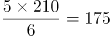元，则老李家人均水费比老张家少222-175=47元。

故正确答案为C。

第 49 题

**参考答案（粉笔题库参考内容）**

B

**解析**

由题意可得，商品每降价1元销量增加5个。上午商品打八折出售，下午商品在上午价格的基础上再打八折，列表可得：

  
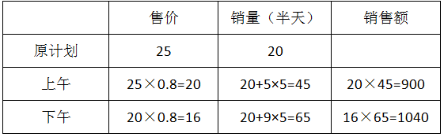商品全天销售额=900+1040=1940元。

故正确答案为B。

第 50 题

**参考答案（粉笔题库参考内容）**

D

**解析**

方法一：设音乐系X人，美术系Y人，根据题意音乐系与美术系男生之和占总人数的30%，可得：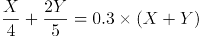，解得0.1Y=0.05X，故X:Y=2:1。

方法二：音乐系男生的比重为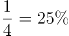，美术系男生的比重为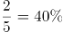，混合后占的比重为30%，根据线段法画图如下：

量与距离成反比，因此音乐系:美术系=(40%-30%):(30%-25%)=10%:5%=2:1。

故正确答案为D。

第 51 题

**参考答案（粉笔题库参考内容）**

C

**解析**

假设加工每张桌子、凳子、椅子的所需时间分别为a小时、b小时、c小时，则2a+4b=10、4a+8c=22，化简得到 a+2b=5……①，a+2c=5.5……②，①+②=2a+2b+2c=10.5，则10(a+b+c)=52.5，所需时间为52.5小时。

故正确答案为C。

第 52 题

**参考答案（粉笔题库参考内容）**

D

**解析**

由2014年父母年龄之差是儿子年龄的，可得儿子的年龄是5的倍数，而5年后儿子的年龄也必然是5的倍数，是5的倍数且为平方数的只能为25，则可得到2014年儿子的年龄为20岁，父母年龄差即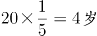，年龄和为4×23=92岁，假设父亲年龄比母亲年龄大，则可得父亲年龄-母亲年龄=4，可得父亲年龄=48岁，母亲年龄=44岁，5年后母亲年龄为49岁，是平方数，满足条件。

故正确答案为D。

第 53 题

**参考答案（粉笔题库参考内容）**

A

**解析**

方法一：设可坐10人的桌子有x张，则可坐12人的桌子有（28-x）张，则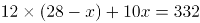，解得x=2。

故正确答案为A。

方法二：假设所有桌子都是10人桌，则总共可坐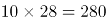人，而现在可坐332人，则多余的人必然是坐到12人桌，而每个12人桌比10人桌可多坐2人，则12人桌子数为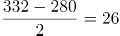，则10人桌为28-26=2张。

故正确答案为A。

第 54 题

**参考答案（粉笔题库参考内容）**

B

**解析**

一环形跑道上画了100个标记点，赋值标记点的间隔1米，根据环形植树公式，环形跑道全长=100×1=100米。某人跑了半圈，即跑了50米，此时要经过的标记点最多，就从一个标记点出发，。

故正确答案为B。

第 55 题

**参考答案（粉笔题库参考内容）**

A

**解析**

小蚂蚁从A点到B点的过程中，三角形AED的底为AD，长度不变，高AE随着小蚂蚁向上爬而增长，故三角形AED的面积随时间增长（如图1所示）；小蚂蚁从B点到C点的过程中，三角形AED的底为AD，长度不变，高为正方形的边长10cm，也不变，故三角形AED的面积不随时间变化，一直相等（如图2所示）；小蚂蚁从C点到D点的过程中，三角形AED的底为AD，长度不变，高DE随着小蚂蚁向下爬而减少，故三角形AED的面积随时间减少（如图3所示）。只有A项符合三角形AED面积随时间先增长，再不变最后减小的趋势。

故正确答案为A。

第 56 题

**参考答案（粉笔题库参考内容）**

B

**解析**

图形元素组成相似，同一个元素不止一次出现，优先考虑遍历。图形都是由内外两个图形组成，优先考虑分开看。外部图形的形状分别为○、◇、□、○、◇，形状遍历，最后问号处应为□，排除A、C两项；B、D两项内部图形形状相同，区别在于颜色，而题干内部图形的颜色分别是黑、白、阴影、黑、白，颜色遍历，最后一幅应该是阴影，排除D项。

故正确答案为B。

第 57 题

**参考答案（粉笔题库参考内容）**

D

**解析**

本题为分组分类题目。观察发现，每幅图形均有一个小三角形和一个小正方形，优先考虑功能元素。图①③⑤中只有小三角形在两个图形相交区域内，图②④⑥中小三角形和小正方形均在两个图形的相交区域内，因此①③⑤为一组，②④⑥为一组。

故正确答案为D。

第 58 题

**参考答案（粉笔题库参考内容）**

C

**解析**

元素组成相同，优先考虑位置规律。此题主要考查图形的旋转和翻转，如下图所示，使用时针法，按照1-2的顺序画时针。图①③④三个图形为顺时针，图②⑤⑥三个图形为逆时针。

故正确答案为C。

第 59 题

**参考答案（粉笔题库参考内容）**

B

**解析**

图形元素组成相同，优先考虑位置规律。九宫格优先横向观察，观察第一行发现“○”绕着三角形的边逆时针每次移动一条边，第二行验证此规律成立，因此问号处的“○”应在三角形下面的那条边上，排除C、D两项。观察A、B两项发现，“○”所处的位置不同，一个在三角形外部，一个在三角形内部，因此应考虑两个元素之间的位置关系。经观察发现前两行中都有两个图形“○”位于三角形内部，一个图形“○”位于三角形外部，因此问号处的“○”应于三角形的内部，排除A项。

故正确答案为B。

第 60 题

**参考答案（粉笔题库参考内容）**

C

**解析**

观察题干和选项可知，五角星面是一个特殊的面，由第一个图形可以发现五角星黑色尖端部位所指向的面是“○”的面，选项A中五角星黑色尖端部位所指向的面是“\\”面，排除；选项B中五角星黑色尖端部位所指向的面是“□”面，排除；选项D中五角星黑色尖端部位所指向的面是“空白面”，排除。

故正确答案为C。

第 61 题

**参考答案（粉笔题库参考内容）**

D

**解析**

图形元素组成不同，优先考虑属性规律，但无唯一答案。观察发现，题干图形出现了粗线条和生活化图形，考虑部分数。图①③⑤的部分数均为1，图②④⑥的部分数均为2。故图①③⑤为一组，图②④⑥为一组。

故正确答案为D。

第 62 题

**参考答案（粉笔题库参考内容）**

B

**解析**

第一步：分析题干词语间的逻辑关系。

黄连是一种草本植物，其味入口一定是极苦，因此苦涩是黄连的一种必然属性。

第二步：逐一分析选项。

A选项：班级可能团结可能不团结，不是一种必然属性关系，与题干逻辑不符，排除；

B选项：钻石是指经过琢磨的金刚石。金刚石在天然矿物中的硬度最高，因此坚硬是钻石的必然属性，与题干逻辑关系一致，为正确答案，当选；

C选项：鲜红是花朵的属性，但花朵不一定是鲜红的，花朵的颜色可以多样，不是必然属性，与题干逻辑不符，排除；

D选项：城市不一定繁华，不是一种必然属性关系，与题干逻辑不符，排除。

故正确答案为B。

第 63 题

**参考答案（粉笔题库参考内容）**

D

**解析**

第一步：分析题干词语间的逻辑关系。

报刊是利用纸张传播文字资料的一种工具，是发表、宣传新闻的一种载体；并且新闻的发表方式有很多，报刊只是其中一种。

第二步：逐一分析选项。

A选项：土地与玉米是作物和种植地之间的对应关系，与题干逻辑不符，排除；

B选项：法院是司法审判机关，不是法律的载体，与题干逻辑不符，排除；

C选项：出版社出版书籍，不是书籍刊登的载体，与题干逻辑不符，排除；

D选项：唱片是一种传播音乐、歌曲的载体，并且歌曲的发表形式有很多，唱片只是其中一种，与题干逻辑关系一致，当选。

故正确答案为D。

第 64 题

**参考答案（粉笔题库参考内容）**

D

**解析**

第一步：判断题干词语间逻辑关系。

“手机”用于“沟通”，“手机”的材质是“金属”。

第二步：判断选项词语间逻辑关系。

A项： “面试”是“招聘”的一个环节，与题干逻辑关系不一致，排除。

B项： “运输”是“物流”的一个环节，与题干逻辑关系不一致，排除。

C项： “卫星”是“科技”发展的成果，与题干逻辑关系不一致，排除。

D项：“帐篷”用于“露营”，“帐篷”的材质是“帆布”，与题干逻辑关系一致，当选。

故正确答案为D。

第 65 题

**参考答案（粉笔题库参考内容）**

A

**解析**

将选项逐一代入。

A项：娴熟是指很熟练，二者为近义关系，且前者是对后者程度的加深，敏捷是指灵敏快捷，与灵敏为近义关系，且前者是对后者程度的加深，前后逻辑关系一致，当选；

B项：熟练可以形容操作，敏捷与迅捷是近义关系，前后逻辑关系不一致，排除；

C项：熟悉指了解得清楚，清楚地知道，而熟练程度要比熟悉更重一些，后比前重。敏捷是指灵敏快捷，所以敏捷程度要比迅速更重一些，这里前比后重。所以二组词顺序反了，前后逻辑关系不一致，排除；

D项：谙熟指熟悉、了解，程度要比熟练轻。敏捷是指灵敏迅速，灵动多指活泼，敏捷和灵动没有关系，前后逻辑关系不一致，排除。

故正确答案为A。

第 66 题

**参考答案（粉笔题库参考内容）**

C

**解析**

第一步：判断题干词语间逻辑关系。

“出行”是行为，“雾霾”是环境，“口罩”是工具，可以造句为“在雾霾天气出行需要戴口罩”，三者为特殊环境中的行为与特殊工具的对应关系。

第二步：判断选项词语间逻辑关系。

A项：“沙发”是家具，不是环境，与题干逻辑关系不一致，排除；

B项：“路标”是指路的一种工具，在“公路”上“超车”的时候不需要“路标”，与题干逻辑关系不一致，排除；

C项：“勘探”是行为，“野外”是环境，“地图”是工具，可以造句为“在野外勘探需要用到地图”，三者为特殊环境中的行为与特殊工具的对应关系，与题干逻辑关系一致，当选；

D项：“游泳”不是工具，与题干逻辑关系不一致，排除。

故正确答案为C。

第 67 题

**参考答案（粉笔题库参考内容）**

A

**解析**

A项：楚楚动人形容姿容美好，动人心神，形容人很美丽。春风满面形容人心情愉快，满脸笑容，形容人很愉快，当选；

B项：笑靥如花形容女子的笑脸像花儿一样美丽，但春风满面不形容兴奋，排除；

C项：眉开眼笑形容人高兴愉快的样子，也不形容人美丽，排除；

D项：心地善良指有道德、德行好，不形容美丽，排除。

故正确答案为A。

第 68 题

**参考答案（粉笔题库参考内容）**

C

**解析**

第一步：分析题干词语间的逻辑关系。

题干麻雀属于动物，二者为种属关系，生物链指的是由动物、植物和微生物互相提供食物而形成的相互依存的链条关系。麻雀和动物都属于生物链的一部分。

第二步：逐一分析选项。

A项：豆浆可以作为早餐食用，但二者并非种属关系，并且早餐不是豆制品的组成部分，与题干逻辑不符，排除；

B项：开水不属于纸杯，二者不是种属关系，与题干逻辑不符，排除；

C项：发卡是首饰的一种，二者为种属关系，发卡和首饰都属于妆扮品，分别与妆扮品构成种属关系，而题干是组成关系，对应关系并不完全一致，但是相比于其他选项，种属关系和组成关系都是包容关系，所以该项更合适，当选；

D项：钢笔和电脑都属于办公品，但是钢笔和电脑之间不是种属关系，与题干逻辑不符，排除。

故正确答案为C。

第 69 题

**参考答案（粉笔题库参考内容）**

A

**解析**

第一步：找到定义关键词。

关键词为“某些物品或者服务的市场需求”、“不同季节，或一周不同日子，甚至一天不同时间”、“上下波动很大”。

第二步：逐一分析选项。

A项：早晚高峰期出租车供不应求，即出租车服务的市场需求在一天的不同时间上下波动很大，符合定义，当选；

B项：只提到牙刷品牌对牙刷分类，并未提到消费者的反应如何，也不存在需求上下波动，不符合定义，排除；

C项：“店庆打折，活动当天点击量剧增”说明这种打折服务的市场需求很大，并未体现出需求上下波动，不符合定义，排除；

D项：“博物馆引进梵高画作后游客蜂拥而至”说明人们对欣赏梵高画作的需求很大，并未体现出需求上下波动，不符合定义，排除。

故正确答案为A。

第 70 题

**参考答案（粉笔题库参考内容）**

C

**解析**

第一步：找到定义关键词。

关键词为初级群体是由“面对面互动所形成”、“具有亲密的人际关系和浓厚的感情色彩”，次级群体是为了“某种特定的目标”、“通过明确的规章制度”。

第二步：逐一分析选项。

A项：亲友团来到比赛现场为小李助威，群体为亲友团，是通过血缘关系或共同爱好结成的，而不是通过“明确的规章制度”，不符合定义，排除；

B项：小赵考上大学山里乡亲为他送行体现的是一种人际关系和感情色彩，属于初级群体，没有涉及到特定的目标和规章制度，排除；

C项：小王考上研究生，同事为他庆祝，这个群体指的是公司群体，大家的共同目标就是努力工作，把公司搞好，同时这个关系群中有严格的公司规章制度，属于次级群体，当选；

D项：小张的玩伴建立了微信群体现的是亲密的人际关系，属于初级群体，没有涉及到特定的目标和规章制度，排除。

故正确答案为C。

第 71 题

**参考答案（粉笔题库参考内容）**

D

**解析**

第一步：找到定义关键词。

“由于一个物体的运动”、“使其相邻的一个静止物体产生运动的错觉”。

第二步：逐一分析选项。

A项：烛光本来就会随风摇动，并不存在让一个静止的物体产生运动的错觉，不符合“使其相邻的一个静止物体产生运动的错觉”，不符合定义，排除；

B项：电影的动态画面是多张图片连续切换的结果，而不是一个物体的运动使相邻静止的物体产生运动的错觉，不符合“由于一个物体的运动”、“使其相邻的一个静止物体产生运动的错觉”，不符合定义，排除；

C项：在注视瀑布后，瀑布向下运动的影像会暂时留在视网膜上，当视线转移到静止的树木时，大脑会误判为树木在向上运动，是运动后效。之所以会觉得树木朝着瀑布向上飞升，原因是长时间注视，不符合“使其相邻的一个静止物体产生运动的错觉”，不符合定义，排除；

D项：注视夜空时会看到月亮在动，而云是静止的，之所以出现这种情况是因为云在运动，给人产生了错觉误以为月亮在运动，符合“由于一个物体的运动”、“使其相邻的一个静止物体产生运动的错觉”，符合定义，当选。

故正确答案为D。

第 72 题

**参考答案（粉笔题库参考内容）**

C

**解析**

第一步：找到定义关键词。

关键词为“职业的成功在于他具有一片特别硕大的红叶子”、“需要靠个人优势不断努力获得”。

第二步：逐一分析选项。

A项：小刘对工作尽职尽责，富有团队精神，没有体现出这是他的个人优势，也没体现出他在不断努力，不符合定义，排除；

B项：小张觉得数学专业枯燥选择了读经济学硕士，没有体现出他的个人优势，也没体现出个人的不断努力，不符合定义，排除；

C项：小李销售水平一般，但是对市场特别敏感，体现了他的个人优势，对市场敏感，同时他努力发展优势体现了他个人不断努力，能用红叶子理论解释，当选；

D项：小文是英语系学生，口语不好，辅修国际法方面的课程最后成为出色律师，说的是虽然有劣势，但是成功了，并没有体现出他的个人优势和特色，不符合定义，排除。

故正确答案为C。

第 73 题

**参考答案（粉笔题库参考内容）**

A

**解析**

第一步：找出定义关键词。

“企业”、“不是直接使用外汇资金”、“取得人民币资金加以使用”。

第二步：逐一分析选项。

A项：一些企业增加外汇负债，然后再用人民币进行投资，符合不直接使用外汇资金，而是取得人民币加以使用，符合定义，当选；

B项：某贸易公司获得外币资金，但并没有转换为人民币加以使用，不符合定义，排除；

C项：主体是王明，不符合定义主体企业，不符合定义，排除；

D项：主体是小宇，不符合定义主体企业，不符合定义，排除。

故正确答案为A。

第 74 题

**参考答案（粉笔题库参考内容）**

D

**解析**

第一步：找到定义关键词。

关键词为“主动参与体育活动的态度和行为表现”。

第二步：逐一分析选项。

A项：小强体质较弱，为了增强体魄他开始参加体育运动，体现的是他参加体育活动的自主性，但是说的是开始参加，没有很好的体现出参与体育运动的行为表现，不属于运动参与，排除；

B项：为了培养孩子的兴趣，小生的父亲经常带他去游泳，虽然有参与体育运动的行为，但是没有体现出小生主动参与体育运动，而是被迫的，是父亲为了培养他的兴趣，不属于运动参与，排除；

C项：小张酷爱网球比赛，会经常观看各种各样的网球比赛，没有体现出他参与体育活动的行为表现，排除；

D项：小李热爱跑步，只要有时间就会参加马拉松，“热爱”一词体现了小李的主动参与性，同时一有时间他就参加马拉松体现了他参与体育活动的行为表现，当选。

故正确答案为D。

第 75 题

**参考答案（粉笔题库参考内容）**

B

**解析**

第一步：找到定义关键词。

关键词为“气候变暖”、“导致生存受到威胁”、“逐渐扩大的人群”。

第二步：逐一分析选项。

A项：卡特里娜飓风是由于特殊气候因素引起的，同时众多居民逃离家乡是一种生存威胁，属于“气候难民”，排除；

B项：印度洋海啸不是由气候因素引起的，一般是由地震或者气象变化产生的破坏性波浪，不属于“气候难民”，为正确答案，当选；

C项：土地沙漠化是由于气候变异或者人类活动引起的，属于“气候难民”，排除；

D项：海平面上涨是由于气候因素引起的，导致国民生存受到威胁，符合定义，排除。

本题为选非题，故正确答案为B。

第 76 题

**参考答案（粉笔题库参考内容）**

D

**解析**

第一步：找到定义关键词。

题干中精益生产的方式是“通过系统结构、人员组织、运行方式和市场供求等方面的变革”，目的是“整体优化、均衡物流、高效利用资源”，达到“最少的投入向顾客提供最完美的价值”。

第二步：逐一分析选项。

A项：题干中的目的是为顾客提供最完美的价值，A项中的目的是抢占市场，不符合定义，排除；

B项：题干中的方式是通过系统结构、人员组织、运行方式和市场供求等方面，B是通过资金的调整，不符合定义，排除；

C项：只说到有强大的供货体系，但是这个供货体系是否经过各方面的变革，是否是最优化的并没有提及，该选项不够明确；

D项：充分发挥自身优势就是对公司优势资源的高效利用，建立超快物流体系符合“均衡物流，高效利用资源”，符合定义。

C、D两项比较而言，D项更加明确地体现了对优势资源的充分利用，实现了均衡物流、高效利用资源的效果。

故正确答案为D。

第 77 题

**参考答案（粉笔题库参考内容）**

A

**解析**

第一步：找到论点论据。

论点：群体比个体更具有冒险精神，群体倾向于获利大但成功率小的行为。

本题没有论据。

第二步：逐一分析选项。

A选项：群体作决策时比个人更容易走极端，将群体决策和个人决策做比较，解释了群体决策与个人决策之间存在差距的原因，可能会导致群体倾向于获利大但成功率小的行为，有一定的加强作用；

B选项：说的是在群体中个体会偏向于群体的一般意见，论证的是个体在群体中是坚持自己独特意见还是屈众，跟论题不一致，所以排除；

C选项：群体决策可能会被个体或者子群体所主导，也就是说群体决策可能和个体决策是一样的，而不是比个体决策更具有冒险精神，有削弱的意思，排除；

D选项：题干中没有涉及到决策的科学性与成功率，为无关选项，排除。

B、D两项为无关选项，C项有削弱的意思，只有A项有一定的加强作用，比较而言只能选A。

故正确答案为A。

第 78 题

**参考答案（粉笔题库参考内容）**

C

**解析**

第一步：分析题干的论证方式。

因为没有任何证据证明反物质是不存在的，所以反物质是存在的。这种论证方式是诉诸无知，其论证模式是：没有证明S为真，所以S为假的；没有证明S为假，所以S为真的。

第二步：逐一分析选项。

A选项，“没有证据证明上帝与你有过对话，你可能是在胡编乱造，也可能精神失常”，并不符合题干的论证模式，排除；

B选项，论证方式为举例论证，即抛出一个观点，然后举出一个例子来证明这个观点，不符合题干的论证模式，排除；

C选项，“不能证明平行世界不存在，那么平行世界就是存在的”完全符合题干的论证模式，当选；

D选项，因为有活动踪迹，所以有怪兽，这是因为有证据所以得到一个结论，不符合题干的论证模式，排除。

故正确答案为C。

第 79 题

**参考答案（粉笔题库参考内容）**

D

**解析**

第一步：找出论点和论据。

论点：远古时期火星可能存在生命。

论据：火星陨坑内的远古土壤存在着类似地球土壤裂纹剖面的土壤样本。

第二步：逐一分析选项。

A项：地球沙漠土壤与火星土壤不同，是对论据的削弱，无法加强，排除。

B项：经化学物质分析后，陨坑内土壤与地球上土壤的化学风化过程相似，与论据表意相同，是对论据的加强，保留。

C项：火星远古土壤样本情况仅表明火星早期的环境比现在宜居，但并没有明确说明当时是否存在生命，不明确选项，排除。

D项：磷在土壤裂纹剖面中有损耗，说明有微生物存在，解释了为什么看到土壤裂纹剖面就说明可能有生命，属于搭桥加强。

B、D两项都能加强，但是D项搭桥的加强力度强于重复论据的B项。

故正确答案为D。

第 80 题

**参考答案（粉笔题库参考内容）**

D

**解析**

第一步：找到题干论点论据。

论点：激光技术或许将成为医学领域的一种变革工具；

论据：激光刺激干细胞生长可能实现组织生长，干细胞具有可以变成任何类型细胞的能力。

第二步：逐一分析选项。

A选项，讨论的是不同波段的激光对人体的组织作用的原理不清楚，属于不明确选项，排除；

B选项，用激光对儿童视网膜影响的例子来证明激光技术会对人体有损伤，属于举例削弱，排除；

C选项，没有在人体试验，风险还待评估，属于不明确选项，排除；

D选项，用有洞的牙齿来作为例子，证明激光技术确实能够成为医学领域变革的工具，举例加强，当选。

故正确答案为D。

第 81 题

**参考答案（粉笔题库参考内容）**

B

**解析**

第一步：找到论点和论据。

论点：全球变暖并不严重。

论据：与1970年至1998年相比，1999年至今全球表面平均气温的上升速度明显放缓，近15年来该平均气温的上升幅度不明显。

第二步：逐一分析选项。

A项：海洋表层热量向深海输送，解释了地球表面温度上升为什么会减缓，补充论据，为加强项，无法削弱，排除；

B项：此现象指的是全球表面平均气温上升速度放缓的现象，这个现象曾经出现过，但随后又加速变暖，即：气温上升速度的放缓并不能得出变暖不严重，有可能之后全球变暖会更加严重，可以削弱，当选；

C项：首先专家的意见不一定符合实情，其次二氧化碳和全球变暖的关系题干中也没提到，需进一步说明才能明确，为无关项，无法削弱，排除；

D项：题干主题是全球变暖这件事儿会不会变得更严重，而D项说的是气候变暖所带来的后果是什么，二者话题并不一致，为无关项，无法削弱，排除。

故正确答案为B。

第 82 题

**参考答案（粉笔题库参考内容）**

C

**解析**

第一步：找到论点论据。

论点：该项举措（建图书馆）是有实效的。

论据：在建成三个图书馆的4年内，光顾图书馆的市民增加了近两倍。

论据说的是光顾图书馆的市民多了，论点说的是举措是有实效的，根据论据可以合理推出论点，因此话题一致，削弱优先考虑削弱论点，也可以考虑削弱论据。

第二步：逐一分析选项。

A项：该项说的是图书馆的维护成本高，与论点讨论的建图书馆能否取得实效无关，话题不一致，不能削弱，排除；

B项：该项说的两所高校的学生也办理了借书证，说明建立图书馆对这两所高校的学生有帮助，有一定的实效，可以加强，不能削弱，排除；

C项：该项说的是一个市民办理三个借书证，这样就是说明看书的人并不一定在增加，只是一人办多证，削弱论据，可以削弱，当选；

D项：该项说的是4年间很多外来人口大量涌入新区，外来人口对于借书证影响不明确，为不明确选项，无法削弱，排除。

故正确答案为C。

第 83 题

**参考答案（粉笔题库参考内容）**

A

**解析**

第一步：找到题干论点论据。

论点：没有一级甲等证书的人不能成为主持人，即：没有一级甲等证书→不是主持人（1）。

论据：主持人不能发音不标准，即：主持人→发音标准（2）。

论点说的是“一级甲等证书”和“主持人”，论据说的是“主持人”和“发音”，二者话题不一致，要想加强优先考虑搭桥，且由论据搭向论点，即“发音标准→有一级甲等证书”。

第二步：逐一分析选项。

A项：没有一级甲等证书→发音不标准，其等价命题为：发音标准→有一级甲等证书，最强搭桥项，当选；

B项：发音不标准的可能没有证书，既是可能性的表述，同时也不符合我们需要的条件逻辑，排除；

C项：发音不标准的可能获得证书，既是可能性的表述，同时也不符合我们需要的条件逻辑，排除；

D项：说的是发音标准与受欢迎之间的关系，排除。

故正确答案为A。

第 84 题

**参考答案（粉笔题库参考内容）**

C

**解析**

第一步：找出论点和论据。

论点：目前我国国际工程项目管理体系还未达到要求。

无明显论据。

第二步：逐一分析选项。

A项：论点说未达到要求，选项说的是学术活动水平较低，并不知道学术活动水平能否反映整个管理体系水平，无关项，排除；

B项：没有提及“工程项目管理体系”，无关项，排除；

C项：绝大部分开展项目管理工作的部门都有健全的运作机制，说明是达到要求的，能够削弱论点，当选；

D项：“项目控制相关部门专业化程度较高”不代表管理体系达到要求，无关项，排除。

故正确答案为C。

第 85 题

**参考答案（粉笔题库参考内容）**

C

**解析**

第一步：分析题干词语间的逻辑关系。

鱼饵和鱼竿为配套使用的对应关系。

第二步：逐一分析选项。

A选项：笔和书籍没有必然对应关系，笔可以书写书籍，但是书籍上的文字也能通过打印形成，与题干逻辑不符，排除；

B选项：写诗和笔没有必然对应关系，笔可以写诗，但不是必然的对应关系，并且写诗是动宾关系，与题干逻辑不符，排除；

C选项：锅铲与炒锅是配套使用的，与题干逻辑关系一致，为正确答案，当选；

D选项：电脑和无线路由器没有必然配套使用的对应关系，与题干逻辑不符，排除。

故正确答案为C。

第 86 题

**参考答案（粉笔题库参考内容）**

B

**解析**

定位表格，2014年1~11月货物运输总量为393.2亿吨，11月为39.3亿吨，故求2014年1~10月货物运输总量，可判定此题为简单加减计算问题。2014年1~10月我国货物运输总量=393.2-39.3=353.9亿吨。

故正确答案为B。

第 87 题

**参考答案（粉笔题库参考内容）**

D

**解析**

由题干“2013年1—10月我国货运运输总量最大的领域”可知，本题是基期比较问题，比较各领域1—10月基期货物运输总量即可。观察表格可知，各领域1—11月和11月同比增速相差不大，故本题可直接比较1—10月现期值。铁路运输总量为35.0-3.2=31.8亿吨，公路运输总量为303.6-30.7=272.9亿吨，水路运输总量为54.5-5.4=49.1亿吨，民航运输总量为538.0-55.5=482.5万吨，可明显看出公路272.9亿吨最大。（注意单位换算，1亿吨=10000万吨）

故正确答案为D。

第 88 题

**参考答案（粉笔题库参考内容）**

B

**解析**

由题干“2013年11月份......水运周转量占比”可知，本题为基期比重问题。定位表格材料，查找数据代入为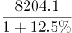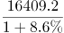，即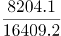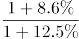，略小于，因此水运周转量占比为40%~50%。

故正确答案为B。

第 89 题

**参考答案（粉笔题库参考内容）**

D

**解析**

由题干“比重超过上年同期水平”可知，本题为两期比重问题，仅需比较a与b的大小关系即可，当a＞b时，比重高于上年同期水平。由表格可知，11月货物运输总量同比增速b=7.1%，铁路同比增速\=-6.5%，公路同比增速\=8.6%，水运同比增速\=7.6%，民航同比增速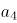\=3.4%，同比增速高于7.1%的有公路和水运两项。

故正确答案为D。

第 90 题

**参考答案（粉笔题库参考内容）**

C

**解析**

由题干“能够从上述资料中推出的是”，可知本题为综合分析问题，找出正确选项。

A项，2014年1—11月货物运输总量为393.2亿吨，可知月均货物运输量=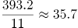亿吨，错误；

B项，每吨货物平均运输距离=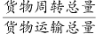\=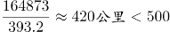，错误；

C项，铁路货运量占总体比重=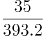<10%，铁路货物周转量占总体比重=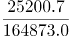\>10%，因此铁路货运量占总体比重低于其货物周转量占总体比重，正确；

D项，定位表格货物周转量中公路和水运，2014年1—11月公路货物周转量为55448亿吨公里，增长率为9.8%，2014年1—11月水运货物周转量为84056亿吨公里，增长率为16%，可知水运现期量和增长率均大于公路，根据“大大则大”，水运货物周转量同比增量高于公路货物周转量同比增量，错误。

故正确答案为C。

第 91 题

**参考答案（粉笔题库参考内容）**

C

**解析**

根据图形可知2014年4月－2015年4月各月租赁贸易进出口总额，题干求2014年下半年进出口总额，可判定此题为简单加减计算问题。2014年下半年（7-12月）进出口总额=10.03+8.57+14.58+9.54+6.22+18.26≈10+9+15+10+6+18=68亿美元，与C项最接近。

故正确答案为C。

第 92 题

**参考答案（粉笔题库参考内容）**

C

**解析**

由题干“各月环比增速最快的是”可知，本题为一般增长率的比较问题，可直接比较的分数大小关系，分数最大则增速最快。根据图形可知各月份进出口总额，故各项环比增速分别为：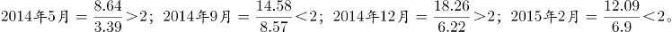。

其中B、D两项明显小于2，排除。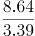，与相比，分子小、分母大，故A项分数较小，则C项较大。

故正确答案为C。

第 93 题

**参考答案（粉笔题库参考内容）**

B

**解析**

题干要求求出2015年一季度相比上一季度（2014年四季度）的环比增速，可判定此题为一般增长率的计算问题。定位图表可得，2015年一季度进出口总额=6.9+12.09+5.29≈7+12+5.3=24.3亿美元；2014年四季度进出口总额=9.54+6.22+18.26≈10+6+18=34亿美元。环比增速=，即降低了29%，与B项最为接近。

故正确答案为B。

第 94 题

**参考答案（粉笔题库参考内容）**

B

**解析**

定位图形材料，全国租赁贸易进出口总额及增长率均高于上月的有2014年5、7、9、12月和2015年2、4月，总共6个月。

故正确答案为B。

第 95 题

**参考答案（粉笔题库参考内容）**

C

**解析**

A项：由图形材料可知2015年4月，全国租赁贸易进出口额6.94亿美元，而2014年4月全国租赁贸易进出口额3.39亿美元，同比增长-41.7%，那么2015年4月全国租赁贸易进出口额是2013年4月的，而非翻一番（2倍），错误；

B项：由图形材料可知2015年1-4月，全国租赁贸易进出口总额分别为6.90、12.09、5.29、6.94亿美元，求平均可得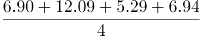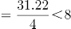，错误；

C项：由图形材料可知2014年8月和9月，全国租赁贸易进出口额分别为8.57、14.58亿美元，同比增长-15.9%、38.7%，则2013年8—9月的全国租赁贸易进出口额为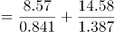亿美元，正确；

D项：由图形材料可得，全国租赁贸易进出口额同比下降的月份为2014年4月、8月、11月及2015年3月，共4个月，而2014年4月-2015年4月共13个月，故占比不到三分之一，错误。

故正确答案为C。

第 96 题

**参考答案（粉笔题库参考内容）**

A

**解析**

由题干“2015年2月”判断现期，“平均每笔快递业务收入”判断平均数问题，故本题为现期平均数计算问题。定位文字材料第一段“2015年2月份，我国快递业务量完成8.2亿件，业务收入完成136.0亿元”可得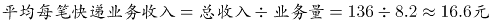。

故正确答案为A。

第 97 题

**参考答案（粉笔题库参考内容）**

A

**解析**

由题干“2015年2月”判断现期，“消费者对快递业务的全部申诉量”和文字材料第一段“占全部申诉量的97.6%”判断本题为现期比重中总量的计算问题。定位文字材料第一段“2015年2月份，快递业务量完成8.2亿件”和文字材料第二段“2015年2月，全国每百万件快递业务中有效申诉量为23.4件”可得8.2亿=820百万，快递业务中有效申诉量=820×23.4=19188件，全部申诉量=19188÷97.6%，略大于1.9万件，与A项最接近。

故正确答案为A。

第 98 题

**参考答案（粉笔题库参考内容）**

D

**解析**

由题干“2015年1月由高到低排序”判断本题为环比基期比较问题，定位第一张表格可得四个企业2015年2月每百万件快递业务丢失损毁有效申诉量现期值，定位第二张表格可得四个企业的环比增速，故企业1、2、3、4的环比基期分别为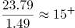、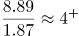、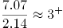、，可得企业1最高，企业3最低，只有D项满足。

故正确答案为D。

第 99 题

**参考答案（粉笔题库参考内容）**

B

**解析**

由题干“2015年2月比重高于上月水平”判断本题为环比两期比重比较问题。定位文字材料第二段可得四个企业的总有效申诉量的环比增长率分比为；定位第二个表格材料第四列可得四个企业的投递业务有效申诉量环比增长率分别为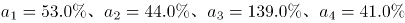。根据两期比重比较公式可得a>b比重上升，可得上述企业中只有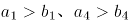，故有2家企业比重上升。

故正确答案为B。

第 100 题

**参考答案（粉笔题库参考内容）**

B

**解析**

由题干“能够推出的是”判断本题为综合分析问题。

A项：定位文字材料第一段可得“2015年2月份，快递业务量完成8.2亿件，同比增长18.7%”，故2014年2月应为 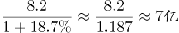 ，错误；

B项：2015年2月有效申诉量为19188件，全部申诉量=19600件，故非有效申诉量=19600-19188=412件。根据第一段文字材料可得总快递业务量=8.2亿，故每百万件快递业务中，非有效申诉量，正确；

C项：定位文字材料第二段可得“每百万件快递业务有效申诉量”全国平均=23.4件、企业1=75.13件、企业2=32.56件、企业3=31.86件、企业4=17.81件，可以看出企业4小于全国平均水平，错误；

D项：定位第一个表格材料，可得企业1每百万件快递业务延误有效申诉量=19.93，企业2=11.12，19.93<11.12×2，错误。

故正确答案为B。

