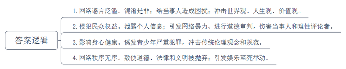
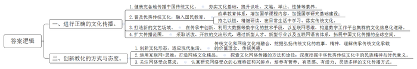
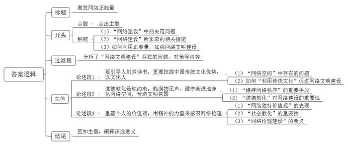

# 2017年公务员多省联考《申论》题（四川上半年卷）

<!-- gwy:overview:start -->
> **四川 · 2017 · 申论 · 上半年** ｜ 3 题 · 图片 3 处 · 答案随题折叠

导航：[题目](#题目) · [材料 1](#材料-1)
<!-- gwy:overview:end -->

> 候选采集稿。参考答案及解析来自粉笔页面，不代表官方答案或真实高分答卷；来源使用许可与原卷对应关系仍需人工核实。

## 给定材料

### 材料 1

习近平总书记在第二届世界互联网大会的主旨演讲中指出：“要加强网络伦理、网络文明建设，发挥道德教化引导作用，用人类文明优秀成果滋养网络空间、修复网络生态。”

2016年里约奥运会，中国女排夺冠，国内外各大媒体纷纷进行报道。有网友表示，“这是奥运会三大球中夺冠的唯一一支亚洲队，而且是女子项目，真不错。”各舆论平台都发表了满满正能量的评论，网络空间难得地呈现出一片欢欣鼓舞的气象。女排奥运夺冠与女排精神成为网络流行的话题，女排精神也成为鼓舞国人实现中国梦的重要动力。

有评论指出，国人感动于女排无畏无惧、自强不息精神力量的同时，一种“女排精神成就中国”的说法也随之蔓延。殊不知，中国梦才是成就女排精神的根本。梦想是引导前进的目标。女排精神并非凭空产生，也不是无根发芽，而是源于一种力量、一种激情，那就是把国家利益、民族利益和每个人的具体利益紧密联系在一起的中华民族伟大复兴的中国梦。

我国近7亿网民的海量规模充分证明，网络空间已经成为公众生活不可分离的精神家园。广大网民对于继承和弘扬中华优秀文化的需求更为迫切，也充分意识到净化网络空间、建设和规范网络伦理的必要性。从网络评论、新闻跟帖留言、论坛话题等方面可以看出，女排精神以及作为源泉的中国梦必将成为润化网络空间的强大“正能量”，正确加以引导、运用，一定会在建设网络伦理、修复网络生态中发挥重要的作用。

### 材料 2

美国学者理查德·斯皮内洛说过：“技术往往比伦理学理论发展得快，而这方面的滞后效应往往会给我们带来相当大的危害。”确实，网络伦理的失范会给社会带来一系列问题。

关于网络伦理，有学者指出这是20世纪中叶以来新兴的应用伦理学研究的重要内容，是指人们在网络空间中应该遵守的行为道德准则和规范。

随着互联网的蓬勃发展，我们遭遇的网络虚假信息越来越多，花样也变得层出不穷，时常难辨真伪。例如，轰动一时的朱自清的《背影》因“违反交规”被逐出教材、香蕉得艾滋病濒临灭绝、哈尔滨赚钱不给老婆花算家暴、东莞警方将拘留非法同居者、“95后”女网友“身体换旅行”等等。这样的虚假新闻不仅混淆是非，给当事人造成了困扰，而且引发了对世界观、人生观、价值观的冲击，危害不小。从技术层面讲，谣言的产生是因为网络的开放性和匿名性；从社会层面讲，是由于权威信息的滞后以及危机预警能力差；从受众层面讲，是因为公众具有猎奇、娱乐、恐慌、盲从及网上宣泄的心理。

2015年，“成都女司机被打事件”的当事人被“人肉搜索”，个人隐私被大肆转发。一场因违章而引发的文明开车讨论，异化成对当事人二次伤害的“网络暴力”事件。当事人面对镜头泣不成声，其家人表示抗议，要诉诸法律，却引来网友更多批判。部分网民对个人信息无边界侵害、对个人道德无限制审判，甚至为了一时情绪的发泄随意谩骂、人肉骚扰，给当事人以及理性的评论者带来了不可言说的伤害。

中国预防青少年犯罪研究会的统计资料显示：目前未成年人犯罪总数中，有70%的少年犯因网络色情、暴力内容影响而诱发盗窃、抢劫、强奸等几类严重犯罪，给传统伦理观念和伦理规范带来了严重的冲击。在此类事件中，青少年可以通过低价、便捷的方式连接互联网，同时利用网络的匿名性，使得网络侵害者与受害者之间的关系复杂化，继而将网络影响现实化。

2016年7月12日，文化部公布了对一批网络表演平台的查处结果，26个网络表演平台被查处，16881名网络表演者被处理。“现在手机几乎成了学生的标配，直播平台里防不胜防的色情信息实在让人担心。”北京一位家长说。“新华视点”记者调查发现，随着网络直播终端从PC端走向移动端，直播开始步入全民时代。与此同时，网络直播中的色情、暴力、侵权等问题也随之凸显，严重影响青少年的身心健康。

如果说2015年是网红年的话，2016年就是直播年了。六间房秀场上，一团队打着户外主播的名义进山林捕杀野生动物，且手段残忍，却吸引了至少三万多粉丝的关注；有网友爆料称，有滴滴司机深夜在机场附近接空姐订单，在乘客不知情的情况下，诱导空姐暴露隐私，将双方对话在某直播平台上直播；某电影明星离婚事件闹得沸沸扬扬，尘埃尚未落定，一部以该事件为背景的网络电影已悄然开机。在这场娱乐的无极限狂欢中，什么道德、法律、文明都被抛掉，取而代之的是娱乐至死的疯狂举动。不可否认，这种无序性源于网络的低门槛、开放性和相对虚拟等特质，但更是“眼球经济”在背后推波助澜。

### 材料 3

网络上文字内容的光怪陆离、图片的鲜艳夺目、标志的新奇诱人，都会使网络用户目不暇接，难以自拔。作家王蒙将触屏时代的到来称为“心智灾难”。在他看来，触屏和电视一样，提供了一些文化含量可疑的声像信息，让人们再度被科技征服。电脑与鼠标、触屏和智能手机先后冲进生活、杀入头脑，它们“提供了最全面的服务与引领，也许还有劫持”。如多伦多大学学者纳尔逊·塔尔所说：“今天，电子技术将人脑加速到一个异乎寻常的速度，而人的肉体却原地不动，这样形成的鸿沟造成了巨大的精神压力。”在强大的诱惑力面前，人们不知不觉地在网上投入了过多的时间，感知了一些不该感知或不宜过多感知的内容，忽视了正常的工作、学习和生活。在这样的过程中，网络用户被诱发生理和心理疾病，导致异化倾向的概率是非常高的。

2015年7月29日，一场EXO跟TFboys的粉丝在网上的骂战引发了极高的关注。起因是一则TFboys小学生粉丝所录制的视频指责EXO，引发了EXO和TFboys双方粉丝在网上互掐。仅仅几分钟的视频，在24小时内微博浏览量飙升3300万，瞬间登上了“微博热门话题榜”。对此，心理专家说：“现在的孩子自降生下来就生活在网络环境之中，网络中各种各样的讯息几乎无时无刻不在影响着他们。孩子会为自己制定角色，作为某个明星的粉丝，就是一种角色意识。角色一旦不被认知，加上网络的污秽之气，孩子不自觉地就会模仿，特别是骂人用语，这其实就是网络暴力的行为，它伤害孩子的心灵，激发愤怒，从而做出过激行为。”网络制造了源于但又远于生活的虚拟情景空间，上网者被赋予了独特的角色，能够满足现实生活中难以实现的各种欲望，久而久之，就导致了现实伦理与网络伦理的错位。现实世界中的普通人张三在网络游戏中可以是受万人敬仰的大英雄，身边美女环绕，众将惟其马首是瞻。

2016年6月28日上午，某省公安厅召开“飓风10号”专案新闻发布会，通报了近期成功打掉“传销式”网络交友诈骗案的情况。该团伙的诈骗手段是利用QQ、微信等网络聊天工具，从网络上下载面容姣好的女性图片作为头像，以交男朋友的形式，通过微信红包和银行转账等方式骗取受害人的金钱。“在网上没有人知道你是一条狗。”网络的隐匿性使人们可以随意注册身份，编造个人所期望的身份资料，使人们可以体验其自由选择的各种社会角色，达成各种交际目的，甚至包括经济诈骗、感情欺骗等。这是网络导致网民社会角色异化的典型案例。通过网络，网民可以实现性别异化（男人可以用女人的思维、情感、表达方式在网上交友，反之亦然）、年龄异化（老人可以用年轻人的口气、情调、交流方式在网上交友，反之亦然）、身份异化（上网者可以随意编造自己的职业、学历、经历、婚姻状况等等，以各种身份出现在网上交际场合，赢得对方的好感以至迷恋）。

### 材料 4

澳洲某女留学生被害一事引发国内舆论关注，但在网上却出现了不和谐的一幕，部分网友留言内容低俗甚至污秽。毋庸讳言，不管什么事，只要捅到网上了，部分“盖楼”的网友从来不怕事大，也不怕措词有多尖刻，说话有多脏，凡能让网友觉得“痛快”的，只要能说出口的，一律不含糊，像竹筒倒豆子一样，全都倒了出来。仔细分析，网民在网上无论是对事实的关注度还是对黑子、粉丝或偶像的态度上，都要比现实生活中高，比现实生活中顾忌少，所以在网络这个大环境下，可控性更弱。这些特性对现有的舆论体系产生了巨大的冲击。因为网民在网络上显示的往往是不同于生活的一面。这一面既有可能来源于伪装，也可能是来自于对人性放纵一面的回归。因此现有的道德体系在网络世界上逐渐被瓦解。例如，在生活中绝大部分场合，我们对人身攻击是持坚决抵触的情绪，而在网民文化中却可能成为一种最为熟悉且亲切的问候方式。在这个人人都脱下假面的世界，因对虚拟的轻蔑与放松，原来一本正经的道德体系便不再适用。在彼此互不认识的情况下，包袱一旦放下，侵犯与伦理的错位就有可能会发生。

“51%的受访者每天会用超过一小时阅读社交媒体上的信息（刷微信、看微博或通过电子设备看新闻等）。”这是亚马逊中国2015全民阅读调查报告给出的数据。随着智能手机的普及，碎片化阅读的时长每年增长近10%，是纸质书籍的近4倍。碎片化阅读，对传统阅读方式正产生着越来越大的冲击。

著名学者许纪霖也在微博上直言碎片化阅读的后果是“毁三观”，因为“世界观、人生观、价值观是人们对宇宙、自然、社会的一整套观念、一整套理解，而今天由于知识的碎片化、资讯的零碎化，不少年轻人是通过各种破碎的知识和资讯，‘拼凑’起自己其实没有世界观的‘三观’，他们的表达方式也是破碎的”。碎片化阅读很轻松，有一度他自己也沉迷于刷微博，“我发现自己没有了读书的时间，微博、微信上的‘信息快餐’，90%的内容看完就忘，为了记住10%的东西，浪费了90%的时间，这让我产生了恐惧感。”

茅盾文学奖得主，著名作家麦家则以自己跟孩子的聊天为例说明自己的担忧，“有时我能明显感觉到他的某些用词、观点简单粗暴，绝对不是从我推荐的书中看来的，那只能是从网络阅读中学来的，可他在网上到底都得到了些什么，我无从知晓。”

毋庸置疑，碎片信息影响了我们的伦理取向。当我们吸收他人各式各样的想法时，他们即成为我们的一部分，同样，我们也成为他们的一部分。充斥各种声音的多元文化社会，使人们沉浸于不一致与风马牛不相及的自我言语中，有学者指出：“年轻人不阅读名著、不动笔、不进行思考性的阅读，思维模式就会渐渐浅表化，这很危险，长此以往我们会被技术手段绑架。”

### 材料 5

发挥中国传统文化在修复网络生态、建设网络伦理等方面的作用，首先需要正确的文化传播。中华优秀传统文化如何在互联网时代实现良好的传承、弘扬、发展、革新？如何通过恢复和创新“诗书礼乐”国学教育体系，使网民对中国文化精神内化于心、外化于行？2016年5月14日，中国文化网络传播首届高峰论坛在北京师范大学举行，专家就相关话题展开了讨论。

当下，国民的文化认同是国家安全的文化基础，国民的文明修养已成为中国现代化成功与否的瓶颈等话题已成为大众意识到的问题。“观乎人文以化成天下者，言圣人观察人文，则《诗》《书》《礼》《乐》之谓，当法此教而‘化成天下’也。”人文是什么？以文化人的“文”指的是什么？圣人观察人与社会的关系规律，选择诗书礼乐为教法，来改变天下人的行为习惯，向大同文明前进。“文”，乃诗书礼乐也。诗是谈吐的训练，书是文笔的锤炼，礼是举止的修炼，乐是性情的冶炼，健康完备地传播中国传统文化的内容，在现代传播过程中显得尤其重要。

正因为传统文化在陶冶人心方面的重要性，在新的历史条件下，我们必须全面认识祖国传统文化，古为今用，推陈出新，积极开展优秀文化教育普及活动，发挥国民教育在文化传承创新中的基础性作用，从而为网络伦理的建设与规范奠定坚实的基础。因此，应该在各层次教育体系中增加国学课程内容，加强国学研究基础建设。我们在日常也应该提倡尊孔读经，尊重圣人，尊重文化，尊重良心，尊重道德，博之以文，约之以礼。时时力戒——贪嗔痴慢疑，每日精进——恒喜孝诚习；改掉坏秉性——恨怨恼怒烦，发掘善天性——仁义礼智信。只有持之以恒、精研细读，大众才能把国学作为一种生命价值和生活规约。也只有这样才能发挥传统文化在网络伦理建设中的作用。

在信息化建设下，新兴的互联网技术重构了社会空间，文化生态、文艺生态发生了巨大变化，传统文艺场域受到冲击，新型社会空间需要新的文艺场域形成。中国文联文艺资源中心副主任冉茂金认为，在这个信息社会大环境发展趋势之下，传统文化的现代传播要以传承为生、以创新为命。传统文化对现代化建设有着重要的积极意义，又能够丰富网络空间的内容建设和价值观建设。故宫、国博等单位的数字化工程，都是传统文化的现代化传播方式。每一个时代的文化都是包容开放的，有着很多的创新。传统文化要融入今天的工作形态和生活形态，就需要文化单位利用大数据等数字化的技术手段，以互联网思维构建数字工作平台集群的文化信息化道路。

如何让中国书画艺术走遍世界的角落是中国画院的执行总监侯茜始终关心并一直在做的事情。她说，文化是传统的，但文化的传播方式是可以不传统的。她从四个方面来阐述自己的观点：用不传统的人推广传统的艺术；结合不传统的行业去推广传统的艺术；用不传统的语言去推广传统的艺术，用互联网的思维和互联网的语言去传播传统艺术；在不传统的地方推广传统的艺术。对中国文化艺术的传播，侯茜不喜欢用刻板严肃的传统传播方式，而是希望通过活泼、开放的交流形式，把展示中国书画艺术做成很酷的事情。

### 材料 6

传统文化对网络伦理的滋养，还需要我们转换思维，发掘内容，创新形式，注意教化的方式与态度。

2016年，一则关于“网络端午”的新闻吸引了大家的眼球。众所周知，端午节是中华民族的传统节日。每年的农历五月初五，人们通过包粽子、戴香包、挂菖蒲、赛龙舟等一系列传统习俗活动来纪念著名爱国诗人屈原。通过这与每个个体紧密关联的节日，可以激活历史传统、唤起文化记忆，塑造着一个民族共同的心灵认同。但是，传统的节日不能只是变成商家促销的噱头，不能只是成为购物节、吃饭节、旅游节，也要适应现代生活需要，创新过节方式。

在这个信息化时代，把中国的网络文化融入传统节日里，能让传统更为时尚，感悟节日意义，凸显端午精神。比如，“网络中国节”活动，就是希望在今天重新挖掘和弘扬传统节日里的中国故事和中国精神，理解和传承节日所承载的那些价值理念和传统美德，让我们成为具有传统文化修养的当代中国人。

有评论认为，“互联网+”时代，更要充分发挥中华优秀的传统文化凝聚人心、滋养网络的积极作用。运用“互联网+”思维，切实打造网络文化精品，探索中华文化网络传播的方法和途径，让中华文化得到创新和传承，让中华传统文化的魅力熏陶网民，深度挖掘中华优秀传统文化中的民族精神与时代意义，让端午节所承载的爱国精神和情操，能更加现代化、人性化地与生命联系，逐渐演变成蕴含独特民族精神和丰富文化内涵的传统节日，成为人类非物质文化遗产宝库中的瑰宝。

北京市社会科学院文化研究所黄仲山认为，在坚持传统文化优秀基因的基础上，站在网络受众角度，摆脱简单机械的灌输方式，努力培养有营养、有质感、有活力的文化传播方式。在网络中传播传统文化，传播者需要思考年轻人的口味，避免利用网络空间进行简单的“文化晾晒”。我们要认真研究网络受众的心理特征和兴趣点，找到灵活多样的传播方式，把“阳春白雪”变得“喜闻乐见”。

事实上，也只有这样，才能让传统文化真正深入网民内心，才能让传统的道德文化潜移默化地成为网络伦理的重要规范。

## 题目

### 第 1 题

**根据给定资料**2**，概括当前网络伦理失范的危害。（20分）**

关联材料：材料 2

作答要求：

要求：全面准确，简明扼要，不超过200字。

第 1 题 · 答案与解析

**参考答案（粉笔题库参考内容）**

1.网络谣言泛滥。混淆是非；给当事人造成困扰；冲击世界观、人生观、价值观。

2.侵犯民众权益。泄露个人信息；引发网络暴力、进行道德审判，伤害当事人和理性评论者。

3.影响身心健康。诱发青少年严重犯罪，冲击传统伦理观念和规范。

4.网络秩序无序。致使道德、法律和文明被抛弃；引发娱乐至死举动。

**参考答案说明**：本参考答案从“网络谣言泛滥”“侵犯民众权益”“影响身心健康”“网络秩序无序”等不同的话题进行了分条撰写。各条答案要点之间在内容上相互并列。

**解析状态：unknown（来源未提供）**

### 第 2 题

**假设你是某市文明办工作人员，给定资料**5**~**6**是你搜集的资料，请就“如何弘扬优秀传统文化，发挥道德教化引导作用，滋养网络空间，修复网络生态”向领导提出建议。（30分）**

关联材料：材料 5、材料 6

作答要求：

要求：内容全面，紧扣材料，观点明确，有针对性；层次分明，条理清晰，不超过500字。

第 2 题 · 答案与解析

**参考答案（粉笔题库参考内容）**

一、进行正确的文化传播。

1.健康完备地传播中国传统文化。夯实文化基础，提升谈吐、文笔、举止、性情等素养。2.普及优秀传统文化，融入国民教育。改革教育体系，增加国学课程内容，加强国学研究基础建设；持之以恒，精细研读，在日常生活中学习、落实传统文化。3.打造新的文艺场域。在传承中创新，利用大数据等数字化的技术手段，以互联网思维，构建数字工作平台集群的文化信息化道路。4.扩大传播范围。采取活泼、开放的交流形式，通过新型人才、新型行业以及互联网语言体系，拓展中国文化传播的全球空间。

二、创新教化的方式与态度。

1.创新文化形态，适应现代生活。传统文化和网络文化相融合，挖掘弘扬传统文化的故事、精神，理解传承传统文化承载的价值理念、传统美德。2.运用互联网+思维，打造网络文化精品。探索文化网络传播的方法和途径；深度挖掘中华优秀传统文化中的民族精神与时代意义。3.关注网络受众需求。认真研究网络受众的心理特征和兴趣点，培养有营养、有质感、有活力、灵活多样的文化传播方式。

**参考答案说明**：本参考答案宏观上分为“进行正确的文化传播”“创新教化的方式与态度”两个方面。在“进行正确的文化传播”方面，又从“健康完备地传播中国传统文化”“普及优秀传统文化，融入国民教育”“打造新的文艺场域”“扩大传播范围”等不同的工作维度进行了分条撰写。在“创新教化的方式与态度”方面，又从“创新文化形态，适应现代生活”“运用互联网+思维，打造网络文化精品”“关注网络受众需求”等不同的工作维度进行了分条撰写。各条要点之间在内容上相互并列，没有交叉。

**解析状态：unknown（来源未提供）**

### 第 3 题

**网络空间已成为公众生活须臾不可分离的精神家园，而在虚拟的网络世界中，现有的道德体系受到冲击，侵犯和伦理的错位可能发生，净化网络空间，加强网络文明建设需要更多的正能量。请从材料出发，联系实际，以“网络文明建设呼唤正能量”为主旨，自拟题目，写一篇论文。（50分）**

关联材料：材料 1、材料 2、材料 3、材料 4、材料 5、材料 6

作答要求：

要求：不拘泥于给定资料；观点明确，内容充实，结构完整，语言流畅；总字数800-1000字。

第 3 题 · 答案与解析

**参考答案（粉笔题库参考内容）**

**参考范文****1****：**

**激发网络正能量**

网络暴力、污言秽语、造谣诈骗、虚假炒作……网络空间似乎弥漫着乌烟瘴气。网络文明的建设，网络生态的修复，网络行为的约束都迫在眉睫，应该早日提上日程。虽然我们出台了不少法律条文、行为规范，然而“徒法不足以自行”，还需要更多软性措施。从弘扬传统文化到重视道德教化，从女排精神的鼓舞到中国梦的激励，**构建网络文明、净化网络环境、传播网络正能量是内化于心、外化于行的过程。**

网络同现实世界存在差别，网络空间虚拟化、隐匿化、碎片化、诱惑大，伦理错位现象更容易发生。然而网络空间同现实世界不是绝缘的，作为公众重要的精神家园，同样不能“打马虎眼”。**网络空间的伦理重建和正能量弘扬，需要多方保障、由浅入深、潜移默化、循序渐进。**

**要引导人们多读书，更要挖掘中国传统文化优势，以文化人。**网络似乎占用了大家大多的时间，碎片化的阅读更是肢解了我们的价值观，重读经典、多读经典是当前救赎网络伦理的重要途径。更关键的是要充分重视传统文化的教化作用。当然，对待传统文化有一个去粗取精、深入挖掘、整理加工的过程。多挖掘中国传统文化精髓中的“仁爱”“诚信”“义利”“慎独”的精神资源，从而促进一个良好的网络伦理规范的构建。同时，传统文化要与时俱进，大胆的与现代网络文化融合。

**道德教化是软约束，能润物无声、循序渐进地净化网络空间，营造文明氛围。**网络需要秩序，维持秩序的手段通常包括风俗、舆论、宗教、道德、法律等，其中法律和道德是最主要的途径。网络治理的一个基本原则是“网络并非法外之地”，网络治理的更高原则是“网络是人们平等分享技术进步和顺利获得社会交往乐趣的空间”，后者就需要引入网络伦理。因此，在流动化时代和高匿名性的网络空间，道德调解是极具建设性的，它通过舆论评价和个人反省自检，唤起人们主动对照网络伦理规范的要求，更提醒当事人要严于律己，与他人理性讨论，彼此尊重。

**重塑个人的价值观，用精神的力量来感召网络伦理。**人肉搜索、碎片化阅读、娱乐至死……这些网络行为一定程度上反映了网络上独特的价值观。这样的价值观是脱离传统伦理和主流价值观的，网络也是一个社会形态，离开了道德教化，同样是一盘散沙。中国古代大一统国家之所以能够维持两千余年，靠的就是“纲常名教”这样的道德教化。西方国家的现代文明秩序也得益于各种社会组织参与其中的广泛社会教化。可以相信，网络伦理建设将使每个网民受益，通过澄清网络空间，可以增大网民在网络世界驰骋的自由度，落实网民个人信息存取、流动的安全性，最终提高网民因网络带来的便利、高效而获得的幸福感。

网络时代是大势所趋，各国更应高瞻远瞩，未雨绸缪。对于每个个体而言，无论是普通网民，还是企业、社会组织，在网络使用、信息传播、新闻报道等方面都要坚守底线、坚守道德，只有这样，**人类的尊严、自由、秩序才能在互联网世界得到有效保障，也只有如此才能让中国梦的正能量常驻每个人的心间**！

**文章****分析**

**激发网络正能量**

【**标题的优点：**首先，范文的标题“激发网络正能量”突出了“网络文明建设呼唤正能量”这一主题。其次，形式上，文字简洁明快。】

（1）<u>网络暴力、污言秽语、造谣诈骗、虚假炒作</u>……网络空间似乎弥漫着乌烟瘴气。网络文明的建设，网络生态的修复，网络行为的约束都迫在眉睫，应该早日提上日程。（2）虽然我们<u>出台了不少法律条文、行为规范</u>，然而“徒法不足以自行”，还需要更多软性措施。（3）从弘扬传统文化到重视道德教化，从女排精神的鼓舞到中国梦的激励，<u><b>构建网络文明、净化网络环境、传播网络正能量是内化于心、外化于行的过程</b></u>**。**

【**开头的优点：**内容方面：范文的开头是紧扣“网络文明建设呼唤正能量”这一主题展开的。首先，开头开门见山点出主题，做到了主题明确。其次，对“网络文明建设呼唤正能量”这一主题进行了分析阐述，指出了（1）“网络建设”中的失范问题。（2）“网络建设”所采取的相关措施。（3）如何利用正能量，加强网络文明建设。文字表达方面：长短句配合使用，使语言表达有节奏感。】

网络同现实世界存在差别，网络空间虚拟化、隐匿化、碎片化、诱惑大，伦理错位现象更容易发生。然而网络空间同现实世界不是绝缘的，作为公众重要的精神家园，同样不能“打马虎眼”。**网络空间的伦理重建和正能量弘扬，需要多方保障、由浅入深、潜移默化、循序渐进。**

【**过渡段的优点：**范文过渡段分析了“网络文明建设”存在的问题、对策等内容，此外，还要注意过渡段末尾的“网络空间的伦理重建和正能量弘扬，需要多方保障、由浅入深、潜移默化、循序渐进”是用来引起下文的过渡句。】

**要引导人们多读书，更要挖掘中国传统文化优势，以文化人。**（1）<u>网络似乎占用了大家大多的时间，碎片化的阅读更是肢解了我们的价值观</u>，重读经典、多读经典是当前救赎网络伦理的重要途径。更关键的是要充分重视传统文化的教化作用。当然，（2）<u>对待传统文化有一个去粗取精、深入挖掘、整理加工的过程</u>。<u>多挖掘中国传统文化精髓中的</u><u>“仁爱”“诚信”“义利”“慎独”的精神资源</u>，从而促进一个良好的网络伦理规范的构建。同时，<u>传统文化要与时俱进，大胆的与现代网络文化融合</u>。

【**论述段****1的优点：**★观点句：范文的观点句是紧扣“网络文明建设呼唤正能量”这一文章主题提出的。形式上，它在段首处直接写出，位置突出，容易发现。内容上，关键词突出，内容要点明确，可以明显看出它是从“利用传统文化”入手，指出了“如何促进网络文明建设”。★论述内容：介绍了（1）“网络空间”中存在的问题；（2）如何“利用传统文化”促进网络文明建设。最后，在论述方法和论据的选取上做到了讲道理、举例子相结合，做到了丰富多样。】

**道德教化是软约束，能润物无声、循序渐进地净化网络空间，营造文明氛围。**（1）网络需要秩序，维持秩序的<u>手段通常包括风俗、舆论、宗教、道德、法律等，其中法律和道德是最主要的途径</u>。网络治理的一个基本原则是“网络并非法外之地”，网络治理的更高原则是“网络是人们平等分享技术进步和顺利获得社会交往乐趣的空间”，后者就需要引入网络伦理。因此，（2）在流动化时代和高匿名性的网络空间，<u>道德调解是极具建设性的，它通过舆论评价和个人反省自检，唤起人们主动对照网络伦理规范的要求</u>，更<u>提醒当事人要严于律己，与他人理性讨论，彼此尊重</u>。

【**论述段****2的优点：**★观点句：范文的观点句是紧扣“网络文明建设呼唤正能量”这一文章主题提出的。形式上，它在段首处直接写出，位置突出，容易发现。内容上，关键词突出，内容要点明确，可以明显看出它是从“道德教化”入手，指出了“如何促进网络文明建设”。★论述内容：介绍了（1）“维持网络秩序”的重要手段；（2）“道德教化”对网络建设的重要性。最后，在论述方法和论据的选取上做到了讲道理、举例子相结合，做到了丰富多样。】

**重塑个人的价值观，用精神的力量来感召网络伦理。**（1）<u>人肉搜索、碎片化阅读、娱乐至死</u><u>……这些网络行为一定程度上反映了网络上独特的价值观</u>。这样的价值观是<u>脱离传统伦理和主流价值观</u>的，网络也是一个社会形态，离开了道德教化，同样是一盘散沙。（2）中国古代大一统国家之所以能够<u>维持两千余年，靠的就是</u><u>“纲常名教”这样的道德教化</u>。西方国家的现代文明秩序也得益于<u>各种社会组织参与其中的广泛社会教化</u>。可以相信，（3）网络伦理建设将使每个网民受益，通过<u>澄清网络空间，可以增大网民在网络世界驰骋的自由度，落实网民个人信息存取、流动的安全性，最终提高网民因网络带来的便利、高效而获得的幸福感</u>。

【**论述段****3的优点：**★观点句：范文的观点句是紧扣“网络文明建设呼唤正能量”这一文章主题提出的。形式上，它在段首处直接写出，位置突出，容易发现。内容上，关键词突出，内容要点明确，可以明显看出它是从“个人价值观”入手，指出了“如何促进网络文明建设”。★论述内容：介绍了（1）“网络独特价值观”的表现；（2）“社会教化”的重要性。（3）“网络伦理建设”的意义。最后，在论述方法和论据的选取上做到了讲道理、举例子相结合，做到了丰富多样。】

【**论述段之间的关系**：★内容的内在逻辑：范文的论述段之间是依照“并列”的逻辑展开的。论述段1先写了“要引导人们多读书，更要挖掘中国传统文化优势，以文化人”，论述段2再写了“道德教化是软约束，能润物无声、循序渐进地净化网络空间，营造文明氛围”，论述段3接着写了“重塑个人的价值观，用精神的力量来感召网络伦理”。】

（1）<u>网络时代是大势所趋</u>，各国更应高瞻远瞩，未雨绸缪。对于每个个体而言，无论是普通网民，还是企业、社会组织，在网络使用、信息传播、新闻报道等方面都<u>要坚守底线、坚守道德</u>，只有这样，（2）<u><b>人类的尊严、自由、秩序才能在互联网世界得到有效保障，也只有如此才能让中国梦的正能量常驻每个人的心间</b></u><u>！</u>

【**结尾的优点**：范文的结尾回扣了“网络文明建设呼唤正能量”这一主题。（1）再次提到“网络文明建设呼唤正能量”；（2）阐述了深远意义。】

**参考范文****2****：**

**以正能量助推网络文明建设**

这是最好的时代，网络让我们快速捕捉到最有用的信息；这是最坏的时代，网络带来**暴力**、**人肉骚扰**、**随意谩骂**，甚至**诱发犯罪**，**严重冲击了传统伦理观念和伦理规范**。这是最好的时代，网络让我们的表达更自由；这是最坏的时代，网络使**人们被赋予独特的角色，满足了现实生活中难以实现的欲望**，**导致现实伦理与网络伦理的错位**……因此，**要加强网络文明建设，让网络空间充满强大的正能量**。

要想用强大的正能量助推网络文明建设，就要发挥道德的引导作用，**加强道德教化**，要用**人类文明优秀成果**滋养网络空间、修复网络生态。**加强传统文化的教育**、**创新传统文化的传播方法**都是行之有效的文化传播方式。

**道德教化是增加网络正能量核心手段**。受**网络开放性、匿名性，社会危机预警能力差，人们猎奇、娱乐、盲从及网上宣泄的心理的影响**，**网络伦理**出现严重的**失范现象。**这使网络中充斥着**虚假信息**、**是非被混淆**、**个人隐私****被****泄露**，给**当事人和理性的评论者带来困扰和伤害**，对**世界观、人生观、价值观造成冲击**。**娱乐至死**，道德、法律、文明统统被抛掉。因此，要用道德影响人们的心意态度、意志品性、行为方式，道德教化势在必行。

**加强传统文化教育是增加网络正能量的必要手段**。传统文化可以**陶冶人的身心**，**时时力戒、每日精进、改掉坏秉性、发掘善天性**。我们不仅要**普及开展优秀传统文化**，**发挥国民教育基础性作用**，**开设国学课程**，**建设国学研究基地**。还要在**日常提倡尊孔读经**。**尊重圣人、良心和道德，博之以文，约之以礼**。让传统文化在网络伦理建设中发挥巨大的作用。

**创新文化传播方式、注意教化方式与态度是增加网络正能量的催化剂**。日新月异、万物更新，文化传播也要**转换思维**、**创新形式。**一方面，要**运用互联网****+****思维**开辟文化传播新途径，打造网络文化精品。要把**网络文化融入传统节日**，让传统节日穿上时尚的外衣，使其更现代、更人性，增加其吸引力，使人们能更好的感悟节日所包含的优质的民族精神。另一方面，要站在网络受众的角度，**摆脱简单的灌输**，让文化传播方式更有营养、质感和活力，让人们在潜移默化中提升文化修养。

加强网络文明建设所呼唤正能量，不仅要依靠道德教化和传统文化的力量，还要加大对具有正能量的精神品质的宣传，如**女排精神，中国梦**；要加大对网络监管力度，对网络违规进行严惩重罚……相信通过大家的共同努力，网络生态一定会得到修复，网络空间一定会被净化，网络文明建设一定会硕果累累。

**解析状态：unknown（来源未提供）**

