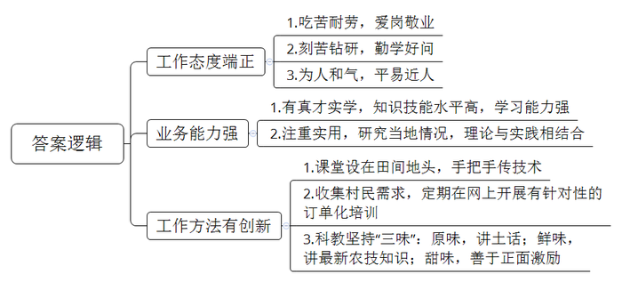
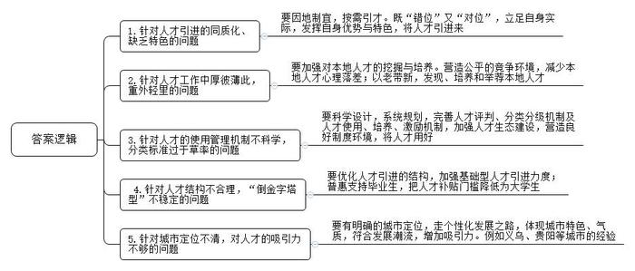
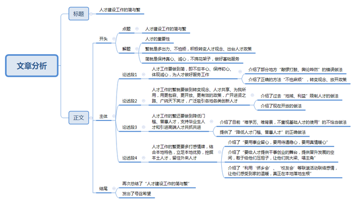

# 2018年公务员多省联考《申论》题（四川上半年卷）

<!-- gwy:overview:start -->
> **四川 · 2018 · 申论 · 上半年** ｜ 3 题 · 图片 3 处 · 答案随题折叠

导航：[题目](#题目) · [材料 1](#材料-1)
<!-- gwy:overview:end -->

> 候选采集稿。参考答案及解析来自粉笔页面，不代表官方答案或真实高分答卷；来源使用许可与原卷对应关系仍需人工核实。

## 给定材料

### 材料 1

在2017年T市的“全市十佳科技特派员”评选活动中，小童以压倒性的票数获得第一名。一个年仅25岁的年轻人，为何能从平均年龄在50岁以上的本市特派员中脱颖而出呢？

领导说，他所服务的S村地处偏僻，有一段路车根本开不进去，下雨天时他坐摩托车进村，常弄得一身泥，特别狼狈。可是他每个月去S村的次数和时间都远远超过了考核要求。同事们说，他要是有什么没弄懂的问题，肯定会睡不好觉，会缠着老特派员们搞清楚的。大学书本告诉了他“是什么”“为什么”，但他觉得还不够。从来到我们这儿，他就开始研究我们这儿的土壤、天气、乡情民俗，他一个北方人竟然在短短几个月时间里学会了我们这儿的方言。

老乡们说，他态度好，说话和气。大家都喜欢和他说话。他说的话大家听得懂，句子不长，用的也是田坎语言，好懂实用。而且他手把手地传技术，把课堂设在田间地头，教给大家的东西都能被记得住。“他讲东西很接地气，富有土味儿。而且，他还会收集村民的需求，定期地在网上开展‘订单化’培训。这样的特派员难找。”村支书也对小童赞不绝口。

而小童自己却说，自己能赢得大家的喜欢，在于自己会玩些“小花样”。“老乡们要的是技术，晦涩的理论讲得再高深，起到的作用也是有限的；老乡们学技术，最终还是要落脚到做上面去。科教本身有些乏味，必须要加点料才会有滋有味。我在做技术特派工作时，就坚持添加‘三味’：一是原味，坚持用原汁原味的田坎语言讲授，尽量讲短话，讲土话；二是鲜味，给乡亲们的一定是最新的农技知识，过时的、可能已经不适用的，坚决不讲；三是甜味，对乡亲们积极鼓励，尽量用积极的语言，谁都希望话好听啊，多给他们看看成功的案例，正面激励。如果你用的是本地语言，说的是农家事，讲的是致富经，他们不欢迎你都难啊。”

### 材料 2

近几年，很多二线城市的人才引进工作都开展得如火如荼。二线城市尚在努力，三四线城市自然也不甘落后：给钱、给房、给户口。然而，纵观很多三四线城市的“人才争夺战”，大多也只是出台买房打折、租房补贴、落户降标、项目资助、一次性奖励等引才政策。这固然有一定的吸引力，但作为本身经济实力和区位优势不那么突出的三四线城市，给出和二线城市差不多的“彩礼”，能真正地“引凤求凰”吗？

“在人才工作中，一些地方的同质化倾向依旧明显。”一位从事人才引进工作多年的部门负责人说道，“现在，很多中小城市都要高学历、高效能、高层次、高大上、高精尖的人才；而给人才的往往就是‘老三样’——钱、房和户口。”“很多地方把人才引进工作想得过于简单了。”一位评论家说道，“人才工作不是把人引进来就可以的，它其实更依赖人才生态的建设——如何利用、再培养、激励，如何留得住才是重中之重。然而，这往往是被很多中小城市所忽视的。花了大力气，引不到人才；人才来了却又待不久。消耗了那么多的财力物力，也还是为他人做嫁衣。

问题还不止于此。现在一些地方的人才引进工作，已经给当地的财政带来不小的压力和负担了，但收效甚微。很多地方都重视引进外地人才，厚彼薄此、重外轻里的人才政策更让本地人颇有意见，可以用“赔本也没赚到吆喝”来形容。“计算机、生物科技、航空航天这些尖端领域的顶尖人才本来就非常稀缺，即使在北上广深这样的城市都是‘肉少狼多’。在这样的环境中，实力薄弱许多的三四线城市往往是耗费了大量的财力、物力、人力，最后却还是被‘剩下’。而且，就算引进了，往往也用不好，甚至用不上。”一位从事人力资源研究的教授说道，“引进人才要靠优势，但中小城市能靠的优势往往不是物质吸引力，而是自己的特色。”

另一位评论家也给出了一个观点：“各个地方的人才引进工作必须要‘错位’又‘对位’。我们的城市定位不应该也不可能是趋同的，如果采用同样的人才路线，会是‘撞车’的；毕竟错落有致，才能既尊重城市发展规律，又符合建筑美学嘛。我国各个城市间的地理、经济等方面差距依然较大，对人才的吸引力、对人才的需求结构都是大不相同的。我们必须认清这个现实，找准自己的位置，才可能做好人才工作。因为你是你，你不是别的城市。你在全省，甚至是全国有你的角色定位，有你自己独特的优势。所以必须各就其位，各求所需。”

位于东部的B市，就曾犯一种“经典”的错误，在五年时间里，B市花费数亿资金引进了大量外市的高职称人才。然而，效果却不尽如人意。“招来了女婿，气走了儿子。各个地方都是这样，厚此薄彼成了通病！”在B市土生土长的科研人员小姚说道，“同样的学历，同样的职称，就因为我一直在本地，来路不同，待遇差距就这么大？果然是‘外来的和尚会念经’？这是让我们这些兢兢业业的本地人有些寒心。”与此同时，小姚也接到了外地的一个职位邀请，待遇颇为优厚，他说自己正在考虑，是否要离开家乡到外地去发展。

### 材料 3

M市D区是省内实施“科技特派员工程”的试点地区，早在2004年就开始了相关的试点工作, M市D区的农民也是“科技特派员工程”的最早受益人。在村民们心中,科技特派员就是要给田间地头开药方,把先进的技术种到地里头，长出金苗苗。

不久前，D区记者小菲就本区科技特派员的情况,对区科技局副局长李明进行了一次采访。在采访中，李局长感叹道：“现在的科技特派员大部分是行业领域的专家、大学生，有的讲授得偏重于纯理论，对农民来说，太过于抽象，不接地气，不实用，这在实际操作中是得不到农民欢迎的。再者说，术业有专攻,本是种蔬菜的农民，要是派一个专攻苗木培养的工作人员给他，又能有多少用呢？”李局长认为,“农民需要和专业领域对口的,有真才实学的，能听懂田坎语言的科技特派员对接,而非流于形式的拉郎配。”

D区目前共有440多个行政村，但科技特派员总共才82名，这令李局长忧心。“在这支队伍里，60来岁的根本不算老，最大的已经70多岁了。想想这些老人们还能在田坎上、果林里跑几年？而一个大学生要想成为一名科技特派员，起码要跟着老特派员学习两年。但是，有多少大学生愿意跟着他们天天进村下地?我们这些年过花甲的特派员又有多少精力来带这些‘徒弟’呢?”

D区村民老蒋对小菲说道：“去年我养土鸡，上面给我安排了一个科技特派员,结果每次来就是帮我喂喂鸡苗,陪着唠唠嗑。后来我怀疑有些鸡苗害了瘟病，找他帮忙看看，他却说没事，叫我放心。结果后来几百只鸡全部染上了鸡瘟，让我损失惨重。”对此,老蒋村里的村支书老周也表示无奈:“现在我们这儿对特派员的考核制度还不够完善。要是他们干好干坏都一个样，是很难有积极性的。如果能通过建立责任连带制度,并让特派员们以技术入股的形式参与分红的话，他们和服务的农户就会同呼吸、共命运'，双方都可以受益。事实上，乡亲们也知道好的特派员不好找，可现在村里也都通了互联网，能不能像很多医院开通网上诊断那样，通过远程视频，让特派员们给村民们的庄稼、家禽们把把脉，号号病?”

采访中,小菲还对全区82名科技特派员进行了问卷调查。调查发现：有近三分之二的科技特派员认为自己的知识结构趋于老化，需要更新丰富：近80%的科技特派员表示因为工作的关系,根本没有时间自行学习，但如果有相应的知识讲座、观摩交流会,他们会积极参加，也不愿错过优质的网络学习资源。此外，这些特派员还有不少同专业、同领域的朋友、同学,他们也有意愿成为服务农村的科技特派员。但都因为工作忙，或不在本地，或不在政府指派培养范围内等原因而作罢。

据悉，D区计划近期开展服务行动，围绕本地农业主导产业，建立一批“互联网+科技特派员”的创新创业示范基地，对接国家、省里的“科技特派员管理服务平台”。对此，小菲感叹道：这样的计划固然是美好的,但用好科技特派员的前提是科技特派员好用、够用。

## 题目

### 第 1 题

**请根据资料2，归纳小童获得“全市十佳科技特派员”荣誉的原因。**（20分）

关联材料：材料 1

作答要求：

要求：

（1）归纳全面，语言简明；

（2）不超过200字。

第 1 题 · 答案与解析

**参考答案（粉笔题库参考内容）**

一、工作态度端正。1.吃苦耐劳，爱岗敬业；2.刻苦钻研，勤学好问；3.为人和气，平易近人。

二、业务能力强。1.有真才实学，知识技能水平高，学习能力强；2.注重实用，研究当地情况，理论与实践相结合。

三、工作方法有创新。1.课堂设在田间地头，手把手传技术；2.收集村民需求，定期在网上开展有针对性的订单化培训；3.科教坚持“三味”：原味，讲土话；鲜味，讲最新农技知识；甜味，善于正面激励。

**解析**

**参考答案说明：**本参考答案从“工作态度端正”“业务能力强”“工作方法有创新”这三方面展开，各条答案要点之间在内容上相互并列，没有交叉。

**参考答案二**

一、工作态度端正。1.吃苦耐劳，爱岗敬业；2.刻苦钻研，勤学好问；3.学习能力强，理论联系实际。

二、业务能力强。1.态度好，沟通能力强；2. 课堂设在田间地头，手把手传技术，讲课接地气；3.收集村民需求，定期在网上开展“订单化”培训。

三、工作方法有创新。1.使用田坎用语，讲短话和土话；2.教授村民最新农业知识，讲致富经；3.对村民使用积极语言，正面激励。

**考点**：原因类

**来源**：2018年公务员多省联考《申论》题（四川上半年卷）

粉笔申论页面对本题只提供「解析视频」入口，该入口是会员推广位，页面无视频地址与文字解析。

### 第 2 题

**请针对资料3和资料4所涉及的城市人才工作中的问题，提出相应的改进措施。**（30分）

关联材料：材料 2

作答要求：

要求：

（1）内容全面，措施得当；

（2）思路清晰，层次分明；

（3）语言流畅，书写工整；

（4）不超过500字。

第 2 题 · 答案与解析

**参考答案（粉笔题库参考内容）**

1.针对人才引进的同质化、缺乏特色的问题。要因地制宜，按需引才。既“错位”又“对位”，立足自身实际，发挥自身优势与特色，将人才引进来。

2.针对人才工作中厚彼薄此，重外轻里的问题。要加强对本地人才的挖掘与培养。营造公平的竞争环境，减少本地人才心理落差；以老带新，发现、培养和举荐本地人才。

3.针对人才的使用管理机制不科学，分类标准过于草率的问题。要科学设计，系统规划，完善人才评判、分类分级机制及人才使用、培养、激励机制，加强人才生态建设，营造良好制度环境，将人才用好。

4.针对人才结构不合理，“倒金字塔型”不稳定的问题。要优化人才引进的结构，加强基础型人才引进力度；普惠支持毕业生，把人才补贴门槛降低为大学生。

5.针对城市定位不清，对人才的吸引力不够的问题。要有明确的城市定位，走个性化发展之路，体现城市特色、气质，符合发展潮流，增加吸引力。例如义乌、贵阳等城市的经验。

**解析**

**参考答案说明：**本参考答案从“人才引进”“人才工作”“人才制度”“人才结构”“城市定位”五个方面进行了分条撰写。各条要点之间在内容上相互并列，没有交叉。

**考点**：提出对策类

**来源**：2018年公务员多省联考《申论》题（四川上半年卷）

### 第 3 题

**请根据你对资料5中划线部分“当简勿繁，当繁勿简；简繁得当，方能出效率，方能出成果”的理解，结合给定资料，联系社会实际，以“人才建设工作的简与繁”为题目，写一篇议论文。**（50分）

关联材料：材料 3

作答要求：

要求：

（1）观点鲜明，论述深刻；

（2）思路清晰，结构严谨；

（3）语言流畅，书写工整；

（4）总字数800-1000字。

第 3 题 · 答案与解析

**参考答案（粉笔题库参考内容）**

**人才建设工作的简与繁**

经济发展了、生活富裕了，人才的重要性愈发凸显：“尚贤者，政之本也”，“致天下之治者在人才”……得人者兴、失人者崩，人才决定了城市发展的速度、社会进步的速度、国家兴旺发达的速度，是新时代的核心竞争力。想要迎来选贤任能、群贤毕至的局面就要把握好人才建设工作的简与繁：繁就是多出力、不怕烦，积极转变人才观念、出台人才政策；简就是保持真心、诚心，不搞花架子，做好基础服务。

长久以来，阻碍人才发展的落后思想没有消失，各地的人才引进政策也不尽完善。有的地方不敢大胆使用人才，吝啬于出台人才优惠政策，担心被指责“有失社会公平”；有的地方人才引得来、留不住，对待大学生、研究生不屑一顾，忽略了基础人才的保护，缺少公平竞争环境；还有的地方虽有政策，但是简单粗暴，没有分层分类、缺少激励机制、发展后劲不足，捆住了人才的手脚，卡住了创新创业的轮子。

**人才工作要做到简，即不忘本心、保持初心、体现诚心，为人才做好服务工作**。不少地方引进人才敲锣打鼓、舆论哗然，光有花拳绣腿，却不愿意踏实出实招、做服务，这样招不来人才，更留不住人才。然而，人才建设更要不怕麻烦，“观念不变原地转，政策放开天地宽”，“要择天下英才而用之，实施更加积极的创新人才引进政策”。

**人才工作的繁就要做到转变观念、人才共享、为我所用，用更包容、更开放、更有效的政策，广开进贤之路、广纳天下英才，广泛吸引各地各类创新人才。**过去，人才有地域的限制，不是本省的不用、不是本市的不用，说白了还是为了私心，为了地方利益，束缚住了手脚。现在我们必须勇于冲破思想观念障碍，突破利益固化藩篱，向顽症痼疾开刀，打通人才发展的体制关卡，真正做到“不拘一格降人才”。

**人才工作的繁还要做到降低门槛、普惠人才，支持毕业生人才和引进高端人才共抓共进。**不少地方引进人才唯学历、唯背景，不重视基础人才的使用，出现了倒金字塔的局面，长此以往不利于人才结构的健康和可持续发展。唯有降低人才门槛、普惠人才方能实现人才多元化、层次化、系统化的局面，对于紧缺人才我们应不唯学历、不唯职称，唯才是举。

**人才工作的繁更要多打感情牌，结合本地特色，立足本地优势，挖掘本土人才，留住外来人才。**要用事业留心，要用待遇稳心，要用真情暖心。不仅要给人才提供干事创业的舞台，提供晋升发展的空间，敢于给他们压担子，让他们挑大梁、唱主角；更应该利用“侨乡会”、“校友会”等联谊活动联络感情，让他们感受到家的温暖，真正在本地落地生根。

“致天下之治者在人才”，让我们做好人才建设的繁与简，让人才进的来、留得住、用得好，为实现中华民族伟大复兴的宏伟目标贡献力量！

**解析**

**文章分析**

**人才建设工作的简与繁**

〖**标题的优点：**严格按照题目的要求，以“人才建设工作的简与繁”为标题。〗

经济发展了、生活富裕了，人才的重要性愈发凸显：“尚贤者，政之本也”，“致天下之治者在人才”……得人者兴、失人者崩，人才决定了城市发展的速度、社会进步的速度、国家兴旺发达的速度，是新时代的核心竞争力。想要迎来选贤任能、群贤毕至的局面就要把握好人才建设工作的简与繁：（1）繁就是多出力、不怕烦，积极转变人才观念、出台人才政策；（2）简就是保持真心、诚心，不搞花架子，做好基础服务。

〖**开头的优点：★**内容方面：范文的开头是紧扣“人才建设工作的简与繁”这一主题展开的。首先，开头第一句话引出了人才的重要性，接着点出了主题，做到了主题明确。其次，对“人才建设工作的简与繁”这一主题进行了分析阐述，指出了（1）繁就是多出力、不怕烦，积极转变人才观念、出台人才政策；（2）简就是保持真心、诚心，不搞花架子，做好基础服务。★文字表达方面：长短句配合使用，使语言表达有节奏感。〗

长久以来，阻碍人才发展的落后思想没有消失，各地的人才引进政策也不尽完善。有的地方不敢大胆使用人才，吝啬于出台人才优惠政策，担心被指责“有失社会公平”；有的地方人才引得来、留不住，对待大学生、研究生不屑一顾，忽略了基础人才的保护，缺少公平竞争环境；还有的地方虽有政策，但是简单粗暴，没有分层分类、缺少激励机制、发展后劲不足，捆住了人才的手脚，卡住了创新创业的轮子。

【**过渡段的优点：**范文过渡段通过举例分析了目前“人才建设工作”的特点、问题等方面的内容，凸显了“人才建设工作”的重要性。】

**人才工作要做到简，即不忘本心、保持初心、体现诚心，为人才做好服务工作**。（1）不少地方引进人才敲锣打鼓、舆论哗然，光有花拳绣腿，却不愿意踏实出实招、做服务，这样招不来人才，更留不住人才。然而，（2）人才建设更要不怕麻烦，“观念不变原地转，政策放开天地宽”，“要择天下英才而用之，实施更加积极的创新人才引进政策”。

〖**论述段1的优点：**★观点句：范文的观点句是紧扣“人才建设工作的简与繁”这一文章主题提出的。形式上，它在段首处直接写出，位置突出，容易发现。内容上，关键词突出，内容要点明确，可以明显看出它是从“不忘本心、保持初心、体现诚心，为人才做好服务工作”等入手，指出了“如何做到人才工作的简”。★论述内容：（1）介绍了部分地方“敲锣打鼓、舆论哗然”的错误做法；（2）介绍了正确的方法“不怕麻烦”，转变观念、放开政策；注意：以上两个方面的内容都是紧扣“人才工作要做到简，即不忘本心、保持初心、体现诚心，为人才做好服务工作”这个观点句进行分析论述的，论述的针对性强，内容层次丰富。并且这两个方面的论述是有内在逻辑顺序的，先讲“错误的”，再讲“正确的”。最后，在论述方法和论据的选取上采用了讲道理、打比方相结合的方式，做到了丰富多样。〗

**人才工作的繁就要做到转变观念、人才共享、为我所用，用更包容、更开放、更有效的政策，广开进贤之路、广纳天下英才，广泛吸引各地各类创新人才。**（1）过去，人才有地域的限制，不是本省的不用、不是本市的不用，说白了还是为了私心，为了地方利益，束缚住了手脚。（2）现在我们必须勇于冲破思想观念障碍，突破利益固化藩篱，向顽症痼疾开刀，打通人才发展的体制关卡，真正做到“不拘一格降人才”。

〖**论述段2的优点：**★观点句：范文的观点句是紧扣“人才建设工作的简与繁”这一文章主题提出的。形式上，它在段首处直接写出，位置突出，容易发现。内容上，关键词突出，内容要点明确，可以明显看出它是从“观念、政策”入手，指出了“如何做到人才工作的繁”。★论述内容：（1）介绍了过去“地域、利益”限制人才的做法；（2）介绍了现在开放的做法；注意：以上两个方面的内容都是紧扣“人才工作的繁就要做到转变观念、人才共享、为我所用，用更包容、更开放、更有效的政策，广开进贤之路、广纳天下英才，广泛吸引各地各类创新人才”这个观点句进行分析论述的，论述的针对性强，内容层次丰富。并且这两个方面的论述是有内在逻辑顺序的，先讲“过去的”，再讲“现在的”。在论述方法上采用了讲道理、打比方相结合的方式进行展开的，做到了论述有力。〗

**人才工作的繁还要做到降低门槛、普惠人才，支持毕业生人才和引进高端人才共抓共进。**（1）不少地方引进人才唯学历、唯背景，不重视基础人才的使用，出现了倒金字塔的局面，长此以往不利于人才结构的健康和可持续发展。（2）唯有降低人才门槛、普惠人才方能实现人才多元化、层次化、系统化的局面，对于紧缺人才我们应不唯学历、不唯职称，唯才是举。

〖**论述段3的优点：**★观点句：范文的观点句是紧扣“人才建设工作的简与繁”这一文章主题提出的。形式上，它在段首处直接写出，位置突出，容易发现。内容上，关键词突出，内容要点明确，可以明显看出它是从“降低门槛、普惠人才”入手，指出了“如何做到人才工作的繁”。★论述内容：（1）介绍了目前“唯学历、唯背景，不重视基础人才的使用”的不恰当做法；（2）提供了“降低人才门槛、普惠人才”的正确做法；注意：以上两个方面的内容都是紧扣“人才工作的繁还要做到降低门槛、普惠人才，支持毕业生人才和引进高端人才共抓共进。”这个观点句进行分析论述的，论述的针对性强，内容层次丰富。并且这两个方面的论述是有内在逻辑顺序的，先讲“现有的做法”，再讲“应该的做法”。在论述方法上采用了例证、理证结合的方式进行展开的，做到了论述有力。〗

**人才工作的繁更要多打感情牌，结合本地特色，立足本地优势，挖掘本土人才，留住外来人才。**（1）要用事业留心，要用待遇稳心，要用真情暖心。（2）不仅要给人才提供干事创业的舞台，提供晋升发展的空间，敢于给他们压担子，让他们挑大梁、唱主角；（3）更应该利用“侨乡会”、“校友会”等联谊活动联络感情，让他们感受到家的温暖，真正在本地落地生根。

〖**论述段4的优点：**★观点句：范文的观点句是紧扣“人才建设工作的简与繁”这一文章主题提出的。形式上，它在段首处直接写出，位置突出，容易发现。内容上，关键词突出，内容要点明确，可以明显看出它从“本地特色、优势”入手，指出了“如何做到人才工作的繁”。★论述内容：（1）介绍了“要用事业留心，要用待遇稳心，要用真情暖心”；（2）介绍了“要给人才提供干事创业的舞台，提供晋升发展的空间，敢于给他们压担子，让他们挑大梁、唱主角”；（3）介绍了“利用‘侨乡会’、‘校友会’等联谊活动联络感情，让他们感受到家的温暖，真正在本地落地生根”。注意：以上两个方面的内容都是紧扣“人才工作的繁更要多打感情牌，结合本地特色，立足本地优势，挖掘本土人才，留住外来人才。”这个观点句进行分析论述的，论述的针对性强，内容层次丰富。并且这三个方面的论述是有内在逻辑顺序的，先总讲“三心”，再分讲“如何用事业留心、用待遇稳心”， “用真情暖心”。在论述方法上采用了例证、理证结合的方式进行展开的，做到了论述有力。〗

【**论述段之间的关系**：★内容的内在逻辑：范文的论述段之间是依照“先简后繁”的逻辑展开的。论述段1先写了“人才工作要做到简，即不忘本心、保持初心，做好服务”，论述段2再写了“人才工作的繁就要做到转变观念、人才共享、为我所用”，论述段3接着写了“人才工作的繁还要做到降低门槛、普惠人才” ，论述段4最后写了“人才工作的繁更要多打感情牌，结合本地特色，立足本地优势，挖掘本土人才，留住外来人才”。★段与段的外在衔接：论述段1的段尾处的过渡句“然而，人才建设更要不怕麻烦，‘观念不变原地转，政策放开天地宽’，‘要择天下英才而用之，实施更加积极的创新人才引进政策’”，起到了承接论述段1、引出了论述段2的作用。论述段3的段首处的过渡句“人才工作的繁还要做到……”，起到了承接论述段2、引出了论述段3的作用。论述段4的段首处的过渡句“人才工作的繁更要……”，起到了承接论述段3、引出了论述段4的作用。】

“致天下之治者在人才”，让我们做好人才建设的繁与简，让人才进的来、留得住、用得好，为实现中华民族伟大复兴的宏伟目标贡献力量！

〖**结尾的优点**：范文的结尾回扣了“人才建设工作的简与繁”这一主题。（1）再次总结了“人才建设工作的简与繁”；（2）发出了号召希望。〗

**考点**：文章写作题

**来源**：2018年公务员多省联考《申论》题（四川上半年卷）

