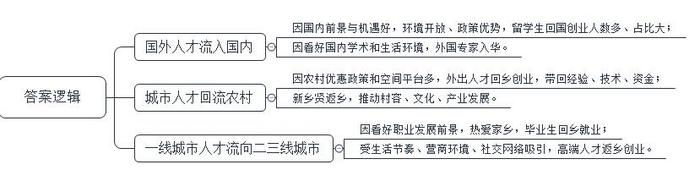
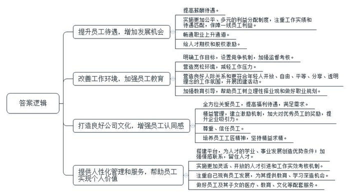
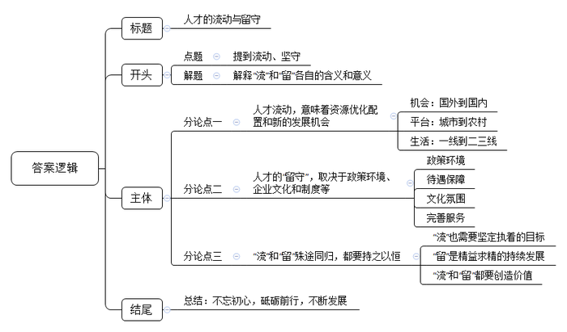

# 2018年四川省公考《申论》题（下半年）

> 候选采集稿。参考答案及解析来自粉笔页面，不代表官方答案或真实高分答卷；来源使用许可与原卷对应关系仍需人工核实。

## 给定材料

### 材料 material-599ec98bb4fff7be

教育部统计数据显示，从1978年到2017年底，我国出国留学人员回国人数稳步提升，高层次人才回流趋势明显。改革开放40年来，各类出国留学人员累计已达519.49万人，有共计313.20万名留学生在完成学业后选择回国发展，占已完成学业留学生人数的83.73%，形成了大规模的留学人才“归国潮”。

2000年谭亮前往美国求学，在华盛顿大学获得博士学位，研究方向是分布式和云计算，毕业后在硅谷从事过电信、能源、医疗等行业的技术研发工作，后加盟一家著名的国际金融互联网公司。在与国内互联网金融界人士接触的过程中，谭亮发现国内这个领域的发展甚至比美国还要火。于是，他开始关注国内互联网金融的发展，并最终决定回国创业。事实上，像谭亮这样具有海外名校科研背景的青年人才，有不少人正是看中了国内的广阔前景和开放环境才选择回国。在2008年《政府工作报告》中，“建设创新型国家”的政策就引起了包括广大留学生在内的全体民众的关注，其中“鼓励海外留学人员回国创新创业，拓宽外国人才来华绿色通道”的表述让已然身在海外留学的莘莘学子心生期待。在谭亮看来，中国的金融市场虽不及美国那么发达，针对个人和小微企业的金融服务市场几乎是空白，但这对相关从业人员来说恰恰意味着发展机遇。另外，从个人角度来说，在美国多年留学和工作经历也让他产生了一些倦怠感。他渴望面临新的挑战，获得更大的发展空间。

随着我国综合国力的不断增强，越来越多的外国专家愿意来华工作和定居。图多尔·拉提乌来自瑞士，是一名数学学者。他第一次来中国是在1987年，当时在北京大学做研究，他喜爱中国的美食和自然环境，与中国结下了不解之缘。图多尔·拉提乌目前是上海交通大学数学科学学院讲席教授、国际化示范学院副院长。“刚来这里时，学校的科研环境让我吃惊，这里太棒了。”图多尔·拉提乌说。上海交大提供了良好的学术环境和生活环境，对于那些潜心做研究的学者来说，这是最重要的砝码之一。据福布斯发布的《2018全球人才流动和资产配置趋势》显示，到2022年，中国将成为国际人才环流中的一个交换性枢纽节点。

### 材料 material-4cf38f30eb406caa

H科技有限公司是J市一家软件服务类企业，目前公司最大的困境不是资金问题，而是无法留住人才。去年公司招了3个应届毕业生，一开始先跟着技术大咖做项目，给出的月薪在7000元左右。经过一年多的学习和培训，员工具备了独立解决问题和进行技术推广的能力。然而招来的三个人走了两个，都跑到“北上广深”的大企业了，剩下的一个也有走的想法。公司总经理王俊永说：“初创期公司，本身就处于企业成长生态链里的弱势地位，难以寻觅对公司文化认可度高的人才。公司好不容易招到匹配的人才，经过后期的培养机制，可以胜任工作了，但也开始萌生跳槽到待遇更丰厚企业的念头。人员的频繁变动直接影响了项目的进展。”

20年前，陈飞进入一家国有煤企，只有中专文化的他牢记老父亲“手里没得艺，挑断箩筐系”的谆谆教导，也坚信“艺多不压身”的道理。他勤学电钳知识，练就了低、高压电工和维修电工等多种技能，成为企业有名的多面手和技术拔尖人才。然而在陈飞为企业效力期间，多面手的特长让他引以为傲的同时又深感困惑。陈飞干了20年电钳工，顶着“土专家”光环的他，还只是在企业内的操作岗位，薪酬待遇与管理岗位存在巨大的差距。“现在，企业里的工资分配制度还是‘大锅饭’居多，拼职称，讲学历。像我这样的人平日里都扎在现场，哪有时间写论文，评职称？转不了管理岗位，评不上职称，工资收入确实太低了，养活一家人都困难。”在陈飞看来，转不上管理岗，如果能从工资待遇上给予倾斜，也是不错的办法。可是，对他这样的“土专家”，企业并没有明确的提高工资待遇的规定。付出这么多却看不到上升的希望，让陈飞做出了另觅高枝的决定。

经济学专业毕业的小李在短短两年的时间里，已经先后从事了文秘、银行柜员、证券公司职员三份工作，最近他又想跳槽到一家财经类报纸做记者。小李每次辞职换工作的理由都不大一样。第一次是觉得文秘工作太稳定，不太适合刚毕业的大学生，怕自己年轻时的锐气一点点被销蚀掉了。第二次是感觉银行压力太大，很难得到晋升。第三次跳槽的理由是与新同事相处不够融洽，希望换个新环境。据最新发布的《2018年就业蓝皮书》显示，职场人员流动呈现出代际特征。90后具有明显不同于70后和80后的职场特点，其离职率也明显提高。70后的第一份工作平均超过4年才换，80后则是3年半，到90后骤降到19个月，95后更是仅仅在职7个月就选择辞职。全国政协委员、中国青少年研究中心主任韩民指出，90后这代人是数字时代成长起来的“数字原住民”，他们普遍具有开放、自由、平等、分享、透明的多元精神和职场价值观，对于企业的依赖性和忠诚度较70后职场前辈明显下降。

## 题目

### 第 1 题

**根据“给定资料**1**～**3**”，概括当前我国人才回流的具体表现。（****20****分）**

关联材料：material-599ec98bb4fff7be

作答要求：

要求：概括准确，内容全面；条理清晰，语言简洁；不超过200字。

### 第 2 题

**根据“给定资料**4**～**6**”，你认为采取哪些措施可以为企事业单位更好地留住人才？（****30****分）**

关联材料：material-4cf38f30eb406caa

作答要求：

要求：措施得当，操作性强；思路清晰，语言简洁；不超过500字。

### 第 3 题

**“给定资料**7**”中划线句子提到“****一个人可以选择领略不同的人生风景，也可以选择一辈子只做一件事。****”请根据你对这句话的理解，结合给定资料，联系实际，以“流与留”为主题，自选角度，自拟题目，写一篇议论文。（****50****分）**

关联材料：material-599ec98bb4fff7be

作答要求：

要求：观点明确，立意深刻；逻辑清晰，结构严谨；语言流畅，书写工整；限800～1000字。

## 答案与解析

第 1 题

**参考答案（粉笔题库参考内容）**

1.国外人才流入国内。因国内前景与机遇好，环境开放、政策优势，留学生回国创业人数多、占比大；因看好国内学术和生活环境，外国专家入华。

2.城市人才回流农村。因农村优惠政策和空间平台多，外出人才回乡创业，带回经验、技术、资金；新乡贤返乡，推动村容、文化、产业发展。

3.一线城市人才流向二三线城市。因看好职业发展前景，热爱家乡，毕业生回乡就业；受生活节奏、营商环境、社交网络吸引，高端人才返乡创业。

**解析**

**参考答案说明：**答案从“国外人才流入国内”“城市人才回流农村”“一线城市人才流向二三线城市”等不同方面进行了分条撰写。各条要点之间在内容上是并列关系，没有交叉。

**考点**：考点其他类

**来源**：来源2018年四川省公考《申论》题（下半年）

粉笔申论页面对本题只提供「解析视频」入口，该入口是会员推广位，页面无视频地址与文字解析。

第 2 题

**参考答案（粉笔题库参考内容）**

一、提升员工待遇，增加发展机会。1.提高薪酬待遇。2.实施更加公平、多元的利益分配制度，注重工作实绩和待遇匹配，保障一线员工利益。3.畅通职业上升通道。4.给人才期权和股权激励。

二、改善工作环境，加强员工教育。1.明确工作目标，设置竞争机制，加强监督考核。2.营造宽松环境，减轻工作压力。3.营造良好人际关系和更符合年轻人开放、自由、平等、分享、透明理念的工作氛围，开展团建活动。4.加强教育引导，帮助员工树立理性择业观和做好职业规划。

三、打造良好公司文化，增强员工认同感。1.全方位关爱员工，提高福利待遇，满足需求。2.精益管理，建立激励机制，加大对优秀员工的奖励，提升企业吸引力。3.尊重、信任员工。4.培养员工工匠精神，坚持精益求精。

四、提供人性化管理和服务，帮助员工实现个人价值。1.搭建平台，为人才的学业、事业发展创造优势条件；加强情感联系，留住人才。2.实施更加灵活、开放的人才引进和工作实效考核机制。3.注重自己现有员工发展，为其提供教育、学习深造机会。4.做好员工及其子女的医疗、教育、文化等配套服务。

**解析**

**参考答案说明：**答案从“提升员工待遇，增加发展机会”“改善工作环境，加强员工教育”“打造良好公司文化，增强员工认同感”“提供人性化管理和服务，帮助员工实现个人价值”四个不同方面进行了分条撰写。每个方面分别用小点分条撰写。

**考点**：考点提出对策类

**来源**：来源2018年四川省公考《申论》题（下半年）

粉笔申论页面对本题只提供「解析视频」入口，该入口是会员推广位，页面无视频地址与文字解析。

第 3 题

**参考答案（粉笔题库参考内容）**

**人才的流动与留守**

这是一个开放、多元、流动的时代，也是一个需要坚持、坚守的时代。选择流动，即选择求新求变和创造性力量，意味着人才、资金、技术等资源重新优化配置机会。选择留下、留守，则意味着坚守传统智慧和价值理念、执着精神。**“****流****”****与****“****留****”****，两种不同的人生观、择业观，体现出不同的人生追求，具有同等的价值和意义。**

**人才流动，意味着资源优化配置和新的发展机会。**流动是一种不断求新、求变的发展力量。人才跨区域、跨行业流动，能丰富人生阅历，更会带来社会价值。过去我国人才流出国外是为了寻求知识和机会，今天我们提供政策和平台吸引人才大量回国，则是为了国家更高质量的发展。当初众多青年离乡是为了摆脱贫困，今日带着技术、资金回乡则为了获得更广大的发展平台，这能促进区域、城乡之间的平衡发展。人才从在一线和二三线城市之间流动，在工作和生活之间有了更多元选择，则可以促进城市均衡发展。

但正是在这种竞争激烈、人才流动不息的时代，能否吸引、留住人才显得异常重要。招揽、留住优秀人才，成了企业、城市和国家生存、发展的根本。

**人才的****“****留守****”****，取决于政策环境、企业文化和制度等。**捡拾最近的新闻，从各类国际化人才流入我国，再到高精端人才从城市流向农村，不难发现，首先就是政策环境好。比如深圳降低个人所得税的举措，就非常有利于其获得全国乃至全球顶级人才的聚集。当然，薪酬机制合理，待遇优厚也是吸引人才的“硬实力”。此外，需要完善企业管理制度和文化，营造一种关心人、尊重人的环境。最后，留住人才需要做好人才服务，建立良好人才生态系统。要在晋升空间、工作和居住环境，医疗、子女教育方等方面给人才提供全方位服务。

**但其实从深处看，****“****流****”****和****“****留****”****殊途同归，都要有一种持之以恒的工匠精神。****“****流****”****中有坚守，****“****留****”****中有变化和进步**。“流”不应该是时下年轻人凭心情任性换工作的不负责行为，也不应该是那些只盯着利益不断“跳槽”的浮躁行为。“流”应该是对理想信念的执着和不断尝试。“留”则是一种对岗位的坚守，对技艺精益求精的追求，是一种不断寻求进步的力量。人才的留守，更是企业和国家可持续发展的根基。如此看来，选择“流”或者“留”，都应该始终以有利于自身发展和社会进步为依据。

总而言之，选择领略不同的风景，还是选择一辈子只做一件事，无论选择哪一种选择，我们都要不忘初心，砥砺前行，不断发展，成就精彩人生！

**解析**

**文章分析**

**人才的流动与留守**

【**标题的优点：**首先，范文的标题“人才的流动与留守”突出了“流与留”这一主题。其次，形式上，文字简洁明快。】

（1）这是一个开放、多元、流动的时代，也是一个需要坚持、坚守的时代。（2）选择流动，即选择求新求变和创造性力量，意味着人才、资金、技术等资源重新优化配置机会。（3）选择留下、留守，则意味着坚守传统智慧和价值理念、执着精神。（4）**“****流”与“留”，两种不同的人生观、择业观，体现出不同的人生追求，具有同等的价值和意义****。**

【**开头的优点：**★内容方面。范文的开头是紧扣题目给定的“流与留”这一主题展开的。首先，开头开门见山点出主题，做到了主题明确。其次，对“流与留”这一主题进行了分析阐述，指出了（1）介绍了当前“流与留”的时代背景；（2）阐释了“流”的含义；（3）阐释了“留”的含义；（4）点出了“流”与“留”的关系。★文字表达方面：长短句配合使用，使语言表达有节奏感；使用了“这是……，也是……”关联词，使语言表达有逻辑性。】

**人才流动，意味着资源优化配置和新的发展机会。**流动是一种不断求新、求变的发展力量。人才跨区域、跨行业流动，（1）能丰富人生阅历，更会带来社会价值。（2）过去我国人才流出国外是为了寻求知识和机会，今天我们提供政策和平台吸引人才大量回国，则是为了国家更高质量的发展。（3）当初众多青年离乡是为了摆脱贫困，今日带着技术、资金回乡则为了获得更广大的发展平台，这能促进区域、城乡之间的平衡发展。（4）人才从在一线和二三线城市之间流动，在工作和生活之间有了更多元选择，则可以促进城市均衡发展。

【**论述段****1****的优点：**★观点句：范文的观点句是紧扣“流与留”这一文章主题提出的。形式上，它在段首处直接写出，位置突出，容易发现。内容上，关键词突出，可以明显看出它是从“实现人才有效流动的意义”入手，指出了“人才流动能促进资源优化配置和提供发展机会”。★论述内容：（1）介绍了人才流动的意义；（2）介绍了人才流动从国外转向国内；（3）介绍了人才流动从城市转向农村的现实及其意义；（4）介绍了人才流动从一线城市转向二三线城市的现实及其意义。注意：以上几个方面的内容都是紧扣“人才流动，意味着资源优化配置和新的发展机会”这个观点句进行分析论述的，论述的针对性强，内容层次丰富。最后，在论述方法和论据的选取上采取讲道理的方式。】

但正是（1）在这种竞争激烈、人才流动不息的时代，能否吸引、留住人才显得异常重要。（2）招揽、留住优秀人才，成了企业、城市和国家生存、发展的根本。

【**过渡段的优点：**范文过渡段分析了人才流动的时代背景、留住人才的重要性等**方面的内容**，其中“招揽、留住优秀人才，成了企业、城市和国家生存、发展的根本”是用来引起下文的过渡句。】

**人才的“留守”，取决于政策环境、企业文化和制度等。**捡拾最近的新闻，从各类国际化人才流入我国，再到高精端人才从城市流向农村，不难发现，（1）首先就是政策环境好。比如深圳降低个人所得税的举措，就非常有利于其获得全国乃至全球顶级人才的聚集。当然，（2）薪酬机制合理，待遇优厚也是吸引人才的“硬实力”。此外，（3）需要完善企业管理制度和文化，营造一种关心人、尊重人的环境。最后，（4）留住人才需要做好人才服务，建立良好人才生态系统。要在晋升空间、工作和居住环境，医疗、子女教育方等方面给人才提供全方位服务。

【**论述段****2****的优点：**★观点句：范文的观点句是紧扣“流与留”这一文章主题提出的。形式上，它在段首处直接写出，位置突出，容易发现。内容上，关键词突出，可以明显看出它是从“实现人才留守的对策”入手，指出了“人才留守取决于政策环境、企业文化和制度”。★论述内容：（1）介绍了人才的“留守”取决于政策环境；（2）介绍了人才的“留守”取决于待遇保障；（3）介绍了人才的“留守”取决于文化氛围；（4）介绍了人才的“留守”取决于完善人才服务。注意：以上几个方面的内容都是紧扣“人才的‘留守’，取决于政策环境、企业文化和制度等”这个观点句进行分析论述的，论述的针对性强，内容层次丰富。最后，在论述方法和论据的选取上做到了讲道理、举例子相结合，做到了丰富多样。】

**但其实从深处看，“流”和“留”殊途同归，都要有一种持之以恒的工匠精神。“流”中有坚守，“留”中有变化和进步**。（1）“流”不应该是时下年轻人凭心情任性换工作的不负责行为，也不应该是那些只盯着利益不断“跳槽”的浮躁行为。“流”应该是对理想信念的执着和不断尝试。（2）“留”则是一种对岗位的坚守，对技艺精益求精的追求，是一种不断寻求进步的力量。（3）人才的留守，更是企业和国家可持续发展的根基。如此看来，（4）选择“流”或者“留”，都应该始终以有利于自身发展和社会进步为依据。

【**论述段****3****的优点：**★观点句：范文的观点句是紧扣“流与留”这一文章主题提出的。形式上，它在段首处直接写出，位置突出，容易发现。内容上，关键词突出，可以明显看出它是从“如何正确的看待‘流’与‘留’”入手，指出了“‘流’与‘留’殊途同归，要有持之以恒的工匠精神”。★论述内容：（1）介绍了“流”需要坚定执着的目标；（2）介绍了“留”是精益求精的持续发展；（3）介绍了人才“留守”的意义；（4）介绍了“流”和“留”都要创造价值。注意：以上几个方面的内容都是紧扣“但其实从深处看，‘流’和‘留’殊途同归，都要有一种持之以恒的工匠精神。‘流’中有坚守，‘留’中有变化和进步”这个观点句进行分析论述的，论述的针对性强，内容层次丰富。最后，在论述方法和论据的选取上采取讲道理的方式。】

【**论述段之间的关系**：★内容的内在逻辑：范文的论述段之间是依照“递进”的逻辑展开的。论述段1先写了“人才流动，意味着资源优化配置和新的发展机会”，论述段2再写了“人才的‘留守’，取决于政策环境、企业文化和制度等”，论述段3接着写了“但其实从深处看，‘流’和‘留’殊途同归，都要有一种持之以恒的工匠精神。‘流’中有坚守，‘留’中有变化和进步”。】

总而言之，选择（1）领略不同的风景，还是选择一辈子只做一件事，无论选择哪一种选择，（2）我们都要不忘初心，砥砺前行，不断发展，成就精彩人生！

【**结尾的优点**：范文的结尾回扣了“流与留”这一主题。（1）再次提到“流与留”这一主题；（2）发出了展望。】

**考点**：考点文章写作题

**来源**：来源2018年四川省公考《申论》题（下半年）

粉笔申论页面对本题只提供「解析视频」入口，该入口是会员推广位，页面无视频地址与文字解析。

