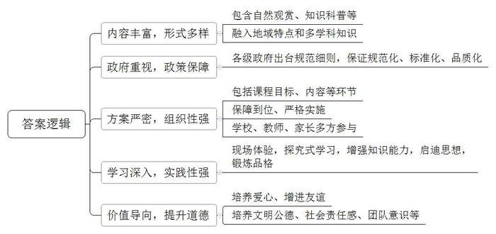
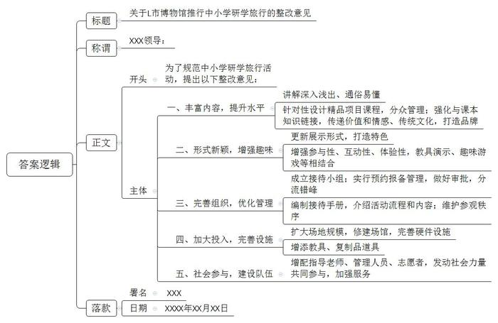
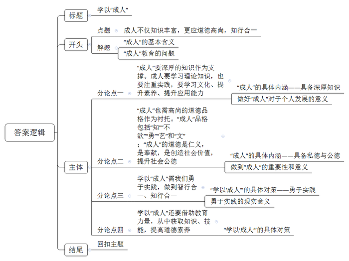

# 2019年公务员多省联考《申论》题（四川上半年、普通选调卷）

<!-- gwy:overview:start -->
> **四川 · 2019 · 申论 · 选调生** ｜ 3 题 · 图片 3 处 · 答案随题折叠

导航：[题目](#题目) · [材料 1](#材料-1)
<!-- gwy:overview:end -->

> 候选采集稿。参考答案及解析来自粉笔页面，不代表官方答案或真实高分答卷；来源使用许可与原卷对应关系仍需人工核实。

## 给定材料

### 材料 1

参观海军博物馆，前往国家海洋局海洋环境监测站了解大气监测和水文监测情况，学系帆船绳结、与大海亲密接触；跟随古脊椎动物专家的步伐，参观遗址博物馆，寻找恐龙和恐龙蛋化石，学习科学采集和修理化石；深入国外大学校园，感受中西教育异同……近几年来，自然观赏型、知识科普型、体验考察型、文化康乐型、励志拓展型等各种各样的研学旅行活动，在我国许多城市中小学生中广泛开展。

我国的研学旅行，最早可追溯到春秋战国时期的“游学”，那时多指士人学子远游异地，从师学习，以所学游说诸候，求取官职。两汉承继战国游学之风，学子们远行访师问道，既求闻达也求仕途。唐代旅行学习之风日盛，众多士子走出书斋，多作郊游、远行、交友、边塞之旅。及至宋代和明清，书院盛行，学子们穿行于不同学院的不同学派之中，广采博收，士人旅行制度化，“读万卷书，行万里路”的主流意识逐渐形成。

20世纪30年代，著名教育家陶行知先生组织“新安旅行团”作长途修学旅行，开创了现代我国修学旅行的先河。受外来的修学旅游理念影响，从20世纪90年代开始，一些教育理念较开放的学校开始组织学生修学旅游、出境游学。

2013年，国务院办公厅发布《国民旅游休闲纲要（2013-2020年）》首次提出“研学旅行”概念，随后在河北省、上海市等省市试点推行研学旅行。2017年国家旅游局发布《研学旅行服务规范》从服务提供方、人员配置、研学产品、研学基地、安全管理等各个环节规范研学旅行服务流程，让研学旅行开始有规可依。此后发布的《中小学综合实践活动课程指导纲要》《中小学德育工作指南》等一系列文件，为研学旅行的规范化发展、标准化建设、品质化推广提供了有力的政策支持。

2016年12月，教育部等11部委联合发布《关于推进中小学生研学旅行的意见》（以下简称《意见》），《意见》指出：“中小学生研学旅行是由教育部门和学校有计划地组织安排，通过集体旅行、集中食宿方式开展的研究性学习和旅行体验相结合的校外教育活动，是学校教育和校外教育衔接的创新形式，是教育教学的重要内容，是综合实践育人的有效途径。”《意见》明确要求各中小学要结合当地实际，把研学旅行纳入学校教育教学计划，与综合实践活动课程统筹考虑，促进研学旅行和学校课程有机融合。学校根据学段特点和地域特色，逐步建立小学阶段以乡土乡情为主、初中阶段以县情市情为主、高中阶段以省情国情为主的研学旅行活动课程体系；规定研学旅行不得开展以营利为目的的经营性创收。自此，研学旅行在全国中小学全面推行，各省市也纷纷出台配套文件及细则，比如，2019年1月17日，成都市教育局、成都市发展和改革委员会、共青团成都市委等11个部门联合发布了《成都市教育局等11部门关于推进中小学生研学旅行的指导意见》。

### 材料 2

2018年12月，S市河西小学开展了题为“寻找儒家文化之根，做骄傲中国人”的主题研学活动，大约300名五年级学生在学校老师的带领下，走进孔子故里，感悟儒家文化。此次研学活动是学校为培养学生综合实践能力和创新能力而设计的“博究六艺”研学课程的一部分。以下是研学活动方案的部分内容。

课程目标：通过参观曲阜六艺城，了解孔子“六艺”（礼、乐、射、御、书、数）；通过实地考察、现场体验、访谈等方式，获得语文、数学、科学等学科知识；利用研讨交流、走访等学习方式，培养学生发现问题、分析问题、解决问题的能力；设计丰富的研学活动，培养学生探究合作、安全自护、健康环保、文明公德等意识和能力。

课程内容：参与古代婚俗表演等活动，让学生深入了解“礼”在民俗文化中的重要位置，引导学生接受礼仪教育，做崇德向善的有礼好少年；观看《萧韶乐舞》及民间器乐演奏节目，了解儒家文化；举行射箭比赛，了解孔子《矍相圃》观乡人射箭的原因；试乘古代马车，“穿越”到春秋末期，跟随孔子师徒周游列国；邀请当地知名书法家现场教学，带领学生学习书法常识，练习书法；观看解谜、解题相关内容，学习体会古代数学的奥妙。此外，学习孔子“八德”思想和名人名家的家风家训。

课程保障：整合校外资源，通过公开招标方式优化课程实施；通过致家长一封信告知家长研学旅行的时间安排、出行线路等信息，签订自愿报名参加研学课程协议；对学生进行安全教育，确定安全应急预案、安全保障措施；加强对承办旅行社服务承诺落实的监督。

实施过程：下发研学手册，学生按照要求完成研学前期知识储备及研学过程中活动准备工作；以小组为单位探究合作，制定本小组组规；研学途中，学生身穿汉服，在教师引领下诵读《论语》；开展孔子及儒家思想相关知识竞答活动；实地参观曲阜六艺城，体验“六艺”；开展“儒家文化大讲堂”活动，采用故事讲述、现场交流等方式，让学生感受儒家文化；研学归来，完成研学手册，各班召开主题交流会，畅谈研学感受。

课程评价：活动结束后，个人、班级、学校对活动进行全面总结，并写出总结报告。从课程目标的达成情况、课程实施过程的活动情况（遵守时间、爱护卫生、就餐礼仪、安全纪律、同伴关系）等方面对学生进行评价。评选出优秀研学手册、优秀小组和优秀个人，通过班会、学校微信平台、专题展览等形式进行展示。

### 材料 3

结对帮扶、下乡送课、亲近乡土、农耕体验……海东小学五（1）班50名学生在8位老师的带领下，参加了为期4天的“走进新农村·亲近乡土文化·体验农耕生活”主题研学旅行活动。

师生们来到学校结对帮扶的石巷镇中心小学，赠送了一批文具和运动器材。在随后的几天里，两校学生一同上课，一起升旗、朗诵、跳舞、玩游戏，在零距离接触和玩耍中，建立起友谊的桥梁。

上课之余，海东小学的学生们还随当地村民一起下地干农活——锄地种花生、下水田种莲藕、插秧。在村民们的指导下，孩子们有模有样地学起了种藕和插秧。满头大汗的小谢同学说：“插秧真的挺不容易的，农民伯伯种粮食很不容易，我现在才明白‘谁知盘中餐，粒粒皆辛苦’的意思，以后一定会好好珍惜粮食的。”

研学旅行中，学生们都借宿在石巷镇中心小学的学生宿舍里。在30平方米左右的大通铺上，每个宿舍都是20多名学生“同床共枕”，大家共用一个厕所和一间浴室。这些经历，都让同学们切身感受到山区小伙伴们生活学习条件的艰苦，他们纷纷表示要珍惜自己的幸福生活，努力学习，将来帮助山区小朋友改善环境。在整个研学过程中，学生们不仅亲近了乡土自然，体验了传统农耕方式，感受了农民劳作的辛苦和快乐，更学会了观察与思考，学会了做人与做事，收获了科学知识，收获了生活技能。

### 材料 4

“走进古都长安，我就好像走进了一段深刻的历史。了解了古代工匠制作兵马俑的详尽细节，又看到了现代考古人员对待修复工作的专注认真，我对历史又多了一分敬畏之情，在旅行中这种带着学习任务探究式的学习方式给了我更多的启示。”

“西工大的航天研究真是令人叹为观止。自己亲手制作航模的过程更是令人回味——只有在一件事上专心致志地付出，才能成功；只有在一个方面用多元知识解决问题，才能有所突破。”

“这次旅行，让我感触最深的是集体游戏时一位组长替组员受罚，即使双手颤抖也坚持做完多达一百多个的俯卧撑，这让我知道何为‘责任’、何为‘团队合作’。”

这是D市实验中学几位初二同学在参加完“梦回唐朝·走近西安”研学旅行后写下的心得。

在5天的研学活动中，学生们先后参观了陕西省历史博物馆、大雁塔、华清宫、陕西省科技馆等文化景点，参与了快乐作文赛、制作陶俑、丛林探险、模拟红军护送伤员翻越夹金山、穿越天网等一系列丰富有趣的拓展体验活动。一路走来，学生们或沉醉于历史博物馆的文化底蕴，或感慨于历史的兴衰荣辱，或沉浸于秦风唐韵等古文化的博大精深，或惊艳于科技馆的光华璀璨，赏美景、吃美食、观历史、品文化、学写作，紧张而充实。

据校教务处丁主任介绍说，学校把研学旅行纳入了学生的课程体系，研学的内容本身就是课程的一部分，注重在生活中教育，在自然中教育，做到知行合一。此次研学旅行活动由多个不同学科老师共同设计，也充分汲取了学生家长们的意见，根据西安的城市特点，融入了语文、历史、英语、科学等多个学科的内容，除此之外，还加入了校外实践、拓展课程的部分内容。

学生家长李女士作为家长代表全程参与了此次研学旅行。在她看来，这次活动真是让她大开眼界。“之前我也带过孩子来西安旅游，也参加过旅行社组织的游学项目，但和学校组织研学旅行的性质完全不同，孩子在旅行中主动地学习，掌握了很多书本以外的知识，也提高了生活自理能力。”

### 材料 5

研学旅行的社会资源十分广泛，如红色教育基地、传统文化教育基地、祖国大好河山、工厂、农村、企业、学校等，都可以作为中小学的研学旅行基地。近几年，具有公众教育功能的博物馆，成为研学旅行的重要资源。国家文物局会同教育部也将博物馆及相关机构列入全国中小学生研学实践教育基地名单。多地博物馆为配合中小学开展研学旅行活动，加强资源整合，推出了一批研学旅行实践项目和精品课程。

“史前工场”是X博物馆推出的大型青少年文化体验项目。活动以当地深厚的文化底蕴为依托，全方位、立体式地呈现了6000多年前半坡先民的生活画卷。“史前工场”设计有“钻木取火”“原始房屋搭建”“神奇的尖底瓶”等体验项目，内容丰富、形式新颖，集“参与性、互动性、体验性”于一体。经过精心设计和不断完善，“史前工场”现已成为X博物馆的品牌产品。

为了积极配合全国各中小学的“研学旅行”活动，X博物馆专门修建了“陶工场”，设计了以半坡陶艺为主题的系列研学活动——“陶醉六千年”，博物馆为此配备了指导老师及工作人员20余人，工具1000余套。此项研学活动包括原始音乐会、制埙小匠、陶器彩绘三个板块。“埙陶渐染体验式音乐会”将远古之声和陶器的素雅之美带回半坡；而在“制埙小匠”环节，博物馆的指导老师则以“听埙”为切入点，详细介绍了陶埙的产生和种类，然后让学生们借助模具自己动手完成一件埙乐器，并可带走作为留念。

国家有关研学旅行的政策出台之后，X博物馆组织编制《研学接待手册》，对研学活动流程和内容做了翔实的介绍。与此同时，博物馆还与学校联合，有针对性地设计了一系列研学课程，遵从教育活动对象的年龄段特征，进行分众管理。为了解决接待量大的问题，博物馆成立了“研学旅行接待小组”，增添了活动道具，拓展了活动场地。不仅如此，博物馆还对团体参观活动实行预约报备管理，规定大致如下：学校自行组团的，直接发预约函进行预约，每批次不超过500人；如果研学团在馆内举行活动，须提前办理审批手续。为保持展厅内相对安静，减少对其他观众的干扰，禁止研学团在参观过程中使用麦克风。因博物馆的教育师资队伍有限，还联动社会力量完成对学生群体的服务。“请小朋友们一起来看看，龙形觥上的纹饰是什么动物呢？”S博物院“晋侯霸业”展厅内，讲解员正在为20余位小学生讲解“青铜器上的小动物”。深入浅出的讲解，使原本略显枯燥的历史文化学习变成一种有趣的探秘“游戏”，深受孩子们的喜欢。据这里的工作人员介绍，这个讲解服务是专门为来博物院研学的小游客设置的，名字为“神奇动物在哪里”。

讲解员除了为孩子们普及青铜器的知识外，还事先准备了连线题题板，题板的左边是动物，右边一列则写着青铜器的名字。“那些看上去高大上的青铜器身上有很多纹饰都是动物的图案，这与古人的宗教思想、祖先崇拜有关。”孩子们一边做着趣味连线题，一边听着将历史、人文、美学角度融为一体的讲解，在欢乐中学习，在互动中加深了对传统文化和历史的了解。在讲解员的带领下，孩子们还能亲手触摸青铜器的复制品。小朋友文文抱着龙形觥的盖子，摸着上面的纹饰，笑着告诉妈妈：“好美啊，古代人生活真讲究、真精致。”孩子们都用心体会着历史的厚重，感知着灿烂历史背后留存下的珍贵文化遗存。

中国社会科学院陈教授认为：一个好的博物馆研学产品或课程，首先应该是一个“翻译者”，把展品用孩子们能听得懂的语言翻译出来；其次是一个“分享者”，把文物背后的故事和价值展示出来，并能让孩子们参与互动进行个人表达；最后还应该是一个“传递者”，为孩子传递出价值和情感、传递出展品代表的传统文化。研学旅行活动是中小学列入教学计划的内容，是学校教育的补充，也是博物馆陈列展览的延伸，在讲解和教育活动中增加和课本知识点的链接，充分发挥博物馆作为学校教育补充的特点。

### 材料 6

“各位同学，橱窗里面陈列的是恐龙身体各个部位的化石，像头骨、方骨、上领骨、齿骨，这些都是恐龙头部的化石。齿骨是恐龙的牙床部分。请看这块齿骨，它长1.1米……”L市博物馆一位讲解员正在为前来参加研学活动的学生们讲解恐龙化石，但认真听的学生却不多。

L市博物馆内，来此参加研学活动的中小学生挤满了各个展厅。一些展品橱窗前，观看的学生围了好几层，而在影音互动区，等候的学生排起了长队。

“讲解太枯燥、太乏味了”“讲的内容网上都有，百度一下就知道了”“有的内容听不懂”“展品放在玻璃罩中，不能触碰、不能去亲手感受，人太多了，挤不进去……”不少学生吐槽。在展厅里，因对参观的内容没有兴趣而坐在展厅的地上打游戏、休息、聊天的学生确实不少，甚至还有人在展厅内打闹嬉戏……

组织研学活动的一位老师抱怨道：“除了展品的陈列、展示、讲解千篇一律外，作为研学基地，博物馆根本没有提供专为学生研学服务的活动和课程，学生们来这就是走马观花的参观，这样的研学旅行对于学生来说作用不大。”

博物馆的一名工作人员介绍，L市博物馆拥有各类展品400多件，是本市重要的中小学生研学旅行实践基地，一些机构和学校经常组织学生来馆里开展研学活动，周末和假期来搞活动的团队更多。我们馆的接待规模为每日3000人，但最忙的时候，一天的参观人数能达到6000人。作为研学基地，为了保证学生参观，经常在超过接待人数的情况下开放。数量众多的学生涌入博物馆，很容易出现部分展厅人员拥堵、环境嘈杂等问题，有时还严重影响其他观众参观，学校开展的研学活动给展厅的日常管理增大了难度。我们的志愿者、讲解员和工作人员的工作量成倍增加，能完成现在的讲解、保证正常开放就很不容易了，根本没有精力去开发专门针对中小学生群体的研学课程。

### 材料 7

某小学合唱团出国参加第九届世界合唱比赛并获得银奖。学校为充分运用这次难得的机会，特意将参赛和研学旅行结合起来，让学生们在参赛学习的同时，还能领略外国文化。合唱团学生在完成比赛以后，在老师的带领下参观当地博物馆、游览异国风光。在孩子们骄傲于自己所取得的成绩，陶醉于异国他乡美景的同时，带队校长因为孩子们身上暴露出的问题，而产生深深担忧和无奈。

旅行中，校长发现，有些孩子出门就跑，不懂得抬头看人看路，冲上公交车还会大声喧哗，不懂得给需要的人让座。有的孩子吃自助餐取的很多，吃不了，就扔掉。一些孩子比较自私，生活、学习中从来不会主动帮助年龄小的、行李多的、身体不舒服的同学，即便是老师指定，也是百般的不情愿，甚至直到最后也没有完成。一路上，因怕孩子想家，老师管理着、帮扶着、照顾着，孩子们玩得很开心，但在打给爸妈的电话时翻脸比翻书还快，不仅喊累，还说老师不帮自己，撒娇、矫情，甚至撒谎，对老师的辛苦付出只字不提，缺少基本的感恩。就音乐特长而言，这些孩子确实是出色的，但在其他方面，这些孩子还欠缺很多。

孔子曾论及“成人”之学。他认为，“成人”品格包括“知”“不欲”“勇”“艺”和“文”，“成人”的行动准则是“见利思义，见危授命，久要不忘平生之言。”就是说，“成人”不等于“成年人”，而是成熟的、完全的人格。

哲学家杜教授指出：“学做人，必然牵涉他者，如家庭、群体、民族、社会、国家、宇宙。从生物人到文化人、文明人、政治人、经济人、生态人，等等，包括各种人物角色的转换，人始终处在转化和被转化、塑造和被塑造的变化过程之中。成人不仅是目标，更是过程。”

李嘉诚在一次演讲中提到：“见闻决定思想，思想决定行为，行为决定习惯，习惯决定性格，性格决定命运。见闻就是你看到什么，听到什么，想到和悟到什么。‘读万卷书，行万里路’强调行中去悟，实践中学，学以致用。见闻多了，格局才会大，成就才会大。”

## 题目

### 第 1 题

**根据****“给定资料**1**~**4**”，****概括目前我国中小学开展研学旅行活动的特点。****（****20分****）**
要求：全面、准确、有条理，不超过200字。

关联材料：材料 1、材料 2、材料 3、材料 4

第 1 题 · 答案与解析

**参考答案（粉笔题库参考内容）**

1.内容丰富，形式多样。包含自然观赏、知识科普等；融入地域特点和多学科知识。

2.政府重视，政策保障。各级政府出台规范细则，保证规范化、标准化、品质化。

3.方案严密，组织性强。包括课程目标、内容等环节；保障到位、严格实施；学校、教师、家长多方参与。

4.学习深入，实践性强。现场体验，探究式学习，增强知识能力，启迪思想，锻炼品格。

5.价值导向，提升道德。培养爱心、增进友谊；培养文明公德、社会责任感、团队意识等。

**解析**

**参考答案说明****：**本参考答案从“内容丰富，形式多样”“政府重视，政策保障”“方案严密，组织性强”“学习深入，实践性强”“价值导向，提升道德”等五个方面进行了分条撰写。各条答案要点之间在内容上相互并列，没有交叉。

### 第 2 题

**“给定资料**6**”****中，作为中小学研学基地的****L市博物馆还存在许多问题。假如你是L市博物馆的工作人员，请你参考“给定资料**5**~**6**”****，针对性地提出一份整改意见，供领导参考。****（****30分****）**
要求：内容全面，有针对性，条理清楚，语言流畅，不超过400字。

关联材料：材料 5、材料 6

第 2 题 · 答案与解析

**参考答案（粉笔题库参考内容）**

关于L市博物馆推行中小学研学旅行的整改意见

XXX领导：

为了规范中小学研学旅行活动，提出以下整改意见：

一、丰富内容，提升水平。讲解深入浅出、通俗易懂；针对性设计精品项目课程，分众管理；强化与课本知识链接，传递价值和情感、传统文化，打造品牌。
二、形式新颖，增强趣味。更新展示形式，打造特色；增强参与性、互动性、体验性，教具演示、趣味游戏等相结合。
三、完善组织，优化管理。成立接待小组；实行预约报备管理，做好审批，分流错峰；编制接待手册，介绍活动流程和内容；维护参观秩序。
四、加大投入，完善设施。扩大场地规模，修建场馆，完善硬件设施；增添教具、复制品道具。

五、社会参与，建设队伍。增配指导老师、管理人员、志愿者，发动社会力量共同参与，加强服务。

XXX

XXXX年XX月XX日

**解析**

**参考答案说明：**（1）格式方面，本参考答案写到了“标题”“称谓”“正文”“落款”。（2）正文部分，一方面从内容来看，围绕着“作为中小学研学基地的L市博物馆”这一主题，本参考答案的开头先写到了“对L市博物馆推行中小学研学旅行进行整改的目的”；主体部分从“丰富内容，提升水平”“形式新颖，增强趣味”“完善组织，优化管理”“加大投入，完善设施”“社会参与，建设队伍”这五个方面给出了具体的对策。另一方面，形式上，本参考答案做到了分段、分条撰写，整体上条理较为清晰。

### 第 3 题

**从给定资料出发，联系实际，以****“学以****‘****成人****’”****为题目，写一篇议论文。****（****50分****）**
要求：
（1）观点明确，见解深刻；

（2）思路清晰，结构严谨；

（3）语言流畅，书写工整；

关联材料：材料 1、材料 2、材料 3、材料 4、材料 5、材料 6、材料 7

作答要求：

（4）总字数800~1000字。

第 3 题 · 答案与解析

**参考答案（粉笔题库参考内容）**

**学以“成人”**

何为“成人”？“成人”并不等同于“成年人”。孔子认为，**“成人”指的是兼具丰富的知识学识、高尚的品行道德的完人。成人不仅知识丰富，更应道德高尚，知行合一**。

反观当下教育，在形式上过度注重书本，忽略亲身实践。在内容上过度注重智力，忽视培养道德。部分学生在他人身处逆境时自私冷漠，在公共场所大声喧闹……**说明“成人”之路并非顺畅，需要思考学以“成人”的精髓**。

**“成人”要深厚的知识作为支撑。成人要学习理论知识，也要注重实践，要学习文化、提升素养、提升应用能力**。“成人”需要掌握理论知识，可从浩瀚书海中获取文字理论，从亲身实践中掌握做事技能，让我们在生活中足够睿智。需要增长见闻。刘彝有言：“读万卷书，行万里路”。向实践学习能拓展视野、丰富见闻，让我们提升眼界、格局。

**“成人”也需高尚的道德品格作为衬托。“成人”品格包括“知”“不欲”“勇”“艺”和“文”；“成人”的道德是仁义，是奉献，是创造社会价值，提升社会公德**。当前社会虽然对个人的私德要求呈现多元化的趋势，但是有品格，讲道德，能实现人生的价值仍然是学习的根本。同时，有德还包含公德。小到关爱家庭，关爱朋友，大到关心集体，维护社会公共利益。讲公德是“学”以成人最重要的内容，也是不可以忽略的本质属性。目前我国的研学旅行要让孩子学到知识，也学会做人，学会做一个对社会有贡献的人。

学以“成人”是持续的过程。这既要在实践中不断感知，也要在教育中不断学习。

**学以“成人”需我们勇于实践，做到智行合一、知行合一**。俗话说：“读万卷书，行万里路”。以研学为例，当孩子们游学于国内古都的时候，就会感受到我们祖国文化的博大精深，更要决心践行中国优良传统；当我们游学于国外，除了要感受异国风情，更应该重视自己的形象。只有勇于实践，才能做到学以致用，才能领会道德内涵，外化于行，规范自己行为。

**学以“成人”还要借助教育力量，从中获取知识、技能，提高道德素养**。教育可传授做事的技能，也能培养做人。当前教育不能满足于课堂式教学，要创新教育形式，注重教学的体验感，注重理论联系实际，寓教于学。同时，要注重价值观的传递，培养学生做人的本领。

学以“成人”，就是要做一个知识全面、品行兼优的人，完成从自然人到社会人，从野蛮人到文明人的转变，真正成为对家庭、社会、国家有用的栋梁之才！

**文章分析**

**学以“成人”**

【**标题的优点：**严格按照题目的要求，以“学以‘成人’”为标题。】

何为“成人”？“成人”并不等同于“成年人”。孔子认为，<u><b>“成人”指的是兼具丰富的知识学识、高尚的品行道德的完人</b></u>**。成人不仅**<u><b>知识丰富</b></u>**，更应**<u><b>道德高尚</b></u>**，知行合一**。

【**开头的优点：**★内容方面：范文的开头是紧扣本题给定的“学以‘成人’”这一主题展开的。首先，开头在段首处点出主题，做到了主题明确。其次，对“学以‘成人’”这一主题进行了分析阐述，指出了“成人”的基本含义。★文字表达方面：使用了关联词“不仅……更……”，使语言表达有逻辑性；还使用了设问的修辞手法，使文字表达更加有力。】

**反观**<u><b>当下教育</b></u>**，在形式上**<u><b>过度注重书本</b></u>**，**<u><b>忽略亲身实践</b></u>**。在内容上**<u><b>过度注重智力</b></u>**，**<u><b>忽视培养道德</b></u>**。**部分学生在他人身处逆境时自私冷漠，在公共场所大声喧闹**……说明“成人”之路并非顺畅，需要思考学以“成人”的精髓**。

【**过渡段的优点**：范文过渡段分析了当前“成人”教育的问题，此外，还要注意过渡段中的“‘成人’之路并非顺畅，需要思考学以‘成人’的精髓”是用来引起下文“成人”内涵的过渡句。】

**“成人”要**<u><b>深厚的知识</b></u>**作为支撑。成人要**<u><b>学习理论知识</b></u>**，也要**<u><b>注重实践</b></u>**，要**<u><b>学习文化、提升素养、提升应用能力</b></u>**。**（1）“成人”需要<u>掌握理论知识</u>，可从浩瀚书海中获取文字理论，从亲身实践中掌握做事技能，（2）<u>让我们在生活中足够睿智</u>。需要<u>增长见闻</u>。刘彝有言：“读万卷书，行万里路”。向实践学习能<u>拓展视野、丰富见闻</u>，<u>让我们提升眼界、格局</u>。

【**论述段****1****的优点：**★观点句：范文的观点句是紧扣“成人”这一文章主题提出的。形式上，它在段首处直接写出，位置突出，容易发现。内容上，关键词突出，内容要点明确，可以明显看出它是从“内涵”这一要素入手，指出了个人应掌握理论，也应通过实践见闻来运用。★论述内容：（1）介绍了“成人”的具体内涵——具备深厚知识；（2）介绍了做好“成人”对于个人发展的意义。以上两个方面的内容都是紧扣“‘成人’要深厚的知识作为支撑。成人要学习理论知识，也要注重实践，要学习文化、提升素养、提升应用能力”这个观点句进行分析论述的，论述的针对性强，内容层次丰富。最后，在论述方法上主要采取了讲道理的方式，具有一定说服力。】

**“成人”也需**<u><b>高尚的道德品格</b></u>**作为衬托。**<u><b>“成人”品格包括“知”“不欲”“勇”“艺”和“文”</b></u>**；**<u><b>“成人”的道德是仁义</b></u>**，**<u><b>是奉献</b></u>**，**<u><b>是创造社会价值</b></u>**，**<u><b>提升社会公德</b></u>**。**（1）当前社会虽然对<u>个人的私德</u>要求呈现多元化的趋势，但是<u>有品格</u>，<u>讲道德</u>，能实现人生的价值仍然是学习的根本。**同时**，<u>有德还包含公德</u>。小到关爱家庭，关爱朋友，大到关心集体，维护社会公共利益。<u>讲公德</u>是“学”以成人最重要的内容，也是不可以忽略的本质属性。（2）目前我国的研学旅行要让孩子学到知识，也学会做人，学会做一个对社会有贡献的人。

【**论述段****2****的优点：**★观点句：范文的观点句是紧扣“成人”这一文章主题提出的。形式上，它在段首处直接写出，位置突出，容易发现。内容上，关键词突出，内容要点明确，指出了个人要具备“私德”与“公德”。★论述内容：（1）介绍了“成人”要具备私德与公德；（2）介绍了做到“成人”的重要性和意义。以上两个方面的内容都是紧扣“‘成人’也需高尚的道德品格作为衬托。‘成人’品格包括‘知’‘不欲’‘勇’‘艺’和‘文’；‘成人’的道德是仁义，是奉献，是创造社会价值，提升社会公德”这个观点句进行分析论述的，论述的针对性强，内容层次丰富。最后，在论述方法上采取了讲道理和举例子相结合的方式，做到了丰富多样。】

学以“成人”是持续的过程。这**既要**<u>在实践中不断感知</u>，**也要**<u>在教育中不断学习</u>。

【**过渡段的优点**：范文过渡段以“既要在实践中不断感知，也要在教育中不断学习”总结了下文两方面的对策，并以此引出下文关于对策的两个论证段。】

**学以“成人”需我们**<u><b>勇于实践</b></u>**，做到**<u><b>智行合一、知行合一</b></u>**。**俗话说：“读万卷书，行万里路”。（1）<u>以研学为例</u>，当孩子们游学于国内古都的时候，就会感受到我们祖国文化的博大精深，更要决心践行中国优良传统；当我们游学于国外，除了要感受异国风情，更应该重视自己的形象。只有<u>勇于实践</u>，（2）<u>才能做到学以致用，</u>才能领会道德内涵，外化于行，<u>规范自己行为</u>。

【**论述段****3****的优点：**★观点句：范文的观点句是紧扣“学以‘成人’”这一文章主题提出的。形式上，它在段首处直接写出，位置突出，容易发现。内容上，关键词突出，内容要点明确，可以明显看出它是从“实践”入手，指出了要想做到“学以‘成人’”，就应该勇于实践，将理论运用于实践。★论述内容：（1）介绍了“学以‘成人’”的具体对策——勇于实践；（2）介绍了勇于实践的现实意义。以上两个方面的内容都是紧扣“学以‘成人’需我们勇于实践，做到智行合一、知行合一”这个观点句进行分析论述的，论述的针对性强，内容层次丰富。最后，在论述方法上采取了举例子与讲道理结合的方式，做到了丰富多样。】

**学以“成人”还要借助教育力量，从中获取知识、技能，提高道德素养。**教育可传授<u>做事的技能</u>，也能<u>培养做人</u>。当前教育不能满足于课堂式教学，要<u>创新教育形式</u>，注重<u>教学的体验感</u>，注重<u>理论联系实际</u>，寓教于学。同时，要注重<u>价值观的传递</u>，培养学生做人的本领。

【**论述段****4****的优点：**★观点句：范文的观点句是紧扣“学以‘成人’”这一文章主题提出的。形式上，它在段首处直接写出，位置突出，容易发现。内容上，关键词突出，内容要点明确，可以明显看出它是从“教育”入手，指出了要想做到“学以‘成人’”，学校应通过教育来传授知识技能，同时也要给学生灌输道德理念。★论述内容：介绍了“学以‘成人’”的具体对策。以上的内容都是紧扣“学以‘成人’还要借助教育力量，从中获取知识、技能，提高道德素养”这个观点句进行分析论述的，论述的针对性强，内容层次丰富。最后，在论述方法上采取了讲道理的方式，具有一定说服力。】

【**论述段之间的关系：**★内容的内在逻辑：范文的论述段之间有两层逻辑。第一层，整体上是从“内涵”到“对策”的逻辑展开的。第二层，论述段3和论述段4又是从“对策”出发，论述段3先写了“个人应该如何做到学以‘成人’”，论述段4写了“学校应该如何做到学以‘成人’”。★段与段的外在衔接：论述段2后的过渡段“学以‘成人’是持续的过程。这既要在实践中不断感知，也要在教育中不断学习”，起到了承接论述段1、2，同时引出论述段3、4的作用。】

（1）<u>学以“成人”</u>，就是要做一个<u>知识全面、品行兼优</u>的人，（2）完成<u>从自然人到社会人</u>，<u>从野蛮人到文明人的转变</u>，真正<u>成为对家庭、社会、国家有用的栋梁之才</u>！

【**结尾的优点**：范文的结尾回扣了“学以‘成人’”这一主题。（1）再次提到了“学以‘成人’”的内涵；（2）阐述了深远意义。】

**解析状态：unknown（来源未提供）**

