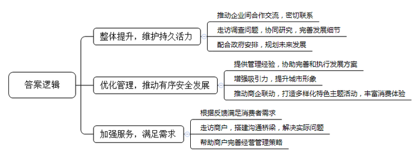
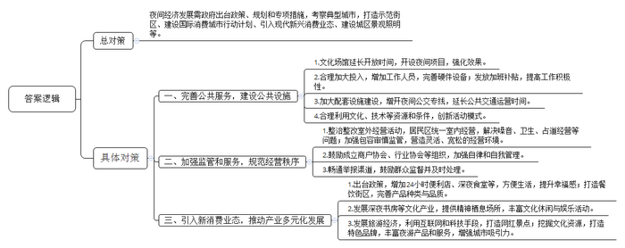
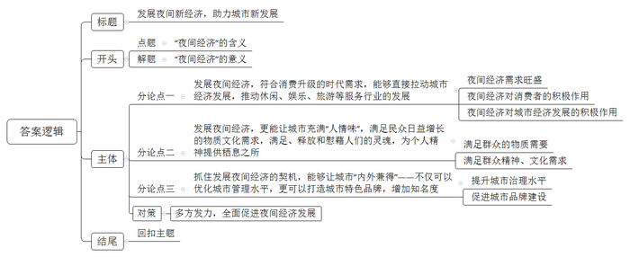

# 2019年四川省公考《申论》题（下半年）

<!-- gwy:overview:start -->
> **四川 · 2019 · 申论 · 下半年** ｜ 3 题 · 图片 3 处 · 答案随题折叠

导航：[题目](#题目)
<!-- gwy:overview:end -->

> 候选采集稿。参考答案及解析来自粉笔页面，不代表官方答案或真实高分答卷；来源使用许可与原卷对应关系仍需人工核实。

## 给定材料

### 材料 material-a3c10835a6fe8e79

2019年4月，为促进夜间经济发展，C市成为首个建立“夜间区长”和“夜生活首席执行官”制度的城市。“夜间区长”是由各区分管区长担任，负责统筹协调夜间经济发展，而“夜生活首席执行官”则鼓励各区公开招聘具有夜间经济相关行业管理经验的人员担任。目前，C市已经任命10多位“夜生活首席执行官”。

作为C市普阳区任命的第一批夜生活首席执行官，安瑞管理有限公司智创项目总经理陈丽在午饭期间，与同一个区域6家大型商业企业又开了一个短暂的“午饭碰面会”。像这样的会议，在陈丽上任一个月以来，已经不知道有多少次了。陈丽说，“以前我们都知道彼此，其中也有一些合作关系。现在我们几乎天天都有几个小时在一起，一起走访调查，一起协同研究如何推动发展我们普阳区的夜间经济，商量夜间地铁的运行如何设置、怎样让夜间店铺与附近居民友好相处的细则等。大家都开玩笑说，我们现在是真成一家人了。”陈丽兴奋地表示，我们时刻准备着，不仅要配合好政府当前的安排，更要考虑未来“辖区”的发展，通过整体提升，维护这片街区的持久活力。

普阳区的夜间区长程区长在工作总结会议中说：“我们区的七位‘夜生活首席执行官’都是具有丰富管理经验的企业高管，现在都成了我的智囊团成员。经过几个月紧锣密鼓的调研，在他们的协助下，我们区关于夜间特色经济发展的方案已敲定并开始执行。目前从启动执行情况看，我们普阳区的特色夜间经济还是非常具有吸引力的，为年轻潮流人士、文艺爱好者、白领人士打造的不同主题的夜生活，改变了以往大家对我区就是一个‘吃货的夜市’的单一印象。5月底至7月，我们这七家商企联动新增加了一系列夜间主题活动，包括蓝调和爵士乐队的助场演出，还有首部沉浸式互动体验古装舞台剧‘华亭唱宋——侬好苏东坡’，让消费者享受美味餐饮的同时感受夜晚的怡人时光。这不仅改变了以前各自开花的状态，还大大丰富了消费者的夜间消费体验。”程区长表示，目前整个普阳区的夜间经济发展呈现出热闹、有序、安全的发展态势，希望未来能切实有效发挥C市设立这项新制度的作用。

华灯初上，普阳区新天地的南里广场上，来自澳大利亚的演出团体正在表演新马戏《绳上精灵》，吸引了过路游客驻足观看。一位“夜生活首席执行官”，也是新天地太平桥项目总经理李华此时也在人群中。不过比起演出，他更留意的是游客的反应和现场的组织情况。趁着演出的间隙，李华又开始走访起新天地里的商户。来到商铺“秦岭人家”门前，店老板老秦热情地和李华打了招呼。一个月之前，因为垃圾倾倒的问题，老秦表示不打算夜间延时开放。而附近很多加班族纷纷表示遗憾，对这些人来讲，深夜加班后来一两个他们家的“老秦夹肉饼”，既方便又能缓解饥饿。根据消费者的反馈，李华与老秦商量，是否可以将夜晚开馆时间适当延长，但老秦表示，延时后垃圾清运车减少，费用也会提高，如不及时倾倒垃圾，随时会被罚款。为此，李华与垃圾清运队、城管进行了多次沟通，解决了这个问题，打消了老秦对夜晚延时经营的顾虑，同时还帮老秦完善了夜晚经营策略、管理方式和措施等。目前，“秦岭人家”成为加班族的又一个“深夜食堂”。

### 材料 material-c308f5764fa13db7

近年来，随着人民群众精神文化生活需求的日益增长，博物馆、美术馆相继开设夜场，越来越多的人喜欢在闲暇之时去逛一逛，放松的同时又充实提升自己。T市博物馆官网上，很多网友留言建议博物馆也进行夜间开放。在要求夜间开放呼声很高的情况下，T市博物馆决定把开放时间延长到晚上11：00，然而效果并不理想，运行一段时间后便放弃了夜间项目。该馆负责人表示，博物馆夜间开放目前还存在诸多实际问题，“我们是心有余而力不足”。

T市博物馆一名负责馆内巡逻的安保人员李师博说：“夜间开放期间，安保人员至少增加了1/3，前两天参观人数真是不少，到闭馆前，我连去喝水的时间都没有。不过也就不到一星期，后面人就没那么多了，最后一段时间，那么大的馆里就只有几个人。”T市博物馆馆长表示，开设一个夜场投入太大，水、电、保洁都是钱，还有那些为保护文物专门添置的设备更是要花不少钱，光硬件费用支出就在2至3万元。除此之外，开放夜场期间，仅安全保卫、展厅服务、设备维护等各方面的工作人员，就需要100人左右。夜间开放如果在不增加工作人员的情况下，可能需要我们工作人员用情怀“发电”。这意味着我们博物馆工作人员要白天晚上无缝衔接地上班，这么大的工作量，还无偿加班，一天两天还行，时间长了，谁都无法保持这种工作热情。

谈及自己在T市博物馆夜间开放期间的参观体验，小高说，她平常上班没时间，所以知道博物馆夜间开放后，第一天就高兴地拉着男朋友一起去了博物馆。人倒是不多，能安安静静地欣赏。但没想到的是，参观完后发现公交已经停运，博物馆又在郊区，那天晚上几乎未看到出租车经过。“那天晚上这么一折腾，我们两人深夜两点才回到家里。如果是一个人，我真不敢夜间再去参观博物馆了”，小高说。

网友“一江清风”建议T市博物馆也应该像故宫博物院一样，可以在夜间举行灯光秀来营造独特的历史氛围，或者像南京博物馆那样举办夜场戏曲文化活动，甚至也可以借鉴伦敦博物馆的夜间开放活动模式，与观众面对面进行现场表演、电影播放、辩论、DJ等活动，这样可以吸引更多的参观者。另一网友却在下面跟帖说：“打铁还需自身硬，像我们这样的博物馆，不一定具备这些办各种形式的夜场活动的条件。”

### 材料 material-e501b24ecdda0d0b

2019年，中国消费增长的规模继续扩大，消费结构不断升级，成为中国经济平稳健康增长的重要压舱石。据国家统计局公布的数据显示，2019年上半年消费对经济增长的贡献率超过60%，第一动力强劲。各省份将促消费作为今后的重要发力点，提出培育新的消费热点、大力发展旅游、发展夜间经济等举措。

夜间经济的崛起，本质上就是消费升级的表现，两者相互依赖又相互促进。它是对从晚7点至次日6点在城市特定地段发生的各种合法商业经营活动的总称。中国旅游研究院联合美团点评发布数据称，2018年我国夜间餐饮消费交易额较上年增长47%，高于日间餐饮消费交易额增长率2个百分点。2019年“五一”期间，北京王府井、三里屯等区域18时至次日早6时夜间消费十分活跃，餐饮消费同比增长达51.3%，文化娱乐等服务消费同比增长15%以上；上海黄浦江游览接待游客11万人次，同比增长46.7%。2019年夜间旅游市场数据显示，对夜游体验有需求的游客占总数比例达92.4%。未来一段时间内，夜游市场需求广阔，随着夜游产品的丰富多元和夜游环境的日臻完善，未来夜游需求将持续旺盛，市场潜力巨大。夜间经济成为消费领域的一个新的增长点，是城市发展的新引擎。

## 题目

### 第 1 题

**根据****“给定资料**2**”，概括“****夜****生活首席执行官****”在推动****C****市夜间经济发展中起到的作用。（****20分）**

关联材料：材料 material-a3c10835a6fe8e79

作答要求：

要求：

（1）全面、准确、有条理；

（2）不超过200字。

第 1 题 · 答案与解析

**参考答案（粉笔题库参考内容）**

1.整体提升，维护持久活力。推动企业间合作交流，密切联系；走访调查问题，协同研究，完善发展细节；配合政府安排，规划未来发展。

2.优化管理，推动有序安全发展。提供管理经验，协助完善和执行发展方案；增强吸引力，提升城市形象；推动商企联动，打造多样化特色主题活动，丰富消费体验。

3.加强服务，满足需求。根据反馈满足消费者需求；走访商户，搭建沟通桥梁，解决实际问题；帮助商户完善经营管理策略。

**解析**

**参考答案说明**：答案从“整体提升，维护持久活力”“优化管理，推动有序安全发展”“加强服务，满足需求”三个方面进行分条撰写，各条要点在内容上是并列且无交叉的。

**考点**：考点影响类

**来源**：来源2019年四川省公考《申论》题（下半年）

粉笔申论页面对本题只提供「解析视频」入口，该入口是会员推广位，页面无视频地址与文字解析。

### 第 2 题

**参考****“给定资料**3**—**7**”，就如何让T市夜晚“亮”起来，推动夜间经济发展提出建议对策。（30分）**

关联材料：材料 material-c308f5764fa13db7

作答要求：

要求：

（1）紧扣材料，观点明确；

（2）建议可行，操作性强；

（3）逻辑清晰，层次分明；

（4）不超过500字。

第 2 题 · 答案与解析

**参考答案（粉笔题库参考内容）**

夜间经济发展需政府出台政策、规划和专项措施，考察典型城市，打造示范街区、建设国际消费城市行动计划、引入现代新兴消费业态、建设城区景观照明等，具体有：

一、完善公共服务，建设公共设施。1.文化场馆延长开放时间，开设夜间项目，强化效果。2.合理加大投入，增加工作人员，完善硬件设备；发放加班补贴，提高工作积极性。3.加大配套设施建设，增开夜间公交专线，延长公共交通运营时间。4.合理利用文化、技术等资源和条件，创新活动模式。

二、加强监管和服务，规范经营秩序。1.整治整改室外经营活动，居民区统一室内经营，解决噪音、卫生、占道经营等问题；加强包容审慎监管，营造灵活、宽松的经营环境。2.鼓励成立商户协会、行业协会等组织，加强自律和自我管理。3.畅通举报渠道，鼓励群众监督并及时处理。

三、引入新消费业态，推动产业多元化发展。1.出台政策，增加24小时便利店、深夜食堂等，方便生活，提升幸福感；打造餐饮街区，完善产品种类与品质。2.发展深夜书房等文化产业，提供精神栖息场所，丰富文化休闲与娱乐活动。3.发展旅游经济，利用互联网和科技手段，打造网红景点；挖掘文化资源，打造特色品牌，丰富夜游产品和服务，增强城市吸引力。

**解析**

**参考答案说明：**本参考答案从“完善公共服务，建设公共设施”“加强监管和服务，规范经营秩序”“引入新消费业态，推动产业多元化发展”等不同的方面进行了分条撰写。各条答案要点之间在内容上相互并列，没有交叉。

**考点**：考点提出对策类

**来源**：来源2019年四川省公考《申论》题（下半年）

粉笔申论页面对本题只提供「解析视频」入口，该入口是会员推广位，页面无视频地址与文字解析。

### 第 3 题

**“给定资料**1**”****中提到****“****夜间经济成为消费领域的一个新的增长点****，****是城市发展的新引擎****”，请根据你的理解，结合给定资料，联系社会生活实际，自选角度，自拟题目，写****一****篇议论文。（****50分）**

关联材料：材料 material-e501b24ecdda0d0b

作答要求：

要求：

（1）观点明确，见解深刻；

（2）思路清晰，结构严谨；

（3）语言流畅，书写工整；

（4）限800～1000字。

第 3 题 · 答案与解析

**参考答案（粉笔题库参考内容）**

**发展夜间新经济，助力城市新发展**

北有北京三里屯，南有成都春熙路，东有上海外滩秀，西有西安夜古都……每一座城市仿佛都有一张属于自己的夜间城市名片，它的名字叫“夜间经济”，是指夜间在城市特定地段发生的各种合法商业经营活动，如餐饮、娱乐休闲等。**其既能促进消费升级、经济发展，满足民众人文需求，更能促进城市管理升级，打造城市品牌，为城市的全方位新发展提供强大支撑**。

**当下，发展夜间经济，符合消费升级的时代需求，能够直接拉动城市经济发展，推动休闲、娱乐、旅游等服务行业的发展。**夜间经济作为城市经济新的消费增长点，其需求旺盛，潜力巨大。作为成都夜间经济的代表作——夜游锦江，对游客而言，既满足了眼球，又丰富了夜间生活；对城市而言，既带动服务业、旅游业发展，更拉动了经济增长。供给侧改革仍在继续，夜间经济所蕴藏的能量，将为城市消费升级、城市经济持续向好发展提供支持。

**不仅于此，发展夜间经济，更能让城市充满“人情味”，满足民众日益增长的物质文化需求，满足、释放和慰藉人们的灵魂，为个人精神提供栖息之所。**夜幕降临，走进“深夜食堂”，民众享受着钟情的食物，游走于舌尖上的中国。故宫博物馆的夜间灯光秀，南京博物馆的夜间曲艺活动，展示着传统文化的魅力，创造了更好文化的氛围，满足了民众文化需求。在夜间看书读报，舒缓情绪，寻求精神的慰藉，体察内心的真切，这是一座城市最本真的幸福。

**对于城市而言，抓住发展夜间经济的契机，****能够****让城市“内外兼得”——不仅可以优化城市管理水平，更可以打造城市特色品牌，增加知名度。**在夜间经济大放异彩的当下，政府积极创新管理方式，建立“夜间区长”和“夜生活首席执行官”制度，在城市精细化管理上下功夫，调整公共交通、管控公共安全等，全面提升城市治理水平。政府的主动改革，在点亮夜间经济星空的同时，提升了城市治理能力，助力了城市品牌的建设，如此内外兼修的城市，必然能吸引更多的关注度。

夜间经济意义非凡，而发展夜间经济需要多方出力，既需要政府积极作为，解决食品卫生、噪音扰民等问题；也需要发挥行业自律与民众自治，在平衡好夜间经济利益相关性的基础上谋求所有参与利益主体的最大公约数。

满足民众需求是夜间经济的标配，提升城市管理与品牌形象体现夜间经济的品质，促进城市经济发展是夜间经济的主脉。夜间经济的效果不言而喻，其能量更是不可或缺，因此，应大力发展夜间新经济，为城市的新发展添砖加瓦，让城市更美好。

**解析**

**文章分析**

**发展夜间新经济，助力城市新发展**

【**标题的优点：**首先，范文的标题突出了“夜间经济”这一主题。其次，它在形式上采用对称式结构，前半句点出主题，后半句点出了意义，使标题更加完整、饱满。】

北有北京三里屯，南有成都春熙路，东有上海外滩秀，西有西安夜古都……（1）每一座城市仿佛都有一张属于自己的夜间城市名片，它的名字叫“夜间经济”，是指夜间在城市特定地段发生的各种合法商业经营活动，如餐饮、娱乐休闲等。（2）**其既能促进消费升级、经济发展****，****满足民众人文需求****，****更能促进城市管理升级****，****打造城市品牌****，为城市的全方位新发展提供强大支撑**。

【**开头的优点**：★内容方面。范文的开头是紧扣题目给定的“夜间经济”这一主题展开的。首先，开头点出了“夜间经济”这一主题，做到了主题明确。其次，对“夜间经济”这一主题进行了分析阐述，指出了：（1）夜间经济的含义，（2）夜间经济积极意义。注意，以上两个方面的论述是有内在逻辑顺序的：先写“含义”，再写“意义”。★文字表达方面。使用了“既能……更能”等关联词，使语言表达有逻辑性。】

**当下，发展夜间经济，符合消费升级的时代需求，能够直接拉动城市经济发展，推动休闲、娱乐、旅游等服务行业的发展。**（1）夜间经济作为城市经济新的消费增长点，其需求旺盛，潜力巨大。（2）作为成都夜间经济的代表作——夜游锦江，对游客而言，既满足了眼球，又丰富了夜间生活；（3）对城市而言，既带动服务业、旅游业发展，更拉动了经济增长。供给侧改革仍在继续，夜间经济所蕴藏的能量，将为城市消费升级、城市经济持续向好发展提供支持。

【**论述段****1****的优点**：★观点句：范文的观点句是紧扣“夜间经济”这一文章主题提出的。形式上，它在段首处直接写出，位置突出，容易被发现；内容上，关键词突出，内容要点明确，可以明显看出它是从“带动服务业发展，刺激消费，拉动城市经济”的角度入手，指出了“夜间经济”的意义。★论述内容：本段主要围绕“夜间经济”这一主题进行分析阐述，指出了：（1）夜间经济需求旺盛，（2）夜间经济对消费者的积极作用，（3）夜间经济对城市经济发展的积极作用。注意：以上三个方面的内容都是紧扣观点句“发展夜间经济，符合消费升级的时代需求，能够直接拉动城市经济发展，推动休闲、娱乐、旅游等服务行业的发展”进行分析论述的，针对性强、内容层次丰富。最后，在论证方法和论据选取方面，讲道理和举例子相结合，做到了丰富多样。】

**不仅于此，发展夜间经济，更能让城市充满“人情味”，满足民众日益增长的物质文化需求，满足、释放和慰藉人们的灵魂，为个人精神提供栖息之所。**夜幕降临，走进“深夜食堂”，（1）民众享受着钟情的食物，游走于舌尖上的中国。故宫博物馆的夜间灯光秀，南京博物馆的夜间曲艺活动，（2）展示着传统文化的魅力，创造了更好文化的氛围，满足了民众文化需求。在夜间看书读报，舒缓情绪，寻求精神的慰藉，体察内心的真切，这是一座城市最本真的幸福。

【**论述段****2****的优点**：★观点句：范文的观点句是紧扣“夜间经济”这一文章主题提出的。形式上，它在段首处直接写出，位置突出，容易被发现；内容上，关键词突出，内容要点明确，可以明显看出它是从“满足群众物质精神需求”的角度入手，指出了“夜间经济”的内涵。★论述内容：本段主要围绕“夜间经济”这一主题进行分析阐述，指出了：（1）满足群众的物质需要，（2）满足群众精神、文化需求。注意：以上两个方面的内容都是紧扣观点句“发展夜间经济，更能让城市充满‘人情味’，满足民众日益增长的物质文化需求，满足、释放和慰藉人们的灵魂，为个人精神提供栖息之所”进行分析论述的，针对性强、内容层次丰富。最后，在论证方法和论据选取方面，讲道理和举例子相结合，做到了丰富多样。】

**对于城市而言，抓住发展夜间经济的契机，能够让城市“内外兼得”——不仅可以优化城市管理水平，更可以打造城市特色品牌，增加知名度。**（1）在夜间经济大放异彩的当下，政府积极创新管理方式，建立“夜间区长”和“夜生活首席执行官”制度，在城市精细化管理上下功夫，调整公共交通、管控公共安全等，全面提升城市治理水平。政府的主动改革，在点亮夜间经济星空的同时，提升了城市治理能力，（2）助力了城市品牌的建设，如此内外兼修的城市，必然能吸引更多的关注度。

【**论述段****3****的优点**：★观点句：范文的观点句是紧扣“夜间经济”这一文章主题提出的。形式上，它在段首处直接写出，位置突出，容易被发现；内容上，关键词突出，内容要点明确，可以明显看出它是从“提高城市管理水平和知名度”的角度入手，指出了“夜间经济”的内涵。★论述内容：本段主要围绕“夜间经济”这一主题进行分析阐述，指出了：（1）提升城市治理水平，（2）促进城市品牌建设。注意：以上两个方面的内容都是紧扣观点句“抓住发展夜间经济的契机，能够让城市‘内外兼得’——不仅可以优化城市管理水平，更可以打造城市特色品牌，增加知名度”进行分析论述的，针对性强、内容层次丰富。最后，在论证方法和论据选取方面，讲道理和举例子相结合，做到了丰富多样。】

夜间经济意义非凡，而发展夜间经济需要多方出力，既需要政府积极作为，解决食品卫生、噪音扰民等问题；也需要发挥行业自律与民众自治，在平衡好夜间经济利益相关性的基础上谋求所有参与利益主体的最大公约数。

【**过渡段的优点：**范文过渡段分析了发展“夜间经济”的对策方面的内容，使得文章更加完整、论述更加充分。】

（1）满足民众需求是夜间经济的标配，提升城市管理与品牌形象体现夜间经济的品质，促进城市经济发展是夜间经济的主脉。夜间经济的效果不言而喻，其能量更是不可或缺，因此，（2）应大力发展夜间新经济，为城市的新发展添砖加瓦，让城市更美好。

【**结尾的优点**：（1）再次提到了“夜间经济”；（2）发出了号召。】

**考点**：考点文章写作题

**来源**：来源2019年四川省公考《申论》题（下半年）

粉笔申论页面对本题只提供「解析视频」入口，该入口是会员推广位，页面无视频地址与文字解析。

