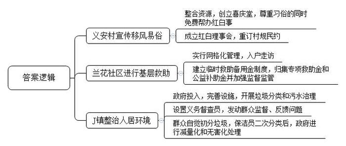
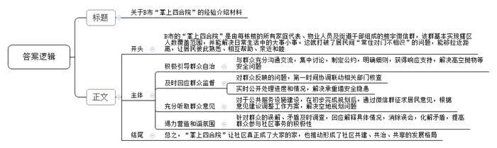

# 2020年0725公务员多省联考《申论》题（四川上半年B卷）

<!-- gwy:overview:start -->
> **四川 · 2020 · 申论 · 上半年B卷** ｜ 3 题 · 图片 3 处 · 答案随题折叠

导航：[题目](#题目) · [材料 1](#材料-1)
<!-- gwy:overview:end -->

> 候选采集稿。参考答案及解析来自粉笔页面，不代表官方答案或真实高分答卷；来源使用许可与原卷对应关系仍需人工核实。

## 给定材料

### 材料 1

这天，B市长江江心洲上的义安村“喜庆堂”里热热闹闹的，村民老赵儿子的婚礼办得简约而红火。有人洗菜切菜，有人焖煮烹调，还有人专注摆盘，大家各司其职，忙得不亦乐乎，不一会儿，原本空空的桌子上便摆满了各式各样的菜肴。亲朋好友齐聚一堂，共同分享老赵家的喜悦。

说起老赵家的喜事，还有一番曲折。筹办婚礼时，老赵说：“娶妻生子是人生大事，再怎么砸钱、费事，也要到城里办婚宴才有面子。就这一个儿子，还不风光点？”村党支部郭书记得知后，上门劝说：“进城要坐轮渡的，拖家带口多不方便！再说，城里租个大屏幕，就得七八千！吃饭店的酒席，哪有自己备料、亲戚帮厨划算？”老赵没吭声。郭书记进一步劝道：“你在饭店把门一关，除了亲戚，谁能瞧见你风光？在‘喜庆堂’办，村里人一走一过，还能够凑个热闹。再把鞭炮放放，不比城里欢腾？”

提起“喜庆堂”，老赵有些动心了。然而，当把新计划告诉女方时，又出现了插曲：外地的儿媳妇，在网上咋也搜不到“喜庆堂”心里犯了嘀咕，非要进村里亲自看看，“喜庆堂”位于村党群服务中心内，从外观上很难看出端倪，走进大厅，却“别有洞天”。面积约200平方米的厅内摆放着二十余张大桌，桌椅板凳统统用红布包裹起来，正前方摆放着一块大屏幕，旁边还有音响设施。环顾四周，大厅的横梁上、柱子周边“喜事新办，节俭养德，文明理事”“破除陈规陋习，倡导健康生活”等宣传语随处可见，屏幕两侧还张贴了以“移风易俗、民风淳厚”为主题的宣传内容，图文并茂地宣传“破旧立新，婚礼丧事简办好”……整体环境既隆重又喜庆，儿媳妇这才安下心，点头同意了。

“喜庆堂”创立于2017年。这一年，村民人均年纯收入达到2万多元，纯朴并注重传统礼俗的乡村婚礼开始被铺张的喜宴、厚重的礼金所取代。“那时候办婚宴，经常是比着铺张，有的人家能花两三年的进账，有些家庭为子女结婚不但花光积蓄还要背上一大笔债务，压力很大。”郭书记说。村两委班子认识到攀比、铺张、浪费之风不可长，便组织本村有威望、有影响的老党员、老干部、老教师成立了红白理事会，由村支部书记兼任会长，组织村民重新订立了村规民约，倡导礼俗回归纯与真。同时，村两委将村委会三层小楼一层的一半改建为红字标示的“喜庆堂”，在充分尊重传统习俗的基础上，帮办协办红白事，推动形成婚事新办、丧事简办的文明新风。郭书记说：“这块地方原来是村里举办活动、接待游客用的，经过装修、置办，更适用于喜宴。只要村民提出申请，就能免费使用这里的水电气灶、桌椅碗筷、屏幕音响等。”

老赵提交“喜庆堂”的使用申请时，郭书记不忘提醒：“既然要在村里办就得守规矩，按照签订的协议办。酒席别超过20桌，每桌菜别超过500元，婚车别超过6辆……”

婚礼结束后，老赵喜滋滋地说：“光是菜，每桌就比饭店里省了1000多块，亲戚们帮厨递菜，也比在城里干坐着更有人情味。在‘喜庆堂’办婚宴，酒席的成本低，一般的亲戚朋友随个200块钱就行了，要是到市里办，没个400块钱拿不出手。”

“喜庆堂”的运行，破除了“人情债”滋生的土壤，减轻了村民人情负担。自“喜庆堂”启动以来，共承办各类宴席35次，共计节约资金70余万元，让村民切实感受到移风易俗的好处。

### 材料 2

“老吴，老吴，我是兰花社区的小刘呀，我和楼栋长来看看你，开一下门哦”。周末上午9点多，J镇兰花社区网格员小刘和楼栋长老张敲着独居低保户吴大爷的门喊道。“小刘啊，我摔倒了。”连续的敲门声后，屋里传来吴大爷微弱的声音。听到声音不对，小刘立即联系吴大爷的几个亲属，但受疫情影响，他们都不能来。吴大爷的二弟告诉小刘，家里有备用钥匙放在窗台上。小刘一开门，看到吴大爷摔倒在地上，便立即拨打了120，同时给社区和镇里反映了此事。

吴大爷说：“小刘呀，你扶我坐起来就好了，不用去医院。”小刘知道，吴大爷是担心承担不起医疗费。

“吴大爷，您不用担心医疗费的问题。对于困难群众遇到各类重大急难问题，我们镇有临时救助备用金制度，您符合救助条件。”小刘解释道。在小刘的协助下，镇上派人送老吴到了医院，并经过备用金专管员同意，使用临时救助备用金为他垫付了住院费。

J镇在2016年建立了临时救助备用金制度，将上级拨的专项救助金和公益补助金归集起来，统一存入“临时救助”专户，解决基层群众突发性、紧迫性、临时性基本生活困难，成为基层救助的“蓄水池”。“在这项制度之前，如果群众遇到了急需救助的情况，需要层层上报、层层审核，救助款至少要2、3天才能到位。而有了临时救助备用金制度后，从收到救助信息到确认审核、拨付款项，最快1小时就能完成。”镇党委梁书记说，“下一步，我们还要加强监督监管，确保确有困难的群众能及时享受该项政策。”

### 材料 3

退休教师老马是单车骑行爱好者，乡村小路上经常能看到他骑车的身影。最初他骑车是为了看风景，但自从3年前他有了一个新的身份——J镇“人居环境整治义务督查员”后，他就会在骑行时随身带上相机和小本子，既看景也看垃圾，看到哪里有垃圾，拍下照片，用小本子记下发现垃圾的具体地址，再反馈给当地村镇处理。

“垃圾靠风刮、污水靠蒸发；房里现代化、屋外脏乱差”这是老马刚开始担任督查员时，他的相机和小本子所记录的景象。

去年，J镇各村开始进行垃圾分类和污水治理，环境有很大改善。谈起村里的变化，74岁的老周打开了话匣子：“垃圾清运、分类，旱厕改造，污水处理，这些都由政府投入，农户不用掏一分钱。我现在知道家里的垃圾需要分开装，像菜叶子、剩饭属于可以腐烂的垃圾，像塑料袋属于不可腐烂的垃圾。”老周觉得农村垃圾的家庭初分，既简单又方便。他家门口，有一蓝一黄两个小型垃圾桶，分别写着“可腐烂垃圾”和“不可腐烂垃圾”，墙上有个“庭院三包”责任牌，明确包卫生、包绿化、包秩序的责任。

“村民将生活垃圾初分后，村里的保洁员会将垃圾收运至村口收集亭，进行二次分类。”J镇农环办徐主任说。离村庄不远处的一片树林里，开挖了一处长10米、深80厘米的可腐烂垃圾堆肥垄，菜叶、瓜皮、树叶等可腐烂垃圾在此就地消化堆肥。2017年9月起，J镇所在的F市停止了生活垃圾填埋的处置方式，利用当地水泥公司的水泥窑高温煅烧，实现其他类生活垃圾处置的减量化和无害化。

老马的照片和小本子清楚地反映了农村人居环境的改变：最初一天能记录十几处卫生死角，而现在，映入眼帘的是干净整洁的道路，幽静雅致的农家小院，以及房前屋后种植的各种花卉苗木。老马督查员的这个身份也面临着“退休”的风险。

### 材料 4

四合院是由东、西、南、北四面房子围合起来形成的内院式住宅，院内四面房门都开向院落，房屋各自独立又有游廊连接，交流沟通便利，生活气息浓厚，起居十分方便。居民们彼此熟悉，相互帮忙，亲近和睦，其乐融融。上个世纪80年代，传统的四合院被鳞次栉比的高楼所取代，居民之间“长住对门不相识”成为常态。

Z街道是B市第一个整体开发建设的大型居住社区，常住居民有3万多户，常住人口达8.8万人，下设16个社区，有223栋居民楼。2018年以来，街道党员干部跟居民拉家常、交朋友、问需求，添加居民为微信好友，邀请他们进入每栋楼的微信群。近七成住户实名入群，一个楼宇群基本可以保证所有家庭代表入群。这个群里，不仅有左邻右舍、物业人员，还有居委会的管楼干部，以及书记、主任等，辖区内的党员全部入群，Z街道干部、社区工作人员全部分片入群。加入楼宇微信群的居民数量超过5万，覆盖了四分之三的居民。

Z街道办事处代主任说：“居民入驻了微信群，让223栋高楼变成了223个‘掌上四合院’。日常生活里的大事小情都能在群里解决，社区里的大事小情都通过‘掌上四合院’找到良策。”Z街道的居民群众更是对“掌上四合院”深有感触。“30多年前，我们从四合院出来上了楼，30年后，我们通过微信群又找回了‘四合院’的感觉！”有居民这样感慨。还有居民说：“在Z街道住了三十年，之前整天抬头不见低头见的邻居，楼上楼下都不知道是谁，这回进了群，终于‘对上号’了，社区真正成了大家的家。”

莲芳社区24号楼是一栋联排高楼，楼内住户很多，发生过高空抛物伤人事件。但因为高空抛物的随意性很大，很难抓现行，多数都成了“无头案”。街道和社区工作人员与24号楼的楼长赵女士建立了一个“楼门微信群”，把楼内的每一户都拉进群里，大伙儿你一言、我一语，集中讨论如何解决高空抛物的难题。在讨论中，街道和社区工作人员引导大家制定了一份《楼门公约》，“不在阳台和窗台外侧放置物品，以免掉落伤人”“家中垃圾集中收集，并扔到楼下垃圾桶，不从楼上往下扔”等六条细则落在纸面，得到楼内住户的一致响应。

“打12345，不停地投诉！”“承重墙怎么能拆，太过分了，大家一起反映！”这一天凌晨，紫芳园社区1号楼微信群忽然炸开了锅，多位居民反映“楼底商户拆除承重墙，存在安全隐患”的问题。看到信息，社区工作人员第一时间协调物业公司，并向区建委报告。后经区建委质监站核查，楼底商户拆除的并非承重墙，而是一块楼板。在多方共同监督下，底商将其恢复原貌。同时，社区工作人员就处理情况实时播报，将恢复后的图片发到群中，让大家伙儿吃上了“定心丸”。

芳城园第一社区南门垃圾楼周边的违建被拆除后，腾退出一块800多平方米的空地。根据“留白增绿”的理念，Z街道办事处和社区准备在这里建一座口袋公园。初步规划完成后，街道通过微信群征求居民意见，一条条意见很快反映上来：口袋公园要和垃圾楼协调，多种植些吸味儿的植物；不要把资金更多地投放在景观建设上；绿地越简约越好，应该把垃圾楼好好包装一下；在绿地建设考虑健身功能的引入……工作人员根据征集的意见建议调整了方案。

一位社区干部在自己包干的楼门群内发了一条微信，向一位80多岁的老志愿者致敬，还发了一张老人戴着志愿者袖标站岗的照片。群里一位居民就发牢骚，说社区和志愿者在作秀，措辞也很不礼貌。负责联系这里的街道干部马上找到社区了解情况。原来那位老人已经在社区志愿服务了十几年，现在社区已经不再给老人安排“任务”，但一有志愿活动，老人还是主动参加，社区干部发微信是想对老人表示感谢。街道干部将情况向居民进行了解释，居民认识到了自己的不理智，向老人道了歉。后来，这位爱吐槽的居民也开始参与社区事务了。

### 材料 5

“党的十九大报告提出，要打造共建共治共享的社会治理格局，加强社区治理体系建设，实现政府治理和社会调节、居民自治良性互动。这一阐述，真的是说到了我这个社区居委会主任的心坎上。”Q市南湖社区居委会余主任对记者说起十九大报告，心情激动。

余主任介绍，南湖社区紧邻商圈，分为古楼湾和花园街道两个片区，辖区有企业300余家，居民住宅楼81栋，居民6260户，人口24664人，流动人口1万余人。社区城市建筑陈旧、商贸门面混乱、居民房屋老旧、道路交通拥堵、活动场地有限、流动人口复杂、治安问题严峻，仅2013年就发生多起刑事案件。传统行政式的社区管理方式，让社区工作人员疲于奔命还难有效果。“曾经一年间里群众诉求1600件次，这让社区工作更加难做。”余主任说。

古楼湾片区内的九龙花园是由10栋20世纪80年代的老建筑组成的老旧小区，基础设施落后，200余户居民来自四面八方，生活习性不一，加上长期无物业管理，小区内污水横流，垃圾乱堆，群众怨声载道。社区引导九龙花园居民自治，组织成立了楼委会、议事委员会等自治组织，引导居民议定出《小区楼规民约》等5个制度规则，形成了“小区事、大家议、协商办、共监督”的自治管理流程。经过居民议事协商，由每户居民出资30元，公益事业发展基金支持2.5万元，街道配套1.8万元，改善了小区的出行等设施，同时组织志愿者对绿化等进行完善，有效地改变了居住环境。古楼湾片区安装摄像头需要28.5万元，社区两个月内召开听证会、协调会30余次，让居民充分表达意愿，最终达成“居民出、社会筹，自己事情自己办”的共识，3327户居民（91％的参与率）出资7.2万元，社会单位支持19.6万元，在重要路口、案件高发区安装像头73个，使年均发案率同比下降45％，居民安全感大幅上升。

街道社区管得越多矛盾似乎越多，管得越细群众意见反而越大，这是南湖社区近年来基层社会治理中干部们普遍存在的困惑。在政府为群众办实事、办好事的过程中，常会出现由政府大包大揽的情况。然而，不分公事或群众的私事，都由政府包揽起来，不仅会让群众产生依赖思想，还很难让群众事事满意。南湖社区发现，只强调加大投入和权利赋予，没有相应的责任共担和公平的投入机制，政府投入再多，群众满意度也不会随之提高。只强调自上而下的精细管理，没有自下而上的广泛参与，政府管得再细，群众认同感也不会随之上升。只强调旧城改造和新区开发，没有把群众组织起来同步推进社会建设，城市发展再快，面临的矛盾和问题也不会随之减少。

“南湖社区花园街道较早开始了社会治理大事、小事和私事分流处理。”花园街道党工委李书记说，为了扭转居民心中观念，培养自治意识，及时划清街道、社区、居民各自责任，不大包大揽，不介入过多具体任务。“分解责任、事务，不在于分得多清楚，更重要的是培养居民责任意识引导居民广泛参与社区事务”，“政府既不能大包大揽做‘物管’，也不能不闻不问不管，简单把责任完全推给居民了事。该办的公共事务要全力办好，属于社区居民自己家的私事，主要由私人自己处理”。

南湖社区在总结基层社区治理探索创新的基础上，提出了社区治理“三事分流”工作法。围绕“谁来划、以什么标准来划、按什么程序划”等问题，建立了一套合理划分“三事”的机制。“大事”即管辖事项及公共服务，由部门负责解决；“小事”是村（居）公共事项及公益服务，由村（居）委会为主导，社区自治组织、社区社会组织和社区单位共同协商解决：“私事”是村（居）民个人事务和市场服务，由群众自行解决或寻求市场服务。“三事分流”要求一是落实责任，“大事”快办；二是基层协商，“小事”共办；三是注重引导，“私事”自办。

据南湖社区民政干部介绍，“三事分流”分为找事、分事、办事、反馈评估四步工作。第一步：找事。找事也就是需求收集。找事的第一责任主体是村（居）委会，所找的“事”是以居民的需求为导向，尤其是居民反映需要解决的问题。第二步：分事。分事也就是通过协商进行分流，将事情按“大事”“小事”和“私事”，分流到相关的承办部门和人头上。第三步：办事。在协商分事后，所有的事便有了具体办事的“主”（包括私事）和具体的办事方法，因而事情办理起来就不会有推诿扯皮的现象出现。第四步：反馈评估。所有分流的事办完后，都进行反馈评估。在反馈评估中，对所办事项还要在社区进行公示，以接受群众的监督和评价。

## 题目

### 第 1 题

**根据“给定资料1～3”，归纳概括各地基层治理的举措。（20分）**

关联材料：材料 1、材料 2、材料 3

作答要求：

要求：全面、准确、有条理，不超过200字。

第 1 题 · 答案与解析

**参考答案（粉笔题库参考内容）**

1.义安村宣传移风易俗：整合资源，创立喜庆堂，尊重习俗的同时免费帮办红白事；成立红白理事会，重订村规民约。

2.兰花社区进行基层救助：实行网格化管理，入户走访；建立临时救助备用金制度，归集专项救助金和公益补助金并加强监督监管。

3.J镇整治人居环境：政府投入，完善设施，开展垃圾分类和污水治理；设置义务督查员，发动群众监督、反馈问题；群众自觉初分垃圾，保洁员二次分类后，政府进行减量化和无害化处理。

**解析**

**参考答案说明：**本参考答案从“义安村宣传移风易俗”“兰花社区进行基层救助”“J镇整治人居环境”三个方面对各地基层治理的举措进行了分条撰写。各条要点之间在内容上相互并列，没有交叉。

**考点**：概括措施类

**来源**：2020年0725公务员多省联考《申论》题（四川上半年B卷）

### 第 2 题

**外地有关部门专程到B市学习考察“掌上四合院”的经验，假如你是Z街道工作人员，请根据“给定资料4”，撰写一份经验介绍材料。（30分）**

关联材料：材料 4

作答要求：

要求：内容全面，条理清晰，语言流畅，不超过500字。

第 2 题 · 答案与解析

**参考答案（粉笔题库参考内容）**

关于B市“掌上四合院”的经验介绍材料

B市的“掌上四合院”是由每栋楼的所有家庭代表、物业人员及街道干部组成的楼宇微信群，该群基本实现辖区人数覆盖范围，并能解决日常生活中的大事小事。这就打破了居民间“常住对门不相识”的问题，能够拉近距离，让居民彼此熟悉、相互帮助、亲近和睦，具体经验如下：

一、积极引导群众自治。与群众充分沟通交流，集中讨论，制定公约，明确细则，获得响应支持，解决高空抛物等安全问题。

二、及时回应群众监督。对群众反映的问题，第一时间协调联动相关部门核查；实时公开处理进度和情况，解决承重墙安全隐患。

三、充分听取群众意见。对于公共服务设施建设，在初步完成规划后，通过微信群征求居民意见，根据意见建议调整工作方案，解决空地规划问题。

四、竭力营造和谐氛围。针对群众的误解、矛盾及时调查，回应解释具体情况，消除误会，化解矛盾，提高群众参与社区事务的积极性。

总之，“掌上四合院”让社区真正成了大家的家，也推动形成了社区共建、共治、共享的发展格局。

**解析**

**参考答案说明：**（1）格式方面，本参考答案写到了“标题”“正文”两个部分。（2）正文部分，一方面，内容上，围绕着“掌上四合院”这一主题，开头写到了“掌上四合院”的内涵、功能等；主体部分从“积极引导群众自治”“及时回应群众监督”“充分听取群众意见”“竭力营造和谐氛围”四个方面介绍了B市“掌上四合院”的经验做法；最后，结尾部分总结了B市“掌上四合院”建设的意义。另一方面，形式上，本参考答案做到了分段、分条撰写，整体上条理较为清晰。

**考点**：总结类

**来源**：2020年0725公务员多省联考《申论》题（四川上半年B卷）

### 第 3 题

**请结合资料5，联系社会实际，围绕社区治理，以“三事分流”工作法带来的“启示”为主题，自选角度，自拟题目，写一篇议论文。（50分）**

关联材料：材料 1、材料 2、材料 3、材料 4、材料 5

作答要求：

要求：

（1）观点明确，见解深刻；

（2）思路清晰，结构严谨；

（3）语言流畅，书写工整；

（4）总字数800～1000字。

第 3 题 · 答案与解析

**参考答案（粉笔题库参考内容）**

**共享、共建、共担 创新社区治理**

“三事分流”工作法，是由部门负责解决“大事”，即管辖事项及公共服务；村（居）委会为主导，社区组织等共同协商解决“小事”，即村（居）公共事项及公益服务；由群众寻求市场服务或自行解决“私事”，即个人事务和市场服务。

这是社区治理的创新，是政府治理和社会调节、居民自治良性互动的方式，是在社区这个“小世界”中，打造一个最优的时代，实现“大事”能快办，“小事”能共办，“私事”能自办，共享共建共担。

**社区的“大事”要快办，需落实责任，联动各方，提升效率。**“民生无小事，枝叶总关情”，只要是涉及群众切身利益的公共事项及公共服务，都是“大事”，是最基本、最迫切的民生需求。“大事”的解决不是某个干部、某个部门的一家之责，需要协调各部门，加强联动，以此精简环节、提高效率。如北京实施的“街乡吹哨、部门报到”，实现群众需求与部门职能的精准对接。群众有所呼，政府有所应，切实提升群众生活的幸福感和获得感。

**社区的“小事”要共办，需调动社区群众参与积极性，共同协商。**过去，政府为群众办实事办好事，却大包大揽，基层干部疲于奔命，群众产生“等靠要”的依赖思想。发展为了人民，更要依靠人民，社区治理也要坚持群众路线，听民意、汇民智、集民力。如“人居环境整治义务督察员”及时发现、反馈问题，共建美好环境。既有政府的投入与权力赋予，也有群众的责任共担，才能求得自上而下精细管理与自下而上广泛参与的“最大公约数”。

**社区的“私事”要自办，既要发挥群众的自主性，也要注重教育引导。**我们常说“清官难断家务事”，“外界力量”有时并不能弄清“私事”的全貌。与此同时，“私事”也涉及到隐私，若处理不得当，把握不好“度”，反而可能弄巧成拙，激化矛盾。因此，对于家庭私事，倡导“自办”。但这并不意味着政府、社区的袖手旁观、隔岸观火，需要为其提供必要的心理、家庭、教育、法律等普惠性服务，注重教育和引导。

总之，要让“三事分流”工作法真正落实地、见实效，需要系统性、全面性、全方位的过程把控。要深入群众，准确把握群众所思所想所盼；要精准识别，合理分类，明确权责；要全面反馈评估，信息公开，接受监督，真正做到准确“找事”、合理“分事”、高效“办事”、全面“反馈评估”。

社区治理没有终点，只有连续不断的新起点，“治大国如烹小鲜”，要继续提升社区治理水平，真正惠民生、暖民心，让社区成为“人人出力、人人尽责”、共享共建共担的大家庭。

**文章分析**

**共享、共建、共担 创新社区治理**

【**标题的优点：**标题中含有“创新社区治理”这一主题词，文章主题突出、清晰。】

（1）<u>“三事分流”工作法</u>，<u>是由部门负责解决“大事”</u>，<u>即管辖事项及公共服务；村（居）委会为主导</u>，<u>社区组织等共同协商解决“小事”</u>，<u>即村（居）公共事项及公益服务</u>；<u>由群众寻求市场服务或自行解决“私事”</u>，<u>即个人事务和市场服务</u>。

（2）<u>这是社区治理的创新</u>，<u>是政府治理和社会调节</u>、<u>居民自治良性互动的方式</u>，<u>是在社区这个“小世界”中</u>，<u>打造一个最优的时代</u>，<u>实现“大事”能快办</u>，<u>“小事”能共办</u>，<u>“私事”能自办</u>，<u>共享共建共担</u>。

【**开头的优点：**★内容方面。范文的开头是紧扣题目给定的“创新社区治理”这一主题展开的。（1）开头直接指出了“三事分流”工作法的含义；（2）指出了此工作法的意义。★文字表达方面。使用了排比的修辞手法以及长短句结合的形式，使语言表达清晰有力、有节奏感。】

**社区的“大事”要快办，需落实责任，联动各方，提升效率。**（1）“民生无小事，枝叶总关情”，只要是<u>涉及群众切身利益的公共事项及公共服务</u>，都是“大事”，<u>是最基本</u>、<u>最迫切的民生需求</u>。“大事”的解决<u>不是某个干部、某个部门的一家之责</u>，<u>需要协调各部门，加强联动</u>，<u>以此精简环节</u>、<u>提高效率</u>。（2）如北京实施的“街乡吹哨、部门报到”，<u>实现群众需求与部门职能的精准对接</u>。<u>群众有所呼</u>，<u>政府有所应</u>，<u>切实提升群众生活的幸福感和获得感</u>。

【**论述段1的优点：**★观点句：范文的观点句是紧扣“创新社区治理”这一文章主题提出的。形式上，它在段首处直接写出，位置突出，容易发现。内容上，关键词突出，内容要点明确，可以明显看出它主要介绍了“‘大事’要快办”。★论述内容：（1）指出了“大事”的含义及解决办法；（2）指出了办“大事”要落实责任，要对接群众需求。注意：以上两个方面的内容都是紧扣观点句“社区的‘大事’要快办，需落实责任，联动各方，提升效率”进行分析论述的，层次清晰，论述的针对性强。最后，在论证方法和论据选取方面，讲道理和举例子相结合，做到了丰富多样。】

**社区的“小事”要共办，需调动社区群众参与积极性，共同协商**。过去，<u>政府为群众办实事办好事</u>，<u>却大包大揽</u>，<u>基层干部疲于奔命</u>，<u>群众产生“等靠要”的依赖思想</u>。（2）<u>发展为了人民</u>，<u>更要依靠人民</u>，<u>社区治理也要坚持群众路线</u>，<u>听民意</u>、<u>汇民智</u>、<u>集民力</u>。如“人居环境整治义务督察员”<u>及时发现</u>、<u>反馈问题</u>，<u>共建美好环境</u>。<u>既有政府的投入与权力赋予</u>，<u>也有群众的责任共担</u>，<u>才能求得自上而下精细管理与自下而上广泛参与的“最大公约数”</u>。

【**论述段2的优点：**★观点句：范文的观点句是紧扣“创新社区治理”这一文章主题提出的。形式上，它在段首处直接写出，位置突出，容易发现。内容上，关键词突出，内容要点明确，可以明显看出它主要介绍了“‘小事’要共办”。★论述内容：（1）指出了政府大包大揽，群众产生“等靠要”思想。（2）指出了要坚持群众路线，要与群众共商事宜、共担责任。注意：以上两个方面的内容都是紧扣观点句“社区的‘小事’要共办，需调动社区群众参与积极性，共同协商”进行分析论述的，层次清晰，论述的针对性强。最后，在论证方法和论据选取方面，讲道理和举例子相结合，做到了丰富多样。】

**社区的“私事”要自办，既要发挥群众的自主性，也要注重教育引导**。（1）我们常说“清官难断家务事”，“外界力量”有时<u>并不能弄清“私事”的全貌</u>。与此同时，“私事”也<u>涉及到隐私，若处理不得当</u>，<u>把握不好“度”</u>，<u>反而可能弄巧成拙</u>，<u>激化矛盾</u>。（2）因此，<u>对于家庭私事</u>，<u>倡导“自办”</u>。<u>但这并不意味着政府</u>、<u>社区的袖手旁观</u>、<u>隔岸观火</u>，<u>需要为其提供必要的心理、家庭、教育、法律等普惠性服务</u>，<u>注重教育和引导</u>。

【**论述段3的优点：**★观点句：范文的观点句是紧扣“创新社区治理”这一文章主题提出的。形式上，它在段首处直接写出，位置突出，容易发现。内容上，关键词突出，内容要点明确，可以明显看出它主要介绍了“‘私事’要自办”。★论述内容：（1）指出了“私事”处理需要把握好“度”。（2）指出了解决“私事”的办法。注意：以上两个方面的内容都是紧扣观点句“社区的‘私事’要自办，既要发挥群众的自主性，也要注重教育引导”进行分析论述的，层次清晰，论述的针对性强。最后，在论证方法上主要采用了讲道理的方式，做到了论述深刻。】

【**论述段之间的关系：**★内容的内在逻辑：范文的论述段之间是依照“并列”的逻辑展开的。论述段1先写了“‘大事’要快办”，论述段2再写了“‘小事’要共办”，论述段3接着写了“‘私事’要自办”。★段与段的外在衔接：三个论述段分别由“‘大事’要快办”“‘小事’要共办”“‘私事’要自办”这一句式引导论述，从形式上看工整对仗。】

总之，要让“三事分流”工作法真正落实地、见实效，需要系统性、全面性、全方位的过程把控。要深入群众，准确把握群众所思所想所盼；要精准识别，合理分类，明确权责；要全面反馈评估，信息公开，接受监督，真正做到准确“找事”、合理“分事”、高效“办事”、全面“反馈评估”。

【**过渡段的优点**：范文过渡段介绍了“三事分流”工作法的具体做法。一方面总体指出“三事分流”工作法要做好过程把控；另一方面具体阐述“找事”“分事”“办事”和“反馈评估”四个步骤，继而引出结尾“社区治理没有终点”。】

<u>社区治理没有终点</u>，<u>只有连续不断的新起点</u>，“治大国如烹小鲜”，<u>要继续提升社区治理水平</u>，真正惠民生、暖民心，让社区成为“人人出力、人人尽责”、<u>共享共建共担的大家庭</u>。

【**结尾的优点**：范文的结尾回扣了“创新社区治理”这个主题，并发出了呼吁和号召。】

**解析状态：unknown（来源未提供）**

**考点**：文章写作题

**来源**：2020年0725公务员多省联考《申论》题（四川上半年B卷）

