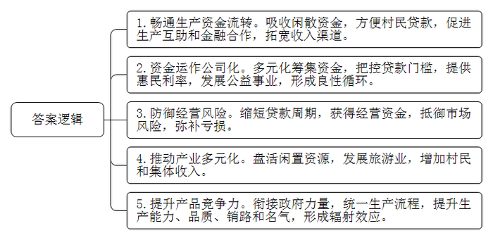
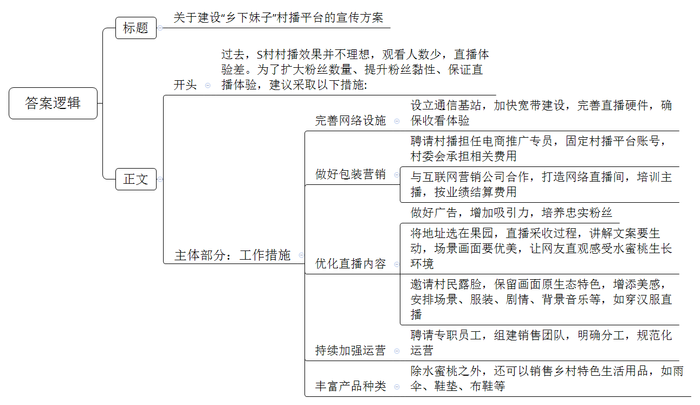
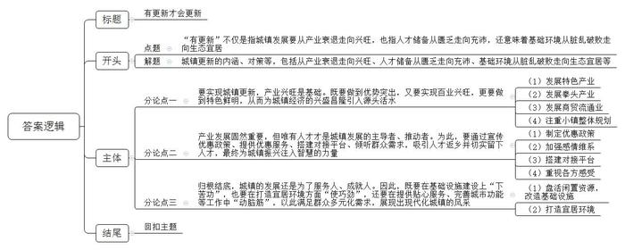

# 2020年0725公务员多省联考《申论》题（四川上半年C卷）

<!-- gwy:overview:start -->
> **四川 · 2020 · 申论 · 上半年C卷** ｜ 3 题 · 图片 3 处 · 答案随题折叠

导航：[题目](#题目) · [材料 1](#材料-1)
<!-- gwy:overview:end -->

> 候选采集稿。参考答案及解析来自粉笔页面，不代表官方答案或真实高分答卷；来源使用许可与原卷对应关系仍需人工核实。

## 给定材料

### 材料 1

“俺去年有1000多元的分红。”M村富民生产互助专业合作社社员小李笑着说，“我们有51户村民领到了入股后的第一笔分红。”“这是咱们自己的‘银行’，钱存进去方便，将来我贷款也便利。”小李口中的“银行”——富民生产互助专业合作社，实际上是L镇为解决农民生产资金周转问题，在大量调研和借鉴其他省份做法的基础上，率先在M村试点的新型农村合作金融。

2017年5月富民生产互助专业合作社成立后，实行公司化运作方式，通过社员大会，设党小组、理事会、监事会，采取政府支持+在外成功人士无偿入股+村民有偿入股的形式筹集资金。贷款则由理事会审核把关，贷给信誉良好、有偿还能力的村民。贷款利率也低于信用社等银信部门，对贫困户、低保户的利息还低于普通农民。利息收入的50％用于本金滚动和村集体公益事业，30％作为60周岁以上村民老年股和普通股分红，20％用于合作社日常管理。

M村以蔬菜种植为主导产业，3万亩耕地将近一半是蔬菜地。农民想种植有机蔬菜，但前期投入成本大，资金周转不灵。商业贷款利息高、借贷周期长，远水解不了近渴。现在有了互助合作社，村民向理事会交个申请，快则几个小时，慢则两三天就能收到贷款。

小赵是村里有名的养鸡大户，2万多只蛋鸡为他带来年营业收入30多万元。2017年上半年，一场禽流感疲软了鸡蛋行情，小赵亏了十几万。2018年开春，连买鸡仔的钱也没了。正当小赵一筹莫展，村里刚成立的互助合作社雪中送炭。“我头一天申请，第二天就审核通过放了款，利息还很低。”这5万元贷款救了小赵。上半年行情回暖，他不仅填补了亏空，还多创收了十几万。还了贷款后，他又贷了6万扩充鸡舍。

M村有几栋闲置的村屋，在合作社动员下，户主入了“房屋股”，合作社将房子装修成民宿，搞起乡村旅游服务，这几户人家每年增收3000元，村集体收入也年增长1.6万元。

L镇J村有种植韭菜和韭黄的传统，在韭菜经销商李先生的带领下，J村的26户村民成立了韭菜合作社。合作社成立之后，得到了当地政府的大力支持。

合作社大力提升韭菜和韭黄的生产能力和产品品质，采取了五统一：统一品种选择，统一栽培管理技术，统一农业投入品供给，统一产品质量和规格，统一销售渠道。韭菜、韭黄的产量、质量、销路、名气大大得到提升，社员从韭菜产业中得到的收入达到户均10万元。韭菜合作社的成功，带动了周边三个村的村民种植韭菜，而这三个村的村民也组织起了自己的合作社。

### 材料 2

近日，S村“90后”姑娘小丁正对着手机，在果林下做直播。只见她徒手掰开一个刚摘下的水蜜桃，粉嘟嘟的果肉惹人垂涎欲滴，吸引了不少粉丝点击淘宝店铺下单购买。

水蜜桃是S村的主导产业。2018年，某互联网企业与村里合作，准备打造村播基地。在村委会帮忙下，小丁成为小山村里第一位村播，但其直播效果并不理想：观看人数少，点击量上不去。而且由于手机信号的问题，直播时断时续，不少网友对此颇有怨言。

正当小丁的直播陷入瓶颈的时候，S村来了一位从事新媒体传播研究的驻村第一书记，他帮小丁深入地分析了村播不成功的原因。

“虽然你用村播卖地道农货，但现在同类型的农村电商太多了，大家都是卖农货，这一方面，你的货品本身没有突出优势。而且，你的货品太单一，光靠水蜜桃赚不到钱，也留不住客人。顾客今年在你这里买了，明年未必还在你家买。就算他明年还记得你，他一年又能买多少呢？”

“在货品本身缺乏资源优势的前提下，同样的货品，要么有价格优势，要么就是你的广告做得特别吸引人，能够逐渐培养起一批铁杆粉丝，以此来和其它销售同类型产品的村播拉开差距。”

“村播的形式虽然新颖，但并不一定就有良好的效果。有了新的形式，还必须有优质的内容才行。而且，直播对技术条件的要求比较高，收看体验不好也很难留住网友。”

要想做出高质量的直播，就需要有专门的包装，要有懂行的专业人，而这些是小丁无法独自做到的。为此，驻村第一书记安排她成为S村的电商推广专员，承担全村农产品的网络销售推广，小丁的“乡下妹子”这个账号成了S村的村播平台，由村委会来承担村播所需要的相关费用。驻村第一书记还联系了一家互联网营销公司，与S村达成合作协议：S村负责网络直播间的打造，公司负责培训小丁。在粉丝数量和销售额达到预期目标后，公司再按双方合同议定的金额收取费用。这样一来，小丁、互联网营销公司和村委会三方皆大欢喜。

改版后的“乡下妹子”村播的第一场，选在了贫困户老牛的果园里。这天，直播团队在老牛的果园里支起直播架，现场直播老牛采收水蜜桃的过程。小丁则在一旁绘声绘色地讲解，并在直播团队指导下，用手机拍下果园周边山水风光的优美画面，让网友直观地感受水蜜桃的生长环境。

“这次直播很成功，‘乡下妹子’的粉丝量从原来的300多一下子涨到了2000多，累计播放量突破1万次。”小丁说。同时，这场直播也帮老牛卖出了400多斤水蜜桃，销售单价远远高于中间商的收购价。看到老牛尝到甜头的村民们纷纷邀请小丁来自家果园搞直播，还主动将水蜜桃放在S村的网店寄卖。小丁给记者算了笔账，在1个月时间里，她一共帮村里卖了5000多斤水蜜桃。

“乡下妹子”第二次爆粉则是在今年，小丁身穿汉服，在果林下直播吃桃。与此同时，团队还邀请其他村民在镜头前露脸，通过对场景、服装、剧情和背景音乐等的安排，使得S村的乡村生活在镜头下面既保留着原生态的特色，又多了几分精致的美感。

小丁成了S村的网红主播。尝到甜头的S村决定继续打造村播事业，同时进一步优化S村的农产品网上销售，聘请两位工作人员，和小丁一起组建S村专门的电商销售团队，分工合作，各司其职，规范网站运营。受此吸引，村里两位在外地从事电商的年轻人返乡加入了团队。他们一起，不断完善村播平台，加大宣传力度，开拓货物品种。S村本身也整合扶贫资金，搭建扶贫车间，生产特色雨伞，还组织S村的家庭妇女，制作乡土风味浓厚、手工精良的鞋垫、布鞋等生活用品，以丰富村播网店的货品种类。

### 材料 3

仲夏时节，小王到P镇旅游。踏进小镇，首先映入眼帘的是晾晒在河堤的上千把成品雨伞，它们在阳光下熠熠生辉，五光十色，成为一道亮丽的风景线。P镇的油纸雨伞始创于明代初年，以引纸、桐油、楠竹、柿水等为原料，经手工精心制作而成，鼎盛时期全镇有制伞坊20余家，工匠达百数以上。P镇雨伞质优价廉，曾驰名全国，至今仍是区域雨伞市场的龙头，产品畅销云、贵、川、湘、鄂五省。

看到小王长久地驻足在雨伞旁，刘大爷自愿当上了小王的导游。“过去，从十字街到浦溪一路是鞭炮街，有大大小小的鞭炮作坊几十家。十字街到医院一带是皮革街，生产经营各式皮具。还有各式瓷器店、铁匠铺、澡堂子等等店面杂居其中。”刘大爷指着不远处说道，“明清时期，P镇面积约2平方公里，街道宽约4米，街面以长条形红石铺成，房屋店面都用杉木构造。街区轮廓如一木排，有正街、河街和后街三大街道。河街和后街各长1.5公里，各行各业在这里集中，银行、钱庄、典当行、油号、瓷庄、洋行遍布街市，数不胜数。”

“那是姚恒森号桐油店。”刘大爷继续介绍，“这个商号在清末民初，以经营桐油和茶油为主业，货物辗转运销常德、长沙、武汉等地。商号李炳记号却是以鞭炮发家，转而经营桐油，极盛时，李家的桐油占到了当地市场桐油总量的五分之二。此外还有太平街的吉中兴、吉和兴，都是当时的桐油业经营大户。油行业的兴旺同时带来了专制油产品包装的木桶业和竹篓业的兴旺，桶行、篓行相应地发展成为一条桶匠街。谷家篓厂雇请篾匠百余名，日制油篓数百计，那时节沿河长街的篓坊常有两三千新油篓晒在太阳下，场景分外壮观。”

走到后街尾，刘大爷说：“据老辈人回忆，当时市场繁华至极，街市上十省三府会馆客商云集，市面上每天要杀60多头猪，所杀的猪就从来没有卖剩过。待装上船的桐油、生铁，因市面过于拥挤，白天无法出仓，只能到晚上起运。人们得赶在天亮前装完货物，天一亮，街市上又会被做生意的人堵塞。”

依依惜别之后，小王的脑海里一直萦绕着刘大爷所描绘的“络绎不绝的生意人、此起彼伏的叫卖声、川流不息的货运船交织在一起，街市上‘腋底下送货，人头上接钱’”的繁华商业景象，久久不能忘怀。

### 材料 4

在T区党委组织部人才科，小李拿着一本花名册对记者说：“这是我区近两年来回引的人员名单，主要是外出务工经商人员。”小李继续介绍，为深入贯彻落实习近平总书记提出的“乡村振兴，人才是关键”的重要指示精神，T区大力开展“把老乡留在老家”专项行动，千方百计把外出务工经商人员回引回乡创业就业。2019年以来，全区已掌握外出务工人员信息11万条，累计回引2万余名老乡返乡，为产业发展、脱贫攻坚、基层治理等方方面面提供源源不断的人才支撑，全区乡村振兴战略持续推进。

在务工人员输出大村G村，刚过大年十五，支部书记老梁打开了村广播，“广大村民朋友，今年受疫情影响，大家都还没有外出，我呀，再把区里的‘把老乡留在老家’的一些政策给大家讲一讲，大家琢磨琢磨。留在家乡创业，既照顾了家庭，也帮助了乡亲嘛，还有不少优惠政策哦……”“现在呀，还给大家发个通知，正月二十五，区里要举办一场宣讲会，通过区政府APP直播，将展现我区发展的新面貌和播放乡村振兴示范片，请大家到时观看。”正在听广播的经商人员小龙，手机上也收到了区委、区政府推送的在家乡创业就业的邀请。老梁告诉记者，“去年，我们还通过座谈会，到企业现场参观和发放宣传资料等方式进行了广泛宣传和动员。”

在E村村口，记者碰到了正在开展防疫宣传的大学生村官小马，除了带着防疫资料，他的背包里还有一大叠回乡创业政策指南。小马说：“在做好防疫宣传工作的同时，我也给大家宣传一下回乡创业政策，同时再调查摸底一下外出务工人员底数，收集一些就业意向及需求。”区委组织部、区人社局和各乡镇、街道，还采取村级自查摸底、镇街分析研判、区级审核把关的联动模式，精准掌握全区基层干部队伍年龄、性别、学历等结构，建立缺额台账、摸清人才需求状况。同时，区政府还建立政企联动机制，了解区内企业用工需求。

“我们主动为村级党组织、民营企业和务工人员‘牵线搭桥’，积极搭建人才对接平台。”小李介绍道，今年我区大力推进部分高校与企业合作，举办高校专场人才双选会；大力开展人才招聘活动，积极组织人员参与人才大会、人才论坛等。对在外的本土人才，还采取多渠道、多方式开展回引工作。为确保回引的人才留得住，区里还出台了“人才政策10条”和本土人才管理办法等政策措施。

### 材料 5

以下是更新镇政府工作人员在接受记者采访时的谈话：

其实我们镇发展升级工作的灵感是来源于“城市更新”概念。我们镇虽然是一个历史悠久的老镇，但居民却是生活在现代的居民，而且其中有相当一部分是年轻人。所谓“衣食住行”嘛，肯定是要吃得好，玩得开心，住得舒适，出行方便。但是，我们镇作为全市“年龄”最大的一个镇，那时各类基础设施是十分薄弱的。镇里有大量的厂房就那样闲置着，我每每经过，都忍不住叹气：它们都应该成为我们的资源和财富，而不是负担。当然，我们是镇，它有别于农村，也不是城市。以前有的群众不理解，老说我们这样的镇“城不城、乡不乡”，稍微好点的评价也是说我们“半城半乡”。其实，我们都清楚，那是指我们既没有工商业支撑，又没有充分的农业发展的尴尬境地啊。但换一个思路来想，我们是市郊大镇，距离三个县城、两个市区都只有不到四十分钟的车程。我们有优越的地理位置，有能够直接使用的作为产业发展基地的厂房，有沉淀丰富的历史底蕴，这些都是我们的优势。那么，要怎么样让我们更新镇名副其实呢？

更新镇要发展升级，首要转变的当然是人。我们转变了一个观念：不是非要一天24小时，一年365天住在我们这儿的才能算我们更新镇人。我们积极与县政府有关部门沟通，争取到3条公交班车线直达镇里。大家可以白天在城市里上班，晚上在镇里生活；也可以搬过来，白天在镇里工作，而居家却在城市里。反正来了都是更新人，对他们都是一视同仁，他们享受的管理、服务、政策优惠都一样。更新镇的建设肯定要让更新人全面参与，让全体更新人谈感受、讲需求、提建议、说意见，充分发挥主体作用，否则我们镇的建设就成了“我们干、他们看”，那样是搞不好的。为此，我们创建设置了专门的公众号以及群众意见信箱，鼓励大家为更新的建设出谋划策。综合群众的建议以及有关专家的意见，我们定下了三个发展的主要方向：一是建设“人文小镇”，着力于全镇的保护和开发，留住历史记忆；二是建设“生态小镇”，在本镇及其周边乡村营造更好的生态，发挥市郊小镇的优势，打造宜居的环境；三是建设“创新小镇”，吸引人们前来创新创业，吸纳相关产业逐步集聚。我们坚信：有更新才会更新。

为了适应现代化的生活，我们对全镇进行了必要的、有计划的改建。这包括对城镇基础设施、公共服务设施等全方位的改造改善。经过我们全镇人民一年多的共同努力，终于实现了生态环境、空间环境、文化环境、视觉环境、游憩环境的优化美化，展现了我们镇“环境优、风景美、功能强、活力足”的现代化城镇新面貌。而且，作为一个毗邻两个大城市的大镇，我们与兄弟乡镇承担起了现代化城镇的功能：吸纳更多农村人口“上迁”，承接城市人口“下移”。我们更新镇和其他兄弟乡镇都不是孤立的。我们一起，形成了各具特色的小镇群落，产业错位，功能共享。大家各不一样，又互相支撑。时代在变，万事万物都需要进化发展。

## 题目

### 第 1 题

**根据****“给定资料**1**”，概括农村合作社在带动农村经济发展上发挥的作用。（20分）**

关联材料：材料 1

作答要求：

要求：全面，准确，有条理，不超过200字。

第 1 题 · 答案与解析

**参考答案（粉笔题库参考内容）**

1.畅通生产资金流转。吸收闲散资金，方便村民贷款，促进生产互助和金融合作，拓宽收入渠道。

2.资金运作公司化。多元化筹集资金，把控贷款门槛，提供惠民利率，发展公益事业，形成良性循环。

3.防御经营风险。缩短贷款周期，获得经营资金，抵御市场风险，弥补亏损。

4.推动产业多元化。盘活闲置资源，发展旅游业，增加村民和集体收入。

5.提升产品竞争力。衔接政府力量，统一生产流程，提升生产能力、品质、销路和名气，形成辐射效应。

**解析**

**参考答案说明：**本参考答案在内容上，从“畅通生产资金流转”“资金运作公司化”“防御经营风险”“推动产业多元化”“提升产品竞争力”等不同方面进行了分条撰写，各条答案要点之间在内容上相互并列，没有交叉。

### 第 2 题

**假如你是****S****村****“乡下妹子”村播平台的团队成员，请根据“给定资料**2**”，为村播平台拟定一份宣传方案。（30分）**

关联材料：材料 2

作答要求：

要求：目标明确，条理清晰，措施可行，操作性强，不超过500字。

第 2 题 · 答案与解析

**参考答案（粉笔题库参考内容）**

关于建设“乡下妹子”村播平台的宣传方案

过去，S村村播效果并不理想，观看人数少，直播体验差。为了扩大粉丝数量、提升粉丝黏性、保证直播体验，建议采取以下措施：

一、完善网络设施。设立通信基站，加快宽带建设，完善直播硬件，确保收看体验。

二、做好包装营销。聘请村播担任电商推广专员，固定村播平台账号，村委会承担相关费用；与互联网营销公司合作，打造网络直播间，培训主播，按业绩结算费用。

三、优化直播内容。做好广告，增加吸引力，培养忠实粉丝；将地址选在果园，直播采收过程，讲解文案要生动，场景画面要优美，让网友直观感受水蜜桃生长环境；邀请村民露脸，保留画面原生态特色，增添美感，安排场景、服装、剧情、背景音乐等，如穿汉服直播。

四、持续加强运营。聘请专职员工，组建销售团队，明确分工，规范化运营。

五、丰富产品种类。除水蜜桃之外，还可以销售乡村特色生活用品，如雨伞、鞋垫、布鞋等。

**解析**

**参考答案说明：**（1）本题是公文题，要求写一份宣传稿。（2）本参考答案的正文，围绕“存在问题”“工作措施”两个方面展开，开头先对“问题”进行了总体阐述；接着主体从“完善网络设施”“做好包装营销”“优化直播内容”“持续加强运营”“丰富产品种类”五个方面对“工作措施”进行了具体展开。形式上，本参考答案做到了分段、分条撰写，整体上条理较为清晰。

### 第 3 题

**请结合****“给定资料**3**\-**5**”，联系社会实际，以“有更新才会更新”为题目，写一篇议论文。（50分）**

关联材料：材料 1、材料 2、材料 3、材料 4、材料 5

作答要求：

要求：

（1）观点明确，见解深刻；

（2）思路清晰，结构严谨；

（3）语言流畅，书写工整；

（4）总字数800-1000字。

第 3 题 · 答案与解析

**参考答案（粉笔题库参考内容）**

**有更新才会更新**

时代在变，万事万物都需要进化发展，城镇发展也不例外。“有更新”不仅是指城镇发展要从产业衰退走向兴旺，也指人才储备从匮乏走向充沛，还意味着基础环境从脏乱破败走向生态宜居。凡益之道，与时偕行。时代的车轮滚滚向前，只有把握契机，城镇才能不断更新，从偏居一隅的“不起眼”小镇，成为繁盛引人的要地重镇。

**要实现城镇更新，产业兴旺是基础。既要做到优势突出，又要实现百业兴旺，更要做到特色鲜明，从而为城镇经济的兴盛昌隆引入源头活水。**首先，发展传统特色产业，能在市场竞争中独树一帜。无论何时，P镇的雨伞一直是区域市场的标杆，由此还带动了旅游业的同步飞跃，实现了产业多元化发展。其次，因地制宜，发展拳头产业，锻造核心竞争力，并以此为跳板，延长产业链，发展配套产业。此外，发展商贸流通业，可以吸引资本，刺激需求，创造就业机会。最后，注重小镇整体规划，既要错位发展、突出特色，又要在镇镇之间互通有无、功能互享，实现几何级增效。

**产业发展固然重要，但唯有人才才是城镇发展的主导者、推动者。为此，要通过宣传优惠政策、提供优惠服务、搭建对接平台、倾听群众需求，吸引人才返乡并切实留下人才，最终为城镇振兴注入智慧的力量。**留下人才，不仅要制定优惠政策，拓宽“返乡”的边界，为人才提供更多管理、服务等优惠；还要通过多样化手段，加强宣传工作；同时也要加强感情维系，让俊杰能人自愿留下、甘愿留住。此外，可以通过搭建对接平台，实现政企联动、校企联动，让人岗精准匹配。在此过程中，还要重视各方感受，吸收群众建议，让他们参与地方建设规划，为城镇发展出谋划策。

**归根结底，城镇的发展还是为了服务人、成就人。因此，既要在基础设施建设上“下苦功”，也要在打造宜居环境方面“使巧劲”，还要在提供贴心服务、完善城市功能等工作中“动脑筋”，以此满足群众多元化需求，展现出现代化城镇的风采。**基础设施就像地基，如果过于脆弱，那么城镇之大厦必将倾倒。因此，盘活闲置资源，有计划地改造基础设施、服务设施十分重要。只有把固本强基的工作做好，更新城镇、发展城镇才能更有心气和底气。当然，软件也应兼顾，打造宜居环境，需要全镇群众同心协力，在美化环境上共同努力，实现生态、景观、功能的统一，为小镇健康发展、持续发展增添活力。

不日新者必日退。在城镇建设与发展中，只有坚决更新、坚持更新、坚定更新，一幅经济繁盛、人潮涌动、环境优美的盛世图景才能跃然眼下！

**文章分析**

**有更新才会更新**

【**标题的优点：**严格按照题目要求，以“有更新才会更新”为标题，不可更改。】

时代在变，万事万物都需要进化发展，城镇发展也不例外。（1）“<u>有更新</u>”<u>不仅是指城镇发展要从产业衰退走向兴旺</u>，<u>也指人才储备从匮乏走向充沛</u>，<u>还意味着基础环境从脏乱破败走向生态宜居</u>。凡益之道，与时偕行。（2）<u>时代的车轮滚滚向前</u>，<u>只有把握契机</u>，<u>城镇才能不断更新</u>，<u>从偏居一隅的</u>“<u>不起眼</u>”<u>小镇</u>，<u>成为繁盛引人的要地重镇</u>。

【**开头的优点：★内容方面：**范文的开头是紧扣“城镇更新”这一主题展开的。首先，开头在段首处点出主题，做到了主题明确。其次，对“城镇更新”这一主题进行了分析阐述，指出了（1）城镇更新的内涵；（2）城镇更新的对策。**★文字表达方面：**使用了时代的车轮、“不起眼”小镇等形象生动的修辞方法，让语言生动、有感染力。】

**要实现城镇更新，产业兴旺是基础。既要做到优势突出，又要实现百业兴旺，更要做到特色鲜明，从而为城镇经济的兴盛昌隆引入源头活水。**首先，（1）<u>发展传统特色产业</u>，<u>能在市场竞争中独树一帜</u>。无论何时，P镇的雨伞一直是区域市场的标杆，由此还带动了旅游业的同步飞跃，实现了产业多元化发展。其次，（2）<u>因地制宜</u>，<u>发展拳头产业</u>，<u>锻造核心竞争力</u>，<u>并以此为跳板</u>，<u>延长产业链</u>，<u>发展配套产业</u>。此外，（3）<u>发展商贸流通业</u>，<u>可以吸引资本</u>，<u>刺激需求</u>，<u>创造就业机会</u>。最后，（4）<u>注重小镇整体规划</u>，<u>既要错位发展</u>、<u>突出特色</u>，<u>又要在镇镇之间互通有无</u>、<u>功能互享</u>，<u>实现几何级增效</u>。

【**论述段****1****的优点：★观点句：**范文的观点句是紧扣“城镇更新”这一文章主题提出的。形式上，它在段首处直接写出，位置突出，容易发现。内容上，关键词突出，内容要点明确，可以明显看出它是从“产业兴旺”这个角度入手，指出了实现城镇更新的对策。**★论述内容：**（1）介绍了实现城镇更新的对策——发展传统产业方面；（2）介绍了实现城镇更新的对策——发展拳头产业方面；（3）介绍了实现城镇更新的对策——发展流通业方面；（4）介绍了实现城镇更新的对策——注重规划方面。以上四个方面的内容都是紧扣“要实现城镇更新，产业兴旺是基础。既要做到优势突出，又要实现百业兴旺，更要做到特色鲜明，从而为城镇经济的兴盛昌隆引入源头活水”这个观点进行分析论述的，论述的针对性强，内容层次丰富。最后，在论述方法上主要采取了讲道理和举例子相结合，做到了丰富多样。】

**产业发展固然重要，但唯有人才才是城镇发展的主导者、推动者。为此，要通过宣传优惠政策、提供优惠服务、搭建对接平台、倾听群众需求，吸引人才返乡并切实留下人才，最终为城镇振兴注入智慧的力量。**留下人才，（1）<u>不仅要制定优惠政策</u>，<u>拓宽</u>“<u>返乡</u>”<u>的边界</u>，<u>为人才提供更多管理</u>、<u>服务等优惠</u>；<u>还要通过多样化手段</u>，<u>加强宣传工作</u>；（2）<u>同时也要加强感情维系</u>，<u>让俊杰能人自愿留下</u>、<u>甘愿留住</u>。此外，（3）<u>可以通过搭建对接平台</u>，<u>实现政企联动</u>、<u>校企联动</u>，<u>让人岗精准匹配</u>。在此过程中，（4）<u>还要重视各方感受</u>，<u>吸收群众建议</u>，<u>让他们参与地方建设规划</u>，<u>为城镇发展出谋划策</u>。

【**论述段****2****的优点：★观点句：**范文的观点句是紧扣“城镇更新”这一文章主题提出的。形式上，它在段首处直接写出，位置突出，容易发现。内容上，关键词突出，内容要点明确，可以明显看出它是从“人才”这个角度入手，指出了实现城镇更新的对策。**★论述内容：**（1）介绍了留下人才的对策——制定优惠政策方面；（2）介绍了留下人才的对策——加强感情维系方面；（3）介绍了留下人才的对策——搭建对接平台方面；（4）介绍了留下人才的对策——吸收群众建议方面。以上四个方面的内容都是紧扣“产业发展固然重要，但唯有人才才是城镇发展的主导者、推动者。为此，要通过宣传优惠政策、提供优惠服务、搭建对接平台、倾听群众需求，吸引人才返乡并切实留下人才，最终为城镇振兴注入智慧的力量”这个观点进行分析论述的，论述的针对性强，内容层次丰富。最后，在论述方法上采取了讲道理的方式进行展开，做到了论述有力**。**】

**归根结底，城镇的发展还是为了服务人、成就人。因此，既要在基础设施建设上“下苦功”，也要在打造宜居环境方面“使巧劲”，还要在提供贴心服务、完善城市功能等工作中“动脑筋”，以此满足群众多元化需求，展现出现代化城镇的风采。**基础设施就像地基，如果过于脆弱，那么城镇之大厦必将倾倒。因此，（1）<u>盘活闲置资源</u>，<u>有计划地改造基础设施</u>、<u>服务设施十分重要</u>。<u>只有把固本强基的工作做好</u>，<u>更新城镇</u>、<u>发展城镇才能更有心气和底气</u>。当然，软件也应兼顾，（2）<u>打造宜居环境</u>，<u>需要全镇群众同心协力</u>，<u>在美化环境上共同努力</u>，<u>实现生态</u>、<u>景观</u>、<u>功能的统一</u>，<u>为小镇健康发展</u>、<u>持续发展增添活力</u>。

【**论述段****3****的优点：★观点句：**范文的观点句是紧扣“城镇更新”这一文章主题提出的。形式上，它在段首处直接写出，位置突出，容易发现。内容上，关键词突出，内容要点明确，可以明显看出它是从“服务人、成就人”这个角度入手，指出了实现城镇更新的对策。**★论述内容：**（1）介绍了实现城镇更新的对策——基础设施建设方面；（2）介绍了实现城镇更新的对策——打造宜居环境方面。以上两个方面的内容都是紧扣“归根结底，城镇的发展还是为了服务人、成就人。因此，既要在基础设施建设上‘下苦功’，也要在打造宜居环境方面‘使巧劲’，还要在提供贴心服务、完善城市功能等工作中‘动脑筋’，以此满足群众多元化需求，展现出现代化城镇的风采”这个观点进行分析论述的，论述的针对性强，内容层次丰富。最后，在论述方法上采取了讲道理的方式进行展开，做到了论述有力。】

【**论述段之间的关系：★内容的内在逻辑：**范文的论述段之间是依照并列逻辑展开的。论述段1先写了要发展产业，这是城镇更新的资金前提，论述段2又写了要吸引人才，这是城镇更新的人才支撑，论述段3还写了要为民服务，这是从城镇自身发展，即基础设施和居住环境的角度给出的对策，三方面的对策有内有外，既有硬件方面的办法、也有软件方面的举措，对实现城镇更新的对策阐述充分。】

不日新者必日退。（1）<u>在城镇建设与发展中</u>，<u>只有坚决更新</u>、<u>坚持更新</u>、<u>坚定更新</u>，（2）<u>一幅经济繁盛</u>、<u>人潮涌动</u>、<u>环境优美的盛世图景才能跃然眼下</u>！

【**结尾的优点：**范文的结尾回扣了“城镇更新”这一主题。（1）再次提到“城镇”“更新”等主题词或其同义词；（2）阐述了深远意义。】

**解析状态：unknown（来源未提供）**

