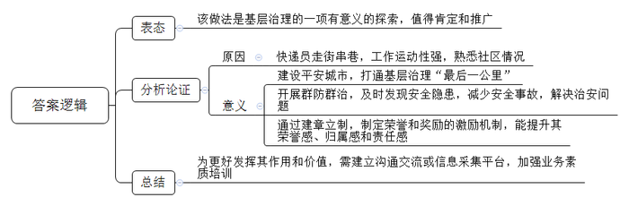
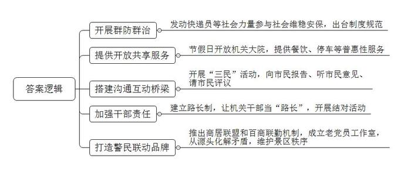
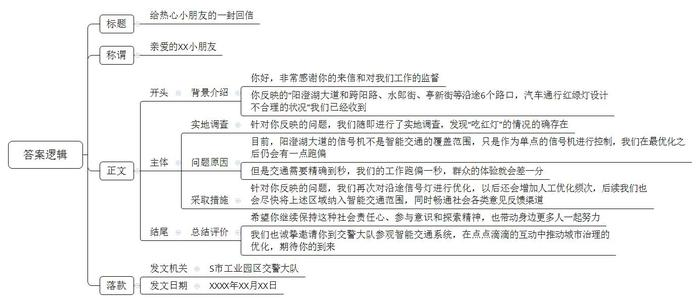
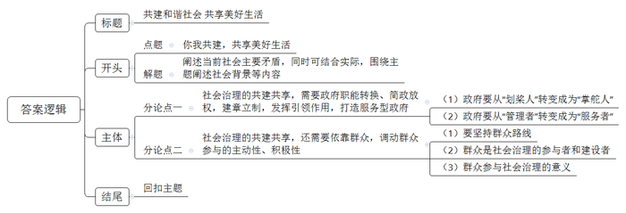

# 2020年四川省公考《申论》题（下半年）

<!-- gwy:overview:start -->
> **四川 · 2020 · 申论 · 下半年** ｜ 4 题 · 图片 4 处 · 答案随题折叠

导航：[题目](#题目)
<!-- gwy:overview:end -->

> 候选采集稿。参考答案及解析来自粉笔页面，不代表官方答案或真实高分答卷；来源使用许可与原卷对应关系仍需人工核实。

## 给定材料

### 材料 material-2a21fe3547649174

起早贪黑、风雨无阻，整日穿梭于街头巷尾、商场超市、田间地头……长期奔忙在基层一线的快递配送员就像勤劳的小蜜蜂，给广大人民群众的生活带来诸多便利。近年来，快递员解锁出一项新技能，他们作为一支重要力量，积极参与到当地社会治安综合治理活动中，成为广受欢迎的平安使者，无处不在的他们打通了基层治理“最后一公里”，为社会治理注入新活力。

23岁的小汪是S市一名快递员，这两年，他积极参与到群防群治工作中。6月21日中午，小汪像往常一样在自己负责的区域内送件。路过某小区3单元时，他闻到一股浓烈的天然气味道。“坏了，一定是什么地方的天然气泄漏了！”小汪一下子紧张起来。他很清楚，6月的S市天气异常炎热，一丁点火星都可能引发爆炸事故伤及群众。小汪赶紧找到小区保安，立即给燃气公司打电话告知此事，而后与保安一起在四周认真排查。经过搜寻，他们很快找到燃气泄漏点。即便如此，小汪仍留在事发地，直到燃气公司工作人员到达后才离开，避免了一起安全事故的发生。

同年11月3日傍晚，垫江县快递员金宗明派件路上经过一家台球室时，无意间看见几名青年正在激烈地争吵，甚至开始相互推搡。金宗明不由地放慢速度，在一旁留意观察。只听一名青年退到一边打起了电话：“喂，我们在北街路口，带上家伙过来！”金宗明顿时提高了警惕，向前驶出一段距离，掏出电话报警。几分钟后，警察赶到现场，及时制止了一起斗殴事件的发生。

有人担心，快递员平时工作已经很忙了，还要参加社会治理活动，岂不是给他们增添了额外负担？S市L区委政法委书记、区社会治理指挥中心韩主任并不认同这种看法。他介绍，L区综治委向全区各物流企业印发了《L区关于进一步发动社会力量参与社会面维稳安保的通知》，让每位快递员都能感到自己是一名“平安志愿者”，能为平安城市建设作出贡献，有一种荣誉感和归属感。

不仅如此，根据《L区群众举报违法犯罪线索和社会治安隐患奖励办法》，快递员在工作期间如发现违法犯罪线索、社会治安隐患，涉及国家安全和社会稳定的情报信息线索可以进行举报，一经核实，将为举报者发放现金奖励等。“有荣誉、有奖励，我们当然更加义不容辞。”L区快递员小徐从不认为参与综治活动增加了负担，而是把这项工作当成自己的重要职责。

仅有荣誉和奖励的激励，快递员参与社会治理就能有效发挥出作用来吗？韩主任介绍，L区通过建章立制，为快递员参与社会治理工作定下规矩。比如，要求快递员在工作期间统一佩戴“平安志愿者”红色袖标，严格落实“一岗双责”，既要落实好“3个100%”制度，又要切实担负起平安志愿者的责任。“我们还对佩戴‘平安志愿者’红袖标参与社会面巡逻防控的快递员实行台账管理，通过新增人员加号、离职人员销号的动态管控方式，对辖区参与社会面平安建设的物流企业实现统一调度、统一指挥。”韩主任说。

N大学社会工作与社会政策系吴教授认为，快递员经常走街串巷，工作运动性强，这种工作属性使得他们熟悉某一片区的基本状况，因此，发动快递员参与社会治理工作是一项十分有意义的探索。“建议为快递员传递预警信息等建立便捷的沟通交流或信息采集平台，方便其深度参与工作。也需要加大对参与者业务素质的培训培养，如进行岗前业务培训考核等，从而使这一模式能够最大限度发挥出其应有的作用与价值。”吴教授说。

### 材料 material-37ae893cfcd0aa58

“交警叔叔，我因为学习和去玩耍的原因，经常要从阳澄湖大道往返工业园区中心，发现这条路的红灯太多了。我想，红绿灯是人设计的，如果设计不合理，那可不可以把那边的红绿灯调整一下呢？”近日，S市一名三年级小学生给交警部门写了一封信，足足有六页纸，反映在高峰和平峰两种情况下，阳澄湖大道和跨阳路、水郎街、亭新街等沿途6个路口汽车通行的状况。

收到来信后，当地交警部门针对小学生的疑问一一做了解释。又花了两天的时间，对这几条路口的情况进行了实地调查。调查中，交警发现小朋友反映的频频“吃红灯”的情况的确存在。S市工业园区交警大队秩序中心曹警官表示：“阳澄湖大道的信号机不是智能交通的覆盖范围，只是作为单点的信号机进行控制，我们在最优化之后仍会有一点跑偏。但是交通需要精确到秒的，我们的工作跑偏一秒，群众的体验就会差一分。”交警表示，他们已经再次对沿途的信号灯进行了优化，以后还会增加人工优化的频次。交警部门找到这位写信的小朋友并邀请他到交警大队参观智能交通系统。曹警官说：“我们希望给小朋友非常完美的、满意的答复，让他保持这种社会责任心、参与意识和探索精神。”

有专家认为，小学生能敏锐发现问题并提出建议，这份“参与意识”秒杀很多“老司机”，值得欣慰。而当地警方的善意呼应和良性互动也是可圈可点。城市治理的优化，往往就是经由这样的互动，一点一点积累，一厘米一厘米推进的。

## 题目

### 第 1 题

**请对****“给定资料**1**”中快递员参与社会基层治理的做法加以评析。（****15****分）**

关联材料：材料 material-2a21fe3547649174

作答要求：

要求：观点正确，分析透彻；不超过200字。

第 1 题 · 答案与解析

**参考答案（粉笔题库参考内容）**

该做法是基层治理的一项有意义的探索，值得肯定和推广。

由于快递员走街串巷，工作运动性强，熟悉社区情况，参与社会治理有利于：1.建设平安城市，打通基层治理“最后一公里”。2.开展群防群治，及时发现安全隐患，减少安全事故，解决治安问题。3.通过建章立制，制定荣誉和奖励的激励机制，能提升其荣誉感、归属感和责任感。

为更好发挥其作用和价值，需建立沟通交流或信息采集平台，加强业务素质培训。

**解析**

**参考答案说明：**思路方面，本参考答案按照观点现象分析题“表态+分析论证+总结”的答题思路展开。内容方面，本参考答案先表明了对“快递员参与社会基层治理”的态度；“分析论证”部分给出了“快递员参与社会基层治理”的原因和意义；最后进行了总结。词句表达方面，本参考答案加上了“由于”等连接词来承接上下文。

**考点**：考点观点现象分析类

**来源**：来源2020年四川省公考《申论》题（下半年）

粉笔申论页面对本题只提供「解析视频」入口，该入口是会员推广位，页面无视频地址与文字解析。

### 第 2 题

**请根据****“给定资料**1**～**5**”，归纳概括城市建设管理服务中共享共治的先进经验。（****20****分）**

关联材料：材料 material-2a21fe3547649174

作答要求：

要求：全面准确，条理清晰；不超过200字。

第 2 题 · 答案与解析

**参考答案（粉笔题库参考内容）**

1.开展群防群治。发动快递员等社会力量参与社会维稳安保，出台制度规范。

2.提供开放共享服务。节假日开放机关大院，提供餐饮、停车等普惠性服务。

3.搭建沟通互动桥梁。开展“三民”活动，向市民报告、听市民意见、请市民评议。

4.加强干部责任。建立路长制，让机关干部当“路长”，开展结对活动。

5.打造警民联动品牌。推出商居联盟和百商联勤机制，成立老党员工作室，从源头化解矛盾，维护景区秩序。

**解析**

**参考答案说明**：本参考答案分别从“开展群防群治”“提供开放共享服务”“搭建沟通互动桥梁”“加强干部责任”“打造警民联动品牌”等五个方面进行了分条撰写，各条要点之间在内容上相互并列，没有交叉。

**考点**：考点经验启示类

**来源**：来源2020年四川省公考《申论》题（下半年）

粉笔申论页面对本题只提供「解析视频」入口，该入口是会员推广位，页面无视频地址与文字解析。

### 第 3 题

**请根据****“给定资料**6**”，以****S****市工业园区交警大队的名义，给来信反映问题的小学生写一封回信。（****25****分）**

关联材料：材料 material-37ae893cfcd0aa58

作答要求：

要求：内容完整，条理清晰，格式规范，语言流畅；不超过500字。

第 3 题 · 答案与解析

**参考答案（粉笔题库参考内容）**

给热心小朋友的一封回信

亲爱的XX小朋友：

你好，非常感谢你的来信和对我们工作的监督！你反映的“阳澄湖大道和跨阳路、水郎街、亭新街等沿途6个路口，汽车通行红绿灯设计不合理的状况”我们已经收到。

针对你反映的问题，我们随即进行了实地调查，发现“吃红灯”的情况的确存在。目前，阳澄湖大道的信号机不是智能交通的覆盖范围，只是作为单点的信号机进行控制，我们在最优化之后仍会有一点跑偏。但是交通需要精确到秒，我们的工作跑偏一秒，群众的体验就会差一分。针对你反映的问题，我们再次对沿途信号灯进行优化，以后还会增加人工优化频次，后续我们也会尽快将上述区域纳入智能交通范围，同时畅通社会各类意见反馈渠道。

希望你继续保持这种社会责任心、参与意识和探索精神，也带动身边更多人一起努力。我们也诚挚邀请你到交警大队参观智能交通系统，在点点滴滴的互动中推动城市治理的优化，期待你的到来。

S市工业园区交警大队

XXXX年XX月XX日

**解析**

**参考答案说明：**（1）格式方面，本参考答案写到了“标题”“称谓”“正文”“落款”。（2）正文部分，一方面从内容来看，开头部分介绍了小学生反映的问题；主体部分主要介绍了通行红绿灯的一些情况，以及如何在工作中避免相关问题的做法；结尾部分发出了期望、总结。另一方面，形式上，本参考答案做到了分段撰写，整体上条理较为清晰。（3）本参考答案能够结合“回信”的特点，在语言表达上加入“你好”等词语，做到了流畅。

**考点**：考点宣传类

**来源**：来源2020年四川省公考《申论》题（下半年）

粉笔申论页面对本题只提供「解析视频」入口，该入口是会员推广位，页面无视频地址与文字解析。

### 第 4 题

**请结合给定资料，联系社会实际，围绕你对****“给定资料**7**”中划线句的理解，以“你我共建，共享美好生活”为主题，自选角度，自拟题目，写一篇议论文。（****40****分）**

关联材料：材料 material-2a21fe3547649174

作答要求：

要求：

（1）观点明确，见解深刻；

（2）思路清晰，结构严谨；

（3）语言流畅，书写工整；

（4）总字数800～1000字。

第 4 题 · 答案与解析

**参考答案（粉笔题库参考内容）**

**共建和谐社会 共享美好生活**

新时代开启新篇章，也呼唤新担当。当下社会的主要矛盾已经转化成为人民日益增长的美好生活需要和不平衡不充分的发展之间的矛盾，而这一矛盾在社会治理领域就体现在过去政府“大包大揽”“干部干，群众看”，群众没有参与的积极性，久而久之，产生依赖心理，让干部疲于奔命，反而得不到群众的认可。在“共享”理念的指引下，如何与时俱进地让市民参与城市的建设、管理和治理，共建共治共享美好生活，成为摆在我们面前的新命题。

**社会治理的共建共享，需要政府职能转换、简政放权，建章立制，发挥引领作用，打造服务型政府。**新时代的社会治理，政府要从“划桨人”转变成为“掌舵人”，指引方向，搭建平台，做好顶层设计，畅通监督反馈渠道，保障群众的知情权、参与权、监督权，让自上而下的管理和自下而上的反馈共同作用，使多元社会主体在这个社会治理共同体中既良性互动，又各尽其能、各展其长，心往一处想、劲往一处使，形成社会共治的强大动能。与此同时，政府要从“管理者”转变成为“服务者”，如推动“最多跑一次”改革，利用现代技术，让数据多跑路，让群众少跑腿，切实提高群众生活的获得感。

**当下，市民与政府的关系，不仅仅是****“你和我”的物理相加，更****要****融通融合、同心同力****，成为相辅相成的社会治理共同体。**对于群众来说，要激发参与社会治理的内生动力，从“要我做”到“我想做”“一起做”，惟其如此，方能真正形成推动社会化治理的强大的合力。

**社会治理的共建共享，还需要依靠群众，调动群众参与的主动性、积极性。**群众路线在任何时候都不过时，社会治理也要从群众中来，到群众中去。社会是大家的，生活在其中的你我他都有责任，我们都是社会治理的参与者和建设者。穿梭在大街小巷的快递小哥，他们是生活中“最熟悉的陌生人”，不仅在传递着商品，让我们足不出户就能享受到生活的便利；还传递着正能量，扶老人过马路、勇救落水者……平凡的他们，为城市的有序发展增添了一抹亮色，鼓励他们参与社会治理，不仅能让他们更好地融入城市，于万家灯火中增强归属感，更能为社会的和谐有序注入强大的动力。

完善党委领导、公众参与的社会治理体系，建设人人有责、人人尽责、人人享有的社会治理共同体……共建共治共享美好生活，我们每个人都是见证者、奉献者。

**解析**

**文章分析**

**共建和谐社会** **共享美好生活**

【**标题的优点：**首先，范文的标题“共建和谐社会 共享美好生活”突出了“你我共建，共享美好生活”这一主题。其次，形式上，文字简洁明快。】

（1）新时代开启新篇章，也呼唤新担当。当下社会的主要矛盾已经转化成为人民日益增长的美好生活需要和不平衡不充分的发展之间的矛盾，（2）而这一矛盾在社会治理领域就体现在过去政府“大包大揽”“干部干，群众看”，群众没有参与的积极性，久而久之，产生依赖心理，让干部疲于奔命，反而得不到群众的认可。（3）在“共享”理念的指引下，如何与时俱进地让市民参与城市的建设、管理和治理，共建共治共享美好生活，成为摆在我们面前的新命题。

【**开头的优点：**★内容方面：范文的开头是紧扣题目给定的“你我共建，共享美好生活”这一主题展开的。首先，开头点出主题，做到了主题明确。其次，对“你我共建，共享美好生活”这一主题进行了分析阐述，指出了（1）当下社会的主要矛盾。（2）主要矛盾在社会领域的表现。（3）当前社会面临的新命题。★文字表达方面：使用了“而”“反而”等关联词，使语言表达有逻辑性。】

**社会治理的共建共享，需要政府职能转换、简政放权，建章立制，发挥引领作用，打造服务型政府。**（1）新时代的社会治理，政府要从“划桨人”转变成为“掌舵人”，指引方向，搭建平台，做好顶层设计，畅通监督反馈渠道，保障群众的知情权、参与权、监督权，让自上而下的管理和自下而上的反馈共同作用，使多元社会主体在这个社会治理共同体中既良性互动，又各尽其能、各展其长，心往一处想、劲往一处使，形成社会共治的强大动能。（2）与此同时，政府要从“管理者”转变成为“服务者”，如推动“最多跑一次”改革，利用现代技术，让数据多跑路，让群众少跑腿，切实提高群众生活的获得感。

【**论述段****1****的优点：**★观点句：范文的观点句是紧扣“你我共建，共享美好生活”这一文章主题提出的。形式上，它在段首处直接写出，位置突出，容易发现。内容上，关键词突出，内容要点明确，可以明显看出它是从“政府”角度入手，指出了“政府应当如何实现共建共享”。★论述内容：（1）政府要从“划桨人”转变成为“掌舵人”。（2）政府要从“管理者”转变成为“服务者”。注意：以上两个方面的内容都是紧扣“社会治理的共建共享，需要政府职能转换、简政放权，建章立制，发挥引领作用，打造服务型政府”这个观点句进行分析论述的，论述的针对性强，内容层次丰富。最后，在论述方法和论据的选取上做到了讲道理与举例子相结合，做到了丰富多样。】

**当下，市民与政府的关系，不仅仅是****“你和我”的物理相加，****更要融通****融合、同心同力，成为相辅相成的社会治理共同体。**对于群众来说，要激发参与社会治理的内生动力，从“要我做”到“我想做”“一起做”，惟其如此，方能真正形成推动社会化治理的强大的合力。

【**过渡段的优点：**范文过渡段分析了“你我共建，共享美好生活”需要政府和群众的共同努力。此外，还要注意过渡段末尾的“对于群众来说，要激发参与社会治理的内生动力，从‘要我做’到‘我想做’‘一起做’，惟其如此，方能真正形成推动社会化治理的强大的合力”是用来引起下文的过渡句。】

**社会治理的共建共享，还需要依靠群众，调动群众参与的主动性、积极性。**（1）群众路线在任何时候都不过时，社会治理也要从群众中来，到群众中去。（2）社会是大家的，生活在其中的你我他都有责任，我们都是社会治理的参与者和建设者。（3）穿梭在大街小巷的快递小哥，他们是生活中“最熟悉的陌生人”，不仅在传递着商品，让我们足不出户就能享受到生活的便利；还传递着正能量，扶老人过马路、勇救落水者……平凡的他们，为城市的有序发展增添了一抹亮色，鼓励他们参与社会治理，不仅能让他们更好地融入城市，于万家灯火中增强归属感，更能为社会的和谐有序注入强大的动力。

【**论述段****2****的优点：**★观点句：范文的观点句是紧扣“你我共建，共享美好生活”这一文章主题提出的。形式上，它在段首处直接写出，位置突出，容易发现。内容上，关键词突出，内容要点明确，可以明显看出它是从“群众”角度入手，指出了“实现共建共享需要群众参与”。★论述内容：（1）要坚持群众路线。（2）群众是社会治理的参与者和建设者。（3）群众参与社会治理的意义。注意：以上三个方面的内容都是紧扣“社会治理的共建共享，还需要依靠群众，调动群众参与的主动性、积极性”这个观点句进行分析论述的，论述的针对性强，内容层次丰富。最后，在论述方法和论据的选取上做到了讲道理与举例子相结合，做到了丰富多样。】

【**论述段之间的关系：**★内在逻辑上：范文的论述段之间呈现出并列关系，阐述了社会治理的共建共享需要“政府”和“群众”两个主体的共同努力。】

完善党委领导、公众参与的社会治理体系，建设人人有责、人人尽责、人人享有的社会治理共同体……共建共治共享美好生活，我们每个人都是见证者、奉献者。

【**结尾的优点：**范文的结尾重新回扣了“你我共建，共享美好生活”这一主题。】

**考点**：考点文章写作题

**来源**：来源2020年四川省公考《申论》题（下半年）

粉笔申论页面对本题只提供「解析视频」入口，该入口是会员推广位，页面无视频地址与文字解析。

