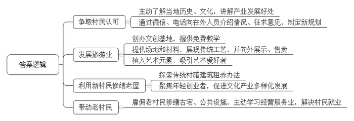
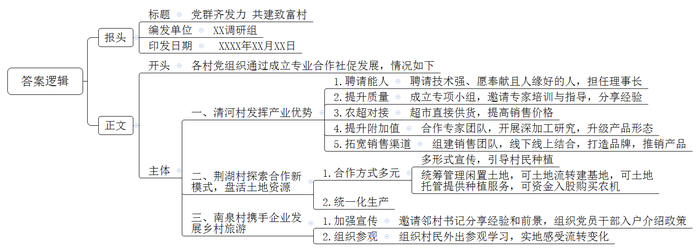
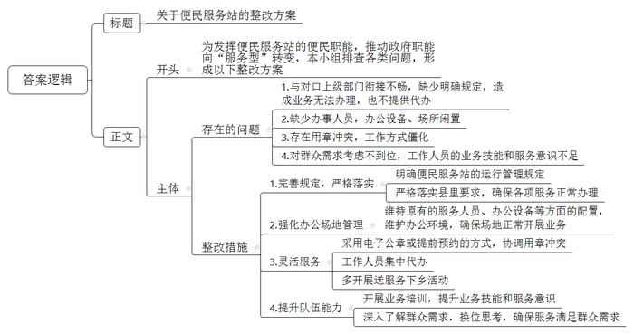
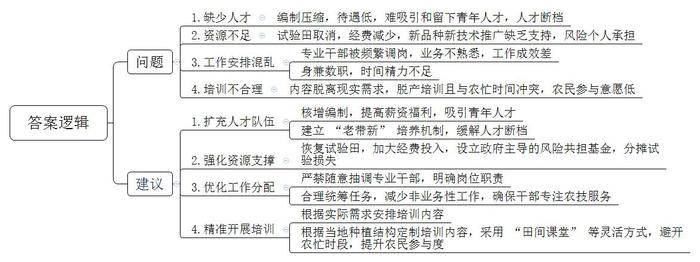

# 2021年公务员多省联考《申论》题（四川上半年乡镇卷）

> 候选采集稿。参考答案及解析来自粉笔页面，不代表官方答案或真实高分答卷；来源使用许可与原卷对应关系仍需人工核实。

## 给定材料

### 材料 material-07fdc0997057c3d8

北山县风河村沿溪而建，村史数百年，村尾的廊桥也已年过百岁。溪流两侧遗存的居民楼一字排开，多数为明清古建筑，都有百年以上的历史，但整体风貌保存完好。

近年来，风河的年轻人外出发展，迁居县城、省城，村里只剩下老人孩子。像风河这样的村子在北山有很多，“北山底子薄，发展只能立足于自身优势。”一位领导回忆起当年决策时说，北山的“优势”，就是传统村落及集群。

2015年，风河村在文创专家团队的指导下，打算以村里的古建筑和廊桥等为依托，发展村落文化创意产业。起初这一想法在村里并没有激起多大的波澜，有不少村民戏谑，“就咱这山脚旮旯，还能整出啥创意来？”“谁愿意到我们这穷乡僻壤来？”

为此，风河村的党员干部逐个上门跟村里的老人们沟通，向他们了解风河的历史和文化传统，跟他们耐心地讲解在风河开展文化创意产业的诸多好处。为让村里在外人员对古村落保护和文化创意有更多了解，村干部专门通过微信、电话等方式向他们介绍相关情况，征求意见建议。有人提出，“发展村落文创产业不是不行，但关键是谁来创这个业？”还有人担心，村里面的人群单一，“没有人进来，创业之后如何能够持续下去？”大家意识到，发展村落文化创意产业的关键是要把人引进来，尤其要引入“新村民”。在多方讨论协商之后，风河村最终以“文创新古村、引凤入风河”为主题，制定了新的发展规划。

以规划为指引，在文创团队的协助下，风河村创办了文创基地“广泰艺术城”，先后在两个村落试点“人人都是艺术家”项目，为村民、游客提供免费油画教学。村里还提供场地和材料，动员村民将剪纸、雕刻等传统手工艺展现出来，并通过村级平台向外界展示、售卖。这不但激发了村民的热情，还吸引了许多游客前来打卡。随着艺术元素的植入，古村旅游风生水起，“广泰艺术城”吸引了众多艺术爱好者纷至沓来，目前已陆续接待国内外驻学人员2万多人次。

村里空置老屋不少，但难就难在老屋早已不适合居住，要拆，业主们不肯；修缮，太费钱，工程还复杂繁琐。两难之下，风河村摸索出了“传统村落建筑租养”的办法。一是村委统一与产权人签订租赁合同，流转老屋的使用权和经营权。二是“新村民”作为老屋承租人同村委签订租赁合同。三是老屋的现代化改造设计由专业团队免费提供，修缮费用由村里垫付，“新村民”分期支付。

2017年8月，冯皓成从南方老家辗转来到风河，成为风河村第一批“新村民”。他选定了两栋溪边老屋，一栋运营书屋，一栋运营咖啡屋。三年多来书屋兼营民宿、文创器物等，已获利超20万元；咖啡屋经营3年多已基本回本。

古村落、古民居的传统环境，以及第一批“新村民”取得的成果，吸引了不少年轻人到此从事互联网文创产业。如今的风河拥有书屋2家、咖啡吧5家、美术馆2个，艺术共享空间和工作室22家，国术馆1家。“新村民”在风河村所从事的文创产业已覆盖影视、传媒、音乐、美术等多个领域。文创产业的愈发兴旺带来的是乡村旅游的人气倍增。在这一过程中，风河变得更加有活力，对老村民的回馈也越来越多。

“从头到尾，老村民都是受益者。”村干部说，“在建设初期，村里的公共设施、‘新村民’认租的古宅都是由村委会雇佣老村民来修建、修缮的，这是他们不用外出打工，在家门口赚到的第一桶金。”游客越来越多，老村民又跟“新村民”学习，经营起餐馆、民宿、小卖部之类，干得风生水起。

“别人‘筑巢引凤’，而我们是‘引凤筑巢’。”有人这样评价。

### 材料 material-f458614dbbc3c381

村级党组织如何带领村民增收致富，有哪些实践探索？D市某部门深入基层进行调研。情况如下：

长桥镇清河村党支部书记聂玉斌谈到，去年4月，村里结合本村传统产业优势，成立了长鲜鱼腥草专业合作社。合作社筹建之初，村里就注意到了孙海新，聘请他担任理事长。“他爱学习肯钻研，种植技术好，亩产值明显高于其他人；他热心肠，为使其他农户受益主动掏钱打井；他性格开朗，在村里人缘好，大家有事都愿意找他说。”于是，聂书记找孙海新谈话，让他接管合作社，带领大家致富。“大家信任我，我就要做出点成绩来。”孙海新干劲十足地说。上任伊始，就成立了鱼腥草质量提升小组，请来县里的专家对农户进行鱼腥草种植技术培训，还下到田间地头进行实地指导，分享种植经验。在他的帮助下，村里的鱼腥草种植质量有了明显提高。他主动与县里的大型超市联系洽谈，成功实现了向超市直接供货，鱼腥草销售价格得到明显提高。为了充分利用好鱼腥草资源，提升鱼腥草附加值，孙海新还与市科院专家团队合作开展鱼腥草深加工研究，推出了凉茶冲剂等系列产品。他组建专门销售市场团队，主打“鱼腥草之乡”的名片，与市内外的商超、医药公司进行联系，推销产品。同时还在线上开设直播间，大力宣传本村鱼腥草系列产品的质量和功效，进行网上直销。经过一段时间的努力，鱼腥草系列产品顺利打开了市场，获得了可观的收入。

“9年前我们成立了荆湖粮食专业合作社，探索‘党支部+合作社+农户+基地’的模式，您可以采取任意方式与我们合作。”柳林镇荆湖村党支部书记刘汉生介绍道，“我们村有200余户村民，地势平坦、土地资源丰富，是个传统的农业种植村，其他自然资源不丰富，主要靠天吃饭，很多村民都长期在外务工，造成了大量土地长期闲置，眼睁睁看着土地闲着，觉得很可惜。我们采取院坝会、走村入户、村直播等形式进行宣传，引导村民种植多种经济作物。对于闲置的土地交由村里统筹管理。现在村民们可以用土地流转、土地托管的方式，也可用资金入股合作社，流转的土地可以建基地，一体化发展多种作物优化产业结构，托管的土地按农户要求提供种植服务，让闲置产生效益，入股的资金购买农机提高生产效率。”

这些年合作社共吸纳社员198人，托管土地近5000亩，流转土地1500多亩。聚合了土地、农机、资金等资源，小田连片大田。去年合作社又出了新招，通过品种、肥料、种植、管理、收获“五统一”，实现了生产成本下降，机械化程度提升，亩产收入增加。合作社经营收入1000万元，合作社社员收入5万元，被评为市级示范合作社。

南泉花海，山花婀娜多姿。丛林探险基地、互动体验式游乐项目，应有尽有……谁曾想到这个每年揽客10万人次的乡村旅游项目险些“难产”。2015年南泉街道南泉村成立馨辉名苑旅游合作社。次年，与花谷生态旅游发展有限公司联合启动南泉花海项目。

“建设初期有一个很大的问题，那就是村民有顾虑不愿意流转土地。为了解决这个难题，村支两委一起想办法。首先我们邀请邻村的王书记过来向村民介绍他们村在土地流转中的具体做法、村民获得的实惠及今后的发展前景，同时我们还组织村支两委成员、共产党员、村级各干部、大学生村官分片分组入户进行宣传，讲明土地流转并不改变村民承包经营等政策。还组织村民走出去到处参观，到阳安长家岭、武陵区玉泉等地参观学习，实地感受土地流转带来的变化。百余村民也边走边看边学，看到了发展机遇。通过多方努力，村民们消除疑点，主动流转上百亩土地，为项目落地、产业发展打下了基础。当时要是没有解决好村民的思想问题，也不会有南泉的今天。”南泉村党总支书记、馨辉名苑乡村旅游专业合作社理事长汪瑞涵说。

### 材料 material-69f496196a452bc1

在传统乡镇布局中，部分乡镇面积小、人口少，但管理机构、干部职数、机构编制、财政投入均不少，行政运行成本较高。合理调整乡镇行政区划有助于统筹设置乡镇服务机构，统一配备服务人员，集中一站式服务，提升公共服务效能。2019年12月，祁河市8个（县）区完成了撤乡并镇行政区划调整，为了充分发挥便民职能，继续服务当地群众，推动乡镇机构职能由“管理型”向“服务型”转变，被撤乡并镇的便民服务站继续保留了下来。

近期，祁河市政府部门陆续收到基层民众反映“便民服务站一点都不便民”的问题，事实究竟怎样？对此，市电视台《阳光问政》节目进行了一次采访。

镜头一：S县赵湾镇罗湖便民服务站

服务站内，办公硬件设施设备齐全，4名工作人员在岗上班，但却无法办理任何业务，并且也不提供代办服务。

“之前我们有对口上级部门，各方面有明确的规定，自从原来的乡撤了之后，上面一直没有安排好，不知道如何衔接。”一名工作人员表示很无奈。

对此，该县乡镇行政区划调整改革领导小组副组长张轩伟说：“在乡镇行政区划调整改革之初，县委、县政府就明确要求，保留设立的乡镇便民服务站要确保服务不减。现在看来，我们的工作确实没有做到位。据了解，这个问题，不仅在赵湾镇罗湖便民服务站存在，在我县其他便民服务站也存在。”

镜头二：T区红河镇双星便民服务站

“这儿可以办准生证吗？”

“准生证办不了，要到镇上的便民服务中心去办。”

“为什么现在办不了？”

“我只给你们解释相关政策，跟你们说在哪里办。”问的人多了，这名工作人员显得有点不耐烦。

这里仅有一名工作人员在岗，但是只会办理医保、社保两项业务，其他业务需到红河镇便民服务中心才能办理。

村民抱怨：“原来办事很齐全，家门口办也很方便，现在服务质量明显不如以前了。”

镜头三：M县张集镇饶河便民服务站

一位村民说：“撤乡并镇之前，乡政府曾承诺，原来便民服务的地点和人员都会保留，但是现在却找不到人办事。”

M县张集镇党委委员李玲解释：“公章只有一枚，我们也不可能把公章放在那边，所以基本上老百姓都是自己到镇上来办理业务。”

“公章的问题，难道没有其他方式解决吗？比如采用电子公章或通过提前预约的方式来协调用章冲突？”记者问。

M县有关领导回应：“实际上这个问题是在服务群众的最后一公里上出现了偏差，也反映了我们为群众考虑不够，我们可以通过其他更灵活的方式来改进服务，比如由工作人员集中代办，尽量让群众少跑路，提高服务质量。”

镜头四：N县大林镇绿树便民服务站

办事窗口的电脑主机已被撤走，办公桌上布满了灰尘，绿植已经枯萎……这里已经停用很长一段时间了。

大林镇镇政府工作人员介绍：“镇上每天都会派干部到这里值守，为村民开展引导服务，告知他们办事要去山下的便民服务中心。”

大林镇党委副书记、镇长朱国伟就便民服务站变为“引导服务站”一事进行了剖析：“我们认为大林镇镇政府所在地是全镇进出的唯一一个口子。山上的群众下来就可以顺便办事，这样既方便了大家，也方便了我们，所以我们的工作安排就出现了偏差，把便民服务站变成了‘引导服务站’。下一步，我们将把便民服务站不便民的问题作为重点工作来改进，多提供‘送服务下乡’活动，以弥补便民服务站的缺失、缺陷，扎实做好乡镇行政区划调整改革的‘后半篇’文章。”

### 材料 material-6a8e6a41fdf0f8a8

为加强全县基层农业专业技术人员队伍建设，D县成立专项调研组进行了走访调研。

“我们的工作，既缺钱，也缺人。”县农业农村局副局长说，“全县基层三农服务岗位有141个编制，目前仅有105人。”“这种情况不是个例。”县水技站站长说，“单位编制不断压缩，如今只剩下‘光杆司令’。”

某乡农服中心主任是农技推广好手，也是省级科技特派员，但近年工作起来愈发感觉“难为无米之炊”。他说，近几年种植的水稻品种效益低，农户种植新品种的意愿强烈，但农服中心却难以推广试种新品种，“原来的试验田已经被取消了，经费也减少了。”这位农服中心主任说，“现在要推广新品种新技术，只能自己去劝服农户，要是种失败了还得个人掏腰包。”

某渔政管理站站长说，为增加百姓收入，他们引导渔民种新品种紫菜，但部分渔民为了多赚一点钱，不按规定时间下苗，最终导致产量下跌40%左右反而责怪站里没有指导好。

“基层技术性岗位待遇低，青年人才不愿意来，来了没几年也要走。”某海岛农服中心主任已经干了26年，正为找不到接任的干部而苦恼。“站里人员断档严重，要么是刚工作的，要么就是我这样工作了二三十年的。”

调研组在基层走访时，常常听到类似的吐槽：“农服中心就剩2（个）人，还都去做其他工作了”“现在负责水利方面工作的，专业是搞村建的”“原来专业搞水利的，被调到财务部门做出纳了”……

一些基层专业干部被频频“挪作他用”，导致旧业务丢掉了，新业务也不熟悉。一位在水利系统工作了22年的水利干部突然被调到海洋渔业部门工作。这位干部说，虽然都和水有关，但工作内容差别较大。刚上任不久，他就接手了“整改违规养殖导致海洋环境污染”的工作，缺少经验的他只好“以文件贯彻文件”，最后被上级批评。

去年秋天，县里指导乡镇开设培训班，要求每户农民都要参加一个月的农技培训。“我们这里种的是茶叶和瓜果，培训内容是竹、菇、菜，培训内容和实际情况不相关。而培训时，正是农忙季节，谁愿意脱产一个月来参加培训？培训有什么用？”某乡镇农技干部说。

“招不来学农的大学生，好不容易招到一个，还留不住。”在走访中，不少农服中心反映“招人难”问题突出。据不完全统计，全县干部队伍中，学农的大学生从事本专业工作的人数不到50%，仅有不足10%的毕业生愿意到乡镇农服中心就业。

有限的农业干部也常常是“身兼数职”，甚至还要承担防汛、防疫等工作。县农服中心主任说：“有个乡镇的农服中心主任还兼着其他几个站所的负责人，根本没有精力研究业务。”调研组在走访中了解到，少了农业人才的支持，无论是农业供给侧改革还是乡村振兴都受到了影响。去年，农民老杨种的辣椒大面积患病，但农技人员赶到现场一看，表示“不熟悉辣椒，无能为力”。最后病害没能控制住，老杨损失了近10万元。

## 题目

### 第 1 题

**根据****“给定资料**1**”，谈谈北山县风河村是怎样“引凤筑巢”的？（****1****0****分****）**

关联材料：材料 material-07fdc0997057c3d8、材料 material-f458614dbbc3c381、材料 material-69f496196a452bc1、材料 material-6a8e6a41fdf0f8a8

作答要求：

要求：全面，准确，有条理，不超过200字。

### 第 2 题

**假如你是调研组的工作人员，请你根据****“给定资料**2**”，****拟****写一份****调研工作的情况简报，供领导参阅****。****（****30****分****）**

关联材料：材料 material-07fdc0997057c3d8、材料 material-f458614dbbc3c381、材料 material-69f496196a452bc1、材料 material-6a8e6a41fdf0f8a8

作答要求：

要求：内容全面，逻辑清晰，行文简洁，不超过400字。

### 第 3 题

**假如你是县乡镇行政区划调整改革领导小组成员****，****请根据****“给定资料**3**”，****就****“便民服务站一点****都****不便民****”，****拟****定****一份整改方案。****（****30****分****）**

关联材料：材料 material-07fdc0997057c3d8、材料 material-f458614dbbc3c381、材料 material-69f496196a452bc1、材料 material-6a8e6a41fdf0f8a8

作答要求：

要求：内容全面，条理清晰，具体可行，不超过400字。

### 第 4 题

**假如你是****D县专项调研组成员，请****根据****“给定资料**4**”，梳理****该****县基层农业专业技术人员队伍存在的主要问题，并提出加强队伍建设的建议。****(3****0****分****)**

关联材料：材料 material-07fdc0997057c3d8、材料 material-f458614dbbc3c381、材料 material-69f496196a452bc1、材料 material-6a8e6a41fdf0f8a8

作答要求：

要求：全面准确，条理清晰，有针对性，具体可行。不超过400字。

## 答案与解析

第 1 题

**参考答案（粉笔题库参考内容）**

1.争取村民认可。主动了解当地历史、文化，讲解产业发展好处；通过微信、电话向在外人员介绍情况、征求意见，制定新规划。

2.发展旅游业。创办文创基地，提供免费教学；提供场地和材料，展现传统工艺，并向外展示、售卖；植入艺术元素，吸引艺术爱好者。

3.利用新村民修缮老屋。探索传统村落建筑租养办法；聚集年轻创业者，促进文化产业多样化发展。

4.带动老村民。雇佣老村民修缮古宅、公共设施，主动学习经营服务业，解决村民就业。

**解析**

**参考答案说明：**本参考答案从“争取村民认可”“发展旅游业”“利用新村民修缮老屋”“带动老村民”等四个方面进行了分条撰写。各条要点之间在内容上相互并列，没有交叉。

  

**考点**：考点概括措施类

**来源**：来源2021年公务员多省联考《申论》题（四川上半年乡镇卷）

粉笔申论页面对本题只提供「解析视频」入口，该入口是会员推广位，页面无视频地址与文字解析。

第 2 题

**参考答案（粉笔题库参考内容）**

党群齐发力 共建致富村

XX调研组 XXXX年XX月XX日

各村党组织通过成立专业合作社促发展，情况如下：

一、清河村发挥产业优势。1.聘请能人。聘请技术强、愿奉献且人缘好的人，担任理事长；2.提升质量。成立专项小组，邀请专家培训与指导，分享经验；3.农超对接。超市直接供货，提高销售价格；4.提升附加值。合作专家团队，开展深加工研究，升级产品形态；5.拓宽销售渠道。组建销售团队，线下线上结合，打造品牌，推销产品。

二、荆湖村探索合作新模式，盘活土地资源。1.合作方式多元。多形式宣传，引导村民种植；统筹管理闲置土地，可土地流转建基地，可土地托管提供种植服务，可资金入股购买农机；2.统一化生产。

三、南泉村携手企业发展乡村旅游。1.加强宣传。邀请邻村书记分享经验和前景，组织党员干部入户介绍政策；2.组织参观。组织村民外出参观学习，实地感受流转变化。

**解析**

**参考答案说明：**（1）格式方面，本参考答案写到了“报头”“正文”两部分，“报头”包括标题、编发单位、印发日期。（2）正文部分，一方面从内容上来看，围绕“村级党组织带领村民增收致富”这一主题，本参考答案的开头介绍了党组织带领村民增收致富的总体举措；主体部分从“清河村发挥产业优势”“荆湖村探索合作新模式，盘活土地资源“南泉村携手企业发展乡村旅游”三个方面展开介绍。另一方面，形式上，本参考答案做到了分段、分条撰写，整体上条理较为清晰。

**考点**：考点总结类

**来源**：来源2021年公务员多省联考《申论》题（四川上半年乡镇卷）

粉笔申论页面对本题只提供「解析视频」入口，该入口是会员推广位，页面无视频地址与文字解析。

第 3 题

**参考答案（粉笔题库参考内容）**

关于便民服务站的整改方案

为发挥便民服务站的便民职能，推动政府职能向“服务型”转变，本小组排查各类问题，形成以下整改方案。

一、存在的问题：1.与对口上级部门衔接不畅，缺少明确规定，造成业务无法办理，也不提供代办。2.缺少办事人员，办公设备、场所闲置。3.存在用章冲突，工作方式僵化。4.对群众需求考虑不到位，工作人员的业务技能和服务意识不足。

二、整改措施：1.完善规定，严格落实。明确便民服务站的运行管理规定；严格落实县里要求，确保各项服务正常办理。2.强化办公场地管理。维持原有的服务人员、办公设备等方面的配置，维护办公环境，确保场地正常开展业务。3.灵活服务。采用电子公章或提前预约的方式，协调用章冲突；工作人员集中代办；多开展送服务下乡活动。4.提升队伍能力。开展业务培训，提升业务技能和服务意识；深入了解群众需求，换位思考，确保服务满足群众需求。

**解析**

**参考答案说明：**（1）格式方面，本参考答案写到了“标题”“正文”。（2）正文部分，一方面从内容来看，围绕着“便民服务站”这一主题，本参考答案的开头先写到了“便民服务站整改方案的背景”；主体部分围绕“存在的问题”“整改措施”两个方面展开。另一方面，形式上，本参考答案做到了分段、分条撰写，整体上条理较为清晰。

**考点**：考点方案类

**来源**：来源2021年公务员多省联考《申论》题（四川上半年乡镇卷）

粉笔申论页面对本题只提供「解析视频」入口，该入口是会员推广位，页面无视频地址与文字解析。

第 4 题

**参考答案（粉笔题库参考内容）**

问题：1.缺少人才。编制压缩，待遇低，难吸引和留下青年人才，人才断档。2.资源不足。试验田取消，经费减少，新品种新技术推广缺乏支持，风险个人承担。3.工作安排混乱。专业干部被频繁调岗，业务不熟悉，工作成效差；身兼数职，时间精力不足。4.培训不合理。内容脱离现实需求，脱产培训且与农忙时间冲突，农民参与意愿低。

建议：1.扩充人才队伍。核增编制，提高薪资福利，吸引青年人才；建立“老带新”培养机制，缓解人才断档。2.强化资源支撑。恢复试验田，加大经费投入，设立政府主导的风险共担基金，分摊试验损失。3.优化工作分配。严禁随意抽调专业干部，明确岗位职责；合理统筹任务，减少非业务性工作，确保干部专注农技服务。4.精准开展培训。根据当地种植结构定制培训内容，采用“田间课堂”等灵活方式，避开农忙时段，提升农民参与度。

**解析**

**参考答案说明**：本参考答案整体上分为“问题”和“对策”两个部分。其中，在“问题”部分，从“缺少人才”“资源不足”“工作安排混”“培训不合理”四个方面进行了分条撰写；在“对策”部分，从“扩充人才队伍”“强化资源支撑”“优化工作分配”“精准开展培训”四个方面进行了分条撰写。各条答案要点之间在内容上相互并列，没有交叉。

**考点**：考点提出对策类

**来源**：来源2021年公务员多省联考《申论》题（四川上半年乡镇卷）

粉笔申论页面对本题只提供「解析视频」入口，该入口是会员推广位，页面无视频地址与文字解析。

