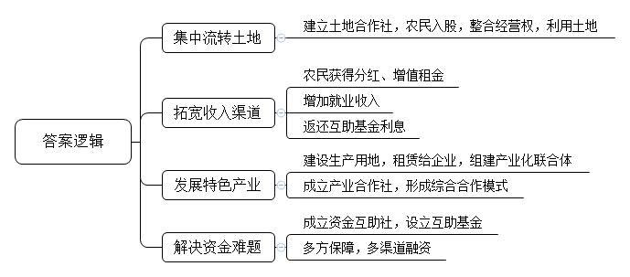
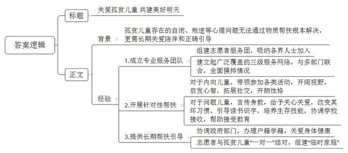
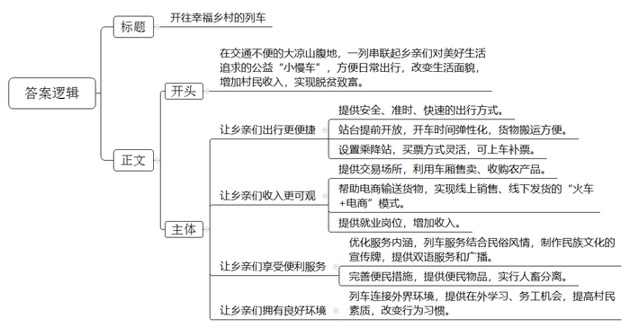
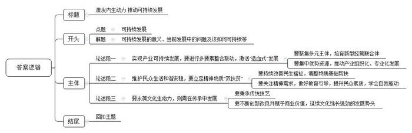

# 2021年公务员多省联考《申论》题（四川上半年省市县卷）

<!-- gwy:overview:start -->
> **四川 · 2021 · 申论 · 上半年省市县卷** ｜ 4 题 · 图片 4 处 · 答案随题折叠

导航：[题目](#题目) · [材料 1](#材料-1)
<!-- gwy:overview:end -->

> 候选采集稿。参考答案及解析来自粉笔页面，不代表官方答案或真实高分答卷；来源使用许可与原卷对应关系仍需人工核实。

## 给定材料

### 材料 1

近年来，长茂村围绕破解人、财、地三个难题，积极推进一系列要素联动改革，逐步从一个发展落后的农业村蝶变为远近闻名的“明星村”。

以前的长茂村是一个传统的农业村，农作物一年两季，一季烤烟，一季稻谷，粗放式耕种方式抗风险能力弱、市场竞争力不强。“一旦遇上了台风，基本就是颗粒无收。”长茂村党支部书记刘振华说，“我们村地处世界长寿之乡，土壤富含‘长寿元素’硒，空气与水质好、温差大，但为何农业却成为‘跛脚’产业？”曾十余次到此走访的农业大学王教授直言，欠发达地区的资源禀赋优势本来就不明显，若是以分散的土地、少量的资金延续传统农业生产形态，收益自然一般。

32岁的黄波是长茂村的致富能手。去年上半年，他一口气向村里的股份合作经济联合社租下40亩地发展木耳种植，“这40亩地，涉及几十户人家，我现在不用一一去谈，只要找村里股份合作经济联合社就行，省去大量沟通成本。”去年以来，为解决承包地分散化、碎片化和低效使用等问题，长茂村建立村级土地合作社。“农民以承包经营权入股，以求将分散在每家每户的耕地经营权‘化零为整’，实现股权到人、股份合作、集体运营。”刘振华介绍，“村级土地合作社以合适的价格集约土地，并将集约后的土地以竞价方式承租出去。对于土地租金增值部分，土地合作社进行二次分配。50%返还给土地出租农户，50%归作集体，用于村里产业发展、关爱老人等公益事业。”

黑木耳产业园是长茂村近些年发展“一村一品”特色产业的缩影。该产业园由长茂村利用集体经济扶持资金与产业帮扶资金投资兴建，总投资约500万元，占地约10亩，实行生产、加工、销售一体化经营。记者在黑木耳产业园看到，几十个村民忙着栽培菌种、制作菌棒、养菌，柳琴就是其中一位。“在这上班，一个月有4000元左右的工资，也能照顾家里。”她笑言。据了解，在前期土地流转基础上，长茂村利用村集体经济建设厂房和种植基地，然后每年以20万元价格租赁给企业，探索“党支部+公司+基地+专业合作社+农户”形式，联手组建产业化联合体。同时，村党支部组织农户成立产业合作社，发展专业化生产，形成生产、供销、信用“三位一体”综合合作模式，有效解决农户传统种植模式风险大、竞争力较弱的问题，为村民提供内有技术、外有销路的产业链服务。

随着乡村振兴战略的推进，农村发展产业有资金需求，但金融机构有规避风险的责任，“钱从哪儿来，怎么才能用好”的问题愈发突出。为此，长茂村按照因地制宜、入社自愿的原则，探索成立长茂村资金互助社，并设立村级互助基金。“互助基金的资金来源为村民自筹、财政支持和社会捐赠三部分，我们实际筹款103万元。”刘振华说。之后，在互助基金中设置100万不动本基金，用于村集体、农业合作社及村民在银行担保贷款，担保贷款总额度为300万元。不动本基金的利息，一部分归村集体，一部分返还给资金互助社社员。“基金担保+村集体审核+银行授信”合作方式，为长茂村带来多渠道、多方式的融资服务，有助于满足农户短期种养、技术设备购买与更新、产业投资等方面的资金需求，也为长茂村股份合作经济联合社开展项目投资提供资金支持。

推进乡村振兴战略，如何释放沉淀资源、推动产业兴旺，是不少乡村遇到的现实难题。在王教授看来，只要思路和方法得当，就能找到适合本地的致富之路，就像把米、红豆、红枣等熬制成八宝粥，能得到更多附加值。长茂村走的正是这样一条路。

### 材料 2

“孩子们的未来无限啊。”孤贫儿童志愿者服务团团长老许从筹备建立孤贫儿童服务团时，就经常念叨这句话。老许从2002年开始就捐资助学、助贫、助残，十几年来捐款捐物已逾千万。2017年，一个患有自闭症的男孩改变了他的想法。因为从小失去父母，男孩一直跟着爷爷奶奶生活，虽然吃穿不愁，但爷爷奶奶外出劳作时，只能将他锁在家里，不让他出门，也不跟村里人来往，更别谈上学。这名6岁的小男孩，已经不能与人正常交流。那时，老许意识到，捐款捐物式的帮扶并不一定能解决多数孤贫儿童的问题，他们也许更需要长期的关爱、陪伴和正确的引导。

在政府有关部门支持下，经过近两年的筹备，A市关心下一代工作委员会（简称“关工委”）孤贫儿童志愿者服务团于2018年3月成立。两年多来，服务团志愿者已达8000余名，他们中既有公务员、教育工作者、医护人员以及“五老”（老干部、老战士、老专家、老教师、老模范）人员，也有企业老板、个体经营者等人员。服务团构建起了覆盖A市11个县区、150个镇街的三级帮扶志愿服务网络。服务团的志愿者配合当地民政、公安、妇联等部门组织的摸排调查工作，走遍了A市9000余个村庄，走访9万余人次，对全市0至15岁的孤儿、事实孤儿、特困儿童、单亲父母无劳动能力和父母残疾无经济来源家庭儿童等进行全面摸排，共摸排出5231名符合帮扶条件的孩子。通过调查梳理发现：80％的孤贫儿童自卑、自闭、不自信，其中又有5％的因抑郁而产生自杀倾向；另有3％的孤贫儿童性格逆反、有暴力倾向；还有2％的孤贫儿童经常遭遇家庭暴力。

A市某县有2名孤贫儿童，姐姐小玲，11岁；妹妹小洁，9岁。小洁出生后父母相继过世，奶奶、姑姑便承担起了监护职责，但她们对孩子的安全过于在意，很少让她们外出。孩子们性格内向，不愿与人交流。对接她们的志愿者熊涛了解到，长期处于这样的环境，对孩子的成长非常不利，除了辅导学习、捐赠书籍，还必须让孩子走出家庭，开阔视野，启发心智。于是，他多次找机会带这两个孩子参加各类活动。去年国庆假期，熊涛带小玲、小洁参加了“航空航天科普展”，让她们与1200名孤贫儿童一起，观看卫星返回舱模型、体验VR时空穿梭，向科学家提问题，无所顾忌地玩、聚精会神地学。寒假时，小玲、小洁与全县孤贫儿童一起，走进革命旧址、观看红色展馆，在孟良崮、大青山、红嫂故里，接受爱党、爱国、爱家乡的教育。经过这些活动，这两个孩子结识了许多新朋友，性格也开朗了，回到学校还主动向同学介绍“红嫂”的故事。

帮扶问题儿童也是孤贫儿童志愿者服务团的重要任务。很多孩子因为家庭的原因，养成了逃学、撒谎等坏习惯。为了帮助孩子改掉这些毛病，志愿者郑得全费了不少心思。现在，他的家已经变成了一个特殊教育基地。阳光充足的大客厅，中间有两张长长的课桌，多排书架靠墙而立，卧室放置了架子床。这里，常年住着10多个“问题儿童”。“他们各有各的问题，有的是小偷小摸，有的是重度网瘾，而且基本上不太识字。”郑得全说，他就是要通过自己的言传身教和关心关爱影响他们、改变他们。

15岁的阿木在父母去世后常年到处游荡。他刚到郑得全家时，一天能往外跑五六趟，每一次，郑得全和妻子都要把他找回来，耐心细致地和他谈心。一个下大雨的晚上，阿木又不见了，郑得全一直找到凌晨3点，最后才在自家一楼的楼道里发现了他。当时，郑得全就对阿木说了一句话:“回来了，饿了吧，快吃点东西吧。”从此，阿木再也没跑过。阿木每天认真识字、读书，还成了家里的大厨。“明年，郑叔就把我送到技校学汽修，毕业后我就开家修理厂，好好挣钱。”阿木说，“等我长大有了孩子，就让郑叔和婶子来教育孩子。”

自成立以来，孤贫儿童志愿者服务团先后帮扶了150多名问题儿童。在帮扶时，志愿者主动协调一些学校接收他们，特别是没有人看管的孩子。此外，他们还协调公安、教育、医疗等部门，为孤贫儿童办户籍、办学籍、做视力矫正、购买意外伤害保险等。迄今为止，共帮助200多名孩子落上了户口。目前，志愿者已与4000多名孤贫儿童实现了“一对一”结对，组建了“临时家庭”，对每个孩子实行长期帮扶引导。老许说：“今后，我们将探索更多的工作方法，撬动更多的资源，加大帮扶力度，惠及更多儿童。”

### 材料 3

77岁的彝族老阿妈克迟莫，乘坐5619次列车从下普雄前往上普雄走访亲戚。阿妈很爱笑，也很健谈，因为牙齿几乎掉光，她笑着的时候总是害羞地抿着双唇。她说：“1968年，25岁从上普雄嫁到了下普雄，走了一天多的山路，才到夫家。两年后的1970年，‘小慢车’开了，40多分钟就可以回娘家。”尽管最近几年山里的大多数村子都修了公路，但是大凉山区经常出现落石、滑坡和泥石流等地质灾害，阻断公路，冬季也经常封路。对于大凉山深处的彝族老乡们来说，“小慢车”还是最安全、时间最有保障的出行方式，很多时候也是唯一的出行方式。“即使某些区段因为各种原因无法通行，我们也会保障其他区段的运行。”乘务员阿呷说。

在过去的几十年间，“小慢车”早已彻底融入当地人的日常生活。作为孩子们的校车，当地人的赶集车、公交车、婚车……这趟列车也在用“润物无声”的方式支持着大凉山区的脱贫攻坚。即使是普通话不流利的彝族老乡，也会在听到“小慢车”三个字时，第一时间吐出一个“好”字。

2020年是成昆铁路通车50周年，作为服务民族地区、助推地方经济、巩固国防建设的钢铁大动脉，成昆铁路串起了沿线群众的幸福生活。5619/20次和5633/4次两辆公益性“小慢车”与成昆线同龄，在悠长岁月里传承“铸道精神”，穿行于大凉山腹地，最长运行里程353公里，停靠26个车站，自1995年以来票价从未变过，最高25.5元，最低2元。5619次、5633次“小慢车”串联起彝族老乡们对美好生活的追求。一张张朴实无华的笑脸，让“小慢车”充满了阳光和温度。

3月开始，正是大凉山采收蕨菜、青岗藤、蒲公英、党参等土特产的季节。5633次尼波站开车后各车厢大件行李处都堆满了农产品。有的时候，这些土特产在“小慢车”上就完成了交易，老乡们在车厢里拿出秤杆子，当场称重交易，省时又省力，在到达终点前就已经把手上的土特产出售一空。阿莫此次乘车目的是收购蕨菜，他的随身物品很简单，一个皮质挎包、一杆秤。他穿梭在车厢里，不断寻找心仪之物，终于在8号车厢的大件行李处找到了几大包新鲜水嫩的蕨菜，在与货主沟通后，阿莫拿出秤杆子，一袋一袋地称了起来，这一趟阿莫收购了300多斤蕨菜。与阿莫同村的阿西，选择了“火车+电商”的新路，不再依靠坐火车运输货物赚钱了。他开办猪场，制作凉山猪腊肉，在电商平台销售，然后用火车把腊肉运到县城去发快递。今年春节，他的几千斤腊肉几乎销售一空，挣了几万块钱。

为了供阿树上学，父母通过“小慢车”销售家里种植的烤烟、土豆、玉米，他们最大的心愿就是阿树能找到一份稳定的工作。2017年，铁路部门履行扶贫承诺来到学校招工，阿树与另外5名彝族同学脱颖而出，成为“小慢车”的乘务员，得知儿子能够在“铁路部门”上班的消息，一家人都高兴坏了，妈妈说，这下阿树既找到了稳定的工作，又缓解了家里的经济压力。从乘客变为铁路人，“小慢车”一直温暖着这位青年的心。

近年来，“小慢车”列车党支部围绕精神文明建设和精准扶贫，积极促进民族团结进步，不断优化“彝乡情”服务内涵，完善便民利民措施，将民俗风情与列车服务举措结合，设计制作了带有彝族文化元素的揭示揭挂，列车方向牌和车内引导标识都标注了彝汉双语。同时，班组服务小分队坚持到车厢、到座位进行安全服务和文明乘车宣传，一并提供针线包、胶带、捆扎绳等便民物品，车内乘务员“彝语”“汉语”双语言上岗，列车广播增加了彝汉双语播报服务。为了方便日常彝族老乡运输家禽、牲口，“小慢车”贴心地在行李车厢增设了牲畜拴挂处，每趟车进行消毒，实现了牲畜与旅客分开，让车厢环境更卫生、整洁。

为了让彝族老乡能把所有东西搬上车，有的车站还会提前开放站台，让老乡先把货物堆在车门前，有时这趟列车的开车时间会推迟几分钟。“我们这种车时间弹性大，不像高铁，都是按秒计算的。”列车员称，“和多数人熟悉的先买票再上火车的流程略有不同，‘小慢车’一路停靠的大多数车站都只能被称为乘降站，也就是可以上下车但不具有售票资格的车站，乘客从乘降站上车后再在车上补票。”

在阿呷看来，教育是阻断贫困的最重要的途径。现在更多彝族孩子能够走进教室，更多年轻人能够走出大山到外面学习、务工，这些都是让当地更快发展的希望。教育进步带来的最直接的变化就是在列车上随地吐痰、乱扔果皮、在车厢里抽烟的人少了，即使有，列车员的劝告也会被听进去。“以前打扫车厢卫生都是用铁铲的，甘蔗上市的时候，地上全是甘蔗渣滓，黏脚。”阿呷已在5633/4次列车上工作了20多年。“工作的时候，其实就像在串亲戚，讲讲自家的喜事和烦心事，更能看到家乡正走在乡村振兴的路上。”她说，她喜欢在列车上的工作和生活。<u>这是一辆开往春天的列车，为乡亲们带来了温暖和希望。</u>

### 材料 4

青茂古镇有王陶然剪不断的情愫，她的童年就是在那里度过的。那时，她外公是镇里有名的陶匠，外婆则是造纸高手。外公外婆还经常教她做陶、造纸。

长大后，王陶然一直在外打拼，虽然事业发展得不错，但在青茂度过的童年，却成了她挥之不去的记忆。于是，她产生了回青茂发展的念头。“那么，回青茂，我应该做点什么呢？”王陶然反复问自己。好在王陶然有基础，加上她寻访到熟悉古法造纸传统技艺的老艺人，这项传统技艺很快就在青茂古镇复活了。2016年8月，王陶然的“青茂人家”作坊在青茂古镇正式开张，她以古法造纸创新体验和相关产品生产销售为主，致力传承青茂独具特色却濒临失传的构树皮造纸手工技艺。

可是，<u>复活容易，活好难</u>。如何添加新元素，让这项古老的传统技艺焕发出生机活力？于是，她去拜访一位有名的书画家，请他当“青茂人家”的顾问。依照他的指点，王陶然按创作山水画的布局，将南瓜叶剪成荷叶，玉米叶剪成月亮，压到纸上去，再淋上一层纸浆，一幅“小荷残月”便做成了。刚做出时，还是挺好看的，能看出南瓜叶和玉米叶。王陶然欣喜不已。可纸上的水干了后，就变成了只是有纹理的纸。正当王陶然心情沮丧的时候，她突然发现，纸上的“小荷残月”在灯光的照射下，散发出植物特有的光泽，整张纸也多了艺术的质感。

受此启发，王陶然又请了当地几位书画家进行创作。她还去省外参观学习并买下比较好的作品，回来不断地进行技术改良，经过努力，“青茂人家”创作出来的作品更加精致、更有艺术感。王陶然还不满足，又带着作品四处参展，既展示自己的东西，又学习外面的经验。在学习中，王陶然更加深刻地认识到，要做到出类拔萃，创作上一定要有新意。有一次，她发现一位刚从国画专业毕业的大学生的作品很有创意，就邀请他参与创作，小伙子爽快地答应了，不久就创作出一幅作品，效果出奇的好。在一次展览中，顾客争相购买，甚至出价到上万元，但王陶然没有卖，她觉得这样的作品应该留下去感染更多的人，让他们体会古法造纸创新的无穷魅力。

接下来，小伙子又把梵高的《星空》等世界名画搬到了王陶然的纸上。可“青茂人家”的其他顾问觉得，不能只是机械地临摹，要把梵高的星空，变成青茂的星空，星空下面必须是青茂的大地、是青茂的山川河流、稻田民居……修改之后，大家再次品味。初一看，是梵高的画，但仔细一瞧，是青茂的风景，大家都拍案叫好。此时的纸，还是一张纸；此时的纸，不再是一张纸。此时的纸上，是青茂；此时的纸上，又不光是青茂。

近几年，来青茂古镇的游客越来越多，王陶然又想着把古法造纸技艺转化成青茂古镇的旅游商品。一方面，游客喜欢这种真花真叶的古纸艺术，另一方面，也能更好地宣传和推广古法造纸。她说：“古法造纸是非物质文化遗产，我们通过创新让它与现代人更加紧密的联系起来，让这个1000多年以前的传统技艺焕发新的生命力。”

经过3年多的努力，王陶然的“青茂人家”已从当年的个人作坊发展成拥有10多名员工的文创公司，公司也已经从2020年开始盈利，同时还带动了一批青茂本地居民参与文创产业。如今，王陶然正在把青茂的传统特色文化，通过多种方式传递出去。目前，古镇相关部门正在帮助“青茂人家”规划建设原料基地、生产区和体验区。王陶然还计划发挥之前的外学的酿酒技术，打造“青茂酒业”带动更多家乡群众就近就地就业。一张纸，为青茂带来了很多很多……

## 题目

### 第 1 题

**根据“给定资料1”，请你谈谈长茂村由发展落后的农业村蝶变为远近闻名的“明星村”的原因。(10分)**

关联材料：材料 1

作答要求：

要求：全面、准确、有条理。不超过150字。

第 1 题 · 答案与解析

**参考答案（粉笔题库参考内容）**

1.集中流转土地。建立土地合作社，农民入股，整合经营权，利用土地。

2.拓宽收入渠道。农民获得分红、增值租金；增加就业收入；返还互助基金利息。

3.发展特色产业。建设生产用地，租赁给企业，组建产业化联合体；成立产业合作社，形成综合合作模式。

4.解决资金难题。成立资金互助社，设立互助基金；多方保障，多渠道融资。

**解析**

**参考答案说明：**本参考答案在内容上从“集中流转土地”“拓宽收入渠道”“发展特色产业”“解决资金难题”四个方面分类概括要点；形式上，对要点按照四个分类进行了整合，并且将每类中具有总括性的要点前置，符合题干中“有条理”这一要求。

**考点**：原因类

**来源**：2021年公务员多省联考《申论》题（四川上半年省市县卷）

### 第 2 题

**省里准备召开孤贫儿童帮扶工作经验交流座谈会。假如你将代表A市在座谈会上发言，请根据“给定资料2”拟写一份座谈会上的发言提纲。（20分）**

关联材料：材料 2

作答要求：

要求：内容全面、逻辑清晰、条理清楚。不超过300字。

第 2 题 · 答案与解析

**参考答案（粉笔题库参考内容）**

关爱孤贫儿童 共建美好明天

一、背景：孤贫儿童存在的自闭、叛逆等心理问题无法通过物质帮扶根本解决，更需长期关爱陪伴和正确引导。

二、经验：1.成立专业服务团队。组建志愿者服务团，吸纳各界人士加入；建立起广泛覆盖的三级服务网络，与多部门联合，全面摸排情况。2.开展针对性帮扶。对于内向儿童，带领参加各类活动，开阔视野，启发心智，拓展社交，开朗性格；对于问题儿童，言传身教，给予关心关爱，改变其坏习惯，引导读书识字，培养生存技能，协调学校接收，帮助接受教育。3.提供长期帮扶引导。协调政府部门，办理户籍学籍，关爱身体健康；志愿者与孤贫儿童“一对一”结对，组建“临时家庭”。

**解析**

**参考答案说明：**（1）格式方面，本参考答案写到了标题、正文。（2）正文部分，一方面从内容来看，围绕着“关爱孤贫儿童”这一主题，本参考答案先写到了“背景”，又从“成立专业服务团队”“开展针对性帮扶”“提供长期帮扶引导”三个方面介绍了A市在孤贫儿童帮扶工作的经验做法。另一方面，形式上，本参考答案做到了分段、分条撰写，整体上条理较为清晰。

**考点**：总结类

**来源**：2021年公务员多省联考《申论》题（四川上半年省市县卷）

### 第 3 题

**请结合“给定资料3”，根据你对划线句子“这是一辆开往春天的列车，为乡亲们带来了温暖和希望”的理解，撰写一篇短评。（30分）**

关联材料：材料 3

作答要求：

要求：观点鲜明、简明扼要、语言生动。不超过400字。

第 3 题 · 答案与解析

**参考答案（粉笔题库参考内容）**

开往幸福乡村的列车

在交通不便的大凉山腹地，一列串联起乡亲们对美好生活追求的公益“小慢车”，方便日常出行，改变生活面貌，增加村民收入，实现脱贫致富。

让乡亲们出行更便捷。提供安全、准时、快速的出行方式；站台提前开放，开车时间弹性化，货物搬运方便；设置乘降站，买票方式灵活，可上车补票。

让乡亲们收入更可观。提供交易场所，利用车厢售卖、收购农产品；帮助电商输送货物，实现线上销售、线下发货的“火车+电商”模式；提供就业岗位，增加收入。

让乡亲们享受便利服务。优化服务内涵，列车服务结合民俗风情，制作民族文化的宣传牌，提供双语服务和广播；完善便民措施，提供便民物品，实行人畜分离。

让乡亲们拥有良好环境。列车连接外界环境，提供在外学习、务工机会，提高村民素质，改变行为习惯。

**解析**

**参考答案说明：**（1）格式方面，本参考答案包括标题、正文，符合短评的形式。（2）正文部分，一方面从内容来看，围绕“‘小慢车’的开通带来的积极影响”这一主题，本参考答案的开头先针对“这是一辆开往春天的列车，为乡亲们带来了温暖和希望”这句话进行了阐述；主体部分，从“让乡亲们出行更便捷”“让乡亲们收入更可观”“让乡亲们享受便利服务”“让乡亲们拥有良好环境”四个方面介绍了“小慢车”的开通为乡亲们带来的积极影响。另一方面，形式上，本参考答案做到了分段、分条撰写，整体上条理较为清晰。（3）本参考答案能够结合题目要求“简明扼要”“语言生动”，在语言表达上做到了简洁、流畅，有感染力。

**考点**：评论类

**来源**：2021年公务员多省联考《申论》题（四川上半年省市县卷）

### 第 4 题

**“给定资料4”中提到“复活容易，活好难”。请你深入思考这句话，结合“给定资料1\-4”，联系实际，自选角度，自拟题目，写一篇议论文。(40分)**

关联材料：材料 1、材料 2、材料 3、材料 4

作答要求：

要求：

（1）观点正确，见解深刻；

（2）思路清晰，结构完整；

（3）语言流畅，书写工整；

（4）字数800-1000字。

第 4 题 · 答案与解析

**参考答案（粉笔题库参考内容）**

**激发内生动力** **推动可持续发展**

“复活容易，活好难”，告诫我们不能把改革目标简单地定位为“活着”，更重要的是要能激发各项事业的发展源动力，实现全面振兴、稳健前行。然而当前产业规模小而散、社会公共服务不健全、文化重传承不重革新等问题，都反应了当前的发展缺少预见性、长远性，难以实现祖国昌盛的百年大计。**显而易见，这个时代的主旋律就是要激发内生动力，实现多领域可持续发展。**

**实现产业可持续发展，要进行多要素整合联动，激活“造血式”发展。不仅要聚集多元主体，培育新型经营联合体，还要集中优势资源，推动产业组织化、专业化发展。**过去农业生产以分散式小农经济为主，不懂得合理利用生产资源，无论怎样精耕细作，产业发展都停留在粗放式阶段，靠山吃山，稳定性极差。要想实现产业高效、长远发展，就要变被动为主动，建立利益联结机制，推动经济组织与农户合作，组建经营联合体，实现“自我驱动”，同时整合技术、市场、土地、劳动力等要素资源，以市场为导向，提供技术支撑，进行专业化、集约化、规模化发展。

**维护民众生活和谐安稳，要立足精神物质“双扶贫”。不仅要持续改善民生福祉，更要关注精神需求，做好教育引导，提升民众素质，学会自我驱动。**“物质基础决定上层建筑”，近年来我们完善了包括低保、医疗保险在内的社会保障体系，给予群众生活基本兜底保证，但“等靠要”等思想也一直难以杜绝，使得民生服务陷入“单一供给式”的困境。故此，民生发展更应优化服务内涵，加强思想情感的融入及优秀文明的传播，将知识型教育与应用型教育并重，帮助立志与扶智，真正开阔视野、启发心智，实现造血式发展。

**要永葆文化生命力，则需在传承中发展。我们在秉承传统技艺的同时，要不断创新改良并赋予商业价值，延续文化绵长强劲的发展势头。**正如北京京剧院不仅重视对传统经典剧目的传承，壮大了各大京剧流派传人的队伍；更在发展过程中将创新精神运用于京剧艺术创作的方方面面，比如实行项目制、探索京剧小剧场，提高经营收入，同时开展“唱响之旅”“魅力春天”等活动，形成品牌效应，传统文化在守正和创新中实现持续发展。传中有创、新中有承，传承与创新共同促进文化的发展，增强文化的内生动力，让文化永葆生机。

基础铺路并非难事，长久稳健才是硬道理。在追求胜利的道路上，实现产业百年、长治久安、文化永续的发展局面才是我们为之奋斗的不竭动力！

**文章分析**

**激发内生动力** **推动可持续发展**

【**标题的优点：**标题中含有“可持续发展”这一主题词，使文章主题更突出、清晰。】

（1）“复活容易，活好难”，告诫我们<u>不能把改革目标简单地定位为“活着”</u>，更重要的是要能<u>激发各项事业的发展源动力</u>，实现<u>全面振兴、稳健前行</u>。（2）然而当前产业规模小而散、社会公共服务不健全、文化重传承不重革新等问题，都反应了<u>当前的发展缺少预见性、长远性</u>，<u>难以实现祖国昌盛的百年大计</u>。（3）**显而易见，这个时代的主旋律就是要激发内生动力，实现多领域可持续发展。**

【**开头的优点：**★内容方面。范文的开头是紧扣题目中“可持续发展”这一主题展开的。首先，对题干划线句子进行简单释义；其次，通过分析当前各方面发展存在的问题引出论点，即指明“活得好”指的是应当激发内生动力，实现多领域可持续发展，为后文的分论点作铺垫。★文字表达方面。使用了“然而”“更”等连接词，使语言表达有逻辑性。】

**实现产业可持续发展，要进行多要素整合联动，激活“造血式”发展。不仅要聚集多元主体，培育新型经营联合体，还要集中优势资源，推动产业组织化、专业化发展。**（1）过去农业生产以分散式小农经济为主，不懂得合理利用生产资源，无论怎样精耕细作，<u>产业发展都停留在粗放式阶段</u>，靠山吃山，稳定性极差。（2）要想实现产业高效、长远发展，<u>就要变被动为主动</u>，<u>建立利益联结机制</u>，推<u>动经济组织与农户合作</u>，<u>组建经营联合体</u>，<u>实现</u>“<u>自我驱动</u>”，同时<u>整合技术</u>、<u>市场</u>、<u>土地</u>、<u>劳动力等要素资源</u>，以市场为导向，提供技术支撑，进行<u>专业化</u>、<u>集约化</u>、<u>规模化发展</u>。

【**论述段1的优点：**★观点句：范文的观点句是紧扣“可持续发展”这一文章主题提出的。形式上，它在段首处直接写出，位置突出，容易发现。内容上，关键词突出，内容要点明确，可以明显看出它侧重于“产业可持续在于多要素联动”。★论述内容：（1）先从人的层次提出要聚集多元主体，培育新型经营联合体；（2）再从物的角度指明要集中优势资源，推动产业组织化、专业化发展。注意：以上两个方面层次清晰，论述的针对性强。在论述方法上主要采用了讲道理、举例子相结合的方式。】

**维护民众生活和谐安稳，要立足精神物质“双扶贫”。不仅要持续改善民生福祉，更要关注精神需求，做好教育引导，提升民众素质，学会自我驱动。**（1）“<u>物质基础决定上层建筑</u>”，近年来我们完善了包括低保、医疗保险在内的社会保障体系，给予群众生活基本兜底保证，但“等靠要”等思想也一直难以杜绝，使得<u>民生服务陷入</u>“<u>单一供给式</u>”<u>的困境</u>。（2）故此，民生发展更应<u>优化服务内涵</u>，<u>加强思想情感的融入及优秀文明的传播</u>，将知识型教育与应用型教育并重，帮助<u>立志与扶智</u>，真正开阔视野、启发心智，实现<u>造血式发展</u>。

【**论述段2的优点：**★观点句：范文的观点句是紧扣“可持续发展”这一文章主题提出的。形式上，它在段首处直接写出，位置突出，容易发现。内容上，关键词突出，内容要点明确，可以明显看出它是从“民生和谐安稳”出发。★论述内容：（1）先调整物质基础帮扶为基础，持续改善民生福祉；（2）更要关注精神需求，做好教育引导，提升民众素质，学会自我驱动。注意：以上几个方面的内容都是紧扣观点句进行分析论述的，论述的针对性强，内容层次丰富。】

**要永葆文化生命力，则需在传承中发展。我们在秉承传统技艺的同时，要不断创新改良并赋予商业价值，延续文化绵长强劲的发展势头。**（1）正如北京京剧院不仅重视对<u>传统经典剧目的传承</u>，壮大了各大京剧流派传人的队伍；（2）更在发展过程中将创新精神运用于京剧艺术创作的方方面面，比如实行项目制、探索京剧小剧场，提高经营收入，同时开展“唱响之旅”“魅力春天”等活动，<u>形成品牌效应</u>，<u>传统文化在守正和创新中实现持续发展</u>。<u>传中有创</u>、<u>新中有承</u>，<u>传承与创新共同促进文化的发展</u>，<u>增强文化的内生动力</u>，让文化永葆生机。

【**论述段3的优点：**★观点句：范文的观点句是紧扣“可持续发展”这一文章主题提出的。形式上，它在段首处直接写出，位置突出，容易发现。内容上，关键词突出，内容要点明确，可以明显看出它是从“永葆文化生命力”入手。★论述内容：（1）介绍文化的可持续应秉承传统技艺。（2）介绍文化想延续文化绵长强劲的发展势头，要不断创新改良并赋予商业价值。注意：以上几个方面的内容都是紧扣观点句进行分析论述的，论述的针对性强，内容层次丰富。在论述方法上采用了讲道理、举例子相结合，做到了丰富多样。】

【**论述段之间的关系：**★内容的内在逻辑：论述段1从产业层面论证可持续发展，论述段2从民生层面论证可持续发展，论述段3从文化层面论证可持续发展。三个论述段相互并列，逻辑清晰。】

基础铺路并非难事，长久稳健才是硬道理。在追求胜利的道路上，实现<u>产业百年</u>、<u>长治久安</u>、<u>文化永续</u>的发展局面才是我们为之奋斗的不竭动力！

【**结尾的优点**：范文的结尾回扣了“可持续发展”这个主题词，语言精悍，不拖沓。】

**解析状态：unknown（来源未提供）**

**考点**：文章写作题

**来源**：2021年公务员多省联考《申论》题（四川上半年省市县卷）

