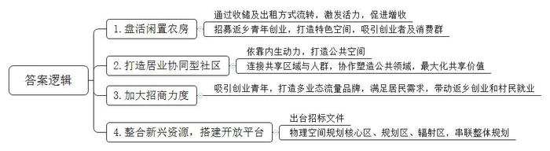
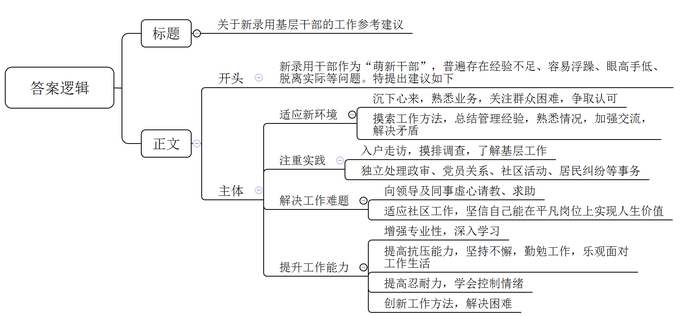
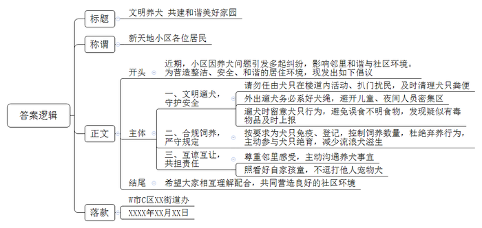
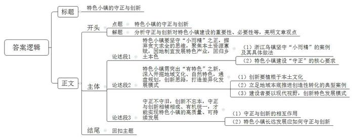

# 2021年四川省公考《申论》题（下半年乡镇卷）

<!-- gwy:overview:start -->
> **四川 · 2021 · 申论 · 下半年乡镇卷** ｜ 4 题 · 图片 4 处 · 答案随题折叠

导航：[题目](#题目) · [材料 1](#材料-1)
<!-- gwy:overview:end -->

> 候选采集稿。参考答案及解析来自粉笔页面，不代表官方答案或真实高分答卷；来源使用许可与原卷对应关系仍需人工核实。

## 给定材料

### 材料 1

田园空阔无桃李，一段春光属菜花。2021年的4月，X区薛家镇任葛村正沐浴在一片春的气息里。蓝天白云，黑瓦白墙，乡间小路两旁的油菜花，迎风摇曳出一片金黄，与这个美丽乡村的名字不期而遇——花开西庄。美丽乡村，是实施乡村振兴战略的重要抓手。近年来，薛家镇另辟蹊径，积极推进任葛村老西庄美丽乡村试点，以“花开西庄”打造品牌文化的美丽乡村2.0版，为乡村振兴注入活力。

随着“叮”的一声，烤箱里的牛角面包好了，整个甜品店里，满是香甜的气息。薛家镇任葛村老西庄内，“赵小姐的甜品屋”主理人赵洁正在为客人预订的手工面包忙碌着。今年以来，“返乡创业青年”的标签让赵洁的甜品屋生意日臻红火，而她这间60多平方米的甜品屋，在一年多前还是一间闲置破败的农村老宅。闲置农房的华丽转身，源自薛家镇打造美丽乡村的机遇。村民钱小明是这间房的原屋主，他连说“没想到”：家中闲置了多年的车库，成了村里的“网红”甜品店，拉动了人气。

老西庄村是薛家镇任葛村的下辖自然村，以前是一个传统农耕村。年轻人都外出打工了，村里住的大多是留守老人和外来打工者，老房子大多闲置或者出租。这些闲置的农村住房、厂房、村集体用房破旧不堪，要修缮很费钱，弃之拆之又可惜。如何变资源为资产，这成为老西庄思考的现实问题。薛家镇副镇长唐刚表示，老西庄的资源禀赋和产业优势并不突出，但是通过收储及出租的方式对闲置老房屋进行流转，激发了乡村活力。“目前，全村已盘活8000多平方米闲置农房。”任葛村党总支副书记查宇翔说，每年能为村委带来70万元的集体增收。

“盘活闲置农房，怎么‘活’起来是关键。不是只赋予它一个外观，而是要找来会造血的人，真正发挥价值。”于是，他们有了“招募返乡青年创业”的思路，“年轻人，有干劲，思路活，一定能赋予我们老房子新的生机。”事实证明，薛家镇的思路没错！如今，咖啡馆、美术馆、初心小院、喜马拉雅乡村书屋、乡创学院、“羊萝卜”艺术牧场等特色空间点缀其间，吸引了一拨又一拨创业者，引来一波又一波消费群。

过去一提乡村振兴，大部分乡村都习惯了旅游导向，引进几家民宿来就万事大吉。但在村里人看来，美丽乡村并不仅仅是风景美。尤其是对于西庄而言，这里离城市那么近，为什么客人要住在这个完全没有特色的村子，而不去城里？再说，城里的酒店也不贵。和吸引游客来玩的网红打卡点不同，西庄的模式是“居业协同型社区”——依靠内生动力而不是外力，即通过寻找社区中人的力量，打造公共空间；同时，加强共享区域与人群的连接，通过协作流程塑造公共领域，最大化共享价值。

时任薛家镇党委书记徐俊邀约镇文创办主任朱莉一起来做这场乡村实验。朱莉带领团队经过3个多月的蹲点调研，发现西庄位于奔牛、罗溪、薛家3个镇的中间，周边不到十分钟车程有15万人群，3000多家公司里有100多家外企，产值超亿元企业65家，90%税收由实体工业企业贡献。小城镇可支配收入很高，居民消费愿望强烈，渴望和城里人享受一样的生活。

但与之不匹配的是，镇上根本没有他们想要的东西，咖啡馆也没有，更别提城里的美好东西了。为此，当地政府进行了大力招商。在老西庄，像赵洁这样的返乡青年并不止一位。“不论是文化、艺术、美食何种形式，都只是一个业态；来我们这里创业的青年，大部分已经在当地扎根，每个品牌都有自带的‘流量’。”朱莉说，“乡村，是这些创业者在城市之外开拓业务的另一方天地，在这里，他们可以带动返乡创业和本村村民就业，实现乡村产业振兴。”让周边的上班族吃到城里的“网红饭”，喝到好的咖啡豆，村里阿姨还能参加花艺课——“我也享受到了和城里人一样的社交”，这是当地人最自豪的。

在记者看来，“花开西庄”在短期内爆红，源于一个开放的政府。当地政府整合了新兴资源，搭建了一个开放的平台。薛家镇人民政府的一份招标文件显示：为高质量实施任葛村老西庄“美丽乡村”建设，完善顶层设计，准备编制薛家镇任葛村老西庄“美丽乡村”规划，从物理空间规划上确定先期启动-核心区，近期打造-规划区，远期愿景-辐射区，把老西庄美丽乡村和吕丁萝卜干文创工场区域、丁家稻场区域串联成整体规划。没有民宿入驻，没有网红带流量，全部自生。政府不再是传统的政府，这是乡村振兴的关键引擎。

### 材料 2

新录用干部入职基层，作为“萌新干部”，不可避免存在学历较高但经验不足、思想活跃但容易浮躁、充满干劲但眼高手低、富于创新但容易脱离实际等特点，年轻的社区工作者需要在基层一线经风雨、见世面，才能熟悉基层，增长才干，在将来挑起重担。

下面是一批从事社区工作的年轻人，讲述他们的工作体会。

讲述人：张琳琳，26岁，A省H市南山街道红岗社区城管协管员

大学毕业后来到社区工作，发现这里跟自己想象中的完全不一样，上班第一个月就累瘦了8斤。刚来时很不适应，甚至还想过辞职不干了，但是后来在社区前辈的鼓励下，慢慢地能够沉下心来，从不熟悉业务到慢慢进入角色，现在满脑子想的都是怎样为老百姓解决困难，怎么让老百姓认识并认可自己。日子长了，自己也摸索出了不少方法，有了自己的一套“管理经”：把每家每户的情况烂熟于心，只要多交流，任何矛盾都可以解决。

讲述人：陈原，28岁，B省S市钟山街道琉璃社区工作者

初到社区工作的时候，我对社区工作一无所知，第一次和老社工上门走访的时候，我看到他们和居民侃侃而谈，自己却插不上话，感到很尴尬。后来我有了自己的网格片区，成为了网格长，在这一年多的时间里，我的足迹逐渐布满了小区的各个楼道小巷，入户走访、摸排调查，我从一开始对基层工作的不了解，到后来能够独立办理政审、党员关系转接、发展党员、举办社区活动、协助调解居民纠纷等，社区工作给我带来了极大的喜悦和成就感，总之就是要做到“实践出真知”。

讲述人：仝晓玲，28岁，C省W市长亭社区社会工作服务中心社工

在社区工作，最有意义的莫过于居民对自己的认可了，当然也有让我感到无力的时候，譬如，每天接触的都是低保低收入的人群，特别无助，尤其是大病救助，每每这时，我就会生出想帮也帮不了的无力感。庆幸的是，身边总有可敬可亲的领导和热情有爱的同事一路支持，我可以虚心向他们请教，向他们求助，让我觉得自己不是一人面对，而是有人与你同进退，在这样的工作环境下，我逐渐适应了社区工作的点点滴滴，也非常相信自己能在这个平凡的岗位上实现自己的人生价值。

讲述人：李娜，29岁，D省J市西罗园社区卫生服务中心护士

自疫情发生以来，我一直奋战在抗击疫情的前线。后来到疫情流调后备队工作，这些天给我最大的感触，或者说和社区卫生疫情防控工作最大的区别，就是专业性更加突出，即便是我以前已经积累了较丰富的临床经验，在这也需要我不断地学习再学习，好让自己掌握更加严格的防护标准，熟悉更加到位的消毒措施，开展更加全面的流行病学调查。

讲述人：任星月，29岁，E省L市雅苑社区工作者

我从来没感到过哪一天上班特别的轻松，因为我总需要不停地写，写外宣新闻稿，写内宣信息稿，写领导讲话材料，每天还要接无数个咨询电话。我一个人负责至少三个工作，做着有些部门三个人才能做的事情，即使勤勉工作，成绩仍然可能不尽人意。工作如此繁忙，我心依旧温暖。我会坚持每天给家人一个拥抱，给同事一个微笑。无论生活如何，我确信对得起自己，对得起工作。

讲述人：周青，27岁，F省J市沙河小区社区工作者

作为父母掌上明珠的我，很少吃苦受气，而现在却要首先学会受气，且是一种“没有道理”的气。刚工作那会儿，一位60多岁的大妈到社区办理医保卡，但是没有带照片。我想了个办法，把大妈旧医保证上面的照片撕下来，贴到了申请表上。虽然在撕之前征得了大妈的同意，可撕下来后大妈却不依了。她缠了我将近两个小时，不管我怎么解释，大妈都不听，还当着众人的面拍桌子。自己当时很委屈，明明做了分内的事情，可得不到理解。面对混乱的场面，我哭了。因为工作中类似的事情，我后来还哭过好几次。

讲述人：文一凡，24岁，G省Y市五里桥社区见习生

到社区报到首日，性格内向的我就接到一个“棘手”任务：帮一位居民照看其腿脚不便的老父亲。陪老爷爷9个小时，可完全不知道聊啥，这可怎么办呢？我当时的唯一念头就是：千万不要慌张，因为越慌张越紧张越不知所措。最后帮我解决难题的是一台笔记本电脑，我了解到老人喜欢看电视，便给老人播放喜爱的剧集，还跟老人一起聊剧情，最终完成了任务。当老人被接回去的时候，他的家人冲我竖起来大拇指，那一刻我觉得自己成长了。我的体会是，办法总比困难多，为人处世各方面都需要学习。

### 材料 3

近段时间以来，W市C区新天地小区因为养狗问题引发多起纠纷，由于小区物业协调无果，矛盾进一步激化，为此，辖区街道办前往小区进行走访调查。

居民A：一楼住户养的狗，经常跑我家门口排便，这几天我和家人出门都没地儿下脚。一楼住户养了5条宠物犬，每逢不便外出遛狗时就打开房门让狗在楼道里活动。半年前我第一次发现狗跑到我家门口排便，便和一楼邻居沟通，希望对方严管宠物犬，不要在公共场所排便，可是情况没有任何改变。这几天连着下雨，几条狗在楼道里排便，臭味儿飘进屋里，熏得我们吃不下饭。我再次向一楼住户反映，对方却闭门拒绝沟通。一楼至五楼的步梯遍布粪便痕迹，这几条狗不仅乱拉乱尿，还经常用爪子扒门，把整个单元弄得又脏又乱。多位住户曾向物业公司反映，但情况好转不了几天又恢复原状，大家对此意见很大。

居民B：小区里很多居民家中都养狗，体型大小都有。绝大部分居民在小区遛狗的时候都会拴绳，但仍有少部分人不拴，有的被主人抱在怀里，有的跟随在主人后面，一旦到了院子里就撒开欢儿跑。在院里玩的还有很多小孩子，每次看到不拴绳的狗离孩子近了都让人悬着一颗心。尤其是一到晚上，很多居民在小区门口的广场上遛狗，这个时段遛狗不拴绳的就更多，甚至还有不拴绳的大型犬。我在新闻上看到，2021年国家已经出台新规：携带犬只出户的，应按规定佩戴犬牌并采取系犬绳等措施，多次违规者将受到法律制裁。无论是在小区还是在广场，万一玩耍的小孩被狗咬一口咋办？希望你们对那些遛狗不牵绳的人加强管理力度。

居民C：之前出门遛狗，刚刚出门，狗就吃到了地上的一块骨头，想要阻止时已经来不及。我看了一眼，地上扔的像是炸过的鸭骨，以为是孩子掉在路上的，也就没在意，没想到回家后狗就开始全身抽搐，我怀疑与吃了鸭骨有关，立刻将狗送到了宠物医院抢救，但是最后还是没能留住狗。我马上就在小区业主群发了消息，提醒大家出门遛狗时要多加注意，但是为时已晚，目前已有9只宠物狗因误食鸭骨死亡。经过宠物医院初步检测，狗的死因疑似是氰化物中毒。

居民D：我多年没有孩子，朋友就送了我一条狗，养了都有半年了，已经有了非常好的感情。这天一如既往地出去遛狗，隔壁家的老大爷带着小孙子也出来了，这个小孩有些调皮，用木棍打狗玩，我比较心疼就把狗牵到一边去，谁知道这熊孩子还一直追着打，而老大爷笑呵呵地不管不动。估计狗被熊孩子惹急了，汪的一声就把小孩扑倒了，但是没有下口咬，估计也是和小孩闹着玩。因为我出门遛狗都会牵狗绳，往后一拉就把狗子拽跑了，熊孩子胳膊被抓了几道红印，哇哇大哭起来。这时候老大爷才急忙跑过来，对我大喊大叫，顺手拿起了他孙子的木棍，一棍子把我家狗狗的腿打断了，狗不停地呜咽，我也心疼坏了，上前跟他理论，他还想拿棍子打我。

居民E：有些小区业主因为各种原因弃养宠物狗，造成大量无主狗出现。有的业主贪便宜，图一时新鲜养流浪狗，又不对狗采取绝育措施，导致流浪狗生下数量过多的小狗。这些业主无力或没有意愿饲养，又无法通过正常的渠道送给他人，就会将这些小狗遗弃，造成流浪狗的问题。城市管理条例中明明就有犬只登记和年检制度，其中就有“未经免疫、登记，不得饲养”的条款。但是，物业却没权力去管，导致这些流浪狗更无人管制，继续繁殖，二代流浪狗就更多了。我们小区人员复杂，素质良莠不齐，如果不加强监管，小区的环境只会越来越差。

### 材料 4

这几年，特色小镇成了文旅产业的热词，不少地方掀起一哄而上的建设热潮。2020年，S省M市一次性淘汰13个特色小镇的消息忽然提醒人们：我们的特色小镇，建起来之后有多少经营“好起来”？

记者调研发现，一些曾经看似光鲜亮丽的特色小镇，如今变成“鬼街”“鬼镇”。其中，民俗村可谓典型。这家投资1.08亿元的民俗村位于一部当代文学名著的故事发生地，随着相关题材影视剧接连热播，2016年5月开业当天笑纳12万人次；2017年新年期间，日接待游客量更高达15万人次，景区周边出现数条堵车长龙。然而好景不长，第二年客流量明显减少，到2019年，民俗村每天游客已不足千人，许多商家关门大吉。一位经营者说：“这地方的‘特色小吃’其实和周边差不多，甚至有的还没别人好吃，游客来一两次就不来了。”目前，民俗村已悄然按下营业暂停键，遍地垃圾，荒草丛生。民俗村的兴衰并非个例。许多特色小镇都以该民俗村为样板，居民、广场、小吃街、戏楼都似曾相识。经营者说：“老板没影了，政府顾不上，当初说是投资5亿元，可不到五个月就黄了，都没人愿意来，就我们没事的时候去坐一坐。”

特色小镇“倒闭”症结究竟何在？某一小镇声名鹊起，其他就跟风照搬，西部某地因电视剧走红，两年内，冒出民俗文化村、影视城等6个文旅项目，村一级的“小打小闹”尚不在内。专家直言，如此复制粘贴式上项目，只会自相残杀，怎会获得良性循环？

有游客反映：一条文化街，一条小吃街，一个广场，一堆仿古建筑就是特色小镇的全部。“去一次不会去第二次，看一个不会看下一个。”还有游客说：“我们去是感受文化乡愁，不是看一堆假古董，买一堆地摊货。”

汝城县是红色之城，半条被子的感人故事就发生在汝城县沙洲村。以“半条被子”为雕塑的民俗广场宽广醒目，广场周围建有特色民居，在乡村规划师的帮助下，成立了红色文旅特色产业园，建成4A级红色旅游区，推动生态环境建设，发展特色农业和旅游业，打开村民致富道路，彰显沙洲村自然本色。以前在这里到处可见断壁残垣，现在发生了变化，沙洲村因地制宜进行规划改造，不仅有了果园，还有了饭馆，村民年收入达到四五十万。要留得住青山绿水，记得住乡愁，就是注意乡土味道，保留乡村风貌。H省积极推动乡村规划师制度，按一乡一师标准，因地制宜，推动乡村振兴。

专家指出，特色小镇建设，关键要“<u>守小而精之正，出有特色之新</u>”，政府应结合通盘规划，立足资源禀赋实际，对项目安排做出科学指导，专业的论证和审核更是不可或缺，不是所有地方都能造景，有自然的山水环境和文化积淀才是文旅项目的最佳地。特色是靠开掘的，发展特色小镇不可忽视差异化逻辑。

## 题目

### 第 1 题

**请根据“给定资料1”，概括“花开西庄”走出特色之路的原因。（15分）**

关联材料：材料 1

作答要求：

要求：全面、准确、有条理。不超过200字。

第 1 题 · 答案与解析

**参考答案（粉笔题库参考内容）**

1.盘活闲置农房。通过收储及出租方式流转，激发活力，促进增收；招募返乡青年创业，打造特色空间，吸引创业者及消费群。

2.打造居业协同型社区。依靠内生动力，打造公共空间；连接共享区域与人群，协作塑造公共领域，最大化共享价值。

3.加大招商力度。吸引创业青年，打造多业态流量品牌，满足居民需求，带动返乡创业和村民就业。

4.整合新兴资源，搭建开放平台。出台招标文件；物理空间规划核心区、规划区、辐射区，串联整体规划。

**解析**

**参考答案说明：**本参考答案从“盘活闲置农房”“打造居业协同型社区”“加大招商力度”“整合新兴资源”四个方面展开，各条答案要点之间在内容上相互并列，没有交叉。

**考点**：原因类

**来源**：2021年四川省公考《申论》题（下半年乡镇卷）

### 第 2 题

**请根据“给定资料2”，为即将入职到社区工作的“萌新干部”提供一份工作参考建议。（20分）**

关联材料：材料 2

作答要求：

要求：全面准确、针对性强、条理清楚、语言简洁。不超过300字。

第 2 题 · 答案与解析

**参考答案（粉笔题库参考内容）**

关于新录用基层干部的工作参考建议

新录用干部作为“萌新干部”，普遍存在经验不足、容易浮躁、眼高手低、脱离实际等问题。特提出建议如下：

1.适应新环境。沉下心来，熟悉业务，关注群众困难，争取认可；摸索工作方法，总结管理经验，熟悉情况，加强交流，解决矛盾。2.注重实践。入户走访，摸排调查，了解基层工作；独立处理政审、党员关系、社区活动、居民纠纷等事务。3.解决工作难题。向领导及同事虚心请教、求助；适应社区工作，坚信自己能在平凡岗位上实现人生价值。4.提升工作能力。增强专业性，深入学习；提高抗压能力，坚持不懈，勤勉工作，乐观面对工作生活；提高忍耐力，学会控制情绪；创新工作方法，解决困难。

**参考答案说明：**（1）格式方面，本参考答案写到了“标题”“正文”两个部分。（2）正文部分，一方面从内容上来看，围绕“新录用基层干部”这一主题，本参考答案的开头先介绍了新录用基层干部当前存在的问题；接着主体从“适应新环境”“注重实践”“解决工作难题”“提升工作能力”四个方面给出了具体的建议。另一方面，形式上，本参考答案做到了分条分段撰写，整体上条理较为清晰。

**考点**：方案类

**来源**：2021年四川省公考《申论》题（下半年乡镇卷）

### 第 3 题

**假如你是该街道办工作人员，请针对“给定资料3”中小区居民反映的情况，以“文明养犬** **共建和谐小区”为主题，撰写一份倡议书。（25分）**

关联材料：材料 3

作答要求：

要求：格式正确、针对性强、条理清楚，不超过400字。

第 3 题 · 答案与解析

**参考答案（粉笔题库参考内容）**

文明养犬 共建和谐美好家园

新天地小区各位居民：

近期，小区因养犬问题引发多起纠纷，影响邻里和谐与社区环境。为营造整洁、安全、和谐的居住环境，现发出如下倡议：

一、文明遛犬，守护安全。请勿任由犬只在楼道内活动、扒门扰民，及时清理犬只粪便；外出遛犬务必系好犬绳，避开儿童、夜间人员密集区；遛犬时留意犬只行为，避免误食不明食物，发现疑似有毒物品及时上报。二、合规饲养，严守规定。按要求为犬只免疫、登记，控制饲养数量，杜绝弃养行为，主动参与犬只绝育，减少流浪犬滋生。三、互谅互让，共担责任。尊重邻里感受，主动沟通养犬事宜；照看好自家孩童，不逗打他人宠物犬。

希望大家相互理解配合，共同营造良好的社区环境！

W市C区XX街道办

XXXX年XX月XX日

**解析**

**参考答案说明：**（1）格式方面，本参考答案写到了“标题”“称谓”“正文”“落款”四个部分。（2）正文部分，一方面从内容来看，围绕着“文明养犬 共建和谐小区”这一主题，本参考答案的开头先写到了倡议小区居民文明养犬的背景；接着主体部分从“文明遛犬，守护安全”“合规饲养，严守规定”“互谅互让，共担责任”这三个方面介绍了文明养犬、遛犬的倡议；结尾部分进行了总结呼吁。另一方面，形式上，本参考答案做到了分段、分条撰写，整体上条理较为清晰。

**考点**：宣传类

**来源**：2021年四川省公考《申论》题（下半年乡镇卷）

### 第 4 题

**请根据对“给定资料4”中划线句子的理解，联合实际，自选角度，自拟题目，写一篇议论文。（40分）**

关联材料：材料 1、材料 2、材料 3、材料 4

作答要求：

要求：

（1）观点正确，见解深刻；

（2）思路清晰，结构完整；

（3）语言流畅、书写工整；

（4）字数800-1000字。

第 4 题 · 答案与解析

**参考答案（粉笔题库参考内容）**

**特色小镇的守正与创新**

特色小镇是连接城市与乡村、承载乡愁与希望的重要节点。然而，实践中，一些小镇或陷入“千镇一面”的同质化泥潭，或沦为“圈地造城”的房地产项目，迅速归于沉寂。特色小镇的生命力，源于对“守正”与“创新”这对辩证关系的把握，唯有守“小而精”之正，出“有特色”之新，让守正与创新双翼共振，方能飞得高、飞得远。

**特色小镇要坚守“小而精”之正，摒弃贪大求全的思维，聚焦本土资源禀赋，因地制宜发展特色产业，回归乡土本色。**浙江乌镇是坚守“小而精”的典范。其保护开发未大拆大建，而是精准“守住”了水乡格局、石桥巷陌与水系原貌。更重要的是，它将这一独特载体转化为发展戏剧节、互联网大会等特色产业的平台，让古典肌理焕发现代活力。乌镇的成功昭示：“守正”在于回归乡土，要求建设者怀揣乡土敬畏，将独特根脉转化为内生型特色产业，摒弃追求短平快的规模效应。

**特色小镇需突出“有特色”之新，深入开掘地域文化、自然特色，通盘规划，创新思路，打造差异化发展模式。**“创新”之新，绝非凭空创造，而是根植于深厚本土文化土壤长出的新芽。放眼全国，西安“长安十二时辰”以影视IP融合沉浸式体验再现盛唐风情；景德镇陶溪川借工业遗产打造文创街区激活千年瓷都；甘孜理塘凭丁真现象推动藏族文化与现代旅游深度融合——它们无一不是立足地域本底，通过创造性转化让城市“活”在当下。建设者应具备现代视野，以符合当代审美与消费习惯的方式，开辟全新发展模式，真正实现“出有特色之新”。

**守正不守旧，创新不忘本，守正与创新相辅相成、有机统一，才能实现特色小镇的高质量、可持续发展。**守正不是因循守旧，而是为创新划定航道，确保其不偏离本土文化与可持续发展的方向；创新也不是凭空臆造，而是为守正注入时代活水，避免其陷入僵化与衰落。特色小镇的未来，在于让“传统的根系”生出“时代的新枝”，既要精心守护乡愁的底蕴，更要大胆运用科技、业态与美学的创新，去激活、演绎并放大其独特的文化基因与自然禀赋。唯有如此，特色小镇才能超越静态的风景，成长为一座既承载乡愁、又涌动生机的活态家园，在时代的激流中真正行稳致远。

特色小镇的发展，当以“小而精”为本真之“锚”，以“有特色”为活力之“帆”。如此，方能在这片千帆竞发的浪潮中，笃定方向，满帆远航。

**解析**

**文章分析**

**特色小镇的守正与创新**

【**标题的优点：**标题中含有主题词，使文章主题更突出、清晰。】

（1）<u>特色小镇是连接城市与乡村</u>、<u>承载乡愁与希望的重要节点</u>。（2）然而，实践中，<u>一些小镇或陷入</u>“<u>千镇一面</u>”<u>的同质化泥潭</u>，或<u>沦为</u>“圈地造城”<u>的房地产项目</u>，迅速归于沉寂。（3）特色小镇的<u>生命力</u>，<u>源于对</u>“<u>守正</u>”与“<u>创新</u>”<u>这对辩证关系的把握</u>，唯有守“小而精”之正，出“有特色”之新，<u>让守正与创新双翼共振</u>，方能飞得高、飞得远。

【**开头的优点：**★内容方面。范文的开头是紧扣“特色小镇的守正与创新”这一主题展开的。首先，开头点出主题，做到了主题明确。其次，对“特色小镇的守正与创新”这一主题进行了分析阐述：（1）指出了特色小镇的重要作用；（2）指出了一些小镇的失败实践；（3）从整体上指出守正与创新对特色小镇建设的重要性。★文字表达方面。使用了“然而……”“唯有……方能”等关联词，使语言表达有逻辑性。】

**特色小镇要坚守“小而精”之正，摒弃贪大求全的思维，聚焦本土资源禀赋，因地制宜发展特色产业，回归乡土本色。**（1）<u>浙江乌镇是坚守</u>“<u>小而精</u>”<u>的典范</u>。其<u>保护开发未大拆大建</u>，而是<u>精准</u>“<u>守住</u>”<u>了水乡格局</u>、<u>石桥巷陌与水系原貌</u>。更重要的是，它<u>将这一独特载体转化为发展戏剧节</u>、<u>互联网大会等特色产业的平台</u>，<u>让古典肌理焕发现代活力</u>。（2）乌镇的成功昭示：“<u>守正</u>”<u>在于回归乡土</u>，<u>要求建设者怀揣乡土敬畏</u>，<u>将独特根脉转化为内生型特色产业</u>，<u>摒弃追求短平快的规模效应</u>。

【**论述段1的优点：**★观点句：范文的观点句是紧扣“特色小镇的守正与创新”这一文章主题提出的。形式上，它在段首处直接写出，位置突出，容易发现。内容上，关键词突出，内容要点明确，可以明显看出是从“特色小镇要坚守‘小而精’之正”的角度展开论述。★论述内容：（1）列举浙江乌镇坚守“小而精”的案例，介绍其具体做法；（2）阐明特色小镇建设“守正”的核心要求。注意：以上两个方面的内容都是紧扣“特色小镇要坚守‘小而精’之正，摒弃贪大求全的思维，聚焦本土资源禀赋，因地制宜发展特色产业，回归乡土本色”这个观点句进行分析论述的，论述的针对性强，内容层次丰富。在论述方法上采用了举例子、讲道理相结合的方式，论述充实透彻。】

**特色小镇需突出“有特色”之新，深入开掘地域文化、自然特色，通盘规划，创新思路，打造差异化发展模式。**（1）“<u>创新</u>”<u>之新</u>，绝非凭空创造，而是<u>根植于深厚本土文化土壤长出的新芽</u>。（2）放眼全国，<u>西安</u>“长安十二时辰”以影视IP融合沉浸式体验再现盛唐风情；<u>景德镇陶溪川</u>借工业遗产打造文创街区激活千年瓷都；<u>甘孜理塘</u>凭丁真现象推动藏族文化与现代旅游深度融合——它们<u>无一不是立足地域本底</u>，<u>通过创造性转化让城市</u>“<u>活</u>”<u>在当下</u>。（3）<u>建设者应具备现代视野</u>，<u>以符合当代审美与消费习惯的方式</u>，<u>开辟全新发展模式</u>，真正实现“出有特色之新”。

【**论述段2的优点：**★观点句：范文的观点句是紧扣“特色小镇的守正与创新”这一文章主题提出的。形式上，它在段首处直接写出，位置突出，容易发现。内容上，关键词突出，内容要点明确，可以明显看出是从“特色小镇要突出‘有特色’之新”的角度展开论述。★论述内容：（1）点明创新要根植于本土文化；（2）列举立足地域本底推进创造性转化的典型案例；（3）强调建设者要以现代视野，创新特色发展模式。注意：以上三个方面的内容都是紧扣“特色小镇需突出‘有特色’之新，深入开掘地域文化、自然特色，通盘规划，创新思路，打造差异化发展模式”这个观点句进行分析论述的，论述的针对性强，内容层次丰富。在论述方法上采用了举例子、讲道理相结合的方式，论证充实有力。】

**守正不守旧，创新不忘本，守正与创新相辅相成、有机统一，才能实现特色小镇的高质量、可持续发展。**（1）<u>守正不是因循守旧</u>，而是<u>为创新划定航道</u>，<u>确保其不偏离本土文化与可持续发展的方向</u>；<u>创新也不是凭空臆造</u>，<u>而是为守正注入时代活水</u>，<u>避免其陷入僵化与衰落</u>。（2）<u>特色小镇的未来</u>，在于<u>让</u>“<u>传统的根系</u>”<u>生出</u>“<u>时代的新枝</u>”，<u>既要精心守护乡愁的底蕴</u>，<u>更要大胆运用科技</u>、<u>业态与美学的创新</u>，去<u>激活</u>、<u>演绎并放大其独特的文化基因与自然禀赋</u>。唯有如此，特色小镇才能超越静态的风景，成长为一座既承载乡愁、又涌动生机的活态家园，在时代的激流中真正行稳致远。

【**论述段3的优点：**★观点句：范文的观点句是紧扣“特色小镇的守正与创新”这一文章主题提出的。形式上，它在段首处直接写出，位置突出，容易发现。内容上，关键词突出，内容要点明确，可以明显看出是从“守正与创新相辅相成、有机统一”的角度展开论述。★论述内容：（1）指出守正与创新的相互作用；（2）特色小镇长远发展应如何守正与创新。注意：以上两个方面的内容都是紧扣“守正不守旧，创新不忘本，守正与创新相辅相成、有机统一，才能实现特色小镇的高质量、可持续发展”这个观点句进行分析论述的，论述的针对性强，内容层次丰富。在论述方法上采用了讲道理的方式，论述清晰透彻。】

【**论述段之间的关系：**★内容的内在逻辑：范文的论述段之间是依照“并列”的逻辑展开的。论述段1先写了“特色小镇要坚守‘小而精’之正”，论述段2再写了“特色小镇要突出‘有特色’之新”，论述段3接着写了“守正与创新相辅相成、有机统一”。文章整体论述思路清晰。】

特色小镇的发展，当以“小而精”为本真之“锚”，以“有特色”为活力之“帆”。如此，方能在这片千帆竞发的浪潮中，笃定方向，满帆远航。

【**结尾的优点：**范文的结尾回扣了“特色小镇的守正与创新”这个主题，并且进行了总结升华。】

**考点**：文章写作题

**来源**：2021年四川省公考《申论》题（下半年乡镇卷）

