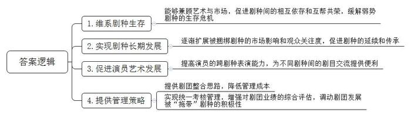
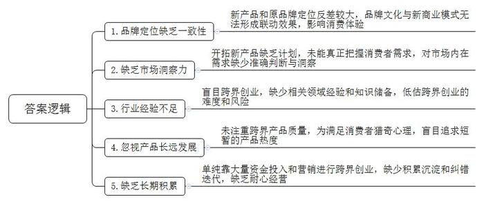
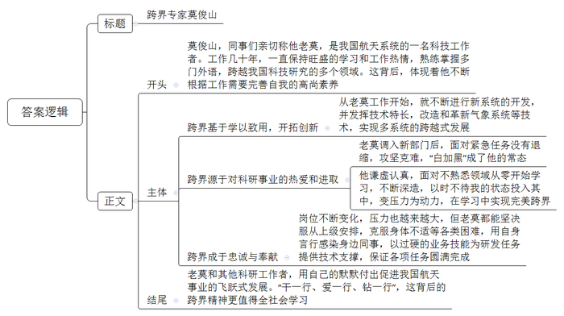
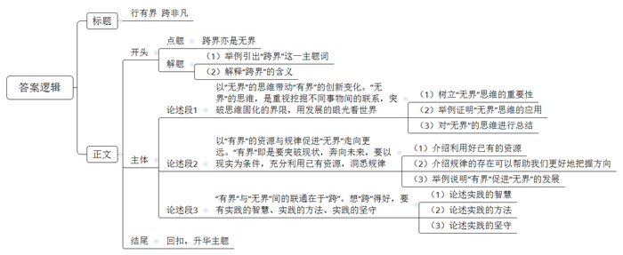

# 2021年四川省公考《申论》题（下半年省市县卷）

<!-- gwy:overview:start -->
> **四川 · 2021 · 申论 · 下半年省市县卷** ｜ 4 题 · 图片 4 处 · 答案随题折叠

导航：[题目](#题目)
<!-- gwy:overview:end -->

> 候选采集稿。参考答案及解析来自粉笔页面，不代表官方答案或真实高分答卷；来源使用许可与原卷对应关系仍需人工核实。

## 给定材料

### 材料 material-98d54e6881e42ed4

在实现中华民族伟大复兴的进程中，戏剧的保护对于传承中华传统优秀文化、坚定文化自信具有重要意义。在戏剧保护中，有一种策略叫做“拖带”。所谓“拖带”，是指在非遗剧种保护实践中，在充分调研和论证的前提下，将符合“拖带”条件的非遗剧种以“组合”形式，由保护主体在技艺、政策、市场等方面统筹规划，从而形成一体化保护的做法。从中国戏曲的发展历程以及当下非遗剧种保护的实际经验中，我们都可看到“拖带”模式的成功范例。

如清代中国戏曲史上著名的“花雅之争”时期的“昆弋合班”现象。花雅之争就是清代中叶以来戏曲花部和雅部之间的竞争。所谓花，就是杂的意思，言其声腔花杂不纯，多为野调俗曲；所谓雅，就是正的意思，即奉昆曲为雅乐正声。其实，在花雅之争时期，各戏班为了兼顾相对弱势剧种的生存，当然更直接的是艺人谋生的需要，普遍采取了联合演出，比如“风搅雪”“两下锅”“三鲜汤”等演出方式，本质上就是“拖带”。当时声誉卓著的艺人都是“昆乱兼擅”的名伶，如著名的“同光十三绝”，即享有盛名的13位京剧名伶，其中大多能演昆曲，无不精妙绝伦。这些“拖带”策略在当时起到了缓解弱势剧种生存危机的作用。

苏州苏昆剧团长期以来一直采用“拖带”策略，来维系苏剧和昆剧的共同存续和发展，20世纪大部分时间里，苏剧较之昆剧更有市场，更受观众欢迎，使得苏昆剧团长期处在“以苏养昆”的状态。通过“捆绑式”演出，逐渐扩展被捆绑剧种的市场影响和观众关注度。还戏于民，还戏于市。这样，非遗剧种就具有了“源头活水”，利于剧种的长期发展。

但就艺术角度看，昆剧则较之苏剧更加丰厚，因而，苏昆剧团的艺人们尽管靠着苏剧吃饭，却不愿舍弃更有艺术内涵的昆剧。进入21世纪之后，随着昆剧被列入非物质文化遗产，昆剧与苏剧的地位发生了倒转。目前，昆剧受到了来自社会各方面的关注和支持，已经呈现初步复兴之态势，而苏剧则相对弱势和被冷落。所以，目前苏昆剧团的策略则是“以昆养苏”，借助昆剧的强势来辅助苏剧的延续和传承。而曾经呵护和拖带昆剧的苏剧，也因此得到了自己曾经拖带昆剧的回报，形成了另外一种类型的“拖带”。

同时，对于演员而言，这种拖带形式对于演员本人的艺术发展也颇有益处，反过来促进剧种的进一步繁荣。以苏昆为例，当今活跃在昆剧舞台的苏州昆剧院的中青年演员，多数都能兼演苏剧、昆剧两个剧种的剧目。

“拖带”和“被拖带”剧种之间的剧目交流，在历史上不乏成功的例子和典范。以苏剧的前身“苏滩”为例，历史上的苏滩曾经分为前滩和后滩。其中，前滩又称“全滩”，受昆剧影响比较显著，很多艺人是能兼演苏滩和昆剧剧目的。这样，就使得二者之间的剧目交流变得十分方便，出现了一些“共享剧目”。如前滩的《游殿》与昆剧舞台石小梅、林继凡版的昆剧《游殿》有很高的相似度，有些地方的念白几乎是照搬。此外，比较前滩与昆剧的《劝农》《打子》《芦林》等剧目内容，也可发现不同程度的类似甚至雷同，二者的交流和渊源关系显而易见。苏滩和昆剧的这种剧目交流历史充分证明：将强势剧种的剧目通过移植用以充实弱势剧种，往往可起到振衰的作用，维系弱势剧种的生存。

对于文化管理部门而言，“拖带”思路也可以提供很多操作层面的策略和办法。比如，从剧团体制角度，可以依据“拖带”思路，考虑剧团间整合的具体问题，减少剧团数量，降低管理成本。此外，从管理测评以及剧团考核角度，也可以通过将不同剧种纳入统一考核和管理的考核方式，“全面”和“兼顾”的考量，达成对剧团业绩的全面和综合评估，从而避免以往“单面”考核的偏颇和缺欠。同时，政府主管部门还可以通过“一揽子”式的资助模式，调动剧团在维护发展被“拖带”剧种方面的积极性和主动性。

### 材料 material-6af14fe4f4675530

前不久，中华老字号马应龙开始跨界卖口红了，而且还一口气推出了3款颜色，这一次的口红系列是马应龙继眼霜、护肤品之后再一次推出的非药类产品。事实上，不只马应龙，“国民奶糖”品牌大白兔也进军彩妆市场，从润唇膏到香水，跨界之路越走越广。不仅这些老品牌如此，新企业也不甘示弱。比如，美团外卖深耕出行领域、小米研发生产“巨能写”中性笔等。几乎所有行业都有主动接受“跨界”洗礼的案例。

借由跨界开始新赛道，进入新的成长区，不仅增加了企业的厚度，降低了“鸡蛋放在同一个篮子里”的风险，还为企业在一段时间内提供了传播热点。在传播日趋碎片化的当下，这种方式的效果住往比单纯广告要好得多。

但是，企业玩“跨界”就一定能成功吗？答案是未必。在一众跨界者中，浴火重生者有之，“一失足成千古恨”的亦有之。所以，“跨界”虽好，如何防止“踩空”才是必须深入思考的课题。

先来说说“大白兔”。从奶糖转向润唇膏、香水、沐浴露，这位“国货大佬”不断将创新发展的新动能赋予这颗国民奶糖，每一次“搞事情”都力求把大白兔经典的奶味以一种更有趣的姿态呈现在消费者面前，让品牌永葆年轻活力。这说明，企业玩“跨界”时应保持品牌定位的一致性，以此形成联动效果，也就是要“守得住既有，当得了网红”。在“跨界”过程中，无论老品牌历经岁月沉淀积累的厚重文化，还是新品牌于互联网浪潮中摸索出的商业模式，都是企业核心竞争力的延伸，都是必须始终守住的东西。在此基础上，才是聚焦消费领域变化，努力“读懂”消费者需求，有计划、有步骤地开拓新产品，为品牌赋予新内涵，制造再度引发消费者注意力的“爆点”。唯有同时做到以上两点，才能在获取用户黏性上抢占先机，在“跨界”竞争中赢得主动。

28岁的小曾是个校外英语培训机构的负责人，自认为具有创业的天赋，看到大学同学小毛开了一家儿童乐园生意火爆，就决定涉足，也开了一家儿童游乐场。刚开始他对自己的设施、模式和能力非常有信心，结果没想到不仅没赚到钱，还把培训机构拖垮了。

成事之要，关键在人。“跨界”的每一项工作都要落实到人，落实到企业家对市场的判断。今天的企业家该如何培养自己的洞察力，“看见”市场内在的需求？这或许是“跨界”这个主题下的又一道必须深入思考的课题。

22岁的小章平时喜欢逛网店，她关注到很多老品牌研发了新产品，有时也会购买。她坦言，不是所有的消费体验都是好的，也会有“踩雷”的时候。“我曾经入手了一款火锅味的牙膏想体验体验，但是用了感觉味道有点奇怪。”小章觉得，老品牌的跨界发展需要找到合适的营销点，“我觉得不是所有领域都可以跨界，如果新产品和原来品牌定位反差比较大，会让人觉得有点不合适，可能不会带来好的结果。”

南开大学商学院市场营销系杜教授分析，“一些企业尝试通过跨界营销博人眼球，虽然获得了短时的关注，但如果处理不当会导致一些负面影响，如白酒品牌做香水，会导致消费者的心理冲突和不适，从而产生品牌抵触”。小何是一个医疗美容机构的负责人，一次和几个朋友出去旅游期间，突然就蹦出个电玩创业的“好点子”，大家一拍即合立马开干，因为没有任何经验和知识储备，技术支撑全靠聘来的几个技术员，简单地做了个市场了解，两三个月就把项目落地了，结果开业之后一地鸡毛，消防检查不合格被要求关停，资金链出现断裂，最后只能关门大吉。

一项调查显示，59.1%的受访者建议老字号跨界发展时多注重产品质量，不盲目追求一时热度。“如果仅是为了满足消费者的猎奇心，那么推出一些‘爆款’可能来得快、去得也快。”32岁的小刘觉得，老字号的长远发展还是需要靠一些经得住时间考验的产品。

富二代小夏是房地产公司的总经理，突然有了生产矿泉水的想法，自认为资金实力雄厚，甚至认为只要花钱做广告，请名牌的运营总监就能解决一切问题。他借助各种大号做营销，以为这样豪华布局，肯定就会火。但是上市后由于价格偏高，大家不愿意购买，亏损了好几个亿，最后不得不整体卖掉止损。有时，钱砸不出好口碑，更砸不出好品牌。外脑只能解决一部分问题，内功还得步步修炼。

今年32岁的小梁，大学期间学习了一些创业知识，毕业后开了一个外贸公司，生意也算马马虎虎。有一天听朋友说餐饮是个赚快钱的行业，只要做爆，就能开放加盟，吸引风投，跨区域经营，全国连锁……于是就在某商场开了一家烤肉店，结果将开外贸公司挣下的买房钱都亏进去了。如果我们细心研究，不难发现，现在比较成功的餐饮品牌创始人，基本都属于餐饮的连续创业者，大都有过长达几年的蛰伏期。即使是近年来出现的新锐品牌，看其发展历程，开始的几年也是不断积累、纠错、迭代的过程，崭露头角绝非一日之功。在成本不断上涨的今天，它其实更是一个薄利行业。

### 材料 material-252f98993c05760c

莫俊山是中国卫星海上测控部的一名专家，同事们都喜欢叫他老莫。虽然称呼随意，但其实老莫是单位数一数二的技术大师，他不仅精通本岗位专业，更是一位发展全面的“跨界专家”。

上世纪90年代中期，老莫大学毕业后来到某航天发射场工作。刚开始工作他就发现单位的某工作系统还停留在“打印+手抄”的原始阶段，不仅费时费力，而且错误率很高。他随即向领导建议，对已有系统进行升级改造。

老莫利用空余时间进行新系统开发，不到一个月，新系统研发成功，使用效果反馈良好。此后在发射场11年的工作历程中，老莫继续发挥技术特长，对气象系统和网络系统进行了大量的技术改造和革新，实现了多系统的跨越式发展，他的工作得到了组织的充分肯定，也获得了多项荣誉。

2005年9月，老莫因工作需要调入中国卫星海上测控部某技术室，负责数据处理工作。刚来单位没多久，老莫所在团队便领受到一项任务：需要研制一套模型软件对某型火箭监视的遥测数据进行事后处理并分析。当时离火箭发射只剩下2个月。

领受任务后，老莫并没有因为自己是“新人”而“退居二线”，他每天加班加点自学，查阅大量资料，前往发射场进行调研并与厂所专家学习交流，回到单位便马不停蹄地着手模型和软件算法设计。

当时，老莫爱人刚刚生产，他一边要搞设计开发，一边还要照顾爱人孩子，那段日子“白加黑”成为了老莫的常态。功夫不负有心人，在老莫和同事们的共同努力下，软件于任务前研制成功。

初到单位就啃下硬骨头，老莫一战成名。但压力也随之而来，与之前单位相比，这里的科研工作任务更重，难度也更大。在接下来的工作中，为了全面适应新岗位，老莫选择了放下架子，从零开始。随后老莫自学宇航动力学理论和数据处理基础理论，在短短的几个月时间内他就熟练掌握了岗位技能，成为了一名数据处理专家。

随着海上测控任务的日益增多，老莫时常觉得自己还需“充电”。2009年经组织推荐，老莫前往英国曼彻斯特大学学习，在学习期间，他协助合作导师完成了一套基于逆向算法的微波成像软件，成果应用于石油探测和医学领域，在学习中老莫完美跨界，并取得了显著成绩。

老莫回国后不久，为了进一步提高自己的理论修养和学术水平，权衡了利弊后，毅然报考了清华大学航天航空学院宇航科学与技术专业的博士研究生。当他人对这位早已是行业内大拿的专家做出如此选择不解时，老莫说：“科技发展日新月异，一刻不努力就有可能掉队，如果我们不自我加压学习，就肯定会落后。”正是源于对科研事业的热爱，老莫变压力为动力，最终以笔试和面试双第一的成绩，来到清华大学。

在校期间，同学都是“学霸”，作为一名“大龄学生”，老莫更是以时不我待的状态投入到学习中。习惯性的自我加压学习，这让老莫很快就在同学中脱颖而出。短短两年时间，他就在专业顶级期刊和其他主流国际期刊上发表论文5篇。

从清华毕业回到单位后，领导考虑老莫在多个专业的工作经验以及理论积累，将他调整到测控方案总体岗位，这次老莫又迎来了新的“跨界”。由于长期高负荷工作学习，他罹患严重的腰椎间盘突出，在一段时间内行动困难、举步维艰。虽然领导常常关心他，让他注意休息，但要强的老莫总觉得，刚刚来到新集体就泡病号，以后工作会很难开展。每当同事们看到老莫咬着牙工作时，大家的干劲就更足了。

来到总体岗位后，老莫参加了数十项重大科研试验任务，承担了多项总体工作。其中，在神舟、天宫、长征五号火箭首飞等重大任务中，老莫更是作为单位专家前往发射中心进行技术协调工作，他以过硬的业务技能，及时为上级提供了快速、准确的分析材料和决策依据，确保了任务圆满成功。

工作几十年，老莫一直保持旺盛的学习热情和工作热情。不断根据工作需要完善自我，为了能够顺利进行国际交流和文献阅读，他除了熟练掌握英语外，还自学法语、日语等多门外语。中国航天事业从无到有，从弱到强，在航天科技英才们的共同努力下，中国航天事业一次次完成了飞跃式发展，从大漠深处到蔚蓝海滨，从东方红一号到神舟飞船，一次次的任务成功背后，是无数普通科技工作者的默默付出，而老莫也是众多科技工作者之一。

## 题目

### 第 1 题

**请根据****“给定资料**1**”****，概括****“拖带”策略在戏剧保护发展中的主要作用。（15****分）**

关联材料：材料 material-98d54e6881e42ed4

作答要求：

要求：全面、准确、有条理。不超过200字。

第 1 题 · 答案与解析

**参考答案（粉笔题库参考内容）**

1.维系剧种生存。能够兼顾艺术与市场，促进剧种间的相互依存和互帮共荣，缓解弱势剧种的生存危机。

2.实现剧种长期发展。逐渐扩展被捆绑剧种的市场影响和观众关注度，促进剧种的延续和传承。

3.促进演员艺术发展。提高演员的跨剧种表演能力，为不同剧种间的剧目交流提供便利。

4.提供管理策略。提供剧团整合思路，降低管理成本；实现统一考核管理，增强对剧团业绩的综合评估，调动剧团发展被“拖带”剧种的积极性。

**解析**

**参考答案说明**：本参考答案从“维系剧种生存”“实现剧种长期发展”“促进演员艺术发展”“提供管理策略”四个方面展开，各条答案要点之间在内容上相互并列，没有交叉。

**考点**：考点影响类

**来源**：来源2021年四川省公考《申论》题（下半年省市县卷）

粉笔申论页面对本题只提供「解析视频」入口，该入口是会员推广位，页面无视频地址与文字解析。

### 第 2 题

**请根据****“给定资料**2**”，分析这些企业跨界失败的原因。（20****分）**

关联材料：材料 material-6af14fe4f4675530

作答要求：

要求：全面准确、分析透彻、条理清楚。不超过300字。

第 2 题 · 答案与解析

**参考答案（粉笔题库参考内容）**

1.品牌定位缺乏一致性。新产品和原品牌定位反差较大，品牌文化与新商业模式无法形成联动效果，影响消费体验。

2.缺乏市场洞察力。开拓新产品缺乏计划，未能真正把握消费者需求，对市场内在需求缺少准确判断与洞察。

3.行业经验不足。盲目跨界创业，缺少相关领域经验和知识储备，低估跨界创业的难度和风险。

4.忽视产品长远发展。未注重跨界产品质量，为满足消费者猎奇心理，盲目追求短暂的产品热度。

5.缺乏长期积累。单纯靠大量资金投入和营销进行跨界创业，缺少积累沉淀和纠错迭代，缺乏耐心经营。

**解析**

**参考答案说明**：本参考答案从“品牌定位缺乏一致性”“缺乏市场洞察力”“行业经验不足”“忽视产品长远发展”“缺乏长期积累”五个方面展开，各条答案要点之间在内容上相互并列，没有交叉。

**考点**：考点原因类

**来源**：来源2021年四川省公考《申论》题（下半年省市县卷）

粉笔申论页面对本题只提供「解析视频」入口，该入口是会员推广位，页面无视频地址与文字解析。

### 第 3 题

**假如你是某报****社****记者，请根据****“给定资料**3**”，以“跨界专家莫俊山”为题，****撰写一篇短评。（****25****分）**

关联材料：材料 material-252f98993c05760c

作答要求：

要求：观点鲜明、简明扼要、语言生动。不超过500字。

第 3 题 · 答案与解析

**参考答案（粉笔题库参考内容）**

跨界专家莫俊山

莫俊山，同事们亲切称他老莫，是我国航天系统的一名科技工作者。工作几十年，一直保持旺盛的学习和工作热情，熟练掌握多门外语，跨越我国科技研究的多个领域。这背后，体现着他不断根据工作需要完善自我的高尚素养。

跨界基于学以致用，开拓创新。从老莫工作开始，就不断进行新系统的开发，并发挥技术特长，改造和革新气象系统等技术，实现多系统的跨越式发展。

跨界源于对科研事业的热爱和进取。老莫调入新部门后，面对紧急任务没有退缩，攻坚克难，“白加黑”成了他的常态。他谦虚认真，面对不熟悉领域从零开始学习，不断深造，以时不待我的状态投入其中，变压力为动力，在学习中实现完美跨界。

跨界成于忠诚与奉献。岗位不断变化，压力也越来越大，但老莫都能坚决服从上级安排，克服身体不适等各类困难，用自身言行感染身边同事，以过硬的业务技能为研发任务提供技术支撑，保证各项任务圆满完成。

老莫和其他科研工作者，用自己的默默付出促进我国航天事业的飞跃式发展。“干一行、爱一行、钻一行”，这背后的跨界精神更值得全社会学习。

**解析**

**参考答案说明**：（1）格式方面，本参考答案写到了“标题”“正文”两个部分。（2）正文部分，一方面从内容上来看，围绕着“跨界专家莫俊山”这一主题，本参考答案的开头先介绍了老莫的基本情况并阐明了观点；接着主体部分从“跨界基于学以致用，开拓创新”“跨界源于对科研事业的热爱和进取”“跨界成于忠诚与奉献”这三个方面介绍了跨界专家莫俊山。另一方面，形式上，本参考答案做到了分段、分条撰写，整体上条理较为清晰。

**考点**：考点评论类

**来源**：来源2021年四川省公考《申论》题（下半年省市县卷）

粉笔申论页面对本题只提供「解析视频」入口，该入口是会员推广位，页面无视频地址与文字解析。

### 第 4 题

**“给定资料**5**”中提到“****跨界亦是无界****”。请你根据对这句话的理解，结合“给****定资料**1**～**5**”，联系实际，自选角度，自拟题目，写一篇议论文。（40****分）**

关联材料：材料 material-98d54e6881e42ed4

作答要求：

要求：

（1）观点正确，见解深刻；

（2）思路清晰，结构完整；

（3）语言流畅，书写工整；

（4）字数800～1000字。

第 4 题 · 答案与解析

**参考答案（粉笔题库参考内容）**

**行有界 跨非凡**

从演员任泉跨界经商，到中华老字号马应龙跨界卖口红……跨界的例子不胜枚举。跨界，是用新的连接来完成自身的跃迁，跨出舒适区，界定新状态，赋予跨界者无限可能。跨界先有界，意味着受“界限”内资源与规律的影响；跨界终无界，就是要突破现状，发掘未来的可能；跨界重在跨，要有智慧、懂方法、肯坚持。跨界，是思维的升华、资源的整合，是从有界跨到无界，是从不变跨到变。行有界限，敢于跨越才能造就非凡。

**以“无界”的思维带动“有界”的创新变化。**“无界”的思维，是重视挖掘不同事物间的联系，突破思维固化的界限，用发展的眼光看世界。当下，我国迈入新发展阶段，新旧动能转换持续进行，无论是个人还是企业，谁能科学树立“无界”的思维，谁就可能获得进一步发展。如有的毕业生突破“留在城市”的概念，进入农村，放光发热，让人与村彼此成就；新东方从英语教培跨到了电商销售，让人“大跌眼镜”，但最终让企业“再生”。“无界”的思维，不能停留在跨空间、跨领域等表层，而是能通过事物内外因变化，发现更深层次的联系。可以说，无界是一种智慧、一份勇气。

**以“有界”的资源与规律促进“无界”走向更远。**“有界”即是要突破现状，奔向未来，要以现实为条件，充分利用已有资源，洞悉规律。这意味着我们必须更加珍惜和高效地利用每一份资源，无论是物质还是人力资源，只有以此为基础，才能够有效地推动科技创新、经济发展和社会进步。而规律的存在则为我们提供了思考、决策和行动的指南，通过深入研究现有的规律，我们可以更好地把握发展的方向，为变革打下坚实的基础。例如，比亚迪汽车，从电池生产跨界到造车领域，主攻新能源车，电池与新能源存在内在联系，易形成联动效应，这背后的本质即是：行有界，方可致无界。

**“有界”与“无界”间的联通在于“跨”。**想“跨”得好，要有实践的智慧、实践的方法、实践的坚守。智慧是要善于发现事物间内在联系，善于在不断变化的环境中主动调整，守正创新；方法是寻找到切入点把不同的资源有机整合起来，实现裂变的功效；坚守是要有脚踏实地、务实的精神，短暂的跨界不会真正成功，深耕才有收获。

跨界是生命的奔腾，是扬弃旧我，追求内心渴望的体现。现实世界有规律，但没剧本，愿我们都能够放飞梦想，书写精彩。行——有界，跨——非凡。

**解析**

**文章分析**

行有界 跨非凡

【**标题的优点：**标题点明“跨界”这一主题词，使文章主题更突出、清晰。】

（1）从演员任泉跨界经商，到中华老字号马应龙跨界卖口红……跨界的例子不胜枚举。（2）跨界，是用新的连接来完成自身的跃迁，跨出舒适区，界定新状态，赋予跨界者无限可能。跨界先有界，意味着受“界限”内资源与规律的影响；跨界终无界，就是要突破现状，发掘未来的可能；跨界重在跨，要有智慧、懂方法、肯坚持。跨界，是思维的升华、资源的整合，是从有界跨到无界，是从不变跨到变。行有界限，敢于跨越才能造就非凡。

【**开头的优点：**★内容方面。范文的开头是紧扣“跨界亦是无界”这一主题展开的。首先，通过举例引出“跨界”这一主题词；其次，解释“跨界”的含义，在含义解释中引申出跨界需先“有界”，走向“无界”，重在“跨界”这三个角度，为后文的分论点作铺垫。★文字表达方面。使用了“就是”“才能”等连接词，使语言表达有逻辑性。】

**以****“无界”的思维带动“有界”的创新变化**。**“无界”的思维，是重视挖掘不同事物间的联系，突破思维固化的界限，用发展的眼光看世界**。（1）当下，我国迈入新发展阶段，新旧动能转换持续进行，无论是个人还是企业，谁能科学树立“无界”的思维，谁就可能获得进一步发展。（2）如有的毕业生突破“留在城市”的概念，进入农村，放光发热，让人与村彼此成就；新东方从英语教培跨到了电商销售，让人“大跌眼镜”，但最终让企业“再生”。（3）“无界”的思维，不能停留在跨空间、跨领域等表层，而是能通过事物内外因变化，发现更深层次的联系。可以说，无界是一种智慧、一份勇气。

【**论述段****1的优点：**★观点句：范文的观点句是紧扣“跨界亦是无界”这一文章主题提出的。形式上，它在段首处直接写出，位置突出，容易发现。内容上，关键词突出，内容要点明确，可以明显看出它是从“无界”的思维这一角度切入。★论述内容：（1）先介绍树立“无界”思维的重要性；（2）然后举例证明“无界”思维的应用；（3）最后对“无界”的思维进行总结。注意：以上几个方面的内容都是紧扣观点句进行分析论述的，论述的针对性强，内容层次丰富。最后，在论述方法上采用了讲道理、举例子相结合，做到了丰富多样。】

**以****“有界”的资源与规律促进“无界”走向更远**。**“有界”即是要突破现状，奔向未来，要以现实为条件，充分利用已有资源，洞悉规律**。（1）这意味着我们必须更加珍惜和高效地利用每一份资源，无论是物质还是人力资源，只有以此为基础，才能够有效地推动科技创新、经济发展和社会进步。（2）而规律的存在则为我们提供了思考、决策和行动的指南，通过深入研究现有的规律，我们可以更好地把握发展的方向，为变革打下坚实的基础。（3）例如，比亚迪汽车，从电池生产跨界到造车领域，主攻新能源车，电池与新能源存在内在联系，易形成联动效应，这背后的本质即是：行有界，方可致无界。

【**论述段2的优点：**★观点句：范文的观点句是紧扣“跨界亦是无界”这一文章主题提出的。形式上，它在段首处直接写出，位置突出，容易发现。内容上，关键词突出，内容要点明确，可以明显看出它是从“有界”的资源与规律这一角度切入。★论述内容：（1）先介绍利用好已有的资源；（2）接着介绍规律的存在可以帮助我们更好地把握方向；（3）最后通过举例说明“有界”促进“无界”的发展。注意：以上几个方面的内容都是紧扣观点句进行分析论述的，论述的针对性强，内容层次丰富。】

**“有界”与“无界”间的联通在于“跨”**。**想****“跨”得好，要有实践的智慧、实践的方法、实践的坚守**。（1）智慧是要善于发现事物间内在联系，善于在不断变化的环境中主动调整，守正创新；（2）方法是寻找到切入点把不同的资源有机整合起来，实现裂变的功效；（3）坚守是要有脚踏实地、务实的精神，短暂的跨界不会真正成功，深耕才有收获。

【**论述段3的优点：**★观点句：范文的观点句是紧扣“跨界亦是无界”这一文章主题提出的。形式上，它在段首处直接写出，位置突出，容易发现。内容上，关键词突出，内容要点明确，可以明显看出它是从“跨”这一角度切入。★论述内容：围绕“跨”这一角度，分别从“实践的智慧”“实践的方法”“实践的坚守”这三个方面展开具体的论述。注意：以上内容紧扣观点句进行分析论述的，论述的针对性强，内容层次丰富。】

【**论述段之间的关系：**★内容的内在逻辑：论述段1从“无界”的思维层面论证“跨界亦是无界”，论述段2从“有界”的资源与规律层面论证“跨界亦是无界”，论述段3从“有界”与“无界”间的联通，即“跨”的层面论证“跨界亦是无界”。三个论述段相互并列，逻辑清晰。】

跨界是生命的奔腾，是扬弃旧我，追求内心渴望的体现。现实世界有规律，但没剧本，愿我们都能够放飞梦想，书写精彩。行——有界，跨——非凡。

【**结尾的优点：**范文的结尾回扣了“跨界亦是无界”这个主题词，语言精练，不拖沓。】

**考点**：考点文章写作题

**来源**：来源2021年四川省公考《申论》题（下半年省市县卷）

粉笔申论页面对本题只提供「解析视频」入口，该入口是会员推广位，页面无视频地址与文字解析。

