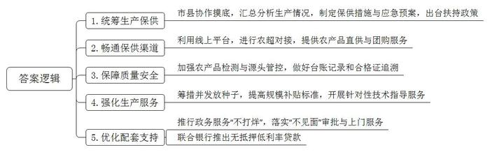
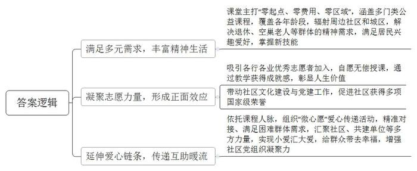
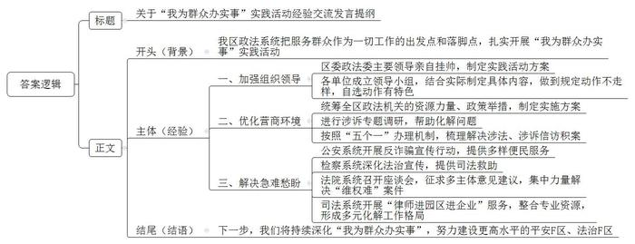
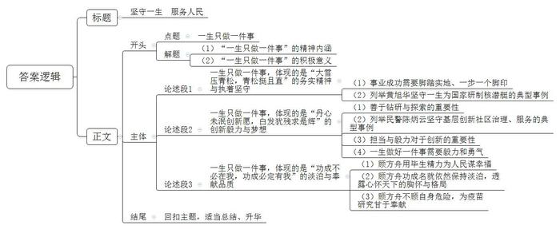

# 2021年四川省公考《申论》题（下半年行政执法卷）

<!-- gwy:overview:start -->
> **四川 · 2021 · 申论 · 下半年行政执法卷** ｜ 4 题 · 图片 4 处 · 答案随题折叠

导航：[题目](#题目) · [材料 1](#材料-1)
<!-- gwy:overview:end -->

> 候选采集稿。参考答案及解析来自粉笔页面，不代表官方答案或真实高分答卷；来源使用许可与原卷对应关系仍需人工核实。

## 给定材料

### 材料 1

近年来，G市农业农村局按照支持农业生产社会化服务工作的有关要求，组织实施农业生产服务项目，统筹推进新一轮“菜篮子”工程建设，有效促进了农业增效农民增收，有力推动了服务规模经营和农业绿色发展。

G市农业农村局王副局长说：“今年以来，我们派出精兵强将，通过市县两级协作和各服务队踩点摸底，每天对地产蔬菜、畜产品、水产品等生产情况进行汇总分析，针对发现问题，及时提出对策措施。”截至上半年，该市蔬菜、生猪、菜牛、家禽、禽蛋、鲜奶、水产品等主要农产品每天可供应量基本能满足市场需求。农业农村局还制定《全市疫情常态化防控期间农产品生产保供措施》，细化生猪、蔬菜2个保供应急预案，出台速生叶菜类蔬菜种植补贴、蔬菜价格指数保险、蔬菜机械购置补贴、生猪调运运输补贴等扶持政策。

农业农村局派出的驻村干部小李说：“我们充分利用微信、微博等手段，组织农业生产经营主体与大型超市视频对接，建立农产品对接采购群，搭建农超对接桥梁，进一步畅通保供渠道。”在局微信公众号，记者看到了推出的十多个农产品套餐直供基地和九十多个优质农产品生产基地的团购联系方式，实现农产品从田头到小区的直达配送，平台上线涵盖七十余种农产品。

在一处农产品监测站，记者看到，技术人员在对禽蛋、水产品等重点农产品进行检测，并做好台账记录。农业农村局干部老刘说：“我们指导各农业检测机构做好应急检测准备，确保检测人员在岗在位、仪器设备处于良好状态，加大抽检力度，检测情况一天一报。同时，还强化源头管控，指导并督促各区县做好台账记录和合格证追溯，主动掌握市场输入性农产品安全供应情况，保障农产品质量安全。”

春耕三月，山水村的20余位农民已在地里忙碌起来，合力为秧盘盖膜。驻村第一书记小周说：“村里实现脱贫后，早稻种植面积比去年大幅度增加，农业主管部门通过深挖种植潜力，想方设法筹措种子，提高规模补贴标准，加强技术指导服务等，充分调动农民种粮的积极性，确保主要农产品的正常供应。”农业农村局里各服务队累计向30个乡镇9000余农户免费送出青菜、菠菜、鲜食毛豆和玉米等速生作物种子约2万公斤，落实蔬菜种植5000余亩，解决了3万多群众的蔬菜供应问题。

技术员小严说：“我们根据农产品季节作业规律和产业分布特点，有针对性地开展技术指导，帮助种植户解决技术难题。”绿苑专业合作社本来计划种植大棚特色瓜果，后来为保障蔬菜生产供给，主动改种了速生蔬菜，农业农村局技术小分队及时上门指导。各区县也纷纷开展农业帮扶指导活动，并呈现“你追我赶、百花齐放”的良好态势。

农业农村部门政务服务“不打烊”，始终坚守“窗口”一线，全面落实“不见面”审批。市县两级农业农村部门所有“最多跑一次”服务事项网办率、掌办率都达到100％。全市100余艘休闲渔船的体验式捕捞许可证即将到期，渔民老林说：“农业局安排工作人员送服务上门，我们在家门口就可以现场办证。”81艘符合审批条件的休闲渔船全部如期完成办理。

佳必食品有限公司林总经理紧锁多日的眉头终于舒展开了，银行提供的132万元免抵押贷款让他绽开了笑容。有了这笔金融支持和助力，他们企业主营的各类水产品罐头又可以远销欧美、非洲、东南亚等地了。与林总经理同感的还有农业科技公司的江国强。“因为没有有效的抵押物，我们农企很难从银行获得贷款，即使拿到了贷款，也是那些需要高利息、高担保费的，对薄利的农业来说，融资成本太高了。”他说，现在解决了资金压力，企业可以轻装上阵，今年的产值能翻一番，估计能达到6000万元。他非常感谢农业农村部门送来的“大礼包”。江国强所说的“大礼包”，就是市农业农村局为切实解决各类农业经营主体生产资金需求，联合银行推出的20亿元“疫情防控常态化期间农产品生产保供即时贷”。这批无抵押低利率涉农贷款缓解了638家涉农企业的资金困扰。

“我们以信贷支持手段推动农业供给侧结构性改革落地落实，让农业生产经营主体获得更多实惠，充分发挥农产品生产稳价保供的重要作用。”市农业农村局周局长说。

### 材料 2

“零点课堂”“微心愿”……走进永新社区服务大厅，丰富多彩的志愿服务项目让人倍感亲切。作为新型城市社区，永新社区成立至今，把贴心服务送到了居民身边。不久前，该社区获评全国学雷锋志愿服务“100个最美志愿服务社区”。

“徐老师，您看我画得怎么样？”又到了阳城一年最美的时节，书画志愿者徐惠珍带领永新社区“零点课堂”的国画学员们走进牡丹花丛写生，62岁的王惠荣捧着自己的作品向她请教。

王惠荣是徐惠珍的“得意门生”，也是“零点课堂”的老学员。5年前，她退休后搬到永新社区居住，因为人地两生，孩子不在身边，觉得无聊又寂寞。无意中听说了社区“零点课堂”，她抱着“打发时间”的想法报了名。

主打“零起点、零费用、零区域”的“零点课堂”，是永新社区多年前就开始推出的一项志愿服务，由来自各行各业的优秀志愿者担任老师，开设声乐、钢琴、英语、书法、国画、剪纸、二胡、葫芦丝等10多门公益课程。目前，课程已在社区居民中颇有口碑。

王惠荣从书画学起，越学越有劲儿，又陆续走进了钢琴、剪纸等课堂。“去年，我的牡丹画在区里绘画比赛中拿了二等奖。”王惠荣说，她现在认识五线谱，能弹奏《致爱丽丝》等世界名曲，还能随手剪出人物肖像，用年轻人的话说“人生简直开挂了”。

如今，“零点课堂”的受益人群除了永新社区居民，还辐射到周边福源社区、宝康社区等，甚至还有别的城区的居民也赶来上课，学员下至五六岁孩童，上至八十岁老人，每期报名几乎爆满。大家都说，这已经不是简单的公益课，而是传递幸福正能量的“磁场”。

在永新社区党委孙书记看来，“零点课堂”就好比一棵大树，越枝繁叶茂，正面效应就越明显。黄老师退休前是某艺术学院的民族器乐教师，他对社区“零点课堂”早有所闻，退休后毅然放弃了某培训机构的高薪聘请，加入到“零点课堂”志愿者队伍中来，目前在老年学员班开设古筝课程教学。他说：“在‘零点课堂’虽然没有报酬，但更有成就感，更能彰显人生价值。”像黄老师这样的志愿者不在少数。后经黄老师介绍，朋友、同事之间的相互传递，又吸引了十多位志愿者加入到“零点课堂”活动中，他们利用空余时间分别为学员免费开设声乐、舞蹈、插花艺术、古诗词欣赏等课程，忙得不亦乐乎。

“不少来授课的居民都是社区热心志愿者、优秀党员，他们为‘零点课堂’学员免费上课辅导，有效地带动了社区文化及党建工作。”孙书记说，社区先后获得全国和谐社区建设示范社区、全国科普建设示范社区等荣誉，与“零点课堂”的正面带动密不可分。

负责“零点课堂”组织工作的社区党委罗副书记说：“我们依托‘零点课堂’的热心志愿者、学员等人脉关系，还组织了‘微心愿’爱心传递活动，通过‘心愿征集——传递——认领’等方式，将爱心正能量传递得更远更广泛。”

“想拥有《小猪佩奇》《冰雪奇缘》两本书”“想要一个恐龙模型”“想要一副老花镜”……在永新社区，有一本神奇的手册，被写入册中的心愿，要不了多久，就能实现。

这本手册其实是“微心愿”项目征集表。它依托“四级网格”党建覆盖体系，由网格长从辖区内的残疾家庭、困难户及空巢老人处收集“微心愿”集结而成，专门用来解决社区空巢老人、困难家庭等的帮扶问题。

“微心愿”收集后，永新社区党委对其进行分类、筛选，评估每条“微心愿”的实施难度，确定每个事项所需的人力和资金，根据不同的心愿制订帮助措施。然后通过“零点课堂”的志愿者们将心愿传递出去。

60岁的李大妈因右腿残疾无法出门工作，但她精通针织，织出的毛衣、婴儿鞋、工艺品委托别人售卖，自食其力。网格长小王在走访中得知，她需要一些针织用的毛线，就将其登记在了“微心愿”项目表中。这一心愿迅速被认领，几天后，李大妈就拿到了心仪的毛线。

从去年至今，通过“零点课堂”的接力传递，目前参与“微心愿”活动的党员志愿者已达158人，共帮助困难居民实现“微心愿”136个。“除了社区党员，多家辖区共建单位的在职党员，也积极领取‘微心愿’，为困难群众‘圆梦’。”罗副书记说，“一个个‘微心愿’，让小爱汇成大爱，给群众带去了幸福，增强了社区党组织的凝聚力。”

### 材料 3

2021年初，全国政法队伍教育整顿活动全面启动。开展政法队伍教育整顿，是党中央从党和国家事业发展全局高度作出的重大决策部署，是政法战线全面从严管党治警的重大举措。F区政法系统紧抓政法队伍教育整顿的契机，坚持将教育整顿与党史学习教育相结合，始终把服务群众作为一切工作的出发点和落脚点，扎实开展“我为群众办实事”实践活动。

F区委政法委陈书记对记者说：“区政法系统领导高度重视，由主要领导亲自挂帅，认真动员部署，制定《F区政法系统“我为群众办实事”实践活动方案》。各单位按照方案要求，成立本单位实践活动领导小组，根据工作实际制定具体活动内容，做到“规定动作不走样，自选动作有特色”。通过本次活动，强化政法干警的宗旨意识，切实解决人民群众的‘急难愁盼’问题。”

“最近工厂生产怎么样？经营上有没有矛盾纠纷？”近日，F区委政法委陈书记带队深入三家企业，进行涉诉专题调研。这是区委政法委助力营商环境建设的一个缩影。年初，区委政法委统筹全区政法机关的资源力量、政策举措，制定《F区政法机关打造一流法治化营商环境实施方案》，提出政法机关服务企业发展的18条措施。2月中下旬，区委政法委通过广泛征求区“四大家”领导、区直有关单位、辖区企业以及部分人大代表、政协委员的意见建议，共整理形成107条意见建议。

政法委深入一线，倾听诉求，帮助化解问题。同时，针对信访积案，开展了大排查、大化解、大协调活动。按照“一个案件、一名领导、一套班子、一个方案、一抓到底”的“五个一”办理机制，梳理细化全区61件涉法、涉诉信访积案，由区委政法委牵头，区纪委监委、组织部门、政法各单位主要负责人亲自调度，其他领导班子成员全员上阵，通过集体“会诊”、逐一研判，针对不同问题，提出具体处理意见，真正做到问题不解决不放过，力求信访人满意、息访。

F区公安分局联合区金融局、区市场监管局、区城管局和各镇办、社区，集结500余人，在辖区商业综合体、写字楼、公寓小区开展反电诈“集中扫楼”行动。活动当天共清查公司96家、公寓小区5个，现场审查有涉诈嫌疑的公司9家，当场签订反诈承诺书200余份，发放反诈宣传资料800余份，手把手教300余名群众下载“国家反诈中心”APP。城区公安分局李副局长说：“我们要求全体干警把工作做到群众心坎上，切实为群众解决困难事、烦心事。今年6月，公安局为中、高考学生开通绿色通道，为150多名考生办理了身份证；‘流动车管所’开展‘送考下乡’，为乡村群众办理摩托车驾驶证；巡逻民警经常为有急迫需求的群众提供服务，等等。”

F区检察院全体干警利用周末休息时间走进社区，挨家挨户开展环境整治、预防电信诈骗、打击非法集资等一系列法治宣传活动。干警们通过一个个鲜活的案例，让群众了解电信诈骗的危害，教会群众如何防范诈骗。针对当前非法集资对象多为老年人的特点，干警们结合真实案例，用通俗易懂的语言，为老年人讲解如何识别和防范非法集资。近日，检察官发现之前的已结案件中，受害人邹某因加害人无赔偿能力，其亲属无法通过诉讼获得相应赔偿。区检察院立即联系邹某亲属，对其开展司法救助。考虑到救助申请人邹某的母亲远在千里之外，加之其家庭困难，往来一趟成本很高，该院采用视频连线的方式，对这起司法救助案进行公开听证，让受害者家属感受到跨越千里的关怀。

F区法院联合区工商联，组织辖区10余家企业代表召开座谈会，一对一服务、面对面交流，解决困难、增进理解。邀请区人大代表、政协委员、律师代表、街道办事处干部代表等参加教育整顿座谈会，征求大家对法院工作和队伍建设的意见建议，共征集法治宣传、简化内部流程等方面的意见建议14条。随机抽取1200件已审结案件，向案件当事人发出征求意见信。

王某从某房地产公司购房后迟迟不能入住，由于房地产公司“一房二卖”，现由案外人实际居住。经F区法院审理后，要求房地产公司交付房屋，房地产公司再次拒绝履行。进入执行阶段后，执行干警多次释法明理，房地产公司仍未腾退房屋。为尽快保障胜诉当事人权益，F区法院集中力量强制腾退该房屋，经过周密部署，仅用两个半小时完成房屋腾空，并现场交付给王某。

F区司法局陆局长一行，与6名律师走进国际商贸城，和30家针纺织品经营者面对面交流，从法律层面探讨防范经营风险的方式方法。区司法局把“律师进园区进企业”服务作为“我为群众办实事”的重要内容，为园区企业开展法律宣传，堵塞经营漏洞，规避经营风险，将服务送到商户心坎上。

陆局长说：“我们整合专业法律服务资源，把区直部门法律顾问、社区律师统一吸纳进社会矛盾大调解体系，明确责、权、利关系，形成考核张力、服务合力、化解动力，已初步形成党委领导、政府主导、多元共治、社会参与的矛盾纠纷多元化解工作格局。”截至目前，全区已建立各级各类调解组织213个，共有调解员663名，全区各级人民调解委员会基本实现“警调对接”“访调对接”“诉调对接”全覆盖。

F区政法系统在扎实推进“我为群众办实事”实践活动中成绩突出，F区公安局、法院、检察院、司法局等单位先后受到上级的表扬。近日，S省为树立典型，弘扬先进，拟召开全省政法系统“我为群众办实事”实践活动经验交流会，区委政法委书记将代表F区政法系统作经验介绍发言。

### 材料 4

陈芳是一名普通兽医，从农校毕业至今30多年，一直坚守在畜牧兽医行业第一线。在村民王大花的养猪场栏舍上，歪歪斜斜写着“陈师傅好人”几个字。被称作“陈师傅”的陈芳在一次下乡出诊中，看到王大花在鸡棚边痛哭。原来，她家几百只鸡一夜间死亡，这让贫困的家庭雪上加霜。陈芳想帮帮这位可怜的大姐，于是拿出1万元托人买来10头优质母猪送给她，并经常跑去指导。后来，王大花通过养猪实现了脱贫致富。今年大年三十，养殖户陈杰家的上万只种鹅突患急病，动物生病不挑时间，接到电话的陈芳二话不说立即赶去给种鹅打针治疗，陈杰悬着的心终于落下。当地400多养殖户都认识陈芳并能背出她的电话号码。如果有困难，无论白天还是黑夜，无论熟人还是生人，只要一个电话，陈芳就会及时赶到。她的手机号被养殖户亲切地称为“服务热线”。她说：“作为一名共产党员，不仅要有为人民服务的‘心’，还要具备为人民服务的‘能’。身在基层，面对群众，我明白自己肩上的责任。”

“习近平总书记说过，当今时代是放飞梦想的时代，每个人都有自己的美好梦想，十三亿个鲜活生动的个人梦想百川归海汇成中国梦。我来自上海浦东，是一名普通的企业注册窗口工作人员，主要工作就是为企业办理属于它们的身份证——营业执照。我在注册窗口坚守了26年，见证了一家家企业从无到有、从小变大，见证了众多逐梦人梦想成真。”这是上海浦东新区市场监督管理局注册许可分局的许明被授予“人民满意的公务员”称号时，在人民大会堂交流发言说的一段话。自1993年进入上海浦东工商局，她就一直在一线窗口服务岗位，从事企业注册登记工作。26年来面对这一纷繁复杂的业务，许明始终保持热情专业的服务态度。她的“许明创新服务工作室”成为服务大众的优良品牌。她说办执照对自己来说只是一项日常工作，可对很多人、很多家庭来说，意味着美好生活梦想的开始。她发誓，一定要用真心真情服务好企业，办好每一张执照，用“小窗口”守护百姓的“大梦想”。许明用普通而不平凡的点滴实践，参与和见证了上海浦东改革开放、自贸试验区建设的非凡历程。她在“小窗口”真情服务好每一家企业、每一名群众，为他们守护梦想、助他们勇敢飞翔。

说起“中国脊髓灰质炎疫苗”，可能知道的人不多，但要是提起小时候医院发的糖丸，很多人一定有印象。这可不是一般的糖丸，它是为了预防小儿麻痹症而特制的糖丸。千千万万孩子免遭小儿麻痹症折磨，都与一位著名医学科学家、病毒学专家分不开，他就是一辈子研究脊髓灰质炎的预防及控制、我国组织培养口服活疫苗开拓者之一顾方舟。小儿麻痹症是一种急性传染病，也称脊髓灰质炎，而引起这种病的病毒就是脊髓灰质炎病毒。该病毒会导致肢体麻痹甚至瘫痪，多见于儿童，故又名小儿麻痹症。该病毒致残致死率极高，1955年江苏南通市暴发大规模小儿麻痹症，1680名儿童被感染，瘫痪率近70％，致死率达28％。1957年顾方舟临危受命，开始脊髓灰质炎研究工作。从此，他的一生与脊髓灰质炎研究结缘。中国医学史上第一瓶脊髓灰质炎疫苗研制出来后，顾方舟不惜冒着巨大的危险，用自己和自己的孩子做临床活体实验，最终取得成功。1960年首批500万人份疫苗生产成功，并在11个城市推广。为了使孩子们既喜欢吃又防疫成功，他在疫苗中加了糖，糖丸疫苗由此诞生。1978年该疫苗被列入全国免疫计划，每个孩子都能免费吃到，即使在偏远山区，孩子也能吃上糖丸疫苗，这成为他们一生最甜蜜的记忆，顾方舟也因此被孩子们亲切地称为“糖丸爷爷”。顾方舟说：“我一生只做了一件事，就是做了一粒小小的糖丸”。科学的真正目的是为了全人类的福祉，顾方舟的一生，是以科学服务人类的一生，他用毕生精力为人民谋幸福。2000年，中国卫生部和世界卫生组织联合宣布：中国彻底消灭了野生脊灰病毒的传播，成为无脊灰国家。

## 题目

### 第 1 题

**请根据“给定资料1”，概括G市农业农村局在农业生产服务方面做了哪些工作。（15分）**

关联材料：材料 1

作答要求：全面、准确、有条理。不超过200字。

第 1 题 · 答案与解析

**参考答案（粉笔题库参考内容）**

1.统筹生产保供。市县协作摸底，汇总分析生产情况，制定保供措施与应急预案，出台扶持政策。

2.畅通保供渠道。利用线上平台，进行农超对接，提供农产品直供与团购服务。

3.保障质量安全。加强农产品检测与源头管控，做好台账记录和合格证追溯。

4.强化生产服务。筹措并发放种子，提高规模补贴标准，开展针对性技术指导服务。

5.优化配套支持。推行政务服务“不打烊”，落实“不见面”审批与上门服务；联合银行推出无抵押低利率贷款。

**解析**

**参考答案说明：**本参考答案分别从“统筹生产保供”“畅通保供渠道”“保障质量安全”“强化生产服务”“优化配套支持”这五个方面展开，各条答案要点之间在内容上相互并列，没有交叉。

**考点**：概括措施类

**来源**：2021年四川省公考《申论》题（下半年行政执法卷）

### 第 2 题

**请根据“给定资料2”，分析大家为什么会说“这已经不是简单的公益课，而是传递幸福正能量的‘磁场’”。（20分）**

关联材料：材料 2

作答要求：全面准确、分析透彻、条理清楚。不超过300字。

第 2 题 · 答案与解析

**参考答案（粉笔题库参考内容）**

1.满足多元需求，丰富精神生活。课堂主打“零起点、零费用、零区域”，涵盖多门类公益课程，覆盖各年龄段，辐射周边社区和城区，解决退休、空巢老人等群体的精神需求，满足居民兴趣爱好，掌握新技能。

2.凝聚志愿力量，形成正面效应。吸引各行各业优秀志愿者加入，自愿无偿授课，通过教学获得成就感，彰显人生价值；带动社区文化建设与党建工作，促进社区获得多项国家级荣誉。

3.延伸爱心链条，传递互助暖流。依托课程人脉，组织“微心愿”爱心传递活动，精准对接、满足困难群体需求，汇聚社区、共建单位等多方力量，实现小爱汇大爱，给群众带去幸福，增强社区党组织凝聚力。

**解析**

**参考答案说明：**本参考答案从“满足多元需求，丰富精神生活”“凝聚志愿力量，形成正面效应”“延伸爱心链条，传递互助暖流”三个方面进行了分类分条撰写，各条答案要点之间在内容上相互并列，没有交叉。

**考点**：原因类

**来源**：2021年四川省公考《申论》题（下半年行政执法卷）

### 第 3 题

**S省将召开全省政法系统“我为群众办实事”实践活动经验交流会。假如你是F区委政法委办公室工作人员，请根据“给定资料3”，为区委政法委书记拟写一份经验介绍的发言提纲。（25分）**

关联材料：材料 3

作答要求：内容全面、逻辑清晰、条理清楚。不超过400字。

第 3 题 · 答案与解析

**参考答案（粉笔题库参考内容）**

关于“我为群众办实事”实践活动经验交流发言提纲

背景：我区政法系统把服务群众作为一切工作的出发点和落脚点，扎实开展“我为群众办实事”实践活动。

经验：一、加强组织领导。区委政法委主要领导亲自挂帅，制定实践活动方案；各单位成立领导小组，结合实际制定具体内容，做到规定动作不走样，自选动作有特色。二、优化营商环境。统筹全区政法机关的资源力量、政策举措，制定实施方案；进行涉诉专题调研，帮助化解问题；按照“五个一”办理机制，梳理解决涉法、涉诉信访积案。三、解决急难愁盼。公安系统开展反诈骗宣传行动，提供多样便民服务；检察系统深化法治宣传，提供司法救助；法院系统召开座谈会，征求多主体意见建议，集中力量解决“维权难”案件；司法系统开展“律师进园区进企业”服务，整合专业资源，形成多元化解工作格局。

结语：下一步，我们将持续深化“我为群众办实事”，努力建设更高水平的平安F区、法治F区。

**解析**

**参考答案说明：**（1）格式方面，本参考答案写到了“标题”“正文”这两个部分。（2）正文部分，一方面从内容上来看，围绕“‘我为群众办实事’实践活动”这一主题，本参考答案的开头先介绍了“开展‘我为群众办实事’实践活动”的背景；主体部分从“加强组织领导”“优化营商环境”和“解决急难愁盼”三个方面给出了具体的经验；结尾给出了展望。另一方面，形式上，本参考答案做到了分段、分条撰写，整体上条理较为清晰。

**考点**：总结类

**来源**：2021年四川省公考《申论》题（下半年行政执法卷）

### 第 4 题

**“给定资料4”中提到“我一生只做了一件事，就是做了一粒小小的糖丸”。请你深入思考这句话，结合“给定资料1\-4”，联系实际，自选角度，自拟题目，写一篇议论文。（40分）**

关联材料：材料 1、材料 2、材料 3、材料 4

作答要求：

（1）观点正确，见解深刻；

（2）思路清晰，结构完整；

（3）语言流畅，书写工整；

（4）字数800-1000字。

第 4 题 · 答案与解析

**参考答案（粉笔题库参考内容）**

**坚守一生** **服务人民**

“敦煌女儿”樊锦诗说：“我的一生只做了一件事，就是守护和研究敦煌莫高窟。”于人生之途，一生只做一件事，是“虽九死其犹未悔”般对信念的坚守执着，是“蜡炬成灰泪始干”般默默付出的谦逊奉献，亦是“吾将上下而求索”般不断突破的探索创新。这般精神，激励着无数人以专注与热忱，书写不凡人生篇章。

**一生只做一件事，体现的是“大雪压青松，青松挺且直”的务实精神与执着坚守。**事业的成功不是一蹴而就的，也不会从天而降，只有脚踏实地、兢兢业业，一步一个脚印，一点一滴进取，发扬滴水穿石精神，才能收获“吹尽狂沙始到金”的喜悦。1958年，黄旭华受命研制核潜艇。在毫无外援和技术资料的条件下，他带领团队依靠算盘和计算尺，演算出数以万计的关键数据，长年坚守在偏僻的科研基地。1988年，年过花甲的黄旭华更以总设计师身份亲自登艇，参与极限深潜试验。他将“一件事，一辈子”的信念，从青丝坚守到白发，铸就了保卫国家的“定海神针”。

**一生只做一件事，体现的是“丹心未泯创新愿，白发犹残求是辉”的创新毅力与梦想。**无论是科研工作还是服务人民，都必须善于钻研与探索，这样才能满足人民意愿，获得成功。社区民警陈炳云扎根基层，创建“警民e家”，推行“五同工作法”，以线上线下联动、群防群治模式，打造智能化、亲情化的社区治理新品牌。创新需要担当，要担负殷切的期盼、未知的风险、失败的损失；创新需要毅力，要持之以恒地专注、百折不挠地求索、艰苦卓绝地奋斗。而“一辈子做好这一件事”更需要毅力与勇气。

**一生只做一件事，体现的是“功成不必在我，功成必定有我”的淡泊与奉献品质。**顾方舟的一生，是以科学服务人类的一生，他用毕生精力为人民谋幸福。功成名就之际他却谦虚地说“我一生只做了一件事，就是做了一粒小小的糖丸”。谦虚的语言所透露的就是他“先天下之忧而忧，后天下之乐而乐”的胸怀与格局。当研究步入人体实验阶段，他不惜冒着巨大的危险，用自己和自己的孩子做临床活体实验，最终取得成功。他的举动是对“苟利国家生死以，岂因祸福避趋之”的最高诠释。

板凳要坐十年冷，磨剑数载方始成。一生只做一件事，凭着最纯粹的心灵和最执着的热爱，默默耕耘，披荆斩棘，造福人民，改变世界。

**解析**

**文章分析**

**坚守一生** **服务人民**

【**标题的优点：**首先，范文的标题突出了“一生只做一件事”这一主题。其次，形式上采用对称式结构，使标题更加完整饱满。】

“敦煌女儿”樊锦诗说：“我的一生只做了一件事，就是守护和研究敦煌莫高窟。”（1）于人生之途，<u>一生只做一件事</u>，<u>是</u>“<u>虽九死其犹未悔</u>”<u>般对信念的坚守执着</u>，<u>是</u>“<u>蜡炬成灰泪始干</u>”<u>般默默付出的谦逊奉献</u>，<u>亦是</u>“<u>吾将上下而求索</u>”<u>般不断突破的探索创新</u>。（2）这般精神，<u>激励着无数人以专注与热忱</u>，<u>书写不凡人生篇章</u>。

【**开头的优点：**★内容方面。范文的开头是紧扣“一生只做一件事”这一主题展开的。首先，开头点出主题，做到了主题明确。其次，对“一生只做一件事”这一主题进行了分析阐述，指出了：（1）“一生只做一件事”的精神内涵；（2）“一生只做一件事”的积极意义。★文字表达方面。使用了“是……是……亦是……”的排比句势，使语言表达更有气势。】

**一生只做一件事，体现的是“大雪压青松，青松挺且直”的务实精神与执着坚守**。（1）<u>事业的成功不是一蹴而就的</u>，也不会从天而降，<u>只有脚踏实地</u>、<u>兢兢业业</u>，<u>一步一个脚印</u>，一点一滴进取，<u>发扬滴水穿石精神</u>，<u>才能收获</u>“吹尽狂沙始到金”<u>的喜悦</u>。（2）1958年，<u>黄旭华受命研制核潜艇</u>。在毫无外援和技术资料的条件下，他带领团队依靠算盘和计算尺，演算出数以万计的关键数据，<u>长年坚守在偏僻的科研基地</u>。1988年，<u>年过花甲的黄旭华更以总设计师身份亲自登艇</u>，<u>参与极限深潜试验</u>。<u>他将</u>“<u>一件事，一辈子</u>”<u>的信念</u>，<u>从青丝坚守到白发</u>，<u>铸就了保卫国家的</u>“<u>定海神针</u>”。

【**论述段1的优点：**★观点句：范文的观点句是紧扣“一生只做一件事”这一文章主题提出的。形式上，它在段首处直接写出，位置突出，容易发现。内容上，关键词突出，内容要点明确，可以明显看出是从“一生只做一件事体现务实与坚守”的角度展开论述。★论述内容：（1）事业成功需要脚踏实地、一步一个脚印；（2）列举黄旭华坚守一生为国家研制核潜艇的典型事例。注意：以上两个方面的内容都是紧扣“一生只做一件事，体现的是‘大雪压青松，青松挺且直’的务实精神与执着坚守”这个观点句进行分析论述的，论述的针对性强，内容层次丰富。在论述方法上采用了讲道理、举例子相结合的方式，论述充实清晰。】

**一生只做一件事，体现的是“丹心未泯创新愿，白发犹残求是辉”的创新毅力与梦想**。（1）<u>无论是科研工作还是服务人民</u>，都<u>必须善于钻研与探索</u>，<u>这样才能满足人民意愿</u>，<u>获得成功</u>。（2）社区民警<u>陈炳云扎根基层</u>，<u>创建</u>“<u>警民e家</u>”，推行“五同工作法”，以线上线下联动、群防群治模式，<u>打造智能化</u>、<u>亲情化的社区治理新品牌</u>。（3）<u>创新需要担当</u>，<u>要担负殷切的期盼</u>、<u>未知的风险</u>、<u>失败的损失</u>；<u>创新需要毅力</u>，<u>要持之以恒地专注</u>、<u>百折不挠地求索</u>、<u>艰苦卓绝地奋斗</u>。（4）而“一辈子做好这一件事”<u>更需要毅力与勇气</u>。

【**论述段2的优点：**★观点句：范文的观点句是紧扣“一生只做一件事”这一文章主题提出的。形式上，它在段首处直接写出，位置突出，容易发现。内容上，关键词突出，内容要点明确，可以明显看出是从“一生只做一件事体现创新毅力与梦想”的角度展开论述。★论述内容：（1）善于钻研与探索的重要性；（2）列举民警陈炳云坚守基层创新社区治理、服务的典型事例；（3）担当与毅力对于创新的重要性；（4）一生做好一件事需要毅力和勇气。注意：以上四个方面的内容都是紧扣“一生只做一件事，体现的是‘丹心未泯创新愿，白发犹残求是辉’的创新毅力与梦想”这个观点句进行分析论述的，论述的针对性强，内容层次丰富。在论述方法上主要采用了讲道理、举例子相结合的方式，论述清晰透彻。】

**一生只做一件事，体现的是“功成不必在我，功成必定有我”的淡泊与奉献品质**。（1）<u>顾方舟的一生</u>，<u>是以科学服务人类的一生</u>，他<u>用毕生精力为人民谋幸福</u>。（2）<u>功成名就之际</u>他却谦虚地说“我一生只做了一件事，就是做了一粒小小的糖丸”。<u>谦虚的语言所透露的就是他“先天下之忧而忧，后天下之乐而乐”的胸怀与格局</u>。（3）当研究步入人体实验阶段，他<u>不惜冒着巨大的危险</u>，<u>用自己和自己的孩子做临床活体实验</u>，最终取得成功。<u>他的举动是对“苟利国家生死以，岂因祸福避趋之”的最高诠释</u>。

【**论述段3的优点：**★观点句：范文的观点句是紧扣“一生只做一件事”这一文章主题提出的。形式上，它在段首处直接写出，位置突出，容易发现。内容上，关键词突出，内容要点明确，可以明显看出是从“一生只做一件事体现淡泊与奉献”的角度展开论述。★论述内容：（1）顾方舟用毕生精力为人民谋幸福；（2）顾方舟功成名就依然保持淡泊，透露心怀天下的胸怀与格局；（3）顾方舟不顾自身危险，为疫苗研究甘于奉献。注意：以上三个方面的内容都是紧扣“一生只做一件事，体现的是‘功成不必在我，功成必定有我’的淡泊与奉献品质”这个观点句进行分析论述的，论述的针对性强，内容层次丰富。在论述方法上采用了讲道理、举例子相结合的方式，论述充实深刻。】

【**论述段之间的关系：**★内容的内在逻辑：范文的论述段之间是依照“并列”的逻辑展开的。论述段1先写了“一生只做一件事体现务实与坚守”，论述段2再写了“一生只做一件事体现创新毅力与梦想”，论述段3最后写了“一生只做一件事体现淡泊与奉献”，文章整体论述思路清晰。】

板凳要坐十年冷，磨剑数载方始成。一生只做一件事，凭着最纯粹的心灵和最执着的热爱，默默耕耘，披荆斩棘，造福人民，改变世界。

【**结尾的优点：**范文的结尾回扣了“一生只做一件事”这个主题，并且进行了总结升华。】

**考点**：文章写作题

**来源**：2021年四川省公考《申论》题（下半年行政执法卷）

