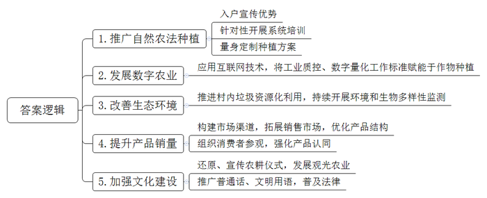
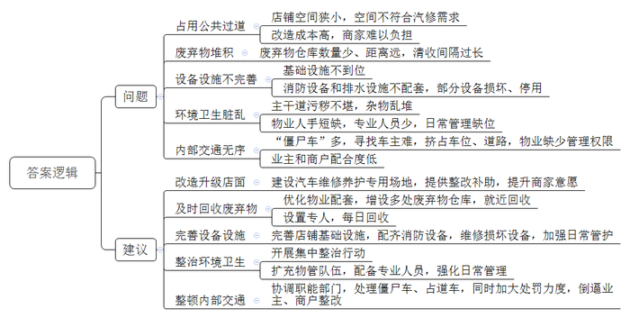
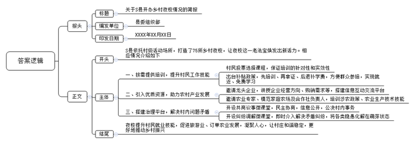
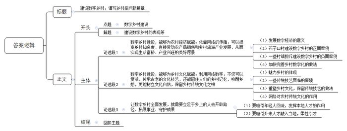

# 2022年公务员多省联考《申论》题（四川上半年县乡卷）

<!-- gwy:overview:start -->
> **四川 · 2022 · 申论 · 上半年县乡卷** ｜ 4 题 · 图片 4 处 · 答案随题折叠

导航：[题目](#题目) · [材料 1](#材料-1)
<!-- gwy:overview:end -->

> 候选采集稿。参考答案及解析来自粉笔页面，不代表官方答案或真实高分答卷；来源使用许可与原卷对应关系仍需人工核实。

## 给定材料

### 材料 1

小陈是农业生态学硕士，毕业后从事农业研究工作。2019年，他和几位同事成立了一个团队——跨界者团队，致力于在乡村实践自然农法种植，构建新的乡村知识生态。

自然农法种植是种植新理念，通俗地讲，就是以维护土壤生机的土壤培育为基础，不使用任何化肥、农药和各种生长调节剂，不通过刻意人为干预，借助自然之力种植农作物。然而，这种新理念的引入并非一帆风顺。向前村村民在接触之初，由于知识和信息的不对称，产生了误解和质疑，认为减少农药化肥的使用会影响产量和收入，于是纷纷抵制。小陈意识到，村民们如果没能得到实惠，任何方法不论如何先进，都无济于事。

于是，跨界者团队登门入户，深入到每家每户，通过各种形式的宣讲、沟通。帮助村民逐渐认识自然农法的优势。经过不懈努力，村民同意拿出一小部分菜地尝试自然农法种植。他们针对性地开展系统培训，指导村民统筹不同种类蔬菜种植时间与空间布局，停用农药化肥，改用团队制作的植物精华营养液和土著微生物，促进蔬菜自然生长。在“鱼菜共生”项目上采用高科技，将黄瓜番茄与鲈鱼在一分为二的空间里实现协同共生，通过智能一体化管理，实现了亩增年产值1600元。通过实施自然农法，村民们得到了实惠，不少村民纷纷邀请跨界者团队上门量身制定种植方案，主动扩大种植面积。自然农法种植也从蔬菜拓展到了水果、水稻和其他农作物。据统计，向前村现在参加自然农法种植的村民已达56户，种植面积近3000亩。

“稻田里都装了电子传感器，湿度、温度、虫害情况等数据实时掌控。如有异常，手机会收到预警，动动手指就能把庄稼种好。”种了半辈子地的老张怎么也没想到，有一天，自己的田地会被互联网技术所改变。跨界者团队技术员表示：“我们申请了30多项专利，将更多的工业质控、数字量化的工业标准赋能到我们的作物上，40亩的蔬菜园只需要6个工人就够了。”自然农法种植并非不需要现代知识和技术，相反，知识和技术这两大要素逐渐成为向前村农业最具竞争力的资产，村民由“靠天吃饭”转变为“靠技术吃饭”，向前村农业产业要素结构发生了重大的改变。

目前，跨界者团队联合向前村开展生态环境项目，推进村内生活污水、畜禽粪便和生活垃圾资源化利用，并持续开展环境和生物多样性监测，改善向前村生态状况，打造自然农法和乡村生态协同共促的发展环境。

虽然自然农法种植正在被越来越多的向前村村民接受，但城乡分割造成二者产销信息不对称，以往向前村的农产品只能通过线下零散的方式供给周边市场，产品销售效果并不理想。对此，跨界者团队再次发挥跨界者链接作用，通过提升城市消费者对向前村农产品的认可度，帮助打响品牌知名度。跨界者团队利用自身在城市的资源与优势，帮助村民构建有效的线下+线上市场渠道，拓展农产品销售市场，并根据市场信息反馈优化农产品结构。如今，他们不仅帮助销售农产品，还不定期组织参观探访向前村的活动，邀请城市消费者实地考察、与村民面对面交流，感知自然农法种植的优势，进而强化对向前村农产品的认同。今年初，向前村的蓝莓、阳光葡萄等特色水果迎来了大丰收，村内水果产业的产值达到200多万元，带动50多户村民在家门口实现就业。“现在在家不仅方便照顾孩子，一年还能多挣几万元！”村民一边采摘水果，一边说道，脸上全是幸福的笑容。

跨界者团队还积极推进自然农法与传统文化的融合。过去，向前村每逢春耕和秋收都要举行仪式，这个传统已经丢失了大半个世纪。团队通过走访村里老人，查阅史料，整理和还原了这些仪式，并大力对外宣传。每逢举行仪式，便有城里和其他地方的民众前来观看，团队因势利导，将一部分农田用于参观者参与种植或收割，形成了观光农业。与此同时，他们还在村里推广普通话，方便村民与外界交流；推行文明用语、普及相关法律知识等，提升村民的素质。

### 材料 2

2008年，W县着手打造全省最大汽配城，汽配城兴盛时，整个县的纳税大户半数以上都来自于汽配相关行业。但随着汽车配件网络销售的连锁普及，汽配城的经营状况开始走下坡路，最萧条的时候，原本可以容纳几千家的市场里只有几十家经营汽车配件的店铺。鉴于这种情况，从2020年开始，县里出台了一系列政策，鼓励汽配商户转变经营范围，从单一售卖汽车配件改为主营汽车维修与养护、兼营汽车配件。

经过一年多的努力，汽配城逐渐恢复了人气。但近段时间，不断有群众反映汽配城的经营管理存在很多问题。对此，W县市场监管部门成立了调研组，到汽配城进行了走访调研。

调研组来到了汽配城入口转角处的一家汽修店铺。

调研组：这是您的店铺吗？

龙先生（店铺老板）：是的，我是从汽配转汽修的老租户，汽配城开业以来就一直在这儿经营。

调研组：我们发现，您的店内空间狭小，恐怕只能同时容纳两辆轿车，生意忙起来的时候，会不会占用门口的公共过道？

龙先生：实不相瞒，这是肯定的。我这店铺还是当年按着销售汽车配件设计的，卖配件够用，但是搞汽修就显得拥挤了。我也不想占用过道，可来修的车没地方停，不停过道，那我还怎么做生意？

调研组：有没有办法解决这个问题呢？

龙先生：办法倒是有，把现有的店面重新改造，做成专门供汽车维修养护的场地，只是改造的成本太高，我们承担不起。

调研组走出龙先生的店铺，在汽配城巡视了一遍，发现几户店铺的门口都堆放着修车的废弃物，还放着好多装满废油的油桶，调研组走进其中一家店铺，向老板赵先生了解情况。

调研组：您的店铺门口为什么堆着这么多废弃物？

赵先生：老实说如果我只卖汽车配件，不会产生这么多废弃物和废油，但是配件市场改了汽修以后，物业配套这些没跟上，还在用老办法来管理。比如修车废弃物，都需要专门处理，不能随意丢弃。但汽配城现在只设了一个废弃物仓库而且距离我们的店铺太远，只能靠店里先把废弃物集中起来，好几天他们才运走一次，我们一直盼望物业每天能派专人回收。

调研组：那废油呢？

赵先生：说起这废油的事儿，真的窝火！汽配城的清洁公司目前一个月只来回收两次，平时就让我们用油桶存着，等车来运走。这废油桶堆在店里既不卫生，也不安全，我自己都担心哪天发生个火灾！

在走访过程中，调研组发现，一些商铺存在基础设施不到位、消防设备和排水设施不配套等情况，个别商铺地下消火栓管网漏水，消防水泵房处于停用状态，部分建筑未设置室内消火栓，即使设置了也大多处于无水状态。

调研组还发现，在汽配城内部的主干道上，随处可见商铺占道洗车、修车留下的黑色痕迹，废弃的广告牌、灯箱也随意堆在垃圾桶旁，原先整洁的主干道已经变得污秽不堪，不少电动车、轮胎、杂物也都堆在消防专用道上。调研组询问了多家商户，都无人认领这些东西。调研组找到了汽配城的物业主管。

调研组：汽配城的物业管理现在大概是什么情况？

物业主管：我们物业公司除去外包的保安和保洁，现在就只有19人，而负责消防管理的专业人员就1人，平时都是哪儿出了问题就去哪儿处理，日常管理根本顾不过来。

调研组：我们发现汽配城内部道路交通也处于无序状态，比如“僵尸车”占道。

物业主管：其实，这个问题由来已久。2021年7月以来，汽配城发现了120多辆“僵尸车”，其中只有50多辆找到了主人，剩下的正在继续挨个寻找。

调研组：“僵尸车”是怎么产生的？

物业主管：来这里维修的好多车都是遭受重创的事故车，一旦维修成本过高，车主就会选择弃车，从这里往前200米停了几十辆车，绝大部分都是“僵尸车”，在等配件，可这一等就是几个月，挤占了临时停车位，导致其他车辆只能乱停，甚至停在消防通道上。

调研组：那你们为什么不清理呢？

物业主管：我们也想清理啊！可是根据规定，我们物管没有清理“僵尸车”和占道车的权力，只能向有关部门反映。这些工作涉及多个部门，我们也是心有余力不足。

调研组：那怎么不督促业主整改呢？

物业主管：这个也难，很多店铺产权都归业主所有，我们以前也多次督促业主整改，但业主不配合，租赁店铺的商户既不愿自行整改，更不愿意承担成本。物业还指望着他们交物管费呢，很多时候就只能睁一只眼闭一只眼了。

### 材料 3

作为农村教育培训的一个老法宝，乡村夜校正在S县焕发出新的活力。

2021年，S县依托现有村级活动场所，先后在75个村打造乡村夜校。以“缺什么学什么，需什么教什么”为目标，根据群众所想、所盼、所需科学设置夜校课程。夜校课程全部由村民投票选出，涉及“思想政治”“惠农政策”“技能培训”等10类“微课程”，包括育婴师、面点师、电焊工、叉车、传统秧歌、法律知识讲堂等多种培训班次。这种“点餐式”教学，有效增强了夜校教育培训的针对性和实效性。

“这是我的叉车证和电焊证，都是在村里的夜校学出来的，有了这两个证，工资比以前高了，工作也更好找。”老陈展示了自己的“双证”。老陈是S县上集村的村民，他早就想考个中级职业技能证书，却苦恼于平时没时间，去城里上课离得又远。2021年初，村里开设了乡村夜校技能班，老陈第一个报了名，学完课程并顺利考取了证书。如今，他在一家上市企业工作，月收入7000元。

随着农业生产机械化水平提高，农活越来越少，村民们想找份工作的想法越来越强烈，但大都面临打工缺技术、想学没时间、培训费昂贵等诸多现实制约。S县采用“先培训、再拿证、后退补学费”的补贴政策，最大限度方便群众参加培训，实现了坐在家门口就业技能免费学。目前，S县“乡村夜校”已累计开课354次、培训1.2万人次，鉴定各类技能人才1571人。

乡村夜校不仅给村民带来技能，更为农村带来产业。前寨村作为革命老区，有着丰富的旅游资源。依托技能培训成果，前寨村成立了红色文化旅游开发公司，开发出“红色研学”“前寨花饽饽”等特色产品。开办半年就有1500余人次来到前寨红色教育基地开展研学，为村集体增收15万元。

2021年9月22日晚，在S县黄沙镇前进新村的夜校微课堂上，2000亩的种植订单谈成了。

“前期我们初步和黄沙镇政府签订了5000亩的订单种植框架协议，看到咱们的夜校培训模式，我们决定将2000亩的订单就放在前进新村。”胜利集团李经理说。

在乡村夜校建设中，黄沙镇积极邀请龙头企业来到乡村夜校现场，讲授企业经营方向、购销需求等，搭建起农民、合作社、企业之间的信息互动平台和沟通交流平台。

黄沙镇属于农业为主的乡镇，全镇耕地面积11.5万亩，主要经营大田农业和设施农业。为推进规模种植、发展现代农业，黄沙镇还邀请农业专家来夜校开展涉农政策、农业技能培训，组织镇内模范家庭农场及部分合作社负责人，讲解各类经济作物种植技术。

“乡村夜校就是一个大平台，既可以把各种资源送到老百姓家门口，又能凝聚人心，激发出乡村振兴的内生动力。”S县委组织部何副部长表示。

随着乡村夜校在各个村中铺开，夜校的人气越来越高。S县因势利导，发挥夜校特有的亲民属性，开设“共商议事微课堂”和“纠纷调解微课堂”，让邻里乡亲有个地方“说知心话”“拉家常呱”。

从7月开始，风林镇太平新村决定修建排水沟渠，但因赔偿问题矛盾丛生。

“村里修水渠，我家菜园子就被占用了，应该给点补偿吧。”“咱村儿一下雨就到处积水，这次得好好修修。”“我家的不用赔了，修排水渠是好事嘛。”……

8月2日晚上，村民代表们聚集在乡村夜校“共商议事微课堂”，各抒己见。太平新村党支部彭书记对村民反映的问题一一答复，并向村民代表们详细介绍了修建排水渠的重要意义、资金来源、工期安排等事宜。

通过举手表决，村民代表最终达成一致意见，对需要疏通挖开的部分不予以赔偿。作为补偿，土地被占用的村民每家可出一人有偿参加排水渠修建相关工作，并梳理出需要疏通的地方共26处。很快，排水沟渠工程开始动工。

“群众遇到的矛盾和问题看似‘小事情’，但若处理不当，常会激化成大矛盾，不仅影响邻里关系、村庄和谐，而且会影响社会稳定。这些‘小事情’引起的矛盾和问题之所以常常被‘放大’，被‘激化’，主要是村民遇事没有一个很好的诉说和解决渠道。”彭书记说。

如今，针对家庭矛盾、邻里纠纷、群众诉求等问题，乡村夜校即时“开课”介入解决，并由新村综治中心党支部主动参与调解，将矛盾摆在桌面上，把事情说明白、把政策讲清楚、把道理讲透彻，把各类隐患化解在萌芽状态。

“现在村民们非常喜欢走进夜校，村庄也变得越来越和谐。没想到，这小小的夜校也能书写乡村振兴的‘大文章’！”彭书记说。

### 材料 4

石子口村遍地都是石头，村里206户人家，家家房子都是石头垒的。尽管有悠久的历史、优美的生态、独具特色的建筑，但石子口村一直默默无闻。所幸的是，这个村邂逅了网络。

2017年，返乡创业大学生小孙和他的团队想打造一款别致的民宿，当他们来到石子口村，一下就喜欢上这里。清理遍地野草、完善基础设施、加固并改善房屋、拍摄宣传片……“石屋、石墙、石巷，再配上模特，大片儿就出来了。村里房子有百年历史，以二十四节气为主题，就地取材，保持山野原味，城里人非常喜欢。有了网络信息化应用，再偏远的山村也能有知名度。”小孙说。

慢慢地，石子口村在网络上的名气大了。导演、剧组、摄影家、画家、游客慕名而来，他们的微信朋友圈都成了石子口村的推介平台。在一座石头房子的屋顶上，有几个三角形的木房子，“这是专供网红直播用的，现在不少网红来这里搞直播带货，一住就好几天。村后西岭上有战国时期的古山寨，上海来的剧团带着粉丝在这里演出，演出时网络直播，还有西班牙来的乐队。没想到咱们村子的名气现在能这么大。”石子口村党支部王书记说。

这些年，石子口村民触网、懂网的越来越多，连老大娘拿着自家的山货摆摊售卖，旁边也放着微信和支付宝收款二维码。王书记说：“现在村集体收入一年有60万元。这石头房原来卖2000块钱一套也没人买，现在有人出20万元咱都不卖了，想住还得在网上提前预订呢。”

面对石子口村的变化，Z大学中国农村发展研究院黄教授有感而发：“乡村现代化，是立足于乡村的现代化，需要立足于乡上的人去开辟路径、拓展事业、守护成果。<u>数字乡村建设为乡村振兴和农业农村现代化注入全新动能。遇见数字与网络的乡村，打开了一扇与现代化对话的门。</u>”

壬寅年春节前，省级非物质文化遗产项目——土法制糖技艺传承人吴少玉在短视频平台上小“火”了一把，她在抖音上展示了一段土糖制作视频，收获大量消费者青睐，店铺卖出23万元的产品，让跟着她干的370多户乡民看到希望。

在吴少玉的家乡儋州市白马井镇学兰村，村民大多以种植甘蔗为生，以前家家户户都会制糖。随着现代制糖业发展，学兰村各个糖寮逐渐“熄火”，掌握传统制糖技艺的村民逐渐减少。土法制糖技艺面临失传危险，依赖种甘蔗、卖甘蔗的村民也渐渐陷入贫困。吴少玉的父亲常感慨：“人老了，锅旧了，甜蜜的土糖越来越少了，以后恐怕再也吃不到用土法制成的糖了。传统的东西没了，根就没了。”父亲的话触动了吴少玉。2013年，她放弃在上海的事业，返村与父亲一起筹建传统制糖体验基地，保护传承土法制糖技艺。一间旧屋，一口老锅，牛拉石辘榨蔗、锅灶熬糖、瓦器分蜜，榨汁、开泡、赶水、摇瓢、凝浆、看糖、打沙等18道工序依次进行，记忆中的糖寮回来了。

为了让更多人爱吃儋州土糖，吴少玉选择势头正盛的短视频平台作为宣传主阵地，不到两年时间，共发布了近50条反映家乡风貌和美食的视频。这些短视频冒着烟火气、透着人情味，还原了许多人的儿时记忆，使得土法制糖工艺在很多人选择“断糖”的当下仍在市场上走俏。因为，在大家心中，这不是在买高热量食品，而是在储藏一罐罐挥之不去的乡愁。

非物质文化遗产专家潘教授说：“只要运用网络技术方法得当，古老的技艺不仅不会过时，反而因其原汁原味、古色古香、有机原生态的特点，展示其超越时间的生命力。”

“哥打竹板妹弹琴，今日洛带喜盈盈。”今年大年初一，用客家山歌演绎的原创客家民俗情景剧《赶场去》在成都市龙泉驿区洛带古镇上演。该演出经抖音等平台传播后，洛带古镇景区春节期间旅游业增收3000余万元。然而，就在几年前，《赶场去》主创者张汉秋在洛带寻根时发现，村民受外来文化冲击，放弃了老祖宗的东西，山歌被认为是“土”的、过时的，难觅踪迹。为了让客家山歌再度流行，年近六旬的他寻遍洛带老人搜罗歌谣，有90多岁老婆婆掩面唱完的《哭嫁歌》，也有从十几个老挑夫口中挨个儿拼凑还原的《挑担谣》。

“文化传承不能只靠国家输氧，要唤醒年轻人的共鸣和热爱，这样才能发新芽、开新枝。我要使用互联网努力把最传统的和最时尚的连接起来，重新抓住年青一代的心。”张汉秋说。

前不久，张汉秋发布了某热门网络游戏的音乐改唱的短视频，一举成为爆款。在这个短视频中，他不断尝试摇滚、说唱、游戏配乐这些元素，使得以乡风为代表的文化符号，已不再是土味和落后的象征，而成为传统元素再创造的文化自信现象。

## 题目

### 第 1 题

**请根据****“给定资料**1**”，概括小陈的跨界者团队在助力向前村发展方面采取的措施。（10分）**

关联材料：材料 1

作答要求：

要求：全面，准确，有条理。不超过200字。

第 1 题 · 答案与解析

**参考答案（粉笔题库参考内容）**

1.推广自然农法种植。入户宣传优势；针对性开展系统培训；量身定制种植方案。

2.发展数字农业。应用互联网技术，将工业质控、数字量化工作标准赋能于作物种植。

3.改善生态环境。推进村内垃圾资源化利用，持续开展环境和生物多样性监测。

4.提升产品销量。构建市场渠道，拓展销售市场，优化产品结构；组织消费者参观，强化产品认同。

5.加强文化建设。还原、宣传农耕仪式，发展观光农业；推广普通话、文明用语，普及法律。

**解析**

**参考答案说明：**本参考答案从“推广自然农法种植”“发展数字农业”“改善生态环境”“提升产品销量”“加强文化建设”五个方面展开，各条答案要点之间在内容上相互并列，没有交叉。

### 第 2 题

**假如你是调研组成员，请根据****“给定资料**2**”，拟写调研报告的“问题”和“建议”部分。（25分）**

关联材料：材料 2

作答要求：

要求：问题归纳全面、准确；建议切实可行，针对性强，不超过400字。

第 2 题 · 答案与解析

**参考答案（粉笔题库参考内容）**

问题：1.占用公共过道。店铺空间狭小，空间不符合汽修需求；改造成本高，商家难以负担。2.废弃物堆积。废弃物仓库数量少、距离远，清收间隔过长。3.设备设施不完善。基础设施不到位；消防设备和排水设施不配套，部分设备损坏、停用。4.环境卫生脏乱。主干道污秽不堪，杂物乱堆；物业人手短缺，专业人员少，日常管理缺位。5.内部交通无序。“僵尸车”多，寻找车主难，挤占车位、道路，物业缺少管理权限；业主和商户配合度低。

建议：1.改造升级店面。建设汽车维修养护专用场地，提供整改补助，提升商家意愿。2.及时回收废弃物。优化物业配套，增设多处废弃物仓库，就近回收；设置专人，每日回收。3.完善设备设施。完善店铺基础设施，配齐消防设备，维修损坏设备，加强日常管护。4.整治环境卫生。开展集中整治行动；扩充物管队伍，配备专业人员，强化日常管理。5.整顿内部交通。协调职能部门，处理僵尸车、占道车，同时加大处罚力度，倒逼业主、商户整改。

**解析**

**参考答案说明：**本参考答案从“问题”“对策”两个方面展开，一方面，内容上，首先从“占用公共过道”“废弃物堆积”“设备设施不完善”“环境卫生脏乱”“内部交通无序”这五个方面阐释问题，其次再从“改造升级店面”“及时回收废弃物”“完善设备设施”“整治环境卫生”“整顿内部交通”这五个方面给出了具体对策建议。另一方面，形式上，本参考答案做到了分段、分条撰写，整体上条理较为清晰。

### 第 3 题

**假如你是****S县委组织部的工作人员，请根据“给定资料**3**”撰写一篇S县开办乡村夜校有关情况的简报，供领导参阅。（25分）**

关联材料：材料 3

作答要求：

要求：内容完整，逻辑清晰，行文简洁，不超过400字。

第 3 题 · 答案与解析

**参考答案（粉笔题库参考内容）**

关于S县开办乡村夜校情况的简报

县委组织部 XXXX年XX月XX日

S县依托村级活动场所，打造了75所乡村夜校，让夜校这一老法宝焕发出新活力。相应情况介绍如下：

一、按需提供培训，提升村民工作技能。村民投票选择课程，保证培训的针对性和实效性；出台补贴政策，先培训、再拿证、后退补学费，方便群众参培，实现就近、免费学习。二、引入优质资源，助力农村产业发展。邀请龙头企业，讲授企业经营方向、购销需求等，搭建信息互动交流平台；邀请农业专家、模范家庭农场及合作社负责人，培训涉农政策、农业生产技术技能。三、搭建治理平台，解决村内问题矛盾。开设共商议事微课堂，民主协商，信息公开，公决村内事务；开设纠纷调解微课堂，即时介入解决矛盾纠纷，将各类隐患化解在萌芽状态。

夜校提升村民就业技能，促进旅游业、订单农业发展，凝聚人心，让村庄和谐稳定，更好地推动乡村振兴！

**解析**

**参考答案说明：**（1）格式方面，本参考答案写到了“报头”“正文”两个部分。（2）正文部分，一方面从内容上来看，围绕“S县开办乡村夜校”这一主题，本参考答案的开头先写到了“S县开办乡村夜校的背景”；主体部分从“按需提供培训，提升村民工作技能”“引入优质资源，助力农村产业发展”“搭建治理平台，解决村内问题矛盾”三个方面介绍了S县开办乡村夜校的具体做法；结尾部分用开办乡村夜校产生的意义进行总结。另一方面，形式上，本参考答案做到了分段、分条撰写，整体上条理较为清晰。

### 第 4 题

**“给定资料**4**”中提到，“数字乡村建设为乡村振兴和农业农村现代化注入全新动能。遇见数字与网络的乡村，打开了一扇与现代化对话的门”。请根据对这段话的理解，联系实际，自选角度，自拟题目，写一篇议论文。（40分）**

关联材料：材料 1、材料 2、材料 3、材料 4

作答要求：

要求：

（1）观点明确，见解深刻；

（2）思路清晰，结构完整；

（3）语言流畅，书写工整；

（4）字数800-1000字。

第 4 题 · 答案与解析

**参考答案（粉笔题库参考内容）**

**建设数字乡村，谱写乡村振兴新篇章**

打开手机，远程“掌控”蔬菜大棚里的温湿度调节、卷帘通风；“垃圾分类数字档案”分发到每家农户，分类投放垃圾可以通过电子账户积分变现；党务、村务、财务网上一键即达，政务服务网上办节约办事时间……一幕幕生动场景，生动诠释了当代的乡村，正是数字化的乡村。可以说，数字乡村建设为乡村振兴注入全新动能。遇见数字与网络的乡村，打开了一扇与现代化对话的门。

**数字乡村建设****，能够为农村经济赋能。依靠网络的传播，可以****提高乡村知名度，直接****带动农产品销售和乡村旅游产业发展，从而实现生活富裕、产业兴旺的美好愿景。**习近平总书记指出：“发展数字经济是把握新一轮科技革命和产业变革新机遇的战略选择。”从电子商务到直播带货，从短视频火爆到乡村博主出圈，不仅为“远在深山人未识”的优质农副产品找到了新销路，也促进了乡村旅游的发展。曾经的石子口村即使历史悠久，环境优美，建筑独具一格，但因地处偏僻依然无人问津，萧条冷落。直到邂逅了网络，利用乡村独有的白墙黛瓦，就地取材，保留原真性，吸引了大批游客纷至沓来，村民开民宿，卖农货，搞直播，日子过得红红火火。但反观有些村镇，固步自封，不愿主动求新求变，不懂网络，不愿学习，只能守着金疙瘩，过着穷日子。因此，未来我们更要加快完善乡村数字化的全面发展，鼓励云端带货、网络直播迭代创新，让更多的人民群众共享数字化发展的时代红利。

**数字乡村建设，能够为乡村文化赋能。利用网络数字，不仅可以复活、传承古老的文化技艺，还能留住人们的乡村记忆，唤醒乡愁，更能树立文化自信，保留乡村传统文化之根。**广阔天地，魅力乡村，它的魅力不仅体现在自然风光上，更体现在它的历史人文上。制糖、山歌、皮影戏、制陶、烧瓷……这些流传了数千年的技艺如今却面临熄火的尴尬。想要重塑乡村文化之根，保留传统技艺，就要将最传统的和最时尚的连接起来——运用网络技术。古老的技艺不会过时，它需要传承创新，于是我们看到了有的视频中将传统民歌改编，与摇滚说唱混搭；有的视频中慢火细熬、开泡赶水、摇瓢凝浆，唤起一罐罐挥之不去的乡愁。网络数字让乡风为代表的文化符号，已不再是土味和落后的象征，而成为传统元素再创造的文化自信现象，展示其超越时间的生命力。

新气象、新征程、新选择。**让数字乡村全面发展，就需要立足于乡上的人去开辟路径、拓展事业、守护成果。**一方面，要吸引本地年轻人回流，调动本地草根乡贤，发挥自身价值，参与数字化建设。他们生于斯长于斯，更加了解本地的优势与短板，更能因地制宜，充分发挥数字化优势，扬长避短，把家乡的好与美传递到远方。另一方面，要吸引更多外来人才融入当地。他们视野开阔，思路活跃，更能将新技术、新思维带回乡村。要搭建平台，做好配套服务，完善人才政策，组建人才智库，树立“人才不必为我所有，人才归我所用”的理念，打破年龄、户籍、地域的限制，柔性引才。

乡村兴则国家兴，数字乡村已经成为乡村振兴的战略方向。在“未开垦”的广袤乡村，数字化建设仍需落地生根；在“已播种”的地区，数字化建设还要继续挖掘潜力。当互联网的因子撒向更广阔的土地，信息化成为田园牧歌的生活常态，数字乡村的美丽图景可期。

**文章分析**

**建设数字乡村，谱写乡村振兴新篇章**

【**标题的优点：**首先，范文的标题突出了“数字乡村建设”这一主题。其次，它在形式上采用对称式结构，前半句点出主题，后半句点出了意义，使标题更加完整、饱满。】

（1）打开<u>手机</u>，<u>远程</u><u>“掌控”蔬菜大棚</u>里的温湿度调节、卷帘通风；“<u>垃圾分类数字档案</u>”分发到每家农户，<u>分类投放垃圾</u>可以通过<u>电子账户</u>积分变现；<u>党务</u>、<u>村务</u>、<u>财务</u>网上一键即达，<u>政务服务网上办</u>节约办事时间……一幕幕生动场景，生动诠释了当代的乡村，正是数字化的乡村。（2）可以说，<u>数字乡村建设为乡村振兴注入全新动能</u>。<u>遇见数字与网络的乡村</u>，<u>打开了一扇与现代化对话的门</u>。

【**开头的优点：**★内容方面：范文的开头是紧扣“数字乡村建设”这一主题展开的。首先，开头点出主题，做到了主题明确。其次，对“数字乡村建设”这一主题进行了分析阐述，指出了（1）建设数字乡村的表现；（2）引用题干给定的句子，亮明文章观点。★文字表达方面：长短句配合使用，使语言表达有节奏感。】

**数字乡村建设，能够为农村经济赋能。依靠网络的传播，可以提高乡村知名度，直接带动农产品销售和乡村旅游产业发展，从而实现生活富裕、产业兴旺的美好愿景。**（1）习近平总书记指出：“<u>发展数字经济是把握新一轮科技革命和产业变革新机遇的战略选择</u>。”从电子商务到直播带货，从短视频火爆到乡村博主出圈，不仅为“远在深山人未识”的优质<u>农副产品找到了新销路</u>，也<u>促进了乡村旅游的发展</u>。（2）曾经的石子口村即使<u>历史悠久</u>，<u>环境优美</u>，<u>建筑独具一格</u>，但因地处偏僻依然无人问津，萧条冷落。直到<u>邂逅了网络</u>，利用乡村独有的白墙黛瓦，<u>就地取材</u>，<u>保留原真性</u>，吸引了<u>大批游客</u>纷至沓来，<u>村民开民宿</u>，<u>卖农货</u>，<u>搞直播</u>，<u>日子过得红红火火</u>。（3）但反观有些村镇，<u>固步自封</u>，<u>不愿主动求新求变</u>，<u>不懂网络</u>，不愿学习，只能守着金疙瘩，<u>过着穷日子</u>。（4）因此，未来我们更<u>要加快完善乡村数字化的全面发展</u>，<u>鼓励云端带货</u>、<u>网络直播迭代创新</u>，让更多的<u>人民群众共享数字化发展的时代红利</u>。

【**论述段****1的优点：**★观点句：范文的观点句是紧扣“数字乡村建设”这一文章主题提出的。形式上，它在段首处直接写出，位置突出，容易发现。内容上，关键词突出，内容要点明确，可以明显看出它是从“为农村经济赋能”入手，指出了“数字乡村建设的意义”。★论述内容：（1）先介绍了发展数字经济的意义；（2）接着介绍了石子口村建设数字乡村的正面案例；（3）再介绍了一些村镇排斥建设数字乡村的负面案例；（4）最后提出了加快完善乡村数字化的做法。注意：以上四个方面的内容都是紧扣“数字乡村建设，能够为农村经济赋能”这个观点句进行分析论述的，论述的针对性强，内容层次丰富。在论述方法上主要采用了讲道理、举例子相结合的方式，做到了丰富多样。】

**数字乡村建设，能够为乡村文化赋能。利用网络数字，不仅可以复活、传承古老的文化技艺，还能留住人们的乡村记忆，唤醒乡愁，更能树立文化自信，保留乡村传统文化之根。**（1）广阔天地，<u>魅力乡村</u>，它的魅力不仅<u>体现在自然风光上</u>，更<u>体现在</u>它的<u>历史人文上</u>。（2）制糖、山歌、皮影戏、制陶、烧瓷……这些<u>流传了数千年的技艺</u>如今却<u>面临熄火的尴尬</u>。（3）想要<u>重塑乡村文化</u>之根，<u>保留传统技艺</u>，就要<u>将最传统的和最时尚的连接起来</u>——运用网络技术。<u>古老的技艺</u>不会过时，它<u>需要传承创新</u>，于是我们看到了有的视频中<u>将传统民歌改编</u>，与摇滚说唱混搭；有的视频中慢火细熬、开泡赶水、摇瓢凝浆，<u>唤起</u>一罐罐挥之不去的<u>乡愁</u>。（4）<u>网络数字让乡风为代表的文化符号</u>，已不再是土味和落后的象征，而<u>成为传统元素再创造的文化自信现象</u>，展示其<u>超越时间的生命力</u>。

【**论述段****2****的优点：**★观点句：范文的观点句是紧扣“数字乡村建设”这一文章主题提出的。形式上，它在段首处直接写出，位置突出，容易发现。内容上，关键词突出，内容要点明确，可以明显看出它是从“为乡村文化赋能”入手，指出了“数字乡村建设的意义”。★论述内容：（1）先介绍了魅力乡村的体现；（2）接着介绍了一些传统技艺面临的窘境；（3）再介绍了重塑乡村文化，保留传统技艺的做法；（4）最后介绍了网络对农村传统文化的作用。注意：以上四个方面的内容都是紧扣“数字乡村建设，能够为乡村文化赋能”这个观点句进行分析论述的，论述的针对性强，内容层次丰富。在论述方法上主要采用了讲道理、举例子相结合的方式，做到了丰富多样。】

新气象、新征程、新选择。**让数字乡村全面发展，就需要立足于乡上的人去开辟路径、拓展事业、守护成果。**（1）一方面，<u>要吸引本地年轻人回流</u>，<u>调动本地草根乡贤</u>，<u>发挥自身价值</u>，<u>参与数字化建设</u>。他们生于斯长于斯，更加<u>了解本地的优势与短板</u>，更能因地制宜，充分<u>发挥数字化优势</u>，扬长避短，把家乡的好与美传递到远方。（2）另一方面，<u>要吸引更多外来人才融入当地</u>。他们<u>视野开阔</u>，<u>思路活跃</u>，更能<u>将新技术</u>、<u>新思维带回乡村</u>。<u>要搭建平台</u>，<u>做好配套服务</u>，<u>完善人才政策</u>，<u>组建人才智库</u>，树立“人才不必为我所有，人才归我所用”的理念，<u>打破年龄</u>、<u>户籍</u>、<u>地域的限制</u>，<u>柔性引才</u>。

【**论述段****3的优点：**★观点句：范文的观点句是紧扣“数字乡村建设”这一文章主题提出的。形式上，它在段首处直接写出，位置突出，容易发现。内容上，关键词突出，内容要点明确，可以明显看出它是从“乡村人才”入手，指出了“建设数字乡村的对策”。★论述内容：（1）先介绍了要吸引年轻人回流，发挥本地人才的作用；（2）接着介绍了要吸引外来人才融入当地，柔性引才。注意：以上两个方面层次清晰，论述的针对性强。在论述方法上主要采用了讲道理的方式，做到了见解深刻。】

【**论述段之间的关系**：范文的论述段之间有两层逻辑。第一层，整体上是从“意义”到“对策”的逻辑展开的。第二层，其中观点1和观点2又是从“意义”出发，论述段1先写了“数字乡村建设，能够为农村经济赋能”，论述段2再写了“数字乡村建设，能够为乡村文化赋能”。文章逻辑清晰、层次分明】

乡村兴则国家兴，数字乡村已经成为乡村振兴的战略方向。在“未开垦”的广袤乡村，数字化建设仍需落地生根；在“已播种”的地区，数字化建设还要继续挖掘潜力。当互联网的因子撒向更广阔的土地，信息化成为田园牧歌的生活常态，数字乡村的美丽图景可期。

【**结尾的优点**：范文的结尾回扣了“数字乡村建设”这一主题。做到了观点突出，论证完整。】

**解析状态：unknown（来源未提供）**

