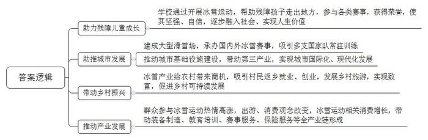
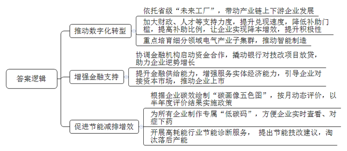
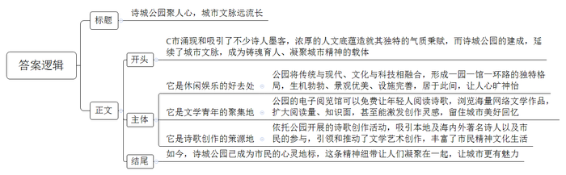
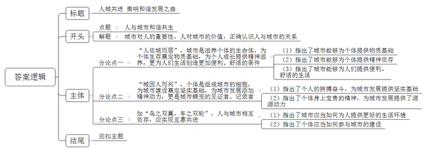

# 2022年公务员多省联考《申论》题（四川上半年省市卷）

> 候选采集稿。参考答案及解析来自粉笔页面，不代表官方答案或真实高分答卷；来源使用许可与原卷对应关系仍需人工核实。

## 给定材料

### 材料 material-f8fef0775b449e9e

“滑雪很有趣，就像小鸟在天上飞。”L市特殊教育学校滑雪队的小娇这样形容滑雪运动。“有的人以为这群孩子啥都做不成，但我就想试试，努力让他们融入社会、实现人生价值。”吴校长说。2017年，吴校长将冰雪运动引入学校。市财政局划拨专款为学校建设了滑雪训练场和旱地冰壶馆，帮助残障孩子开展冰雪运动。过去，这些孩子大多不愿出门，害怕与社会接触，更不用说到户外进行冰雪运动了。但近几年，已有40余名残障孩子走出了L市，在各类赛事中获得了60余枚奖牌。小娇说：“我就是想拿第一名，让大家看到我能行。冰雪运动让我变得更加坚强、自信。”

L市被称为“全球最适合滑雪的地点之一”。据市体育局田局长介绍，冰雪运动兴起以来，全市建成了七家大型滑雪场，其中四家位列全国十强。“上个雪季，我们举办了70多项国际、国内冰雪赛事。近年来，多支国家队常驻我市开展训练。‘全国十强’‘国际比赛’‘国字号队伍’等词汇过去在我们这里几乎是听不到的，现在大家都习以为常了。”在L市土生土长的赵军自豪地说：“我们这个内陆小城市，有两座高铁站，一些大城市恐怕都还没有哦。”随着交通等基础设施建设的跨越式发展，加上丰富的冰雪资源，冰雪旅游、冰雪休闲在L市风生水起。如今，L市智慧交通纵横交错、各式建筑造型别致，随处可见不同档次的酒店、餐厅、咖啡馆，已然成为一座国际化的现代冰雪城市。

即便是L市郊外的乡村田野，也沐浴到了冰雪带来的“春风”。三年前，当赵军看到两座高铁站开工建设时，便嗅到了扑面而来的商机。他回到老家所在的三道河村，在村里建起130多个大棚，发展采摘经济。村党支部廖书记说：“十多年前，我们就曾发展过采摘经济，但游客稀少，后来村民们都陆续退出了，又进城打工去了。现在不一样了，像赵军这样返村创业的人越来越多，涌现出了十几个资产上百万的企业主。此外，村里还有两百多人在附近雪场、酒店打工。按照现在这个趋势，未来每年预计会有十万人次来村里采摘、踏青、休闲、旅游。”

过去，皑皑白雪阻挡了市民出行的步伐，冬季也是国内大部分地方的旅游淡季。国家举办冬奥会，激发了人们参与冰雪运动的热情，改变了人们的出游习惯和消费观念，寒冷的冬季也火热了起来。据某电商平台销售数据显示，虎年春节期间，冰雪运动用品的销量同比增长超300%，其中相当一部分产自L市。“春赏花、夏避暑、秋观景、冬滑雪。党的十九大以来，我市的游客人数年均增长15%，全市四星级及以上的酒店已达40多家。”L市发改委梁副主任说，“冰雪小镇、滑雪场生意兴隆，装备制造、教育培训、赛事服务等冰雪产业从无到有、蓬勃发展，冰雪全产业链已逐步形成。冰冷的雪给L市带来了火热的发展。”

小陈在沿海某大城市干了七年的保险销售，感觉业务越来越难做。近日他辞掉了原来的工作，进入L市一家保险公司继续干老本行，一下就焕发出新的职业活力。小陈说：“冰雪运动风险系数高，现在有这么多人搞冰雪运动，为他们提供安全、便捷的保险服务，行业大有可为。”

钟师傅在L市某滑雪场当了15年滑雪教练，对近几年的“冰雪激情”深有体会：“过去来滑雪的人一直不多，闲暇时我就兼职干着护林员、清洁工的工作，教练员的本职都快荒废了。但现在，男女老少都来参与冰雪运动，我们雪场最多时一天接待了近5000人，教练员根本忙不过来。有时候还被邀请到学校讲授冰雪运动课。”曾邀请钟师傅去讲课的L市某小学李校长说：“学校每周两节体育课，滑冰、冰壶等都属于常规教学内容。全市绝大多数中小学校都引入了冰雪运动课程，我们有这么好的冰雪资源，绝不能浪费。”

### 材料 material-ea7676edb6a96921

最近，Z省Q市工业总产值迈上2150亿元新台阶，上市企业突破两位数，市场主体突破18万，高新技术企业总数近800家，居全省前三，电气产业成功获评国家先进制造业集群；规上企业亩均税收54.6万元，居省内各县市第一；工业用电量两年平均增速居全省第1位。根据最新排名，Q市跃居全国县域经济百强县市第14位、中国创新百强县市第11位。

Q市这些亮眼数据的背后，藏着怎样的“密码”？

走进T公司“未来工厂”，机械手精准完成冲压、焊接、组装等动作，在视觉在线检测系统火眼金睛的“审视”下，一个个断路器组装完成。“车间24小时运作，每天的产量已达到300万极。”T公司生产运营部总经理郜军介绍，这条国内领先的小型断路器全制程自动化生产线，由T公司自主设计、制造，拥有自主知识产权，每秒可生产出一个断路器。

T公司“未来工厂”是Z省首批12家“未来工厂”之一。截至目前，T公司投入智能化技改资金23.48亿元，努力打造“百亿车间”，实现全制程自动化和全价值链数字化，并依托工业物联网平台，带动产业链上下游400余家企业数字化升级、协同化制造，生产效率提升3倍以上，单极成本下降50%以上。

随着财政资金扶持力度和广度的加大，越来越多的Q市企业尝到了技术改造升级带来的甜头，企业进行技改的积极性空前高涨，智能化技改已覆盖近90%的规上企业。同时，通过数字植入产品、智能引领制造，重点培育智能低压电气、物联网传感器等10个细分领域子集群，400多家规上电气企业实现产品数字化转型，电能表、断路器等传统产品加速向数字化产品迭代升级。

数字化不仅推动龙头企业降本增效，也成为智能制造的基础。Q市以智能化升级为重要抓手，激活电气产业集群创新动能。走进J公司新型小型断路器智能工厂，车间里5条自动生产线一字排开。J公司副总裁楚方自豪地介绍，智能工厂建成后生产运营成本降低8%，能源利用率提升10%，经济效益改善明显。这个总投入4980万元的智能工厂，有30%的资金来源于政府补贴。政府的激励政策大大激发了企业智能化升级的热情。

截至目前，Q市已累计分9批配套竞争性财政存款11.48亿元。在企业智能化转型升级中，政府的补助力度和兑现速度Q市均走在Z省前列。

2020年针对企业发展需求，Q市政府协调国开行Z省分行等金融机构启动“制造业资金合作计划”，撬动各银行对43家企业的250个技改项目放贷49.03亿元，助力企业实现了10%以上的逆势增长，部分企业销售增长超30%。

为持续激发企业智能化技术改造积极性，Q市在原有“技改新八条”的基础上，制定出台了“技改新十条”，进一步降低补助门槛，提高最高补助比例。同时，还在专业技术人才引进、技术装备购置等方面加大支持力度。一降一升中，折射出Q市进一步支持企业技术改造的定力和决心。

为促进企业节能减排增效，Q市根据企业碳效情况绘制成“碳画像五色图”，每月动态评价一次，半年度评价结果将作为政策实施依据。目前，已实现规上企业碳效监测全覆盖，每家企业都有自己专属的“低碳码”，企业可随时查看自身“碳效”水平，对症下药，提高碳效。

“两个月前我们的碳效等级还是橙色，这个月终于升级成二级蓝色。”雷波按钮制造有限公司负责人说，“近两个月我们的行业碳效排名上升了144名。”该负责人坦言，企业碳效直接影响企业所享政策补贴，争当“低碳优等生”才能获得更好的待遇。Q市乾龙电气有限公司因为在“碳画像五色图”评价体系中被评为代表最优的绿色，依据政策获得了国开行Z省分行1000万元“碳均英雄”专项贷款，并给予3.8%的优惠年利率。

围绕帮助企业精准减碳的工作目标，Q市还对重点高耗能行业开展节能诊断服务行动，为年用电量500吨标煤以上的企业实行免费“诊断”，提出节能技改建议。

当前，Q市已淘汰低端铸造业等落后产能，去年规上工业增加值能耗降至0.32吨标准煤/万元，为全省平均值的38%。

与此同时，Q市以提升金融供给能力为目标，增强服务实体经济能力，引导企业对接资本市场。截至目前，Q市全市境内外上市公司共有11家，在中国证监会和深圳证券交易所排队待审IPO企业6家，“新三板”挂牌企业累计20家，IPO签约企业累计28家，上市后备梯队企业50家，新增报会数在Z省排名第1位。

### 材料 material-fac5854c03a4b81c

D省C市因涌现了不少诗人墨客而小有名气，也吸引了古今不少诗人前来“打卡”，唐代诗人李白、杜甫，近代诗人徐志摩、艾青，当代诗人舒婷、海子等都曾在这里留下过足迹和诗篇。浓浓的诗情，深厚的底蕴，形成了C市独特的城市气质秉赋。

为了延续城市文脉，2021年，C市建成了一座新的城市地标——诗城公园。公园建设之初，C市市委市政府将其定位为市民的精神生活园地、凝聚市民的精神家园、绵延城市精神的重要场所。公园将传统园林与现代建筑相结合，将诗歌文化与科技手段相融合，形成一园（诗词碑园）、一馆（电子阅览馆）、一环路（环湖路）的独特布局。园内预设了1000个橱窗，从2021年标记到了2120年，用于展示每年入驻的现代诗作品。2021年已经入驻了《走向未来》《城市春天》《白昼路灯》等不少获奖作品。2.5公里长的环湖路景墙上镌刻着400多首古今中外的诗歌，按照经典、流行、儿童、本地四个板块依次排列。园内虫鸣鸟叫、花繁叶茂，引人入胜，市民们在公园里品诗、读书，打太极、练瑜伽，一幅幅人与自然和谐共生的场景令人心旷神怡。“公园很漂亮、设施很完善，大家休闲娱乐都喜欢来这儿。”正在公园锻炼身体的沈大爷连连称赞。

沈大爷的孙子小沈时不时也会陪爷爷来诗城公园。“爷爷来锻炼身体，我是来电子阅览馆读诗的。”即将参加高考的小沈说，“紧张的复习备考之余来读读诗，既可以放松身心，又可以扩大阅读量、知识面。”像小沈一样在电子阅览馆享受文学乐趣的年轻人还有很多，他们不仅可以读诗，还可以读到海量的网络文学作品。有数据显示，“95”后已成为网络文学创作的主力军。1997年出生在C市的小齐，凭借一部讲述中国装备工业发展历史、现实与未来的《大国重工》，在全国网络文学征文大赛中获得一等奖。他的作品就可以在诗城公园的电子阅览馆免费阅读。而小齐本人也是诗城公园的常客，他说：“诗城公园有凝聚年轻人的魔力，它激发了我创作的灵感。现在，我正在构思一部新的网络文学作品《城市建构师》，就是以C市为背景。”C市市委宣传部孙副部长说：“如何适应时代变化，引导市民讴歌时代、歌颂梦想、热爱城市，同时将包括现代诗歌在内的各类文学精品更好地呈现和推荐给广大市民，让人们留住关于城市的美好回忆，是现代城市人文建设需要深入思考的课题。”

诗城公园建成后，2021年，C市组织开展首届“云集诗城·唱响时代”诗歌创作活动，由市作协组织本地及海内外著名诗人，到诗城公园开展诗歌创作、展示、交流及评选，并鼓励广大市民积极参与。市财政划拨专项经费，对优秀作品给予奖励。此次活动征集到了诗歌作品200余件，其中15件获评优秀。C市本地诗人熊邓灵的诗作《走向未来》获奖并入驻了诗城公园的橱窗，她还获得了5万元奖金。“这次诗歌创作活动在社会引起了广泛关注，效果很好。引领和推动了我市文学艺术创作，极大丰富了市民精神文化生活，我们还要继续举办下去。”C市作协刘主席说，“诗城公园已成为我市铸魂育人、凝聚城市精神的重要载体。”

它就像一条精神纽带，通过诗歌将人们联系在一起，凝聚在一起，让我们的城市更有魅力。如今，诗城公园已经成为C市市民的心灵地标。

## 题目

### 第 1 题

**请根据****“给定资料**1**”，谈谈为什么说冰冷的雪给L市带来了火热的发展。****（****15分****）**

关联材料：材料 material-f8fef0775b449e9e

作答要求：

要求：全面、准确、逻辑清晰，不超过300字。

### 第 2 题

**请根据****“给定资料**2**”，概述Q市激励企业技改升级、促进经济快速发展的密码。****（****15分****）**

关联材料：材料 material-ea7676edb6a96921

作答要求：

要求：全面、准确、有条理，不超过300字。

### 第 3 题

**请根据给定资料**3**，自拟****题目****，为****D省日报撰写一篇关于C市****诗城公园****建设的短评。****（****30分****）**

关联材料：材料 material-fac5854c03a4b81c

作答要求：

要求：观点鲜明，简明扼要，语言生动。不超过400字。

### 第 4 题

**资料**5**中横线部分“一座城市就像一个生命共同体，生活在****其****间的每个个体，就像这个生命体的细胞，这些细胞既给生命体提供支撑****与****动力，又从生命体中汲取养分成长。****”根据对这句话的理解，结合给定资料**1**\-**5**，联系实际，自选角度，自拟题目，写一篇议论文。****（****40分****）**

关联材料：材料 material-f8fef0775b449e9e

作答要求：

要求：

（1）题意明确，见解深刻；

（2）思路清晰，结构完整；

（3）语言流畅，书写工整；

（4）800-1000字。

## 答案与解析

第 1 题

**参考答案（粉笔题库参考内容）**

一、助力残障儿童成长。学校通过开展冰雪运动，帮助残障孩子走出地方，参与各类赛事，获得荣誉，使其坚强、自信，逐步融入社会、实现人生价值。

二、助推城市发展。建成大型滑雪场，承办国内外冰雪赛事，吸引多支国家队常驻训练；推动城市基础设施建设，带动第三产业，实现城市国际化、现代化发展。

三、带动乡村振兴。冰雪产业给农村带来商机，吸引村民返乡就业、创业，发展乡村旅游，实现致富，促进乡村可持续发展。

四、推动产业发展。群众参与冰雪运动热情高涨，出游、消费观念改变，冰雪运动相关消费增长，带动装备制造、教育培训、赛事服务、保险服务等全产业链形成。

**解析**

**参考答案说明：**本参考答案从“助力残障儿童成长”“助推城市发展”“带动乡村振兴”和“推动产业发展”四个方面展开，各条答案要点之间在内容上相互并列，没有交叉。

**考点**：考点原因类

**来源**：来源2022年公务员多省联考《申论》题（四川上半年省市卷）

粉笔申论页面对本题只提供「解析视频」入口，该入口是会员推广位，页面无视频地址与文字解析。

第 2 题

**参考答案（粉笔题库参考内容）**

1.推动数字化转型。依托省级“未来工厂”，带动产业链上下游企业发展；加大财政、人才等支持力度，提升兑现速度，降低补助门槛，提高补助比例，让企业实现降本增效，提升积极性；重点培育细分领域电气产业子集群，推动智能制造。

2.增强金融支持。协调金融机构启动资金合作，撬动银行对技改项目放贷，助力企业逆势增长；提升金融供给能力，增强服务实体经济能力，引导企业对接资本市场，推动企业上市。

3.促进节能减排增效。根据企业碳效绘制“碳画像五色图”，按月动态评价，以半年度评价结果实施政策；为所有企业制作专属“低碳码”，方便企业实时查看、对症下药；开展高耗能行业节能诊断服务，提出节能技改建议，淘汰落后产能。

**解析**

**参考答案说明：**本参考答案从“推动数字化转型”“增强金融支持”“促进节能减排增效”三个方面进行了分条撰写。各条要点之间在内容上相互并列，没有交叉。

**考点**：考点概括措施类

**来源**：来源2022年公务员多省联考《申论》题（四川上半年省市卷）

粉笔申论页面对本题只提供「解析视频」入口，该入口是会员推广位，页面无视频地址与文字解析。

第 3 题

**参考答案（粉笔题库参考内容）**

诗城公园聚人心，城市文脉远流长

C市涌现和吸引了不少诗人墨客，浓厚的人文底蕴造就其独特的气质秉赋，而诗城公园的建成，延续了城市文脉，成为铸魂育人、凝聚城市精神的载体。

它是休闲娱乐的好去处。公园将传统与现代、文化与科技相融合，形成一园一馆一环路的独特格局，生机勃勃、景观优美、设施完善，居于此间，让人心旷神怡。

它是文学青年的聚集地。公园的电子阅览馆可以免费让年轻人阅读诗歌，浏览海量网络文学作品，扩大阅读量、知识面，甚至能激发创作灵感，留住城市美好回忆。

它是诗歌创作的策源地。依托公园开展的诗歌创作活动，吸引本地及海内外著名诗人以及市民的参与，引领和推动了文学艺术创作，丰富了市民精神文化生活。

如今，诗城公园已成为市民的心灵地标，这条精神纽带让人们凝聚在一起，让城市更有魅力。

**解析**

**参考答案说明：**（1）格式方面，本参考答案写到了“标题”“正文”两个部分。（2）正文部分：从内容来看，围绕着“诗城公园”这一主题，开头部分整体介绍了诗城公园建设的背景并做出评价；主体部分分别从“休闲娱乐的好去处”“文学青年的聚集地”“诗歌创作的策源地”这三个方面介绍其积极作用；结尾部分再次进行了总结评价。从形式来看，本参考答案做到了分段、分条撰写，逻辑清晰。

**考点**：考点评论类

**来源**：来源2022年公务员多省联考《申论》题（四川上半年省市卷）

粉笔申论页面对本题只提供「解析视频」入口，该入口是会员推广位，页面无视频地址与文字解析。

第 4 题

**参考答案（粉笔题库参考内容）**

**人城共进** **奏响和谐发展之曲**

“城，所以盛民也。”城市是人赖以生存的聚居所，其发展关乎百姓生活方方面面。“民，乃城之本也。”人是城市不可或缺的一份子，是城市建设的主力军，其为城市发展注入不竭活力。**城市与人是休戚与共的命运共同体，二者互相支撑，共同生长，双向奔赴。**

**“人依城而居”，城市是滋养个体的生命体，为个体生存奠定物质基础，为个人成长提供精神滋养，更为人们生活创造更加便利、舒适的条件。**亚里士多德曾说过，“人们来到城市，是为了生活；人们居住在城市，是为了生活得更好。”乘文旅融合东风，千年古都西安书写今世繁华，城市经济焕发活力，民众就业难题解决，人们“钱景”更加可期。得城市精神滋养，嘉兴市民崇德明礼，文明因子深入骨血，“红船精神”外化于行，志愿服务之花吹遍大街小巷。步入社区，智能车牌识别、智能安防系统“各司其职”；线上办事，医疗健康、安全缴费等事项“一站式办理”……城市越来越“智慧”，民众生活也越来越方便、越有品质。城市既是个体的生存空间，亦是涵养其精神的重要场所，更以优渥的供给满足人民对美好生活的需求。

**“城因人而兴”，个体是组成城市的细胞，为城市建设奠定坚实基础，为城市发展添加精神动力，更是城市蝶变的见证者、记录者。**生命体的健康运行，离不开细胞赋能，城市的建设发展，离不开个人的拼搏奋斗。藏族小伙丁真、“田园一姐”李子柒、新农人张同学……因为他们，理塘、绵阳、营口等城市被更多人熟知，随着众多真金白银的旅游订单涌来，城市逐渐从“贫穷”走向富裕；“振超团队”潜心研发，大幅提升青岛港作业效率，“海洋强市”步伐正稳步迈进；酷暑严寒，环卫工人、快递小哥、建筑工人劳作不休，城市因之更加靓丽、美好……伴随着无数“平凡”个体的奋斗，“棒棒精神”、“深圳精神”应运而生，城市文化底蕴愈加丰厚，发展内驱力更强。于奋斗之中，个体建设了城市，也见证着城市的发展、变迁。

**如“鸟之双翼，车之双轮”，人与城市相互依存，应实现互惠共进。**如此，城市要“以人为本”，不断加强城市建设、完善制度设计、优化公共服务，切实保障居民的各项权益；个人发展也要“服务于城”，要在敬畏、善待城市的前提下，让城市因人的奋斗而更加繁荣昌盛。

“同呼吸，共命运”，人与城市，相互依存、相互促进，是不可分割的统一整体。处理好这对生命共同体的关系，我们的未来将会不断谱就发展新篇章！

**解析**

**文章分析**

**人城共进 奏响和谐发展之曲**

【**标题的优点：**标题中含有主题词，使文章主题更突出、清晰。此外，修辞方法的运用，让标题又增添了些许生动与灵动。】

（1）“城，所以盛民也。”城市是人赖以生存的聚居所，其发展关乎百姓生活方方面面。（2）“民，乃城之本也。”人是城市不可或缺的一份子，是城市建设的主力军，其为城市发展注入不竭活力。（3）**城市与人是休戚与共的命运共同体****，****二者互相支撑****，****共同生长****，****双向奔赴****。**

【**开头的优点：**★内容方面。范文的开头是紧扣题目给定的“人与城市和谐共生”这一主题展开的。一方面，通过名言，指出城市对人的意义；另一方面，结合名言，指出了人对城市的价值；最后，指出了城市与人的关系，提出文章核心观点。★文字表达方面。表述简洁精炼，表意清晰明确。】

**“人依城而居”，城市是滋养个体的生命体，为个体生存奠定物质基础，为个人成长提供精神滋养，更为人们生活创造更加便利、舒适的条件。**（1）亚里士多德曾说过，“人们来到城市，是为了生活；人们居住在城市，是为了生活得更好。”乘文旅融合东风，千年古都西安书写今世繁华，城市经济焕发活力，民众就业难题解决，人们“钱景”更加可期。（2）得城市精神滋养，嘉兴市民崇德明礼，文明因子深入骨血，“红船精神”外化于行，志愿服务之花吹遍大街小巷。（3）步入社区，智能车牌识别、智能安防系统“各司其职”；线上办事，医疗健康、安全缴费等事项“一站式办理”……城市越来越“智慧”，民众生活也越来越方便、越有品质。城市既是个体的生存空间，亦是涵养其精神的重要场所，更以优渥的供给满足人民对美好生活的需求。

【**论述段****1的优点：**★观点句：范文的观点句是紧扣“人与城市和谐共生”这一文章主题提出的。形式上，它在段首处直接写出，位置突出，容易发现。内容上，关键词突出，内容要点明确，可以明显看出从“城市对人的影响”角度，对“人与城市和谐共生”这一主题展开了论述。★论述内容：（1）指出了城市能够为个体提供物质基础。（2）指出了城市能够为个体提供精神依存；（3）指出了城市能够为人们提供便利、舒适的生活。注意：以上三个方面的内容都是紧扣“‘人依城而居’，城市是滋养个体的生命体，为个体生存奠定物质基础，为个人成长提供精神滋养，更为人们生活创造更加便利、舒适的条件”这个观点句进行分析论述的，论述的针对性强，内容层次丰富。在论述方法上主要采用了讲道理的方式，论述清晰透彻。】

**“城因人而兴”，个体是组成城市的细胞，为城市建设奠定坚实基础，为城市发展添加精神动力，更是城市蝶变的见证者、记录者。**（1）生命体的健康运行，离不开细胞赋能，城市的建设发展，离不开个人的拼搏奋斗。藏族小伙丁真、“田园一姐”李子柒、新农人张同学……因为他们，理塘、绵阳、营口等城市被更多人熟知，随着众多真金白银的旅游订单涌来，城市逐渐从“贫穷”走向富裕；“振超团队”潜心研发，大幅提升青岛港作业效率，“海洋强市”步伐正稳步迈进；酷暑严寒，环卫工人、快递小哥、建筑工人劳作不休，城市因之更加靓丽、美好……（2）伴随着无数“平凡”个体的奋斗，“棒棒精神”、“深圳精神”应运而生，城市文化底蕴愈加丰厚，发展内驱力更强。于奋斗之中，个体建设了城市，也见证着城市的发展、变迁。

【**论述段****2的优点：**★观点句：范文的观点句是紧扣“人与城市和谐共生”这一文章主题提出的。形式上，它在段首处直接写出，位置突出，容易发现。内容上，关键词突出，内容要点明确，可以明显看出从“人对城市的价值”角度，对“人与城市和谐共生”这一主题展开了论述。★论述内容：（1）指出了个人的拼搏奋斗，为城市发展提供坚实基础。（2）指出了个体身上宝贵的精神，为城市发展提供了源源动力。注意：以上两个方面的内容都是紧扣“‘城因人而兴’，个体是组成城市的细胞，为城市建设奠定坚实基础，为城市发展添加精神动力，更是城市蝶变的见证者、记录者”这个观点句进行分析论述的，论述的针对性强，内容层次丰富。在论述方法上主要采用了讲道理的方式，论述清晰透彻。】

**如****“鸟之双翼，车之双轮”，人与城市相互依存，应实现互惠共进。**（1）如此，城市要“以人为本”，不断加强城市建设、完善制度设计、优化公共服务，切实保障居民的各项权益；（2）个人发展也要“服务于城”，要在敬畏、善待城市的前提下，让城市因人的奋斗而更加繁荣昌盛。

【**论述段****3的优点：**★观点句：范文的观点句是紧扣“人与城市和谐共生”这一文章主题提出的。形式上，它在段首处直接写出，位置突出，容易发现。内容上，关键词突出，内容要点明确，可以明显看出从“如何处理城市与人的关系”角度，对“人与城市和谐共生”这一主题展开了论述。★论述内容：（1）指出了城市应当如何为人提供更好的生活环境。（2）指出了个体应当如何参与城市的建设。注意：以上两个方面的内容都是紧扣“如‘鸟之双翼，车之双轮’，人与城市相互依存，应实现互惠共进”这个观点句进行分析论述的，论述的针对性强，内容层次丰富。在论述方法上主要采用了讲道理的方式，论述清晰透彻。】

【**论述段之间的关系：**★内容的内在逻辑：范文的论述段之间是依照“城市对人的意义”“人对城市的价值”“正确处理人与城的关系”的逻辑展开的。★段与段的外在衔接：论述段1、2、3的段首处，都有“人依城而居”“城因人而兴”“鸟之双翼，车之双轮”等引导语，提示段落论述重点，让文章结构一目了然。】

“同呼吸，共命运”，人与城市，相互依存、相互促进，是不可分割的统一整体。处理好这对生命共同体的关系，我们的未来将会不断谱就发展新篇章！

【**结尾的优点：**范文的结尾回扣了“人与城市和谐共生”这个主题，并且进行了总结提升。】

**考点**：考点文章写作题

**来源**：来源2022年公务员多省联考《申论》题（四川上半年省市卷）

粉笔申论页面对本题只提供「解析视频」入口，该入口是会员推广位，页面无视频地址与文字解析。

