# 2022年四川下半年公务员录用考试《行测》试题（网友回忆版）

<!-- gwy:overview:start -->
> **四川 · 2022 · 行测 · 下半年** ｜ 100 题 · 图片 127 处 · 答案随题折叠

| 题型模块 | 题量 | 题号 |
| --- | ---: | ---: |
| 常识判断 | 10 | 1–10 |
| 言语理解与表达 | 30 | 11–40 |
| 数量关系 | 10 | 41–50 |
| 判断推理 | 35 | 51–85 |
| 资料分析 | 15 | 86–100 |
| **合计** | **100** | |

导航：[题型与作答说明](#题型与作答说明) · [题目](#题目) · [材料 1](#材料-1)
<!-- gwy:overview:end -->

> 候选采集稿。参考答案及解析来自粉笔页面，不代表官方答案或真实高分答卷；来源使用许可与原卷对应关系仍需人工核实。

## 题型与作答说明

常识判断

（10题）

第一部分 常识判断。 根据题目要求，在四个选项中选出一个最恰当的答案。

言语理解与表达

（30题）

第二部分 言语理解与表达。 本部分包括表达与理解两方面的内容。请根据题目要求，在四个选项中选出一个最恰当的答案。

数量关系

（10题）

第三部分 数量关系。 在这部分试题中，每道题呈现一段表述数字关系的文字，要求你迅速、准确地计算出答案。

判断推理

（35题）

第四部分 判断推理。 本部分包括图形推理、定义判断、类比推理与逻辑判断四种类型的试题，在四个选项中选出一个最恰当的答案。

资料分析

（15题）

第五部分 资料分析。 所给出的图、表、文字或综合性资料均有若干个问题要你回答。你应根据资料提供的信息进行分析、比较、计算和判断处理。

## 题目

### 第 1 题

习近平总书记在党的二十大报告中指出，全党必须牢记“五个必由之路”。其中，新时代我国发展壮大的必由之路是：

A. 坚持党的全面领导

B. 中国特色社会主义

C. 贯彻新发展理念

D. 全面从严治党

第 1 题 · 答案与解析

**参考答案（粉笔题库参考内容）**

C

**解析**

本题考查政治常识。

A、B、D三项错误，C项正确。2022年10月16日，习近平总书记在二十大上作题为《高举中国特色社会主义伟大旗帜 为全面建设社会主义现代化国家而团结奋斗》的报告，其中指出：“时代呼唤着我们，人民期待着我们，唯有矢志不渝、笃行不怠，方能不负时代、不负人民。全党必须牢记，坚持党的全面领导是坚持和发展中国特色社会主义的必由之路，中国特色社会主义是实现中华民族伟大复兴的必由之路，团结奋斗是中国人民创造历史伟业的必由之路，贯彻新发展理念是新时代我国发展壮大的必由之路，全面从严治党是党永葆生机活力、走好新的赶考之路的必由之路。这是我们在长期实践中得出的至关紧要的规律性认识，必须倍加珍惜、始终坚持，咬定青山不放松，引领和保障中国特色社会主义巍巍巨轮乘风破浪、行稳致远。”

故正确答案为C。

### 第 2 题

习近平总书记在中央政治局就推进军事政策制度改革举行的第十六次集体学习时强调，军事政策制度改革力度大、创新性强，要解放思想，坚决破除一切不合时宜的思想和行为障碍，善于谋新策、出新招、走新路。下列关于我国军事政策制度改革的说法正确的是：

①军事政策制度改革是军地双方共同的任务

②军事政策制度改革是对我军的一次制度性重构

③军事政策制度改革应以确保战斗力提升为根本指向

④军事政策制度改革要牢固确立系统集成的基本理念和原则

A. ①②③

B. ①②④

C. ①③④

D. ②③④

第 2 题 · 答案与解析

**参考答案（粉笔题库参考内容）**

B

**解析**

本题考查政治常识。

2019年7月30日下午，中共中央政治局就推进军事政策制度改革举行第十六次集体学习。

①正确，习近平总书记强调，军事政策制度改革是军地双方共同的任务，要增强全局观念，加强组织领导，压紧压实责任，形成一盘棋，拧成一股绳。

②正确，习近平总书记强调，军事政策制度是我们党治国理政的重要保障，军事政策制度改革是对我军的一次制度性重构，关系实现党在新时代的强军目标、把人民军队全面建成世界一流军队，关系实现“两个一百年”奋斗目标、实现中华民族伟大复兴的中国梦。

③错误，2018年11月13日至14日，中央军委政策制度改革工作会议召开，习近平指出，军事政策制度改革的指导思想是，以新时代中国特色社会主义思想和党的十九大精神为指导，深入贯彻新时代党的强军思想，以确保党对军队绝对领导为指向，以战斗力为唯一的根本的标准，以调动军事人员积极性、主动性、创造性为着力点，系统谋划、前瞻设计，创新发展、整体重塑，建立健全中国特色社会主义军事政策制度体系，为实现党在新时代的强军目标、把人民军队全面建成世界一流军队提供有力政策制度保障。

④正确，习近平总书记强调，要把握军事政策制度改革特殊复杂性，把系统集成作为一个基本理念和原则牢固确立起来。要处理好顶层设计和分层对接的关系，各项改革都要在军事政策制度体系框架下加以推进，搞好上下左右、方方面面的衔接，确保改革整体联动，发生“化学反应”。

综上所述，①②④表述正确。

故正确答案为B。

### 第 3 题

1951年2月到1953年6月的整党运动中，有32.8万人被开除出党或被劝告退党；1983年10月到1987年5月的整党运动中，开除党籍的将近3.39万人；十八大以来，共有90多万名党员出党，震撼人心。这主要说明：

①从严管党治党、保持党员队伍纯净是党中央一贯秉持的理念

②勇于自我革命，是中国共产党最鲜明的品格，也是中国共产党最大的优势

③世界上没有一个政党、历史上也不曾有过一个政党有中国共产党这么宏大的规模

④中国共产党扩大队伍的过程绝非是来者不拒，而是不断去粗取精、不断自我净化

A. ①②

B. ①②③

C. ①②④

D. ①②③④

第 3 题 · 答案与解析

**参考答案（粉笔题库参考内容）**

C

**解析**

本题考查政治常识。

①④正确，从题干可知，整党运动上个世纪已有开展，中国共产党由小到大、由弱变强，扩大队伍的过程绝非是来者不拒、壮大山头，而是去粗存精、不断净化。从严管党治党、保持党员队伍纯净是党中央一贯秉持的理念。

②正确，中国共产党的百年历史，就是一部勇于自我革命的历史。习近平总书记在省部级主要领导干部学习贯彻党的十八届六中全会精神专题研讨班开班式上发表重要讲话，指出：“勇于自我革命，是我们党最鲜明的品格，也是我们党最大的优势。”

③错误，一百年前，中国共产党成立时只有50多名党员，今天已经成为拥有9500多万名党员、领导着14亿多人口大国、具有重大全球影响力的世界第一大执政党。世界上没有一个政党、历史上也不曾有过一个政党，有中国共产党这么宏大的规模，这么强大的号召力、凝聚力和战斗力。本身说法正确，但不符合题意。

故正确答案为C。

### 第 4 题

《中华人民共和国个人信息保护法》自2021年11月1日起施行。根据该法，下列说法正确的是：

A. 甲在购买空调时，商家要求甲提供身份证号码及指纹办理会员，甲表示拒绝，则商家有权拒绝提供产品

B. 为了保护不满十四周岁的未成年人乙的个人信息，个人信息处理者可以采取与成年人相同的个人信息处理规则

C. 某电视台为了报道丙无故偷逃高速通行费的新闻，播放含有丙肖像和车牌号码的视频时，无需取得丙的同意

D. 某外国企业丁为了向中国境内的自然人提供服务而处理他们的个人信息，但因丁是在中国境外进行处理的，可以不适用中国的法律

第 4 题 · 答案与解析

**参考答案（粉笔题库参考内容）**

C

**解析**

本题考查法律常识。

A项错误，C项正确，根据《中华人民共和国个人信息保护法》第十三条规定：“符合下列情形之一的，个人信息处理者方可处理个人信息：（一）取得个人的同意；（二）为订立、履行个人作为一方当事人的合同所必需，或者按照依法制定的劳动规章制度和依法签订的集体合同实施人力资源管理所必需；（三）为履行法定职责或者法定义务所必需；（四）为应对突发公共卫生事件，或者紧急情况下为保护自然人的生命健康和财产安全所必需；（五）为公共利益实施新闻报道、舆论监督等行为，在合理的范围内处理个人信息；（六）依照本法规定在合理的范围内处理个人自行公开或者其他已经合法公开的个人信息；（七）法律、行政法规规定的其他情形。依照本法其他有关规定，处理个人信息应当取得个人同意，但是有前款第二项至第七项规定情形的，不需取得个人同意。”A项中，就购买空调来说，提供身份证号码及指纹不是履行合同所必需的条件，甲有权拒绝，商家无权因此拒绝提供产品。C项中，电视台为了报道丙无故偷逃高速通行费的新闻，播放含有丙肖像和车牌号码的视频，符合上述第（五）项规定，无需取得丙的同意。

B项错误，根据《中华人民共和国个人信息保护法》第三十一条规定：“个人信息处理者处理不满十四周岁未成年人个人信息的，应当取得未成年人的父母或者其他监护人的同意。个人信息处理者处理不满十四周岁未成年人个人信息的，应当制定专门的个人信息处理规则。”

D项错误，根据《中华人民共和国个人信息保护法》第三条规定：“在中华人民共和国境内处理自然人个人信息的活动，适用本法。在中华人民共和国境外处理中华人民共和国境内自然人个人信息的活动，有下列情形之一的，也适用本法：（一）以向境内自然人提供产品或者服务为目的；（二）分析、评估境内自然人的行为；（三）法律、行政法规规定的其他情形。”丁向中国境内的自然人提供服务，应适用本法。

故正确答案为C。

### 第 5 题

下列关于武器装备的说法错误的是：

A. 无人潜航器集战场环境侦察、敌情监视等多种功能于一身

B. 直-20战术通用直升机为新型五桨直升机，采用人工折叠技术折收旋翼

C. 轰-6N国产新型远程战略轰炸机能够实施远程奔袭、大区域巡航、防区外打击

D. 东风-17弹道导弹携带高超音速滑翔飞行器，发射弹头前可在超低空飞行，更难被侦察和拦截

第 5 题 · 答案与解析

**参考答案（粉笔题库参考内容）**

B

**解析**

本题考查科技常识。

A项正确，无人潜航器是指没有人驾驶、靠遥控或自动控制在水下航行的器具，主要指那些代替潜水员或载人小型潜艇进行深海探测、救生、排除水雷等高危险性水下作业的智能化系统，是中国海军智能化平台，集战场环境侦察、敌情监视等多种功能于一身，是未来无人作战的典型装备。

B项错误，直-20战术通用直升机（代号：入云龙、“神雕”-20），从外形上看，比较类似中国进口的美制“黑鹰”S-70C-2直升机，但与“黑鹰”不同的是，直20主旋翼采用五桨叶结构，具有更好的控制性和机动性。直-20海基型是中国大陆第一款采用旋翼电动折叠技术的国产直升机，和之前直-9人工折叠旋翼的方式相比，以旋翼电动折叠技术折收海基型直20旋翼时，不但所需时间较海基型直-9人工方式所需的半小时大大缩减，所需人力也大为减少，因此提高了舰上起降速度。

C项正确，2019年国庆阅兵上首次亮相的轰-6N是战略打击的主力。轰-6N是国产新型远程战略轰炸机，可以进行空中受油。载弹量大、航程远的轰-6N可实施远程奔袭、大区域巡航、防区外打击，人民空军战略威慑和战略打击能力全面提升。

D项正确，2019年国庆阅兵活动中，中国人民解放军的东风-17高超音速弹道导弹首次亮相。东风-17高超音速弹道导弹是目前世界上唯一一种从地面发射的高超音速战术导弹，有效射程超过1000千米，战斗部是DF-ZF高超音速滑翔飞行器。“东风-17”弹头采用了乘波体设计，具有在大气层内进行复杂机动的高超音速飞行能力。由于弹道非常低，雷达很难在远距离上发现它，而且弹头变轨机动能力很强大。

本题为选非题，故正确答案为B。

### 第 6 题

下列诗句描写的景象按时间先后排序，排列正确的是：

①春城无处不飞花，寒食东风御柳斜

②葵影便移长至日，梅花先趁小寒开

③昼晷已云极，宵漏自此长

④萧疏桐叶上，月白露初团

A. ①④③②

B. ①③④②

C. ②①④③

D. ②①③④

第 6 题 · 答案与解析

**参考答案（粉笔题库参考内容）**

B

**解析**

本题考查人文常识。

①诗句出自唐代韩翃的《寒食》，意思是暮春长安城处处柳絮飞舞、落红无数，寒食节东风吹拂着皇城中的柳树。为寒食节的景象。

②诗句出自宋代朱淑真的《冬至》，意思是葵菜影子相应移动，冬至这天白昼最短，腊梅花率先趁着小寒时节盛开。为冬至的景象。

③诗句出自唐代韦应物的《夏至避暑北池》，意思是夏至这天，昼晷所测白天的时间已经到了极限，从此以后，夜晚漏壶所计的时间渐渐加长。为夏至的景象。

④诗句出自唐代戴察的《月夜梧桐叶上见寒露》，意思是萧瑟稀疏的梧桐叶上，月色银白的光芒折射在晶莹似将要凝结的露珠上，寒露节气已至。为寒露的景象，寒露为秋天的节气。

按时间先后排序为①③④②。

故正确答案为B。

### 第 7 题

下列诗句中提到的乐器，与“大弦嘈嘈如急雨，小弦切切如私语”描写的是同一种乐器的是：

A. 钿装模六律，柱列配三才

B. 紫清人一管，吹在月堂中

C. 一弹决破真珠囊，迸落金盘声断续

D. 十二门前融冷光，二十三丝动紫皇

第 7 题 · 答案与解析

**参考答案（粉笔题库参考内容）**

C

**解析**

本题考查人文常识。

“大弦嘈嘈如急雨，小弦切切如私语”出自唐代白居易的《琵琶行》，意思是大弦浑宏悠长嘈嘈如暴风骤雨，小弦和缓幽细切切如有人私语。描写的乐器是琵琶。

A项错误，“钿装模六律，柱列配三才”出自唐代李峤的《筝》，描写的乐器是古筝。

B项错误，“紫清人一管，吹在月堂中”出自唐代张祜的《笛》，描写的乐器是笛子。

C项正确，“一弹决破真珠囊，迸落金盘声断续”出自唐代牛殳的《琵琶行》，描写的乐器是琵琶。

D项错误，“十二门前融冷光，二十三丝动紫皇”出自唐代李贺的《李凭箜篌引》，描写的乐器是箜篌。

故正确答案为C。

### 第 8 题

下列选项中，含有中药名称最少的是：

A. 石打乌头粉碎，沙飞海马俱伤

B. 连翘首，掠过半夏，凉透薄荷裳

C. 当归也，茱萸熟地，菊老伴花黄

D. 云母屏开，珍珠帘闭，防风吹散沉香

第 8 题 · 答案与解析

**参考答案（粉笔题库参考内容）**

A

**解析**

本题考查人文常识。

A项正确，“石打乌头粉碎，沙飞海马俱伤”出自明代吴承恩用中药写的药名词《西江月》。描写的是孙悟空运用了飞沙走石的战术，把猎户的头颅打得粉碎，把他们的战马全部打伤。这一句中含有乌头、海马这两种中药。

B项错误，“连翘首，掠过半夏，凉透薄荷裳”出自南宋辛弃疾的《满庭芳·静夜思》，意思是我抬头看着天空，发现时光匆匆，夏天悄然过去，我还穿着单薄的衣服，这时候我感觉到了寒意。这一句中含有连翘、半夏、薄荷这三种中药。

C项错误，“当归也，茱萸熟地，菊老伴花黄”出自南宋辛弃疾的《满庭芳·静夜思》，意思是到了回家的时候，茱萸成熟了，菊花绽放，自己该回家看望妻子了。这一句中含有当归、茱萸、熟地、菊花这四种中药。

D项错误，“云母屏开，珍珠帘闭，防风吹散沉香”出自南宋辛弃疾的《满庭芳·静夜思》，意思是云母的屏风帘子被打开了，要把珠帘关上，防止风把沉香吹散。这一句中含有云母、珍珠、防风和沉香这四种中药。

故正确答案为A。

### 第 9 题

下列关于生活常识的说法错误的是：

A. 过载是空气开关跳闸的原因之一

B. 自行车车闸的把与连杆是省力杠杆

C. 汽车拐弯时乘客会向拐弯的反方向倾倒

D. 砂锅的比热容比铁锅小，但导热性比铁锅差

第 9 题 · 答案与解析

**参考答案（粉笔题库参考内容）**

D

**解析**

本题考查科技常识。

A项正确，空气开关跳闸原因一般有四个：过载保护、电路短路保护、漏电保护、欠电压保护。

B项正确，省力杠杆的动力臂较长，动力较小，所以省力。自行车车闸的主要作用就是用来减速的，我们用很小的力就能使车闸以较大的压力压到车轮的钢圈上，使自行车减速乃至停止，所以车闸的把与连杆是省力杠杆。

C项正确，当汽车突然拐弯时，由于乘客自身的惯性，其仍然保持与汽车原来运动方向相同的状态，故乘客会向拐弯的反方向倾倒。

D项错误，砂锅具有通气性好、传热均匀、散热慢等特点，是由不易导热的石英、长石、粘土等原料配合成的陶瓷制品，这些材料的比热容比铁大，因此砂锅的比热容比铁锅大。

本题为选非题，故正确答案为D。

### 第 10 题

中欧班列是指按照固定车次、线路等条件开行，往来于中国与欧洲及一带一路沿线各国的集装箱国际铁路联运班列。中欧班列铺划了西、中、东三条运行线，下列路线不属于中欧班列的是：

A. 成都—维也纳

B. 义乌—列日

C. 连云港—伊斯坦布尔

D. 昆明—莫斯科

第 10 题 · 答案与解析

**参考答案（粉笔题库参考内容）**

D

**解析**

本题考查地理国情。

中欧班列是由中国铁路总公司组织，按照固定车次、线路、班期和全程运行时刻开行，运行于中国与欧洲以及“一带一路”沿线国家间的集装箱等铁路国际联运列车。中欧班列共铺划了西、中、东三条通道中欧班列运行线：西部通道由我国中西部经阿拉山口（霍尔果斯）出境，中部通道由我国华北地区经二连浩特出境，东部通道由我国东北地区经满洲里（绥芬河）出境。

A项正确，2018年4月27日，首列直达奥地利首都维也纳的中欧班列抵达目的地，其4月12日从成都发车，穿越亚欧6国，行程9800公里。

B项正确，首列“义乌—列日”中欧班列于2019年10月9日开行。

C项正确，2018年11月28日，连云港中欧班列（土耳其方向）正式开通运营。“连云港—伊斯坦布尔”班列于每月8日、18日、28日定时从中哈（连云港）物流合作基地开出，逐步实现常态化运作模式。

D项错误，目前还没有开通昆明到莫斯科的中欧班列。

本题为选非题，故正确答案为D。

### 第 11 题

为了延续胡同的生机活力，北京东城不仅重新整治了胡同里外的生活环境和基础设施，还大力发掘出一批            的胡同文化，比如讲述北新桥信托商行年代故事的“北新典故”，展现九道湾胡同历史的“九曲寻幽”“凉亭闲话”“合院朝夕”等，展示出北京城的厚重历史与文化底蕴。

填入画横线部分最恰当的一项是：

A. 鲜为人知

B. 前所未有

C. 口口相传

D. 寡见鲜闻

第 11 题 · 答案与解析

**参考答案（粉笔题库参考内容）**

A

**解析**

横线后搭配“胡同文化”，横线后“比如”提示后文是对横线处的解释说明，根据后文的“北新典故”“九曲寻幽”“凉亭闲话”“合院朝夕”以及横线前的“发掘”可知，这些胡同文化大家并不是很了解，A项“鲜为人知”指很少有人知道，符合文意，且与“胡同文化”搭配恰当，当选。B项“前所未有”指从来没有发生过的，文段并未体现这种胡同文化从前没有出现过，与文意不符，排除；C项“口口相传”意思是不著文字，口头相传，后文并未强调传播方式，无法与后文形成对应，排除；D项“寡见鲜闻”形容学识浅薄，见闻不广，知识贫乏，与文意不符，排除。

故正确答案为A。

【文段出处】《北京东城：以文化浸润城市》

### 第 12 题

随着汉魏文人创作的极大繁荣，古人对于文学创作中的形式要素愈加重视，加之音韵学蜂起，反切和“四声”            ，促使人们更加重视汉语的音节结构。六朝以后，研究诗歌韵律问题渐成风气，唐宋以后更加普遍，逮至明清更是            。

依次填入画横线部分最恰当的一项是：

A. 融会贯通 无出其右

B. 蔚然成风 独树一帜

C. 此消彼长 三足鼎立

D. 深入人心 盛极一时

第 12 题 · 答案与解析

**参考答案（粉笔题库参考内容）**

D

**解析**

第一空，根据“古人对于文学创作中的形式要素愈加重视”及“人们更加重视汉语的音节结构”可知，横线处应体现反切和“四声”受到人们重视和认可之意。B项“蔚然成风”形容一种事物逐渐发展、盛行，形成一种良好风气，D项“深入人心”指已经被多数人深深地理解、信仰和拥护，均符合文意，保留。A项“融会贯通”指各方面的知识或道理融合贯穿起来，从而得到系统透彻的理解，文段强调受人重视，而非“二者融合”，与文意不符，排除；C项“此消彼长”指这个下降，那个上升，与文意不符，排除。

第二空，根据横线前“更是”可知，横线处应比“研究诗歌韵律问题渐成风气，唐宋以后更加普遍”程度更重，体现到明清时期非常流行之意。D项“盛极一时”形容一时特别兴盛或流行，符合文意，当选。B项“独树一帜”比喻与众不同，自成一家，文段强调流行，而非“与其他不同”，与文意不符，排除。

故正确答案为D。

### 第 13 题

回顾我国改革开放40多年的历程，有很多            的成就，其中之一就是恩格尔系数稳步下降。这与我国经济从高速发展迈向高质量发展相        ，不仅侧面佐证了中国经济社会的发展进步，更是民众告别求温饱阶段、走向更加富裕生活的生动注解。

依次填入画横线部分最恰当的一项是：

A. 可歌可泣 呼应

B. 彪炳史册 般配

C. 来之不易 辉映

D. 可圈可点 匹配

第 13 题 · 答案与解析

**参考答案（粉笔题库参考内容）**

D

**解析**

第一空，根据“其中之一就是恩格尔系数稳步下降”可知，横线处所填成语应体现出改革开放取得了很多积极成就之意。B项“彪炳史册”形容伟大的业绩流传千秋万代，C项“来之不易”表示财物的取得或事物的成功是不容易的，D项“可圈可点”形容表现好，值得肯定或赞扬，均符合文意，保留。A项“可歌可泣”指悲壮的事迹使人非常感动，文段并未提及“悲壮”之意，与文意不符，排除。

第二空，搭配“发展”，横线处出现指代词“这”，指代前文“恩格尔系数稳步下降”，故横线处所填词语需修饰“恩格尔系数稳步下降”与“我国经济发展”之间的关系，且“恩格尔系数”指居民家庭中食物支出占消费总支出的比重，结合横线后内容可知，恩格尔系数下降不仅能体现我国经济的发展进步，还可体现出民众生活更加富裕，故横线处所填词语需体现恩格尔系数与我国经济发展水平相契合之意。D项“匹配”指配合、符合，符合文意，且与“发展”搭配恰当，当选。B项“般配”指结亲的双方相称，也指人的衣着、住所等与其身份相称，常搭配“人”，与“发展”搭配不当，排除；C项“辉映”指照耀、映射，常搭配“光亮”“色彩”等，与“发展”搭配不当，排除。

故正确答案为D。

粉笔拓展：“恩格尔系数”指居民家庭中食物支出占消费总支出的比重，揭示了居民收入和食品支出之间的相关关系，是衡量一个家庭或一个国家富裕程度的主要标准之一，恩格尔系数越大，一个国家或家庭生活越贫困；反之，恩格尔系数越小，国家或家庭生活越富裕。

【文段出处】光明网《“恩格尔系数连降八年”见证中国发展进步》

### 第 14 题

研究文学史不可能剥离其思想内涵，研究思想史也不能脱离文学这一重要的表现形式，二者从来就是            的。研究中国现当代文学思想史，如果隔绝了与现代中国思想文化的整体联系，也就难有            的深度分析，也就无法描述文学思想史的真实形态。

依次填入画横线部分最恰当的一项是：

A. 互为表里 举足轻重

B. 如影随形 精益求精

C. 密不可分 抽丝剥茧

D. 相得益彰 鞭辟入里

第 14 题 · 答案与解析

**参考答案（粉笔题库参考内容）**

C

**解析**

第一空，根据前文“研究文学史不可能剥离其思想内涵，研究思想史也不能脱离文学这一重要的表现形式”可知，文学史与思想史之间有着不可分离的关系，B项“如影随形”比喻两个事物关系密切或两个人关系密切不能分离，C项“密不可分”形容十分紧密，不可分割，均符合文意，保留。A项“互为表里”指互相之间是表与里的关系，与文意不符，排除；D项“相得益彰”指两个人或两件事物互相配合，双方的能力和作用更能显示出来，体现不出二者不可分离的关系，排除。

第二空，搭配“深度分析”，C项“抽丝剥茧”形容分析事物极为细致，而且一步一步很有层次，与“深度分析”搭配恰当，当选。B项“精益求精”比喻已经很好了，还要求更好，与“深度分析”搭配不当，排除。

故正确答案为C。

【文段出处】论文网《中国现当代文学思想史的对象、理念及方法》

### 第 15 题

过去高耸的烟囱满是灰尘，昔日热闹的厂房            ，以往忙碌的铁轨锈迹斑斑······在不少地方都有类似的景象，它们见证了时代发展的            ，但随着产业升级和城市化进程推进，逐渐沉寂。

依次填入画横线部分最恰当的一项是：

A. 人迹罕至 事过境迁

B. 杳无人烟 标新立异

C. 人去楼空 日新月异

D. 颓垣败壁 沧桑巨变

第 15 题 · 答案与解析

**参考答案（粉笔题库参考内容）**

C

**解析**

第一空，修饰“厂房”，且根据“过去高耸的烟囱满是灰尘”“以往忙碌的铁轨锈迹斑斑”可知，横线处应体现厂房不再热闹之意。C项“人去楼空”指人已离去，楼中空空，可以体现出厂房不再热闹之意，保留。A项“人迹罕至”指很少有人到过的地方，B项“杳无人烟”指僻远无人居住，二者均强调地方荒凉、偏僻，而文段并未体现厂房偏僻之意，与文意不符，排除；D项“颓垣败壁”形容荒凉破败的景象，置于此处用法不当，可用作“厂房已是颓垣败壁”，排除。

第二空，代入验证。根据“产业升级和城市化进程推进”可知，横线处应体现出时代发展很快之意。C项“日新月异”指发展或进步迅速，不断出现新事物、新气象，符合文意，当选。

故正确答案为C。

【文段出处】光明网《工业遗产：旧址不旧 锈迹变“秀”》

### 第 16 题

企业不能仅仅学习、模仿优秀企业的做法，更要积极探索出一套            的企业文化实践经验。如果认为依靠复制其他企业的成功做法就能            ，却忽略企业“硬件”与文化“软件”的兼容、匹配问题，最终也是徒劳。

依次填入画横线部分最恰当的一项是：

A. 行之有效 万事大吉

B. 与时俱进 计日程功

C. 独树一帜 博采众长

D. 推陈出新 一劳永逸

第 16 题 · 答案与解析

**参考答案（粉笔题库参考内容）**

A

**解析**

第一空，“不能仅仅······更要”表示递进关系，故横线处所填成语应比“学习、模仿”的语义更进一步，且根据“企业‘硬件’与文化‘软件’的兼容、匹配问题”可知，横线处所填成语应凸显探索出一套能解决问题的企业文化实践经验。A项“行之有效”指实行起来有成效，置于此处可体现能够解决问题之意，可与后文形成对应，符合文意，保留。B项“与时俱进”指随着时代的发展而不断发展、前进，C项“独树一帜”比喻创造出独特的风格、主张，自成一家，D项“推陈出新”指去掉旧事物的糟粕，取其精华，并使它向新的方向发展（多指继承文化遗产），均侧重强调“创新”，无法体现文段中解决问题的含义，与文意不符，排除。

第二空，代入验证。根据“忽略企业‘硬件’与文化‘软件’的兼容、匹配问题，最终也是徒劳”可知，横线处所填成语应体现取得成功之意，A项“万事大吉”指圆满解决问题，符合文意，当选。

故正确答案为A。

【文段出处】《中国企业文化发展70年——实践发展与理论构建》

### 第 17 题

算法推荐凭借对用户浏览数据的精准分析，降低了人们获取信息的成本，同时也将人们推向了            的舒适圈。人们看似浏览了很多信息，实际只是在不断重复中强化固有的喜好和对事物的看法。一旦        其中，探索世界多样性的动力和欲望难免降低，加剧“信息茧房”效应。

依次填入画横线部分最恰当的一项是：

A. 悠然自得 陷溺

B. 画地为牢 束缚

C. 固步自封 沉浸

D. 按部就班 迷失

第 17 题 · 答案与解析

**参考答案（粉笔题库参考内容）**

C

**解析**

第一空，根据后文“实际只是在不断重复中强化固有的喜好和对事物的看法”可知，算法会不断强化我们固有的喜好，让人们局限在自己固有的喜好当中，故横线处应体现局限之意，且感情色彩偏消极。B项“画地为牢”原指在地上画个框，作为牢狱，后用来比喻只许在规定好的范围内活动，C项“固步自封”比喻守着老一套，不求进步，均符合文意，保留。A项“悠然自得”形容自由清闲、心情舒畅，无法与后文形成对应，且与文段感情色彩不符，排除；D项“按部就班”指做事按照一定的条理，遵循一定的程序，也指按老规矩办事，缺乏创新精神，文段并非强调条理性、程序性以及缺乏创新精神，排除。

第二空，搭配“其中”，且根据前后文可知，如果人们一直不断被算法强化固有的喜好，就容易降低探索世界的欲望，故横线处应体现人们陷入某种境地。C项“沉浸”比喻处在某种境界之中，符合文意，且与“其中”搭配恰当，当选。B项“束缚”指受到约束限制，若填入文段应表述为“一旦被束缚其中”，用法不当，排除。

故正确答案为C。

【文段出处】《让“算法”给文化生活带来正能量》

### 第 18 题

如今，网络数字技术愈发成熟，平台架构、开发和运营技术趋于          ，数字平台的内容差异构成了平台之间互相竞争的优势。音乐、视频和电子书直接        了网络服务商提供服务的目标消费市场和目标消费者。其中，核心内容的版权资源更为        ，为各大数字内容平台服务商争相收购。

依次填入画横线部分最恰当的一项是：

A. 模式化 反映 珍贵

B. 同质化 决定 关键

C. 标准化 限制 稀缺

D. 工具化 对应 抢手

第 18 题 · 答案与解析

**参考答案（粉笔题库参考内容）**

B

**解析**

第一空，由后文“数字平台的内容差异构成了平台之间互相竞争的优势”可知，横线处应体现在“平台架构、开发和运营技术”方面比较相似之意，A项“模式化”指可以为众人所套用的方式，B项“同质化”指具有相似性，C项“标准化”指为适应科学发展和合理组织生产的需要，在产品质量、品种规格、零件部件通用等方面规定统一的技术标准，均能体现出比较相似之意，保留。D项“工具化”指将某物当作为了达到目的所使用的事物，与文意不符，排除。

第二空，搭配“目标消费市场和目标消费者”，横线处应体现出“音乐、视频和电子书”对其的相关作用，B项“决定”指做出主张，让某事物成为另一事物的先决条件，起主导作用，符合文意，保留。A项“反映”比喻把客观事物的实质表现出来，文段中并没有“表现实质”之意，排除；C项“限制”指规定范围，不许超过，如限制文章的字数，由文意可知，“音乐、视频和电子书”并非对“目标消费市场和目标消费者”划定范围，不许其超出规定的范围，与文意不符，排除。

第三空，代入验证。由后文“争相收购”可知，横线处应体现出版权资源的重要性，B项“关键”比喻事物最关紧要的部分，对事情起决定作用的因素，符合文意，当选。

故正确答案为B。

【文段出处】《王伟：数字内容平台版权集中的法律规制研究 | 实务研究》

### 第 19 题

智能技术可以        沉浸式学习情境，将传统学习空间中学生受想象力局限而无法直接感受到的内容以三维立体形式呈现出来。学生能够设身处地思考问题，而不是处于            的状态，其潜在的求知欲被激发出来，学生可以        感知知识的生产过程，理解知识的附加价值。

依次填入画横线部分最恰当的一项是：

A. 创设 置身事外 真实

B. 改善 雾里看花 完整

C. 重建 无所适从 深入

D. 模拟 无动于衷 逐步

第 19 题 · 答案与解析

**参考答案（粉笔题库参考内容）**

A

**解析**

第一空，根据“将传统学习空间中学生受想象力局限而无法直接感受到的内容以三维立体形式呈现出来”可知，“沉浸式学习情境”是传统学习中所不具备的，是一种新的学习情境，横线处所填词语应体现产生新型的学习情境之意。A项“创设”指开始建立、创造条件，使原来不具备条件的也能实现，D项“模拟”指对真实事物或者过程的虚拟，均符合文意，保留。B项“改善”指使原有情况变好一些，侧重于变好，未能体现智能技术产生一种区别于传统学习的新情境，排除；C项“重建”指重新建设或建立，重新组建，“沉浸式学习情境”是一种新的学习情境，并非重新建设或建立的，与文意不符，排除。

第二空，根据“能够······而不是······”可知，横线处所填成语与“设身处地”构成反义并列，应体现不能融入情境之意。A项“置身事外”指不参与所发生的事情，似乎所有事物与自身毫不相干，符合文意，保留。D项“无动于衷”指对应该关心、注意的事情毫不关心，置之不理，侧重于心理上的不关心，未体现不能融入情境之意，与文意不符，排除。

第三空，代入验证。A项“真实”指与事实相符，与“能够设身处地思考问题”对应，符合文意，当选。

故正确答案为A。

【文段出处】《人工智能背景下学习空间构建的问题与对策》

### 第 20 题

高精地图是自动驾驶的“基础设施”，数据可以不受天气、光线探测距离等因素的影响，        常规传感器的有效距离，达到超视距感知。同时，汽车传感器        各类静态地物后，将这些物体与高精地图上记录的物体进行比对，从而确定车辆在道路上的精确位置，车辆正是对所处的驾驶环境进行了        感知，才有效确保了驾驶的安全可靠。

依次填入画横线部分最恰当的一项是：

A. 超越 搜索 多维

B. 打破 扫描 立体

C. 扩展 发现 全面

D. 突破 识别 精准

第 20 题 · 答案与解析

**参考答案（粉笔题库参考内容）**

D

**解析**

第一空，搭配“有效距离”，且根据“达到超视距感知”可知，横线处应体现高精地图比常规传感器的有效距离远，超出了常规有效距离之意，A项“超越”指逾越、胜过，B项“打破”指突破原有的限制和约束，D项“突破”指超过，打破，均符合文意，保留。C项“扩展”指向外伸展，通常用来修饰宽度的扩大，与“有效距离”搭配不当，排除。

第二空，搭配“静态地物”，且根据“将这些物体与高精地图上记录的物体进行比对，从而确定车辆在道路上的精确位置”可知，横线处应为“比对”之前的动作，即先弄清楚各类静态地物后再比对，B项“扫描”指通过电子束、无线电波等的左右移动在屏幕上显示出画面或图形，D项“识别”指辨认、辨别，均符合文意，保留。A项“搜索”指仔细查找、搜寻，汽车传感器并非要搜寻静态地物来进行比对，排除。

第三空，根据“从而确定车辆在道路上的精确位置”“才有效确保了驾驶的安全可靠”可知，横线处应体现精确之意，D项“精准”指非常准确、精确，符合文意，当选。B项“立体”指地面以上具有若干横向层次的，无法体现精确之意，排除。

故正确答案为D。

【文段出处】中国青年报《高德地图带来“中国方案”》

### 第 21 题

汉服不是静态的出土文物，而是活态的社会习俗。如果说传统汉服是汉民族的服饰，新时代汉服则是以传统汉服为基本规范，吸收其他民族服饰元素，适合当代人着装需要，承载中华民族共同体的文化基因、象征整个中华民族共同符号的服饰。当前，汉服穿戴还属于在特定文化空间展示艺术美的范畴。要加强汉服研究阐释工作，着力构建有中国底蕴、中国特色的汉服理论体系和话语体系，将汉服作为礼服向国家、社会、人生仪式，以及文化、教育、科技等方面推广，最后推向人民群众的日常生活起居。

这段文字意在说明：

A. 当前应加强汉服理论研究和推广

B. 新时代汉服设计应体现时代精神

C. 汉服是体现中国传统文化的典型符号

D. 汉服理论研究要形成自己的话语体系

第 21 题 · 答案与解析

**参考答案（粉笔题库参考内容）**

A

**解析**

文段开篇引出“汉服”这一话题，接着通过对比介绍新时代汉服已成为象征中华民族的服饰，并指出当前汉服穿戴的范畴比较狭窄。最后尾句通过“要”提出对策，强调我们应当加强对汉服的研究与推广，故文段意在强调需要对汉服加强研究和推广，对应A项。

B项，“汉服设计应体现时代精神”无中生有，排除；

C项，“体现中国传统文化的典型符号”对应对策前的内容，非重点，排除；

D项，“要形成自己的话语体系”表述片面，排除。

故正确答案为A。

【文段出处】《汉服“热”起来也要“冷”思考》

### 第 22 题

从国际上看，全球经济增长动力减弱、国际大宗商品价格下跌，一些先行指标回落。从国内来看，出现产业转型升级、去杠杆的阶段性阵痛及市场周期震荡的短期效应。这些因素都使我国经济面临近年来少有的复杂局面。不难发现，当前经济下行压力加大的一大症结是，在“逆周期”和不利条件下，国内市场活力释放不足，未能有效发挥“下降缓冲”和支撑功能，市场爆发力未能最大限度地转化为推进经济高质量发展的改革力、创新力和增长力。

这段文字意在分析：

A. 全球经济动荡对我国产生的影响

B. 当前我国经济下行压力加大的原因

C. 促进国内经济高质量发展的主要因素

D. 释放国内市场活力的重要意义

第 22 题 · 答案与解析

**参考答案（粉笔题库参考内容）**

B

**解析**

文段开篇通过“从国际上看”和“从国内来看”并列两方面介绍背景，指出“这些因素”使我国经济面临复杂局面，随后指出当前经济下行压力加大，并通过“一大症结”分析了原因，即“国内市场活力释放不足”，后文对市场活力释放不足是如何影响当下经济的进行了解释说明，故文段重点强调国内市场活力释放不足造成当前经济下行压力加大，对应B项。

A项，“全球经济动荡”对应文段首句，为背景引入的一部分，表述片面且非重点，排除；

C项，“高质量发展”对应文段尾句，为解释说明部分，非重点，排除；

D项，“国内市场活力”对应文段原因部分的内容，缺少文段核心话题“经济下行压力加大”，且“重要意义”反推文段应为意义好处的论述，与文段不符，排除。

故正确答案为B。

【文段出处】《半月谈评论 | 激发市场主体活力，顶住经济下行压力！》

### 第 23 题

一部医疗美容行业发展史，恰恰就是一部行业合规进化史。每次政策法规发布、重大行业执法活动，都会给行业合规带来短期震荡。但从行业中长期发展和结果来看，规范一定是行业发展的长期利好，不仅避免了合规企业被劣币驱逐，还能促进行业竞争力的提升。

这段文字意在说明：

A. 医疗美容行业走向整体规范化是必然要求

B. 缺乏监管会导致合规医疗美容企业被排挤

C. 医疗美容行业的合规有助于扩大市场占有率

D. 医疗美容行业合规应建立在健全政策法规上

第 23 题 · 答案与解析

**参考答案（粉笔题库参考内容）**

A

**解析**

文段首先介绍医疗美容行业发展与行业合规之间的关系，接着指出政策法规发布等会给行业合规带来短期震荡，之后通过转折关联词“但”强调规范对医疗美容行业中长期发展利好，后文“不仅······还能······”具体介绍了规范对医疗美容行业发展的重要意义。由此可知，文段重在强调医疗美容行业的中长期发展离不开规范，对应A项。

B项，为问题表述，非重点，且文段并未涉及“缺乏监管”，无中生有，排除；

C项，“有助于······”为意义表述，非重点，且文段并未涉及“扩大市场占有率”，无中生有，排除；

D项，文段强调的是“规范”对医疗美容行业中长期发展的重要性，而非“健全政策法规”的重要性，偏离文段核心话题，排除。

故正确答案为A。

【文段出处】《医美板块 迎来“最严”监管》

### 第 24 题

研究人员耗时2年在圣诞岛周围的珊瑚礁进行调查，在热浪袭来和减弱时，分别对两种常见珊瑚的藻类共生体进行6次采样。从某一时间节点开始，2个月内气温上升约。正如预期的那样，拥有热敏感藻类的珊瑚比拥有耐热藻类的珊瑚更快白化。随着海水持续变暖，甚至连耐热的藻类也被珊瑚排出体外。但圣诞岛上的这两种珊瑚在海水仍然异常温暖的情况下从白化中恢复了过来。此前，海洋生物学家发现只有海水冷却到正常温度后，白化珊瑚才能恢复。而圣诞岛珊瑚的意外复苏则意味着即使在长时间热浪中，其中一些珊瑚还是有救的。

研究人员最主要的实验目的是：

A. 探索珊瑚对海水温度变化的敏感度

B. 研究珊瑚在长期热浪中的生存能力

C. 讨论海水水质对珊瑚生存的影响

D. 调查白化珊瑚如何重新恢复活力

第 24 题 · 答案与解析

**参考答案（粉笔题库参考内容）**

B

**解析**

文段介绍了研究人员对圣诞岛周围的珊瑚礁进行的实验，实验过程中发现随着海水温度的上升，拥有热敏感藻类的珊瑚和拥有耐热藻类的珊瑚先后出现白化现象，之后在海水仍然异常温暖的情况下这两种珊瑚从白化中恢复了过来，紧接着将此次的实验结果与之前的实验结果对比，最后通过“意味着”一词得出实验结论，在长时间热浪中一些珊瑚还是有救的，即依然可以生存下来，故本次实验证明了在长时间热浪中一些珊瑚依然可以生存下来，对应B项。

A项，“敏感度”偏离文段核心话题“珊瑚的生存”，排除；

C项，“水质”文段并未提及，无中生有，排除；

D项，“如何重新恢复活力”未体现“长时间热浪对珊瑚生存的影响”这一重点，排除。

故正确答案为B。

【文段出处】《藻类“伴侣”帮珊瑚挺过热浪》

### 第 25 题

所谓生态产品价值实现，是要使生态系统为人类提供的产品和服务的潜在价值以货币化的现实价值在市场上得到显现和认可。当前能够在市场上显现的生态产品价值一般是消费性直接使用价值，除此以外的生态产品价值，往往难以得到市场的识别和认可。因此需要一定的机制设计，使得生态产品价值以现实价值的形式在市场上得到全面的显现。

接下来最可能说的是：

A. 生态产品价值实现的定义

B. 生态产品价值实现的社会意义

C. 生态产品价值实现机制的构建

D. 生态产品显性价值和潜在价值的区别

第 25 题 · 答案与解析

**参考答案（粉笔题库参考内容）**

C

**解析**

本题为接语选择题，需通读全文，重点把握文段最后谈论的核心话题。文段开篇引出生态产品价值实现的概念，随后指出当前得到市场认可的一般是消费性直接使用价值的现状，尾句通过“因此”得出结论，即需要通过机制设计的方式，让生态产品价值得到全面的显现，故文段接下来应围绕“机制设计”和“生态产品价值”的话题继续论述，对应C项。

A项，“定义”对应文段开篇话题引入部分，前文已论述，后文不会再论述，排除；

B项，“社会意义”为意义表述，与尾句“需要一定的机制设计”的对策表述话题不一致，排除；

D项，“显性价值和潜在价值”文段未提及，与尾句话题衔接不当，排除。

故正确答案为C。

【文段出处】《充分发挥市场机制和政府调节两种作用，推动生态产品价值实现》

### 第 26 题

最新考古成果表明，我国是东方人类的故乡，同非洲并列人类起源最早之地；北京猿人在50万年前就发明人工用火术，为全球最早之一；早在1万年前，我们的先人就种植粟、水稻，农业起源同西亚北非并列第一；我国在乐器、独木舟、水利设施、天文等方面的发明发现也是全球最早或最早者之一。考古成果还说明了中华民族和中华文明多元一体、家国一体的形成发展过程，揭示了中国社会赖以生存发展的价值观和中华民族日用而不觉的文化基因。这些重大成就为我们更好研究中华文明史、塑造全民族历史认知提供了一手材料，具有十分重要的政治、文化、社会、历史意义。

这段文字意在强调：

A. 我国考古成就在世界考古发展中有着举足轻重的地位

B. 我国考古发现展示了中华文明起源和发展的历史脉络

C. 我国各个时代的文明发展成就都走在世界前列

D. 中华文明史的研究离不开考古发现的证据支持

第 26 题 · 答案与解析

**参考答案（粉笔题库参考内容）**

B

**解析**

文段开篇介绍了我国的一些最新考古成果，论述通过这些考古成果可以探知我国在各个领域文明的起源，接着通过“还”表示并列，论述考古成果还说明了中华民族和中华文明多元一体、家国一体的形成发展过程，揭示了中华民族的文化基因。文段结尾通过指代词“这些”对上文进行概括总结，得出结论，故整个文段为分—总结构，重在强调这些考古发现可以展示出中华文明起源形成发展的全貌，对应B项。

A项“在世界考古发展中的地位”、C项“我国各个时代的文明发展成就都走在世界前列”文段均未提及，无中生有，排除；

D项，“中华文明史的研究”仅对应尾句的部分内容，表述片面，排除。

故正确答案为B。

【文段出处】《建设中国特色中国风格中国气派的考古学 更好认识源远流长博大精深的中华文明》

### 第 27 题

在任何国家的城市化进程中，都会伴随着一些传统大城市的衰落与新兴大城市的崛起，这是一个十分正常的现象。例如，那些资源枯竭型城市，如果产业转型不顺利，难免就会在城市化大潮中掉队。与之相反，赶上互联网经济红利的城市，也可能一跃而起。某些地区的不少城市长期依赖第二产业，又无法尽快适应产业升级换代的大潮，难免会出现人才流失的问题。久而久之，没有人气的城市即使有辉煌的往昔，最终难免会被时代抛弃，走向衰落。

这段文字意在说明：

A. 城市衰退的主因是人才流失

B. 城市兴衰有一定的客观规律

C. 衰落城市发展应紧跟经济热点

D. 资源枯竭型城市转型面临困境

第 27 题 · 答案与解析

**参考答案（粉笔题库参考内容）**

B

**解析**

文段开篇提出观点，即城市化进程伴随着传统大城市的衰落与新兴大城市的崛起是十分正常的现象。随后通过“例如”进行举例说明，列举了几类城市的兴起与衰落，并分析了其中的原因。故文段意在强调城市的兴衰都是正常的，符合规律的，对应B项。

A项，“城市衰退”仅对应“城市兴衰”的一个方面，表述片面，且“主因”无中生有，排除；

C项，“衰落城市”仅对应“城市兴衰”的一个方面，表述片面，排除；

D项，“资源枯竭型城市”对应文段解释说明部分的内容，非重点，排除。

故正确答案为B。

【文段出处】《世界观改变背后的历史大势》

### 第 28 题

CAR-T全称嵌合抗原受体T细胞免疫疗法，是一种个性化的肿瘤治疗方法，其核心是T细胞，它们在协调免疫应答和杀死感染病原体细胞中起关键作用，是免疫系统的主力军。该疗法需要从患者身上抽血并分离出T细胞，在体外扩增后再次注入患者体内，经过体外改造的T细胞，能够识别并附着在肿瘤细胞上的特定蛋白质或抗原上。目前最成功的CAR-T疗法是靶向B淋巴细胞上的一种称为CD19的抗原，它是癌变的B淋巴细胞上的抗原，在B细胞白血病和淋巴瘤中频繁表达，就像是一个能让T细胞找到癌细胞的路标。

关于CAR-T疗法，这段文字没有提及：

A. 适用病症

B. 作用原理

C. 治疗过程

D. 潜在风险

第 28 题 · 答案与解析

**参考答案（粉笔题库参考内容）**

D

**解析**

A项，根据“······是一种个性化的肿瘤治疗方法”可知，“适用病症”是肿瘤，文段有所提及，排除；

B项，根据“其核心是T细胞，它们在协调免疫应答和杀死感染病原体细胞中起关键作用，是免疫系统的主力军”可知，“作用原理”文段有所提及，排除；

C项，根据“该疗法需要从患者身上抽血并分离出T细胞，在体外扩增后再次注入患者体内，经过体外改造的T细胞，能够识别并附着在肿瘤细胞上的特定蛋白质或抗原上”可知，“治疗过程”文段有所提及，排除；

D项，“潜在风险”文段并未提及，当选。

本题为选非题，故正确答案为D。

【文段出处】《定价或超百万元！又一种抗肿瘤疗法在国内获批，专家：谨防滥用》

### 第 29 题

全球5G部署基于两大类频段，一个是6GHz以下频段，另一个是毫米波频段（30GHz~300GHz）。相比6GHz以下频段，毫米波最大的优势是频段资源非常丰富，带宽能达到400兆甚至800兆，无线传输速度达到10Gbps。此外，毫米波可以集成更多的天线，形成更窄的波束，空间分布能力非常强，同时，由于其带宽大，因此产生的空口时延小，为高可靠、低时延业务的开展提供了天然的优势。因此，在智慧建筑中更适合采用5G毫米波。

在智慧建筑中采用5G毫米波的理由不包括：

A. 频段资源多

B. 传输速度快

C. 空间分布能力强

D. 维护成本更低廉

第 29 题 · 答案与解析

**参考答案（粉笔题库参考内容）**

D

**解析**

A项，根据“相比6GHz以下频段，毫米波最大的优势是频段资源非常丰富”可知，文段提及了5G毫米波的“频段资源多”，排除；

B项，根据“相比6GHz以下频段······无线传输速度达到10Gbps”可知，文段提及了5G毫米波“传输速度快”，排除；

C项，根据“此外，毫米波可以集成······空间分布能力非常强”可知，文段提及了5G毫米波“空间分布能力强”，排除；

D项，文段未提及5G毫米波的维护成本是否低廉，“维护成本更低廉”无中生有，当选。

本题为选非题，故正确答案为D。

【文段出处】《5G毫米波挑起智慧建筑大梁》

### 第 30 题

传统意义上的国家主权管辖以属地划界为主，政府对本国境内的活动享有管辖权，对来自境外的安全威胁享有防卫权，但在互联互通的网络虚拟空间，信息的传递和网络活动往往会超越地理边界，内部事务与外部事务的界限在网络空间逐渐消融，原本属于国家内政的活动与政策常常具有溢出属性。

这段文字主要介绍：

A. 国家主权在地理与网络空间的差异

B. 国家内政在网络上的特殊表现形式

C. 国家地理边界在网络空间的消融

D. 政府在虚拟空间行使主权的途径

第 30 题 · 答案与解析

**参考答案（粉笔题库参考内容）**

C

**解析**

文段开篇介绍传统意义上的国家主权管辖以属地划界为主，并从“境内”“境外”两方面进行详细说明，随后通过转折词“但”引出文段重点，强调在网络虚拟空间，信息的传递和网络活动往往会超越地理边界，内外部事务的界限在网络空间会逐渐消融，故文段重在强调在网络空间中国家的地理边界会逐渐消融，对应C项。

A项，“国家主权”在转折之前，非重点，且缺少文段核心话题“地理边界”，排除；

B项，“特殊表现形式”无中生有，且缺少文段核心话题“地理边界”，排除；

D项，“途径”无中生有，且缺少文段核心话题“地理边界”，排除。

故正确答案为C。

【文段出处】《郎平：互联网如何改变国际关系？》

### 第 31 题

数字化信息时代，所有的传播技术、内容生产、文化消费快速融合为可被计算机识别读取的数字形式，新兴信息技术赋予文化产业新的内涵，使其日益走向数字化，包括各类传统媒体内容制作和表征过程的数字化，新兴媒体的数字化、网络化以及新传媒制播工具的数字化。随着大数据的采集存储技术与分析方法的不断更新，公共文化消费中产生的各类大数据已经完全能被收集、组织和利用起来，大数据技术的发展自下而上反向推动着文化产业的数字化进程。

这段文字意在说明：

A. 大数据技术改变了传统文化的产业格局

B. 新传媒传播工具数字化进程进一步加快

C. 数字化趋势成为文化产业发展内生动力

D. 公共文化产业的科学技术创新势不可挡

第 31 题 · 答案与解析

**参考答案（粉笔题库参考内容）**

A

**解析**

文段开篇介绍在数字化信息时代的背景下，新兴信息技术赋予文化产业新的内涵，并促使文化产业走向数字化，接着介绍文化产业数字化包含的具体内容，强调随着大数据技术与方法的不断更新，公共文化消费中产生的各类大数据已经完全能够被收集、组织和利用，尾句强调大数据技术的发展有利于推动文化产业数字化进程，故文段重点围绕“大数据技术”“文化产业数字化”展开论述，强调大数据技术推动文化产业数字化进程，即大数据技术改变了传统文化的产业格局，对应A项。

B项，“新传媒传播工具数字化”表述片面，且缺少文段核心话题“大数据技术”，排除；

C项，文段并未提及“文化产业发展内生动力”，无中生有，且缺少文段核心话题“大数据技术”，排除；

D项，文段并未提及“公共文化产业的科学技术创新”，无中生有，且缺少文段核心话题“大数据技术”，排除。

故正确答案为A。

【文段出处】中国社会科学网《人工智能技术打造数字文化产业新形态》

### 第 32 题

研究表明，衰老导致神经前体细胞表面的主要组织相容性复合体I类分子（MHC-I）下调，造成免疫耐受缺失，激活免疫监视，导致神经前体细胞被免疫细胞清除。免疫细胞通过细胞表面的“自我识别分子”来识别敌友。MHC-I就是神经前体细胞的“自我识别分子”，衰老导致其中一些“标记”变得模糊或者消失，使免疫细胞自我识别能力下降，就会“敌我不分”，清除它们认为异常或者发生变化的细胞，从而损伤衰老大脑中的神经前体细胞。如果通过药物或者抗体的手段，把脑内的免疫细胞定点清除，有可能改善神经再生和认知功能，延缓脑衰老。

这段文字意在说明：

A. 提高MHC-I水平有助于延缓人脑衰老

B. 人体免疫系统是大脑衰老的“加速器”

C. 衰老细胞能激活并干预正常免疫系统

D. 衰老大脑中特定免疫细胞有重要作用

第 32 题 · 答案与解析

**参考答案（粉笔题库参考内容）**

B

**解析**

文段开篇介绍了衰老会让神经前体细胞表面的MHC-I分子下调，造成免疫耐受缺失，并最终导致神经前体细胞被免疫细胞清除。接着具体介绍了免疫细胞通过细胞表面的MHC-I分子来识别敌友，并指出衰老会让某些MHC-I分子“标记”变得模糊或消失，让免疫细胞清除被它们所认为异常或发生变化的细胞，从而损伤衰老大脑中的神经前体细胞。尾句指出如果能通过药物或抗体的手段将脑内免疫细胞定点清除则有可能延缓大脑衰老。故文段围绕“免疫细胞”与“大脑衰老”的话题，介绍了免疫细胞是如何导致大脑衰老的，对应B项。

A项，文段尾句指出延缓大脑衰老是通过“把脑内的免疫细胞定点清除”，而非“提高MHC-I水平”，且偏离“免疫细胞”的话题，排除；

C项，文段强调的是“大脑衰老”，“衰老细胞”范围扩大，且文段并未提及“干预正常免疫系统”，排除；

D项，“重要作用”表述不明确，文段强调的是免疫细胞对衰老大脑的负面作用，排除。

故正确答案为B。

【文段出处】《人脑衰老退化，免疫系统竟是“加速器”》

### 第 33 题

动物外壳的出现是动物演化历史中的革新事件，对塑造身体构型、保护脆弱软体以及实现生态扩张具有重要意义。但不断生长的壳体也会阻碍动物运动、消耗更多能量。为了克服这些缺点，一些带壳动物演化出一种特殊的生存策略——断壳，即通过分泌隔板及溶壳物质断掉壳顶部分，但它何时起源又如何演化一直是个谜。中国科学院研究人员日前在云南玉案山组碳酸岩夹层中，发现了一类距今5.18亿年前的新型软舌螺动物——断壳桶螺，他们采用高分辨率显微CT技术，结合扫描电镜观察，首次复原了其完整的断壳过程，为揭示动物断壳行为的起源与演化之谜提供了重要线索。研究成果在线发表于国际权威期刊《古生物学》上。

关于断壳桶螺的研究，文中没有提及：

A. 技术手段

B. 文献依据

C. 重要价值

D. 成果形态

第 33 题 · 答案与解析

**参考答案（粉笔题库参考内容）**

B

**解析**

A项，根据“他们采用高分辨率显微CT技术，结合扫描电镜观察”可知，“技术手段”文段有提及，排除；

B项，文段并未提及与该研究有关的文献依据，无中生有，当选；

C项，根据“为揭示动物断壳行为的起源与演化之谜提供了重要线索”可知，“重要价值”文段有提及，排除；

D项，根据“研究成果在线发表于国际权威期刊《古生物学》上”可知，“成果”刊登在线上期刊上，“成果形态”文段有提及，排除。

本题为选非题，故正确答案为B。

【文段出处】科技日报《高分辨率显微CT扫描 揭示寒武纪动物断壳演化之谜》

### 第 34 题

现实主义美术以写实传统和真实性品格，追求真善美。但现实主义的真实性，并非对生活简单的模仿和照搬，也非生硬的逻辑推理和科学判断，而是通过真实地再现典型环境中的典型人物来描绘生活，是画家对社会生活内蕴的认识和感悟。现实主义追求的善，是指美术要反映对生命的尊重、对道德理想的追求、对幸福生活的向往。美术作品里没有善，就难以感动人。艺术创作者只有扎根人民生活和社会实践，通过对生活和人性的深度挖掘与全面观照，关怀人民群众乃至人类的命运，作品才能回应人民的期待，完成传递真善美的使命。

这段文字意在强调：

A. 现实主义美术要有现实关怀与使命担当

B. 应提升现实主义美术的艺术和历史价值

C. 对真善美的表现是美术作品的真正的生命力

D. 良好的文化生态有助于文艺事业健康发展

第 34 题 · 答案与解析

**参考答案（粉笔题库参考内容）**

A

**解析**

文段开篇引出“现实主义美术”的话题，指出其追求真善美，接着通过转折词“但”指出现实主义的真实性是对社会生活内蕴的认识和感悟，并指出美术作品缺少善，就很难感动人，最后尾句通过必要条件“只有······才”强调艺术创作者应该扎根人民生活及社会实践，深度挖掘生活和人性，关怀人民群众和人类命运，对应A项。

B项，“艺术和历史价值”文段并未提及，无中生有，排除；

C项，“美术作品”范围扩大，文段主题词是“现实主义美术”，且“真善美”非重点，排除；

D项，没有提及文段主题词“现实主义美术”，排除。

故正确答案为A。

【文段出处】《中国现实主义美术的历史价值与时代担当》

### 第 35 题

瑞典厨师发现，浅蓝色的餐布作为对比色，更加凸显橙色和黄色，能使菜肴看起来没有那么咸，增加咖喱和鸡蛋的香味；而珊瑚色能减少葡萄柚等食材的苦味，让其尝起来更甜；粉色和玫瑰红色搭配甜点，使食物尝起来更香甜。利用餐布颜色互补的优势搭配菜肴，这种方法简单、有创意，还能为食物锦上添花。

这段文字意在说明：

A. 国外餐饮重视运用色彩

B. 餐布的颜色会影响味觉

C. 要注重不同食材的色彩搭配

D. 利用色彩互补能影响用餐者心情

第 35 题 · 答案与解析

**参考答案（粉笔题库参考内容）**

B

**解析**

文段开篇通过三个分句介绍了瑞典厨师的发现，即浅蓝色、珊瑚色、粉色和玫瑰红色的餐布和不同颜色的食物搭配均会影响味觉，随后指出利用餐布颜色互补的优势搭配菜肴能为食物锦上添花。故文段围绕“餐布”展开，主要介绍了餐布的颜色会影响人的味觉，对应B项。

A、C两项，均缺少文段主题词“餐布”，偏离文段核心话题，排除；

D项，“用餐者心情”文段并未提及，无中生有，且缺少文段主题词“餐布”，排除。

故正确答案为B。

【文段出处】《餐布颜色影响味觉》

### 第 36 题

科技创新是具备了现代科学知识的智慧头脑思想碰撞的产物，只有在思想观念的交流和相互激荡中才能激发出创新的活力。因此，科技创新中心往往因世界交流枢纽地位的变化而变化，唯有保持开放才能有创新的可能空间。                    。要建立创新型国家，不仅要坚持自主创新是第一动力，而且必须坚持全方位对外开放，推进更高水平的开放，不断提高“引进来”的吸引力和“走出去”的竞争力。

填入画横线部分最恰当的一项是：

A. 只有坚持自主创新，才能从世界产业变革中的参与者变为主导者

B. 要持续放宽外资市场准入，引导外资更好融入我国国民经济循环

C. 对外开放有利于统筹优质资源，发挥稳定产业链、供应链的作用

D. 由此，我们也就能够更加深切地理解改革开放的必要性和重要性

第 36 题 · 答案与解析

**参考答案（粉笔题库参考内容）**

D

**解析**

横线位于文段中间，需要结合前后文内容进行分析。文段开篇介绍了科技创新的含义，并指出科技创新通过思想观念的交流激发出创新的活力，随后通过“因此”对上文进行总结，论述科技创新的中心会因世界交流枢纽地位的变化而变化，并由此强调保持“开放”对于“科技创新”的必要性。横线后通过递进关联词“而且”强调坚持全方位对外开放，推进更高水平的开放的重要性。故横线前后均围绕“科技创新”要保持“开放”进行论述，横线处也应体现“开放”的重要性，对应D项。

A项，偏离核心话题“开放”，与前后文衔接不当，且文段并未提及要从“参与者”变为“主导者”，无中生有，排除；

B项“外资市场准入，引导外资”、C项“统筹优质资源，发挥稳定产业链······作用”文段均未提及，无中生有，排除。

故正确答案为D。

【文段出处】中国社会科学网《知识形态演进的历史逻辑》

### 第 37 题

指纹是灵长类动物和考拉独有的，似乎具有双重作用，在促进多余水分蒸发的同时，在其底部提供一个水分储存库，以使抓握力最大化。研究人员发现，当手指与不透水的表面接触时，指纹脊线部毛孔中的汗液会使皮肤更柔软，从而显著增加摩擦力；而脊线汗液的顺应性增加最终会导致毛孔堵塞，防止因释放出过多的水分而降低抓握力。科学家利用高科技激光成像技术研究发现，水分调节由两部分组成，即上述汗孔阻塞过程，以及由于接触物体时指纹表皮脊线特定横截面形状变化导致的外部多余水分的加速蒸发。无论最初手指肚是湿的还是干的，上述两个过程                    。

填入画横线部分最恰当的一项是：

A. 为灵长类动物在干湿环境下提供了进化上的优势

B. 使指纹脊线保持最佳湿度，从而使摩擦力最大化

C. 能够调节皮肤湿度，确保角质层的最佳水合状态

D. 有助于增强对粗糙表面的抓握力和触觉的敏感性

第 37 题 · 答案与解析

**参考答案（粉笔题库参考内容）**

B

**解析**

横线出现在结尾，需要总结全文。文段开篇指出指纹具有双重作用，即促进多余水分蒸发和提供水分储存库以使抓握力最大化。接着通过研究人员的发现进行了解释说明，即手指与不透水的表面接触时，指纹脊线部毛孔中的汗液一方面会使皮肤柔软增加摩擦力，另一方面又会及时地堵塞住毛孔防止水分过多释放而降低抓握力。然后提出科学家发现，水分调节除了汗孔阻塞过程，指纹脊线的特征也会导致外部多余水分的加速蒸发，从而增大摩擦力。故文段重在强调，指纹脊线具有一定的水分调节作用，其目的都是为了增加手指与物品的摩擦力，对应B项。

A项，文段并未提及“进化”，无中生有，排除；

C项，文段并未提及“角质层的最佳水合状态”，无中生有，且缺少文段核心话题“摩擦力”，排除；

D项，文段并未提及“触觉的敏感性”，无中生有，排除。

故正确答案为B。

【文段出处】《指纹调湿机制让手更“灵”》

### 第 38 题

民政部每年公布的结婚率与离婚率，实际上是粗结婚率和粗离婚率，即以结（离）婚对数除以当期平均人口数。这两个指标数据容易获得，计算简便，能够反映出一定时期内人口婚姻事件的发生频率。但是，                    ，因而计算结果会受到人口年龄结构的影响。如果非适婚年龄的人口比重不断增加，那么即使适婚年龄人口中的结婚水平和离婚水平没有发生变化，也会使粗结婚率和粗离婚率呈现出下降的趋势。

填入画横线部分最恰当的一项是：

A. 指标计算时未考虑人口变动抽样调查数据

B. 这种指标并不能反映人口真实的婚姻状况

C. 婚姻事件只在一定年龄范围内的人口中发生

D. 这种计算方法并未排除当期非适婚年龄人口

第 38 题 · 答案与解析

**参考答案（粉笔题库参考内容）**

C

**解析**

横线出现在文段中间，需起到承上启下的作用。文段开篇引出粗结婚率和粗离婚率这一话题，并阐述其优势，随后通过转折词“但是”引出横线内容，根据转折前后语义相反可知，横线处应体现之前的计算方式存在一定问题，并且横线后通过“因而”得出结论，强调横线处的问题与人口年龄结构有关，随后对其受到的影响展开具体的解释说明，即非适婚年龄人口的比重会影响计算结果的准确性。故横线处应体现粗结婚率和粗离婚率这种计算方式存在一定弊端，且与人口年龄结构这一客观规律有关，对比选项，C项“婚姻事件”对应前文话题，“一定年龄范围内”对应后文“人口年龄结构”话题，符合文意，当选。

A项，“人口变动抽样调查数据”文段并未提及，无中生有，排除；

B项，“不能反映人口真实的婚姻状况”表述不明确，后文指出这种计算方式会被非适婚年龄人口的比重影响，与后文衔接不当，排除；

D项，“非适婚年龄人口”对应后文解释说明的内容，非重点，排除。

故正确答案为C。

【文段出处】《中国人离婚率高达63％？！真实的状况到底是什么样的？》

### 第 39 题

随着人工智能的广泛应用，未来单兵系统呈现智能化发展趋势。佩戴智能头盔的士兵被视作人机结合协同作战体系，有可能改变现代战争单兵作战模式。在研究人员的设想中，智能头盔不再只是保护头部的设备，而是成为指挥控制机器人、无人机的控制中枢。它整合了多光谱传感器，可选择性过滤或透过不同波长的光线，有效探知敌人位置，日夜均可使用。头盔内右眼前方的一个小屏幕，可为单兵提供大量信息，比如瞄准和导航系统情况、电池使用情况、指挥官的命令等。所有这些信息还会被传送到单兵手腕上的另一个小屏幕上，它被称作“人-机视觉界面”。

最适合做这段文字标题的是：

A. 智能头盔：未来士兵的“第二大脑”

B. 人工智能：改变作战模式的“神器”

C. 协同作战：未来科技发展的“新利器”

D. 人机交互：“未来战士”或将登上舞台

第 39 题 · 答案与解析

**参考答案（粉笔题库参考内容）**

A

**解析**

文段开篇交代背景，介绍未来单兵系统呈现智能化发展趋势。随后指出佩戴“智能头盔”的士兵或可改变现代战争单兵作战模式，接下来通过不同方面详细介绍在研究人员的设想中，“智能头盔”是如何协助单兵发挥作用的。故文段主要围绕着“智能头盔”这一话题展开论述，强调其在未来战场中可协助单兵作战发挥智能效用，对应A项。

B、C、D三项，均偏离文段核心话题“智能头盔”，排除。

故正确答案为A。

【文段出处】《“第二大脑”——智能头盔》

### 第 40 题

①肠道微生物可“塑造”局部免疫，但也可能影响大脑的衰老，增加神经退行性疾病风险

②人体内和体表生活的微生物会对健康产生影响，也会随年龄产生变化

③近期研究发现，老年小鼠身上与衰老相关的免疫系统在移植年轻小鼠菌群之后发生了逆转

④获得年轻捐赠者粪菌移植的老年小鼠，其大脑也恢复了活力，并含有与年轻小鼠大脑相似的代谢物和基因调控模式

⑤以人体肠道为例，正常的微生物中超过99%都是细菌，这些微生物对宿主的发育、营养吸收和免疫功能有巨大影响

⑥但随着时间变化，那些导致慢性炎症、代谢功能紊乱和疾病的微生物，可能会逐渐取代“友好”微生物

将以上6个句子重新排列，语序正确的一项是：

A. ②③⑥①⑤④

B. ②⑤⑥①③④

C. ③①④②⑤⑥

D. ③④①⑤②⑥

第 40 题 · 答案与解析

**参考答案（粉笔题库参考内容）**

B

**解析**

对比选项，判断首句。②句指出微生物对人体健康产生影响这一观点，③句介绍老年小鼠移植年轻小鼠菌群这一实验研究，均符合首句特征，不好判断，均保留。

观察句子发现，⑤句提到“以人体肠道为例”，并指出肠道微生物对宿主的发育、营养吸收和免疫功能有巨大影响，故⑤句前应为例子所论证的观点句，强调微生物对人体的影响，观察选项，⑤句前分别为①②两句，①句强调肠道微生物具有的好坏两种作用，②句指出微生物对人体健康产生影响这一观点，按照逻辑顺序，应先引出观点，再进行举例论证，故②⑤两句构成捆绑，排除A、D两项。

观察B、C两项，可对比①④两句与③句的关系。①句介绍肠道微生物的影响有好有坏，③句介绍老年小鼠移植年轻小鼠菌群这一实验研究，④句具体介绍获得年轻捐赠者粪菌移植的老年小鼠有什么样的变化，为对实验结果的具体论述，按照日常逻辑顺序，应先引出实验研究，接着具体论述研究结果，故③④两句联系更紧密，而①句所介绍的内容与实验研究无关，排除C项，B项当选。

故正确答案为B。

【文段出处】《时光或可倒流，移植年轻菌群逆转小鼠大脑老化》

### 第 41 题

某年级有甲、乙、丙三个班级，三个班级的期末考试平均成绩分别为70分、88分和74分。若甲班和乙班的平均成绩为78分，乙班和丙班的平均成绩为82分。问该年级的期末考试平均成绩为多少分？

A. 75

B. 77

C. 79

D. 81

第 41 题 · 答案与解析

**参考答案（粉笔题库参考内容）**

B

**解析**

结合题意可画出如下线段：

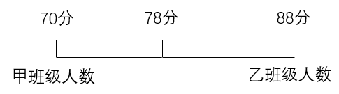

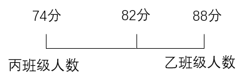

根据线段法“距离与量成反比”及“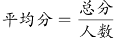”，可得：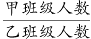，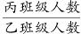，即甲、乙、丙班级人数之比为5：4：3。赋值甲、乙、丙班级人数分别为5人、4人、3人，则该年级的期末考试平均成绩分。

故正确答案为B。

### 第 42 题

某零件生产车间每天产量固定且目前有一定库存，车间用货车将库存零件运往买方仓库。如每天运24车，5天刚好运完；如每天运18车，8天刚好运完。现每天运x车，4天后车间生产效率提高了50%，又用了7天运完存货。问x可能的最小值为：

A. 18

B. 19

C. 20

D. 21

第 42 题 · 答案与解析

**参考答案（粉笔题库参考内容）**

A

**解析**

设目前有的库存零件量为y，零件生产车间每天产量为a，每车每天运的零件量为1。可得：y=（24×1-a）×5=（18×1-a）×8，解得a=8，y=80。根据题干“现每天运x车，4天后车间生产效率提高了50%，又用了7天运完存货”，则有：，解得，问最小值，向上取整，故x可能的最小值为18。

故正确答案为A。

### 第 43 题

从甲地到乙地全程为9千米。其中前为下坡路；剩下路程中，前为平路，后为上坡路。小张从甲地到乙地，下坡路转平路、平路转上坡路时各休息5分钟，下坡路、平路和上坡路的用时之比为1：4：5（休息时间不计）。已知他走上坡路的速度为2千米/小时，则其全程用时为：

A. 2小时

B. 2小时30分钟

C. 2小时40分钟

D. 3小时

第 43 题 · 答案与解析

**参考答案（粉笔题库参考内容）**

C

**解析**

根据题意可知，下坡路的长度为千米，平路的长度为千米，上坡路的长度为千米。小张走上坡路用时为小时，根据“下坡路、平路和上坡路的用时之比为1：4：5（休息时间不计）”，可得小张走下坡路用时为小时，走平路用时为小时，则小张全程走路用时为0.25+1+1.25=2.5小时，即2小时30分钟，中间休息5+5=10分钟，故全程用时为2小时40分钟。

故正确答案为C。

### 第 44 题

如图所示的图形是一个由小正方体组成的大正方体，图中灰色部分的小正方体被挖去且贯穿到对面，则剩下的部分有多少块小正方体？

A. 32

B. 40

C. 42

D. 48

第 44 题 · 答案与解析

**参考答案（粉笔题库参考内容）**

B

**解析**

大正方体从上至下分为4层，俯视每层去掉所需挖去的小正方体（灰色），剩余小正方体（白色）情况如下图所示：

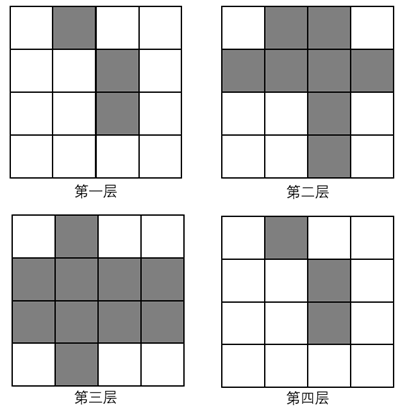

第一层剩余13块、第二层剩余8块、第三层剩余6块、第四层剩余13块，则共剩余13+8+6+13=40块。

故正确答案为B。

### 第 45 题

张某参加甲、乙、丙三门课程的网络在线培训，培训学时分别为28学时、36学时、40学时。已知每门课程每天最多学习2学时，张某每天最多学习2门课程，问他最少需要多少天完成3门课程的培训？

A. 24

B. 26

C. 28

D. 30

第 45 题 · 答案与解析

**参考答案（粉笔题库参考内容）**

B

**解析**

根据题意可知，张某完成甲课程需天、完成乙课程需天、完成丙课程需天。因张某每天最多学习2门课程，培训学时中丙的学时最长（20天），则优先考虑丙与甲、乙搭配，且尽量使甲、乙剩余学时相等。天，14-6=8天，18-6=12天，即甲与丙搭配8天，乙与丙搭配12天，则甲、乙均剩余6天，符合题意。故最少需要6+8+12=26天完成3门课程的培训。

故正确答案为B。

### 第 46 题

一艘轮船在点A处测得灯塔M在北偏西，向北航行了20千米后到达B点，测得灯塔M在北偏西。此后该船继续向北航行，在到达灯塔正东方向C处时，轮船与灯塔M的距离为多少千米？

A. 10

B. 12

C. 

D. 

第 46 题 · 答案与解析

**参考答案（粉笔题库参考内容）**

A

**解析**

根据题意可画出如下示意图：

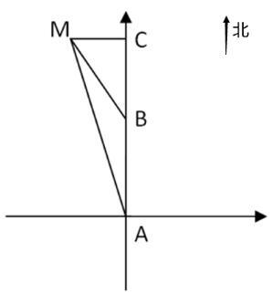

由题可得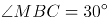，，根据三角形外角等于不相邻的两个内角之和，则，所以为等腰三角形，MB=AB=20千米。因C点在灯塔M的正东方，故为直角三角形，又因，所以千米。

故正确答案为A。

### 第 47 题

甲生产零件的效率比乙高50%，1小时内甲比乙多生产8个零件。现安排甲、乙共同生产1小时，从生产的零件中抽取3件。问至少有1件是甲生产的概率在以下哪个范围内？

A. 小于0.80

B. 0.80~0.90之间

C. 0.90~0.95之间

D. 大于0.95

第 47 题 · 答案与解析

**参考答案（粉笔题库参考内容）**

C

**解析**

根据甲比乙的效率高50%且每小时比乙多生产8个零件，可得50%×乙=8，则乙每小时生产16个零件，甲每小时生产16+8=24个零件，两人1小时共生产16+24=40个零件。正面情况较多可以从反面考虑，“从生产的零件中抽取3件，至少有1件是甲生产的”反面为没有1件是甲生产，即3件都是乙生产，满足条件的情况数为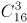种，总情况数为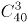种，根据概率，可得所求概率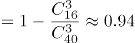，在0.90~0.95之间。

故正确答案为C。

### 第 48 题

甲、乙、丙3名消费者在某餐厅排队，各自拿取两位数字的等位号。已知3个等位号的个位数字和十位数字恰好由1、2、3、4、5、6六个不重复的数字组成，乙的等位号正好与3人等位号的平均数相同，且甲的等位号数字最小。问三人的等位号组合有多少种不同的可能性？

A. 3

B. 6

C. 8

D. 12

第 48 题 · 答案与解析

**参考答案（粉笔题库参考内容）**

C

**解析**

方法一：由乙的等位号与3人等位号的平均数相同，可知：乙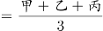，整理得：2乙=甲+丙，根据奇偶特性可知甲和丙的奇偶性相同，且甲＜乙＜丙，选项数字较小，考虑枚举法：

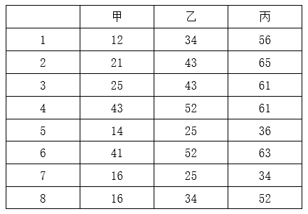

则三人的等位号组合有8种不同的可能性。

方法二：由题意可知，三个数字均为两位数，乙的等位号与3人等位号的平均数相同，且甲＜乙＜丙，则三个数的十位和个位，分别成等差数列，即：

①若十位是1、2、3，则个位是4、5、6或6、5、4；

②若十位是1、3、5，则个位是2、4、6或6、4、2；

③若十位是2、4、6，则个位是1、3、5或5、3、1；

④若十位是4、5、6，则个位是1、2、3或3、2、1。

则三人的等位号组合有8种不同的可能性。

故正确答案为C。

### 第 49 题

商场6月6日开始销售某种电器，从6月7日起，每天这种电器的销量都比前一天多1台。已知6月16日卖了22台这种电器，问其6月共卖了多少台这种电器？

A. 555

B. 600

C. 645

D. 690

第 49 题 · 答案与解析

**参考答案（粉笔题库参考内容）**

B

**解析**

方法一：根据题意可知，6月每天销售的电器数量成等差数列，公差d=1，共销售30-6+1=25天，中位数为第13天的销售数量。由于“6月16日卖了22台”，可知，根据等差数列通项公式，则。根据等差数列求和公式：\=中位数×项数，则6月共卖了24×25=600台。

方法二：根据题意可知，6月每天销售的电器数量成等差数列，且销售了30-6+1=25天，根据等差数列求和公式：\=中位数×项数，则6月的总销量为，是25的整数倍，只有B项符合。

故正确答案为B。

### 第 50 题

甲、乙两名游泳运动员同时从下游A点出发，游向900米外的上游B点并立刻原路返回。甲游了200米时，乙游了120米。已知甲顺流游泳的速度是逆流的1.8倍，问两人迎面相遇的地点距离A点多少米？

A. 270

B. 390

C. 510

D. 630

第 50 题 · 答案与解析

**参考答案（粉笔题库参考内容）**

D

**解析**

根据题意，当行驶时间相同时，行驶路程与行驶速度成正比，可知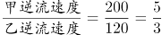，设甲逆流速度为5v，则乙逆流速度为3v，根据“甲顺流游泳的速度是逆流的1.8倍”，则甲顺流速度为5v×1.8=9v。

方法一：设从甲、乙出发到两人迎面相遇所用时间为t，两人相遇时游泳的路程和为两个全程=900×2=1800米，乙游泳路程为3vt，甲游泳路程为，根据路程和不变可列方程：1800=3vt+9vt-720，解得vt=210米，故两人迎面相遇的地点到A点的距离为乙游泳路程=3vt=3×210=630米。

方法二：根据题意，甲逆流游泳900米到达B点时，乙逆流游了米，乙从此时到两人迎面相遇还需继续游一段距离，故可推出两人迎面相遇的地点到A点的距离大于540米，只有D项满足。

故正确答案为D。

### 第 51 题

从所给的四个选项中，选择最合适的一个填入问号处，使之呈现一定的规律性：

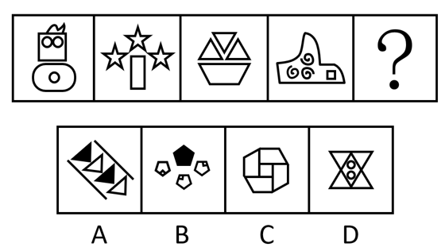

A. A

B. B

C. C

D. D

第 51 题 · 答案与解析

**参考答案（粉笔题库参考内容）**

B

**解析**

元素组成不同，且无明显属性规律，优先考虑数量规律。观察发现，题干图形均由多个小元素构成，且图2、图3明显出现了相同小元素五角星和三角形，考虑相同元素的个数。题干图形均有3个相同的小元素，故“？”处图形也应有3个相同的小元素，只有B项符合。

故正确答案为B。

### 第 52 题

从所给的四个选项中，选择最合适的一个填入问号处，使之呈现一定的规律性：

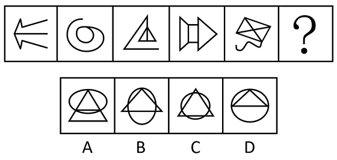

A. A

B. B

C. C

D. D

第 52 题 · 答案与解析

**参考答案（粉笔题库参考内容）**

A

**解析**

元素组成不同，且无明显属性规律，优先考虑数量规律。观察发现，题干图4、图5分割区域明显，考虑面数量。题干图形的面数量依次为0、1、2、3、4，故“？”处应为面数量为5的图形，只有A项符合。

故正确答案为A。

### 第 53 题

从所给的四个选项中，选择最合适的一个填入问号处，使之呈现一定的规律性：

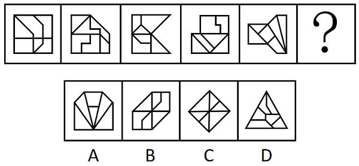

A. A

B. B

C. C

D. D

第 53 题 · 答案与解析

**参考答案（粉笔题库参考内容）**

A

**解析**

元素组成不同，且无明显属性规律，优先考虑数量规律。观察发现，题干图形封闭区域明显，考虑面数量，但题干图形与选项图形的面数量均为6，无唯一答案，考虑面的细化。再次观察发现，题干图形大多具有三角形面，考虑三角形面的数量，依次为0、1、2、3、4，所以“？”处应为三角形面数量为5的图形，只有A项符合。

故正确答案为A。

### 第 54 题

从所给的四个选项中，选择最合适的一个填入问号处，使之呈现一定的规律性：

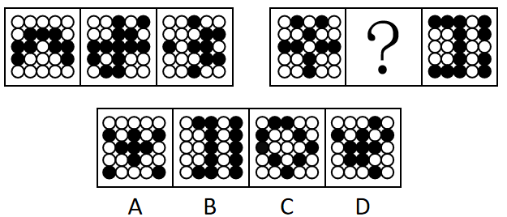

A. A

B. B

C. C

D. D

第 54 题 · 答案与解析

**参考答案（粉笔题库参考内容）**

D

**解析**

元素组成不同，优先考虑属性规律。观察发现，题干图形中黑白球整体较为规整，优先考虑对称性。题干图形均只有1条对称轴，且第一组图形的对称轴方向依次顺时针旋转，第二组图形应遵循此规律，故？处图形的对称轴方向应从右上至左下，只有D项符合。

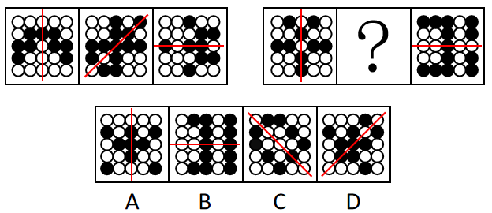

故正确答案为D。

### 第 55 题

以下哪项是由下列图形不经旋转、翻转拼合起来得到的？

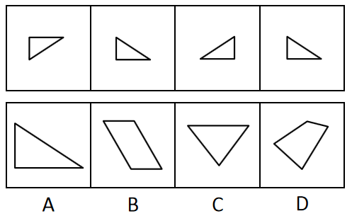

A. A

B. B

C. C

D. D

第 55 题 · 答案与解析

**参考答案（粉笔题库参考内容）**

A

**解析**

本题考查平面拼合，可采用平行且等长相消的方式解题。消去平行且等长的线段后进行组合可得到轮廓图，即为A项。平行且等长相消的方式如下图所示：

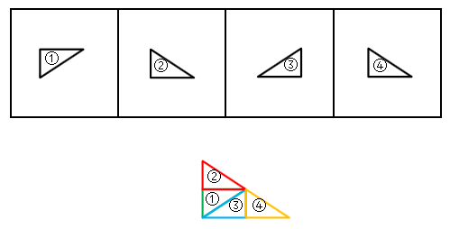

故正确答案为A。

### 第 56 题

从所给的四个选项中，选择最合适的一个填入问号处，使之呈现一定的规律性：

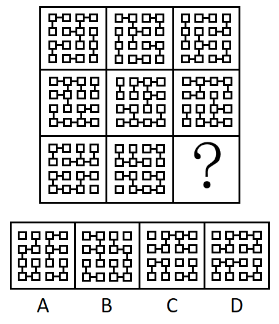

A. A

B. B

C. C

D. D

第 56 题 · 答案与解析

**参考答案（粉笔题库参考内容）**

D

**解析**

元素组成相同，优先考虑位置规律。九宫格优先看横行，观察发现，第一行中，第一个图形左右翻转得到第二个图形，第二个图形上下翻转得到第三个图形；第二行符合此规律，第三行应用此规律，只有D项符合。

故正确答案为D。

### 第 57 题

以下为2个正方体纸盒的外表面展开图，其折叠后不可能的是：

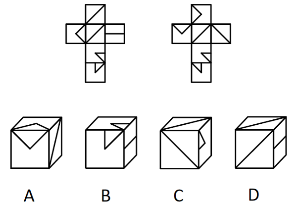

A. A

B. B

C. C

D. D

第 57 题 · 答案与解析

**参考答案（粉笔题库参考内容）**

C

**解析**

将展开图标上序号（如下图所示），逐一进行分析。

A项：选项对应题干右侧展开图的面①、面②和面③，与题干一致，排除；

B项：选项对应题干左侧展开图的面④、面⑤和面⑥，与题干一致，排除；

C项：根据两斜线面中的斜线相交于一点可以判断出选项上面和正面对应题干右侧展开图的面③和面④，选项右侧为面⑤，在选项中面③④⑤的公共点挨着面⑤中的小三角形，但题干右侧展开图中三个面的公共点没有挨着面⑤中的小三角形，与题干不一致，当选；

D项：选项对应题干左侧展开图的面①、面③和面④，与题干一致，排除。

本题为选非题，故正确答案为C。

### 第 58 题

上图是给定的多面体，下边哪一项可能是该多面体的视图？

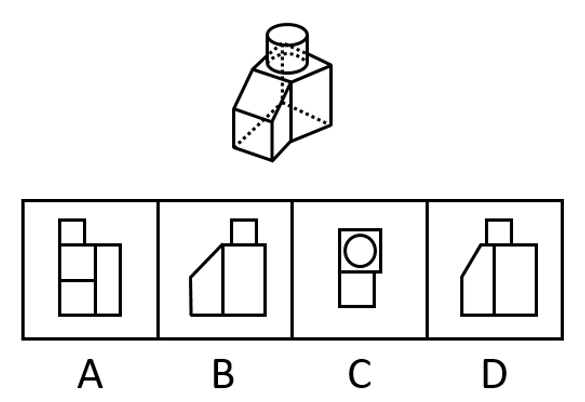

A. A

B. B

C. C

D. D

第 58 题 · 答案与解析

**参考答案（粉笔题库参考内容）**

B

**解析**

本题考查三视图，逐一分析选项。

A项：从前往后看，选项最上方的正方形应在左侧矩形的正中间，排除；

B项：从右往左看，与题干一致，当选；

C项：从上往下看，选项上方的四边形应为梯形，排除；

D项：从右往左看，视图应和B项保持一致，排除。

故正确答案为B。

### 第 59 题

把下面六个图形分为两类，使每一类图形都有各自的共同特征和规律，分类正确的一项是：

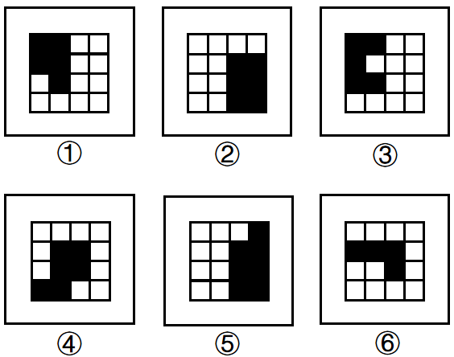

A. ①②④，③⑤⑥

B. ①②⑥，③④⑤

C. ①③⑥，②④⑤

D. ①④⑥，②③⑤

第 59 题 · 答案与解析

**参考答案（粉笔题库参考内容）**

B

**解析**

本题为分组分类题目。元素组成不同，且无明显属性规律，优先考虑数量规律。题干图形均由黑白块构成，多个小黑块组成了一个大的黑色图形，观察发现，若小黑块的边长为1，那么图①②⑥黑色图形的周长为10，图③④⑤黑色图形的周长为12，故图①②⑥为一组，图③④⑤为一组。

故正确答案为B。

### 第 60 题

把下面六个图形分为两类，使每一类图形都有各自的共同特征或规律，分类正确的一项是：

A. ①②⑤，③④⑥

B. ①③⑤，②④⑥

C. ①②③，④⑤⑥

D. ①④⑤，②③⑥

第 60 题 · 答案与解析

**参考答案（粉笔题库参考内容）**

A

**解析**

本题为分组分类题目。元素组成不同，且无明显属性规律，考虑数量规律。观察发现，题干图形出现了“日”字变形图和圆相切，考虑笔画数。图①②⑤为一笔画图形，图③④⑥为两笔画图形。即图①②⑤为一组，图③④⑥为一组。

故正确答案为A。

### 第 61 题

求职经济是指求职者为了增加被招聘单位录用可能性，在求职应聘阶段付出的与所应聘岗位职业能力无关的各种开销。

根据上述定义，下列不属于求职经济的是：

A. 研究生阶段学习文学专业的甲，自费在业余时间学习动画制作，毕业后顺利通过面试进入心仪的影视公司

B. 由于应聘同一职位的竞争者众多，乙请专业影视制作公司为自己拍摄制作了反映自己各方面能力和特长的视频简历，花费不菲

C. 某女大学生丙为了能在面试环节有好的表现，在面试前高薪聘请专业化妆师为其针对不同的应聘岗位提供时尚、得体的化妆服务

D. 大学毕业生丁分别应聘了两家单位的管理岗位和技术岗位，为了给面试官良好的第一印象，花费3000元添置了两套不同风格的服装

第 61 题 · 答案与解析

**参考答案（粉笔题库参考内容）**

A

**解析**

第一步：找出定义关键词。

“为了增加被招聘单位录用可能性”、“在求职应聘阶段付出的与所应聘岗位职业能力无关的各种开销”。

第二步：逐一分析选项。

A项：研究生阶段学习的甲，不明确是否处于“求职应聘阶段”；自费学习动画制作并进入影视公司，“动画制作的能力”与“影视公司的职位”相关，不符合“在求职应聘阶段付出的与所应聘岗位职业能力无关的各种开销”，不符合定义，当选；

B项：乙在应聘时花钱拍摄制作视频简历，是为了展示自己的各方面能力和特长，该花销与岗位职业能力本身无关，符合“为了增加被招聘单位录用可能性”、“在求职应聘阶段付出的与所应聘岗位职业能力无关的各种开销”，符合定义，排除；

C项：丙高薪聘请化妆师设计有针对性的岗位妆容，是为了在面试环节有更好的表现，该花销与岗位职业能力本身无关，符合“为了增加被招聘单位录用可能性”、“在求职应聘阶段付出的与所应聘岗位职业能力无关的各种开销”，符合定义，排除；

D项：丁自费添置两套面试服装，是为了给面试官留下良好的印象，该花销与岗位职业能力本身无关，符合“为了增加被招聘单位录用可能性”、“在求职应聘阶段付出的与所应聘岗位职业能力无关的各种开销”，符合定义，排除。

本题为选非题，故正确答案为A。

### 第 62 题

人力资本投资是指体现在劳动者身上的，用来提高人的生产能力从而提高人在劳动力市场上的收益能力的初始性投资。

根据上述定义，下列不属于人力资本投资的是：

A. 某大学资助教师参加教学技能提升培训班的费用

B. 某公司为员工添置了一批健身器材所花费的投资

C. 父母在小张大学暑假期间为其支付的驾校培训费用

D. 某食品加工企业为购买专利而支付的知识产权转让费

第 62 题 · 答案与解析

**参考答案（粉笔题库参考内容）**

D

**解析**

第一步：找出定义关键词。

“体现在劳动者身上”、“用来提高人的生产能力”、“从而提高人在劳动力市场上的收益能力”。

第二步：逐一分析选项。

A项：某大学资助教师参加教学技能提升培训班，教师是劳动者，且参加技能提升培训班是为了提高教师能力，同时也提高了教师的收益能力，符合“体现在劳动者身上”、“用来提高人的生产能力”、“从而提高人在劳动力市场上的收益能力”，符合定义，排除；

B项：公司为员工添置健身器材，员工是劳动者，添置健身器材是为了提升员工的身体素质，以提高员工的生产能力，而且也提升了员工的收益能力，符合“体现在劳动者身上”、“用来提高人的生产能力”、“从而提高人在劳动力市场上的收益能力”，符合定义，排除；

C项：父母为小张支付的驾校培训费用，小张是劳动者，驾校培训可以提高小张的能力，并提高了小张的收益能力，符合“体现在劳动者身上”、“用来提高人的生产能力”、“从而提高人在劳动力市场上的收益能力”，符合定义，排除；

D项：企业为购买专利支付的费用，未体现在劳动者身上，不符合“体现在劳动者身上”，不符合定义，当选。

本题为选非题，故正确答案为D。

### 第 63 题

原子数符指的是数字符号0~9；原子音符指的是小写字母a、u、e；在两个原子数符中间加一个原子音符构成的3个连续的符号串称为密符；由三个不完全相同的密符构成的符号串称为M密码。

根据上述定义，下列符号串属于M密码的是：

A. 5e6a71a3u6

B. 9u8ae89u8

C. 7a58u24e6

D. 3u53u53u5

第 63 题 · 答案与解析

**参考答案（粉笔题库参考内容）**

C

**解析**

第一步：找出定义关键词。

原子数符：“数字符号0~9”；

原子音符：“小写字母a、u、e”；

密符：“在两个原子数符中间加一个原子音符构成的3个连续的符号串”；

M密码：“由三个不完全相同的密符构成的符号串”。

第二步：逐一分析选项。

A项：该项中5e6a71a3u6，可以划分5e6、a71a、3u6，其中的a71a，不符合“在两个原子数符中间加一个原子音符构成的3个连续的符号串”，不属于密符，不符合M密码的定义，排除；

B项：该项中9u8ae89u8，可以划分9u8、ae8、9u8，其中的ae8，不符合“在两个原子数符中间加一个原子音符构成的3个连续的符号串”，不属于密符，不符合M密码的定义，排除；

C项：该项中7a58u24e6，可以划分7a5、8u2、4e6共三个密符，符合“由三个不完全相同的密符构成的符号串”，符合M密码的定义，当选；

D项：该项中3u53u53u5，可以划分3u5、3u5、3u5共三个密符，但这属于完全相同的密符构成的符号串，不符合“由三个不完全相同的密符构成的符号串”，不符合M密码的定义，排除。

故正确答案为C。

### 第 64 题

观念贫困是指在相对封闭落后的环境中所形成的因循守旧，难以接受新事物、新信息，不愿尝试新的生产生活方式以改变贫困生活的现象。

根据上述定义，下列属于观念贫困的是：

A. 朋友们劝说老张买理财产品，但老张坚持认为理财产品都是骗人的，不愿尝试

B. 受迷信观念的影响，老朱轻信了不法分子“破财消灾”的骗局，几乎倾家荡产

C. 李奶奶一个人住在农村，儿子多次动员她来城里住，她就是不肯，说不适应城市生活，在农村安逸、清净

D. 老刘在路边摆摊修鞋，收入低微，家庭负担重，虽然去外地鞋厂工作可以提高收入，但他担心学不会新技术，不愿外出

第 64 题 · 答案与解析

**参考答案（粉笔题库参考内容）**

D

**解析**

第一步：找出定义关键词。

“在相对封闭落后的环境中”、“因循守旧，难以接受新事物、新信息”、“不愿尝试新的生产生活方式以改变贫困生活”。

第二步：逐一分析选项。

A项：该项指出老张坚持不买理财产品，并未提及老张的生活环境，不符合“在相对封闭落后的环境中”，也不清楚老张的经济状况，不符合“不愿尝试新的生产生活方式以改变贫困生活”，不符合定义，排除；

B项：该项指出老朱因被骗几乎倾家荡产，未提及老朱的生活环境，不符合“在相对封闭落后的环境中”，老朱轻信“破财消灾”的骗局是受迷信观念的影响，没有体现难以接受新事物、新信息，不符合“因循守旧，难以接受新事物、新信息”、“不愿尝试新的生产生活方式以改变贫困生活”，不符合定义，排除；

C项：该项指出李奶奶因不适应城市生活而选择住在农村，符合“在相对封闭落后的环境中”，但李奶奶不肯去城里住的原因是觉得农村安逸、清净，而非难以接受新事物、新信息，不符合“因循守旧，难以接受新事物、新信息”、“不愿尝试新的生产生活方式以改变贫困生活”，不符合定义，排除；

D项：该项指出老刘在路边摆摊修鞋而不愿意去外地鞋厂工作，符合“在相对封闭落后的环境中”，收入低微、家庭负担重说明生活贫困，且老刘不愿意去外地鞋厂拿更高收入的原因是担心学不会新技术，说明他不愿意接受新事物、新信息，符合“因循守旧，难以接受新事物、新信息”、“不愿尝试新的生产生活方式以改变贫困生活”，符合定义，当选。

故正确答案为D。

### 第 65 题

区域经济扩散的空间形式有两种：一种是等级扩散，即经济现象的扩张是沿着一定等级规模的地理区域进行的；另一种是接触扩散，即区域经济扩散的过程是由近及远进行的。

根据上述定义，下列情形属于接触扩散的是：

A. 南方企业生产的产品由南向北逐渐扩张销售市场

B. 企业的产品先是占领大城市市场，接着进入中等城市

C. 企业生产的产品分销时，先拿到产品的经销商先进行销售

D. 企业产品销售先发展5家省级代理，再发展60家市级代理

第 65 题 · 答案与解析

**参考答案（粉笔题库参考内容）**

A

**解析**

第一步：找出定义关键词。

等级扩散：“经济现象的扩张是沿着一定等级规模的地理区域进行”；

接触扩散：“区域经济扩散的过程是由近及远进行”。

第二步：逐一分析选项。

A项：南方企业生产的产品由南向北逐渐扩张，即南方企业先扩张近处，再逐渐扩张远处的北方，符合“区域经济扩散的过程是由近及远进行”，符合“接触扩散”定义，当选；

B项：企业的产品先是占领大城市市场，接着进入中等城市，其中大城市和中等城市属于不同等级的城市，即属于不同等级规模的地理区域，符合“经济现象的扩张是沿着一定等级规模的地理区域进行”，符合“等级扩散”定义，不符合“接触扩散”定义，排除；

C项：企业生产的产品分销时，先拿到产品的经销商先进行销售，说明拿货时间决定了销售顺序，不符合“区域经济扩散的过程是由近及远进行”，不符合“接触扩散”定义，排除；

D项：企业产品销售先发展5家省级代理，再发展60家市级代理，说明是代理商的级别和数量发生变化，不符合“区域经济扩散的过程是由近及远进行”，不符合“接触扩散”定义，排除。

故正确答案为A。

### 第 66 题

义务冲突是指存在两个以上不相容的法律义务，为了履行其中的某种义务，迫不得已无法履行其他义务的情况。

根据上述定义，下列情形存在义务冲突的是：

A. 刘某驾车途中，为避让突然冲出的行人而撞毁了路边的护栏

B. 因经济条件限制，李某只能选择资助两位贫困儿童中的一位

C. 在追捕两名分头逃跑的小偷的过程中，警官王某先抓捕了其中一人

D. 农忙时节人手不足，张某让两名还在读初中的孩子中的一人请假帮忙

第 66 题 · 答案与解析

**参考答案（粉笔题库参考内容）**

C

**解析**

第一步：找出定义关键词。

“存在两个以上不相容的法律义务”、“为了履行其中的某种义务”、“迫不得已无法履行其他义务的情况”。

第二步：逐一分析选项。

A项：为避让突然冲出的行人而撞毁了路边的护栏，是紧急避险，不是履行法律义务，不符合定义，排除；

B项：资助贫困儿童不是法律义务，不符合定义，排除；

C项：警察抓捕小偷是与工作相关的法律义务，要同时抓捕分头逃跑的两名小偷符合“存在两个以上不相容的法律义务”，警官王某先抓捕了其中一人，符合“为了履行其中的某种义务”、“迫不得已无法履行其他义务的情况”，符合定义，当选；

D项：张某让孩子请假帮忙做农活不是法律义务，孩子做农活也不是法律义务，不符合定义，排除。

故正确答案为C。

### 第 67 题

暗示效应是指在无对抗的条件下，用含蓄、抽象诱导的间接方法对人们的心理和行为产生影响，从而诱导人们按照一定的方式去行动或接受一定的意见，使其思想、行为与暗示者期望的目标相符合。

根据上述定义，下列体现暗示效应的是：

A. “凤雏”庞统率军经过落凤坡，得知坡名，惊呼：“天绝我也！”最终被乱箭射死于“落凤坡”上

B. 张飞在长坂桥独自迎战曹操大军时大吼：“我乃燕人张翼德也！谁敢与我决一死战”，吓得曹军落荒而逃

C. 貂蝉为让吕布除去董卓，对吕布哭诉被董卓霸占的痛苦及对吕布的思念，吕布得知气愤不已，最终将董卓杀掉

D. 岳母在岳飞幼年时在其背上刺下“精忠报国”四个字，岳飞长大后果然不负母亲期望，成为一代精忠报国的抗金名将

第 67 题 · 答案与解析

**参考答案（粉笔题库参考内容）**

C

**解析**

第一步：找出定义关键词。

“在无对抗的条件下”、“含蓄、抽象诱导的间接方法”、“使其思想、行为与暗示者期望的目标相符合”。

第二步：逐一分析选项。

A项：庞统到了落凤坡这个地方，自己认为天要绝他，并没有人对他做出诱导行为，不符合“含蓄、抽象诱导的间接方法”、“使其思想、行为与暗示者期望的目标相符合”，不符合定义，排除；

B项：张飞大吼的内容可以直接凸显出其勇猛，不符合“含蓄、抽象诱导的间接方法”，不符合定义，排除；

C项：貂蝉的目的是让吕布除去董卓，但是她没有直接向吕布表达这个意思，而是用哭诉痛苦和思念的间接方法来诱导吕布采取除去董卓的行为，而最终吕布也确实受到了她的诱导，将董卓杀掉，符合“含蓄、抽象诱导的间接方法”、“使其思想、行为与暗示者期望的目标相符合”，符合定义，当选；

D项：岳母在岳飞背上刺字“精忠报国”，“精忠报国”直接就能体现出为国家竭尽忠诚、牺牲一切的含义，属于直接激励岳飞，不符合“含蓄、抽象诱导的间接方法”，不符合定义，排除。

故正确答案为C。

### 第 68 题

普通社会工作是人们在本职工作之外承担的、不计报酬的思想政治教育性或公益服务性活动。

根据上述定义，下列属于普通社会工作的是：

A. 交通协管员小邓在工作期间阻止欲闯红灯的群众，并对其进行交通安全宣传

B. 在家长进校园活动日，某高校教师为其儿子所在班级的同学们授课，向小学生们普及大数据知识

C. 某国有企业有偿聘请在企业管理领域有很高造诣的退休老专家刘教授为企业中层领导干部做培训讲座

D. 为落实国家“双减”政策，有效衔接家长们的下班时间，阳光小学为有需要的学生开展每天两小时的课后服务工作

第 68 题 · 答案与解析

**参考答案（粉笔题库参考内容）**

B

**解析**

第一步：找出定义关键词。

“本职工作之外”、“不计报酬”、“思想政治教育性或公益服务性活动”。

第二步：逐一分析选项。

A项：交通协管员小邓在工作期间对欲闯红灯的群众进行交通安全宣传，“在工作期间”说明这是小邓的本职工作，不符合“本职工作之外”，不符合定义，排除；

B项：在家长进校园活动日，某高校教师向儿子所在班级的小学生们普及大数据知识，该教师作为家长参加活动，且“高校教师”说明其不是小学老师，向小学生普及知识并非自己本职工作，符合“本职工作之外”；在家长进校园活动日上作为家长进行科普，未收取金钱，符合“不计报酬”；普及大数据知识，符合“思想政治教育性或公益服务性活动”，符合定义，当选；

C项：某国有企业有偿聘请退休老专家做培训讲座，“有偿聘请”不符合“不计报酬”，不符合定义，排除；

D项：阳光小学为有需要的学生开展课后服务工作以衔接家长们的下班时间，说明该小学负责课后服务工作，那么课后服务工作就是老师的本职工作，不符合“本职工作之外”，不符合定义，排除。

故正确答案为B。

### 第 69 题

M大学开给教授的工资通常比其他大学平均工资低20％左右，却仍然能聘到称职的教授。原因主要是，许多教授非常喜欢M大学周边的湖光山色，尤其是天晴时能远眺美洲最高雪山——雷尼尔山峰。为此，他们宁可放弃其他大学更高的收入。这种现象在管理学中被称为雷尼尔效应，引申指用积极的企业精神、文化氛围和工作环境等吸引并留住人才。

根据上述定义，下列涉及雷尼尔效应的是：

A. 甲放弃名企及高薪，加入一家可以居家办公，工作时间灵活的公司

B. 乙行事怪异，被同事视为异类，但其发明的仪器为企业创造了很高利润

C. 丙因某著名公司工作压力太大而拒绝了高薪聘请，宁可待在原单位拿低薪

D. 丁不在意薪水高低，只希望创意能得到采纳和支持，决不去无法满足其愿望的企业

第 69 题 · 答案与解析

**参考答案（粉笔题库参考内容）**

A

**解析**

第一步：找出定义关键词。

“积极的企业精神、文化氛围和工作环境”、“吸引并留住人才”。

第二步：逐一分析选项。

A项：甲加入可以居家办公，工作时间灵活的公司，说明公司是通过这种人性化的工作环境吸引甲的，符合“积极的企业精神、文化氛围和工作环境”、“吸引并留住人才”，符合定义，当选；

B项：乙发明的仪器为企业创造了很高利润，没提到该企业通过什么方式来吸引乙，不符合“积极的企业精神、文化氛围和工作环境”、“吸引并留住人才”，不符合定义，排除；

C项：丙因工作压力大拒绝了高薪而选择待在原单位拿低薪，只是说明了丙的就业选择，但是没提到原单位通过什么方式吸引丙，不符合“积极的企业精神、文化氛围和工作环境”、“吸引并留住人才”，不符合定义，排除；

D项：丁不在意薪水高低只是希望创意能得到采纳和支持，是丁自己的职业观，但是没提到企业通过什么方式吸引人才，不符合“积极的企业精神、文化氛围和工作环境”、“吸引并留住人才”，不符合定义，排除。

故正确答案为A。

### 第 70 题

隐蔽属性是指商品在使用过程中容易被顾客忽略的一些特性，商家在销售时往往采用各种手段故意隐藏这些特性，从而诱导顾客进行消费。

根据上述定义，下列属于隐蔽属性的是：

A. 超市售卖特价商品时，往往会用各种手法醒目地标出新售价，而原价只是用比较小的字列出

B. 因为稀缺才显得珍贵，市面上所谓“限量版”或“珍藏版”的产品多属于有意制造稀缺性的情况

C. 某购物网站上某款打印机的商品页面中，打印机的价格标注得非常醒目，但后续更换耗材和配件的价格和周期却并未说明

D. 手机销售前往往已预先安装很多应用软件，某些软件大多数用户几乎一辈子也用不上，但这些软件归根到底都是由用户来买单的

第 70 题 · 答案与解析

**参考答案（粉笔题库参考内容）**

C

**解析**

第一步，找出定义关键词。

“在使用过程中”、“容易被顾客忽略的一些特性”、“采用各种手段故意隐藏这些特性”。

第二步，逐一分析选项。

A项：超市用各种手法醒目地标出特价商品的新售价，而将原价用小字列出，但售价仅体现商品的价值，并非是对商品的使用，不符合“在使用过程中”、“容易被顾客忽略的一些特性”，不符合定义，排除；

B项：市面上的“限量版”“珍藏版”的产品存在有意制造稀缺性的情况，制造稀缺性并非隐瞒特性，不符合“采用各种手段故意隐藏这些特性”，不符合定义，排除；

C项：购物网站将打印机的价格标注得十分醒目，但并未说明后续更换耗材和配件的价格和周期，更换耗材和配件的价格及周期，符合“在使用过程中”、“容易被顾客忽略的一些特性”，且商家并未对此进行说明，符合“采用各种手段故意隐藏这些特性”，符合定义，当选；

D项：手机销售前便预先安装了大多数用户用不上的应用软件并需要用户来买单，但手机销售前并未刻意隐藏这些软件，不符合“采用各种手段故意隐藏这些特性”，不符合定义，排除。

故正确答案为C。

### 第 71 题

青花瓷：青铜剑

A. 蓝花草：蓝棉鞋

B. 黄大衣：黄土坡

C. 红星旗：红木柜

D. 黑皮夹：黑漆桌

第 71 题 · 答案与解析

**参考答案（粉笔题库参考内容）**

C

**解析**

第一步：判断题干词语间逻辑关系。

从微观的角度来讲，“青花瓷”与“青铜剑”一个是瓷器一个是武器，关联不大，二者都是物品，可以考虑命名方式，青花瓷是因其瓷身具有青花图案而命名，青铜剑是因其材料为青铜而命名。

第二步：判断选项词语间逻辑关系。

A项：蓝花草不是根据自身图案命名，与题干逻辑关系不一致，排除；

B项：黄大衣是根据衣服颜色来命名，而非自身图案，与题干逻辑关系不一致，排除；

C项：红星旗是因其带有红星图案而命名，红木柜是因其材料为红木而命名，与题干逻辑关系一致，当选；

D项：黑皮夹是根据材质命名，而非自身图案，与题干逻辑关系不一致，排除。

故正确答案为C。

### 第 72 题

爱迪生：电灯

A. 伦琴：X光射线

B. 瓦特：蒸汽机

C. 牛顿：万有引力

D. 爱因斯坦：相对论

第 72 题 · 答案与解析

**参考答案（粉笔题库参考内容）**

B

**解析**

第一步：判断题干词语间逻辑关系。

爱迪生改良了电灯的灯丝，延长了电灯的寿命，二者为改良者和被改良事物的对应关系。

第二步：判断选项词语间逻辑关系。

A项：伦琴发现了X光射线，二者为发现者和被发现事物的对应关系，与题干逻辑关系不一致，排除；

B项：瓦特改良了蒸汽机，提高了蒸汽机的效率，二者为改良者和被改良事物的对应关系，与题干逻辑关系一致，当选；

C项：牛顿提出了万有引力，二者为创造者和研究成果的对应关系，与题干逻辑关系不一致，排除；

D项：爱因斯坦提出了相对论，二者为创造者和研究成果的对应关系，与题干逻辑关系不一致，排除。

故正确答案为B。

### 第 73 题

四边形：矩形：菱形

A. 雄蕊：花药：花丝

B. 固态：液态：气态

C. 体裁：诗歌：散文

D. 塑料：着色剂：稳定剂

第 73 题 · 答案与解析

**参考答案（粉笔题库参考内容）**

C

**解析**

第一步：判断题干词语间逻辑关系。

“矩形”和“菱形”是两种不同的“四边形”，二者分别和一词构成种属关系。

第二步：判断选项词语间逻辑关系。

A项：“花药”和“花丝”是“雄蕊”的组成部分，二者分别和一词构成组成关系，与题干逻辑关系不一致，排除；

B项：“固态”“液态”和“气态”是物体的三种状态，三者为并列关系，与题干逻辑关系不一致，排除；

C项：“诗歌”和“散文”是两种不同的“体裁”，二者分别和一词构成种属关系，与题干逻辑关系一致，当选；

D项：“着色剂”可使塑料具有各种鲜艳、美观的颜色，“稳定剂”可以防止塑料分解、老化，二者分别和“塑料”构成对应关系，与题干逻辑关系不一致，排除。

故正确答案为C。

### 第 74 题

洗洁精 对于 （ ） 相当于 3D眼镜 对于 （ ）

A. 厨房；电影院

B. 碗筷；观众

C. 洗涤；三维

D. 洗碗机；太阳镜

第 74 题 · 答案与解析

**参考答案（粉笔题库参考内容）**

A

**解析**

逐一代入选项。

A项：在厨房使用洗洁精，二者为地点对应关系；在电影院使用3D眼镜，二者为地点对应关系，前后逻辑关系一致，当选；

B项：洗洁精可以用于清洗碗筷，二者为工具对应关系；观众佩戴3D眼镜，二者为主宾关系，前后逻辑关系不一致，排除；

C项：洗洁精可以用于洗涤，二者为功能对应关系；通过3D眼镜可以看到三维的图像，但3D眼镜的功能不是三维，前后逻辑关系不一致，排除；

D项：洗碗机无法冲洗掉洗洁精产生的大量泡沫，因此使用洗碗机时不能使用洗洁精，二者无明显逻辑关系；3D眼镜和太阳镜是两种不同类型的眼镜，二者为并列关系，前后逻辑关系不一致，排除。

故正确答案为A。

### 第 75 题

军队 对于 （ ） 相当于 （ ） 对于 人体

A. 警察；甲状腺

B. 武器；维生素

C. 国家；白细胞

D. 士兵；血小板

第 75 题 · 答案与解析

**参考答案（粉笔题库参考内容）**

C

**解析**

逐一代入选项。

A项：军队和警察都能维护国家安全，二者是并列关系，甲状腺是人体的一部分，二者是组成关系，前后逻辑关系不一致，排除；

B项：武器是军队配发的工具，二者是工具的对应关系，维生素是维持人体生命活动必需的一类有机物质，二者是对应关系，前后逻辑关系不一致，排除；

C项：军队能保护国家安全，二者是对应关系，白细胞能将病菌包围、吞噬，保护人体免受侵害，二者是对应关系，前后逻辑关系一致，当选；

D项：士兵是军队的一部分，二者是组成关系，血小板是人体血液中的一种成分，是人体的一部分，二者是组成关系，但前后顺序相反，前后逻辑关系不一致，排除。

故正确答案为C。

### 第 76 题

书报亭曾经是所有城市的标配，承载着几代人的共同记忆，但当下已经快要成为一个历史名词了。近日，《中国青年报》在显著版面刊登了上海中学生的一封信，希望《中国青年报》替青少年呼吁恢复书报亭。一个初中生的来信受到媒体的关注有些让人意外，刊登出来在瞬间点燃了网民的热情也实属罕见。由此可见，恢复书报亭十分必要。

以下哪项如果为真，最能支持上述结论？

A. 城市书报亭的退出是时代变迁、城市规划、网络媒体发展的必然结果

B. 书报亭具有很强的社区服务功能，是社区居民获取信息和知识的重要渠道

C. 青少年正处于大量吸收知识、进行探索和思考的阶段，报纸杂志是文化必需品

D. 纸质的报纸杂志有着无法替代的优势，它有助于培养青少年的阅读兴趣和能力

第 76 题 · 答案与解析

**参考答案（粉笔题库参考内容）**

B

**解析**

第一步：找出论点和论据。

论点：恢复书报亭十分必要。

论据：一个初中生的来信即“呼吁恢复书报亭”受到媒体的关注有些让人意外，刊登出来在瞬间点燃了网民的热情也实属罕见。

论据讨论的是“呼吁恢复书报亭受到广泛的关注和支持很罕见”，论点说的是“恢复书报亭十分必要”，从论据可以合理推出论点，故论据和论点话题一致，加强优先考虑补充论据，即解释恢复书报亭十分必要的原因。

第二步：逐一分析选项。

A项：城市书报亭的退出是必然结果，但论点讨论的是有无必要恢复书报亭，话题不一致，无法加强，排除；

B项：书报亭具有很强的社区服务功能，是社区居民获取信息和知识的重要渠道，说明了书报亭对于社区居民的重要作用，解释了需要恢复书报亭的原因，补充论据，可以加强，当选；

C项：报纸杂志对于青少年来说是文化必需品，但报纸杂志不一定只能在书报亭获取，论点讨论的是有无必要恢复书报亭，话题不一致，无法加强，排除；

D项：纸质的报纸杂志对于培养青少年的阅读兴趣和能力有着无法替代的优势，但纸质的报纸杂志不一定只能在书报亭获取，论点讨论的是有无必要恢复书报亭，话题不一致，无法加强，排除。

故正确答案为B。

### 第 77 题

医学上把晕车叫做“晕动症”，眼睛可以通过视神经，告诉大脑我们有没有在动；而耳朵则通过平衡感知系统——前庭，感受是否真的在动。正常情况下，眼睛和耳朵提供的信息是一致的。但坐在晃动的车上时，我们接受的信息出现了分歧——耳朵会觉得“你动了”，而眼睛则觉得“你没动”。这时，大脑接收到了两个不一致的报告，就会让它有点晕。据此，有人推理出一个结论：坐在车上看手机时往往会晕车晕得更严重。

以下哪项如果为真，最能支持上述结论？

A. 车内光线不足，看手机容易引起视觉疲劳

B. 车辆的颠簸使眼睛难以聚焦，会损伤视力

C. 看手机时会强化我们“没有动”的感觉

D. 晕车多数都是由于前庭发育不良引起的

第 77 题 · 答案与解析

**参考答案（粉笔题库参考内容）**

C

**解析**

第一步：找出论点和论据。

论点：坐在车上看手机时往往会晕车晕得更严重。

论据：坐在晃动的车上时，我们接受的信息出现了分歧——耳朵会觉得“你动了”，而眼睛则觉得“你没动”。这时，大脑接收到了两个不一致的报告，就会让它有点晕。

论据在说动没动和晕车的关系，论点在说手机和晕车的关系，论点论据话题不一致，优先考虑搭桥，即在动没动和手机之间建立联系。

第二步：逐一分析选项。

A项：选项说的是车内光线不足，看手机容易引起“视觉疲劳”，但论点讨论的是坐在车上“看手机时”是否会“晕车晕得更严重”，话题不一致，无法加强，排除；

B项：选项说的是车辆的颠簸使眼睛难以聚焦，“会损伤视力”，但论点讨论的是坐在车上“看手机时”是否会“晕车晕得更严重”，话题不一致，无法加强，排除；

C项：选项说的是看手机时会强化我们“没有动”的感觉，说明看手机时大脑接收到的两个不一致的报告会更强烈，导致晕车更严重，在“没有动”和“手机”之间搭桥，可以加强，当选；

D项：选项说的是晕车多数都是由于前庭发育不良引起的，是在说晕车的原因，但论点讨论的是坐在车上“看手机时”是否会“晕车晕得更严重”，话题不一致，无法加强，排除。

故正确答案为C。

### 第 78 题

近日，某研究小组开发出一种双光子成像显微镜的改进版本，它可以让科学家更快地获得大脑内血管和单个神经元等结构的高分辨率图像。有研究者认为，新技术或将促进神经科学的研究。

以下哪项如果为真，最能支持上述观点？

A. 改版后较传统双光子显微镜成像快100到1000倍，所能达到的组织深度为原来的两倍

B. 新技术可以更好地了解大脑内血流的变化，还能通过添加电压敏感的荧光染料或荧光钙探针来测量神经元活动

C. 研究人员经常使用双光子显微镜制作大脑等组织的高分辨率3D图像，但这种成像技术不易扫描大脑等组织深处，且很耗时

D. 研究证明，使用改进的新技术可以在肌肉和肾脏组织切片中实现约200微米尺度的成像，在老鼠大脑中实现约300微米的成像

第 78 题 · 答案与解析

**参考答案（粉笔题库参考内容）**

B

**解析**

第一步：找出论点和论据。

论点：新技术或将促进神经科学的研究。

论据：某研究小组开发出一种双光子成像显微镜的改进版本，它可以让科学家更快地获得大脑内血管和单个神经元等结构的高分辨率图像。

本题论点和论据都在讨论“改进版双光子成像显微镜这项新技术”与“促进神经科学研究”之间的关系，论据论点话题一致，加强优先考虑补充论据，即解释新技术是如何促进神经科学研究的或举例说明新技术在促进神经科学研究上的作用。

第二步：逐一分析选项。

A项：本题论点讨论的是新技术或将促进神经科学研究，而该项讨论的是新技术比传统技术成像更快，达到的组织深度更深，但无法得知新技术的这些提升是否能促进神经科学研究，话题不一致，无法加强，排除；

B项：该项指出新技术能更好地了解大脑内血流变化，并测量神经元活动，说明新技术在神经科学研究上取得了进步，解释了新技术能够促进神经科学研究的原因，补充论据，可以加强，当选；

C项：该项讨论的是研究人员经常使用双光子显微镜制作大脑等组织的图像，但不易扫描大脑等组织深处且耗时，未提及改进版新技术对促进神经科学研究的作用，为无关项，无法加强，排除；

D项：该项指出新技术可以在肌肉和肾脏组织切片中实现成像，与题干讨论的大脑内血管和单个神经元无关，而在老鼠大脑中实现成像，也与论点讨论的促进神经科学研究无关，为无关项，排除。

故正确答案为B。

### 第 79 题

长期以来，我国高校一直按专业招生，专业分得过细过窄暴露出诸多突出问题，如太侧重职业知识与技能的传授，忽略人文素养与科学精神的培养。大类招生、大类培养被认为是高等教育发展的趋势，能扩大学生的自主选择权，更符合当前学科交叉、专业界限淡化的改革方向，有利于培养创新性、综合性人才。为此，有人主张当下所有高校应该用大类招生全面取代专业招生。

以下哪项如果为真，最能质疑上述观点？

A. 一些学校的大类招生把热门专业和冷门专业放在一起搞“捆绑式招生”，是给学生“挖坑”

B. 大类招生与培养是一项系统工程，需要高校建立起一套完整的支撑体系，不能一蹴而就和“一刀切”

C. 大类招生是大势所趋，也是形势所迫。据统计，九成的一流大学建设高校和近七成的一流学科建设高校都实行了大类招生

D. 一些学校将大类招生简单作为应对新高考的举措，并没有抓住改革良机，下大力气推行大类培养，只有大类培养之名，没有大类培养之实

第 79 题 · 答案与解析

**参考答案（粉笔题库参考内容）**

B

**解析**

第一步：找出论点和论据。

论点：当下所有高校应该用大类招生全面取代专业招生。

论据：我国高校一直按专业招生，专业分得过细过窄暴露出诸多突出问题，如太侧重职业知识与技能的传授，忽略人文素养与科学精神的培养。大类招生、大类培养被认为是高等教育发展的趋势，能扩大学生的自主选择权，更符合当前学科交叉、专业界限淡化的改革方向，有利于培养创新性、综合性人才。

本题论点和论据都在讨论大类招生相对于专业招生的优势，当下所有高校应该用大类招生取代专业招生，论点论据话题一致，削弱优先考虑削弱论点。

第二步：逐一分析选项。

A项：选项指出部分学校的大类招生是把冷、热门专业捆绑，给学生“挖坑”，与论据中表述的大类招生能扩大学生的自主选择权相违背，削弱论据，可以削弱，保留；

B项：选项指出实行大类招生不能一蹴而就和“一刀切”，说明“当下”所有高校不能用大类招生“全面取代”专业招生，应该循序渐进，削弱论点，可以削弱，保留；

C项：选项指出大类招生是大势所趋并举例说明大部分一流大学都实行了大类招生，有加强作用，无法削弱，排除；

D项：选项指出大类招生在推行过程中出现有名无实的情况，这不利于培养创新性、综合性人才，与论据中表述的利于培养创新性、综合性人才相违背，削弱论据，可以削弱，保留。

对比A、B、D三项，B项的削弱论点的削弱力度强于A、D两项的削弱论据，当选。

故正确答案为B。

### 第 80 题

一个人过去的生活和个人信息会形成长期记忆储存在脑中，当某个和往事相关的线索再次出现时，便会触发对该事件的回忆。有研究者做了这样的实验：分别展示某些气味、画面和文字，请受试者以此为线索回忆自己的往事，并说出这些往事发生时的年龄。统计结果发现，哪怕参与测试的人已经步入老年，他们通过气味回忆起的往事大部分发生在人生的头十年，而通过画面或文字回忆起的大多是10~20岁时发生的事。

由此可以推出：

A. 受试者的嗅觉记忆比画面文字记忆更加久远

B. 受试者在回忆往事时会忽略20岁以后的记忆

C. 受试者在10岁以前对画面或文字缺乏感知力

D. 嗅觉所唤起的记忆更清晰、情感体验更浓烈

第 80 题 · 答案与解析

**参考答案（粉笔题库参考内容）**

A

**解析**

日常结论题，根据题干信息逐一分析选项。

A项：题干中指出“通过气味回忆起的往事大部分发生在人生的头十年，而通过画面或文字回忆起的大多是10~20岁时发生的事”，“人生的头十年”要早于“10~20岁”，可以推出受试者的嗅觉记忆比画面文字记忆更久远，当选；

B项：题干中没有涉及到20岁以后的记忆，无中生有，排除；

C项：题干中指出“通过气味回忆起的往事大部分发生在人生的头十年，而通过画面或文字回忆起的大多是10~20岁时发生的事”，但是无法得到受试者10岁以前对画面或文字的感知力如何，无中生有，排除；

D项：题干中没有涉及到嗅觉唤起的记忆与画面、文字唤起的记忆之间的清晰度和情感体验的比较，无中生有，排除。

故正确答案为A。

### 第 81 题

近年来减肥人士所追捧的低碳饮食，指的是在饮食中严格限制碳水化合物的摄入量，增加蛋白质和脂肪的摄入量。一些研究指出，通过降低饮食中的碳水化合物不但可以达到减重的目的，还能在一定程度上降低血液胆固醇水平，令心脏病风险有所降低。所以不少支持者认为，长期低碳饮食对身材和健康都有益。

以下哪项如果为真，不能削弱上述结论？

A. 研究发现只有1%的人能够长期坚持低碳饮食，平均坚持19个月

B. 低碳饮食者会更多进食蛋白质、脂肪，不适合冠心病、痛风等患者

C. 碳水化合物是营养膳食的基础，长期低碳饮食会影响大脑功能，导致精神萎靡

D. 少吃才是减肥的硬道理，通过改变碳水化合物、蛋白质和脂肪的比例并不能起到效果

第 81 题 · 答案与解析

**参考答案（粉笔题库参考内容）**

A

**解析**

第一步：找出论点和论据。

论点：长期低碳饮食对身材和健康都有益。

论据：通过降低饮食中的碳水化合物不但可以达到减重的目的，还能在一定程度上降低血液胆固醇水平，令心脏病风险有所降低。

论点论据都是在讨论低碳饮食能带来身材和健康上的好处，二者话题一致，削弱优先考虑否定论点，即低碳饮食并不能带来身材或健康上的好处。

第二步：逐一分析选项。

A项：该项指出能够坚持长期低碳饮食的人很少，讨论的是低碳饮食的方式是否容易坚持，而论点讨论的是坚持低碳饮食后是否对身材和健康有益，二者话题不一致，无关项，无法削弱，当选；

B项：该项指出低碳饮食的方式不适合冠心病、痛风等患者，说明对于一部分人群低碳饮食对健康是没有好处的，举反例否定论点，可以削弱，排除；

C项：该项指出长期低碳饮食会影响大脑功能，导致精神萎靡，说明长期低碳饮食会损害身体健康，直接否定论点，可以削弱，排除；

D项：该项指出改变摄入碳水化合物、蛋白质和脂肪的比例并不能起到减肥的效果，说明即使采取了低碳饮食的方式也无法减肥，直接否定论点，可以削弱，排除。

本题为选非题，故正确答案为A。

### 第 82 题

社会上曾有一种流言，说有人在使用液化气灶的厨房烹饪时接听手机，造成爆炸，并由此得出结论：在厨房里接打手机，与在加油站一样危险，如果急需打电话，必须离开有液化气灶的厨房3米左右。

以下哪项如果为真，不能驳斥上述流言？

A. 厨房里的燃气平时处于密闭状态，烹饪时释放的燃气立即在灶上烧掉，不会泄漏到其他地方

B. 如果厨房发生燃气泄漏，那么只要有明火，就会有爆炸的危险，不论是打电话还是产生明火、电火花等其他情况

C. 烹饪的灶火远大于使用手机产生的弱电火花，如果厨房已有燃气泄漏，那么引发爆炸的应该是灶上的明火，而非手机的电火花

D. 加油站油枪向油箱加油时，空油箱内的油汽向外飘散，新注入的汽油向空中挥发，使车辆周围油汽密度骤增，与厨房使用燃气的情况完全不同

第 82 题 · 答案与解析

**参考答案（粉笔题库参考内容）**

B

**解析**

第一步：找出论点和论据。

论点：在厨房里接打手机，与在加油站一样危险，如果急需打电话，必须离开有液化气灶的厨房3米左右。

论据：社会上曾有一种流言，说有人在使用液化气灶的厨房烹饪时接听手机，造成爆炸。

论点和论据讨论的都是在厨房接打手机的危害，二者话题一致，本题为削弱选非题，排除能够削弱的选项即可。

第二步：逐一分析选项。

A项：指出厨房里的燃气平时处于密闭状态，烹饪时释放的燃气不会泄漏到其他地方，因此在厨房里接打手机是安全的，并没有危险，不需要离开有液化气灶的厨房3米左右，可以削弱，排除；

B项：指出如果厨房发生燃气泄漏会有爆炸的危险，但论点讨论的是日常情况下在厨房接打手机是否有危险，话题不一致，无法削弱，当选；

C项：指出引发爆炸的应该是灶上的明火，而非手机的电火花，因此在厨房里接打手机与厨房是否会发生爆炸无关，可以削弱，排除；

D项：指出加油站加油的情况与厨房使用燃气的情况完全不同，因此不能将这两个场景相对比，说明在厨房里接打手机，与在加油站不是同样危险，可以削弱，排除。

本题为选非题，故正确答案为B。

### 第 83 题

近年来，随着移动互联网的迅速发展，各类手机APP逐渐成为人们日常生活的“必需品”，但也面临着一些手机APP广告的困扰。有些用户认为“没什么感觉，不必太在意”，但也有反对者认为，手机APP广告降低了用户体验，潜藏安全风险，需要加大治理力度。

以下哪项如果为真，最能支持反对者的观点?

A. 多数用户反映，手机APP广告存在伪装页面、诱导点击、弹窗信息关闭按钮过小等问题，稍不注意就可能导致财产损失

B. 近期，工信部针对用户反映强烈、投诉较多的手机APP出现的违规行为进行了集中整治，取得了阶段性成果

C. 移动互联网时代，注意力是稀缺资源，植入广告、流量变现成为许多应用程序盈利的手段

D. 手机APP接入广告本身并无不可，关键在于相关操作要符合法律规定

第 83 题 · 答案与解析

**参考答案（粉笔题库参考内容）**

A

**解析**

第一步：找出论点和论据。

论点：手机APP广告降低了用户体验，潜藏安全风险，需要加大治理力度。

论据：无。

本题只有论点，没有论据，加强优先考虑补充论据。

第二步：逐一分析选项。

A项：该项说的是多数用户反映手机APP广告存在可能导致财产损失的问题，补充论据说明了手机APP广告确实降低了用户体验，潜藏安全风险，需要加大治理力度，可以加强，当选；

B项：该项说的是工信部针对用户反映强烈、投诉较多的手机APP出现的违规行为进行了集中整治，但未提及手机APP广告是否降低了用户体验，是否潜藏安全风险，与论点讨论的话题不一致，无法加强，排除；

C项：该项说的是植入广告、流量变现成为许多应用程序盈利的手段，但未提及手机APP广告是否降低了用户体验，是否潜藏安全风险，与论点讨论的话题不一致，无法加强，排除；

D项：该项说的是手机APP接入广告本身并无不可，关键在于相关操作要符合法律规定，但未提及手机APP广告是否降低了用户体验，是否潜藏安全风险，与论点讨论的话题不一致，无法加强，排除。

故正确答案为A。

### 第 84 题

某大学有赵、王、李三位教授，他们分别来自广东、广西、湖南中的一个，其专业学科分别为历史学、文学与哲学之一。已知：

（1）王教授与来自湖南的教授拥有共同的爱好。

（2）历史学教授从来没有去过湖南。

（3）来自广西的教授住在历史学教授的隔壁。

（4）来自广东的教授喜欢和王教授一起下棋。

（5）李教授经常与哲学教授以及来自湖南的教授三人一起登山。

由此可知：

A. 赵教授喜欢下棋

B. 文学教授来自广东

C. 哲学教授来自广西

D. 王教授住在赵教授隔壁

第 84 题 · 答案与解析

**参考答案（粉笔题库参考内容）**

C

**解析**

第一步：分析题干信息。

（1）王教授与来自湖南的教授拥有共同的爱好；

（2）历史学教授从来没有去过湖南；

（3）来自广西的教授住在历史学教授的隔壁；

（4）来自广东的教授喜欢和王教授一起下棋；

（5）李教授经常与哲学教授以及来自湖南的教授三人一起登山。

第二步：根据题干条件进行推理。

题干无确定信息，可以考虑最大信息法。由于对象和信息较多，为了使推理更加清晰，可以借助列表推理：

题干条件中提到湖南三次，故由此入手进行推理。根据条件（1）王教授不来自湖南、条件（5）李教授不来自湖南，可知赵教授来自湖南。又根据条件（4）王教授不来自广东，则王教授来自广西，则李教授来自广东。

根据赵教授来自湖南和条件（5）可知哲学教授是王教授。又根据赵教授来自湖南和条件（2）可知历史学教授是李教授，则赵教授是文学教授。

最后得到表格如下：

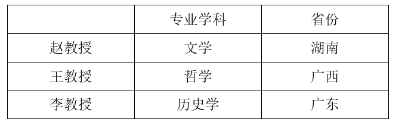

根据条件（4）可知，李教授喜欢和王教授一起下棋，A项无法推出；

根据推出的表格，文学教授来自湖南，而非广东，B项无法推出；

根据推出的表格，哲学教授来自广西，C项可以推出；

根据条件（3）可知，王教授住在李教授隔壁，D项无法推出。

故正确答案为C。

### 第 85 题

当前生物科技领域中克隆人技术是基本不可能实现的，并且在实现过程中也不能给生物科学带来任何附带的技术推动，因此克隆人技术在现阶段没有进行开发的必要。

以下哪项与上述论述的逻辑结构最为相似?

A. 从北方迁徙到南方的候鸟难以适应炎热的夏季，并且还会受到此处捕食者的威胁，因此它们没有必要在这里久留

B. 人类登陆金星是我们这代人无法看到的奇迹，并且就算登陆成功也不会给我们在地球上的生活带来促进意义，所以人类发展航天技术探索外星球是没有意义的

C. 如果要建成这座世界上最长的跨海大桥，就必须建设世界上最好的土木工程学科，并且在此基础上取得建设长距离跨海大桥的经验，不然大桥就不可能建成

D. 掌握5门外语是普通人一生都难以做到的，并且投入大量时间也很难用其收获相应的经济回报，但不能因此排除部分人为了更多经济报酬去学习并掌握5门外语

第 85 题 · 答案与解析

**参考答案（粉笔题库参考内容）**

B

**解析**

第一步：分析题干推理形式。

题干根据克隆人技术基本不可能实现，并且在实现过程中也不能带来附带的技术推动，得到结论认为克隆人技术没有进行开发的必要。故论证方式为：根据A（克隆人技术）难以实现，而且没有更多好处，所以认为A（克隆人技术）没有必要。

第二步：逐一分析选项。

A项：根据A（从北方迁徙到南方的候鸟久留）难以实现，而且还面临许多坏处，所以认为A（从北方迁徙到南方的候鸟久留）没有意义，与题干论证方式不同，排除；

B项：根据A（人类登陆金星）难以实现，而且不会给地球生活带来更多好处，所以认为A（人类登陆金星）没有必要，与题干论证方式相同，当选；

C项：A（建成跨海大桥）需要建设土木工程学科，而且取得经验，不然A（建成跨海大桥）无法实现，与题干论证方式不同，排除；

D项：虽然A（掌握5门外语）难以实现，而且好处较少，但还是有部分人认为A（掌握5门外语）有意义，与题干论证方式不同，排除。

故正确答案为B。

## 材料 1

### 第 86 题

2019年3月，订销报纸数量约是订销杂志数量的多少倍？

A. 21

B. 22

C. 23

D. 24

第 86 题 · 答案与解析

**参考答案（粉笔题库参考内容）**

A

**解析**

根据题干“2019年3月······是······多少倍”，可判定本题为现期倍数问题。定位统计表可得：2019年3月，订销报纸数量为148145.5万份，订销杂志数量为6980.0万份。则2019年3月，订销报纸数量是订销杂志数量的倍。

故正确答案为A。

### 第 87 题

2018年1~2月，我国邮政寄递服务的收入约为多少亿元？

A. 44

B. 65

C. 82

D. 103

第 87 题 · 答案与解析

**参考答案（粉笔题库参考内容）**

B

**解析**

根据题干“2018年1~2月······收入约为多少亿元”，结合材料时间为2019年一季度和2019年3月，可判定本题为基期和差问题。定位统计表可得：2019年一季度，我国邮政寄递服务110.4亿元，同比增速为7.4%；2019年3月，我国邮政寄递服务37.1亿元，同比增速为-1.6%。根据公式：基期量，可得2018年1~2月我国邮政寄递服务的收入亿元，与B项最接近。

故正确答案为B。

### 第 88 题

2019年1~2月，我国包裏寄递量比去年同期：

A. 下降了不到10%

B. 下降了10%以上

C. 上升了不到10%

D. 上升了10%以上

第 88 题 · 答案与解析

**参考答案（粉笔题库参考内容）**

B

**解析**

根据题干“2019年1~2月······比去年同期”，选项为“上升/下降+%”，结合材料给出2019年一季度和2019年3月我国包裏寄递量及其同比增速，可判定本题为混合增长率问题。定位统计表可得：2019年一季度，我国包裏寄递量为588.1万件，同比增速为-12.3%；2019年3月，我国包裏寄递量为188.9万件，同比增速为-10.8%。根据混合增长率口诀“混合后居中”，可知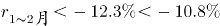，在B项范围内。

故正确答案为B。

### 第 89 题

在①同城快递、②异地快递和③国际/港澳台快递中，2019年3月业务量占一季度比重高于2018年3月业务量占一季度比重的是：

A. 仅①

B. 仅③

C. 仅①和②

D. 仅②和③

第 89 题 · 答案与解析

**参考答案（粉笔题库参考内容）**

C

**解析**

根据题干“······2019年3月······占一季度比重高于2018年3月······占一季度比重的是”，可判定本题为两期比重比较问题。定位统计表可得同城快递、异地快递和国际/港澳台快递2019年3月业务量的同比增速（a）和一季度业务量的同比增速（b）。根据两期比重比较结论：若部分增长率（a）＞整体增长率（b），则比重上升，因①同城快递1.2%＞-0.2%，②异地快递30.6%＞30.3%，③国际/港澳台快递7.5%＜8.9%，则仅①和②满足要求。

故正确答案为C。

### 第 90 题

关于我国邮政行业发展状况，能够从上述资料中推出的是：

A. 2018年3月，快递业务收入高于500亿元

B. 2019年3月，快递业务量高于同年1~2月平均水平

C. 2019年一季度，平均每件邮政寄递服务产生的收入高于2元

D. 2019年一季度，函件、包裹和汇兑的业务量之和占邮政寄递服务业务量的20%以上

第 90 题 · 答案与解析

**参考答案（粉笔题库参考内容）**

B

**解析**

A项：定位统计表可得：2019年3月，快递业务收入为596.0亿元，同比增速为23.0%。根据公式：基期量，可得2018年3月快递业务收入为亿元，错误；

B项：定位统计表可得：2019年一季度，快递业务量为1214633.0万件；2019年3月，快递业务量为486392.8万件。则2019年1~2月，快递业务量平均水平为万件<486392.8万件，故2019年3月，快递业务量高于同年1~2月平均水平，正确；

C项：定位统计表可得：2019年一季度，邮政寄递服务收入为110.4亿元，邮政寄递服务业务量为601950.3万件。平均每件邮政寄递服务产生的收入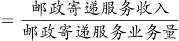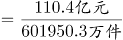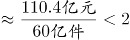元/件，错误；

D项：定位统计表可得2019年一季度，函件、包裹和汇兑的业务量以及邮政寄递服务业务量。根据公式：比重，可得，故2019年一季度，函件、包裹和汇兑的业务量之和不到邮政寄递服务业务量的20%，错误。

故正确答案为B。

（备注：表格中邮政寄递服务量单位为万件/万份/万笔，C项所求为平均每件邮政寄递服务产生的收入，此处应为出题人统一用每件指代各类不同单位总数）

## 材料 2

2019年，A市居民人均可支配收入28920元，比上年增长9.6%。按常住地分，城镇居民人均可支配收入37939元；农村居民人均可支配收入15133元。全市居民人均消费支出20774元，比上年增长7.9%。按常住地分，城镇居民人均消费支出25785元；农村居民人均消费支出13112元。全市居民恩格尔系数为32.1%，比上年下降0.2个百分点。其中城镇为31.2%，农村为34.9%。

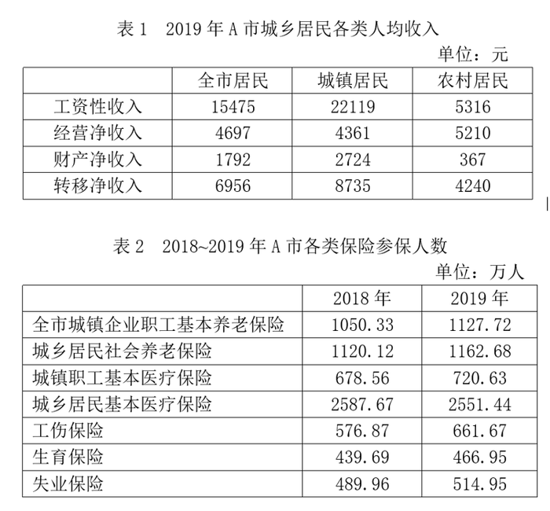

### 第 91 题

2019年，A市居民人均可支配收入同比增量约是同期人均消费支出同比增量的多少倍？

A. 1.1

B. 1.4

C. 1.7

D. 2.2

第 91 题 · 答案与解析

**参考答案（粉笔题库参考内容）**

C

**解析**

根据“2019年······是······的多少倍”，可判定本题为现期倍数问题。定位文字材料可得：2019年，A市居民人均可支配收入28920元，比上年增长9.6%。全市居民人均消费支出20774元，比上年增长7.9%。根据公式：增长量，则2019年A市居民人均可支配收入同比增量，同期人均消费支出同比增量。所求倍数，与C项最接近。

故正确答案为C。

### 第 92 题

2019年，A市城镇常住居民工资性收入占可支配收入的比重比农村常住居民的这一比重：

A. 低不到10个百分点

B. 低10个百分点以上

C. 高不到10个百分点

D. 高10个百分点以上

第 92 题 · 答案与解析

**参考答案（粉笔题库参考内容）**

D

**解析**

根据题干“2019年······的比重······”，可判定本题为现期比重问题。定位文字材料可得：2019年，A市按常住地分，城镇居民人均可支配收入37939元；农村居民人均可支配收入15133元。定位表1可得：2019年，A市城镇居民人均工资性收入22119元；农村居民人均工资性收入5316元。根据公式：现期比重，则2019年A市城镇常住居民工资性收入占可支配收入的比重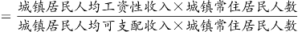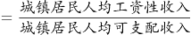，同理，农村常住居民工资性收入所占比重。故2019年A市城镇常住居民工资性收入占可支配收入的比重比农村常住居民高约58%-35%=23%，即高10个百分点以上。

故正确答案为D。

### 第 93 题

2019年，A市城镇企业职工基本养老保险及城乡居民社会养老保险总参保人数比2018年多：

A. 不到50万人

B. 50~100万人之间

C. 100~150万人之间

D. 150万人以上

第 93 题 · 答案与解析

**参考答案（粉笔题库参考内容）**

C

**解析**

根据题干“2019年······比2018年多”，结合选项单位为“人”，可判定本题为增长量计算问题。定位表2可得：A市城镇企业职工基本养老保险，2018年参保人数为1050.33万人，2019年参保人数为1127.72万人；A市城乡居民社会养老保险，2018年参保人数为1120.12万人，2019年参保人数为1162.68万人。根据公式：增长量=现期量-基期量，则2019年A市城镇企业职工基本养老保险及城乡居民社会养老保险总参保人数比2018年多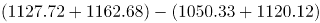万人，在C项范围内。

故正确答案为C。

### 第 94 题

将2019年A市①工伤保险、②生育保险和③失业保险按参保人数同比增速从高到低的顺序排列，以下正确的是：

A. ①②③

B. ①③②

C. ②③①

D. ②①③

第 94 题 · 答案与解析

**参考答案（粉笔题库参考内容）**

A

**解析**

根据题干“2019年······同比增速从高到低······”，可判定本题为一般增长率比较问题。定位表2可得：2018-2019年，A市工伤保险参保人数分别为576.87万人、661.67万人；生育保险参保人数分别为439.69万人、466.95万人；失业保险参保人数分别为489.96万人、514.95万人。根据公式：增长率，则2019年，工伤保险参保人数同比增速为；生育保险参保人数同比增速为；失业保险参保人数同比增速为。则三者按参保人数同比增速从高到低的顺序排列为：①＞②＞③。

故正确答案为A。

### 第 95 题

以下饼图中，最能准确反映2019年A市全市居民工资性收入（白色）、经营净收入（灰色）、财产净收入（黑色）和转移净收入（斜线）占可支配收入比重关系的是：

A. 

B. 

C. 

D. 

第 95 题 · 答案与解析

**参考答案（粉笔题库参考内容）**

D

**解析**

根据题干“······2019年······占······比重关系”，可判定本题为现期比重问题。定位表1可得：2019年，A市全市居民工资性收入为15475元，经营净收入为4697元，财产净收入为1792元，转移净收入为6956元。财产净收入最小，则黑色扇形面积最小，排除A、B两项。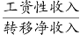，则白色扇形面积应为斜线扇形面积的2倍多，排除C项。

故正确答案为D。

## 材料 3

2020年末，全国共有艺术表演团体17581个，比上年末减少214个；从业人员43.69万人，增加2.44万人。其中各级文化和旅游部门所属艺术表演团体2060个，占11.7%，从业人员10.75万人，占24.6%。

2020年，全国艺术表演团体共演出225.61万场，比上年下降24.0%；国内观众8.93亿人次，下降27.4%；演出收入86.63亿元，下降31.7%。

2020年，全国文化和旅游部门所属艺术表演团体共组织政府采购公益演出13.38万场，比上年下降14.9%；观众0.86亿人次，下降27.9%。

2020年末，全国公共图书馆实际使用房屋建筑面积1785.77万平方米，比上年末增长12.2%；全国图书总藏量117929.99万册，增长6.1%；阅览室坐席数126.47万个，增长6.2%；计算机226234台，增加419台；其中供读者使用的电子阅览终端143714台，减少2022台。

2020年末，全国共有群众文化机构43687个，比上年末减少386个。其中乡镇综合文化站32825个，减少705个。年末全国群众文化机构从业人员185076人，比上年末减少4992人。其中具有高级职称的人员7075人，具有中级职称人员17969人。

### 第 96 题

2020年末，平均每个各级文化和旅游部门所属艺术表演团体的从业人数约是全国所有艺术表演团体的多少倍？

A. 0.5

B. 0.8

C. 1.3

D. 2.1

第 96 题 · 答案与解析

**参考答案（粉笔题库参考内容）**

D

**解析**

根据题干“2020年末，平均每个······约是······的多少倍”，可判定本题为现期倍数问题。定位文字材料第一段可得：2020年末，全国共有艺术表演团体17581个，从业人员43.69万人；其中各级文化和旅游部门所属艺术表演团体2060个，从业人员10.75万人。根据平均每个······团体的从业人数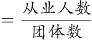，则2020年末，平均每个各级文化和旅游部门所属艺术表演团体的从业人数约是全国所有艺术表演团体的倍，对应D项。

故正确答案为D。

### 第 97 题

2020年，全国艺术表演团体平均每场演出创造收入比上年：

A. 减少了不到1000元

B. 减少了1000元以上

C. 增加了不到1000元

D. 增加了1000元以上

第 97 题 · 答案与解析

**参考答案（粉笔题库参考内容）**

A

**解析**

根据题干“2020年······平均每场演出创造收入比上年”，结合选项为“增加/减少+元”，可判定本题为平均数的增长量问题。定位文字材料第二段可得：2020年，全国艺术表演团体共演出225.61万场（B），比上年下降24.0%（b）；演出收入86.63亿元（A），下降31.7%（a）。根据公式：平均数的增长量，故2020年，全国艺术表演团体平均每场演出创造收入的同比增长量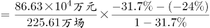元/场，即比上年减少了不到1000元。

故正确答案为A。

### 第 98 题

2020年，全国群众文化机构从业人员中，中高级职称从业人员占比约为：

A. 8%

B. 14%

C. 27%

D. 38%

第 98 题 · 答案与解析

**参考答案（粉笔题库参考内容）**

B

**解析**

根据题干“2020年······中······占比约为”，可判定本题为现期比重问题。定位文字材料最后一段可得：2020年末，全国群众文化机构从业人员185076人，其中具有高级职称的人员7075人，具有中级职称人员17969人。根据公式：比重，所求比重为，对应B项。

故正确答案为B。

### 第 99 题

2020年，全国供读者使用的电子阅览终端数量同比增速约为：

A. 3.4%

B. 2.7%

C. \-1.4%

D. \-2.8%

第 99 题 · 答案与解析

**参考答案（粉笔题库参考内容）**

C

**解析**

根据题干“2020年······同比增速约为”，可判定本题为一般增长率问题。定位文字材料第四段可得：2020年末，全国供读者使用的电子阅览终端143714台，减少2022台。根据公式：增长率，则2020年，全国供读者使用的电子阅览终端数量同比增速为，对应C项。

故正确答案为C。

### 第 100 题

以下信息中，能够从上述资料中推出的有几条？

①2019年末全国各级文化和旅游部门所属艺术表演团体数

②2019年全国平均每场政府采购公益演出的观众数量

③2019年全国艺术表演团体平均每场演出收入

④2019年末全国群众文化机构个数

A. 1

B. 2

C. 3

D. 4

第 100 题 · 答案与解析

**参考答案（粉笔题库参考内容）**

C

**解析**

①：定位文字材料第一段“2020年末，各级文化和旅游部门所属艺术表演团体2060个，占11.7%”。材料并未给出2019年末各级文化和旅游部门所属艺术表演团体的相关数据，无法推出；

②：定位文字材料第三段“2020年，全国文化和旅游部门所属艺术表演团体共组织政府采购公益演出13.38万场（B），比上年下降14.9%（b），观众0.86亿人次（A），下降27.9%（a）”。根据基期平均数可得，2019年全国平均每场政府采购公益演出的观众数量为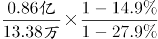人次，可以推出；

③：定位文字材料第二段“2020年，全国艺术表演团体共演出225.61万场（B），比上年下降24.0%（b）；演出收入86.63亿元（A），下降31.7%（a）”。根据基期平均数可得，2019年全国艺术表演团体平均每场演出收入为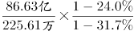元，可以推出；

④：定位文字材料最后一段“2020年末，全国共有群众文化机构43687个，比上年末减少386个”。根据基期量=现期量-增长量可得，2019年末全国群众文化机构个数为43687-（-386）个，可以推出。

综上可知，可以推出的有②③④，共3条。

故正确答案为C。

