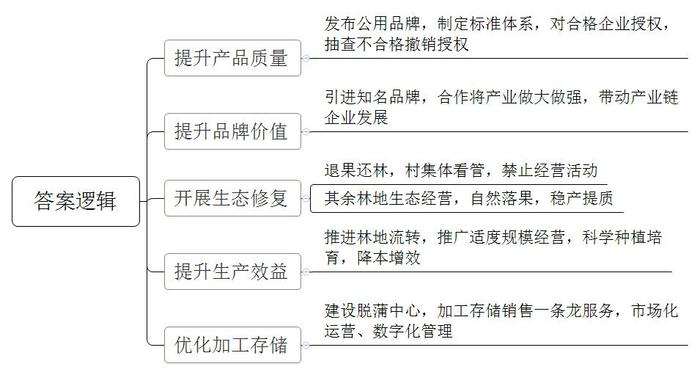
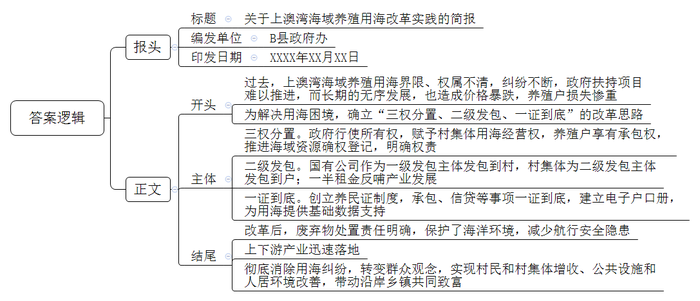
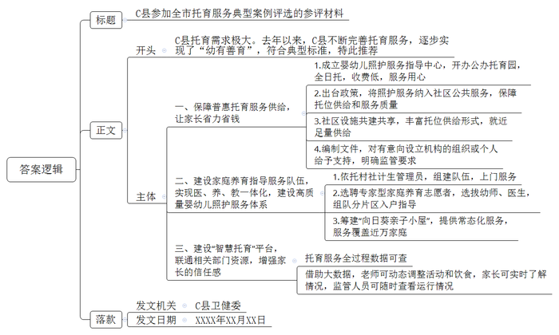
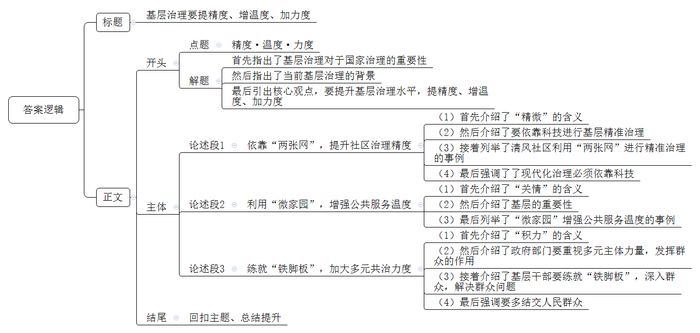

# 2023年公务员多省联考《申论》题（四川上半年县乡卷）

<!-- gwy:overview:start -->
> **四川 · 2023 · 申论 · 上半年县乡卷** ｜ 4 题 · 图片 4 处 · 答案随题折叠

导航：[题目](#题目) · [材料 1](#材料-1)
<!-- gwy:overview:end -->

> 候选采集稿。参考答案及解析来自粉笔页面，不代表官方答案或真实高分答卷；来源使用许可与原卷对应关系仍需人工核实。

## 给定材料

### 材料 1

2022年本应是A县山核桃丰产的大年，但由于高温干旱，产量只是略有增加。虽然产量受影响，但效益却创下了新高，这背后是山核桃的转型升级之路。

多年来，A县山核桃产业生产主体众多，很多是家庭作坊，质量参差不齐，以次充好并不鲜见。相关部门不断加强对山核桃的销售市场的监管，但收效甚微。“为此，我们决定制定统一的标准，从而鼓励、引导、带动企业执行这个标准。”A县农业农村局古局长介绍。

2021年，A县发布“天目”农产品区域公用品牌，覆盖包括山核桃在内的众多农产品。县政府委托省山核桃产业协会牵头制定“天目”山核桃系列标准。9月，“天目”山核桃系列标准体系对外发布，包括炒制山核桃、手剥类山核桃和山核桃仁三个标准。标准起草人之一、省山核桃产业协会蔡秘书长说：“在山核桃领域20个标准中，我们这次制定的标准是最高的。”

“要获得‘天目’品牌使用授权，企业需要申请，产品要符合我们的标准。”古局长说。目前已有8家山核桃企业获得授权，A县太康炒货食品厂就是其中之一。“现在，我们有两款产品用了‘天目’品牌。”程厂长说，“这两款山核桃的品质是我们产品中最好的。”获得“天目”品牌使用授权后，程厂长感受最深的是品牌推广的力度大大提升。“‘天目’需要好的产品来支撑，我们也需要‘天目’这个公共品牌提升消费者的认可度。”“市场监管部门会不定期抽查，如果授权企业的‘天目’产品不符合相关标准，将撤销授权并向社会公布，同时在一定时间内禁止该企业再申请。”古局长表示。

A县山核桃加工企业有280多家，年加工能力3万吨，光是龙水镇就集聚了170余家炒货食品加工产业链企业。但这些企业大多是给品牌企业代加工，尽管做自己品牌的也有，然而规模、名气都不大，亟待有影响力的领头企业带动发展。蔡秘书长说：“为品牌企业做代加工利润薄，只有更多品牌企业成长起来，A县山核桃的品牌价值才会更大，才能分享到山核桃产业带来的更多效益。”

2022年，天生记总部落户龙水镇，A县终于有了第一个具有全国知名度的坚果类品牌。天生记杨副总经理深耕坚果领域20多年，“看着都是山核桃，但其实有很多不同的地方，在企业文化、品牌宣传等方面，天生记更有优势。”在他看来，大家可以合作，一起将山核桃产业做强做大。“如果整个市场能做得更大，大家都可以从中受益。”而在古局长眼里，天生记的到来，更为重要的是对当地食品加工产业链企业带来积极影响，包括规范经营、现代化生产、市场营销、科技研发等。

几年前，因山核桃种植规模无序扩张，加之过度使用农药、化肥，导致山坡植被大面积破坏、水土流失严重，山核桃品质逐年下降。A县痛定思痛，于2019年9月起开展了一场生态修复行动，“退果还林”2万亩，退出后的山核桃林禁止除草、施肥、除虫、采打等经营活动，由村集体看管。正常经营的山核桃林，则鼓励生态经营，推广自然落果，不滥用农药、化肥，减少人为干预。A县农林技术推广中心李主任说：“生态经营逐步推广，山核桃林的产出更稳定，品质也更好。”

为了提升山核桃林的生产效益，A县近年还在推进山核桃林流转，推广适度规模经营。“近年来，由于种植成本上涨、分散经营等原因，山核桃林的投入产出比持续下降，年轻一辈经营山核桃林的意愿也持续下降。”李主任说，“规模经营更有利于农业机械和数字技术利用，能更好地实施科学种植与培育，降低生产成本、优化投入产出比。”

中间的加工储存环节，A县也在求变。山核桃脱蒲的汁液碱性很强，乱排放对环境有影响。晒干、存储环节没做好，山核桃品质就会受影响。“脱蒲中心可以实现山核桃脱蒲、晒干、存储、销售‘一条龙’服务。”古局长介绍，“这个中心由政府建设，实行市场化运营，农户将采收的山核桃送到中心脱蒲后，可以直接将山核桃存储在这里的仓库。仓库是数字化管理，精准地对温度、湿度等进行控制，山核桃存储在这里比存放在家里更妥当。”

### 材料 2

B县上澳湾海域微波粼粼、金光闪耀，富饶的5万多亩海域是周边村民赖以生存的“海上耕地”。正值紫菜收获的季节，村民们在海上劳作，一派祥和景象。可就在2016年以前，这里曾因养殖用海权属不清而纠纷不断。“大海谁先占有就是谁的，大家都在抢地盘。”赤水村民兰大爷记忆犹新，“那时我们脑子里只有‘祖宗海’‘门前海’的概念，谁占的海多，谁就来钱多。”兰大爷所说的“那时”指的是2010年前后。2010年，全国紫菜市场供不应求，养殖户不断增多，收益也很可观，但养殖户之间海域使用权不明的问题也埋下了矛盾冲突的隐患。

上澳湾沿岸分布着20余个乡镇，长期以海产养殖为主导产业，但不同乡镇、不同村落之间的养殖海域又互相交叉。下海镇党委袁书记说：“过去，我们与邻近的中海镇在养殖海域确权方面进展迟缓，海域界限不清、权属不明，只能是谁先占、谁先用，养殖用海矛盾纠纷时有发生。”中海镇李镇长则说道：“当时我们也没啥办法，用海基础数据我们镇上也不清楚，上头发来的数据也是模糊不清。我们两个镇搞过联合规划排查，想对养殖海域全面确权，但受各种因素影响，两个镇谈好的一些界限、权属也落不了地，只能任由村民自行其是。”

紫菜养殖用海还没确权，部分从事海洋捕捞的渔民也转向紫菜养殖，要求政府重新配置用海资源，这更增添了确权的难度。袁书记说：“为调解矛盾纠纷，我们甚至将办公地搬到了养殖户家门口或渔船上，但终究治标不治本。”2016年，因上澳湾海域紫菜养殖长期无序发展，致使收购价格暴跌，出现大面积烂菜现象，养殖户损失惨重。同时，多发的矛盾也使得政府的扶持项目无法推进，严重影响上澳湾沿岸建设和村民增收。

B县王副县长说：“要引领养殖户走好乡村振兴路，走出养殖用海困境尤为关键。”2016年至2017年，B县先后召开20多次会议，反复征求沿海镇村干部和群众意见建议，最后确立了“三权分置、二级发包、一证到底”的改革思路，并决定在上澳湾海域开展养殖用海管理体制改革试点。

“政府行使所有权，赋予村集体用海经营权，保障养殖户享有承包权，推进海域资源确权登记，以制度形式明确权责范围，彻底解决用海定界模糊等根源性问题。”王副县长介绍说，国有安海渔业发展有限公司作为一级发包主体行使所有权，将养殖用海按面积发包到村集体，村集体成为二级发包主体行使经营权，经村民代表大会审议后再发包给本村养殖户享有承包权。承包租金的50%归属村集体经济收入，30%由镇政府统筹，20%由国有公司统筹。政府和国有公司统筹所得全部投入产业发展、养殖保险，以反哺养殖户。

为确保“三权分置”“二级发包”落地见效，B县创立“养民证”制度。在养殖户签署协议并缴纳租金后，发放“养民证”。对养民的承包、产业发展补贴申报等事项实行“一证到底”。同时，县有关部门借助无人机航拍和卫星定位技术建立养殖用海电子“户口册”，为养殖用海依法有序分配、流转提供准确的基础数据支持。

兰大爷刚拿到“养民证”时，意外地发现，“养民证”还是B县农商银行的信贷凭证。他来到县农商银行营业网点了解详情，银行工作人员向他解释道：“根据县政府发来的通知，您可以用‘养民证’享受‘蓝色信贷’服务，我们可为您发放低息贷款，支持您发展海产养殖。”2019年，B县完成了覆盖全县所有沿海乡镇的养殖用海改革工作，化解了多年来的养殖用海矛盾。

上澳湾紫菜养殖每年需更换竹竿33万根左右，以前养殖户们为降低成本，将废弃的竹竿留在养殖海域，给海洋生态环境带来了极大的破坏，也对海上渔船航行造成了严重安全隐患。“养殖用海改革后，养殖海域废弃竹竿处置责任得到进一步明确，养殖户主动配合竹竿集中更换处置工作，有的还更换为经久耐用的环保型玻璃钢插杆。”王副县长说，上澳湾紫菜育苗基地、紫菜精加工产业园也得到迅速落地，下海镇和中海镇还瞄准“共富海”，联手打造“多彩上澳”项目，大力发展特色渔村旅游。

“现在海上抢地盘的情况没有了，我们‘祖宗海’‘门前海’的老观念也没有了，紫菜养殖更赚钱了。”兰大爷逢人便说。他现在承包了42亩海域从事紫菜养殖，好的年份能赚七八十万元。近三年，兰大爷所在的赤水村集体经济收入年均增长40%。有了雄厚的资金基础，码头修缮、村道改扩建、村社绿化等项目快速推进，上澳湾的公共设施和人居环境明显改善，小渔村越来越美了。如今，上澳湾每年的紫菜产量约占全国的六分之一，年产值超10亿元，有效带动沿岸乡镇共同致富。

### 材料 3

上午8时30分，“伊家托育园”准时开园，不少送娃的家长已在门口等候，余先生一对两岁多的龙凤胎就托在这儿。“我和爱人都在上班，岳父母年纪大，照顾起来实在力不从心，若托到其他私立托育园，两个娃每月要6000元，负担实在太重！”余先生说。在C县，3岁以下婴幼儿有2万多人，托育需求着实不小。

去年，C县卫健委成立县级婴幼儿照护服务指导中心，并牵头开办首家公办托育园——“伊家托育园”。“这是全日托模式，完美匹配上下班时间，每月收费1700多元，在我们可负担范围内。”余先生“托”得很放心。园区内用心的小设计随处可见，比如墙上的护牙小玩具，能模拟牙刷的使用。再比如，宝宝吃过的食物都会留样48小时，方便后续追溯……“小家伙入托后，生活习惯变好了，自理能力也增强了！”

普惠托育服务，替年轻家长分担“带娃”时间和成本，这是C县在“幼有善育”这道民生考题上的突破口之一。为满足托育服务的“硬需求”，C县出台《关于促进3岁以下婴幼儿照护服务发展的实施意见》，将婴儿照护服务纳入城乡社区公共服务范围，加快普惠性托育供给，全县今年计划新增3岁以下婴幼儿托位2000个，其中普惠性托位1200个。同时，C县还出台《家庭型托育质量评价办法》和《托育机构量级评定办法》，促进普惠托育服务质量有保障，方便可及。

位于兴河社区的阳光托育中心，是C县第一家由社会资本和社区共建的民办普惠托育机构。该中心利用社区用房与个人自有商业用房合建而成，设置托位100个。创海社区服务中心二楼是该县首批社区婴幼儿照护服务站之一，配备了1名保育医生和1名育婴师，提供预约式临时托管等服务，居民步行15分钟便可“放心托”，这些形式多样的“家门口”托位，通过设施共建共享，实现了托位的显著增长。此外，县卫健委还牵头编制《托育机构设置指引》，对有意向设立托育机构的组织或个人给予引导和支持，并明确监管要求。

前段时间连续高温，高塘小区的李女士因1岁的宝宝暑热而发愁，幸好家庭养育指导员上门，为她开出“度夏指南”：空调不要低于26度，食材要新鲜，要关注孩子腹泻等症状，要及时陪伴、抚慰……李女士是“新手妈妈”，育儿经验不足，平时带娃不是听长辈建议，就是上网查资料，总有些焦虑。现在有了“家庭养育指导员”帮她梳理宝宝成长各阶段的照护技能，心里有底了！

C县去年组织培训了一支专业家庭养育指导员队伍，通过上门服务，手把手教年轻父母养娃，依托村（社区）计生管理员队伍就地转化了300多名家庭养育指导员，目前已累计入户指导3万余户次。县卫健委靳主任表示，这批人原本就在村社工作，人缘亲、情况熟，是婴幼儿照护入户服务快速落地的“主力军”。

去年，C县试水在全县选聘专家型“家庭养育志愿者”，目前已有43名幼儿园老师和53名儿保医生正式入列。一个志愿者与N个家庭养育指导员组队，分片区入户指导，县妇幼保健院儿保科陈医生是首批家庭养育志愿者，她带着十几名养育指导员服务着片区内1000多名婴幼儿。这些志愿者还是教育、卫健、妇联三部门联合筹建的“向日葵亲子小屋”的主力。每个“小屋”200多平方米，为周边社区家庭提供常态化指导服务。全县目前已有43个这样的“小屋”，近一年来举办了近2000场活动，近万个家庭参与。县卫健委靳主任认为：“把儿保医生和幼师这两大类专业人才纳入家庭养育指导的服务队伍，真正实现了医、养、教一体化，是推动高质量婴幼儿照护服务体系建设的‘关键一招’。”

洋渡社区稻田托育园有110名婴幼儿。每个宝宝每天吃了多少食物、喝了多少水，一旁的保育老师都会记录下来并上传到“智慧托育”平台。包括安全检查、消毒卫生、课程活动、健康检查等托育服务的全过程被细化成200多项数据类目，在“智慧托育”平台上均有据可查。借助对平台的大数据分析，老师们还可动态调整孩子的活动和饮食，家长可实时了解孩子在园状况，监管人员可随时查看辖区内托育机构每日运行情况。“智慧托育”既联通了卫健、民政、市场监管和教育等部门资源，又增强了家长对婴幼儿照护服务机构的信任感。

### 材料 4

“了解情况靠走、登记信息靠手、交流沟通靠口”，这是D市欣阳社区党委郭书记20多年来的工作常态，但现在，面对新问题，这三招已经不够用了，需要新解法。欣阳社区是典型的融合型大社区，有近2万常住人口，其中八成是外来人口，另外还有1000多家商铺，近400家企业。“现在的社区，规模更像是一座小型城市。”郭书记说，人口密度大、单元构成复杂、利益需求多样、管理主体多元，而社区干部满编也就18人，仅靠传统的管理服务方式，已经无法应对。

E市清风社区所辖的青林湾小区有100多幢高层住宅。去年疫情期间，清风社区在短时间内就精准高效完成了1.6万常住人口的人员排查、上门服务等工作，靠的就是“两张网”：一方面，通过一体化智能化公共数据平台，区、乡镇（街道）的排查数据及时流转下发到社区、网格，社区网格员可及时精准对接相关人员；另一方面，清风社区这两年加强数字化建设，通过调查收集数据建立了小应用——“活地图”，标记了辖区内345名党员、志愿者的居住位置和联系方式，可随时发动他们参与社区疫情防控。

针对此前网格划分过大、层级过多、力量不足等问题，去年省里对网格进行了科学划分、合理优化。“现在不仅增加了网格的密度，还在网格中按楼道、楼栋设置了微网格，构建了‘村（社区）-网格-微网格’治理体系。”省政法委张副书记说，“遍布全省的‘两张网’，正在提升<u>社区治理的精度</u>。”

但居民们的期待不止于此，在融合型大社区，通过数字化改革让居民享受更有温度的服务，是大家进一步的期待。在F市，一个集纳了线下6000多个网格的线上空间——“微家园”，成为广大居民享受优质公共服务的新平台。F市居民只要扫二维码注册，填写所属的社区网格，就能加入这个线上空间，大家可以在这里发布需求，与社区干部、邻居们交流。目前，“微家园”的用户数已达253万，日均活跃用户达40万，已成为一片火热的线上空间。

东湖社区的王女士前几天看到“微家园”贴出了社区举办书法培训班的通知，很快就在线上报名。培训班由社区里有书法特长的老师义务教学，居民不用交费。“期间，我们认识了很多邻居，也收获了温暖的友情。”王女士说，“我们这儿是新建小区，住户来自全国各地，以前相互间基本都是‘陌生人’。”

“这也是众多融合型大社区的共性问题。”F市政法委陈副书记说，“‘微家园’创造了线上交流的社区新空间，通过数字化重建了熟人社会，邻里关系越来越紧密。”如今，“微家园”上有了邻里互助、爱心义卖、定向捐赠等项目，实现邻里需求与公共服务精准配对。“微家园”正在被复制、推广，更多实用管用的服务功能被送到“掌上社区”，满足更多个性化的需求，让大家享受到<u>公共服务的温度</u>。

在融合型大社区，群众投诉的问题更为复杂和棘手，仅靠社区或者街道的力量远远不够。F市风华社区的水产市场一直被内涝问题困扰，不仅影响商户的生意，也对居民的生活造成不便。许多人在“微家园”上投诉，社区也一直想解决，但由于缺乏资源统筹调度能力，问题不得不搁置。2022年7月，风华社区严书记带着水务集团、镇政府相关人员，到水产市场现场协调，决定由水务集团负责新装抽水系统，镇、社区在资金、施工等环节协同配合，内涝问题很快得以解决。

一个社区书记，为什么能“叫得动”水务集团和镇里的干部？原来，为了推动基层治理，特别是解决一些陈年顽疾，从2022年7月开始，全市乡镇以及基层站所干部全部下沉到村（社区），多跨协同形成合力，帮助解难题、谋发展，<u>多元化共治的力度</u>前所未有。“微家园”还开通了政府部门、村（社区）与群众的三方对话机制。“用大数据分析和手机应用为协商议事插上了科技的翅膀，让民有所呼更便捷、基层议事更智慧、为民解难更精准。”陈副书记认为，“但技术手段再先进，走街访巷‘铁脚板’的老传统也不能丢，问题的‘最后一米’还是要脚踏实地去解决。与此同时，也绝不能让技术浮在现实之上，要防止因多头报送、重复收集数据而增加基层压力。”

## 题目

### 第 1 题

**请根据****“给定资料**1**”，归纳概括A县发展山核桃产业的措施。（15分）**

关联材料：材料 1

作答要求：

要求：全面准确，条理清晰，语言简洁；不超过200字。

第 1 题 · 答案与解析

**参考答案（粉笔题库参考内容）**

1.提升产品质量。发布公用品牌，制定标准体系，对合格企业授权，抽查不合格撤销授权。

2.提升品牌价值。引进知名品牌，合作将产业做大做强，带动产业链企业发展。

3.开展生态修复。退果还林，村集体看管，禁止经营活动；其余林地生态经营，自然落果，稳产提质。

4.提升生产效益。推进林地流转，推广适度规模经营，科学种植培育，降本增效。

5.优化加工存储。建设脱蒲中心，加工存储销售一条龙服务，市场化运营、数字化管理。

**解析**

**参考答案说明：**本参考答案从“提升产品质量”“提升品牌价值”“开展生态修复”“提升生产效益”“优化加工存储”5个方面对A县发展山核桃产业的措施进行了分类分条撰写，各条要点之间在内容上是并列关系，没有交叉。

**考点**：概括措施类

**来源**：2023年公务员多省联考《申论》题（四川上半年县乡卷）

### 第 2 题

**假如你是****B县政府办工作人员，请根据“给定资料**2**”，就B县上澳湾海域养殖用海改革实践写一份简报。（20分）**

关联材料：材料 2

作答要求：

要求：内容全面，简明扼要，语言流畅；不超过400字。

第 2 题 · 答案与解析

**参考答案（粉笔题库参考内容）**

关于上澳湾海域养殖用海改革实践的简报

B县政府办 XXXX年XX月XX日

过去，上澳湾海域养殖用海界限、权属不清，纠纷不断，政府扶持项目难以推进，而长期的无序发展，也造成价格暴跌，养殖户损失惨重。为解决用海困境，确立“三权分置、二级发包、一证到底”的改革思路，措施如下。

一、三权分置。政府行使所有权，赋予村集体用海经营权，养殖户享有承包权，推进海域资源确权登记，明确权责。二、二级发包。国有公司作为一级发包主体发包到村，村集体为二级发包主体发包到户；一半租金反哺产业发展。三、一证到底。创立养民证制度，承包、信贷等事项一证到底，建立电子户口册，为用海提供基础数据支持。

改革后，废弃物处置责任明确，保护了海洋环境，减少航行安全隐患；上下游产业迅速落地；彻底消除用海纠纷，转变群众观念，实现村民和村集体增收、公共设施和人居环境改善，带动沿岸乡镇共同致富。

**解析**

**参考答案说明：**（1）格式方面，本参考答案写到了“报头”“正文”两个部分。（2）正文部分，一方面从内容上来看，围绕“上澳湾海域养殖用海改革实践”这一主题，本参考答案的开头阐述了上澳湾海域养殖用海改革实践面临的问题，改革的总体思路；主体部分介绍了改革的具体措施；结尾部分介绍了改革的成效。另一方面，形式上，本参考答案做到了分段、分条撰写，整体上条理较为清晰。

**考点**：总结类

**来源**：2023年公务员多省联考《申论》题（四川上半年县乡卷）

### 第 3 题

**C县将参加全市托育服务典型案例评选，假如你是C县卫健委工作人员，请根据“给定资料**3**”，拟写一份参评材料。（25分）**

关联材料：材料 3

作答要求：

要求：

（1）中心明确，亮点突出；

（2）思路清晰，语言流畅；

（3）不超过500字。

第 3 题 · 答案与解析

**参考答案（粉笔题库参考内容）**

C县参加托育服务典型案例评选的参评材料

C县托育需求极大。去年以来，C县不断完善托育服务，逐步实现了“幼有善育”，符合典型标准，特此推荐。

一、保障普惠托育服务供给，让家长省力省钱。1.成立婴幼儿照护服务指导中心，开办公办托育园，全日托，收费低，服务用心。2.出台政策，将照护服务纳入社区公共服务，保障托位供给和服务质量。3.社区设施共建共享，丰富托位供给形式，就近足量供给。4.编制文件，对有意向设立机构的组织或个人给予支持，明确监管要求。

二、建设家庭养育指导服务队伍，实现医、养、教一体化，建设高质量婴幼儿照护服务体系。1.依托村社计生管理员，组建队伍，上门服务。2.选聘专家型家庭养育志愿者，选拔幼师、医生，组队分片区入户指导。3.筹建“向日葵亲子小屋”，提供常态化服务，服务覆盖近万家庭。

三、建设“智慧托育”平台，联通相关部门资源，增强家长的信任感。托育服务全过程数据可查；借助大数据，老师可动态调整活动和饮食，家长可实时了解情况，监管人员可随时查看运行情况。

C县卫健委

XXXX年XX月XX日

**解析**

**参考答案说明：**（1）格式方面，本参考答案写到了“标题”“正文”“落款”三个部分。（2）正文部分，一方面从内容上来看，围绕着C县发展托育服务这一主题，本参考答案的开头先介绍了C县托育服务的背景情况；接着主体从“保障普惠托育服务供给，让家长省力省钱”“建设家庭养育指导服务队伍，实现医、养、教一体化，建设高质量婴幼儿照护服务体系”“建设‘智慧托育’平台，联通相关部门资源，增强家长的信任感”三个方面介绍了C县发展托育服务的经验、做法、意义等。另一方面，形式上，本参考答案做到了分段分条撰写，整体上条理颇为清晰。

**考点**：总结类

**来源**：2023年公务员多省联考《申论》题（四川上半年县乡卷）

### 第 4 题

**请根据****“给定资料**4**”，围绕“精度·温度·力度”这一主题，联系实际，自选角度，自拟题目，写一篇议论文。（40分）**

关联材料：材料 1、材料 2、材料 3、材料 4

作答要求：

要求：

（1）观点鲜明，论述深刻；

（2）思路清晰，结构完整；

（3）语言流畅，书写工整；

（4）限800-1000字。

第 4 题 · 答案与解析

**参考答案（粉笔题库参考内容）**

**基层治理要提精度、增温度、加力度**

治国安邦，重在基层。基层治理的能力越强，国家治理的全局基础就越牢固。特别是当前融合型大社区逐步增多，其人口密度大、单元构成复杂、利益需求多样、管理主体多元的特点增加了基层治理的难度，对比之下，更应该提升基层治理水平，提精度、增温度、加力度，不断提升群众的安全感、幸福感、获得感。

**依靠****“两张网”，提升社区治理精度。**“致广大而尽精微”。所谓“精微”就是精准、精细，不弃微末、不差分毫，善于抓住每个小问题、每个小细节，在细微处见功力、见真章。社区治理活多人少事情杂，既要高效还要精准，就必须依靠科技。清风社区依靠“两张网”，有效地提升了精准治理能力。一张是与一体化智能化数据平台对接的社区网格，另一张是小应用组建的数字“地图网”。这两张网交叉、密织，科学有效地优化了治理。正所谓“工欲善其事，必先利其器”，现代化治理必须依靠科技。

**利用****“微家园”，增强公共服务温度。**“一枝一叶总关情”。所谓“关情”就是关注群众的感情，关注服务的温度，关注民生福祉。基层是社会的细胞，与群众切身利益息息相关，在群众眼里事关己身都不是“小事”，而是日常生活的“大事”。一个线上空间——“微家园”，将天天有感的民生小事变成了人人暖心的社区好事，从发布需求到兴趣交流，从爱心义卖到组建互助队伍，“微家园”为各方沟通提供了平台，让更多人的个性化需求得到满足，真正实现“各美其美，美人之美，美美与共，天下大同”。

**练就****“铁脚板”，加大多元共治力度。**“积力之所举，则无不胜也”。所谓“积力”就是要团结起来，注重集体的力量。政府部门要重视各社区、各乡镇、各企业等力量，动员群众，发挥群众的作用，因为只有与人民想在一起，干在一起，才能充分调动群众的积极性、主体性和创造性。这就要求社区干部要练就“铁脚板”，少坐办公室，多接触群众，懂民心、知民情；少开部门会议，多开群众大会，解民忧、纾民怨。打通国家政策落实的“最后一公里”，切实为老百姓解决实际问题。“问渠那得清如许？为有源头活水来”，相信多交几个群众朋友，自有源头活水会来。

人民就是江山，江山就是人民。基层治理要提精度、增温度、加力度，尊重人民、服务人民、造福人民，方能建设起更安全、更文明、更和谐的社会！

**文章分析**

**基层治理要提精度、增温度、加力度**

【**标题的优点：**首先，范文的标题突出了“精度·温度·力度”这一主题。其次，形式上，文字简洁明快。】

（1）<u>治国安邦</u>，<u>重在基层</u>。<u>基层治理的能力越强</u>，<u>国家治理的全局基础就越牢固</u>。（2）特别是当前<u>融合型大社区逐步增多</u>，其<u>人口密度大</u>、<u>单元构成复杂</u>、<u>利益需求多样</u>、<u>管理主体多元的特点增加了基层治理的难度</u>，（3）对比之下，<u>更应该提升基层治理水平</u>，<u>提精度</u>、<u>增温度</u>、<u>加力度</u>，不断提升群众的安全感、幸福感、获得感。

【**开头的优点：**★内容方面：范文的开头是紧扣“精度·温度·力度”这一主题展开的。首先指出了基层治理对于国家治理的重要性；然后指出了当前基层治理的背景；最后引出核心观点，要提升基层治理水平，提精度、增温度、加力度。★文字表达方面：长短句配合使用，使语言表达有节奏感。】

**依靠****“两张网”，提升社区治理精度。**（1）“致广大而尽精微”。所谓“<u>精微</u>”<u>就是精准</u>、<u>精细</u>，<u>不弃微末</u>、<u>不差分毫</u>，<u>善于抓住每个小问题</u>、<u>每个小细节</u>，<u>在细微处见功力</u>、<u>见真章</u>。（2）<u>社区治理活多人少事情杂</u>，<u>既要高效还要精准</u>，<u>就必须依靠科技</u>。（3）<u>清风社区依靠</u>“<u>两张网</u>”，<u>有效地提升了精准治理能力</u>。<u>一张是与一体化智能化数据平台对接的社区网格</u>，<u>另一张是小应用组建的数字</u>“<u>地图网</u>”。这两张网交叉、密织，科学有效地优化了治理。（4）正所谓“工欲善其事，必先利其器”，<u>现代化治理必须依靠科技</u>。

【**论述段****1的优点：**★观点句：范文的观点句是紧扣“精度·温度·力度”这一文章主题提出的。形式上，它在段首处直接写出，位置突出，容易发现。内容上，关键词突出，内容要点明确，可以明显看出他是从“精度”出发，指出了提升基层治理精度的对策。★论述内容：（1）首先介绍了“精微”的含义；（2）然后介绍了要依靠科技进行基层精准治理；（3）接着列举了清风社区利用“两张网”进行精准治理的事例；（4）最后强调了现代化治理必须依靠科技。注意：以上四个方面的内容都是紧扣“依靠‘两张网’，提升社区治理精度”这个观点句论述的，论述的针对性强，内容层次丰富。在论述方法上采用了讲道理、举例子相结合，做到了丰富多样。】

**利用****“微家园”，增强公共服务温度。**（1）“一枝一叶总关情”。所谓“<u>关情</u>”<u>就是关注群众的感情</u>，<u>关注服务的温度</u>，<u>关注民生福祉</u>。（2）<u>基层是社会的细胞</u>，<u>与群众切身利益息息相关</u>，在群众眼里事关己身都不是“小事”，而是日常生活的“大事”。（3）一个线上空间——“<u>微家园</u>”，将天天有感的民生小事变成了人人暖心的社区好事，从发布需求到兴趣交流，从爱心义卖到组建互助队伍，“微家园”<u>为各方沟通提供了平台</u>，<u>让更多人的个性化需求得到满足</u>，<u>真正实现</u>“<u>各美其美</u>，<u>美人之美</u>，<u>美美与共</u>，<u>天下大同</u>”。

【**论述段****2****的优点：**★观点句：范文的观点句是紧扣“精度·温度·力度”这一文章主题提出的。形式上，它在段首处直接写出，位置突出，容易发现。内容上，关键词突出，内容要点明确，可以明显看出他是从“温度”出发，指出了增强基层治理温度的对策。★论述内容：（1）首先介绍了“关情”的含义；（2）然后介绍了基层的重要性；（3）最后列举了“微家园”增强公共服务温度的事例。注意：以上三个方面的内容都是紧扣“利用‘微家园’，增强公共服务温度”这个观点句论述的，论述的针对性强，内容层次丰富。在论述方法上采用了讲道理、举例子相结合，做到了丰富多样。】

**练就****“铁脚板”，加大多元共治力度。**（1）“积力之所举，则无不胜也”。所谓“<u>积力</u>”<u>就是要团结起来</u>，<u>注重集体的力量</u>。（2）<u>政府部门要重视</u>各社区、各乡镇、各企业<u>等力量</u>，<u>动员群众</u>，<u>发挥群众的作用</u>，因为<u>只有与人民想在一起</u>，<u>干在一起</u>，<u>才能充分调动群众的积极性</u>、<u>主体性和创造性</u>。（3）这就要求<u>社区干部要练就</u>“<u>铁脚板</u>”，少坐办公室，<u>多接触群众</u>，懂民心、知民情；少开部门会议，<u>多开群众大会</u>，解民忧、纾民怨。打通国家政策落实的“最后一公里”，<u>切实为老百姓解决实际问题</u>。（4）“问渠那得清如许？为有源头活水来”，相信<u>多交几个群众朋友</u>，<u>自有源头活水会来</u>。

【**论述段****3****的优点：**★观点句：范文的观点句是紧扣“精度·温度·力度”这一文章主题提出的。形式上，它在段首处直接写出，位置突出，容易发现。内容上，关键词突出，内容要点明确，可以明显看出他是从“力度”出发，指出了加大基层治理力度的对策。★论述内容：（1）首先介绍了“积力”的含义；（2）然后介绍了政府部门要重视多元主体力量，发挥群众的作用；（3）接着介绍了基层干部要练就“铁脚板”，深入群众，解决群众问题；（4）最后强调要多结交人民群众。注意：以上四个方面的内容都是紧扣“练就‘铁脚板’，加大多元共治力度”这个观点句论述的，论述的针对性强，内容层次丰富。在论述方法上采用了讲道理、举例子相结合，做到了丰富多样。】

【**论述段之间的关系：**★内容的内在逻辑：论述段1先写了“依靠‘两张网’，提升社区治理精度”，论述段2接着写了“利用‘微家园’，增强公共服务温度”，论述段3最后写了“练就‘铁脚板’，加大多元共治力度”，各论述段分别从“精度”“温度”“力度”展开，论述段之间相互并列，逻辑清晰。】

人民就是江山，江山就是人民。基层治理要提精度、增温度、加力度，尊重人民、服务人民、造福人民，方能建设起更安全、更文明、更和谐的社会！

【**结尾的优点：**范文的结尾回扣了“精度·温度·力度”这个主题，并且进行了总结提升。】

**解析状态：unknown（来源未提供）**

**考点**：文章写作题

**来源**：2023年公务员多省联考《申论》题（四川上半年县乡卷）

