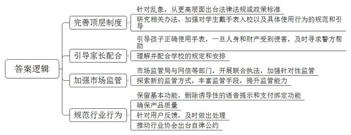
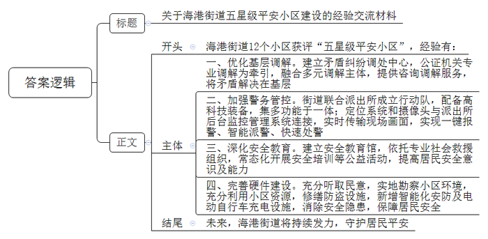
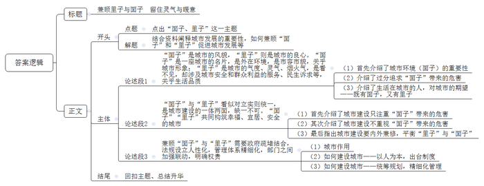

# 2023年公务员多省联考《申论》题（四川上半年行政执法卷）

> 候选采集稿。参考答案及解析来自粉笔页面，不代表官方答案或真实高分答卷；来源使用许可与原卷对应关系仍需人工核实。

## 给定材料

### 材料 material-06f9b94a7a1d4561

“了解情况靠走、登记信息靠手、交流沟通靠口”，这是Z省P市欣阳社区党委郭书记20多年来的工作常态，但现在，面对新问题，这三招已经不够用了，需要新解法。

欣阳社区是典型的融合型大社区，有近2万常住人口，其中八成是外来人口，另外还有1000多家商铺，近400家企业。“现在的社区，规模更像是一座小型城市。”郭书记说，人口密度大、单元构成复杂、利益需求多样、管理主体多元，而社区干部满编也就18人，仅靠传统的管理服务方式，已经无法应对。

一天上午，社区网格员小吕在巡查中发现社区河道有漂浮物，他通过“掌上社区”APP拍摄上报，基层治理综合信息平台根据定位，自动将事件派发，保洁人员当天下午就完成了清理。“这要在以往，至少得两三天，幸好有数字化赋能。”小吕说。

B市清风社区所辖的青林湾小区有100多幢高层住宅。去年疫情期间，清风社区在短时间内就精准高效完成了1.6万常住人口的人员排查、上门服务等工作，靠的是“两张网”：一方面，通过一体化智能化公共数据平台，区、乡镇（街道）的排查数据及时流转下发到社区、网格，社区网格员可及时精准对接相关人员；另一方面，清风社区这两年加强数字化建设，通过调查收集数据建立了小应用——“活地图”，标记了辖区内345名党员、志愿者的居住位置和联系方式，可随时发动他们参与社区的相关工作。

针对此前网格划分过大、层级过多、力量不足等问题，去年省里对网格进行了科学划分、合理优化。“现在不仅增加了网格的密度，还在网格中按楼道、楼栋设置了微网格，构建了‘村（社区）—网格-微网格’治理体系。”省政法委张副书记说，“遍布全省的‘两张网’，正在提升社区治理的精度。”

在融合型大社区，通过数字化改革让居民享受更有温度的服务，是大家进一步的期待。在Y市，一个集纳了线下6000多个网格的线上空间——“微家园”，成为广大居民享受优质公共服务的新平台。Y市居民只要扫二维码注册、填写所属的社区网格，就能加入这个线上空间，大家可以在这里发布需求，与社区干部、邻居们交流。目前，“微家园”的用户数已达253万，日均活跃用户达40万，已成为一片火热的线上空间。

东湖社区的王女士前几天看到“微家园”贴出了社区举办书法培训班的通知，很快就在线上报了名。培训班由社区里有书法特长的老师义务教学，居民不用交费。“期间，我们认识了很多邻居，也收获了温暖的友情。”王女士说，“我们这儿是新建小区，住户来自全国各地，以前相互间基本都是‘陌生人’。”

“这也是众多融合型大社区的共性问题。”Y市政法委陈副书记说，“‘微家园’创造了线上交流的社区新空间，通过数字化重建了熟人社会，邻里关系越来越紧密。”如今，“微家园”上有了邻里互助、爱心义卖、定向捐赠等项目，实现邻里需求与公共服务精准配对。“微家园”正在被复制、推广，更多实用管用的服务功能被送到“掌上社区”，满足更多个性化的需求，让大家享受到公共服务的温度。

“微家园”设有投诉功能，问题投诉可以线上发布，但必须线下解决。在融合型大社区，群众投诉的问题更为复杂和棘手，仅靠社区或者街道的力量远远不够。Y市风华社区的水产市场一直被内涝问题困扰，不仅影响商户的生意，也对居民的生活造成不便。许多人在“微家园”上投诉，社区由于缺乏资源统筹调度能力，问题不得不搁置。

2022年7月，风华社区严书记带着水务集团、镇政府相关人员，到水产市场现场协调，决定由水务集团负责新装抽水系统，镇、社区在资金、施工等环节协同配合，内涝问题很快得到解决。一个社区书记，为什么能“叫得动”水务集团和镇里的干部？原来，为了推动基层治理，特别是解决一些陈年顽疾，从2022年7月开始，全市乡镇以及基层站所干部全部下沉到村（社区），多跨协同形成合力，帮助解难题、谋发展，多元化共治力度前所未有。

“微家园”还开通了政府部门、村（社区）与群众的三方对话机制。“用大数据分析和手机应用为协商议事插上了科技的翅膀，让民有所呼更便捷、基层议事更智慧、为民解难更精准。”陈副书记认为，“但技术手段再先进，走街访巷‘铁脚板’的老传统也不能丢，问题的‘最后一米’还是要脚踏实地去解决。与此同时，也绝不能让技术浮在现实之上，要防止因多头报送、重复收集数据而增加基层压力。”

### 材料 material-976c7ff33a8a501f

“碰碰手表，加个好友！”这句话成了当下不少儿童社交时打招呼的见面语。儿童智能手表市场蓬勃发展的背后，也暴露出不少问题。为守护儿童“腕上安全”，N市市场监管局近日召开了一次专题座谈会，听取各方意见建议。以下是部分参会人员的发言摘录：

学生家长龚某：前几天，小孩突然要我在她手表上绑定我的手机钱包。她说班上很多小朋友都这么做了，到时想买什么就买什么。有些智能手表一旦关联了家长的手机，就开通了免密支付，在家长不知情的情况下，孩子就可能会任性消费，比如打赏、购买游戏皮肤等，这不但容易导致小孩养成不健康的消费习惯，还可能危及家庭的资金安全。

某学校教师曾某：客观而言，智能手表有助于学生、家长和学校之间的沟通联系，但学生之间语音聊天、打电话越来越频繁，有的还在手表里下载了游戏和短视频APP，课上偷着玩，课下抢着玩，不但影响了正常教学秩序，也不利于学生学习。

学生家长李某：给孩子买智能手表，主要是为了方便跟孩子联系，确保孩子安全。前阵子，孩子突然吵着要拿我的手机扫码听音乐，我才知道他的手表电话中居然自带了语音提示：“小朋友，请用爸爸妈妈的手机扫码，开通手表音乐VIP。”其实，我觉得儿童手表只要有基本功能就行，没必要设置那么多诱导性的语音提示和支付绑定功能。

市教委周副主任：现在儿童智能手表都具有上网、拍照以及智能语音功能，有的学生自律意识差，一遇到不会做的题，自己不动脑筋思考，而是用手表拍照在网上搜索答案，关键有时候答案还是错的。更严重的是，不少手表都与人工智能平台相连，学生喜欢向手表提出各种稀奇古怪的问题，而得到的回答时常会给学生造成误导，甚至引起认知偏差，非常不利于他们的身心健康。我们正在研究相关办法，加强对学生带手表入校以及具体使用行为的规范和引导，当然这也需要家长们的理解和配合。

市消保委监督部黄主任：我们今年对儿童智能手表消费情况进行了调查，结果显示，近一半的消费者对儿童智能手表质量表示不满，主要是信号不稳定、定位不准确、屏幕显示质量差、材质不安全等问题，有的厂商涉嫌虚假宣传，产品售后维修困难。

市公安局周警官：我们遇到过不少因儿童手表免密支付引发的经济损失案件。我们发现，有恶意程序伪装成游戏APP，当小孩在手表上下载安装后，恶意程序就能轻松进驻到手表中，手表就被远程控制，容易被不法分子采集位置信息、监听通话记录，甚至偷拍偷录视频，有时可能危及儿童人身安全。希望家长引导孩子正确使用手表，一旦人身和财产受到侵害，应及时寻求警方帮助。

市关工委刘副主任：由于缺乏筛选和监管，用户容易下载到血腥暴力的游戏APP和内容不健康的漫画APP，极易诱使未成年人模仿。一些APP在安装时，不用授权就可以直接获得定位、通讯录、麦克风、摄像头等多种敏感权限，轻易就能获取孩子的位置、人脸图像、录音等个人隐私信息，存在极大的信息安全漏洞。

某儿童手表公司曹经理：我们会千方百计确保产品质量，针对用户反馈的第三方软件问题，我们已在第一时间下架处理了问题应用程序。但守护儿童“腕上安全”仅靠我们一家公司是不够的，我们已向行业协会提出建议，出台相应的行业自律公约，共同为孩子们提供干净安全的手表。

某大学姚教授：儿童智能手表集多种功能于一体，但功能的多样性也带来了一系列“负产品”。治理儿童智能手表乱象，根本在于要从更高层面出台相应的法律法规或政策标准，同时社会各界也要共同担当作为，合力确保孩子“腕上安全”。

市场监管局王副局长：大家所反映的问题都不同程度存在，且问题所涉及面较广，给执法带来一定难度。我们将不断探索新的监管方式，丰富监管手段，提高监管专业能力。

### 材料 material-37368663c1b897af

2022年5月，A市认定729个“五星级平安小区”，光明区海港街道有12个小区获评“五星级平安小区”，居光明区各街道首位。人们纷纷打探海港街道的“平安密码”到底是什么。

近日，海港街道居民吴先生出差回家后发现，自己楼下的“爱车”竟然被“毁容”。邻居家装修时工人使用电焊未加装防护措施，导致火星坠落破坏了车漆面。吴先生找到施工队负责人沟通后，赔偿金额不能达成一致。街道多元化矛盾纠纷调处中心知悉后主动介入，经过调解，双方达成一致，纠纷成功化解。

多元化矛盾纠纷调处中心以公证机关专业调解为牵引，融合公证调解、人民调解、治安调解、司法调解等多元调解为主体，力争将矛盾解决在基层。2020年7月运行以来，中心成功化解183起纠纷，成功率达98.4%，接受当事人咨询631人次。

2021年3月26日晚，“超级花血月”现身A市。作为最佳观测点之一，位于海港辖区内的中兴大桥观景平台，迎来了众多专业的天文学爱好者及市民。在现场，一群身着高科技装备、驾驶平衡车维持秩序的民警们格外吸睛。海港街道联合派出所成立了“闪警别动队”，集治安巡逻、反诈宣传、隐患排查、应急处突、便民服务为一体，日常巡逻搭载北斗定位系统和360度高清摄像头，与派出所后台监控管理系统相连接，实时传输巡逻现场画面，实现一键报警、智能派警、快速处警。

5月20日，海港街道安全教育馆迎来一群活泼可爱的小朋友，A市光明区蓝天救援队队员为小朋友们讲授水上安全与自救、急救包扎的知识。在现场，同学们与授课队员积极互动，场面十分活跃。

自2020年海港街道安全教育馆运作以来，依托蓝天救援队的专业力量，常态化开展应急救护、安全演练、安全宣传、安全培训、心理危机干预等公益活动，为居民提供心理支持与服务，不断提高辖区居民的安全意识和安全防范能力。开馆以来，已为学生和居民举办40多场安全培训，累计接待居民、学生、各类团体4000余人次。

“刷脸”进出楼栋，这不是在高端小区。光明南路294号，三栋建于上世纪80年代的居民楼内，也实现了这一设想。8月中旬，随着崭新的人脸识别系统在单元楼上线，无物业老旧小区的居民们靠“刷脸”就能进出楼栋，在方便出行的同时，也更有安全保障。为保障居民安全，派出所还牵头修缮了一批老旧防盗门。

走进海成廊桥小区，映入眼帘的是三组电动车智能充电桩，满足居民电动车充电需求。海港街道坚持防范在前、疏堵结合，下大力气解决小区居民电动车停放、充电问题，消除“电动车进电梯”而引发的安全隐患。去年10月份开始，在了解到居民的“急难愁盼”问题之后，廊桥小区物业和业委会及时进行商量，充分听取居民的诉求，实地勘察小区环境，充分利用小区资源，在辖区内开展电动自行车充电设施建设。

海港街道切实解决群众身边的“糟心事、烦心事、揪心事”，海成廊桥小区居民李先生表示：“现在小区更安全，邻里更和谐，群众更满意，对这个小区的归属感也越来越强。”

## 题目

### 第 1 题

**根据****“给定资料**1**”，概括Z省在融合型大社区治理过程中遇到的新问题以及运用的新解法。****（****25分****）**

关联材料：material-06f9b94a7a1d4561

作答要求：

要求：全面、准确、有条理。不超过400字。

### 第 2 题

**假如你是****N市市场监管局工作人员，请根据“给定资料**2**”，对座谈会上反映的问题提出解决的初步建议，供领导参考。（20分）**

关联材料：material-976c7ff33a8a501f

作答要求：

要求：

（1）全面、准确、有条理；

（2）有针对性，合理可行；

（3）不超过300字。

### 第 3 题

**“给定资料**3**”中，海港街道有12个小区获评“五星级平安小区”，请结合材料里该街道管理的成功做法，拟写一份经验交流材料。****（****15分****）**

关联材料：material-37368663c1b897af

作答要求：

要求：

（1）内容全面；

（2）逻辑完整，条理清楚；

（3）不超过350字。

### 第 4 题

**根据****“给定资料**4**”，以“面子、里子”为话题，联系实际，自选角度，自拟题目，写一篇文章。（40分）**

关联材料：material-06f9b94a7a1d4561

作答要求：

要求：

（1）观点明确，见解深刻。

（2）参考给定资料，但不拘泥于给定资料。

（3）思路清晰，语言流畅。

（4）字数800-1000字。

## 答案与解析

第 1 题

**参考答案（粉笔题库参考内容）**

新问题：1.治理规模大。社区人口密度大，单元构成复杂，利益需求多样，管理主体多，干部编制少。2.网格划分不合理。网格划分大，层级多，管理力量薄弱。3.邻里联系不紧密。居民之间缺少交流，感情淡漠，缺少温度。4.投诉问题处理难。社区缺乏资源统筹调度能力，群众反馈问题被搁置。

新解法：1.加强数字化建设。建立智能化信息平台，精准对接工作人员，建立应用程序，记录党员志愿者信息，发动多元主体力量，提高治理效率。2.科学划分网格。增加了网格密度，设置微网格，构建“村（社区）—网格—微网格”治理体系，提升治理的精度。3.提供优质公共服务。打造并推广“微家园”线上空间，将邻里需求与公共服务精准配对，重建熟人社会，增进邻里感情。4.强化协同合作。推动干部下沉基层，多跨协同形成合力，开通三方对话机制等技术手段与走街访巷等传统手段相结合，精准切实解决群众问题，加强协调，减轻基层压力。

**解析**

**参考答案说明：**本参考答案包括问题与对策两个方面。问题从“治理规模大”“网格划分不合理”“邻里联系不紧密”“投诉问题处理难”四个层次展开；对策从“加强数字化建设”“科学划分网格”“提供优质公共服务”“强化协同合作”四个层次展开。以上两个方面，各条答案要点之间在内容上相互并列，没有交叉。

**考点**：考点多要素组合类

**来源**：来源2023年公务员多省联考《申论》题（四川上半年行政执法卷）

粉笔申论页面对本题只提供「解析视频」入口，该入口是会员推广位，页面无视频地址与文字解析。

第 2 题

**参考答案（粉笔题库参考内容）**

1.完善顶层制度。针对乱象，从更高层面出台法律法规或政策标准；研究相关办法，加强对学生戴手表入校以及具体使用行为的规范和引导。

2.引导家长配合。引导孩子正确使用手表，一旦人身和财产受到侵害，及时寻求警方帮助；理解并配合学校的规定和安排。

3.加强市场监管。市场监管局与网信等部门，开展联合执法，加强针对性监管；探索新的监管方式，丰富监管手段，提升监管能力。

4.规范行业行为。保留基本功能，删除诱导性的语音提示和支付绑定功能；确保产品质量；针对用户反馈，及时做出处理；推动行业协会出台自律公约。

**解析**

**参考答案说明：**本参考答案从“完善顶层制度”“引导家长配合”“加强市场监管”“规范行业行为”4个方面对儿童手表市场存在的“问题”提出了解决建议，并进行了分类分条撰写，各条要点之间在内容上是并列关系，没有交叉。

**考点**：考点提出对策类

**来源**：来源2023年公务员多省联考《申论》题（四川上半年行政执法卷）

粉笔申论页面对本题只提供「解析视频」入口，该入口是会员推广位，页面无视频地址与文字解析。

第 3 题

**参考答案（粉笔题库参考内容）**

关于海港街道五星级平安小区建设的经验交流材料

海港街道12个小区获评“五星级平安小区”，经验有：

一、优化基层调解。建立矛盾纠纷调处中心，公证机关专业调解为牵引，融合多元调解主体，提供咨询调解服务，将矛盾解决在基层。二、加强警务管控。街道联合派出所成立行动队，配备高科技装备，集多功能于一体；定位系统和摄像头与派出所后台监控管理系统连接，实时传输现场画面，实现一键报警、智能派警、快速处警。三、深化安全教育。建立安全教育馆，依托专业社会救援组织，常态化开展安全培训等公益活动，提高居民安全意识及能力。四、完善硬件建设。充分听取民意，实地勘察小区环境，充分利用小区资源，修缮防盗设施，新增智能化安防及电动自行车充电设施，消除安全隐患，保障居民安全。

未来，海港街道将持续发力，守护居民平安。

**解析**

**参考答案说明：**（1）格式方面，本参考答案写到了“标题”“正文”两个部分。（2）正文部分，一方面从内容上来看，围绕“海港街道建设五星级平安小区”这一主题，本参考答案的开头先总体介绍了海港街道管理的成功做法；接着主体部分从“优化基层调解”“加强警务管控”“深化安全教育”“完善硬件设施”四个方面给出了具体的经验做法；最后结尾部分进行简单总结。另一方面，形式上，本参考答案做到了分段、分条撰写，整体上条理较为清晰。

**考点**：考点总结类

**来源**：来源2023年公务员多省联考《申论》题（四川上半年行政执法卷）

粉笔申论页面对本题只提供「解析视频」入口，该入口是会员推广位，页面无视频地址与文字解析。

第 4 题

**参考答案（粉笔题库参考内容）**

**兼顾里子与面子 留住灵气与暖意**

一座城市的发展，承载着市民对美好生活的向往，向往的既有城市外在的美丽与繁华，也有内在的温暖与归属。只有二者兼顾，以人为本，才能留住城市的人间烟火气，让民众感受到城市的灵气与暖意。

**“****面子****”****是城市的风貌，****“****里子****”****则是城市的良心。“面子”是一座城市的名片，是外在环境，是市容市貌，关乎城市形象；“里子”是城市的气度、灵气、烟火气，是看不见，却涉及城市安全和群众利益的服务、民生诉求等，关乎生活品质。**随着生活水平的提升，民众对于城市环境的要求越来越高，优美的景色、完善的硬件、特色的建筑等，也是城市魅力与品味的象征，是市民自信心与归属感的来源。但如果过分追求“面子”，忽视“里子”则会降低市民的幸福感和获得感。因为居于其中，我们更希望一座城市有优质的服务、厚重的人文、便利的生活……

**“面子”与“里子”看似对立实则统一，是城市建设的一体两面，缺一不可。“面子”“里子”共同构筑幸福、宜居、安全的城市。**当前，一些城市重金打造城市地标、对夜市摊点“一禁了之”、忽视地下管网建设导致“城市看海”等等，不仅造成国家财力和社会资源的浪费，还损害民众的切身利益，面子有了，却丢了里子。但若在重视“里子”的同时，未做好管理工作，也会让民众心生不满，如夜市开放后，满地散乱的垃圾、难以清理的油垢同样会有损城市的“面子”。所以城市建设不可厚此薄彼，只有内外兼修，城市才是一座健康的生命有机体！

**兼顾****“面子”与“里子”需要政府疏堵结合，法规设立人性化，管理体系精细化，部门之间加强联动，明确权责。**游人如织的夜市中，人与人之间有了亲密的交流，城市不再是钢筋水泥的森林，而是成了寄托乡愁，释放压力的归处。但狂欢之时的噪音扰民，狂欢之后的卫生难题，也饱受诟病。如何平衡就要考量政府治理的智慧。一方面政府要以人为本，出台制度，立法疏导。如对于设摊经营、占道经营等行为由以往的全面禁止变为“重点区域禁止”，不再“一禁了之”。当然也不能“一放了之”，所以另一方面，管理者也要不断提升管理水平，统筹规划，建立更加精细化的管理体系，协调各部门通力合作、密切配合。这样才不会让城市的“烟火气”变成“火气”。

既把“面子”做靓，又要把“里子”做实。只有“面子”“里子”一起抓，才能真正提升城市质感，彰显城市温度，让民众在“光鲜亮丽”中感受城市的活力与美好。

**解析**

**文章分析**

**兼顾里子与面子** **留住灵气与暖意**

【**标题的优点：**首先，范文的标题突出了“面子、里子”这一主题。其次，形式上，文字简洁明快。】

一座城市的发展，承载着市民对美好生活的向往，向往的既有城市外在的美丽与繁华，也有内在的温暖与归属。只有二者兼顾，以人为本，才能留住城市的人间烟火气，让民众感受到城市的灵气与暖意。

【**开头的优点：**★内容方面：范文的开头是紧扣“面子、里子”这一主题展开的。首先指出了城市发展对市民诉求的关系；然后指出了兼顾“面子”和“里子”让城市充满灵气。★文字表达方面：长短句配合使用，使语言表达有节奏感。】

**“面子”是城市的风貌，“里子”则是城市的良心。“面子”是一座城市的名片，是外在环境，是市容市貌，关乎城市形象；“里子”是城市的气度、灵气、烟火气，是看不见，却涉及城市安全和群众利益的服务、民生诉求等，关乎生活品质。**随着生活水平的提升，（1）民众对于城市环境的要求越来越高，优美的景色、完善的硬件、特色的建筑等，也是城市魅力与品味的象征，是市民自信心与归属感的来源。（2）但如果过分追求“面子”，忽视“里子”则会降低市民的幸福感和获得感。因为居于其中，我们更希望一座城市有优质的服务、厚重的人文、便利的生活……

【**论述段****1的优点：**★观点句：范文的观点句是紧扣“面子、里子”这一文章主题提出的。形式上，它在段首处直接写出，位置突出，容易发现。内容上，关键词突出，内容要点明确，可以明显看出他是围绕“面子”“里子”的含义展开。★论述内容：（1）首先介绍了城市环境（面子）的重要性；（2）介绍了过分追求“面子”带来的危害；（3）介绍了生活在城市的人，对城市的期望——既有面子，又有里子。注意：以上三个方面的内容都是紧扣“‘面子’是城市的风貌，‘里子’则是城市的良心。‘面子’是一座城市的名片，是外在环境，是市容市貌，关乎城市形象；‘里子’是城市的气度、灵气、烟火气，是看不见，却涉及城市安全和群众利益的服务、民生诉求等，关乎生活品质”这个观点句论述的，论述的针对性强，内容层次丰富。在论述方法上采用了讲道理、举例子相结合，做到了丰富多样。】

**“面子”与“里子”看似对立实则统一，是城市建设的一体两面，缺一不可。“面子”“里子”共同构筑幸福、宜居、安全的城市。**当前，（1）一些城市重金打造城市地标、对夜市摊点“一禁了之”、忽视地下管网建设导致“城市看海”等等，不仅造成国家财力和社会资源的浪费，还损害民众的切身利益，面子有了，却丢了里子。（2）但若在重视“里子”的同时，未做好管理工作，也会让民众心生不满，如夜市开放后，满地散乱的垃圾、难以清理的油垢同样会有损城市的“面子”。（3）所以城市建设不可厚此薄彼，只有内外兼修，城市才是一座健康的生命有机体！

【**论述段****2****的优点：**★观点句：范文的观点句是紧扣“面子、里子”这一文章主题提出的。形式上，它在段首处直接写出，位置突出，容易发现。内容上，关键词突出，内容要点明确，可以明显看出他是围绕“面子”与“里子”的关系展开。★论述内容：（1）首先介绍了城市建设只注重“面子”带来的危害；（2）其次介绍了城市建设不重视“面子”带来的危害；（3）最后指出城市建设要内外兼修，平衡“里子”与“面子”。注意：以上三个方面的内容都是紧扣“‘面子’与‘里子’看似对立实则统一，是城市建设的一体两面，缺一不可。‘面子’‘里子’共同构筑幸福、宜居、安全的城市”这个观点句论述的，论述的针对性强，内容层次丰富。在论述方法上采用了讲道理、举例子相结合，做到了丰富多样。】

**兼顾****“面子”与“里子”需要政府疏堵结合，法规设立人性化，管理体系精细化，部门之间加强联动，明确权责。**（1）游人如织的夜市中，人与人之间有了亲密的交流，城市不再是钢筋水泥的森林，而是成了寄托乡愁，释放压力的归处。但狂欢之时的噪音扰民，狂欢之后的卫生难题，也饱受诟病。如何平衡就要考量政府治理的智慧。（2）一方面政府要以人为本，出台制度，立法疏导。如对于设摊经营、占道经营等行为由以往的全面禁止变为“重点区域禁止”，不再“一禁了之”。（3）当然也不能“一放了之”，所以另一方面，管理者也要不断提升管理水平，统筹规划，建立更加精细化的管理体系，协调各部门通力合作、密切配合。这样才不会让城市的“烟火气”变成“火气”。

【**论述段****3****的优点：**★观点句：范文的观点句是紧扣“面子、里子”这一文章主题提出的。形式上，它在段首处直接写出，位置突出，容易发现。内容上，关键词突出，内容要点明确，可以明显看出他是围绕“如何兼顾‘面子’与‘里子’”展开。★论述内容：（1）城市作用；（2）如何建设城市——以人为本，出台制度；（3）如何建设城市——统筹规划，精细化管理。注意：以上三个方面的内容都是紧扣“兼顾‘面子’与‘里子’需要政府疏堵结合，法规设立人性化，管理体系精细化，部门之间加强联动，明确权责”这个观点句论述的，论述的针对性强，内容层次丰富。在论述方法上采用了讲道理、举例子相结合，做到了丰富多样。】

既把“面子”做靓，又要把“里子”做实。只有“面子”“里子”一起抓，才能真正提升城市质感，彰显城市温度，让民众在“光鲜亮丽”中感受城市的活力与美好。

【**结尾的优点：**范文的结尾回扣了“面子、里子”这个主题，并且进行了总结提升。】

**考点**：考点文章写作题

**来源**：来源2023年公务员多省联考《申论》题（四川上半年行政执法卷）

粉笔申论页面对本题只提供「解析视频」入口，该入口是会员推广位，页面无视频地址与文字解析。

