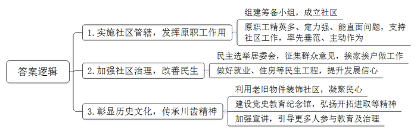
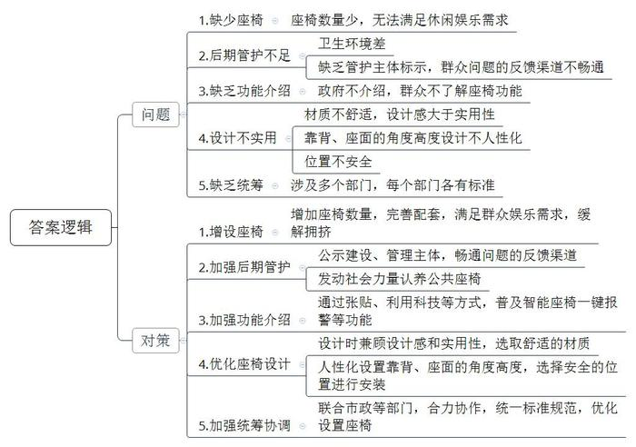
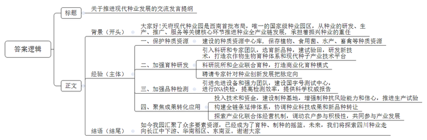
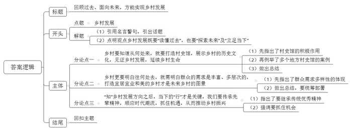

# 2024年四川省公考《申论》题（县乡、普通选调卷）

> 候选采集稿。参考答案及解析来自粉笔页面，不代表官方答案或真实高分答卷；来源使用许可与原卷对应关系仍需人工核实。

## 给定材料

### 材料 material-58c26efd1ee53799

2019年5月16日，四川齿轮厂100余名老职工重返“娘家”。川西味道的矮墙上，月季绽放，樱桃成熟，破产的老厂“长”出了一个花园式社区。“哎哟，没走错地方嘛？”古稀级的“年轻人们”故作惊讶，玩笑过后，鼻子却隐隐有点发酸。这片“蜕变”的土地，承载了他们今生的芳华，没有辜负故人多年来的魂牵梦系。

1958年，来自天津内燃机和齿轮厂的200多名干部职工来到遥远的四川支援“三线建设”，同原成都拖拉机厂职工一起，组建起了四川齿轮厂（以下简称川齿厂）。1983年，岷江齿轮厂并入川齿厂，国外先进生产线陆续引入，川齿厂步入了发展巅峰时期，一度雄踞全国机械行业定点生产变速箱和齿轮配件的主要工厂队列。然而，辉煌过后的川齿厂在上世纪90年代逐渐衰落，2005年宣布破产，至此走完它45个风雨春秋，留下一群独守记忆的川齿人和一座座废弃的厂房。

川齿厂是计划经济年代的翘楚国企，毕业于各大名牌高校的菁英不在少数，厂子破产，对当时川齿员工的打击是巨大的，大家难以接受。“厂子怎么能说没就没了？3000多名职工哪里去？家属生活区谁来管？”莲花社区党委书记介绍说，“厂子刚刚破产那会儿，士气非常低落，除了经济上的忧伤，职工们还有心理上的不忿。”

2005年，属地县委、县政府对破产清算后的川齿生活区实施社区管辖，组建社区党总支、社区居民委员会筹备小组，并命名为莲花社区。社区面积0.78平方公里，辖川齿、牧山园两个居民小区，常住人口近8000人，有共产党员498人。

“企业没有了，未来的生活、工作怎么办？”关键时刻，以张大姐为代表的川齿人保持了共产党员和“三线建设者”应有的定力，她主动请缨加入莲花社区筹备组，直面破产企业家属区转型的阵痛。

在长达8年的社区筹建过程中，莲花社区经历着从老工业单位小区向城市社区的艰难转型，整治环境、拆除违章建筑、安装路灯、收水电费物业费……实施的每一步，都遭到强烈抵制，推进得异常艰辛。每一次，社区都以极大的诚意争取到老党员、老干部、老职工的支持，他们和社区干部并肩站在矛盾冲突的第一线，率先垂范、主动作为，成为小区志愿者队伍的骨干。

“之前这里杂草丛生、污水四溢，居民违章搭建也多，存在极大安全隐患。”社区老党员邹发洪师傅介绍，社区多次召开坝坝会和居民代表大会征集意见，但由于年代久远，涉及住户较多，拆除工作难度非常大。社区老党员志愿者知道情况后，主动上门挨家挨户做工作，最终将各处违建悉数拆除。日子一天天过去，曾经漆黑的路灯亮了，曾经屡被水淹的道路水患消除了……

属地县委、县政府努力帮助下岗职工就业，招聘会直接开到社区，并为大家实施住房改造等民生工程，越来越多的居民生活不断改善，他们感受到党委政府的诚意，心气儿平了，信心足了。

2014年1月，第一届莲花社区居民委员会通过民主选举产生，张大姐高票当选主任。“我们把全部的青春甚至一生都放在了这里，本来就是一家人。”1965年，3岁的张大姐随支援“三线建设”的父母从天津来到川齿厂，在这里学习、工作、成家，见证了这里的变化。她告诫自己：“我要坚守，我要传承川齿精神，努力让大家过得更好，让家园更美。”

2017年，为进一步彰显社区的历史文化，莲花社区两委班子决定将原川齿厂的老旧物件作为社区的独特装饰，让居民睹物生情，重新凝聚在一起。大家伙儿听说后，一个个都开心地翻箱倒柜，踊跃捐赠，恨不得把自己的整个青春都展现出来，跟参观者无言交流。

2018年，利用上个世纪70年代修建的防空洞打造的、占地约900平方米、具有“三线精神”特色的党史教育纪念馆“川齿记忆”落成。室内展厅陈列了老设备、老齿轮、老照片、老物什儿，诉说了老川齿人曾经背井离乡，为支援“三线建设”开拓进取和无私奉献的金色年华，重现了老川齿人埋头苦干、自力更生扛起国家富强的责任与担当，牢记嘱托与使命，建设美好家园的场景。展厅外部通过标语、设备、器材的展示，重现了老川齿艰苦奋斗的历程，拖拉机、大型机床等物件作为辉煌历史的见证，烙下了那段峥嵘岁月的印记，呈现了老川齿人奋斗和拼搏的精神。

为了讲好川齿故事，莲花社区发动15名党员组建党史宣讲小分队，以见证人、参与者、建设者的身份话川齿旧事、讲奋斗革新，打通普通群众参与党史学习教育的通道。现在，越来越多的人主动参与到社区发展治理中。92岁的老党员主动加入社区党员志愿服务队，70岁的老工人主动当起河道护管员。90后年轻一代，愿意留在社区了，远在国外的莲花社区子弟，也想回来看看了。社区居民们说，“这里既有新楼盘的环境，又有老社区的人情味，跟以前比简直就是脱胎换骨，确实相当安逸。”

### 材料 material-bb8e39ec5bfb5ff9

自从家门口的小公园和附近街道提升改造后，65岁的辛奶奶下楼勤快了。“到处面貌焕然一新，环境干净整洁，尤其是这些座椅，又好看又好用。”辛奶奶坐在座椅上向记者分享着，“约朋友坐在这儿聊天，心情可舒畅了。”

辛奶奶家附近，一些独具匠心而又与众不同的创意座椅引起了人们的注意。

公园里，一个废轮胎，安装3根30厘米长的钢管，就是一个简易凳子；两个轮胎摞在一起，上面穿上编织绳，就是一个软座沙发。新华路上一家饼店外，利用商铺与人行道之间的阶梯空间，用啤酒箱加软垫的方式打造的休憩座椅，成本不算太高，却一不小心成了店招，让门店成了人气打卡的“网红”。科苑路一家文具用品商店前的公共座椅，巨大醒目的木夹子造型，凭借文艺范儿，成了店铺气质担当，吸引了不少人驻足欣赏和试坐。

小小的一把座椅，不仅方便了市民的休闲和生活，也成为城市景观的一种点缀，彰显着一个城市的温度，犹如一把钥匙，撬动的是城市新空间的活力、魅力，塑造出温暖动人的城市表情，整个城市空间变成了“家的延伸”，许多人在这里找到了交流的乐趣。

文化公园的一处廊架下，几位大爷正低着头、弯下腰对弈，灰色的布料棋盘铺在一把居民自带的木椅子上。“这里要是能放几个石桌、石凳或几套棋盘座椅，我们下棋就方便多了。”一位大爷指着廊架说。放学时分，莲花小学北门外的小公园内人声鼎沸，有的孩子在拎着书包站立的家长群中钻来钻去。公园里仅有5张座椅，每张座椅上都挤着两三位家长。趁一位家长起身离开的工夫，记者看到这张座椅的木条两端已经断裂，“都是刚装设不久就坏了。”一位家长说，“这些设施由谁建、归谁管，也没有个标示，坏了该向哪里反映我们也不晓得。”

家住学府园附近的王老师，坐在2米多长的深棕色木条座椅上听着音乐。“这儿的人比较少，我图的就是这份安静。”王老师笑着说。学府园原为闲置的林地，为方便市民休憩，管理部门在穿林小径自然区设置了具有线条美感的弧形木制座椅，通过半围合空间设计体现趣味性。美中不足的是，有的座椅上覆盖着一层灰，有的还有明显的脚印，有的座椅下面还有垃圾，让很多人想坐却坐不下来。

“建公共座椅还是容易的，后期的管护才是真正的难关。我看到有新闻报道，S市发动社会力量对公共座椅进行‘认养’，就是很好的一种探索嘛。”

2019年，南翠屏公园提升改造，5套造型独特、科技感十足的智能座椅在公园里“安家落户”。智能座椅的靠背是金属材质，座面是透明玻璃，下面安装的是黑色太阳能板。“座椅装有太阳能供电系统，具有一键报警、手机USB充电等功能。刚安装时，这儿还曾是‘网红’打卡地。”工作人员小林介绍。“一把椅子还挺有科技含量的嘛。”坐在椅子上的一对老年夫妇对座椅称赞不已，“这些智能座椅已安装3年了，我们经常来这里，还不知道有这些功能呢，可惜了。应该把信息醒目地贴出来，让大家了解。”

公园里呈半月形弯曲的石条上设置着一个个黄色的钢质座椅，看上去挺漂亮的。“这些椅子用起来怎么样？”记者问一对母女。这位母亲说，女儿就在附近上学，放学后孩子很喜欢到公园里玩一会儿再回家，“这椅子现在还能用，但一到夏天就特别烫，没法坐人。到了冬天又特别冰，穿长羽绒服也不敢坐，感觉设计感大于实用性。”另一位居民告诉记者，有些附近的居民来这里，会随身带着坐垫。

府南路上有3处利用绿化花台改造的座椅，花台石被切掉一截，上面用褐色窄木板铺成椅面、椅背，座椅前便是人来人往的灰砖步道，一条黄色盲道就在脚边。“这些椅子是2022年有关部门在道路改造中应附近老人需求装设的，这一做法可谓想民所想，值得点赞。但椅子安好了，却很尴尬。”家住府南路的居民李先生说，“这几处椅子，靠背与座面呈90度直角，靠背很矮，边角尖锐，身体向后靠时，会硌得背疼。还有就是，坐下去脚自然会伸出来，这就占了步道、盲道，容易和行人发生冲突。站起来吧，腿向后收，脚就会磕碰在石墩上，很容易向前栽倒，这对老年人来说很不友好。”

一处公共座椅的背后紧邻着三层小楼的墙体，墙体上装有10余台空调外机，其中一张座椅的椅背正对着一部空调外机。“这排座椅能坐是能坐，就是老担心空调会砸下来。”“你看座椅上落的全是灰，即使有人坐，也是倾着前身小坐休息一下，不敢太放松。”几名附近居民纷纷说道。

C市相关部门负责人表示：公共座椅是公共空间中与人接触很密切的产品，为行人提供了宝贵的休息空间，让人们在快节奏的城市生活中换得“浮生半日闲”，最终指向居民体验感和获得感。座椅虽小，背后却涉及了市政、绿化、市容等6个不同部门，每个部门都有关于座椅标准的规范，要优化设置并不容易。怎么“坐”到老百姓心坎里？需要做更多的工作。

### 材料 material-824ea7035ea7a6af

9月30日，邛崃市天府现代种业园内的上千亩水稻刚刚收获，稻田内铺满了金黄的秸秆。金色的原野上，一栋栋展馆大楼拔地而起，和田野融为一体。

作为国家在西南首批布局的唯一国家级种业园区，邛崃市天府现代种业园堪称四川种业“最强大脑”。国庆假期，园区在建项目施工现场仍一片繁忙，工地上塔吊林立，工程车往来不断。

早在2015年，邛崃市政府就抢抓先机，积极推进把第一批国家级种业园落户邛崃，将其列为《四川省“十四五”现代种业发展规划》良种繁育能力提升工程的重要规划之一，为中国西南“种业硅谷”高端种业的集群发展，奠定了良好的基础。

从2018年园区成立以来，项目建设就如火如荼，作为全省唯一一个以“大种业”发展为基础的功能园区，天府现代种业园从种业的研发、生产、推广、服务等关键核心环节全产业链推进种业发展。园区规划建设38个项目，其中政府投资14.5亿元，撬动社会投资34.98亿元。目前，2.1平方公里总部区已基本成形，种子检测中心、种业科创中心、种业实验中心、种业博览中心等入驻园区，进而形成种业的“诺亚方舟”。邛崃市天府现代种业园管委会易主任说：“现代种业园承担着振兴种业的重任，要尽快建成发挥实效。”

正在建设的种质资源中心库，建成后将保存45.4万份植物种质资源、5万份食用菌种质资源、26万剂水产种质资源以及105.2万剂畜禽种质资源。每逢有人好奇地提出疑问，Y主任会这样解释：“如果说种子是农业的‘芯片’，种质资源就是‘芯片’中的‘芯片’。”

初春的成都平原，广袤沃野铺上了新绿，金黄的油菜花在春风拂煦中悄然绽放，经过蛰伏的一粒粒种子破土而出，在阳光的照耀下拔节生长……

“看，这一大片都是我们的试验田，现在看来，长势不错。”3月2日，记者来到邛崃市天府现代种业园，从四川农业大学水稻研究所教授、四川荣稻科技有限公司执行董事李平手指的方向望去，金灿灿的油菜花正盛开着。“这是我们今年推广的浓香型油菜品种荣香油001，这种油味道特别香，很适合用于川菜烹饪。”李平在田埂边蹲下，仔细观察着一株油菜的长势。

“你觉得这和你以往看到的油菜花有什么不一样？”面对李平抛出的问题，记者一时并没有看出差异。看出记者的疑惑，李平又给出提示，“你仔细看看植株基部。”这时，记者发现，荣香油001的植株基部从很低的地方就有了分枝，且分枝之上还有分枝，每个小分枝上开了几十朵花。

“对了，就是由于分枝较低，抗倒性就比较好，分枝多，在产量上也能提高不少，且适宜机械化收割。”李平说，荣香油001的区试产量接近400斤/亩，大面积生产在直播情况下都能达到亩产300斤左右。

作为最早入驻天府现代种业园的科研团队之一，荣稻科技的专家团队常年在园区内从事粮油品种的选育和新技术研发工作，并正打造具有国际竞争力的农作物生物育种体系和现代种子产业技术平台。

据李平介绍，园区还统筹科研院所和企业联合育种，形成了以市场为纽带、科研院所为支撑、企业为主体、园区为平台的商业化育种模式，已与中国农科院、省农科院、川农大等科研院所建立深度合作关系，聚集了30多家“育繁推”一体化企业和关联企业。同时还聘请中国农科院6位“两院”院士和3位首席科学家针对种业创新发展现场把脉定向，已入驻科研团队10个。

采集、选种、制样……8月20日上午10时，在国家品种测试西南分中心理化室内，三位科研人员正在对一批新送来的种子进行检测。

“我们正在做的是对种子进行DNA快检，从而对其真实性、纯度、质量等进行判定，并判断其是否宜于市场推广。”农业农村部植物新品种测试（成都）分中心副主任告诉记者，在他们实验室，一份种子从送样到出具检测报告，总共只需要7-10天，但如果换成田间检测，平均周期为8个月。

迅捷的检测效率，得益于先进的设备和强力的团队。作为“国字号”测试中心，该中心由国家种业提升工程投资建设，主要为西南地区农作物新品种审定提供必备的DUS测试、品种区试、抗性鉴定等科学权威报告。这个中心，是天府现代种业园“一库一院五中心”的重要组成部分。

“就一个水稻新品种而言，经过了育种和检测，在审定上市的前后，生产试验就是种子从育种试验到生产转化的关键步骤。”中心的一位工作人员告诉记者。

在邛崃市制种大户骆建彬看来，实施种业振兴行动，给他和农民带来了实实在在的好处。“科研院校、技术机构入驻邛崃，给我们带来了更多的技术指导。同时，政府整合资金投入，加大制种基地建设力度，给予我们每亩500元的制种补贴，统筹推进制种保险等，都能给我们增强制种风险抵抗能力，让我们信心更足！”骆建彬说。

园区聚焦成果转化应用，构建“品种——产品——品牌”全链条延伸体系，协调种业科技成果和新品种转让，为110余家本地绿色食品加工企业供应优质原料和新兴技术，大规模开展原料深加工和新品种市场化推广。集中展示水稻突破性新品种、稻作新技术、种植新模式及示范转化推广新机制。川康优6107等新品种转让给四川丰大等园区企业，实现就地转化，促进粮食生产面积稳定在56.7万亩、年产量24.4万吨以上。

与此同时，通过“龙头企业+合作社+家庭农场（农户）”农业产业化联合体经营机制，向种植户推广粮食新品种、标准化生产方式等，调动农户种粮积极性、共同参与产业发展。目前，通过新品种的应用推广，全市国标二级以上优质品种稻种植面积达18万亩，粮食耕种收综合机械化水平达86.67%，粮食优质品种应用率超过96%。

“天府现代种业园把种业振兴所需要素都聚集在一起，良好的制种基地，深厚的制种基础，还有好的政策支撑和社会服务。农业科技人员只需带上好的想法就能入驻，把精力完全集中在研发上。”在李平看来，如今的天府现代种业园汇聚了众多支持种子创新、研发的科技、人才、金融等要素资源，已经成为了育种、制种的摇篮和沃土。

川种曾在长江上下游地区占很大的市场份额，如今迎来复苏。李平认为，四川种业在西南地区的品种、营销及市场优势仍较明显，“现在是怎么走出去的问题，怎么走向长江中下游，走向华南稻区，走向东南亚。”

## 题目

### 第 1 题

**请根据****“给定资料**1**”，谈谈莲花社区为什么能“脱胎换骨”。（15分）**

关联材料：材料 material-58c26efd1ee53799

作答要求：

要求：全面、准确、有条理；不超过200字。

### 第 2 题

**C市拟对全市市政公用设施进行优化提升。假如你是市政部门的工作人员，请根据“给定资料**2**”，对该市公共座椅存在的问题进行梳理，并提出优化建议。（20分）**

关联材料：材料 material-bb8e39ec5bfb5ff9

作答要求：

要求：

（1）梳理完所有问题后再提出建议；

（2）问题梳理全面、准确，建议具体可行、有针对性；

（3）不超过400字。

### 第 3 题

**四川省拟召开推进现代种业发展现场会，天府现代种业园将在会上做交流发言。假如你是该种业园的工作人员，请根据****“给定资料**3**”，撰写一份发言提纲。（25分）**

关联材料：材料 material-824ea7035ea7a6af

作答要求：

要求：内容全面，要点突出，条理清晰，语言简洁；不超过500字。

### 第 4 题

**“给定资料**4**”中提到：“我们的乡村，要知道从何处来，更要明白往何处去。”请你对这句话进行深入思考，参考给定资料，联系实际，自选角度，自拟题目，撰写一篇文章。（40分）**

关联材料：材料 material-58c26efd1ee53799

作答要求：

要求：

（1）观点明确，见解深刻；

（2）思路清晰，语言流畅；

（3）限800-1000字。

## 答案与解析

第 1 题

**参考答案（粉笔题库参考内容）**

1.实施社区管辖，发挥原职工作用。组建筹备小组，成立社区；原职工精英多、定力强、能直面问题，支持社区工作，率先垂范、主动作为。

2.加强社区治理，改善民生。民主选举居委会，征集群众意见，挨家挨户做工作；做好就业、住房等民生工程，提升发展信心。

3.彰显历史文化，传承川齿精神。利用老旧物件装饰社区，凝聚民心；建设党史教育纪念馆，弘扬开拓进取等精神；加强宣讲，引导更多人参与教育及治理。

**解析**

**参考答案说明：**本参考答案从“实施社区管辖，发挥原职工作用”“加强社区治理，改善民生”“彰显历史文化，传承川齿精神”三个方面介绍了莲花社区“脱胎换骨”的原因，每条答案要点之间在内容上是并列关系，没有交叉。

**考点**：考点原因类

**来源**：来源2024年四川省公考《申论》题（县乡、普通选调卷）

粉笔申论页面对本题只提供「解析视频」入口，该入口是会员推广位，页面无视频地址与文字解析。

第 2 题

**参考答案（粉笔题库参考内容）**

问题：1.缺少座椅。座椅数量少，无法满足休闲娱乐需求。2.后期管护不足。卫生环境差；缺乏管护主体标示，群众问题的反馈渠道不畅通。3.缺乏功能介绍。政府不介绍，群众不了解座椅功能。4.设计不实用。材质不舒适，设计感大于实用性；靠背、座面的角度高度设计不人性化；位置不安全。5.缺乏统筹。涉及多个部门，每个部门各有标准。

对策：1.增设座椅。增加座椅数量，完善配套，满足群众娱乐需求，缓解拥挤。2.加强后期管护。公示建设、管理主体，畅通问题的反馈渠道；发动社会力量认养公共座椅。3.加强功能介绍。通过张贴、利用科技等方式，普及智能座椅一键报警等功能。4.优化座椅设计。设计时兼顾设计感和实用性，选取舒适的材质；人性化设置靠背、座面的角度高度，选择安全的位置进行安装。5.加强统筹协调。联合市政等部门，合力协作，统一标准规范，优化设置座椅。

**解析**

**参考答案说明：**答案从“座椅数量”“后期管护”“功能介绍”“座椅设计”“工作统筹”5个方面指出了C市公共座椅存在的问题，并针对每一方面的问题给出了相应的对策。此外，形式方面，本答案做到了分类分条撰写，各条要点之间在内容上是并列关系，没有交叉。

**考点**：考点提出对策类

**来源**：来源2024年四川省公考《申论》题（县乡、普通选调卷）

粉笔申论页面对本题只提供「解析视频」入口，该入口是会员推广位，页面无视频地址与文字解析。

第 3 题

**参考答案（粉笔题库参考内容）**

关于推进现代种业发展的交流发言提纲

背景：大家好！天府现代种业园是西南首批布局，唯一的国家级种业园区，从种业的研发、生产、推广、服务等关键核心环节推进种业全产业链发展，承担着振兴种业的重任。

做法：一、保护种质资源。建设的种质资源中心库，保存植物、食用菌、水产、畜禽等种质资源。二、加强育种研发。引入科研和专家团队，选育新品种，建试验田，研发新技术，打造农作物生物育种体系和现代种子产业技术平台；科研院所和企业联合育种，打造商业化育种模式；聘请专家针对种业创新发展把脉定向。三、加强品种检测。引进先进设备和强力团队，建设国字号测试中心，进行DNA快检，提高检测效率，提供科学权威报告。四、聚焦成果转化应用。投入技术和资金，建设制种基地，增强制种抗风险能力和信心，推进生产试验；构建全链条延伸体系，协调种业科技成果和新品种转让；探索产业化联合体经营机制，调动农户参与积极性，共同参与产业发展。

结语：如今我园汇聚了众多要素资源，已经成为了育种、制种的摇篮。未来，我们将探索四川种业走向长江中下游、华南稻区、东南亚。谢谢大家！

**解析**

**参考答案说明：**（1）格式方面，本参考答案写到了“标题”“正文”两个部分。（2）正文部分，一方面从内容来看，开头先写了天府现代种业园的地位以及建设发展历程等；主体从“保护种质资源”“加强育种研发”“加强品种检测”“聚焦成果转化应用”这四个方面给出了具体做法；结尾介绍了该种业园的成果以及未来的发展方向。另一方面，形式上，本参考答案做到了分段、分条撰写，整体上条理较为清晰。

**考点**：考点总结类

**来源**：来源2024年四川省公考《申论》题（县乡、普通选调卷）

粉笔申论页面对本题只提供「解析视频」入口，该入口是会员推广位，页面无视频地址与文字解析。

第 4 题

**参考答案（粉笔题库参考内容）**

**回顾过去、面向未来，方能实现乡村发展**

“知所从来，方明所往”，这句话指的是历史是一盏明灯，照亮我们前行的道路，启示我们要学习借鉴历史，从而可以继往开来、砥砺前行。乡村的发展亦是如此，**我们必须要****“读懂过去”，了解乡村历史，知道乡村是谁。除此之外，我们也要在此基础上“探索未来”及“立足当下”，明确乡村未来的发展目标与方向，顺应时代、谋取发展，**如此，才能让群众过上更美好的生活。

**乡村要知道从何处来，就要打造村史馆，展示乡村的历史文化，见证乡村发展，延续乡村生命。**乡村的木雕工艺品、犁耙等农具、历史老照片……这些老物件展示的是先辈们的生产生活轨迹，承载的是村庄百年的历史记忆，而村史馆则是让我们知晓乡村是谁这一答案的最好载体。陕西延安市南沟村的村史馆，记录了从贫困的“荒秃岭”到苹果满山坡的“金扁担”这一变化；重庆市丰都县陶家坪村的“书香村史馆”，展陈了近百年来教育兴学的乡贤事迹，激发村民学习热情……因此，应打造多元特色的村史馆，记录乡村历史、经济等内容，让更多人了解乡村、传承文化。

**乡村更要明白往何处去，就需明白群众的需求是丰富、多层次的，打造宜居宜业和美的乡村才是未来乡村的图景。**在产业兴旺方面，要推进农业、加工业、旅游业的融合发展；在生态宜居方面，要治理环境污染，提高绿化美化水平，实现绿色发展；在乡风文明方面，要传承利用传统文化，弘扬好的社会风气；在生活富裕方面，要拓宽增收渠道，让群众口袋有钱、过上富裕的生活；在治理有效方面，要推进自治、德治、法治等治理体系的建设。总之，乡村的发展是综合、全面的，必须要统筹部署、协同推进。

**“知”乡村发展方向之后，当下的“行”才是关键，我们要传承先辈精神，顺应时代潮流，抓住机遇，从而推动乡村振兴。**一方面，我们应延续前人的荣光，继承他们埋头苦干、无私奉献等精神，铆足干劲建设乡村；另一方面，我们也要认识到时代潮流浩浩荡荡，涌现了不少的发展机会，譬如互联网等科学技术，可以将其运用到农业中，提高机械化水平；也可以将其运用到乡村治理中，打造数字乡村智能平台，优化乡村公共服务，提高精细化治理水平。

回顾过去，我们可知乡村一路以来的变迁之路；探索未来，我们需知高质量发展、全方位发展的乡村振兴才是目标与方向；立足当下，我们应不懈奋斗，抓住新时代的机会发展乡村。只有如此，才能让村民过上美好的生活，才能实现农业的现代化、乡村的现代化！

**解析**

**文章分析**

**回顾过去、面向未来，方能实现乡村发展**

【**标题的优点：**标题中含有主题词，使文章主题更突出、清晰。其次，明确“过去”“未来”等论述方向，使标题更明确。】

（1）“知所从来，方明所往”，这句话指的是历史是一盏明灯，照亮我们前行的道路，启示我们要学习借鉴历史，从而可以继往开来、砥砺前行。（2）乡村的发展亦是如此，**我们必须要****“读懂过去”****，****了解乡村历史****，知道乡村是谁。除此之外，****我们也要在此基础上****“探索未来”及“立足当下”****，明确乡村未来的发展目标与方向，顺应时代、谋取发展，**如此，才能让群众过上更美好的生活。

【**开头的优点：**★内容方面。范文的开头是紧扣“乡村发展”这一主题展开的。首先，通过引用名言警句，引出话题；其次，点明观点乡村发展既要“读懂过去”，也要“探索未来”及“立足当下”。★文字表达方面。使用了“亦是如此”“除此之外”等连接词，使语言表达有逻辑性。】

**乡村要知道从何处来，就要打造村史馆，展示乡村的历史文化，见证乡村发展，延续乡村生命。**乡村的木雕工艺品、犁耙等农具、历史老照片……（1）这些老物件展示的是先辈们的生产生活轨迹，承载的是村庄百年的历史记忆，而村史馆则是让我们知晓乡村是谁这一答案的最好载体。（2）陕西延安市南沟村的村史馆，记录了从贫困的“荒秃岭”到苹果满山坡的“金扁担”这一变化；重庆市丰都县陶家坪村的“书香村史馆”，展陈了近百年来教育兴学的乡贤事迹，激发村民学习热情……（3）因此，应打造多元特色的村史馆，记录乡村历史、经济等内容，让更多人了解乡村、传承文化。

【**论述段****1的优点：**★观点句：范文的观点句是紧扣“乡村发展”这一文章主题提出的。形式上，它在段首处直接写出，位置突出，容易发现。内容上，关键词突出，内容要点明确，可以明显看出主要论述“乡村要知道从何处来”。★论述内容：（1）先指出了村史馆的积极作用；（2）再例举了多个地方村史馆的案例；（3）做出总结。注意：以上几个方面的内容都是紧扣“乡村要知道从何处来，就要打造村史馆，展示乡村的历史文化，见证乡村发展，延续乡村生命”这个观点句进行分析论述的，论述的针对性强，内容层次丰富。在论述方法上主要采用了举例子的方式，论述丰富。】

**乡村更要明白往何处去，就需明白群众的需求是丰富、多层次的，打造宜居宜业和美的乡村才是未来乡村的图景。**（1）在产业兴旺方面，要推进农业、加工业、旅游业的融合发展；在生态宜居方面，要治理环境污染，提高绿化美化水平，实现绿色发展；在乡风文明方面，要传承利用传统文化，弘扬好的社会风气；在生活富裕方面，要拓宽增收渠道，让群众口袋有钱、过上富裕的生活；在治理有效方面，要推进自治、德治、法治等治理体系的建设。（2）总之，乡村的发展是综合、全面的，必须要统筹部署、协同推进。

【**论述段****2的优点：**★观点句：范文的观点句是紧扣“乡村发展”这一文章主题提出的。形式上，它在段首处直接写出，位置突出，容易发现。内容上，关键词突出，内容要点明确，可以明显看出主要论述“乡村更要明白往何处去”。★论述内容：（1）先指出了群众需求多样性的体现；（2）做出总结，要统筹部署。注意：以上两个方面的内容都是紧扣“乡村更要明白往何处去，就需明白群众的需求是丰富、多层次的，打造宜居宜业和美的乡村才是未来乡村的图景”这个观点句进行分析论述的，论述的针对性强，内容层次丰富。在论述方法上主要采用了讲道理的方式，论述清晰透彻。】

**“知”乡村发展方向之后，当下的“行”才是关键，我们要传承先辈精神，顺应时代潮流，抓住机遇，从而推动乡村振兴。**（1）一方面，我们应延续前人的荣光，继承他们埋头苦干、无私奉献等精神，铆足干劲建设乡村；（2）另一方面，我们也要认识到时代潮流浩浩荡荡，涌现了不少的发展机会，譬如互联网等科学技术，可以将其运用到农业中，提高机械化水平；也可以将其运用到乡村治理中，打造数字乡村智能平台，优化乡村公共服务，提高精细化治理水平。

【**论述段****3的优点：**★观点句：范文的观点句是紧扣“乡村发展”这一文章主题提出的。形式上，它在段首处直接写出，位置突出，容易发现。内容上，关键词突出，内容要点明确，可以明显看出主要论述“如何践行”。★论述内容：（1）指出了要继承传统优秀精神；（2）强调要抓住机会。注意：以上两个方面的内容都是紧扣“‘知’乡村发展方向之后，当下的‘行’才是关键，我们要传承先辈精神，顺应时代潮流，抓住机遇，从而推动乡村振兴”这个观点句进行分析论述的。在论述方法上主要采用了讲道理、举例子相结合的方式。】

【**论述段之间的关系：**★内容的内在逻辑：范文的论述段之间是依照“要知道从何处来”“更要明白往何处去”“要知行合一”的逻辑展开的。★段与段的外在衔接：论述段3中“‘知’乡村发展方向之后，当下的‘行’才是关键”，起到了承接论述段1、2，引出了论述段3的作用。】

回顾过去，我们可知乡村一路以来的变迁之路；探索未来，我们需知高质量发展、全方位发展的乡村振兴才是目标与方向；立足当下，我们应不懈奋斗，抓住新时代的机会发展乡村。只有如此，才能让村民过上美好的生活，才能实现农业的现代化、乡村的现代化！

【**结尾的优点：**范文的结尾回扣了“乡村发展”这个主题，并且进行了总结提升。】

**考点**：考点文章写作题

**来源**：来源2024年四川省公考《申论》题（县乡、普通选调卷）

粉笔申论页面对本题只提供「解析视频」入口，该入口是会员推广位，页面无视频地址与文字解析。

