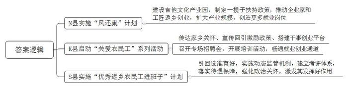
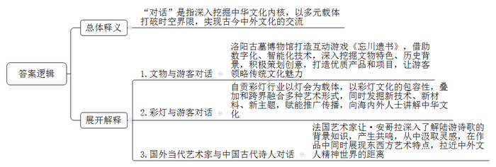
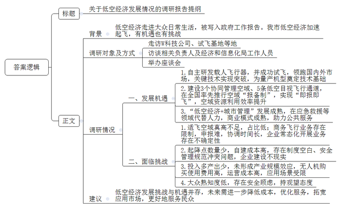
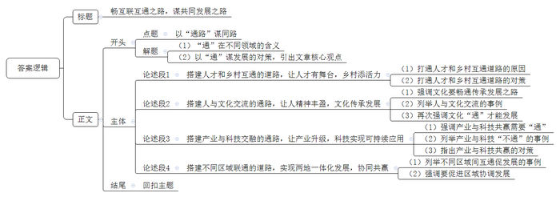

# 2025年四川省公考《申论》题（省市卷）

<!-- gwy:overview:start -->
> **四川 · 2025 · 申论 · 省市卷** ｜ 4 题 · 图片 4 处 · 答案随题折叠

导航：[题目](#题目) · [材料 1](#材料-1)
<!-- gwy:overview:end -->

> 候选采集稿。参考答案及解析来自粉笔页面，不代表官方答案或真实高分答卷；来源使用许可与原卷对应关系仍需人工核实。

## 给定材料

### 材料 1

1.“打工何必去远方，家乡就是好地方。”走进位于Z市N县的神曲乐器制造有限责任公司（以下简称“神曲公司”），两行大字映入眼帘。

N县位于崇山峻岭之间，土地贫瘠，交通不便，过去是远近闻名的劳务输出大县，仅在广州等地吉他制造行业务工的N县籍技术人员就有近6万人。

小郑和他的表哥曾在广州一家吉他厂打工，他们边干边看边学，从一线工人做到企业中层，掌握了技术，学会了管理。用打工攒下的“第一桶金”，兄弟俩合伙创立了广州神曲公司。

2012年，N县开始实施“凤还巢”计划，积极引导企业家带着企业回乡发展。以神曲公司创始人小郑为代表，背井离乡在外打工的N县吉他工匠们陆续踏上返乡创业之路，把学来的技术技能和管理经验带回家乡。小郑的神曲公司成为入驻N县吉他文化产业园的第一家企业。

2010年左右，小郑在广州的厂房月租为6万元，电费一个月需要支出20万元，而回到N县，家乡直接免了10年房租，电费每月也只需12万元。小郑说：“县里兑现了‘墙内的事情企业自己管，墙外的事情政府包’的承诺，税收、贴息、奖补、金融……家乡为我们返乡发展的吉他工匠们制定了一揽子扶持政策，让我们能放心大胆地创业。”

如今，N县已成为全球集聚程度最高、产销规模最大的吉他生产基地。吉他文化产业园已形成包括吉他生产、原材料供应、包装销售、贸易物流、艺术培训、科技研发等在内的产业链，辐射带动就业1.5万人。

引一个企业，聚一方产业，靠着一把吉他，这些工匠成为当地抓住机遇、实现吉他产业“无中生有”最重要的“发动机”，助力N县从曾经的全国农村劳动力转移就业工作示范县，升级为结合新型城镇化开展支持农民工等人员返乡创业试点地区。“N县吉他产业有今天的规模，靠的是当年在外打拼的吉他工匠们，他们带回技术和资本，带动了整个产业集群化发展。”N县黄县长说。

2.在Z市K县广福镇一处养殖基地，一排排标准化生猪养殖圈舍宽敞整洁，这是返乡农民工方林创办的鸿发家庭农场，几名饲养管理员正穿梭于猪舍间不时查看情况。“这么多年一直都有回乡创业的想法，但也有一些顾虑，后来家乡政府的领导多次与我联系，给我宣传政策，鼓励我回乡创业。在家乡领导的关心下，我打消了心里的顾虑，开始了回乡创业之旅。”经过三年发展，农场已建成标准化生猪养殖圈舍6000余平方米，设计规模年出栏6000余头，现存栏生猪3600余头。

方林是大批返乡创业优秀农民工的一个缩影。近年来，K县打出“乡情牌”和“政策牌”，启动“关爱农民工”系列活动，通过召开农民工访谈会、组建农民工常态联系微信QQ群等举措，及时向农民工传达家乡关心关怀、宣传回引激励政策、搭建干事创业平台。

K县糖房坝村的赵建通过参加农民工专场招聘会，现场与某电子有限公司达成了就业协议，全县像他一样通过农民工专场招聘会达成就业协议的还有500余人。与此同时，该县还依托“智慧党建”、农民夜校等平台，分层分类开展返乡农民工政策理论、特色种植养殖技术、加工制造等培训活动，让农民工由传统劳力型，向技术型、智能型转变，畅通了农民工就业创业的通道。

3.“热天特别要掌控好药材生长的湿度。”立夏后这几天，Z市S县雍河乡桃园村天麻中药材专合社种植基地内，村党支部书记、专合社社长杨阳正向村民传授中药材夏管知识。

两年前，在外务工多年的杨阳回乡当选桃园村党支部书记。在她的带领下，村里300多家农户户均增收5000余元。

近年来，S县坚持实施“优秀返乡农民工进班子”计划。县委县政府从摸清“家底”入手，掌握全县优秀农民工流入地、从业情况、政治面貌、返乡创业和担任村干部意愿等信息，有针对性地选择45周岁以下懂技术、善管理、群众口碑好、热心村级事务的1000多名优秀农民工，作为培育回引的重点对象，培养了一大批带领群众增收致富的拓荒者和引路人。像杨阳一样进入村“两委”班子的优秀农民工已有500多名。

杨阳介绍说，针对回引的优秀农民工在村务管理、基层治理等方面经验不足的短板，所在乡镇党委牵头开展了村级事务能力培训，鼓励他们参与村“两委”选举。通过公开竞选、组织任命、顶岗试用等方式，让他们走上了管理岗位。

该县县委组织部何部长表示，把优秀农民工“引回选准育好”只是过程，激发他们充分发挥好作用才是目的。对此，该县对优秀农民工村“两委”班子成员实施动态监管机制，建立日常调研、定期研判、专项考核、动态淘汰的考评体系，随时掌握他们的工作实绩、工作作风、廉洁自律等情况，倒逼其主动作为。为了激励激发其干事活力，S县还落实待遇保障，强化政治关怀。实行“基本报酬+绩效补助”制度，待遇按村党支部书记的1.5倍发放，解决回乡后的“收入差”；建立基本报酬正常增长机制，在职村干部养老保险、医疗保险按县财政补助制度执行，切实解决大家的后顾之忧；鼓励符合条件的优秀农民工村干部参加乡镇机关公务员、事业单位公开招考，拓展其发展的空间。

### 材料 2

1.“太酷了，真是既刺激又好玩，下一次来还要体验不同的故事线！”今年5月，洛阳古墓博物馆精心组织策划了“北邙千秋”系列沉浸式实景互动解谜游戏《忘川遗书》，参加互动游戏的游客纷纷表示。

作为国内唯一一座集帝陵、历代典型墓葬及其附属文物、石刻和古代壁画为一体的大型墓葬类博物馆，洛阳古墓博物馆自开馆后就成为了网红打卡地。而《忘川遗书》的发布，让那些充满神秘感的文物“活了过来”，在解谜游戏中，游客“身临其境”，在趣味中观展，与文物和历史共情，通过多元化的手段了解这些文物背后的文化，体验不一样的博物馆之旅。“古都洛阳的文化底蕴太厚重了，以前只能在历史书或网上看到的这些古墓文物，没想到还能这么玩！”来自四川的李先生兴奋地说。

脑洞大开的创意、科技感十足的呈现、沉浸互动式的体验……现如今，飞速发展的VR、XR等数字化、智能化技术，正在帮助博物馆实现“华丽转身”，让沉默千年的文物插上翅膀，超越时空与游客对话。

“博物馆与观众的双向互动值得大力提倡，可以让更多的年轻人怀着好奇心走进博物馆，但同时也要注意到，数字化文博的背后需要更多内容做支撑。”中国传媒大学王教授指出，“只有深入挖掘文物特色、历史背景，积极策划创意，才能在数字化手段的助力下打造出优质的产品和项目，让游客充分领略中华优秀传统文化的魅力。”

2.“两个月前忙完法国蒙托邦的彩灯节，年底到现在就一直在忙活春节的灯会。”2024年1月15日，在自贡中华彩灯大世界，彩灯工匠孙师傅正在裱糊彩灯。放眼望去，2000余名彩灯工匠正分工有序、紧锣密鼓地冲刺最后的布展。2月2日，第30届自贡国际恐龙灯会将在这里开幕。

自贡在1964年举办了第一场迎春灯会。60年来，自贡彩灯不断发展壮大，目前已占据85%的国内彩灯市场，92%以上的国际市场份额，累计吸引全球5亿多人次观灯。2023年，自贡彩灯在国内布展212个，海外灯展达90个，点亮了19个国家和地区的71座城市。截至目前，自贡彩灯已在海外形成多个知名品牌并屡获国际大奖，成为美国、加拿大、德国、英国、法国等国家节庆活动的重要节目，显现出较强的特色文化全球影响力。

自贡市文旅局相关负责人介绍，越来越多的自贡彩灯企业发掘新技术、新材料、新主题，赋能彩灯推广传播。以2024年初在美国田纳西州举行的“潮起东方·大美中华”中国彩灯节为例，应用人工智能光影数字技术，转化彩灯研发成果，打造了“中国龙”“戏曲中国”“十二生肖”“巴蜀韵·三星秘境”等35个场景灯组。去年以来，自贡某彩灯产业集团在英国、法国、爱尔兰等地的灯展项目，相继采用全息投影、辉光球/静电离子球、激光水幕电影等技术，实现了灯组的虚实结合，受到各国人民广泛好评。

“自贡彩灯好在什么地方，好在它的文化内涵，包容性非常强，可以反映我们历史文化的戏曲、诗词、歌赋等艺术形式，都可以和自贡彩灯实现叠加或跨界融合。”自贡彩灯行业协会秘书长介绍道，“自贡灯会已成为输出川灯、川茶、川酒和四川杂技等元素的一个平台，它实际上已成为一个中华文化的大观园、大荟萃，以深入浅出的方式，用彩灯与游客对话，向海内外人士讲解中华文化的博大精深。”

3.一位生活在当代的法国艺术家，为何同近一千年前的中国南宋诗人陆游产生共鸣？近日，法国法兰西艺术院院士让·安哥拉的一组陆游诗画在成都博物馆展出。画面中，孤独的人影面向湖泊，眺望远山，笔墨和留白传达出东方水墨画的神韵，构图和线条则有西方绘画的特点。

让·安哥拉创作的陆游诗画，是成都博物馆“目光交织-法兰西艺术院中法院士艺术特展”的一组展品。今年国庆假期，观众被这组兼具东西方绘画风格的画作深深吸引，感受法国当代艺术家与中国古代诗人跨越时空的对话。

“我读了陆游的诗歌后，就试着用绘画把这些诗歌表达出来。”让·安哥拉说，这是他与陆游“交流”的一种方式，“画作中的人物既是陆游，也是我。我试着走进陆游的诗歌，在绘画里和他‘相逢’。”

陆游的诗歌拉近了让·安哥拉与中国文人精神世界的距离。“蒲萄初紫柿初红，小阁凭阑万里风”，写的是秋季的丰收场景和凭栏远眺的开阔意境；“醉觉乾坤大，闲知日月长”，表达了诗人对宇宙辽阔和日月长久的感受。时至今日，让·安哥拉时常翻开陆游的诗集，从中汲取艺术创作的灵感。

通过深入了解陆游诗歌所反映的时代背景、社会环境和生活日常，让·安哥拉逐渐与这位中国诗人产生了共鸣。他认为，诗人与艺术家一样，都是用作品描写周遭环境，表达内心世界。他在陆游的诗歌中读到了人文精神，“这种精神既是陆游写下的诗歌，也是我笔下的画作。”让·安哥拉说。

### 材料 3

网购的商品由无人机配送，在拥堵的早高峰打个“空中的士”上班，乘坐水陆两栖飞机来一场“陆海空”立体式观光……这些曾经只出现在科幻片里的场景，已经走进或者正在逐渐走进现实，“飞”入大众日常生活。

在垂直高度1000米以下的空域内，以民用有人驾驶和无人驾驶航空器为主，涵盖载人、载货及其他相关活动的综合性经济形态，即低空经济。它不仅包括飞行器的研发制造、运营服务等直接相关领域，还涉及综合保障、空域管理等多个方面。2024年全国两会，低空经济作为“新增长引擎”之一被写入政府工作报告。

C市拥有多家“国字号”科研院所和国家高端航空装备技术创新中心，集聚500余家上下游企业，2023年航空制造产业集群规模突破1500亿元，综合实力居全国第一梯队。低空经济加速起飞，将给C市带来哪些机遇和挑战？如何才能畅“飞”无阻？带着一系列热点问题，C市相关部门组织了调研。

场景一

在W科技公司展厅，调研组一行看到一架由该公司全自研的AE200载人电动垂直起降飞行器（eVTOL）。该飞行器作为空中交通产业的一个重要细分领域，相比传统直升机，具有更安全、成本低、易维护、噪声低、更环保等优点，是低空经济里热度最高的板块之一。“我们公司的AE200采用的倾转旋翼构型在续航、速度、载重和舒适性上，相较于多旋翼、复合翼构型具有明显优势，同时研发难度也较高。我们瞄准飞控系统等‘根’技术和‘卡脖子’环节开展技术创新，在关键技术上实现了突破，为量产机型奠定了坚实的技术基础。目前，我们已成功完成AE200机型的全倾转过渡飞行试验，成为中国首个、全球第二个完成该类试验科目的eVTOL企业。”该公司刘总监说。

场景二

嗡嗡嗡……伴随着轰鸣声，一架纯电动垂直起降固定翼无人机从C市桂花镇鹿坪社区的“天空之眼”无人机试飞基地起飞，在一阵快速滑翔过后消失在空中。

“我们基地取得了半径5公里范围内、海拔1200米以下的无人机专用飞行空域牌照。在我们这里开展测试，起飞前一小时报备即可，基本实现能飞尽飞。”基地负责人周经理介绍。

调研组成员C市交通运输局相关负责人介绍，作为低空空域管理改革试点地区，C市先后推进建设3个协同管理空域、5条低空目视飞行通道，在全国率先推行空域“报备制”，推动民用无人驾驶航空试验基地等空域由“一飞一审”转为“即报即飞”，空域资源利用效率大幅提升。然而，受民航机场等影响，目前全市仅有部分地区纳入低空协同管理空域且真高不足500米，适飞空域约2700平方公里，仅占全域面积的18.84%。

“对于我们试飞基地来说，现在飞行和航线审批流程快了很多，但对商务飞行业务存在较强限制。空域安全、地面安全、空中广告等业务开展需向多方监管部门申报，低空飞行相关活动协调时间长，运行常常需要暂停、推迟，企业常态化开展业务存在不确定性。”周经理说。

场景三

在F科技无人机运营基地，调研组一行看到，1000多平方米的起降场设有10多个起降位，22架无人机忙碌地执行飞行任务。

“低空经济的发展，需要建设通用机场、无人驾驶航空器枢纽起降场eVTOL起降场、无人机起降点等低空基础设施。就无人机起降点来看，目前C市仅建成十几个，不足以支撑广泛的低空飞行活动。”C市经济和信息化局工作人员向调研组介绍。

“除了基地，我们主要是靠租用一些楼顶天台自建起降点运营。”科技院陈总监说，自建起降点不仅成本非常高，还需要面对许多制度空白，在城市楼宇顶部等设置充电基础设施也与既有相关安全管理规范存在冲突。“比如，如何将无人机锂电池充电设施搬到屋顶，部分物业参照电动车电池不能进楼的安全标准来要求，但如果电池不能上楼，无人机配送的业务就很难在城市人群密集的地区开展。”陈总监说，“在人员高密度、环境高复杂、飞行高频次的城市空间建设起降点，全部交由企业来建设不现实。”

场景四

C市口岸物流办会议室里，一场围绕“低空经济”的座谈会正在举行。

W科技公司刘总监：目前，eVTOL离赚钱还很遥远，大多数主机厂都处于投入多、产出少阶段。短期来看，企业并不缺“热钱”投入研发生产，长远来看，硬科技发展需要广阔的应用市场做技术迭代，才能形成商业闭环。

F科技陈总监：多数城市还没有形成产业规模效应，导致无人机购买使用费用高，配送成本也高。一些消费者可能为了新鲜好玩使用一次两次，但发现因为配送快上十几分钟需要付出更高的费用，就放弃了。

某无人机物流负责人：我们现在尝试使用无人机做“快递助农”，但因研发投入高，基础设施尚不完善，无人机飞行运营成本高，还需要政府补贴，尚未形成大规模、可复制以及商业可持续的应用场景。

某航空大学教授：目前“低空经济+城市管理”发展最为成熟，无人机在农林植保、勘探测绘、应急救援、城市安防、医疗配送等领域替代人力效应明显，商业模式基本跑通，这类场景主要是公共服务性质，其特点是规模大、成本相对较低，是使用方对价格接受度高的场景。

某低空经济试点项目负责人：低空经济作为新兴经济形态还未被大众所熟知，居民对低空服务类型缺乏深入了解，存在安全顾虑，对于低空物流、低空观光旅游等大众能够接触到的新型消费场景和服务尚处在观望状态。

### 材料 4

1.“我计划再扩种一些白芷。”今年收获白芷后，潼南区宝龙镇村民老张有了新想法，“去年湿白芷每公斤4块，今年能卖到7块。”价格的提高与种植规模扩大有关，当地干部说：“此前我们这里的白芷种植分散、不具规模，没有议价权，卖不上好价钱。自从与相邻的遂宁市群利镇抱团发展后，我们在价格方面有了更多的话语权。”

山水相依，人文相亲，遂宁市与潼南区两地融合发展具有天然优势。宝龙镇同群利镇建立毗邻乡镇党建联盟后，两地交流合作频繁。目前，两地已联合打造了2000余亩遂潼毗邻白芷产业基地，预计产值可达2500余万元，人均年增收1.5万余元，下一步，两地将依托遂宁、潼南两地农业产业示范带建设，采取“党建+合作社+基地+农户”的发展新路子，逐步向产业化、规模化、专业化方向发展，加强与毗邻地区的合作，共建、共享打造特色园区。

按照《遂潼川渝毗邻地区一体化发展先行区发展规划》，两市还配套编制工业协同发展、农业示范带建设等产业规划，以4个乡镇为试点启动毗邻村连片规划，构建一体化发展“1+1+N”规划体系，引领毗邻地区基层治理、产业发展，助力乡村振兴。

如今，两地越来越多的专项合作协议生根落地，遂潼天然气综合利用产业园储气调峰基地、渝遂绵优质蔬菜生产带等产业项目和遂潼快捷通道、涪江复航等基础设施项目加快推进，两地景区同城化发展，还实现了社保无障碍转移……越来越多的两市群众从生产生活的方方面面感受到两地一体化快速发展的脉动。本是“一家人”，突破区域和行政的壁垒，在大范围、多领域、深层次上互通互融，才能最终实现“一加一大于二”的协同效应。

2.2021年9月，一名原醛患者到重庆医科大学附属第一医院求医，患者带来的一份出自西南医科大学附属医院的68Ga-Pentixafor PET/CT检查报告，引起了内分泌科李主任的注意。当时国内外医学指南大多都是推荐原醛患者采取肾上腺静脉取血（AVS）进行定位诊断，这是一种有创检查且技术难度大，很多医院都无法开展。而这份报告显示，该医院采取的却是一种无创检查诊断方法，这种方法价格更低，同时能避免AVS手术相关风险和并发症。李主任立即联系上西南医科大学附属医院徐教授，双方深聊良久，不约而同地表达出开展跨地区合作的意愿，随即一拍即合。

1个月后，两家医院启动该技术诊断效能联合研究。3个月后，100名原醛患者在西南医科大学附属医院完成了诊断检查，后续诊疗及研究则由重庆医科大学附属第一医院李主任团队接力完成。2024年初，合作研究的成果发表在国际著名医学期刊上，在国际上首次建立了68Ga-Pentixafor PET/CT对原醛患者的诊断效能与判断标准。

今年初，西南医科大学附属医院与重庆医科大学附属第一医院联合建设了“代谢性血管疾病川渝共建重点实验室”。自实验室成立以来，已为川渝两地上百名患者完成诊断和手术治疗。“我们医学上常用到‘通路’这个词，比如神经通路、血管通路，通路正常才能保障机体健康。其实，人们在各领域都在努力打开甚至创建‘通路’，就像我们联合建立这个实验室，未来还可能跟别人强强联合，以‘通路’谋同路，为人类健康做出新的贡献。”实验室负责人说。

3.2024年9月29日，渝昆高铁川渝段开通。上午10时45分，G5761车次从重庆西出发，61分钟后抵达宜宾。

“以后到宜宾，坐高铁去真是方便太多了！”某汽车公司工程师小陈兴奋地说。由于工作需要，小陈经常在重庆、宜宾两地间往返，高铁的开通，将大大节省他在路上的时间。该公司总部负责人说，选择在宜宾设立工厂的考量之一，就是渝昆高铁让两地往来更加便捷，能大幅提高企业运转效率，“上午总部通过的技术方案，下午就可以在车间里开展试验”。渝昆高铁是“八纵八横”高速铁路网中京昆通道的重要组成部分，向东连接四川和重庆，向南连接贵州和云南。这条高铁的开通，将促进成渝双城经济圈与滇中城市群之间更紧密的联系。

一条条飞驰的高铁，缩短了城市之间的时空距离，而愈加活跃的跨境通道也如“地瓜的藤蔓向四面八方延伸”，将中国与世界相连。2024年6月25日，四川成都国际铁路港一批来自孟加拉国的服装服饰搭乘首列亚蓉欧“空铁联运”中欧班列（成渝班列）驶向波兰罗兹。6月27日上午，重庆江津小南垭站，满载40标箱化工原料的西部陆海新通道跨境铁路班列从重庆鸣笛启程，此趟班列是西部陆海新通道首趟跨越中国、老挝、泰国、马来西亚四国，全程采用铁路运输双向对开的国际货运班列。

多年来，从内陆腹地到出海门户，运送货物从“品种单一”到“门类齐全”，装载情况从“有去无回”到“满载而归”，线路数量从“连点成线”到“织线成网”，运输方式从“铁路班列”到“水陆铁空”。不靠海的内陆地区不断拓展创新，依托班列及陆海新通道，助推“中国制造”加快走向全球，也将来自世界各地的商品送至中国广阔的市场，让货物跨越山海，用服务链接世界。

## 题目

### 第 1 题

**请根据****“给定资料**1**”，概括Z市各地在开展农民工回引工作方面的举措。（15分）**

关联材料：材料 1

作答要求：

要求：全面、准确、有条理，不超过200字。

第 1 题 · 答案与解析

**参考答案（粉笔题库参考内容）**

1.N县实施“凤还巢”计划：建设吉他文化产业园，制定一揽子扶持政策，推动企业家和工匠返乡创业，扩大产业规模，创造更多就业岗位。

2.K县启动“关爱农民工”系列活动：传达家乡关怀、宣传回引激励政策、搭建干事创业平台；召开专场招聘会，开展培训活动，畅通就业创业通道。

3.S县实施“优秀返乡农民工进班子”计划：引回选准育好，实施动态监管机制，建立考评体系，落实待遇保障，强化政治关怀，激发其发挥好作用。

**解析**

**参考答案说明：**本参考答案分别从“N县实施‘凤还巢’计划”“K县启动‘关爱农民工’系列活动”“S县实施‘优秀返乡农民工进班子’计划”这三个方面的举措展开，各条答案要点之间在内容上相互并列，没有交叉。

### 第 2 题

**请根据****“给定资料**2**”，谈谈你对文中“对话”一词的理解。****（****20分****）**

关联材料：材料 2

作答要求：

要求：分析全面，理解透彻，思路清晰，语言简洁；不超过300字。

第 2 题 · 答案与解析

**参考答案（粉笔题库参考内容）**

“对话”是指深入挖掘中华文化内核，以多元载体打破时空界限，实现古今中外文化的交流。

1.文物与游客对话‌：洛阳古墓博物馆打造互动游戏《忘川遗书》，借助数字化、智能化技术，深入挖掘文物特色、历史背景，积极策划创意，打造优质产品和项目，让游客领略传统文化魅力。

‌ 2.彩灯与游客对话‌：自贡彩灯行业以灯会为载体，以彩灯文化的包容性，叠加和跨界融合多种艺术形式，同时发掘新技术、新材料、新主题，赋能推广传播，向海内外人士讲解中华文化。

‌ 3.国外当代艺术家与中国古代诗人对话：法国艺术家让·安哥拉深入了解陆游诗歌的背景知识，产生共鸣，从中汲取灵感，在作品中同时展现东西方艺术特点，拉近中外文人精神世界的距离。

**解析**

**参考答案说明****：**（1）思路方面，本参考答案按照词句解释题“总体释义+展开解释+总结”的一般答题思路展开。（2）内容方面，本参考答案先对“对话”进行总体释义，再分别从“文物与游客对话”“彩灯与游客对话”“国外当代艺术家与中国古代诗人对话”这三个方面展开解释，并省略了总结部分。

### 第 3 题

**调研组将根据调研情况撰写调研报告，假如你是调研组成员，请根据****“给定资料**3**”，拟写一份调研报告提纲。（25分）**

关联材料：材料 3

作答要求：

要求：内容全面，结构完整，要点突出，条理清晰；不超过500字。

第 3 题 · 答案与解析

**参考答案（粉笔题库参考内容）**

关于低空经济发展情况的调研报告提纲

背景：低空经济走进大众日常生活，被写入政府工作报告。我市低空经济加速起飞，有机遇也有挑战。

调研对象及方式：走访W科技公司、试飞基地等地；访谈相关负责人及经济和信息化局工作人员；举办座谈会。

调研情况：一、发展机遇：1.自主研发载人飞行器，并成功试飞，领跑国内外市场，关键技术实现突破，为量产机型奠定技术基础。2.建设3个协同管理空域、5条低空目视飞行通道，在全国率先推行空域“报备制”，实现“即报即飞”，空域资源利用效率提升。3.“低空经济+城市管理”发展成熟，在应急救援等领域代替人力，商业模式成熟，助力公共服务。二、面临挑战：1.适飞空域真高不足，占比低；商务飞行业务存在限制，申报难，协调时间长，企业常态化开展业务存在不确定性。2.起降点数量少，自建成本高，存在制度空白、安全管理规范冲突问题，企业建设不现实。3.投入多产出少，未形成产业规模效应，无人机购买使用费用高，运营成本高，应用场景受限。4.大众熟知度低，存在安全顾虑，持观望态度。

建议：低空经济发展挑战与机遇并存，未来需进一步降低成本，优化服务，拓宽应用市场，更好地服务民众。

**解析**

**参考答案说明**：（1）格式方面，本参考答案写到了“标题”“正文”两个部分。（2）正文部分，一方面从内容上来看，围绕“低空经济”这一主题，本参考答案从“背景”“调研对象及方式”“调研情况”“建议”四个方面展开，其中“调研情况”包括“发展机遇”和“面临挑战”两个层次。另一方面，形式上，本参考答案做到了分段、分条撰写，整体上条理较为清晰。

### 第 4 题

**请参考给定资料**1**\-**4**，围绕“以‘通路’谋同路”这一话题，联系实际，自选角度，自拟题目，撰写一篇文章。（40分）**

关联材料：材料 1、材料 2、材料 3、材料 4

作答要求：

要求：

（1）观点明确，见解深刻；

（2）思路清晰，语言流畅；

（3）限800～1000字。

第 4 题 · 答案与解析

**参考答案（粉笔题库参考内容）**

**畅互联互通之路，谋共同发展之路**

中医理论中，“通”是非常重要的概念，常有经脉通，解百病之说，生活中也常言畅通无阻，快乐前行。从而可见，谋发展需畅通同进之途，努力打通堵点，畅通软硬联通，实现人才与乡村、人与文化、产业与科技以及不同区域之间的互通互达，高质量发展。

**搭建人才和乡村互通的道路，让人才有舞台，乡村添活力。**乡村振兴的关键在于人才振兴，需聚天下人才而用之，打通人才流向乡村的道路，吸引优秀人才返乡共创大业。当下，各地乡村努力在事业上成就人才，在情感上留住人才，在政治激励上吸引人才，让更多人才返乡入乡，为乡村全面振兴添砖加瓦，在奋斗人生中圆梦出彩。

**搭建人与文化交流的通路，让人精神丰盈，文化传承发展。**传统文化如同“古老的种子”，需要畅通文化传承发展之路，在新时代“发芽”，绽放自信光彩。正如洛阳古墓博物馆、自贡彩灯借力科技赋能，提供传播通道，让游客与千年文物深入对话，更好了解中华传统文化。陆游的诗画碰撞多元艺术形式，打开时空通道，让大家读懂中国人文精神。文化通才能活，坚持古为今用、以古鉴今，方可避免厚古薄今、以古非今。

**搭建产业与科技交融的通路，让产业升级，科技实现可持续应用。**《周易》有曰：“穷则变，变则通，通则久。”变通是发展必由之路，产业与科技共赢也是如此。当下我们瞄准飞控系统等“卡脖子”技术创新突破，助力低空经济加速起飞，但不可否认低空产业发展之路并不通畅，难以扩大科技应用之势。所以需提供政策支持，壮大产业规模，为科技转化应用提供支撑，共绘科技与产业携手共进愿景。

**搭建不同区域联通的道路，实现两地一体化发展，协同共赢。**四川与重庆，历来山水相依，人文相亲，只有加强互通互融，才能实现既为一域争光，更为全局添彩。前有两地主动突破区域行政壁垒，推进产业协同发展，后有重庆和西南医科大学共享医疗技术，更有川渝高铁等基建开通，助推“中国制造”跨越山海，链接世界。区域协调是破题之策和乘胜之举，在壮阔山河之间，让我们把这篇协调发展的大文章写得更好。

前行的道路依然充满泥泞。回顾过去，我们曾经面对很多看似难以克服的问题，但发展本身正是一个不断解决阻碍的过程。相信打开通路，互通有无，必将蹄疾步稳、充满活力。

**文章分析**

**畅互联互通之路，谋共同发展之路**

【**标题的优点：**首先，范文的标题突出了“以‘通路’谋同路”这一主题。其次，形式上，文字简洁明快，不拖沓。】

（1）<u>中医理论中</u>，“<u>通</u>”是非常重要的概念，<u>常有经脉通</u>，<u>解百病之说</u>，<u>生活中也常言畅通无阻</u>，<u>快乐前行</u>。（2）从而可见，<u>谋发展需畅通同进之途</u>，<u>努力打通堵点</u>，<u>畅通软硬联通</u>，<u>实现</u>人才与乡村、人与文化、产业与科技以及不同区域之间的<u>互通互达</u>，<u>高质量发展</u>。

【**开头的优点：**★内容方面：范文的开头是紧扣“以‘通路’谋同路”这一主题展开的。首先，开头点出主题，做到了主题明确。其次，对“以‘通路’谋同路”这一主题进行了分析阐述：（1）指出“通”在不同领域的含义；（2）阐述以“通”谋发展的对策，引出文章核心观点。★文字表达方面：长短句配合使用，使语言表达有节奏感。】

**搭建人才和乡村互通的道路，让人才有舞台，乡村添活力。**（1）<u>乡村振兴的关键在于人才振兴</u>，<u>需聚天下人才而用之</u>，<u>打通人才流向乡村的道路</u>，吸引优秀人才返乡共创大业。（2）当下，<u>各地乡村努力在事业上成就人才</u>，<u>在情感上留住人才</u>，<u>在政治激励上吸引人才</u>，<u>让更多人才返乡入乡</u>，<u>为乡村全面振兴添砖加瓦</u>，在奋斗人生中圆梦出彩。

【**论述段****1的优点：**★观点句：范文的观点句是紧扣“以‘通路’谋同路”这一文章主题提出的。形式上，它在段首处直接写出，位置突出，容易发现。内容上，关键词突出，内容要点明确，可以明显看出它是从“人才与乡村”这个角度入手，指出了乡村发展的对策。★论述内容：（1）一方面指出打通人才和乡村互通道路的原因；（2）另一方面指出打通人才和乡村互通道路的对策。注意：以上两个方面的内容都是紧扣“搭建人才和乡村互通的道路，让人才有舞台，乡村添活力”这个观点句进行分析论述的，论述的针对性强，内容层次丰富。最后，在论述方法上主要采用了讲道理的方式，论证深刻有力。】

**搭建人与文化交流的通路，让人精神丰盈，文化传承发展。**（1）<u>传统文化</u>如同“古老的种子”，<u>需要畅通文化传承发展之路</u>，<u>在新时代</u>“<u>发芽</u>”，<u>绽放自信光彩</u>。（2）正如<u>洛阳古墓博物馆</u>、<u>自贡彩灯</u>借力科技赋能，提供传播通道，让游客与千年文物深入对话，更好了解中华传统文化。<u>陆游的诗画碰撞多元艺术形式</u>，打开时空通道，让大家读懂中国人文精神。（3）<u>文化通才能活</u>，坚持古为今用、以古鉴今，方可避免厚古薄今、以古非今。

【**论述段****2****的优点：**★观点句：范文的观点句是紧扣“以‘通路’谋同路”这一文章主题提出的。形式上，它在段首处直接写出，位置突出，容易发现。内容上，关键词突出，内容要点明确，可以明显看出它是从“人与文化”这个角度入手，指出了文化发展的对策。★论述内容：（1）首先强调文化要畅通传承发展之路；（2）其次列举人与文化交流的事例；（3）最后再次强调文化“通”才能发展。注意：以上三个方面的内容都是紧扣“搭建人与文化交流的通路，让人精神丰盈，文化传承发展”这个观点句进行分析论述的，论述的针对性强，内容层次丰富。最后，在论述方法上主要采用了讲道理与举例子结合，做到了丰富多样。】

**搭建产业与科技交融的通路，让产业升级，科技实现可持续应用。**（1）《周易》有曰：“穷则变，变则通，通则久。”<u>变通是发展必由之路</u>，<u>产业与科技共赢也是如此</u>。（2）当下我们瞄准飞控系统等“卡脖子”技术创新突破，助力<u>低空经济</u>加速起飞，但不可否认低空产业发展之路并不通畅，难以扩大科技应用之势。（3）所以<u>需提供政策支持</u>，<u>壮大产业规模</u>，<u>为科技转化应用提供支撑</u>，<u>共绘科技与产业携手共进愿景</u>。

【**论述段****3的优点：**★观点句：范文的观点句是紧扣“以‘通路’谋同路”这一文章主题提出的。形式上，它在段首处直接写出，位置突出，容易发现。内容上，关键词突出，内容要点明确，可以明显看出它是从“产业与科技”这个角度入手，指出了产业与科技共赢的对策。★论述内容：（1）首先强调产业与科技共赢需要“通”；（2）其次列举产业与科技“不通”的事例；（3）最后指出产业与科技共赢的对策。注意：以上三个方面的内容都是紧扣“搭建产业与科技交融的通路，让产业升级，科技实现可持续应用”这个观点句进行分析论述的，论述的针对性强，内容层次丰富。最后，在论述方法上主要采用了讲道理与举例子结合，做到了丰富多样。】

**搭建不同区域联通的道路，实现两地一体化发展，协同共赢。**（1）<u>四川与重庆</u>，历来山水相依，人文相亲，<u>只有加强互通互融</u>，<u>才能实现既为一域争光</u>，<u>更为全局添彩</u>。前有<u>两地主动突破区域行政壁垒</u>，推进产业协同发展，后有<u>重庆和西南医科大学共享医疗技术</u>，更有<u>川渝高铁</u>等基建开通，助推“中国制造”跨越山海，链接世界。（2）<u>区域协调是破题之策和乘胜之举</u>，在壮阔山河之间，让我们把这篇协调发展的大文章写得更好。

【**论述段****4的优点：**★观点句：范文的观点句是紧扣“以‘通路’谋同路”这一文章主题提出的。形式上，它在段首处直接写出，位置突出，容易发现。内容上，关键词突出，内容要点明确，可以明显看出它是从“不同区域”这个角度入手，指出了区域发展的对策。★论述内容：（1）一方面列举不同区域间互通促发展的事例；（2）另一方面强调要促进区域协调发展。注意：以上两个方面的内容都是紧扣“搭建不同区域联通的道路，实现两地一体化发展，协同共赢”这个观点句进行分析论述的，论述的针对性强，内容层次丰富。最后，在论述方法上主要采用了讲道理与举例子结合，做到了丰富多样。】

【**论述段之间的关系：**★内容的内在逻辑：范文的论述段之间是依照并列的逻辑展开的。论述段1先写了“人才与乡村”，论述段2然后写了“人与文化”，论述段3再写了“产业与科技”，论述段4最后写了“不同区域”，这四个论述段之间相互并列，逻辑清晰。】

前行的道路依然充满泥泞。回顾过去，我们曾经面对很多看似难以克服的问题，但发展本身正是一个不断解决阻碍的过程。相信打开通路，互通有无，必将蹄疾步稳、充满活力。

【**结尾的优点：**范文的结尾回扣了“以‘通路’谋同路”这个主题，并且进行了总结展望。】

**解析状态：unknown（来源未提供）**

