# 2025年四川省考/选调公务员录用考试《行测》试题（网友回忆版）

<!-- gwy:overview:start -->
> **四川 · 2025 · 行测 · 选调生** ｜ 100 题 · 图片 161 处 · 答案随题折叠

| 题型模块 | 题量 | 题号 |
| --- | ---: | ---: |
| 政治理论 | 10 | 1–10 |
| 常识判断 | 10 | 11–20 |
| 言语理解与表达 | 25 | 21–45 |
| 数量关系 | 10 | 46–55 |
| 判断推理 | 30 | 56–85 |
| 资料分析 | 15 | 86–100 |
| **合计** | **100** | |

导航：[题型与作答说明](#题型与作答说明) · [题目](#题目) · [材料 1](#材料-1)
<!-- gwy:overview:end -->

> 候选采集稿。参考答案及解析来自粉笔页面，不代表官方答案或真实高分答卷；来源使用许可与原卷对应关系仍需人工核实。

## 题型与作答说明

政治理论

（10题）

根据题目要求，在四个选项中选出一个最恰当的答案。

常识判断

（10题）

根据题目要求，在四个选项中选出一个最恰当的答案。

言语理解与表达

（25题）

本部分包括表达与理解两方面的内容。请根据题目要求，在四个选项中选出一个最恰当的答案。

数量关系

（10题）

在这部分试题中，每道题呈现一段表述数字关系的文字，要求你迅速、准确地计算出答案。

判断推理

（30题）

本部分包括图形推理、定义判断、类比推理与逻辑判断四种类型的试题，在四个选项中选出一个最恰当的答案。

资料分析

（15题）

所给出的图、表、文字或综合性资料均有若干个问题要你回答。你应根据资料提供的信息进行分析、比较、计算和判断处理。

## 题目

### 第 1 题

新时代的区域协调发展战略，充分考虑了不同空间尺度、区域类型、功能定位等因素，以解决实际问题为出发点，政策制定更加注重精准性、有效性、差异化。下列关于促进区域协调发展的说法，错误的是（ ）。

A. 要以各区域经济发展增长速度作为检验区域战略成效的评判标尺

B. 要针对对全国发展大局有重大影响的地区进行先进性和示范性布局

C. 要深入推进西部大开发、东北全面振兴、中部地区崛起、东部率先发展

D. 要根据不同区域的资源环境承载能力、现有开发强度和发展潜力确定其主体功能

第 1 题 · 答案与解析

**参考答案（粉笔题库参考内容）**

A

**解析**

本题考查理论与政策。

A项错误，人民网发表的题为《促进区域协调发展 稳步推进中国式现代化》的文章指出：“高质量的区域协调发展评价必须以是否有利于促进共同富裕作为重要标准，以各区域人民是否获得相对均衡的生活水平作为检验区域政策成效的评判标尺，在动力、指标、考核体系建设等方面率先突破，使最广大人民群众能够最终受益于协调发展成果。”故“以各区域经济发展增长速度”作为“检验区域战略成效的评判标尺”的说法错误。

B项正确，中央纪委国家监委官网发表的题为《下好区域协调发展“一盘棋”》的文章指出：“区域重大战略是在对全国发展大局有重大影响的地区进行的先行性和示范性的布局，是推动区域协调发展的主引擎和发动机，有利于辐射带动更多地区融入全国协调发展的大局。”

C项正确，国家统计局官网发表的题为《区域协调发展迈向高水平 重大战略实施取得新进展》的文章指出：“新中国成立75年来，党中央、国务院高度重视区域经济社会发展，作出一系列重大决策部署，统筹推进西部大开发、东北全面振兴、中部地区崛起和东部率先发展战略，区域发展协调性不断增强。”

D项正确，《国务院关于印发全国主体功能区规划的通知》中指出：“推进形成主体功能区，就是要根据不同区域的资源环境承载能力、现有开发强度和发展潜力，统筹谋划人口分布、经济布局、国土利用和城镇化格局，确定不同区域的主体功能，并据此明确开发方向，完善开发政策，控制开发强度，规范开发秩序，逐步形成人口、经济、资源环境相协调的国土空间开发格局。”

本题为选非题，故正确答案为A。

**考点**：经济建设、重要文件

### 第 2 题

党的二十届三中全会审议通过的《中共中央关于进一步全面深化改革、推进中国式现代化的决定》着眼健全保障和改善民生制度体系的重大任务，提出“健全人口发展支持和服务体系”的改革措施。下列关于这些举措的表述，准确的有几项？

①完善生育支持政策体系和激励机制，推动建设生育友好型社会

②加强普惠育幼服务体系建设，支持用人单位办托、社区嵌入式托育、家庭托育点等多种模式发展

③发展银发经济，创造适合老年人的多样化、个性化就业岗位

④按照自主、灵活原则，稳妥有序推进渐进式延迟法定退休年龄改革

A. 1项

B. 2项

C. 3项

D. 4项

第 2 题 · 答案与解析

**参考答案（粉笔题库参考内容）**

C

**解析**

本题考查理论与政策。《中共中央关于进一步全面深化改革、推进中国式现代化的决定》以下简称《决定》。

①②正确，《决定》“十一、健全保障和改善民生制度体系”中指出：“（46）健全人口发展支持和服务体系。以应对老龄化、少子化为重点完善人口发展战略，健全覆盖全人群、全生命周期的人口服务体系，促进人口高质量发展。完善生育支持政策体系和激励机制，推动建设生育友好型社会······加强普惠育幼服务体系建设，支持用人单位办托、社区嵌入式托育、家庭托育点等多种模式发展。”

③正确，④错误，《决定》“十一、健全保障和改善民生制度体系”中指出：“（46）健全人口发展支持和服务体系······积极应对人口老龄化，完善发展养老事业和养老产业政策机制。发展银发经济，创造适合老年人的多样化、个性化就业岗位。按照自愿、弹性原则，稳妥有序推进渐进式延迟法定退休年龄改革······”

故①②③表述正确，共3项。

故正确答案为C。

**考点**：重要文件、社会建设

### 第 3 题

习近平总书记在文化传承发展座谈会上指出，“第二个结合”是又一次的思想解放，让我们能够在更广阔的文化空间中，充分运用中华优秀传统文化的宝贵资源，探索面向未来的理论和制度创新。下列对“第二个结合”的理解正确的是：（ ）

①其实现过程，就是将中华民族的“根脉”与马克思主义的“魂脉”扭在一起、各行其“脉”，形成新的理论优势

②不是简单的“拼盘”，而是马克思主义同中国优秀传统文化相“结合”的深刻“物理反应”，形成中国式现代化的文化形态

③是我们不断吸取思想精华推动马克思主义中国化时代化、开辟和发展中国特色社会主义的必由之路

④打开了创新空间，不断赋予马克思主义新的中国内涵、中国特色，让马克思主义成为中国的，中华优秀传统文化成为现代的

A. ①②

B. ②③

C. ②④

D. ③④

第 3 题 · 答案与解析

**参考答案（粉笔题库参考内容）**

D

**解析**

本题考查理论与政策。“第二个结合”，即把马克思主义基本原理同中华优秀传统文化相结合。

①错误，实现“第二个结合”，不是简单地将马克思主义和中华优秀传统文化扭在一起、各行其“脉”，而是两“脉”贯通，有效把马克思主义思想精髓同中华优秀传统文化精华贯通起来，聚变为新的理论优势，不断攀登新的思想高峰。

②错误，2023年6月2日，中共中央总书记、国家主席、中央军委主席习近平在文化传承发展座谈会上发表重要讲话中指出：“第二，‘结合’的结果是互相成就。‘结合’不是‘拼盘’，不是简单的‘物理反应’，而是深刻的‘化学反应’，造就了一个有机统一的新的文化生命体。”

③正确，“第二个结合”既是中国共产党一百多年来扎根中华文化沃土、坚持和发展马克思主义的深刻总结，也是我们不断汲取思想精华推动马克思主义中国化时代化、开辟和发展中国特色社会主义的必由之路。

④正确，“第二个结合”打开了创新空间，不断赋予马克思主义新的中国内涵、中国特色，让马克思主义成为中国的，中华优秀传统文化成为现代的，让经由“结合”而形成的新文化成为中国式现代化的文化形态。

故正确答案为D。

**考点**：文化建设、重要会议讲话

### 第 4 题

习近平总书记在省部级主要领导干部学习贯彻党的二十届三中全会精神专题研讨班开班仪式上发表重要讲话强调，改革是一项系统工程，需要讲求科学方法，处理好方方面面的关系。这些关系包括：

①坚持改革和法治相统一

②坚持破和立的辩证统一

③坚持改革和开放相统一

④处理好部署和落实的关系

⑤处理好发展和稳定的关系

A. ①②③④

B. ①②③⑤

C. ①②④⑤

D. ①③④⑤

第 4 题 · 答案与解析

**参考答案（粉笔题库参考内容）**

A

**解析**

本题考查理论与政策。

2024年10月29日，省部级主要领导干部学习贯彻党的二十届三中全会精神专题研讨班在中央党校（国家行政学院）开班，习近平总书记发表重要讲话。

①正确，习近平总书记指出，要坚持改革和法治相统一，以改革之力完善法治，进一步深化法治领域改革，不断完善中国特色社会主义法治体系；更好发挥法治在排除改革阻力、巩固改革成果中的积极作用，善于运用法治思维和法治方式推进改革，做到重大改革于法有据，平等保护全体公民和法人的合法权益。

②正确，习近平总书记指出，要坚持破和立的辩证统一，破立并举、先立后破，该立的积极主动立起来，该破的在立的基础上及时破，在破立统一中实现改革蹄疾步稳。

③正确，习近平总书记指出，要坚持改革和开放相统一，稳步扩大制度型开放，主动对接国际高标准经贸规则，深化外贸、外商投资和对外投资管理体制改革，营造市场化、法治化、国际化一流营商环境。

④正确，习近平总书记指出，要处理好部署和落实的关系，改革方案的设计必须把握客观规律，注重各项改革举措的协调配套，增强改革取向的一致性，建立健全责任明晰、链条完整、环环相扣的工作机制，强化跟踪问效，推动改革举措落实落细落到位。

⑤错误，习近平总书记在讲话中并未涉及。

综上，表述正确的有①②③④。

故正确答案为A。

**考点**：政治建设、重要会议讲话

### 第 5 题

习近平总书记强调：“我们不能等实现了现代化再来解决共同富裕的问题，而是要始终把满足人民对美好生活的新期待作为发展的出发点和落脚点，在实现现代化过程中不断地、逐步地解决好这个问题。”这表明：（ ）

A. 推进共同富裕必须坚持以人民为中心的发展思想，处理好效率和公平的关系

B. 共同富裕是全体人民共同富裕，是人民群众物质生活和精神生活都富裕，决不允许贫富差距越来越大

C. 实现共同富裕是一个长期的历史过程，不可能一蹴而就，必须保持历史耐心，进行不断努力

D. 谱写全面建设社会主义现代化国家新篇章，必须把扎实推动全体人民共同富裕摆在更加重要位置

第 5 题 · 答案与解析

**参考答案（粉笔题库参考内容）**

D

**解析**

本题考查理论与政策。

题干中强调“要始终把满足人民对美好生活的新期待作为发展的出发点和落脚点”。

A项错误，2021年第20期《求是》杂志刊发的习近平总书记的重要文章《扎实推动共同富裕》中指出：“坚持以人民为中心的发展思想，在高质量发展中促进共同富裕，正确处理效率和公平的关系。”选项说法正确，但与题干不符。

B项错误，2021年第20期《求是》杂志刊发的习近平总书记的重要文章《扎实推动共同富裕》中指出：“我国必须坚决防止两极分化，促进共同富裕，实现社会和谐安定······共同富裕是社会主义的本质要求，是中国式现代化的重要特征。我们说的共同富裕是全体人民共同富裕，是人民群众物质生活和精神生活都富裕，不是少数人的富裕，也不是整齐划一的平均主义。”选项说法正确，但与题干不符。

C项错误，2023年第1期《求是》杂志刊发的习近平总书记的重要文章《为实现党的二十大确定的目标任务而团结奋斗》中指出：“要深刻认识到，实现全体人民共同富裕是一个长期的历史过程，不可能一蹴而就，必须保持历史耐心、进行不懈努力。”选项说法正确，但与题干不符。

D项正确，《习近平新时代中国特色社会主义思想概论》中指出：“新征程上，谱写全面建设社会主义现代化国家新篇章，必须把扎实推动全体人民共同富裕摆在更加重要的位置。习近平强调：‘我们不能等实现了现代化再来解决共同富裕问题，而是要始终把满足人民对美好生活的新期待作为发展的出发点和落脚点，在实现现代化过程中不断地、逐步地解决好这个问题。’”与题干相符合。

故正确答案为D。

**考点**：经济建设

### 第 6 题

总体国家安全观是新时代国家安全工作的基本遵循。总体国家安全观的关键是“总体”，下列针对“总体”的理解错误的是：（ ）

A. 强调“大安全”理念，涵盖政治、军事、国土、科技、资源等诸多领域

B. 强调打持久战，形成汇聚党政军民学各战线各方面各层级的强大合力

C. 强调做好国家安全工作的系统思维和方法，统筹做好多个领域的安全

D. 强调维护国家安全要贯穿党和国家工作各方面全过程，统筹好发展和安全

第 6 题 · 答案与解析

**参考答案（粉笔题库参考内容）**

B

**解析**

本题考查理论与政策。

A项正确，总体国家安全观强调“大安全”理念，涵盖政治、军事、国土、经济、金融、文化、社会、科技、网络、粮食、生态、资源、核、海外利益、太空、深海、极地、生物、人工智能、数据等诸多领域，而且将随着社会发展不断动态调整。

B项错误，总体国家安全观强调打总体战，形成汇聚党政军民学各战线各方面各层级的强大合力，全社会全政府全体系全手段应对重大国家安全风险挑战。故“持久战”说法错误，应为“总体战”。

C项正确，总体国家安全观强调做好国家安全工作的系统思维和方法，加强科学统筹，做到统筹发展和安全、统筹开放和安全、统筹传统安全和非传统安全、统筹自身安全和共同安全、统筹维护国家安全和塑造国家安全，着力解决国家安全工作不平衡不充分的问题。

D项正确，总体国家安全观强调维护国家安全要贯穿党和国家工作各方面全过程，绝非某一领域、单一部门的职责，必须把安全和发展置于同等重要地位，同步决策部署，同样积极落实。

本题为选非题，故正确答案为B。

**考点**：其他建设

### 第 7 题

党的十八大以来，习近平总书记围绕网络强国建设发表了一系列重要论述，其中包含着古代典籍、经典名句。下列典故与内涵对应正确的是：

A. “得人者兴，失人者崩”——要把更多人力物力财力投向核心技术研发

B. “通则不痛，痛则不通”——完善全球互联网治理体系，维护网络空间秩序

C. “知屋漏者在宇下，知政失者在草野”——领导干部要善于运用网络了解民意开展工作

D. “行生于己，名生于人”——我们要本着对社会负责，对人民负责的态度，依法加强网络空间治理

第 7 题 · 答案与解析

**参考答案（粉笔题库参考内容）**

C

**解析**

本题考查理论与政策。

2016年4月19日，网络安全和信息化工作座谈会召开，习近平总书记发表重要讲话。

A项错误，“得人者兴，失人者崩”出自《史记·商君列传》，意思是国家和政权的兴衰决定于人心的向背，即得人与否。习近平总书记指出：“‘得人者兴，失人者崩。’网络空间的竞争，归根结底是人才竞争。建设网络强国，没有一支优秀的人才队伍，没有人才创造力迸发、活力涌流，是难以成功的。”“网信领域可以先行先试，抓紧调研，制定吸引人才、培养人才、留住人才的办法。”

B项错误，“通则不痛，痛则不通”是中医术语，意思是身体气血不通的时候容易出现疼痛的现象，若是气血通畅，疼痛便会消失。此成语与全球互联网治理体系无关。

C项正确，“知屋漏者在宇下，知政失者在草野”出自王充的《论衡》，意思是知道房屋漏雨的人在房屋下，知道政治有过失的人在民间。习总书记指出：“古人说：‘知屋漏者在宇下，知政失者在草野。’很多网民称自己为‘草根’，那网络就是现在的一个‘草野’。”“善于运用网络了解民意、开展工作，是新形势下领导干部做好工作的基本功。各级干部特别是领导干部一定要不断提高这项本领。”

D项错误，“行生于己，名生于人”出自《逸周书》，意思是做事行为高尚有德在于自己，而名号取决于他人。习近平总书记指出：“‘行生于己，名生于人。’我说过，只有富有爱心的财富才是真正有意义的财富，只有积极承担社会责任的企业才是最有竞争力和生命力的企业。”“希望广大互联网企业坚持经济效益和社会效益统一，在自身发展的同时，饮水思源，回报社会，造福人民。”

故正确答案为C。

**考点**：文化建设

### 第 8 题

人类只有一个地球，人类也只有一个共同的未来。无论是应对眼下的危机，还是共创美好的未来，人类都需要同舟共济、团结合作。实践一再证明，任何以邻为壑的做法，任何单打独斗的思路，任何孤芳自赏的傲慢，最终都必然归于失败！让我们携起手来，让多边主义火炬照亮人类前行之路，向着构建人类命运共同体不断迈进！这段文字所蕴含的哲理是：（ ）

A. 量变达到一定程度必然引起质变

B. 事物的发展是前进性与曲折性的统一

C. 联系是普遍的，任何事物都处在普遍联系之中

D. 矛盾的普遍性和特殊性在一定条件下可以相互转化

第 8 题 · 答案与解析

**参考答案（粉笔题库参考内容）**

C

**解析**

本题考查马克思主义。

A项错误，质量互变规律揭示了事物发展的形式和状态。量变是质变的必要准备；质变是量变的必然结果，量变达到一定的程度必然引起质变；量变和质变相互渗透，在质变中有量的扩张，在总的量变过程中包含着阶段性和局部性的部分质变。题干未体现这一哲学原理。

B项错误，否定之否定规律揭示了事物发展的方向和道路。否定之否定规律表明事物发展的总方向、总趋势是前进的、上升的，事物发展的具体道路又是曲折的、迂回的，即事物的发展过程是前进性和曲折性的统一。题干未体现这一哲学原理。

C项正确，联系是指事物之间以及事物内部诸要素之间的相互影响、相互制约和相互作用的关系。联系具有普遍性，世界上的一切事物都处于普遍联系之中，任何事物都不能孤立存在，都同其他事物处于一定的联系之中，整个世界就是一个普遍联系着的统一的整体。题干中“人类也只有一个共同的未来”“人类都需要同舟共济、团结合作”“任何单打独斗的思路，任何孤芳自赏的傲慢，最终都必然归于失败”“构建人类命运共同体”体现了联系是普遍的，任何事物都处在普遍联系之中。

D项错误，矛盾的普遍性是指矛盾存在于一切事物及事物的发展过程始终，即矛盾无处不在，无时不有。矛盾的特殊性是指各个具体事物的矛盾、每一个矛盾的各个方面在发展的不同阶段上各有其特点。矛盾的普遍性和特殊性是辩证统一的，两者是共性与个性、一般与个别的关系。普遍性寓于特殊性之中，并通过特殊性表现出来，两者在一定条件下可以相互转换。题干未体现这一哲学原理。

故正确答案为C。

**考点**：唯物辩证法

### 第 9 题

新时代，我们党各项工作始终坚持以人民为中心，不断改善人民生活、增进人民福祉。从当前我国各项社会事业的发展情况来看，下列说法错误的是（ ）。

A. 人才资源在全球范围内规模最宏大、门类最齐全

B. 织就世界上覆盖人口规模最大的社会保障安全网

C. 各级教育质量达到或超过中高收入国家平均水平

D. 居民健康水平总体上优于中高收入国家平均水平

第 9 题 · 答案与解析

**参考答案（粉笔题库参考内容）**

C

**解析**

本题考查理论与政策。

A项正确，《聚天下英才而用之——党的十八大以来我国人才事业创新发展综述》指出，全国人才资源总量快速壮大。专业技术人才从2010年的5550.4万人增长到2019年7839.8万人，成为全球规模最宏大、门类最齐全的人才资源大国。

B项正确，社会保障关乎人民群众最关心最直接最现实的利益问题。我们党围绕覆盖全民、人人享有的目标，推动实施全民参保计划，推进城乡统筹，将更多的群众纳入保障范围，不断增强社会保障公平性，织就世界上覆盖人口规模最大的社会保障安全网。2024年7月15日，国家统计局发布数据，截至2023年底全国基本养老保险参保人数10.7亿人，基本医疗保险覆盖13.3亿人，已建成世界上规模最大的社会保障体系。

C项错误，2022年9月27日，教育部举办新闻发布会，主题为从数据看党的十八大以来我国教育改革发展成效，新闻发布会指出，全国各级教育普及程度达到或超过中高收入国家平均水平，其中义务教育普及程度达到世界高收入国家平均水平，高等教育实现了从大众化到普及化的历史性跨越。

D项正确，2024年2月28日，国家卫健委召开新闻发布会，介绍卫生健康进展成效有关情况。新闻发布会指出，截至2023年，我国婴儿死亡率降至4.5‰，5岁以下儿童死亡率降至6.2‰，孕产妇死亡率降至15.1/10万，我国居民主要健康指标居于中高收入国家前列。

本题为选非题，故正确答案为C。

**考点**：社会建设

### 第 10 题

中共四川省委十二届六次全会紧密结合省情实际，就进一步全面深化改革、奋力谱写中国式现代化四川新篇章提出了系列要求。下列关于这些要求的表述，不恰当的是：（ ）

A. 优化工业兴省农业强省体制机制，促进现代服务业同先进制造业深度融合

B. 深化人才发展体制机制改革，建强基层人才队伍，健全城市人才入乡激励机制

C. 强化国家战略腹地服务保障功能，打造保障国家重要初级产品供给战略基地

D. 健全生态环境治理体系，健全绿色低碳发展机制，持续筑牢长江黄河上游生态屏障

第 10 题 · 答案与解析

**参考答案（粉笔题库参考内容）**

A

**解析**

本题考查理论与政策。

A项错误，《中国共产党四川省第十二届委员会第六次全体会议公报》指出：“优化工业兴省制造强省体制机制，因地制宜发展新质生产力，推进重点产业建圈强链，推进制造业高端化、智能化、绿色化发展，推进优质企业梯度培育，促进现代服务业同先进制造业深度融合。”故“工业兴省农业强省”表述有误，应为“工业兴省制造强省”。

B项正确，《中国共产党四川省第十二届委员会第六次全体会议公报》指出：“深化人才发展体制机制改革，深化国家科技人才评价改革综合试点，完善科技领军人才引育体系，建强基层人才队伍，健全城市人才入乡激励机制。”

C项正确，《中国共产党四川省第十二届委员会第六次全体会议公报》指出：“强化国家战略腹地服务保障功能，提升产业链供应链韧性和安全水平，打造保障国家重要初级产品供给战略基地。”

D项正确，《中国共产党四川省第十二届委员会第六次全体会议公报》指出：“深化生态文明体制改革，健全生态环境治理体系，健全绿色低碳发展机制，持续筑牢长江黄河上游生态屏障。”

本题为选非题，故正确答案为A。

**考点**：政治建设

### 第 11 题

根据我国法律对代理的规定，下列说法正确的是：（ ）

A. 7岁的张某的监护人可由其继父担任

B. 王某委托律师陈某进行诉讼，必须签订书面代理合同

C. 10岁的李某用压岁钱购买价值人民币5000元的玩具，该购买行为有效

D. 甲公司委托黄某购买一台指定型号的生产设备，黄某经过考察比较后买了性能更好的另一型号生产设备并确定合同，该合同有效

第 11 题 · 答案与解析

**参考答案（粉笔题库参考内容）**

B

**解析**

本题考查法律常识。

A项错误，根据《中华人民共和国民法典》第二十七条规定：“父母是未成年子女的监护人。未成年人的父母已经死亡或者没有监护能力的，由下列有监护能力的人按顺序担任监护人：（一）祖父母、外祖父母；（二）兄、姐；（三）其他愿意担任监护人的个人或者组织，但是须经未成年人住所地的居民委员会、村民委员会或者民政部门同意。”第一千零七十二条第二款规定：“继父或者继母和受其抚养教育的继子女间的权利义务关系，适用本法关于父母子女关系的规定。”选项中，7岁的张某作为未成年人，只有与其继父形成抚养教育关系，才可担任其监护人。

B项正确，根据《中华人民共和国律师法》第二十五条第一款规定：“律师承办业务，由律师事务所统一接受委托，与委托人签订书面委托合同，按照国家规定统一收取费用并如实入账。”选项中，王某委托律师陈某进行诉讼，依法必须签订书面委托代理合同。

C项错误，根据《中华人民共和国民法典》第十九条规定：“八周岁以上的未成年人为限制民事行为能力人······”第一百四十五条第一款规定：“限制民事行为能力人实施的纯获利益的民事法律行为或者与其年龄、智力、精神健康状况相适应的民事法律行为有效；实施的其他民事法律行为经法定代理人同意或者追认后有效。”选项中，10岁的李某属于限制民事行为能力人，用压岁钱购买价值人民币5000元玩具的行为与其年龄、智力、精神健康状况不相适应，不属于有效的民事法律行为，需经法定代理人同意或者追认后才有效。

D项错误，根据《中华人民共和国民法典》第一百六十二条规定：“代理人在代理权限内，以被代理人名义实施的民事法律行为，对被代理人发生效力。”第一百七十一条第一款规定：“行为人没有代理权、超越代理权或者代理权终止后，仍然实施代理行为，未经被代理人追认的，对被代理人不发生效力。”选项中，甲公司委托黄某购买一台指定型号的生产设备，黄某未经甲公司同意购买性能更好的另一型号生产设备，超越了代理权限，该合同不属于有效的，需经被代理人追认后才发生效力。

故正确答案为B。

**考点**：民法典

### 第 12 题

关于食品安全，下列说法正确的是：

A. 保健食品的说明书不得涉及疾病治疗功能，但可涉及疾病预防功能

B. 县级以上人民政府应当将食品安全工作经费列入本级政府财政预算

C. 食品安全风险评估时采集的样品不需要向生产经营者支付费用

D. 屠宰畜、禽的检验规程由国务院农业行政部门进行制定

第 12 题 · 答案与解析

**参考答案（粉笔题库参考内容）**

B

**解析**

本题考查法律常识。

A项错误，根据《中华人民共和国食品安全法》第七十八条规定：“保健食品的标签、说明书不得涉及疾病预防、治疗功能，内容应当真实，与注册或者备案的内容相一致，载明适宜人群、不适宜人群、功效成分或者标志性成分及其含量等，并声明‘本品不能代替药物’。保健食品的功能和成分应当与标签、说明书相一致。”因此，保健食品的说明书也不得涉及疾病预防功能。

B项正确，根据《中华人民共和国食品安全法》第八条第一款规定：“县级以上人民政府应当将食品安全工作纳入本级国民经济和社会发展规划，将食品安全工作经费列入本级政府财政预算，加强食品安全监督管理能力建设，为食品安全工作提供保障。”

C项错误，根据《中华人民共和国食品安全法》第十五条第二款规定：“食品安全风险监测工作人员有权进入相关食用农产品种植养殖、食品生产经营场所采集样品、收集相关数据。采集样品应当按照市场价格支付费用。”因此，采集的样品需要向生产经营者支付费用。

D项错误，根据《中华人民共和国食品安全法》第二十七条第三款规定：“屠宰畜、禽的检验规程由国务院农业行政部门会同国务院卫生行政部门制定。”因此，不是由国务院农业行政部门单独制定。

故正确答案为B。

**考点**：其他法律法规

### 第 13 题

下列场景中，与其他三项不可能发生在同一年的是：

A. 杭州市民通过电视转播台观看洛杉矶奥运会中国女排夺冠比赛

B. 北京市民在报纸上看到神舟一号发射成功的新闻

C. 香港居民看到《中英联合声明》草签的号外

D. 上海市民购买飞乐音响公司的股票

第 13 题 · 答案与解析

**参考答案（粉笔题库参考内容）**

B

**解析**

本题考查人文常识。

A项正确，1984年，第23届夏季奥林匹克运动会于洛杉矶举行，中国女排队在此届奥运会上夺得了中国三大球的第一个奥运会金牌，实现了三连冠。

B项错误，1999年11月20日，我国自行研制的第一艘试验飞船“神舟一号”在酒泉卫星发射中心成功发射升空。这是中国载人航天工程的首次飞行，标志着我国在载人航天飞行技术上有了重大突破。

C项正确，1984年9月26日，中英两国政府在北京草签关于香港问题的联合声明和三个附件。声明宣布，中国政府决定，1997年7月1日对香港恢复行使主权，英国将在同时将香港交还给中国。

D项正确，1984年11月14日，经人民银行上海分行批准，由上海飞乐电声总厂、飞乐电声总厂三分厂、上海电子元件工业公司、工商银行上海市分行信托公司静安分部发起设立上海飞乐音响股份有限公司，向社会公众及职工发行股票。

本题为选非题，故正确答案为B。

**考点**：中国历史

### 第 14 题

下列名胜古迹与楹联对应正确的是（ ）。

A. 四川成都杜甫草堂——两表酬三顾，一对足千秋

B. 浙江杭州岳飞墓——四面荷花三面柳，一城山色半城湖

C. 山东济南大明湖——湖光潋滟疑花雨，山籁空灵度梵音

D. 安徽合肥包公祠——理冤狱关节不通自是阎罗气象，赈灾黎慈悲无量依然菩萨心肠

第 14 题 · 答案与解析

**参考答案（粉笔题库参考内容）**

D

**解析**

本题考查人文常识。

A项错误，“两表酬三顾，一对足千秋”是明代文人游俊题在湖北襄阳三顾堂正门的对联，而不是四川成都杜甫草堂。上联的意思是诸葛亮的前、后两个《出师表》酬答了刘备三顾茅庐的情谊；下联的意思是诸葛亮的《隆中对》足以流传千秋万世而不朽。

B项错误，“四面荷花三面柳，一城山色半城湖”是清代刘凤诰题在山东济南大明湖沧浪亭的对联，而不是浙江杭州岳飞墓。上联的意思是大明湖四面是荷花三面是柳树，红荷绿柳相映衬，分外美丽；下联的意思是济南满城都映着千佛山的山色，大明湖占了城的一半。

C项错误，“湖光潋滟疑花雨，山籁空灵度梵音”是杨翰西题在江苏无锡广福寺的对联，而不是山东济南大明湖。上联的意思是在阳光照耀下，湖水微波粼粼像花雨一般；下联的意思是念经诵佛的声音在空灵的山间回荡。

D项正确，“理冤狱关节不通自是阎罗气象，赈灾黎慈悲无量依然菩萨心肠”是安徽合肥包公祠正殿门两侧的对联。上联描绘了包拯在处理冤假错案时的严格和公正，如同阎罗王那样不留情面，不让任何不公正的事情发生；下联表达了包拯对待百姓极为仁慈，面对灾难时他慷慨解囊，如同菩萨一般，心中充满了对人民的慈悲和爱心。

故正确答案为D。

**考点**：文化常识

### 第 15 题

一直以来，长江中下游洪涝灾害严重，给当地人民生产生活带来了很多不利影响。下列关于导致长江流域洪涝灾害原因的分析错误的是：

A. 中游湖泊面积缩小，分洪蓄洪能力减弱

B. 长江流域内多为温带季风气候，降水充沛集中

C. 中下游段河道弯曲，水流缓慢，泥沙沉积抬高河床

D. 上游植被遭到破坏，水土流失严重，河流含沙量增大

第 15 题 · 答案与解析

**参考答案（粉笔题库参考内容）**

B

**解析**

本题考查地理国情。

长江全长约6300千米，长江干流宜昌以上为上游，宜昌至湖口为中游，湖口以下为下游。

A项正确，长江流域中游湖泊如鄱阳湖、洞庭湖等，因自然和人为原因面积缩小。湖泊面积缩小，调蓄能力变弱，分洪蓄洪能力也随之降低。

B项错误，长江流域大部分地处亚热带季风区，气候温暖湿润，四季分明。长江流域降水量的年内分配很不均匀，月最大降水量多出现在七八月份。

C项正确，长江中下游为地势低平的平原地区，河流流速缓慢，河道弯曲，泥沙沉积严重，容易抬高河床，易引发洪涝灾害。

D项正确，长江上游各支流区域内森林植被遭到破坏，水土流失严重，致使长江含沙量增加，使得水流密度增大，对堤坝的冲击力就更大。

本题为选非题，故正确答案为B。

**考点**：中国地理

### 第 16 题

下列与体育运动有关的说法正确的是：

A. 持续5分钟尚有余力的运动称为无氧运动

B. 坐姿半转身、手臂拉伸能改善柔韧性与身体形态

C. 耐力是指人体短时间有节奏进行肌肉活动的能力

D. 做俯卧撑和举哑铃均属于克服外部阻力的训练方法

第 16 题 · 答案与解析

**参考答案（粉笔题库参考内容）**

B

**解析**

本题考查科技常识。

A项错误，持续5分钟尚有余力的运动一般是有氧运动，而不是无氧运动。无氧运动是指肌肉在“缺氧”的状态下高速剧烈的运动。无氧运动大部分是负荷强度高、瞬间性强的运动。相比之下，有氧运动是指人体在氧气充分供应的情况下进行的体育锻炼，如慢跑、游泳等。

B项正确，坐姿半转身是一种有效的柔韧性练习。通过转身动作，可以拉伸脊柱两侧的肌肉和韧带，增加脊柱的灵活性进而改善整个身体的柔韧性。定期进行坐姿半转身练习，可以帮助调整脊柱的自然曲线，减少因久坐或不良姿势导致的驼背等问题，从而改善整体的身体形态。手臂拉伸可以有效地拉伸手臂肌肉，这种拉伸有助于增加肌肉的弹性，减少肌肉紧张和疲劳感，从而提高手臂肌肉的柔韧性。通过手臂拉伸，可以增强手臂肌肉的力量和柔韧性，从而有助于纠正圆肩驼背等不良姿态，改善整体的身体形态。

C项错误，耐力是指人体长时间进行肌肉活动的能力和对抗疲劳的能力。它是衡量人体在长时间运动或活动中保持一定运动强度的能力指标。耐力运动通常是有氧代谢为主，如长距离的游泳、骑自行车、越野滑雪等，运动时间较长，一般持续数分钟到数小时不等。

D项错误，做俯卧撑主要是克服自身重力的训练方法。当我们做俯卧撑时，人体的重心位置会随着身体的起伏而改变。整个过程中，阻力主要来源于自身的体重，而不是外部施加的额外阻力。举哑铃则是克服外部阻力的训练方法，通过更换不同重量的哑铃，可以调整训练时所需要克服的外部阻力大小，以达到不同的训练强度和目的。

故正确答案为B。

**考点**：生活常识

### 第 17 题

下列古诗句中出现的时辰与现代24小时制对应时间错误的是：（ ）

A. 三条九陌丽城隈，万户千门平旦开——3时到5时

B. 山高树多日出迟，食时雾露且雰霏——7时到9时

C. 人定犹行背街鼓，月高还去打僧房——17时到19时

D. 姑苏城外寒山寺，夜半钟声到客船——23时到1时

第 17 题 · 答案与解析

**参考答案（粉笔题库参考内容）**

C

**解析**

本题考查人文常识。

A项正确，“三条九陌丽城隈，万户千门平旦开”出自唐代骆宾王的《帝京篇》。这句诗描绘了长安城清晨的繁华景象。太阳露出地平线之前，天刚蒙蒙亮的一段时候称“平旦”，用地支表示为寅时，即每天的3时-5时。

B项正确，“山高树多日出迟，食时雾露且雰霏”出自宋代王质的《东流道中》。这句诗的意思是山高树密，因此太阳升起得很晚，吃早餐的时候，四周弥漫着浓密的雾气和细雨。古人吃早饭的时间即食时，对应十二地支的辰时，即每天的7时-9时。

C项错误，“人定犹行背街鼓，月高还去打僧房”出自唐代诗人王建的《寄杨十二秘书》。这句诗的意思是即使在深夜人静之时，仍旧沿着背街行走，月亮高挂时还去古寺与僧侣交流。人定，又名定昏。此时夜色已深，人们已停止活动，安歇睡眠了，对应十二时辰的亥时，即每天的21时-23时。选项中17时-19时对应日入，即酉时。

D项正确，“姑苏城外寒山寺，夜半钟声到客船”出自唐代诗人张继的《枫桥夜泊》。这句诗的意思是在姑苏城外的寒山寺，半夜时分敲响的钟声传到了停泊在江边的客船上。夜半指前一日夜里零点钟前后，对应十二时辰的子时，即23时-1时。

本题为选非题，故正确答案为C。

**考点**：文化常识

### 第 18 题

下列与人体有关的说法错误的是：

A. 人眼角膜是透明结构，没有血管

B. 人体皮肤可通过角质层进行呼吸

C. 在医学上，人的第三磨牙又称为智齿

D. 有的人乳糖不耐受，其实是对牛奶过敏

第 18 题 · 答案与解析

**参考答案（粉笔题库参考内容）**

D

**解析**

本题考查科技常识。

A项正确，人眼角膜由透明的结缔组织构成，没有血管，主要依赖眼球周围的血管提供氧气和营养。其主要功能是聚焦光线进入眼球，使图像能够清晰地投影在视网膜上。

B项正确，皮肤是人体最大的器官，由上皮组织、结缔组织、神经组织和肌肉组织组成，被覆在人身体表面。皮肤主要通过三个途径吸收外界物质，即角质层、毛囊皮脂腺及汗管口，其中角质层是皮肤吸收气体的最重要的途径。角质层在皮肤表面形成一层半透膜，在一定条件下，气体可以通过与水分子结合的方式经细胞膜进入细胞内。

C项正确，智齿，又称第三磨牙，是人类口腔中最后长出的牙齿，通常位于口腔的两侧，上下各一颗。智齿一般在人16~25岁间萌出，此时人的生理、心理发育都接近成熟，有“智慧到来”的象征，因此被俗称为“智齿”。

D项错误，乳糖不耐受是乳糖酶先天缺乏，不能完全消化分解母乳或牛乳中的乳糖所引起的非感染性腹泻，又称乳糖酶缺乏症；对牛奶过敏大多指人们对牛奶中蛋白质过敏，二者的表现症状有类似之处，都可能发生腹痛、腹泻、腹胀等肠道症状，但乳糖不耐受和对牛奶过敏实际上并不相同。

本题为选非题，故正确答案为D。

**考点**：生物常识

### 第 19 题

化学与生产、生活紧密相关。下列相关说法错误的是：

A. 石墨烯是生产新能源电池的重要材料

B. 氢氧化镁具有碱性，可作为胃酸中和剂

C. 医用口罩和防护服的主要原材料是氯乙烯

D. 丁达尔效应是区分胶体与溶液的常用方法

第 19 题 · 答案与解析

**参考答案（粉笔题库参考内容）**

C

**解析**

本题考查科技常识。

A项正确，石墨烯不仅是世界上最坚硬、导热系数最高的材料，也是世界上电阻最小的材料。它可制造轻便、耐用、适用于高容量储能的电池，并能大大缩短充电时间，是理想的电池材料。

B项正确，氢氧化镁是一种碱性药物，服用后可以与胃内的胃酸（主要成分为盐酸）发生反应，从而达到中和胃酸的目的。

C项错误，氯乙烯是无色易液化气体，是制备聚氯乙烯塑料（PVC）的基本原料，但氯乙烯也是一种非常具有危险性的有毒的化学物质，已被列入世界卫生组织国际癌症机构一类致癌物。医用口罩的主要材料是熔喷无纺布，熔喷无纺布的主要材质是五大通用合成树脂之一的聚丙烯。医用防护服目前有以下几种材料：聚丙烯纺粘布、聚酯纤维与木浆复合的水刺布、聚丙烯纺粘一熔喷一纺粘复合非织造布，即SMS或SMMS、高聚物涂层织物、聚乙烯透气膜/非织造布复合布。

D项正确，丁达尔效应是指当一束光线透过胶体，从入射光的垂直方向可以观察到胶体里出现一条光亮“通路”的现象。在化学中通常用丁达尔效应来区分溶液和胶体。光线通过胶体时会产生丁达尔效应，而通过溶液时则没有这种现象。

本题为选非题，故正确答案为C。

**考点**：化学常识

### 第 20 题

下列与植物有关的说法正确的是：

A. 中草药中的黄连、金银花都是植物的花

B. 板栗、红松子、南瓜子都是植物的种子

C. 土豆片、萝卜干、红薯粉都是用植物的根加工的

D. 龙井、碧螺春是根据不同加工方法制作的茶叶品种

第 20 题 · 答案与解析

**参考答案（粉笔题库参考内容）**

B

**解析**

本题考查科技常识。

A项错误，黄连性苦寒，是一种药用价值很高的中草药，主要的功效就是清热泻火、解毒杀虫，入药的部位是根茎。金银花性寒，是一种常见的中药，其药用部位主要为干燥的花蕾或初开的花。

B项正确，板栗是板栗树的种子。板栗树的果实由带尖刺的壳斗、果皮和种子组成，其中供食用的板栗就是种子。红松子也被称为海松子，是松科植物红松的种子，主要分布于东北长白山和小兴安岭林区。南瓜子是南瓜成熟以后的种子，含有丰富的脂肪、蛋白质、维生素B1、维生素B2等多种营养物质。

C项错误，土豆植株的茎分地上茎和地下茎两部分，地下茎末端形成膨大而不规则的块状茎就是土豆果实。萝卜和红薯的食用部分是根，是植物器官的变态发育现象。

D项错误，绿茶因其干茶呈绿色、冲泡后的茶汤呈碧绿、叶底呈翠绿色而得名，采取茶树的新叶或芽，经杀青、整形、烘干等工艺制作而成。龙井和碧螺春都是绿茶，虽在制作中的具体工艺或步骤会有不同；外观上看外形、茶汤等方面有区别，但它们的加工方式都是未经发酵、采用炒干的方式而获得的炒青绿茶。

故正确答案为B。

**考点**：生物常识

### 第 21 题

香水调制的核心是演绎法。调香师想象出新香水的味道，再凭自己对已知香味的了解，组成配方草案。            ，调香师先找到了理想答案，再反推出生产步骤。虽有隐忧，但香水业仍逐步接纳了这种调制逻辑。

填入画横线部分最恰当的一项是：

A. 简而言之

B. 一言蔽之

C. 推而广之

D. 换而言之

第 21 题 · 答案与解析

**参考答案（粉笔题库参考内容）**

D

**解析**

文段开篇指出香水调制的核心是演绎法，然后解释香水调制中演绎法的具体内涵，即先想象出新香水的味道，再凭着自己对已知香味的了解形成配方草案。横线后指出“先找到了理想答案，再反推出生产步骤”，与前文语义相近，也是对“演绎法”的解释说明，因此横线处所填成语应体现横线前后的内容语义相近，互为解释说明。D项“换而言之”意为换一种表述方式，符合文意，当选。A项“简而言之”指简单扼要地说，B项“一言蔽之”指用一句话来概括，两项均侧重对前文所述内容进行简要概括，不符合文意，排除。C项“推而广之”指推展开来而且把它扩大，横线后并未体现出扩大之意，排除。

故正确答案为D。

【文段出处】《人间百味：揭开香气的神秘面纱》

**考点**：对应关系-前后呼应、成语填空

### 第 22 题

描写山水田园是中国散文固有之重要领域，也为后世留下了大量            的优秀篇章。此类散文借景抒情，以景、物甚至山水田园寄寓作者的思想情感和道德理想。这样的写物抒情方式之所以            ，是因为它们和中国传统审美观相联系。中国早期的比德、畅神审美意识，都深刻地影响了中国散文创作的发展。

依次填入画横线部分最恰当的一项是：

A. 闻名遐迩 深入人心

B. 称奇道绝 喜闻乐见

C. 脍炙人口 经久不息

D. 令人称道 长盛不衰

第 22 题 · 答案与解析

**参考答案（粉笔题库参考内容）**

D

**解析**

第一空，搭配“优秀篇章”。C项“脍炙人口”比喻好的诗文受到人们的称赞和传诵，D项“令人称道”指让人称赞，两项均与“篇章”搭配得当，且能体现“优秀”之意，保留。A项“闻名遐迩”形容名声很大，远近都知道，侧重名声大；B项“称奇道绝”指事物奇特绝妙，侧重奇特。两项均与文意无关，排除。

第二空，搭配“写物抒情方式”。根据“因为它们和中国传统审美观相联系。中国早期的比德、畅神审美意识，都深刻地影响了中国散文创作的发展”可知，横线后的内容对横线处所填成语进行解释说明，表达传统审美观对中国散文创作的长远影响。D项“长盛不衰”指长时间保持旺盛的势头，符合文意，且与“写物抒情方式”搭配恰当，当选。C项“经久不息”指经过很长时间也停不下来，常用来形容掌声、欢呼声，与“写物抒情方式”搭配不当，排除。

故正确答案为D。

【文段出处】光明日报《别样的散文，不一样的“文化中国”——从2023年第1期〈散文（海外版）〉看当下散文创作特色与趋向》

**考点**：词的辨析-搭配对象、成语填空、对应关系-解释说明

### 第 23 题

在人际交往中，感恩与知己处于不同的层次，体现不同的境界。感恩的对象非常        ，可以说遍布于人生的各个时段、各种场合，不必要求精神的契合、情志的相通。而知己就不同了，“人生得一知己足矣”，平生不可能遇到很多。知己处于更高境界，需要            ，声应气求，相知相重。

依次填入画横线部分最恰当的一项是：

A. 复杂 休戚与共

B. 灵活 情投意合

C. 广泛 志同道合

D. 明确 心有灵犀

第 23 题 · 答案与解析

**参考答案（粉笔题库参考内容）**

C

**解析**

第一空，搭配“感恩的对象”，且根据“遍布于人生的各个时段、各种场合”可知，横线处所填词语需体现感恩的对象分布很广之意。C项“广泛”比喻范围广、普遍，符合文意，保留。A项“复杂”指多而杂，文段未体现杂乱之意，排除。B项“灵活”指敏捷、不呆板，与文意无关，排除。D项“明确”指清晰明白而确定不移，与文意不符，排除。

第二空，代入验证。横线处所填成语搭配“知己”，且根据“，”可知，横线处所填成语需与“声应气求”“相知相重”构成近义并列，语义相近。C项“志同道合”指志趣相同，思想相合，符合文意，且符合“知己”的特点，当选。

故正确答案为C。

【文段出处】2022年02月23日03版中华读书报《感恩》

**考点**：对应关系-前后呼应、混搭填空、关联关系-并列关系

### 第 24 题

一切器具都需要经历一个从原材料到终端器件的加工过程，其间材料会根据需要在不同物态间        。传统上，这些过程可能需要高温条件，并且依赖于            的物理化学反应，操作起来十分繁琐。这样就引申出一个极为重要的技术概念——常温制造。

依次填入画横线部分最恰当的一项是：

A. 转换 纷繁复杂

B. 切换 不计其数

C. 变化 眼花缭乱

D. 转变 难以捉摸

第 24 题 · 答案与解析

**参考答案（粉笔题库参考内容）**

A

**解析**

第一空，搭配“材料”，且根据“一切器具都需要经历一个从原材料到终端器件的加工过程”可知，横线处所填词语需体现“材料”在不同物态间发生变化之意。A项“转换”指改变、改换，从一种能量形式变成另一种能量形式；C项“变化”指事物在形态上或本质上产生新的状况；D项“转变”指从一种情况变为另一种情况。三项均与“材料”搭配恰当，且符合文意，保留。B项“切换”指影视片等从某一个镜头或画面迅速换到另一个镜头或画面，与“材料”搭配不当，排除。

第二空，根据“操作起来十分繁琐”可知，横线处所填成语需体现物理化学反应繁琐之意。A项“纷繁复杂”指事物或情况多而杂，头绪繁多，难以理清，符合文意，当选。C项“眼花缭乱”指现象复杂，无法辨清，使人感到迷乱或困惑，正确用法为“物理化学反应令人眼花缭乱”，置于此处用法不当，排除。D项“难以捉摸”指很难让人摸索、揣测清楚，侧重无法掌握，与文意无关，排除。

故正确答案为A。

【文段出处】微信公众号《液态金属：无尽的科学与技术前沿》

**考点**：词的辨析-搭配对象、对应关系-前后呼应、混搭填空

### 第 25 题

面对农业现代化的现实需求，数字化能覆盖和作用的范围还相对有限。由于我国幅员辽阔，各地间情况差异较大，很难完全依靠一套技术就包打天下。倘若在技术上            ，就很容易引发“橘生淮南则为橘、生于淮北则为枳”的问题。因此，在农业数字化进程中，技术引用也必须            ，方能持续跑出加速度，为现代农业提供源源不断的数字化供给。

依次填入画横线部分最恰当的一项是:

A. 固步自封 循序渐进

B. 纸上谈兵 实事求是

C. 削足适履 因地制宜

D. 好高骛远 脚踏实地

第 25 题 · 答案与解析

**参考答案（粉笔题库参考内容）**

C

**解析**

第一空，根据后文“很容易引发‘橘生淮南则为橘、生于淮北则为枳’的问题”可知，横线处所填成语要体现“橘生淮南则为橘、生于淮北则为枳”的原因，前文提及“各地间情况差异较大，很难完全依靠一套技术就包打天下”，故横线处所填成语应体现在技术上不顾各地情况差异，生搬硬套。C项“削足适履”指把脚削去一块来适凑合鞋的大小，比喻不合理地迁就凑合或不顾具体条件，生搬硬套，符合文意，保留。A项“固步自封”比喻守着老一套，不求进步；B项“纸上谈兵”比喻空谈理论，不能解决实际问题；D项“好高骛远”指脱离实际去追求过高的、难以实现的目标。三项均不能体现在技术上不顾各地情况差异，不符合文意，排除。

第二空，代入验证。横线所在句子通过“因此”引导因果关系，前文提及“各地间情况差异较大，很难完全依靠一套技术就包打天下”，故横线处所填成语应给出解决对策，即根据不同地方的情况采取不同的措施。C项“因地制宜”指根据各地的具体情况制定适宜的办法，符合文意，当选。

故正确答案为C。

【文段出处】钱江晚报《努力推动农业数字化闯关过隘》

**考点**：对应关系-前后呼应、成语填空、关联关系-因果关系

### 第 26 题

大地震的冷酷在于，它将人们的生活连根拔起，        了人们的视觉和记忆的全部基础。震后，唐山人几乎失忆了，乃至一个美国人把他1972年途经唐山时拍的旧照送来展览时，            ，很多老唐山人泣不成声。是啊，故乡是有容颜的，它需要视觉凭证，需要细节还原，哪怕只是蛛丝马迹。

依次填入画横线部分最恰当的一项是：

A. 颠覆 望梅止渴

B. 摧毁 睹物思情

C. 扫荡 人非物换

D. 动摇 沧海桑田

第 26 题 · 答案与解析

**参考答案（粉笔题库参考内容）**

B

**解析**

第一空，搭配“基础”，且根据横线前的“它将人们的生活连根拔起”以及横线后的“震后，唐山人几乎失忆了”可知，横线处所填词语需体现大地震严重破坏了人们的视觉和记忆的全部基础。B项“摧毁”指用强大的力量破坏，符合文意，且与“基础”搭配恰当，保留。A项“颠覆”意为推翻、摧毁，C项“扫荡”指用武力或其他手段肃清敌人，二者均与“基础”搭配不当，排除。D项“动摇”指摇动、松动，程度过轻，排除。

第二空，代入验证。根据横线后的“很多老唐山人泣不成声”“它需要视觉凭证，需要细节还原”可知，横线处所填成语应表达唐山旧照勾起了老唐山人的回忆和情感。B项“睹物思情”指看到曾经待过的地方、使用过的物品、经历过的类似的事情等，而想起自己曾经的经历，从而发出感慨的这样一种情感，符合文意，当选。

故正确答案为B。

【文段出处】王开岭《每个故乡都在消逝》

**考点**：词的辨析-搭配对象、词的辨析-程度轻重、对应关系-前后呼应、混搭填空

### 第 27 题

佛教在印度传播之初，石窟是僧人修行的场所，但不在里边雕塑和描绘佛像，要表现也只用象征物来        ，用得比较多的有金牛、佛塔、法柱等。后来到了犍陀罗时期，受到亚历山大大帝东征时带来的希腊雕塑家们的影响，开始开凿佛像石窟。因此，人们往往可以从那里发现希腊雕塑的明显        。

依次填入画横线部分最恰当的一项是：

A. 传达 烙印

B. 替代 痕迹

C. 指代 线索

D. 传递 风格

第 27 题 · 答案与解析

**参考答案（粉笔题库参考内容）**

B

**解析**

第一空，根据文意可知，佛教在印度传播之初，是用金牛、佛塔、法柱等象征物来表现而非佛像。B项“替代”指以甲换乙，起到乙的作用，符合文意，保留。A项“传达”指把一方的意思告诉给另一方，D项“传递”指由一方交给另一方，辗转递送，二者均强调一方向另一方的转移，与文意不符，排除。C项“指代”通常指用抽象概念代表具体的事物，而金牛、佛塔、法柱等象征物并非抽象的概念，搭配不当，排除。

第二空，代入验证。根据文意可知，受到希腊雕塑家们的影响，僧人开始开凿佛像石窟，故横线处所填词语应体现在佛像石窟中能够发现希腊雕塑的明显影响之意。B项“痕迹”指事物经过后留下的可察觉的印迹，残存的迹象，符合文意，当选。

故正确答案为B。

【文段出处】书籍《人生苦旅》——莫高窟

**考点**：词的辨析-搭配对象、实词填空、对应关系-前后呼应

### 第 28 题

在流量思维下，短视频领域还存在一些庸俗内容，而长视频在短视频冲击下，优质内容的观看时长受到        。如何充分发挥长短视频各自的优势，已成为当下影视创作的重要        。

依次填入画横线部分最恰当的一项是：

A. 挤压 命题

B. 限制 考量

C. 挤占 内容

D. 控制 课题

第 28 题 · 答案与解析

**参考答案（粉笔题库参考内容）**

A

**解析**

第一空，根据“长视频在短视频冲击下”可知，横线处所填词语需体现在短视频的影响下，观众观看长视频优质内容的时长变短之意。A项“挤压”指推挤压迫，C项“挤占”指强行挤入并占用，二者均符合文意，保留。B项“限制”指规定范围，不许超出，文段并无规定范围之意，与文意不符，排除。D项“控制”指掌控住对象使其不能任意活动或超出范围，或使其按照控制者的意愿活动，与文意不符，排除。

第二空，根据文意可知，横线处所填词语需体现如何充分发挥长短视频各自的优势已成为当下影视创作的重要问题、话题之意。A项“命题”可延伸为主题、课题的意思，符合文意，当选。C项“内容”强调事物内部所含的实质或存在的情况，与文意不符，排除。

故正确答案为A。

【文段出处】《〈中国短视频大会〉：短视频里看中国》

**考点**：词的辨析-词义侧重、实词填空、对应关系-前后呼应

### 第 29 题

通常在含水率高、粒度细、黏度大的地层上留下的恐龙足迹要深，反之则浅；但又不能太湿、太细或太黏。太湿、太细可能保存不住，马上会被踩塌的物质        ；太黏则会使留下的足迹变形而难以        ；但也不能太干，太干则根本留不下足迹。总而言之，恐龙足迹的保存条件比较        ，需要不多不少刚刚好。

依次填入画横线部分最恰当的一项是：

A. 遮盖 甄别 严格

B. 淹没 保留 苛刻

C. 掩盖 采集 刁钻

D. 掩埋 识别 严苛

第 29 题 · 答案与解析

**参考答案（粉笔题库参考内容）**

D

**解析**

第一空，修饰“恐龙足迹”和“踩塌的物质”之间的关系。根据“太湿、太细可能保存不住”可知，横线处所填词语应体现足迹被周围的物质覆盖而无法保存之意。A项“遮盖”指从上面遮住、盖住，C项“掩盖”指从上面遮住、盖住或隐藏、隐瞒，D项“掩埋”指遮盖、埋藏，三项均符合文意，保留。B项“淹没”指被水覆盖或被其他物质浸没，常搭配水或声音，与“踩塌的物质”搭配不当，排除。

第二空，与“难以”连用，结合“太黏则会使留下的足迹变形”可知，横线处应表达由于足迹变形，而难以认出足迹本来的样子之意。D项“识别”指辨认、分辨清楚，符合文意，保留。A项“甄别”指考核鉴别，多指对真伪、优劣等进行区分，C项“采集”指收集、搜罗，两项均无法体现认出足迹之意，与文意不符，排除。

第三空，代入验证。D项“严苛”指严厉苛刻，置于此处与“需要不多不少刚刚好”形成对应，表达恐龙足迹的保存条件要求很高、很严格，符合文意，当选。

故正确答案为D。

【文段出处】中国科普博览《“白垩纪世界”再现？山东恐龙足迹化石群有哪些发现？》

**考点**：词的辨析-词义侧重、词的辨析-搭配对象、实词填空、对应关系-前后呼应

### 第 30 题

可以说，于社会生活，路名是坐标、是方位；于文化建设，路名是记忆、是传承。城市的路名，是导航上            的回家之路，也是心灵中            的归乡之路，不仅能带着我们回到亮着灯光、飘着饭香的小家，也能带着我们回到历史之河、传统之脉的家园。路名        起空间与时间，对接着历史与生活，为城市生活增添了一份精神的底色。

依次填入画横线部分最恰当的一项是：

A. 山长水阔 朝思夜盼 交织

B. 翻山越岭 望眼欲穿 连通

C. 纵横交错 源远流长 串联

D. 落叶归根 魂牵梦萦 缝合

第 30 题 · 答案与解析

**参考答案（粉笔题库参考内容）**

C

**解析**

第一空，搭配“回家之路”，且需跟前文的“导航”形成呼应。C项“纵横交错”形容道路等交叉、错杂的样子，用来形容“导航上的路”得当，保留。A项“山长水阔”形容路途遥远艰难，B项“翻山越岭”形容长途跋涉的艰辛，也形容在外工作的艰苦，文段未体现路途辛苦，均排除。D项“落叶归根”多指客居他乡的人终究要回到本乡，与日常的“回家”含义不同，故与“回家之路”搭配不当，排除。

第二空，代入验证。观察句子，发现句子中存在并列的对应关系，即“导航上的……回家之路”对应“带着我们回到亮着灯光、飘着饭香的小家”，而“心灵中……的归乡之路”则对应“带着我们回到历史之河、传统之脉的家园”。C项“源远流长”比喻根源深远，历史悠久，与文段中的“历史之河、传统之脉”对应得当，保留。

第三空，代入验证。根据后文“对接着历史与生活”可知，横线处所填词语需体现出将空间和时间连接到一起的语义。C项“串联”指贯穿连接，符合文意，当选。

故正确答案为C。

【文段出处】四川省情网《让路名成为城市的文化名片（金台随笔）》

**考点**：词的辨析-搭配对象、对应关系-前后呼应、混搭填空

### 第 31 题

古风经济的兴起，显性的表现之一就是穿古代服装，但古风经济应更好地融入当代社会。古风经济不仅仅是穿古装，它从本质上是一种对传统文化的传承和复兴，背后更多的是传统文化自信。服装加身却缺乏文化内涵，只能是孤芳自赏，浅尝辄止。弘扬优秀传统文化不仅需要外在形式，                    。诗词歌赋创作、传统民俗体验、亲子互动活动······更多种类的体验、更深层次的延展，才能使古风经济发展更长久，让历史悠久的中华优秀传统文化焕发新生机。

填入画横线部分最恰当的一项是：

A. 更需要具有广泛外延

B. 更需要发掘精神内核

C. 还要向沉浸式旅游进阶

D. 也应承担传承文化的责任

第 31 题 · 答案与解析

**参考答案（粉笔题库参考内容）**

B

**解析**

本题为语句填空题，横线在文段中间，需承上启下。横线前首先引出古风经济这一话题，指出其显性表现是穿古代服装，并指出古风经济的本质，随后指出穿古代服装仅是外在形式，若缺乏文化内涵，只能是孤芳自赏，所以横线前强调不仅要有穿古代服装等外在形式还需要有文化内涵。横线后通过列举诗词歌赋创作、传统民俗体验、亲子互动活动，说明丰富多样的弘扬优秀传统文化内涵的活动才能让历史悠久的中华优秀传统文化焕发新生机，即强调文化内涵的重要性，故横线处应体现要挖掘传统文化的内涵，对应B项“更需要发掘精神内核”。

A项：“广泛外延”依旧为外在形式，无法与前文“不仅需要外在形式”构成递进，且与横线前后强调的“文化内涵”话题不一致，排除。

C项：“沉浸式旅游”无中生有，无法与前后文衔接，排除。

D项：“传承文化”无法与前文“不仅需要外在形式”构成递进，且无法与后文话题衔接，排除。

故正确答案为B。

【文段出处】《重拾古风之美，不仅仅是穿古装》

**考点**：横线在中间

### 第 32 题

光污染被称为“一个开关就能治理的污染”，但光污染治理绝不仅仅是简单粗暴地关闭开关而已。颁布光污染防治相关法律法规，致力于研发减少光污染且能满足照明需要的产品，关闭那些纯粹为了城市景观而设计的灯光等，都能够在一定程度上进行暗夜保护。光污染的治理                    ，当人们不再将绚丽的灯光看作营造城市现代氛围感的必要条件，不再执着于将都市的繁华程度与灯光的熄灭时间早晚等同，再抬头，一定能看见久违的星空。

填入画横线部分最恰当的一项是：

A. 要求人们养成科学用电的好习惯

B. 应从顶层设计完善相关法律法规

C. 首先就需要每个人从每一件小事做起

D. 更要从扭转人们对于灯光的观念开始

第 32 题 · 答案与解析

**参考答案（粉笔题库参考内容）**

D

**解析**

本题为语句填空题，横线在中间，需结合前后文判断。横线前首先引出光污染治理的话题，接着通过转折词“但”指出光污染的治理不仅仅是简单粗暴地关闭开关，随后列举了一些能在一定程度上进行暗夜保护的措施。横线后阐述当人们对灯光的作用有了新的认识后，光污染就有可能得到明显改善。故横线处所填语句需体现人们认识的转变对治理光污染的重要性，D项符合文意，且“更要”能和前文“在一定程度上”构成递进关系，与前文衔接得当，当选。

A项：“科学用电的好习惯”文段未提及，无中生有，无法衔接前后文内容，排除。

B项：“完善相关法律法规”与前文内容重复，且表述片面，排除。

C项：“每个人从每一件小事做起”与文段无关，无法与前后文衔接，排除。

故正确答案为D。

【文段出处】化工仪器网《光污染：正在“消失”的星星和一辈子见不到大海的海龟》

**考点**：横线在中间

### 第 33 题

发现古人个体生命的历史，莫过于关注那些与历史宏大叙事有一定距离的私人生活场域，书信又是最能在这个场域中反映人物情感世界、个性特点的物件。并且，书信作为一种人际交往的重要手段，还传递出手书者与阅读者之间复杂甚至微妙的关系。透过历史的缝隙，往往能够看到古人区别于庙堂争斗之外的，更加细腻、鲜活和复杂的一面。仔细体会就能发现，书信中的历史人物，比史书中的历史人物更有血肉，更接近真实的人。

这段文字意在说明：

A. 书信是研究历史的重要途径

B. 书信是记载历史的重要载体

C. 书信能够反映历史人物的真实个性

D. 历史研究中对于书信研究有待加强

第 33 题 · 答案与解析

**参考答案（粉笔题库参考内容）**

C

**解析**

文段开篇指出书信是最能反映古人情感世界、个性特点的物件，接着通过“并且”指出书信能够传递手书者和阅读者之间的复杂甚至微妙的关系，然后指出通过书信还能看到古人更加细腻鲜活和复杂的一面，最后指出书信中的历史人物比史书中的历史人物更接近真实的人。故整个文段围绕“书信”和“古人”展开，强调书信对于研究古人的重要价值，古人即“历史人物”，对应C项。

A、B、D三项：均未提及“古人”这一核心话题，偏离文段中心，排除。

故正确答案为C。

【文段出处】《〈千面宋人〉：隐藏在短札中的生命史》

**考点**：主题词

### 第 34 题

棕熊捕鱼所带动的能量流动在生态学中常被称为“棕熊—鲑鱼”体系。地球上拥有这一体系最典型的地区有两个。通过稳定同位素追踪的方法，研究者发现，在这两个区域的海岸附近靠近鲑鱼洄游河湖的森林里，树木获得的氮至少有17%～25%都来自于海洋，而且越是距河湖近的森林，这一比例越高。洄游的鲑鱼将这些氮从海洋带向河湖，而棕熊作为高超的鲑鱼猎手，则将氮快速地从河湖中“转运”出来，再通过食物链传递到森林中，成为植物生长的重要外部氮源。

这段文字主要介绍的是：

A. 氮元素在湖泊和森林间的流动路径

B. 棕熊捕鱼带来能量流动的具体过程

C. 测定“棕熊—鲑鱼”体系中氮元素流动的方法

D. 食物链对生态系统能量流动产生的直接影响

第 34 题 · 答案与解析

**参考答案（粉笔题库参考内容）**

B

**解析**

文段开篇指出棕熊捕鱼带动的能量流动被称为“棕熊—鲑鱼”体系，接着围绕这一体系具体解释了研究者通过稳定同位素追踪的方法，发现在这两个区域的海岸附近靠近鲑鱼洄游河湖的森林里，树木获得的氮有部分来自海洋，是洄游的鲑鱼将氮从海洋带到河湖，而棕熊捕获鲑鱼后又通过食物链将氮传递到森林中，使其成为植物生长的重要外部氮源。故文段重在强调棕熊捕鱼带来了能量流动及其具体过程，对应B项。

A项：缺少文段核心话题“棕熊”，偏离文段重点，排除。

C项：对应解释说明的内容，非重点，排除。

D项：“食物链”范围扩大，文段主要讨论的是“棕熊—鲑鱼”体系，排除。

故正确答案为B。

【文段出处】中国国家地理《堪察加棕熊 为森林“运氮”的鲑鱼猎手》

**考点**：分述句特征-其他、主题词

### 第 35 题

基于量子力学的基本原理，量子计算和模拟被认为是后摩尔时代推动高速信息处理的颠覆性技术，有望解决诸如高温超导机制模拟、密码破解等重大科学和技术问题。量子纠缠是量子计算的核心资源，量子计算的能力将随纠缠比特数目的增长呈指数增长。因此，大规模纠缠态的制备、测量和相干操控是该研究领域的核心问题，而高品质纠缠粒子对的同步制备是实现大规模纠缠态的首要条件。

这段文字主要介绍的是：

A. 高品质纠缠粒子对同步制备的重要意义

B. 量子纠缠在量子计算能力中的重要作用

C. 量子计算和模拟在后摩尔时代的地位

D. 量子计算和模拟的核心问题

第 35 题 · 答案与解析

**参考答案（粉笔题库参考内容）**

A

**解析**

文段开篇引出量子计算和模拟的话题，指出其能够解决多种重大科学和技术问题，随后论述量子纠缠对量子计算的重要性，最后通过因果关联词“因此”总结前文，得出结论，强调大规模纠缠态是量子纠缠研究的核心，并通过“首要条件”进一步强调高品质纠缠粒子对的同步制备对实现大规模纠缠态的重要性。故文段通过层层递推的方式强调高品质纠缠粒子对同步制备的重要性，对应A项。

B项：“量子纠缠在量子计算能力中的重要作用”对应文段分述部分的内容，非重点，排除。

C项：“量子计算和模拟在后摩尔时代的地位”对应文段开篇话题引入部分的内容，非重点，排除。

D项：“核心问题”表述不明确，且缺少文段主题词“高品质纠缠粒子对”，偏离文段中心，排除。

故正确答案为A。

【文段出处】中国新闻网《中国量子研究：光晶格中首次实现1250对原子高保真度纠缠态同步制备》

**考点**：主题词

### 第 36 题

18世纪60年代始于英国的产业革命，一方面大大促进了社会生产力的发展，另一方面也使社会的风险结构由以自然风险为主，发展成为既有自然风险又有人为风险，既有经济风险又有政治风险，既有基本风险又有特定风险等多重风险并存的风险结构。为了有效控制和处理风险，近现代保险业开始不断发展与繁荣，特别是险种也随之不断增加。例如，1885年出现了世界上第一辆三轮汽车以后，1898年产生了世界上第一张汽车保单；1957年人类发明了卫星以后，出现了卫星保险；2010年随着中国网络购物的兴起，国内推出退货运费保险，等等。

这段文字意在强调：

A. 社会风险结构越来越复杂

B. 保险业随着社会经济发展而繁荣

C. 英国产业革命促进了保险业的发展

D. 保险业险种的划分随着社会分工不断精细

第 36 题 · 答案与解析

**参考答案（粉笔题库参考内容）**

B

**解析**

文段开篇介绍英国产业革命不仅促进了社会生产力的发展，也使社会的风险结构变得复杂，接着指出为有效控制和处理复杂多样的风险，近现代保险业开始不断发展且日益繁荣，险种也持续增加，最后通过“例如”进行举例论证，分别介绍了“世界上第一辆三轮汽车”“卫星”“网络购物”出现后增加的险种。故文段为“分—总—分”结构，重点强调保险业随着社会经济的发展而不断繁荣，对应B项。

A、C两项：A项“社会风险结构越来越复杂”、C项“英国产业革命”均属于前文背景引入部分的内容，非重点，排除。

D项：“社会分工”文段未提及，无中生有，且文段举例论证的内容是在论述经济发展对保险业的影响，而非社会分工给保险业险种带来的影响，排除。

故正确答案为B。

【文段出处】《保险学（第四版）》

**考点**：分述句特征-举例子、关联词-对策、分述句特征-引入铺垫

### 第 37 题

蚕丝蛋白存储器的形成过程是一个将蚕丝反向变成蚕丝蛋白溶液再将其旋涂成薄膜的过程。如果要保存有活性的生物分子，可在将蚕丝变成蚕丝蛋白溶液后，将带有血红蛋白、白蛋白、葡萄糖等生命体特征的标记物融入其中，这就完成了生命体信息存储的全过程。如果再通过激光等手段在丝素蛋白膜上进行高密度的点阵加工，通过二进制数字编码，便可将数字信息和生命体信息同时存储到蚕丝硬盘上。蚕丝蛋白是一种厌水性材料，在一定纳米尺度下会形成防水、防气的致密结构，保护包覆在其中的蛋白质、葡萄糖、DNA等易于损坏的有机分子，使其不受破坏。

这段文字没有提及：

A. 蚕丝蛋白存储信息的基本原理

B. 蚕丝蛋白在信息存储方面的优缺点

C. 蚕丝硬盘保护活性生物分子的方式

D. 蚕丝蛋白存储器的制作过程

第 37 题 · 答案与解析

**参考答案（粉笔题库参考内容）**

B

**解析**

A项：根据“如果要保存有活性的生物分子，可在将蚕丝变成蚕丝蛋白溶液后······这就完成了生命体信息存储的全过程”可知，“蚕丝蛋白存储信息的基本原理”文段有提及，排除。

B项：根据“蚕丝蛋白是一种厌水性材料······保护包覆在其中的蛋白质、葡萄糖、DNA等易于损坏的有机分子，使其不受破坏”可知，文段仅提及蚕丝蛋白在信息存储方面的优点，但未论述其缺点，“缺乏”无中生有，当选。

C项：根据“蚕丝蛋白是一种厌水性材料······保护包覆在其中的蛋白质、葡萄糖、DNA等易于损坏的有机分子，使其不受破坏”可知，“蚕丝硬盘保护活性生物分子的方式”文段有提及，排除。

D项：根据“蚕丝蛋白存储器的形成过程是一个将蚕丝反向变成蚕丝蛋白溶液再将其旋涂成薄膜的过程”可知，“蚕丝蛋白存储器的制作过程”文段有提及，排除。

本题为选非题，故正确答案为B。

【文段出处】《盖过蚕丝被，但你用过蚕丝硬盘吗——世界首块蚕丝硬盘问世，具备普通光盘功能还可记录生命信息》

**考点**：细节判断题

### 第 38 题

“天禄”是传说中的神兽，汉朝宫廷设天禄阁以藏书；“琳琅”指美玉，或指玉石相击发出的清脆声音，常用来比喻珍贵的书籍。公元1744年，清高宗弘历命内廷翰林院检阅内府藏书，择善本进呈御览，列架收藏于乾清宫东侧的昭仁殿，御笔亲题匾联，赐名“天禄琳琅”，主要典藏宋、元、明刊本及影写宋本等珍稀古籍。

下列说法与上文不相符的是：

A. 在汉代“天禄”已经与藏书联系起来

B. 在汉代“琳琅”常用来比喻珍贵的书籍

C. 昭仁殿主要用于收藏珍稀古籍

D. “天禄琳琅”匾联为清高宗御题

第 38 题 · 答案与解析

**参考答案（粉笔题库参考内容）**

B

**解析**

A项：根据“‘天禄’是传说中的神兽，汉朝宫廷设天禄阁以藏书”可知，该项表述正确，排除。

B项：根据“‘琳琅’指美玉，或指玉石相击发出的清脆声音，常用来比喻珍贵的书籍”可知，文段只介绍了“琳琅”常用来比喻珍贵的书籍，并未指出是在汉代，该项表述错误，当选。

C项：根据“列架收藏于乾清宫东侧的昭仁殿，御笔亲题匾联，赐名‘天禄琳琅’，主要典藏宋、元、明刊本及影写宋本等珍稀古籍”可知，该项表述正确，排除。

D项：根据“清高宗弘历命内廷翰林院检阅内府藏书，择善本进呈御览，列架收藏于乾清宫东侧的昭仁殿，御笔亲题匾联，赐名‘天禄琳琅’”可知，该项表述正确，排除。

本题为选非题，故正确答案为B。

【文段出处】人民日报海外版《七夕晒书，琳琅“天禄”现国图》

**考点**：细节判断题

### 第 39 题

中国从古国文明到王朝文明的演进，呈现出十分明显的统一趋势。“古国”是多元的，黄河流域、长江流域等，所在皆是。古国之间长时间的征服和兼并，使多元逐渐向统一过渡并形成发展趋势。这种趋势在“王朝”时代开始显现，当王朝文明过渡到皇朝文明时，政治上的“大一统”国家和文化上的“大一统”认同，成为不可逆转的趋势。这也是中国和世界其他许多“王朝”乃至“帝国”的根本区别。

这段文字最后一句中的“这”指的是：

A. 王朝文明过渡到皇朝文明的不可逆转的历史发展趋势

B. 政治上的“大一统”国家和文化上的“大一统”认同

C. 中国从古国文明向王朝文明演进过程中的大一统趋势

D. 多元文化逐渐向统一过渡并形成发展趋势的历史传承

第 39 题 · 答案与解析

**参考答案（粉笔题库参考内容）**

B

**解析**

本题考查对代词“这”的理解。“这”出现在文段尾句，尾句强调指代词“这”是中国和世界其他许多“王朝”乃至“帝国”的根本区别，故需在前文中寻找“这”指代的对象。前文首先论述中国从古国文明到王朝文明的演进呈现出明显的统一趋势，随后介绍了“古国”使多元逐渐向统一过渡并形成发展趋势，紧接着指出这一趋势在“王朝”时代开始显现，当王朝文明过渡到皇朝文明时，政治上的“大一统”国家和文化上的“大一统”认同，成为不可逆转的趋势。故前文论述了中国从古国文明到王朝文明再到皇朝文明的过程中，政治和文化上形成了不可逆转的“大一统”趋势，这是中国与世界其他许多“王朝”乃至“帝国”的根本区别，对应B项。

A、C两项：A项“王朝文明过渡到皇朝文明”、C项“古国文明向王朝文明演进”均只对应了中国演进过程中的一部分，表述片面，排除。

D项：文段论述了政治和文化方面的统一，“多元文化”表述片面，排除。

故正确答案为B。

【文段出处】历史研究《方志远 汪红亮：中华文明何以保持连续性——“建设中华民族现代文明的历史逻辑（二）”笔谈（二）》

**考点**：代词

### 第 40 题

中华优秀传统文化是中华民族的精神命脉，培育了中华民族共同的情感和价值、共有的理想和精神，是最深厚的文化软实力。诗经、楚辞、先秦散文、汉赋、唐诗、宋词、元曲、明清小说汇成的中国文学长河，绵延着中华优秀传统文化的血脉，为中华民族提供了丰厚滋养。新时代文学要自觉运用马克思主义的立场、观点和方法，发掘中华优秀传统文化的当代价值，正确处理传统与现代、守正与创新的关系，既保持文化的民族性，赓续中华深厚文脉，又体现文化的时代性，融入当代文化资源，推进中华优秀传统文化与革命文化、社会主义先进文化源流相汇、浩荡前行。

最适合做这段文字标题的是：

A. 占领当代文化之高地

B. 古为今用，活化经典

C. “传统”与“现代”并驾齐驱

D. 优秀传统文化彰显文化软实力

第 40 题 · 答案与解析

**参考答案（粉笔题库参考内容）**

B

**解析**

文段首先指出中华优秀传统文化的重要价值，并列举了诗经、楚辞、先秦散文等例子，进一步阐述中华优秀传统文化的重要性；随后指出新时代文学要发掘中华优秀传统文化的当代价值，正确处理传统与现代、守正与创新的关系，保持文化的民族性，赓续中华深厚文脉的同时，与当代文化相融合。故文段重在强调要发掘中华优秀传统文化的当代价值，融于当代文化。B项“古为今用”强调要发掘中华优秀传统文化的当代价值，“活化经典”指对优秀传统文化要灵活利用，符合文意，当选。

A项：“占领当代文化之高地”无中生有，排除。

C项：“并驾齐驱”比喻地位相当，无法体现出传统文化为当代所用，排除。

D项：“彰显文化软实力”没有体现出发掘中华优秀传统文化的当代价值，排除。

故正确答案为B。

【文段出处】《新时代文学要牢记“国之大者”》

**考点**：标题填入题

### 第 41 题

诗源于情感，但应该超越一般的情感。超越，建立在情感的基础之上，本身就包含了情感元素。诗是文字的最高形式，不能等同于一般的情感抒发和情绪宣泄，诗应该有更高的使命，那就是“言志”。所以，“缘情”是诗之基础，“言志”才是诗之超越，或者说诗之要求、诗之标准。“道始于情”“道生于情”，精神的源头其实是情感。情感不加控制，就流于欲望本能；情感经过疏导，就可能上升为“道”或者“理”，并可能最终转化为精神。

这段文字意在强调：

A. 情感元素是诗歌创作的基本要求和标准

B. 诗的创作必须建立在生活实践的基础上

C. 诗“言志”才能成为精神的传道者和弘扬者

D. 诗歌应该尽可能地避免情感宣泄与欲望表达

第 41 题 · 答案与解析

**参考答案（粉笔题库参考内容）**

C

**解析**

文段开篇指出诗源于情感但应超越一般情感，接着指出不同于一般的情感抒发和情绪宣泄，诗有更高的使命，即“言志”，随后通过“所以”得出结论，即“缘情”是诗之基础，“言志”才是诗之超越、诗之要求、诗之标准，再次强调“言志”的重要意义，文段最后指出情感不加控制，就流于欲望本能，只有经过疏导的情感，才可能转化为“道”或“理”，并可能最终转化为精神。故文段重点强调诗“言志”的重要性，对应C项。

A项：“情感元素”偏离文段核心话题，文段重点强调诗要“言志”，排除。

B、D两项：B项“建立在生活实践的基础上”、D项“避免情感宣泄与欲望表达”文段均未提及，无中生有，排除。

故正确答案为C。

【文段出处】珠海特区报《“诗言志”新论》

**考点**：主题词

### 第 42 题

现代人基本上是死于疾病，而非死于衰老。绝大多数人是因病或意外伤害而死于期望寿命以下的年龄，真正“老死”的人极少。即使是衰老而死，实际上还是因为各个器官处于病态，而不能行使最基本的功能。人在衰老过程中，身体的细胞和器官会慢慢衰弱，身体机能下降，细胞的新陈代谢能力减弱，身体内分泌水平也会发生较大改变，这样就会影响身体的免疫力。随着免疫力下降，身体抗病能力变差，容易生病。心脑血管疾病、神经系统退行性疾病、感觉器官疾病以及恶性肿瘤等，大多发生于老年人，且发病率随年龄增加而上升。

这段文字意在说明：

A. 疾病的发生率与年龄呈现正相关

B. 死亡的根本原因是机体功能下降

C. 免疫力下降是衰老过程中必然发生的情形

D. 衰老而死的本质是衰老过程中伴随的疾病致死

第 42 题 · 答案与解析

**参考答案（粉笔题库参考内容）**

D

**解析**

文段开篇引出疾病与衰老两个话题，介绍现代人死亡多是因为疾病而非衰老，随后进一步阐释衰老而死实际上是因为各器官患病无法行使功能，然后具体阐述了人在衰老过程中，身体的细胞和器官慢慢衰弱，身体机能下降等会影响免疫力，进而导致老年人容易患病。故文段重点围绕“衰老”和“疾病”两个话题展开，强调衰老而死实际上是衰老过程中产生的疾病最终导致人们死亡，对应D项。

A项：缺少主题词“衰老”，偏离文段核心话题，排除。

B项：缺少主题词“衰老”“疾病”，且“机体功能下降”仅对应“身体机能下降”，表述片面，排除。

C项：缺少主题词“疾病”，偏离文段核心话题，排除。

故正确答案为D。

**考点**：主题词

### 第 43 题

在经典的冯·诺伊曼计算机架构中，存储单元和计算单元泾渭分明。运算时，需要将数据从存储单元读取到计算单元，运算后会把结果写回存储单元。在大数据驱动的人工智能时代，AI运算中数据搬运更加频繁，需要存储和处理的数据量远远大于之前常见的应用。当运算能力达到一定程度，由于访问存储器的速度无法跟上运算部件消耗数据的速度，因此再增加运算部件也无法得到充分利用，就形成了所谓的冯·诺伊曼“瓶颈”或“内存墙”问题。这就如同一台马力强劲的发动机，却因为输油管的狭小而无法产生应有的动力。

这段文字接下来最可能介绍的是：

A. 人工智能为何如此耗费算力

B. 人工智能计算能力的发展趋势

C. 数据“内存墙”问题产生的原因

D. 如何突破AI运算的算力瓶颈

第 43 题 · 答案与解析

**参考答案（粉笔题库参考内容）**

D

**解析**

文段开篇介绍在冯·诺伊曼计算机架构中存储单元和计算单元的界限很分明，并详细说明两者参与运算的过程，接着指出在人工智能时代，AI运算中需要存储和处理的数据量更大，当运算能力达到一定程度时会受到访问存储器的速度的限制，从而形成了冯·诺伊曼“瓶颈”或“内存墙”问题，尾句通过“如同”进行类比。故文段最后主要论述AI运算中会遇到运算能力不够的问题，接下来应围绕如何解决这一问题来展开，对应D项。

A、C两项：均为文段中已具体论述过的内容，后文不会继续论述，排除。

B项：文段并未论述与“计算能力的发展趋势”相关的话题，该项与文段话题无关，衔接不当，排除。

故正确答案为D。

【文段出处】科技日报《要像人类一样聪明 AI先得突破算力极限》

**考点**：接语选择题

### 第 44 题

①元宇宙运行符合人类认识和改造世界的规律，其直接作用但又不拘泥于人的思维认知的本质属性

②这决定其本身承载了现实世界的运行规律，提供了全新的思维方式和探知客观规律的新手段

③与现实世界平行、反作用于现实世界、多种高技术综合，是未来元宇宙的三大特征

④元宇宙本质是与现实世界平行存在但又反作用于现实世界的高度发达的虚拟世界

⑤当虚拟技术和区块链、人工智能等技术发展到一定阶段，元宇宙就横空出世

⑥它就是一个复杂的认知体，因而具有不可估量的现实应用价值

将以上6个句子重新排列，语序正确的是：

A. ⑤④②①③⑥

B. ⑤⑥④③①②

C. ④①⑤⑥③②

D. ④⑤③①②⑥

第 44 题 · 答案与解析

**参考答案（粉笔题库参考内容）**

D

**解析**

对比选项，判断首句。④句通过“本质是”引出“元宇宙”的定义，⑤句通过“当······到一定阶段，元宇宙就横空出世”介绍“元宇宙”出现的背景，均可做首句，无法判断。

接下来对比尾句，②句介绍元宇宙本身具备的应用价值，⑥句在承接②句“复杂的认知体”的基础上，通过“因而”进行总结进一步指出元宇宙具有不可估量的现实应用价值，故⑥句更适合做尾句，排除B、C两项。

继续观察句子，②句中出现指代词“这”，且指代对象需对应“本身承载了现实世界的运行规律”“提供了全新的思维方式”，观察A、D两项可知，②句前为①句或④句。①句中的“符合人类认识和改造世界的规律”“直接作用但又不拘泥于人的思维认知”与②句内容衔接恰当，逻辑通顺，可与②句构成指代词捆绑，D项当选。④句描述的是元宇宙的本质，无法与②句构成指代词捆绑，排除A项。

故正确答案为D。

【文段出处】内蒙古自治区统计局官网《元宇宙：未来认知战的新高地》

**考点**：确定首句-首句特征、确定捆绑

### 第 45 题

①众多老字号消失的结果，就是这种文化现象的消亡

②老字号是中国工商业的精髓，凝聚了几代人的智慧，承载了无数的民众记忆，是诚信、道德、品质的体现

③在全球化和洋品牌冲击下，许多老字号企业陷入困境，呈衰落态势

④具有鲜明民族特色的中华老字号，因其具有深厚文化底蕴而成为城市文脉延续的载体

⑤上至政府，下至企业，都在致力于使老字号长久生存下去

⑥一家老字号的消失不仅代表一个企业的倒闭，也意味着一个传统文化基因的不复存在

将以上6个句子重新排列，语序正确的是（ ）。

A. ④③⑥①②⑤

B. ④②⑤③①⑥

C. ②③⑥④⑤①

D. ②①⑥③④⑤

第 45 题 · 答案与解析

**参考答案（粉笔题库参考内容）**

A

**解析**

对比选项，确定首句。②句和④句都在介绍老字号这一话题，均可做首句。继续观察句子，寻找其他线索。①句中出现指代词“这种文化现象”，说明前一句应该提及“文化现象”。观察选项，①句前有②③⑤⑥四句，⑥句介绍一家老字号的消失意味着一个传统文化基因的不复存在，其中“传统文化”可作为①句中“这种文化现象”的指代对象，且⑥句中的“一家老字号的消失”，可与①句中的“众多老字号消失”构成语义上的递进，故⑥①两句构成捆绑，A项当选。②句论述老字号是中国工商业的精髓，③句论述许多老字号企业陷入困境，呈衰落态势，⑤句论述上至政府，下至企业，都在致力于使老字号长久生存下去，三句均无法体现“文化现象的消亡”，B、C、D三项排除。

故正确答案为A。

【文段出处】中国非物质遗产网《老字号遗产资源的转化及其价值》

**考点**：确定捆绑

### 第 46 题

甲、乙两条生产线生产同一种产品，且甲的效率是乙的1.5倍，现接到A、B两个订单。已知甲完成A订单和乙完成B订单均需要8小时，问甲完成B订单的用时比乙完成A订单的用时少多长时间？

A. 6小时

B. 6小时40分

C. 7小时20分

D. 8小时

第 46 题 · 答案与解析

**参考答案（粉笔题库参考内容）**

B

**解析**

根据题意“甲的效率是乙的1.5倍”，赋值甲的效率为3、乙的效率为2，故A订单工作总量=3×8=24，B订单工作总量=2×8=16。则甲生产线完成B订单需要小时，乙完成A订单需要小时。故甲完成B订单的用时比乙完成A订单的用时少小时=6小时40分。

故正确答案为B。

**考点**：给效率比例型

### 第 47 题

教师从某班级学号为01～07的7名学生中随机抽出3名做值日，则这3名学生学号恰好为三个相邻自然数的概率为：

A. 

B. 

C. 

D. 

第 47 题 · 答案与解析

**参考答案（粉笔题库参考内容）**

A

**解析**

根据公式：概率，分析如下：

从7名学生中随机抽出3名做值日，不需要考虑顺序，则总的情况数为种情况；

这3名学生的学号恰好为三个相邻自然数的情况为：01-03，02-04，03-05，04-06，05-07，共5种情况。

综上，所求概率。

故正确答案为A。

**考点**：给情况求概率

### 第 48 题

某工匠计划在700×115厘米的钢板上裁剪若干大小为70×40厘米的钢片，且在裁剪时，每块钢片之间还应保留至少5厘米的间隔。问最多能裁剪出多少块？

A. 23

B. 24

C. 25

D. 26

第 48 题 · 答案与解析

**参考答案（粉笔题库参考内容）**

B

**解析**

根据题意，若要使得裁剪出的钢片数最多，则需尽可能减少材料浪费。观察题干信息：钢片长+宽+间隔长=70+40+5=115cm，恰好与钢板宽度115cm相等，此时造成的浪费最少。如下图所示，将钢板分为700×70cm与700×40cm两块区域，钢片分别按照纵向与横向分布裁剪。

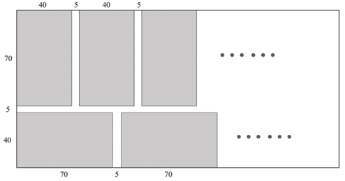

设第一行、第二行裁剪出的钢片最大数量分别为a、b个，可得：

，解得，

则a、b最大分别取15个、9个，最多可剪裁出15+9=24块。

故正确答案为B。

**考点**：几何公式类-平面图形

### 第 49 题

一块正方形花圃如下图所示。现将其划分为4个矩形，分别种植A、B、C、D四种作物。已知B、C的种植面积比为14：9，B、C的种植面积之和比A的种植面积大，则D的种植面积是A的：

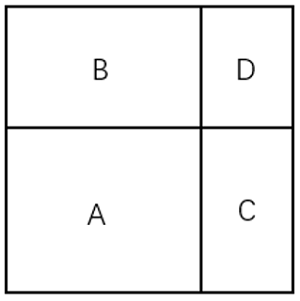

A. 

B. 

C. 

D. 

第 49 题 · 答案与解析

**参考答案（粉笔题库参考内容）**

C

**解析**

由题可知：，，则。如下图所示，𝑎、𝑏、𝑐、𝑑分别表示对应边长，则，，，。

方法一：设A的种植面积为21x，则B、C的种植面积分别为14x、9x。14和21都有公因子7，令b=7，则d=3x，c=2x，a=3，又因a+b=c+d，即3+7=2x+3x，可得x=2，则a=3、b=7、c=4、d=6，故D的种植面积是A的。

方法二：赋值，，，则，故D的种植面积是A的。

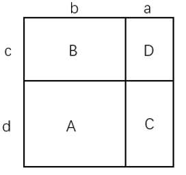

故正确答案为C。

**考点**：几何公式类-平面图形

### 第 50 题

从5名男性和4名女性志愿者队伍中抽调6名志愿者去田径比赛、篮球比赛和跳水比赛做服务引导工作。田径比赛要求2名男性志愿者，篮球比赛要求男、女志愿者各1名，跳水比赛要求2名女性志愿者。问有多少种不同的抽调方式？

A. 300

B. 320

C. 360

D. 400

第 50 题 · 答案与解析

**参考答案（粉笔题库参考内容）**

C

**解析**

根据题意，先从5名男性志愿者中选择2名去田径比赛，有种情况；再从剩余3名男性志愿者中选择1名，4名女性志愿者中选择1名去篮球比赛，有种情况；最后从剩余3名女性志愿者中选择2名去跳水比赛，有种情况，则有10×12×3=360种不同的抽调方式。

故正确答案为C。

**考点**：基础排列组合

### 第 51 题

某企业采购甲、乙和丙三种不同配置的电脑，已知甲、乙、丙各1台共2.3万元，2台甲加1台乙的总价比1台丙的单价高2.2万元。该企业最终决定采购1台甲、3台乙和7台丙，问采购总费用为多少万元？

A. 6.6

B. 7.1

C. 7.6

D. 8.1

第 51 题 · 答案与解析

**参考答案（粉笔题库参考内容）**

B

**解析**

设甲、乙和丙三种不同配置的电脑单价分别为a万元、b万元和c万元，根据题意可列方程：a+b+c=2.3······①，2a+b-c=2.2······②

方法一：赋值b=0，即a+c=2.3······①，2a-c=2.2······②，解得a=1.5，c=0.8，可得所求a+3b+7c=1.5+3×0+7×0.8=7.1万元。

方法二：联立①×5-②×2可得：a+3b+7c=2.3×5-2.2×2=7.1，即采购1台甲、3台乙和7台丙的总费用为7.1万元。

故正确答案为B。

**考点**：和差倍比问题、不定方程组

### 第 52 题

甲、乙两地受灾，政府从丙、丁两地分别调集100吨和60吨救灾物资。已知甲、乙两地各需救灾物资80吨，丙地到甲地、丙地到乙地、丁地到甲地、丁地到乙地的每吨运价之比为7：4：6：5。问总运输成本可能的最高值比最低值高：

A. 不到10%

B. 10%~15%之间

C. 15%~20%之间

D. 20%以上

第 52 题 · 答案与解析

**参考答案（粉笔题库参考内容）**

B

**解析**

赋值丙地到甲地、丙地到乙地、丁地到甲地、丁地到乙地的每吨运价分别为7元/吨、4元/吨、6元/吨、5元/吨，设丙运往甲地的物资为x吨，则丙运往乙地的物资为（100-x）吨，丁运往甲地的物资为（80-x）吨，丁运往乙地的物资为（x-20）吨，由题意可知：，，，，解得：。总运输成本为7x+4×(100-x)+6×(80-x)+5×(x-20)=2x+780，当x=80时，总运输成本最高为2×80+780=940元；当x=20时，总运输成本最低为2×20+780=820元，因此所求为，在B项范围内。

故正确答案为B。

**考点**：统筹规划问题

### 第 53 题

在一次团体操表演中，演员方阵的成员需要贴上红色、黄色和白色三种颜色之一的背贴。一位演员看到贴红色背贴的演员是除自己之外所有演员的，另一位演员则看到贴红色背贴的演员是除自己之外所有演员的。问这次团体操的演员有多少人？

A. 55

B. 56

C. 110

D. 111

第 53 题 · 答案与解析

**参考答案（粉笔题库参考内容）**

B

**解析**

根据题意可知，（总人数-1）既是5的倍数，又是11的倍数，结合选项可排除A、C两项。两位演员除自己之外看到红色背贴的比例不同，说明这两位演员一人为红色背贴、一人为非红色背贴；又因为两次比例的大小关系为 ，可知第二位演员是红色背贴，则等量关系为，，代入B、D两项进行验证。

代入B项，若总人数为56人，则红色背贴演员数为11人，且，等式成立，符合题意，当选；

代入D项，若总人数为111人，则红色背贴演员数为22人，但，不符合题意，排除。

注：考场上剩二代一，B项符合题意直接当选，可不验证D项。

故正确答案为B。

**考点**：和差倍比问题

### 第 54 题

某农场采摘脐橙，每名工人的工作效率相同。8：00开始工作，每30分钟休息10分钟，11：50结束，正好完成当天任务的一半。下午从14：00开始工作，工人的数量增加了一半，且每30分钟休息5分钟。问完成当天任务的时间是：

A. 16：15

B. 16：20

C. 16：25

D. 16：30

第 54 题 · 答案与解析

**参考答案（粉笔题库参考内容）**

A

**解析**

设上午工人数量为x人，则下午工人数量为人。根据每名工人的工作效率相同，且效率不变，赋值每名工人的工作效率为1。根据题意可得，上午工人每40分钟休息1次，到11：50共休息了次······30分钟，即上午工作时间为5×30+30=180分钟，则下午工作量=上午工作量=180x，下午工作时间为分钟=2小时，根据下午每30分钟休息5分钟，可得下午共休息分钟（最后一次30分钟结束时已完成任务不需要再休息），故完成当天任务的时间是16：15。

故正确答案为A。

**考点**：给具体单位型

### 第 55 题

甲、乙两地相距150千米。小张、小李分别于8：00和9：00开车从甲地匀速前往乙地。小张开了135千米被小李追上，且于10：30到达乙地。问小李的速度为多少千米/小时？

A. 75

B. 90

C. 108

D. 120

第 55 题 · 答案与解析

**参考答案（粉笔题库参考内容）**

C

**解析**

由题可知，小张开车走完全程所需时间为2.5h，根据公式：速度，可得千米/小时。小张开135千米所用时间小时，小李比小张晚出发1小时，则到135千米时小李用时=2.25-1=1.25小时，故千米/小时。

故正确答案为C。

**考点**：普通行程、相遇追及

### 第 56 题

从所给四个选项中，选择最合适的一个填入问号处，使之呈现一定规律性：

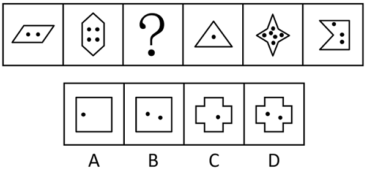

A. A

B. B

C. C

D. D

第 56 题 · 答案与解析

**参考答案（粉笔题库参考内容）**

B

**解析**

元素组成不同，且无明显属性规律，优先考虑数量规律。观察发现，题干图形均由外框和内部黑点组成，考虑内外两者之间的关系。题干图形外框边数分别为4、6、？、3、8、5，内部黑点个数分别为2、4、？、1、6、3，每幅图形均符合“外框边数-黑点个数=2”，故？处应填入一个“外框边数-黑点个数=2”的图形，只有B项符合。

故正确答案为B。

**考点**：数量规律-复合

### 第 57 题

从所给四个选项中，选择最合适的一个填入问号处，使之呈现一定规律性：

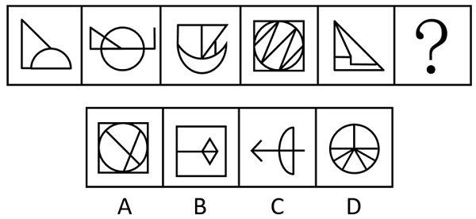

A. A

B. B

C. C

D. D

第 57 题 · 答案与解析

**参考答案（粉笔题库参考内容）**

B

**解析**

元素组成不同，且无明显属性规律，优先考虑数量规律。观察发现，题干图形均存在小直角三角形或垂直关系的图形，考虑直角数，数量依次为：1、2、3、4、5，呈递增规律，故？处直角数量应为6，只有B项符合。

故正确答案为B。

**考点**：数量规律-角

### 第 58 题

从所给四个选项中，选择最合适的一个填入问号处，使之呈现一定规律性：

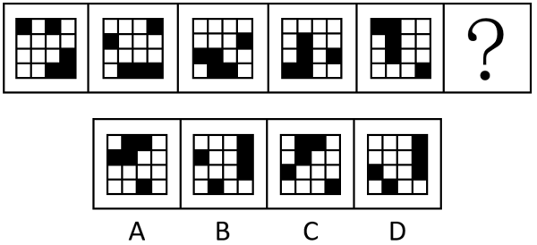

A. A

B. B

C. C

D. D

第 58 题 · 答案与解析

**参考答案（粉笔题库参考内容）**

A

**解析**

元素组成相同，优先考虑位置规律。观察发现，黑块位置发生变化，优先考虑平移。如下图所示，1号黑块依次向下平移一格（到头时循环走），2号黑块在外圈沿顺时针方向依次平移一格，3号、4号、5号黑块在右侧3×4在最左侧一列宫格中，沿顺时针方向依次平移一格，只有A项符合。

故正确答案为A。

**考点**：位置规律-平移

### 第 59 题

从所给四个选项中，选择最合适的一个填入问号处，使之呈现一定规律性：

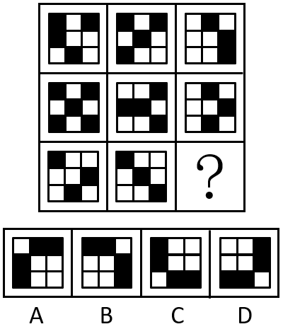

A. A

B. B

C. C

D. D

第 59 题 · 答案与解析

**参考答案（粉笔题库参考内容）**

A

**解析**

元素组成相似，优先考虑样式规律。题干图形轮廓和分割区域相同，且黑块数量不成规律，考虑黑白运算。九宫格优先看横行，第一行运算规律为：黑+黑=白，白+白=黑，黑+白=白，白+黑=白；经验证，第二行符合此规律；第三行应用此规律，只有A项符合。

故正确答案为A。

**考点**：样式规律-黑白运算

### 第 60 题

下边四个图形，可以拼合（只能通过上、下、左、右平移）成选项中的哪一个图形？

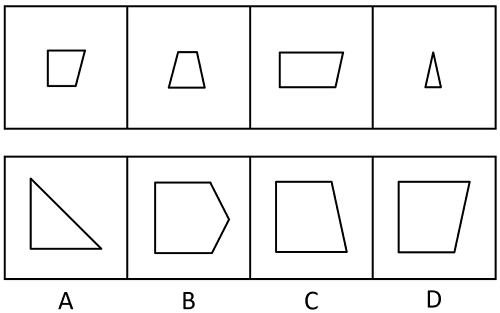

A. A

B. B

C. C

D. D

第 60 题 · 答案与解析

**参考答案（粉笔题库参考内容）**

C

**解析**

本题考查平面拼合，可采用平行且等长相消的方式解题。消去平行且等长的线段后进行组合即可得到轮廓图，即为C项。平行且等长相消的方式如下图所示：

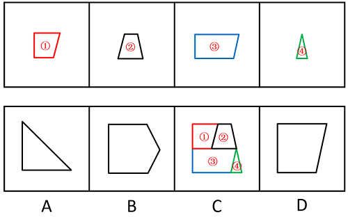

故正确答案为C。

### 第 61 题

将一长方形纸沿左图虚线折叠后，沿右图虚线裁剪，得到的窗花是：

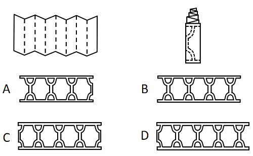

A. A

B. B

C. C

D. D

第 61 题 · 答案与解析

**参考答案（粉笔题库参考内容）**

B

**解析**

观察图形，将左侧长方形纸沿虚线折叠后，形成8个形状大小完全相等的长方形，两两一组，共分为4组，后按照右图虚线花纹进行裁剪，得到4个镂空完整的花纹图案，只有B项符合。

故正确答案为B。

### 第 62 题

左图给定的是由等大的15个白色正方体和3个黑色正方体堆叠而成的多面体的正视图和后视图，该多面体可以由①、②和③三个多面体拼合而成，问以下哪一项能填入问号处？

A. A

B. B

C. C

D. D

第 62 题 · 答案与解析

**参考答案（粉笔题库参考内容）**

D

**解析**

本题考查立体拼合。题干立体图形可以由①、②以及D项旋转拼合而成，如下图所示：

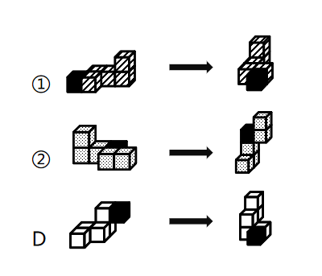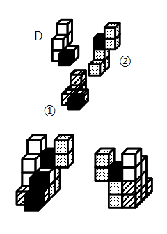

故正确答案为D。

**考点**：空间类-立体拼合

### 第 63 题

把下面的六个图形分为两类，使每一类图形都有各自的共同特征或规律，分类正确的一项是：

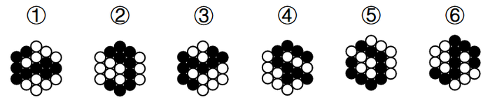

A. ①③④；②⑤⑥

B. ①⑤⑥；②③④

C. ①②⑥；③④⑤

D. ①④⑥；②③⑤

第 63 题 · 答案与解析

**参考答案（粉笔题库参考内容）**

B

**解析**

本题为分组分类题目。元素组成相同，但无明显位置规律和属性规律，优先考虑数量规律。观察发现，题干图形均由黑球和白球构成，且有部分白球被分隔开，考虑数部分数。题干图形黑球均是由一部分构成，白球均是由两部分构成，无法分组。继续观察白球每部分含有的小球个数，发现图①⑤⑥中每个白色部分均含有5个小球，图②③④中两个白色部分含有的小球数分别是3和7。即图①⑤⑥为一组，图②③④为一组。

故正确答案为B。

**考点**：黑白块类、数量规律-素

### 第 64 题

词的同一性是指同一个词形可以表示不同的意义，但这些不同的意义之间存在着内在联系的现象。

根据上述定义，下列划线的词不属于词的同一性现象的是：

A. 他的态度很端正 大家要端正态度

B. 他是我们的领导 在D的领导下奋勇前进

C. 这个人仪表堂堂 在重要场合要注意仪表

D. 这是一门科学 处理问题的方法很科学

第 64 题 · 答案与解析

**参考答案（粉笔题库参考内容）**

C

**解析**

第一步：找出定义关键词。

“同一个词形可以表示不同的意义”、“这些不同的意义之间存在着内在联系”。

第二步：逐一分析选项。

A项：“态度很端正”中的“端正”为形容词，意思是正派、正确，“端正态度”中的“端正”为动词，意思是使端正，两个“端正”表示的是不同的意义，且两个不同意义间存在联系，符合“同一个词形可以表示不同的意义”、“这些不同的意义之间存在着内在联系”，符合定义，排除；

B项：“他是我们的领导”中的“领导”为名词，指的是担任领导工作的人，“在D的领导下奋勇前进”中的“领导”为动词，意思是率领并引导，两个“领导”表示的是不同的意义，且两个不同意义间存在联系，符合“同一个词形可以表示不同的意义”、“这些不同的意义之间存在着内在联系”，符合定义，排除；

C项：“仪表堂堂”中的“仪表”为名词，指的是人的外表（包括容貌、姿态、风度等），与“注意仪表”中的“仪表”词性、词义一致，不符合“同一个词形可以表示不同的意义”，不符合定义，当选；

D项：“一门科学”中的“科学”为名词，指的是反映自然、社会、思维等的客观规律的分科的知识体系，“方法很科学”中的“科学”为形容词，意思是合乎科学的，两个“科学”表示的是不同的意义，且两个不同意义间存在联系，符合“同一个词形可以表示不同的意义”、“这些不同的意义之间存在着内在联系”，符合定义，排除。

本题为选非题，故正确答案为C。

**考点**：单定义-其他句式

### 第 65 题

生产性固定资产是指在物质资料生产过程中能长期发挥作用而不改变其实物形态的劳动资料。它不同于非生产性固定资产，非生产性固定资产可分两类，一类是纯消费性的，没有盈利，投资不能收回，其再投资依靠社会积累，另一类是可转化为无形商品的，有盈利，可以收回投资，甚至可实现增值和积累。

根据上述定义，以下投资能形成生产性固定资产的是：

A. 对影剧院、电视台、咨询公司等的投资

B. 对面粉厂的机器、设备和厂房等的投资

C. 对学校、国防安全、社会福利设施等的投资

D. 对快餐店的家禽、蔬菜、大米等原材料的投资

第 65 题 · 答案与解析

**参考答案（粉笔题库参考内容）**

B

**解析**

第一步：找出定义关键词。

生产性固定资产：“在物质资料生产过程中”、“长期发挥作用”、“不改变其实物形态”；

非生产性固定资产：“纯消费性的，没有盈利，投资不能收回”、“可转化为无形商品的，有盈利，可以收回投资”。

第二步：逐一分析选项。

A项：对影剧院、电视台、咨询公司等的投资，可以盈利、收回投资，符合“可转化为无形商品的，有盈利，可以收回投资”，符合“非生产性固定资产”定义，不符合“生产性固定资产”定义，排除；

B项：面粉厂的机器、设备和厂房属于可长期使用的实物，符合“在物质资料生产过程中”、“长期发挥作用”、“不改变其实物形态”，符合“生产性固定资产”定义，当选；

C项：对学校、国防安全、社会福利设施等的投资，符合“纯消费性的，没有盈利，投资不能收回”，符合“非生产性固定资产”定义，不符合“生产性固定资产”定义，排除；

D项：家禽、蔬菜、大米等原材料在使用时，会被消耗减少且也可能被制作成其他商品，不符合“长期发挥作用”、“不改变其实物形态”，不符合“生产性固定资产”定义，排除。

故正确答案为B。

**考点**：常规问法

### 第 66 题

内疚式教育是指在家庭生活中，父母企图通过自己的某种行为让孩子产生内疚感，从而使其听从自己的安排。

根据上述定义，下列属于内疚式教育的是：

A. 小强爷爷病重住院，小强父母为了不影响小强学习就没有告诉他，但小强无意中发现了此事，还是偷偷去医院探望了爷爷

B. 小刚不小心删除了爸爸电脑中的文件，导致爸爸通宵加班补救，小刚对此十分自责，下决心再也不碰爸爸的电脑了

C. 妈妈每天早上五点就起来给小红准备早餐，经常对吃着早餐的小红念叨，只要你好好学习，妈妈就是再辛苦也心甘情愿

D. 爸爸在下雪天骑车给小林送衣物时不慎摔伤，看着爸爸打着厚厚石膏的胳膊，小林暗想长大以后一定要好好孝顺爸爸

第 66 题 · 答案与解析

**参考答案（粉笔题库参考内容）**

C

**解析**

第一步：找出定义关键词。

“通过自己的某种行为让孩子产生内疚感”、“使其听从自己的安排”。

第二步：逐一分析选项。

A项：父母向小强隐瞒爷爷病重住院的事情，是为了不影响小强学习，并非是为了让小强产生内疚感并听从安排，不符合“通过自己的某种行为让孩子产生内疚感”、“使其听从自己的安排”，不符合定义，排除；

B项：小刚的自责来源于爸爸为小刚的错误通宵补救，爸爸实施这一行为并非为了让小刚产生内疚感并听从安排，不符合“通过自己的某种行为让孩子产生内疚感”、“使其听从自己的安排”，不符合定义，排除；

C项：妈妈为小红早起做早餐，并经常向小红说明自己的辛苦，是为了让小红产生内疚感，并且好好学习，符合“通过自己的某种行为让孩子产生内疚感”、“使其听从自己的安排”，符合定义，当选；

D项：爸爸在为小林雪天送衣物时摔伤，爸爸的行为并非是为了让小林产生内疚感并听从安排，不符合“通过自己的某种行为让孩子产生内疚感”、“使其听从自己的安排”，不符合定义，排除。

故正确答案为C。

**考点**：方式目的

### 第 67 题

过度管理是指某些管理者过分相信自己的能力、精力和眼光，认为缺少自己的指挥就达不到预期效果，或凡事亲力亲为，让自己整日陷于忙碌之中。

根据上述定义，下列不属于过度管理的是：

A. 班主任陶老师对学生要求十分严格，每天都到班级督促学生学习和锻炼，常常严厉批评犯错误的同学

B. 龚经理总是对下属不放心，公司职员小张出差两天，龚经理打了10多个电话指导工作，弄得小张压力很大

C. 饭店高老板习惯每天下班时和保洁员工一起打扫卫生，他觉得只有这样才能保证餐厅整洁，不留任何卫生死角

D. 办公室许主任每次分派工作都十分具体，如对会议室桌椅的摆放数量和位置等细节都交代得十分清楚，让下属没有一点发挥的余地

第 67 题 · 答案与解析

**参考答案（粉笔题库参考内容）**

A

**解析**

第一步：找出定义关键词。

“管理者过分相信自己的能力、精力和眼光”、“认为缺少自己的指挥就达不到预期效果”、“凡事亲力亲为”、“让自己整日陷于忙碌之中”。

第二步：逐一分析选项。

A项：班主任陶老师对学生要求十分严格，每天都到班级督促学生学习和锻炼，常常严厉批评犯错误的同学，陶老师的行为属于比较严格的教育行为，但并未体现陶老师过分相信自己眼光，也未体现陶老师认为学生离开自己就无法学习，不符合“管理者过分相信自己的能力、精力和眼光”、“认为缺少自己的指挥就达不到预期效果”，不符合定义，当选；

B项：龚经理总是对下属不放心，职员小张出差两天，打了10多个电话指导工作，说明龚经理认为小张缺少自己的指导，就无法完成工作，符合“认为缺少自己的指挥就达不到预期效果”，符合定义，排除；

C项：饭店高老板每天下班时和保洁员工一起打扫卫生，他觉得只有这样才能保证餐厅整洁，说明高老板认为缺少自己的参与，员工就无法完成保洁工作，符合“认为缺少自己的指挥就达不到预期效果”，符合定义，排除；

D项：许主任每次分派工作都十分具体，让下属没有一点发挥的余地，说明许主任凡事亲力亲为，符合“凡事亲力亲为”，符合定义，排除。

本题为选非题，故正确答案为A。

**考点**：单定义-其他句式

### 第 68 题

国际法上的先占是指一国有意识地占有无主地，并对其实行有效的行政管理，从而取得该领土的行为。

根据上述定义，下列属于先占行为的是：

A. 甲国的探险队在海上发现了一个从未有人踏足的新岛屿

B. 乙国在某一仅有游牧民族长期生活的土地上援建一条铁路

C. 丙国通过战争，迫使另一国将一个无人居住的区域，割让给自己

D. 丁国在公海发现了一无人岛，迅速向该地派遣人员，建立了行政机关

第 68 题 · 答案与解析

**参考答案（粉笔题库参考内容）**

D

**解析**

第一步：找出定义关键词。

“一国有意识地占有无主地”、“实行有效的行政管理”、“取得该领土的行为”。

第二步：逐一分析选项。

A项：甲国探险队发现新岛屿，仅仅是“发现”而不是“占有”，不符合“一国有意识地占有无主地”、“实行有效的行政管理”、“取得该领土的行为”，不符合定义，排除；

B项：乙国援建铁路，“援建”是支援建设，而不是“占有”，不符合“一国有意识地占有无主地”、“实行有效的行政管理”、“取得该领土的行为”，不符合定义，排除；

C项：丙国通过战争迫使另一国割让无人居住的区域，割让的区域为另一国所有，不是无主地，不符合“一国有意识地占有无主地”，不符合定义，排除；

D项：丁国在公海发现无人岛，派遣人员建立了行政机关，符合“一国有意识地占有无主地”、“实行有效的行政管理”、“取得该领土的行为”，符合定义，当选。

故正确答案为D。

**考点**：方式目的

### 第 69 题

太师椅是我国古代唯一用官职来命名的椅子，它体态宽大，靠背与扶手连成一片，形成一个三扇、五扇或多扇的围屏。

根据上述定义，下列图片中是太师椅的是：

A. 

B. 

C. 

D. 

第 69 题 · 答案与解析

**参考答案（粉笔题库参考内容）**

B

**解析**

第一步：找出定义关键词。

“体态宽大”、“靠背与扶手连成一片”、“形成一个三扇、五扇或多扇的围屏”。

第二步：逐一分析选项。

A项：该图中的椅子没有扶手，不符合“靠背与扶手连成一片”，不符合定义，排除；

B项：该图中的椅子符合“体态宽大”、“靠背与扶手连成一片”、“形成一个三扇、五扇或多扇的围屏”，符合定义，当选；

C项：该图中的椅子靠背与扶手高度相差悬殊，未连成一片，不符合“靠背与扶手连成一片”，不符合定义，排除；

D项：该图中的椅子体态较窄，不符合“体态宽大”，不符合定义，排除。

故正确答案为B。

**考点**：单定义-其他句式

### 第 70 题

语言通胀是指当前社会中，由于词语使用过度夸张、描述超过事实而造成词义掉价、情感弱化、指称范围夸大，甚至可能导致信息理解错误的语言泡沫化现象。

根据上述定义，下列没有体现语言通胀的是：

A. “美女”一词原指“年轻貌美的女子”，具有称赞之意，但如今“美女”已变成很多人对女性的日常称呼

B. 社交网络上人们用词仿佛达成了一种“默契”，实用效果不错的东西都叫“神器”，说起好吃的东西都是“好吃哭了”

C. 微信聊天时，最初用“哈哈”表示高兴，现在，年轻人经常会用很夸张的动态表情图来表示自己高兴的心情，有些图让人忍俊不禁

D. 小李向顾客介绍说自己是理发店的首席设计师，顾客发现价目表上写着“首席设计师38元，设计总监68元，创意总监98元”

第 70 题 · 答案与解析

**参考答案（粉笔题库参考内容）**

C

**解析**

第一步：找出定义关键词。

“词语使用过度夸张、描述超过事实”、“造成词义掉价、情感弱化、指称范围夸大”、“甚至可能导致信息理解错误”。

第二步：逐一分析选项。

A项：“美女”由“年轻貌美的女子”变为对女性的日常称呼，符合“词语使用过度夸张、描述超过事实”、“造成词义掉价、情感弱化、指称范围夸大”，符合定义，排除；

B项：“神器”原指中国神话中有其超自然的威力或能力的兵器法宝，而现在只要实用效果不错的一般器具都叫“神器”，“好吃哭了”原用于特别好吃以致于十分感动，而现在只要好吃都说“好吃哭了”，过于夸张，符合“词语使用过度夸张、描述超过事实”、“造成词义掉价、情感弱化、指称范围夸大”，符合定义，排除；

C项：微信聊天时，最初用“哈哈”表示高兴，现在，年轻人经常会用很夸张的动态表情图来表示自己高兴的心情，一个是语言，一个是图片，不符合“词语使用过度夸张、描述超过事实”、“造成词义掉价、情感弱化、指称范围夸大”，不符合定义，当选；

D项：首席设计师原指在一个设计机构的设计师群体中排在第一位的，现为理发店单价最低等的理发师，符合“词语使用过度夸张、描述超过事实”、“造成词义掉价、情感弱化、指称范围夸大”、“甚至可能导致信息理解错误”，符合定义，排除。

本题为选非题，故正确答案为C。

**考点**：原因结果

### 第 71 题

功能性自治是指在解决问题的过程中，某些子目标的达成刺激当事人产生进一步发展的动力，不受最初设定问题的限制，诱发思维进入更高级发展阶段的过程。

根据上述定义，下列属于功能性自治的是：

A. 某婴儿想要触碰稍远处的玩具，在此过程中学会了控制手臂，之后他根据有时能触碰到、有时不能触碰到的体验，逐渐建立了“距离”的概念

B. 某中学生立志获得学校跨栏比赛的冠军，经过刻苦练习终于实现目标，这赋予了他更大的勇气和自信，此后他更加努力并入选国家队

C. 某医学生为掌握神经解剖技术大量练习，在控制手部精细操作的过程中，他意识到自己的兴趣在雕塑，于是下定决心转入艺术系

D. 某工程师退休之后回想人生，意识到自己年轻时立下的职业理想已实现，但有些人生目标尚未实现，因而生发出许多感慨

第 71 题 · 答案与解析

**参考答案（粉笔题库参考内容）**

A

**解析**

第一步：找出定义关键词。

“解决问题的过程中”、“子目标的达成”、“思维进入更高级发展阶段”。

第二步：逐一分析选项。

A项：婴儿想要碰触玩具，符合“解决问题的过程中”，学会控制手臂，符合“子目标的达成”，建立“距离”的概念，符合“思维进入更高级发展阶段”，符合定义，当选；

B项：学生立志获得校比赛冠军，符合“解决问题的过程中”，刻苦练习实现目标，属于原本的目标，不符合“子目标的达成”，此后更加努力加入国家队，也不是思维方面的问题，不符合“思维进入更高级发展阶段”，不符合定义，排除；

C项：学生为掌握神经解剖技术，符合“解决问题的过程中”，控制手部精细操作，符合“子目标的达成”，但是由学医转入艺术系，只是更换了兴趣和专业，不符合“思维进入更高级发展阶段”，不符合定义，排除；

D项：工程师退休后回想人生，不符合“解决问题的过程中”，不符合定义，排除。

故正确答案为A。

**考点**：大前提

### 第 72 题

沉浸式演艺是指某些旅游景区或机构摒弃传统游览模式，将人们喜爱的、脑海中留存或想象的场景通过艺术表演的方式转变为现实，让游客产生一种身临其境的体验。

根据上述定义，下列不属于沉浸式演艺的是：

A. 某市的电影主题公园利用较为成熟的虚拟现实技术，让游客进行角色扮演，参与情节互动

B. 某旅游餐厅向就餐的游客推出近距离魔术表演，魔术师的精彩演出让观看的游客惊叹不已

C. 某景区推出由3D技术支撑的大型演出剧目，游客们置身其中，仿佛在与古人面对面交流

D. 某影视城建有许多仿古建筑，并安排身穿古装的演员穿梭其中，游客游览时会有穿越时空之感

第 72 题 · 答案与解析

**参考答案（粉笔题库参考内容）**

B

**解析**

第一步：找出定义关键词。

“将人们喜爱的、脑海中留存或想象的场景通过艺术表演的方式转变为现实”、“让游客产生一种身临其境的体验”。

第二步：逐一分析选项。

A项：电影主题公园利用虚拟现实技术让游客进行角色表演，符合“将人们喜爱的、脑海中留存或想象的场景通过艺术表演的方式转变为现实”，游客参与情节互动，符合“让游客产生一种身临其境的体验”，符合定义，排除；

B项：旅游餐厅向游客推出近距离魔术表演，不符合“将人们喜爱的、脑海中留存或想象的场景通过艺术表演的方式转变为现实”，游客只是惊叹不已并未互动，不符合“让游客产生一种身临其境的体验”，不符合定义，当选；

C项：景区推出由3D技术支撑的大型演出剧目，游客们置身其中，符合“将人们喜爱的、脑海中留存或想象的场景通过艺术表演的方式转变为现实”，游客们仿佛在与古人面对面交流，符合“让游客产生一种身临其境的体验”，符合定义，排除；

D项：影视城安排身穿古装的演员穿梭在仿古建筑群中，符合“将人们喜爱的、脑海中留存或想象的场景通过艺术表演的方式转变为现实”，游客游览时会有穿越时空之感，符合“让游客产生一种身临其境的体验”，符合定义，排除。

本题为选非题，故正确答案为B。

**考点**：方式目的

### 第 73 题

提纲：挈领

A. 抚今：追昔

B. 扶老：携幼

C. 追本：溯源

D. 上行：下效

第 73 题 · 答案与解析

**参考答案（粉笔题库参考内容）**

C

**解析**

第一步：判断题干词语间逻辑关系。

“提纲挈领”的意思是抓住要领，简明扼要。提纲：抓住网的总绳，挈领：提起衣服的领子，两者都有抓住关键、要领的意思，为近义关系。

第二步：判断选项词语间逻辑关系。

A项：“抚今追昔”的意思是接触当前的事物而回想过去，“抚今”是感受当下，“追昔”是回忆过去。两者意思不同，不是近义关系，与题干逻辑关系不一致，排除；

B项：“扶老携幼”的意思是搀扶着老人，带领着小孩，形容民众成群结队而行。“扶老”是照顾老人，“携幼”是带着小孩。两者意思不同，不是近义关系，与题干逻辑关系不一致，排除；

C项：“追本溯源”的意思是追究根本，探索源头，比喻追寻根源。“追本”和“溯源”都有追寻根本、源头的意思，两者是近义关系，与题干逻辑关系一致，当选；

D项：“上行下效”本义是指上面或上辈的人怎样做，下面或下辈的人就学着怎样做。“上行”指上面或上辈的行为，“下效”指下面或下辈的效仿，两者意思不同，不是近义关系，与题干逻辑关系不一致，排除。

故正确答案为C。

**考点**：语义关系-近义关系、拆分思维

### 第 74 题

火炉：蒲扇

A. 斗笠：蓑衣

B. 暖气：空调

C. 油门：刹车

D. 出租车：私家车

第 74 题 · 答案与解析

**参考答案（粉笔题库参考内容）**

C

**解析**

第一步：判断题干词语间逻辑关系。

火炉和蒲扇是两种不同的用于调节温度的工具，二者为并列关系；且火炉的功能是取暖，蒲扇的功能是降温，二者的功能相反。

第二步：判断选项词语间逻辑关系。

A项：斗笠是用竹篾夹油纸或箬竹的叶子等制成的遮阳光和雨的帽子，蓑衣是用草或棕毛制成的、披在身上的防雨用具，二者为并列关系，但二者的功能不相反，与题干逻辑关系不一致，排除；

B项：暖气和空调是两种不同的用于调节温度的工具，二者为并列关系；暖气的功能是取暖，空调既可用于取暖，也可用于制冷，二者的功能不完全相反，与题干逻辑关系不一致，排除；

C项：油门是控制发动机功率（推力）的操纵装置，刹车是机动车的制动器，二者均为机动车的组成装置，为并列关系；且油门的功能是使机动车加速，刹车的功能是使机动车减速，二者的功能相反，与题干逻辑关系一致，当选；

D项：出租车和私家车是从车辆拥有者的角度划分的两种不同的车，二者为并列关系，但二者的功能均为交通运输，功能不相反，与题干逻辑关系不一致，排除。

故正确答案为C。

**考点**：逻辑关系-并列关系

### 第 75 题

扩散：化合：化学反应

A. 闪烁：朝霞：光学现象

B. 液化：氧化：物理反应

C. 广告：直销：经销方式

D. 证明：反驳：逻辑推理

第 75 题 · 答案与解析

**参考答案（粉笔题库参考内容）**

C

**解析**

第一步：判断题干词语间逻辑关系。

扩散是指分子或粒子从高浓度区域向低浓度区域的净移动，是一种物理反应类型，第一个词和第三个词是反向种属关系，化合是指由两种或两种以上的物质（单质或化合物），形成一个成分较复杂的化合物的反应，是一种化学反应类型，第二个词和第三个词是种属关系。

第二步：判断选项词语间逻辑关系。

A项：闪烁和朝霞都是光学现象，前两个词与第三个词均为种属关系，与题干逻辑关系不一致，排除；

B项：液化是指物质由气态转变为液态的过程，是物理反应，第一个词和第三个词是种属关系，氧化是一种化学反应类型，第二个词和第三个词是反向种属关系，但顺序与题干相反，与题干逻辑关系不一致，排除；

C项：广告是指广而告之，即向社会广大公众告知某件事物，是一种营销方式，并不是经销方式，第一个词和第三个词是反向种属关系，直销是经销方式的一种，第二个词和第三个词是种属关系，与题干逻辑关系一致，当选；

D项：证明和反驳都是逻辑推理的方式，前两个词和第三个词均构成种属关系，与题干逻辑关系不一致，排除。

故正确答案为C。

**考点**：逻辑关系-包容关系

### 第 76 题

炭火：烤架：烧烤

A. 扳手：电钻：修理

B. 鞋柜：皮鞋：收纳

C. 酒精：棉签：消毒

D. 手枪：子弹：击发

第 76 题 · 答案与解析

**参考答案（粉笔题库参考内容）**

C

**解析**

第一步：判断题干词语间逻辑关系。

炭火和烤架可以搭配用来烧烤，前两词是配套使用的对应关系，且烧烤主要用的是炭火，烤架是辅助工具。

第二步：判断选项词语间逻辑关系。

A项：扳手和电钻是两个不同的工具，且都可以用来修理，前两词是功能一致的并列关系，与题干逻辑关系不一致，排除；

B项：皮鞋放在鞋柜里，前两词是位置对应关系，不是配套使用的对应关系，与题干逻辑关系不一致，排除；

C项：酒精和棉签可以搭配用来消毒，前两词是配套使用的对应关系，且消毒主要用的是酒精，棉签是辅助工具，与题干逻辑关系一致，当选；

D项：手枪和子弹是配套使用的关系，但是击发必须是枪+子弹，二者缺一不可，与题干逻辑关系不一致，排除。

故正确答案为C。

**考点**：逻辑关系-对应关系

### 第 77 题

健身 对于 （ ） 相当于 （ ） 对于 眼罩

A. 运动；口罩

B. 增肌；遮光

C. 健步走；丝绸

D. 跑步机；睡眠

第 77 题 · 答案与解析

**参考答案（粉笔题库参考内容）**

D

**解析**

逐一代入选项。

A项：“运动”有“健身”的作用，二者为功能对应关系；“口罩”和“眼罩”是两种不同的用具，二者为并列关系，前后逻辑关系不一致，排除；

B项：“健身”有“增肌”的作用，二者为功能对应关系；“眼罩”有“遮光”的作用，二者为功能对应关系，但前后词语顺序相反，前后逻辑关系不一致，排除；

C项：“健步走”是一种“健身”方式，二者为种属关系；“丝绸”是制作“眼罩”的原材料，二者为原材料和成品的对应关系，前后逻辑关系不一致，排除；

D项：“健身”的时候可能会用到“跑步机”，二者为工具对应关系；“睡眠”的时候可能会用到“眼罩”，二者为工具对应关系，前后逻辑关系一致，当选。

故正确答案为D。

**考点**：逻辑关系-对应关系

### 第 78 题

为有效减轻义务教育阶段学生过重作业负担和校外培训负担，国家推出“双减政策”。目前“双减政策”已经初见成效，不过有些家长担心，自己的孩子会因减负落后于其他同学。

以下哪项如果为真，最能说明上述家长的担心是不必要的？

A. 孩子的学习成绩因个体原因总存在差异

B. “双减政策”对孩子和其他同学的影响都是一样的

C. 过多的作业负担和培训负担不利于孩子的健康成长

D. 在“双减政策”要求下，学校会大力提升教学质量

第 78 题 · 答案与解析

**参考答案（粉笔题库参考内容）**

B

**解析**

第一步：找出论点和论据。

论点：自己的孩子会因减负落后于其他同学。

论据：无。

本题只有论点，没有论据，削弱优先考虑否定论点。

第二步：逐一分析选项。

A项：该项指出不同孩子学习成绩有差异的原因，但论点讨论的是减负对孩子学习的影响，话题不一致，无法削弱，排除；

B项：该项指出了政策影响的普遍性，如果所有孩子都受到相同影响，说明自己的孩子不会因为减负导致学习落后于其他同学，削弱论点，可以削弱，当选；

C项：该项指出过重的负担对孩子健康成长的影响，但论点讨论的是减负对孩子学习的影响，话题不一致，无法削弱，排除；

D项：该项指出学校在减负的同时提升教学质量，但一方面未明确说明各学校提升后的教学质量是否相同，另一方面未说明在提升教学质量后学生能否保持或提升学习水平，是否会落后于其他同学，无法削弱，排除。

故正确答案为B。

**考点**：削弱论点

### 第 79 题

近年来，“手术机器人”在一些地区的医院应用广泛，但一些外科手术病人在选择机器人手术时面临很大的心理障碍。有研究者认为外科手术仍应以医生为主导，因为机器人不完全具备医生的学习能力，又缺少了医生的敏锐触觉。

以下哪项如果为真，最能反驳上述研究者的观点？

A. 机器人手术价格高昂，性价比不高

B. “手术机器人”只是“机械臂”，只能给外科医生当助手

C. 外科手术的成功率与操作“手术机器人”的外科医生有关

D. 人工智能的发展使“手术机器人”的智能化和精确度日益提高

第 79 题 · 答案与解析

**参考答案（粉笔题库参考内容）**

D

**解析**

第一步：找出论点和论据。

论点：外科手术仍应以医生为主导。

论据：机器人不完全具备医生的学习能力，又缺少了医生的敏锐触觉。

本题论点说的是外科手术仍应以医生为主导，论据说的是应以医生为主导的原因，由论据得出论点，话题一致，削弱可以考虑削弱论点或削弱论据。

第二步：逐一分析选项。

A项：指出机器人手术价格高昂，性价比不高，说明不会优先选择“手术机器人”，因此外科手术仍应以医生为主导，为加强项，无法削弱，排除；

B项：指出“手术机器人”只能给外科医生当助手，说明“手术机器人”无法主导外科手术，为加强项，无法削弱，排除；

C项：指出外科手术的成功率与操作“手术机器人”的外科医生有关，但是不明确外科手术是否以医生为主导，不明确项，无法削弱，排除；

D项：指出人工智能的发展使“手术机器人”的智能化和精确度日益提高，说明手术机器人可能具备医生的学习能力和敏锐触觉，可能性削弱，保留。

本题问法为“最能反驳研究者观点”，只有D项为可能性削弱，对比择优选择D项。

故正确答案为D。

**考点**：削弱论据

### 第 80 题

近年来，名牌稻米和普通稻米之间的价格差距变得非常大，以至于越来越多的消费者转而购买普通稻米，尽管名牌稻米因质量更好而享有盛誉。为了吸引消费者，一些名牌稻米生产商计划采用精简物流等方法降低成本，缩小名牌稻米和普通稻米之间的价格差距，使其与普通稻米的价格接近甚至持平。有人指出，生产商的这一计划难以实现。

以下哪项如果为真，最能支持上述观点？

A. 各生产商生产的名牌稻米销售价格没有明显差异

B. 普通稻米的成品售价已经低于名牌稻米的收购价

C. 转而购买普通稻米的消费者普遍对这些稻米的质量感到满意

D. 名牌稻米拥有一批稳定的消费者，他们认为名牌稻米的质量更好

第 80 题 · 答案与解析

**参考答案（粉笔题库参考内容）**

B

**解析**

第一步：找出论点和论据。

论点：生产商的这一计划（采用精简物流等方法降低成本，缩小名牌稻米和普通稻米之间的价格差距，使其与普通稻米的价格接近甚至持平）难以实现。

论据：无。

本题只有论点，没有论据，加强优先考虑补充论据，即解释原因或举例。

第二步：逐一分析选项。

A项：选项指出各生产商生产的名牌稻米销售价格没有明显差异，讨论的是“名牌稻米”之间的价格差异，但论点讨论的是能否通过精简物流等方法降低成本，进而缩小“名牌稻米和普通稻米”之间的价格差距，话题不一致，为无关项，无法加强，排除；

B项：选项指出普通稻米的成品售价已经低于名牌稻米的收购价，即就算生产商降低了物流等成本，也难以在不亏损的情况下，使名牌稻米的成品售价与普通稻米接近甚至持平，说明生产商的计划难以实现，补充论据，可以加强，当选；

C项：选项指出转而购买普通稻米的消费者普遍对这些稻米的质量感到满意，但论点讨论的是能否通过精简物流等方法降低成本，进而缩小名牌稻米和普通稻米之间的价格差距，话题不一致，为无关项，无法加强，排除；

D项：选项指出名牌稻米拥有一批稳定的消费者，但论点讨论的是能否通过精简物流等方法降低成本，进而缩小名牌稻米和普通稻米之间的价格差距，话题不一致，为无关项，无法加强，排除。

故正确答案为B。

**考点**：补充论据

### 第 81 题

电商平台个人信息泄露问题日益受到人们的关注。目前，一些电商平台和物流企业相继推出隐私号码保护功能，收件人下单时的真实手机号码将被隐藏，商家、物流和消费者之间将通过系统生成的虚拟号码联系，交易完成一段时间后，该虚拟号便自动失效。有人认为这一功能将大大改善电商平台个人信息泄露的问题。

以下哪项如果为真，最能质疑上述观点？

A. 事前对提供个人信息授权的范围加以审慎考虑，比事后使用一次性的虚拟信息来降低影响效果更好

B. 大部分的个人信息泄露并非发生在物流阶段，而是在用户将个人信息填写于网络平台的那一刻就已经发生

C. 个人信息一旦被收集，传递给其他人，实际上就已经被泄露了，即便事后采取了惩治手段，也很难再去弥补

D. 后台运营由电商平台掌控，网购消费者无法得知自己有哪些信息、在什么环节被对方掌握，在权益受到侵犯时举证困难、成本高昂

第 81 题 · 答案与解析

**参考答案（粉笔题库参考内容）**

B

**解析**

第一步：找出论点和论据。

论点：电商平台和物流企业相继推出隐私号码保护功能将大大改善电商平台个人信息泄露的问题。

论据：无。

本题只有论点，没有论据，削弱优先考虑削弱论点，即电商平台和物流企业相继推出隐私号码保护功能无法改善电商平台个人信息泄露的问题。

第二步：逐一分析选项。

A项：该项是对事前信息授权范围审慎考虑和事后使用虚拟信息降低影响的效果进行比较，讨论哪种方法更好，但是没有明确说明使用一次性虚拟信息是否能够改善个人信息泄露的问题，无法削弱，排除;

B项：该项说明隐私泄露是从填写信息时就发生了，而不是物流阶段，故单纯在物流阶段使用隐私号码保护功能并不能避免用户个人信息泄露，削弱论点，当选;

C项：该项说明个人信息被收集，传递给其他人，就已经被泄露了，事后惩治手段无法弥补，与论点隐私号码保护功能能够改善个人信息泄露的问题无关，无法削弱，排除;

D项：该项强调消费者无法在受到侵犯时进行举证，与论点隐私号码保护功能能够改善个人信息泄露的问题无关，无法削弱，排除。

故正确答案为B。

**考点**：削弱论点

### 第 82 题

一项关于烟草依赖影响因素的调查中，研究者选取了近10万名吸烟者，追踪了多年，结果发现：近一半吸烟者存在烟草依赖，而且开始吸烟的年龄越小，烟草依赖的状况越严重，两者相关高达70%以上。因此研究者认为：控制吸烟起始时间（即尽早控烟）是减少人对烟草依赖程度的最重要举措。

以下哪项如果为真，最能质疑上述研究者的观点？

A. 研究显示，群体吸烟率高的地域不一定烟草依赖率高

B. 调查人群中，男性群体的数量和对烟草的依赖度均明显高于女性群体

C. 开始吸烟往往发生在青少年，这一时期的控制与引导可减少成年后的烟草依赖度

D. 相比吸烟开始时间早、剂量少的人群，吸烟晚但摄烟量大的群体更易出现烟草依赖

第 82 题 · 答案与解析

**参考答案（粉笔题库参考内容）**

D

**解析**

第一步：找出论点和论据。

论点：控制吸烟起始时间（即尽早控烟）是减少人对烟草依赖程度的最重要举措。

论据：关于烟草依赖影响因素的调查中发现：近一半吸烟者存在烟草依赖，而且开始吸烟的年龄越小，烟草依赖的状况越严重，两者相关高达70%以上。

本题论点说的是尽早控烟是减少人对烟草依赖程度的最重要举措，论据说的是开始吸烟的年龄越小对烟草依赖的状况越严重，二者话题一致，削弱优先考虑否定论点，即尽早控烟不是减少人对烟草依赖程度的最重要举措。

第二步：逐一分析选项。

A项：该项说的是群体吸烟率高的地域不一定烟草依赖率高，而论点说的是尽早控烟能减少人对烟草依赖程度，话题不一致，无法削弱，排除；

B项：该项说的是男性群体与女性群体对烟草依赖的程度不同，而论点说的是尽早控烟能减少人对烟草依赖程度，话题不一致，无法削弱，排除；

C项：该项说的是对青少年时期吸烟的控制与引导可减少成年后的烟草依赖度，论点讨论的也是尽早控烟能减少人对烟草依赖程度，为加强项，无法削弱，排除；

D项：该项说的相比吸烟开始时间早、但剂量少的人群，吸烟晚但摄烟量大的群体更容易出现烟草依赖，讨论的是相比吸烟早晚，吸烟剂量的大小才是影响烟草依赖的更重要的因素，即尽早控烟不是减少人对烟草依赖程度的最重要举措，直接削弱论点，可以削弱，当选。

故正确答案为D。

**考点**：削弱论点

### 第 83 题

普通食盐主要成分为氯化钠，过量摄入钠盐容易引发高血压和心脑血管疾病。近百年来，心脏病患者被告知要减少钠盐的摄入量，但最近一项研究表明，减少钠盐摄入量并没有减少心力衰竭患者的急诊、住院或死亡风险。据此，有人认为心脏病患者无需减少钠盐摄入量。

以下哪项如果为真，最不能质疑上述观点？

A. 长期过量摄入钠盐会增加心脏病人中风的风险

B. 心脏病人减少钠盐的摄入量后可能会导致低钠血症

C. 长期过量摄入钠盐会加重心脏病人的肝脏和肾脏负担

D. 低钠盐饮食能够改善心脏病患者的肿胀、疲劳等症状

第 83 题 · 答案与解析

**参考答案（粉笔题库参考内容）**

B

**解析**

第一步：找出论点和论据。

论点：心脏病患者无需减少钠盐摄入量。

论据：减少钠盐摄入量并没有减少心力衰竭患者的急诊、住院或死亡风险。

论点和论据讨论的都是心脏病患者无需减少钠盐摄入量，二者话题一致，本题为削弱选非题，排除能够削弱的选项即可。

第二步：逐一分析选项。

A项：指出长期过量摄入钠盐会增加心脏病人中风的风险，因此证明心脏病患者需要减少钠盐摄入量，可以削弱，排除；

B项：指出心脏病人减少钠盐的摄入量后可能会导致低钠血症，因此对心脏病患者就不能减少钠盐摄入量，为加强项，无法削弱，当选；

C项：指出长期过量摄入钠盐会加重心脏病人的肝脏和肾脏负担，因此证明心脏病患者需要减少钠盐摄入量，可以削弱，排除；

D项：指出低钠盐饮食能够改善心脏病患者的肿胀、疲劳等症状，说明了低钠盐饮食对心脏病患者有帮助，因此证明心脏病患者需要减少钠盐摄入量，可以削弱，排除。

本题为选非题，故正确答案为B。

**考点**：削弱选非题

### 第 84 题

某大学毕业班甲、乙、丙、丁、戊、己、庚7位同学对于未来的打算包括就业、考研、留学3种情况，每位同学只选择了其中一种，且每种情况都有上述7位同学中的2~3人选择。已知：

（1）如果甲、丙两人中至少有一人选择就业或留学，则乙和戊选择考研；

（2）如果乙、丁两人中至少有一人选择就业或考研，则己和庚选择留学；

（3）如果戊、己两人中至少有一人选择考研或留学，则乙和丙选择就业。

根据上述信息可以得出，选择留学的同学有：

A. 甲和乙

B. 丙和戊

C. 乙和丁

D. 丁和庚

第 84 题 · 答案与解析

**参考答案（粉笔题库参考内容）**

C

**解析**

第一步：分析题干条件。

①（甲就业或留学） 或 （丙就业或留学）乙考研 且 戊考研

②（乙就业或考研） 或 （丁就业或考研）己留学 且 庚留学

③（戊考研或留学） 或 （己考研或留学）乙就业 且 丙就业

④每位同学只选择了其中一种，且每种情况都有上述7位同学中的2~3人选择

第二步：根据题干条件进行推理。

本题没有确定信息，从最大信息入手。乙出现次数最多，为最大信息，因此从乙入手进行假设。乙有就业、考研或者留学三种情况，但是若想要利用条件②，则优先假设“乙就业或考研”。

“乙就业或考研”是对条件②的肯前，肯前必肯后，可以推出“己留学 且 庚留学”。“己留学”是对条件③的肯前，肯前必肯后，可以推出“乙就业 且 丙就业”。“丙就业”是对条件①的肯前，肯前必肯后，可以推出“乙考研 且 戊考研”。此时得到的两个结论“乙就业”和“乙考研”矛盾（因为条件④每位同学只选择了其中一种）。因此乙不能选择就业。

“乙不就业”是对条件③的否后，否后必否前，得到“戊不考研且不留学” 且 “己不考研且不留学”，那么戊和己选择就业。

“己就业”是对条件②的否后，否后必否前，则得到“乙不就业且不考研” 且 “丁不就业且不考研”，那么乙和丁选择留学。只有C项符合。

故正确答案为C。

**考点**：假设

### 第 85 题

老高、老胡、老杨、老陈围坐在一张方桌前，相对而坐的两人均是夫妻。这4人穿的上衣颜色各不相同，有蓝色、黄色、粉色和红色。其中，坐在老杨左手边的老陈上衣不是蓝色，穿蓝色上衣的人右手边是老胡，穿黄色上衣的人坐在老杨对面，穿黄色上衣的不是老胡。

由此可以推出：

A. 穿红色和穿粉色上衣的是夫妻

B. 老陈和穿黄色上衣的相对而坐

C. 穿红色上衣的人是老胡

D. 老高和老杨相邻而坐

第 85 题 · 答案与解析

**参考答案（粉笔题库参考内容）**

A

**解析**

第一步：分析题干条件。

（1）老高、老胡、老杨、老陈围坐在一张方桌前，相对而坐的两人均是夫妻；

（2）4人上衣颜色各不相同，有蓝色、黄色、粉色和红色；

（3）坐在老杨左手边的老陈上衣不是蓝色；

（4）穿蓝色上衣的人右手边是老胡；

（5）穿黄色上衣的人坐在老杨对面，穿黄色上衣的不是老胡。

第二步：根据题干条件进行推理。

条件（3）和（5）都涉及关于老杨的确定信息，故可从老杨入手推理。由条件（3）可知，老陈坐在老杨的左手边，再结合条件（5）可知，坐在老杨对面的人既不是老陈、也不是老胡，则只能是老高，进而可知坐在老杨右手边的人是老胡，如下图所示（只表示四人之间的左右手关系，不明确四人东南西北的位置）：

根据条件（4）和上图可知，老杨的右手边是老胡，所以老杨穿蓝色上衣；根据条件（5）和上图可知，老高坐在老杨对面，所以老高穿黄色上衣。老陈和老胡谁穿粉色谁穿红色根据题干条件无法推出，如下图所示：

由条件（1）和上图可知，A项正确。

故正确答案为A。

**考点**：从确定信息开始推

## 材料 1

2023年上半年，全国新注册登记机动车1688万辆，同比增长1.9%。新注册登记汽车1175万辆，同比增长5.8%。其中，新注册登记载客汽车1034万辆，同比增长5.6%；新注册登记载货汽车133万辆，同比增长8.1%。新注册登记新能源汽车313万辆，同比增长41.6%。

2023年上半年，全国办理机动车转让登记业务1134万辆。其中，办理汽车转让登记业务1057万辆，同比增长5.3%；异地直接办理交易登记二手小客车157万辆。

2023年6月末，全国机动车保有量4.26亿辆，同比增长4.9%。其中，汽车3.28亿辆，同比增长5.8%；新能源汽车1620万辆，同比增长61.8%。新能源汽车中，纯电动汽车保有量1259万辆，同比增长55.4%；2023年6月末，全国机动车驾驶人为5.13亿人，同比增长4.3%。其中，汽车驾驶人4.75亿人，同比增长4.6%。2023年上半年，全国新领证驾驶人1191万人，同比增长8.0%。

2023年6月末，全国有88个城市汽车保有量超过100万辆，同比增加7个城市。其中，41个城市超过200万辆，24个城市超过300万辆，3个城市超过500万辆，2个城市超过600万辆。

### 第 86 题

2023年上半年，我国办理汽车转让登记业务同比增加：

A. 不到40万辆

B. 40多万辆

C. 50多万辆

D. 60万辆以上

第 86 题 · 答案与解析

**参考答案（粉笔题库参考内容）**

C

**解析**

根据题干“······同比增加”，结合选项带单位，可判定本题为增长量计算问题。定位文字材料第二段可得：2023年上半年，办理汽车转让登记业务1057万辆，同比增长5.3%。根据公式：增长量，则所求万辆，在C项范围内。

故正确答案为C。

**考点**：增长量计算、文字资料

### 第 87 题

2023年上半年，全国新注册登记非汽车类机动车数量比上年同期：

A. 增长了不到2%

B. 增长了2%以上

C. 减少了不到2%

D. 减少了2%以上

第 87 题 · 答案与解析

**参考答案（粉笔题库参考内容）**

D

**解析**

根据题干“······全国新注册登记非汽车类机动车数量比上年同期”，结合选项为增长/减少+%，且材料给出2023年上半年全国新注册登记机动车、新注册登记汽车的数量和增长率，可判定本题为混合增长率问题。定位文字资料第一段可得：2023年上半年，全国新注册登记机动车1688万辆，同比增长1.9%，新注册登记汽车1175万辆，同比增长5.8%。设所求增长率为x，根据混合增长率口诀“整体增长率居中”，可知：5.8%>1.9%>x，排除B项。根据混合增长率口诀“整体增长率偏向基数较大的”，且新注册登记汽车1175万辆、新注册登记非汽车类机动车1688-1175=513万辆，可知5.8%-1.9%<1.9%-x，解得x<-2%，即减少了2%以上。

故正确答案为D。

**考点**：文字资料、混合增长率

### 第 88 题

2023年6月末，新能源汽车保有量占汽车保有量的比重，比当年上半年新注册登记新能源汽车数量占新注册登记汽车数量的比重约低多少个百分点？

A. 12

B. 17

C. 22

D. 27

第 88 题 · 答案与解析

**参考答案（粉笔题库参考内容）**

C

**解析**

根据题干“2023年6月末······的比重，比当年上半年······的比重约低多少个百分点”，结合材料时间为2023年上半年及6月末，可判定本题为现期比重问题。定位文字材料第一段可得：2023年上半年，新注册登记汽车1175万辆，新注册登记新能源汽车313万辆；定位文字材料第三段可得：2023年6月末，汽车保有量3.28亿辆，新能源汽车保有量1620万辆。根据公式：比重，则所求，即前者比后者约低21个百分点，与C项最接近。

故正确答案为C。

**考点**：文字资料、现期比重

### 第 89 题

以下饼图中，最能准确反映2023年6月末全国汽车保有量超过100万辆的城市中，保有量在100~200万辆之间的城市（白色）、保有量在200~300万辆之间的城市（斜线）和保有量超过300万辆的城市（黑色）个数占比关系的是：

A. 

B. 

C. 

D. 

第 89 题 · 答案与解析

**参考答案（粉笔题库参考内容）**

D

**解析**

根据题干“······2023年6月末······占比关系的是”，结合材料时间为2023年6月末，可判定本题为现期比重问题。定位文字材料第四段可得：2023年6月末，全国有88个城市汽车保有量超过100万辆，其中，41个城市超过200万辆，24个城市超过300万辆。则保有量在100~200万辆之间的城市（白色）有88-41=47个、保有量在200~300万辆之间的城市（斜线）有41-24=17个、保有量超过300万辆的城市（黑色）有24个。，即白色区域约是黑色区域的2倍，只有D项符合。

故正确答案为D。

**考点**：文字资料、现期比重

### 第 90 题

在①2023年6月末除汽车驾驶人之外的机动车驾驶人数量同比增速和②2022年下半年全国新领证驾驶人数量两个指标中：

A. 仅①能够从上述资料中推出

B. 仅②能够从上述资料中推出

C. 两者均能从上述资料中推出

D. 两者均不能从上述资料中推出

第 90 题 · 答案与解析

**参考答案（粉笔题库参考内容）**

A

**解析**

①定位文字材料第三段可得：2023年6月末，全国机动车驾驶人为5.13亿人，同比增长4.3%，其中，汽车驾驶人4.75亿人，同比增长4.6%。2023年6月末除汽车驾驶人之外的机动车驾驶人数量为（5.13-4.75）亿人。根据公式：基期量，可得2022年6月末除汽车驾驶人之外的机动车驾驶人数量为（）亿人。根据公式：增长率，可得所求，可以推出；

②定位文字材料第三段可得：2023年上半年，全国新领证驾驶人1191万人，同比增长8.0%。材料并未给出与2022年下半年全国新领证驾驶人数量相关的数据，故无法推出。

综上，仅①能够从上述资料中推出。

故正确答案为A。

注：由于驾驶人增长量新领证驾驶人数量（存在因驾驶证被吊销、驾驶证持有人死亡等原因造成的驾驶人减少的情况），所以不能用“ 2023年6月末驾驶人同比增长量-2023年上半年新领证驾驶人数量” 计算“2022年下半年新领证驾驶人数量”。

**考点**：文字资料、综合分析

## 材料 2

2019年末，全国共有群众文化机构44073个，比上年末减少391个。其中乡镇综合文化站33530个，比上年末减少328个。年末全国群众文化机构从业人员190068人，比上年末增加4431人。其中具有高级职称的人员6675人，具有中级职称的人员17503人。

2019年末，全国群众文化机构实际使用房屋建筑面积4518.18万平方米，比上年末增长5.5%；业务用房面积3295.21万平方米，比上年末增长4.7%。年末全国平均每万人群众文化设施建筑面积322.72平方米，比上年末提高15.77平方米。

### 第 91 题

2018年末，乡镇综合文化站占全国群众文化机构的比重约为：

A. 70%

B. 73%

C. 76%

D. 79%

第 91 题 · 答案与解析

**参考答案（粉笔题库参考内容）**

C

**解析**

根据题干“2018年末······占······的比重约为”，结合材料时间为2019年末，可判定本题为基期比重问题。定位文字材料第一段可得：2019年末，全国共有群众文化机构44073个，比上年末减少391个。其中乡镇综合文化站33530个，比上年末减少328个。根据公式：比重，基期量=现期量-增长量，则2018年末，乡镇综合文化站占全国群众文化机构的比重。

故正确答案为C。

**考点**：基期比重、综合资料

### 第 92 题

以下各年份中，年末全国平均每万人群众文化设施建筑面积同比增速最快的是：

A. 2012年

B. 2013年

C. 2014年

D. 2019年

第 92 题 · 答案与解析

**参考答案（粉笔题库参考内容）**

C

**解析**

根据题干“······同比增速最快的是”，可判定本题为一般增长率问题。定位统计图可得：2011-2014年、2018年、2019年年末全国平均每万人群众文化设施建筑面积分别为221.23平方米、234.24平方米、249.09平方米、269.15平方米、306.95平方米、322.72平方米。根据公式：增长率，可得各选项增速分别为：

2012年：；

2013年：；

2014年：；

2019年：。

综上可知，上述年份中同比增速最快的是2014年。

故正确答案为C。

**考点**：一般增长率、综合资料

### 第 93 题

以下饼图中，最能准确反映2019年末全国群众文化机构从业人员中，具有高级职称的人员（黑色）、具有中级职称的人员（斜线）及其他人员（白色）占比情况的是（ ）。

A. 

B. 

C. 

D. 

第 93 题 · 答案与解析

**参考答案（粉笔题库参考内容）**

D

**解析**

根据题干“以下饼图中，最能准确反映2019年末······占比情况的是”，结合材料时间为2019年末，可判定本题为现期比重问题。定位文字材料第一段可知：2019年末，全国群众文化机构从业人员190068人，比上年末增加4431人。其中具有高级职称的人员6675人，具有中级职称的人员17503人。

方法一：其他人员有190068-（6675+17503）=165890人。比较可知，高级职称的人员数（黑色）最少，排除B、C两项；根据公式：比重，可知其他人员占比为，排除A项。

方法二：倍。根据中级职称人员数（斜线）和高级职称人员数（黑色）倍数大于2倍，排除B、C两项；同时倍数小于3倍，排除A项。

故正确答案为D。

**考点**：现期比重、综合资料

### 第 94 题

在2019年全国群众文化机构开展的各项活动中，平均每次活动服务人次数最多的是：

A. 展览

B. 文艺活动

C. 公益性讲座

D. 训练班

第 94 题 · 答案与解析

**参考答案（粉笔题库参考内容）**

A

**解析**

根据题干“在2019年······各项活动中，平均每次······最多的是”，结合材料时间为2019年，可判定本题为现期平均数问题。定位表格材料可知：2019年全国群众文化机构开展的展览、文艺活动、公益性讲座、训练班的活动次数分别为16.40万次、135.95万次、3.84万次、88.92万次；服务次数分别为12465万人次、60137万人次、710万人次、5404万人次。根据公式：平均每次活动服务人次数，则四个选项的平均每次活动服务人次数分别为：

展览，人；

文艺活动，人；

公益性讲座，人；

训练班，人。

比较可知，平均每次活动服务人次数最多的是展览。

故正确答案为A。

**考点**：现期平均数、综合资料

### 第 95 题

能够从上述资料中推出的是：

A. 2011~2019年全国平均每万人群众文化设施建筑面积年均增量（以2011年为基期）小于11平方米

B. 2018年全国群众文化机构开展活动中，文艺活动的服务人次占总服务人次的比重超过80%

C. 2019年全国群众文化机构开展的活动次数比2018年多不到30万次

D. 2019年末全国群众文化机构实际使用业务用房建筑面积与实际使用房屋建筑面积的比值高于上年

第 95 题 · 答案与解析

**参考答案（粉笔题库参考内容）**

C

**解析**

A项：定位统计图可得，2011年、2019年全国平均每万人群众文化设施建筑面积分别为221.23平方米、322.72平方米。根据公式：年均增量，则所求年均增量平方米>11平方米，错误；

B项：定位统计表可得，2019年全国群众文化机构开展活动的总服务次数为78716万人次（B），同比增速为11.6%（b）；文艺活动的服务次数为60137万人次（A），同比增速为11.5%（a）。根据公式：基期比重，则所求比重，错误；

C项：定位统计表可得，2019年全国群众文化机构开展活动次数为245.11万次，同比增速为11.7%。根据公式：增长量，则所求增长量万次<30万次，正确；

D项：定位文字材料第二段可得，2019年末，全国群众文化机构实际使用房屋建筑面积······比上年末增长5.5%（b）；业务用房面积······比上年末增长4.7%（a）。根据两期比例比较结论：当分子增长率（a）>分母增长率（b）时，比值上升；当分子增长率（a）<分母增长率（b）时，比值下降。因4.7%（a）<5.5%（b），故比值下降，错误。

故正确答案为C。

**考点**：综合分析、综合资料

## 材料 3

2022年上半年，我国软件与信息技术服务业总收入同比增长10.9%，增速较1~5月份提高0.3个百分点。软件与信息技术服务业收入中，软件产品收入、信息技术服务收入、信息安全收入、嵌入式系统软件收入同比分别增长10.2%、12%、11.4%和5%。信息技术服务收入中，云计算、大数据服务收入4790亿元，同比增长9.3%；集成电路设计收入1279亿元，同比增长15.2%。

2022年上半年，我国东部、中部、西部、东北地区完成软件与信息技术服务业总收入同比增速分别为10.2%、14.4%、15.9%和6.3%。

### 第 96 题

2022年二季度，我国中部地区软件与信息技术服务业总收入约是东北地区的：

A. 不到2倍

B. 2~3倍之间

C. 3~4倍之间

D. 4倍以上

第 96 题 · 答案与解析

**参考答案（粉笔题库参考内容）**

B

**解析**

根据题干“2022年二季度······是······”，结合选项为倍数，且材料给出2022年一季度与上半年数据，可判定本题为现期倍数问题。定位统计表可得：2022年一季度我国中部地区和东北地区软件与信息技术服务业总收入分别为666亿元和356亿元，上半年分别为2174亿元和974亿元。根据公式：倍数，则所求倍，在B项范围内。

故正确答案为B。

**考点**：现期倍数、综合资料

### 第 97 题

2022年上半年，我国东部地区信息技术服务收入在全国软件与信息技术服务业总收入中的占比在以下哪个范围内？

A. 不到50%

B. 50%~60%之间

C. 60%~70%之间

D. 超过70%

第 97 题 · 答案与解析

**参考答案（粉笔题库参考内容）**

B

**解析**

根据题干“2022年上半年，······占比······”，结合材料给出2022年上半年具体值，可判定本题为现期比重问题。定位统计表可得：2022年上半年，全国软件与信息技术服务业总收入为46266亿元、东部地区信息技术服务收入为25040亿元。根据公式：比重，则所求比重，在B项范围内。

故正确答案为B。

**考点**：现期比重、综合资料

### 第 98 题

在全国4个地区中，2022年二季度四类软件与信息技术服务业收入均高于一季度水平的有几个？

A. 4

B. 3

C. 2

D. 1

第 98 题 · 答案与解析

**参考答案（粉笔题库参考内容）**

C

**解析**

定位表格可知2022年上半年和一季度全国四个地区四类软件与信息技术服务业的收入。则全国四个地区2022年二季度四类软件与信息技术服务业收入与一季度的比较如下：

东部地区：软件产品，亿元；信息技术服务，亿元；信息安全，亿元；嵌入式系统软件，3353-1353=2000亿元>1353亿元。则2022年二季度东部地区四类软件与信息技术服务业收入均高于一季度水平；

中部地区：软件产品，亿元；信息技术服务，亿元；信息安全，亿元；嵌入式系统软件，亿元。则2022年二季度中部地区四类软件与信息技术服务业收入均高于一季度水平；

西部地区：软件产品，1234-627=607亿元<627亿元。则2022年二季度西部地区不满足四类软件与信息技术服务收入均高于一季度水平；

东北地区：软件产品，亿元；信息技术服务，亿元；信息安全，亿元。则2022年二季度东北地区不满足四类软件与信息技术服务收入均高于一季度水平。

综上，符合题意的有东部地区、中部地区，共2个。

故正确答案为C。

**考点**：综合资料、简单加减计算

### 第 99 题

将我国4个地区按2022年二季度嵌入式系统软件收入环比增速从快到慢排序，下列正确的是：

A. 东部地区>东北地区>西部地区>中部地区

B. 东北地区>中部地区>西部地区>东部地区

C. 东部地区>西部地区>中部地区>东北地区

D. 东北地区>中部地区>东部地区>西部地区

第 99 题 · 答案与解析

**参考答案（粉笔题库参考内容）**

D

**解析**

根据“······2022年二季度······环比增速从快到慢排序······”，可判定本题为一般增长率问题。定位统计表可得2022年一季度和上半年我国4个地区嵌入式系统软件收入。根据公式：增长率，结合“二季度收入=上半年收入-一季度收入”可得各地区二季度环比增速分别为：

东部地区：；

中部地区：；

西部地区：；

东北地区：。

则4个地区按环比增速从快到慢排序为：东北地区>中部地区>东部地区>西部地区。

故正确答案为D。

**考点**：一般增长率、综合资料

### 第 100 题

能够从上述资料中推出的是：

A. 2021年上半年，我国东北地区软件与信息技术服务业月均收入不足150亿元

B. 2022年6月，我国软件与信息技术服务业总收入增速超过10%

C. 2022年上半年，我国嵌入式系统软件收入同比增量小于信息安全收入同比增量

D. 2022年上半年，我国集成电路设计收入占信息技术服务收入比重低于上年同期

第 100 题 · 答案与解析

**参考答案（粉笔题库参考内容）**

B

**解析**

A项：定位文字材料第二段可得：2022年上半年，我国东北地区完成软件与信息技术服务业总收入同比增速为6.3%；定位表格材料可得：2022年上半年，我国东北地区完成软件与信息技术服务业总收入为974亿元。根据公式：基期量，可得2021年上半年我国东北地区完成软件与信息技术服务业总收入为亿元，则题干所求为亿元>150亿元，错误；

B项：定位文字材料第一段可得：2022年上半年，我国软件与信息技术服务业总收入同比增长10.9%，增速较1~5月提高0.3个百分点。则2022年1~5月我国软件与信息技术服务业总收入同比增速为10.9%-0.3%=10.6%。根据混合增长率口诀：“总体增长率居中，但不正中”可知：6月同比增长率>10.9%>10.6%，即6月同比增长率>10%，正确；

C项：定位文字材料第一段可得：2022年上半年，我国信息安全收入、嵌入式系统软件收入同比分别增长11.4%和5%；定位表格材料可得：2022年上半年，我国信息安全收入、嵌入式系统软件收入分别为755亿元、3788亿元。根据公式：增长量，则信息安全收入同比增量为亿元；嵌入式系统软件收入同比增量为亿元。则嵌入式系统软件收入同比增量（亿元）大于信息安全收入同比增量（75.5亿元），错误；

D项：定位文字材料第一段可得：2022年上半年，我国信息技术服务收入同比增长12%（b）；信息技术服务收入中，集成电路设计收入同比增长15.2%（a）。根据两期比重比较的结论：当部分增长率（a）>整体增长率（b）时，比重上升。由15.2%（a）>12%（b），故比重高于上年同期，错误。

故正确答案为B。

**考点**：综合分析、综合资料

